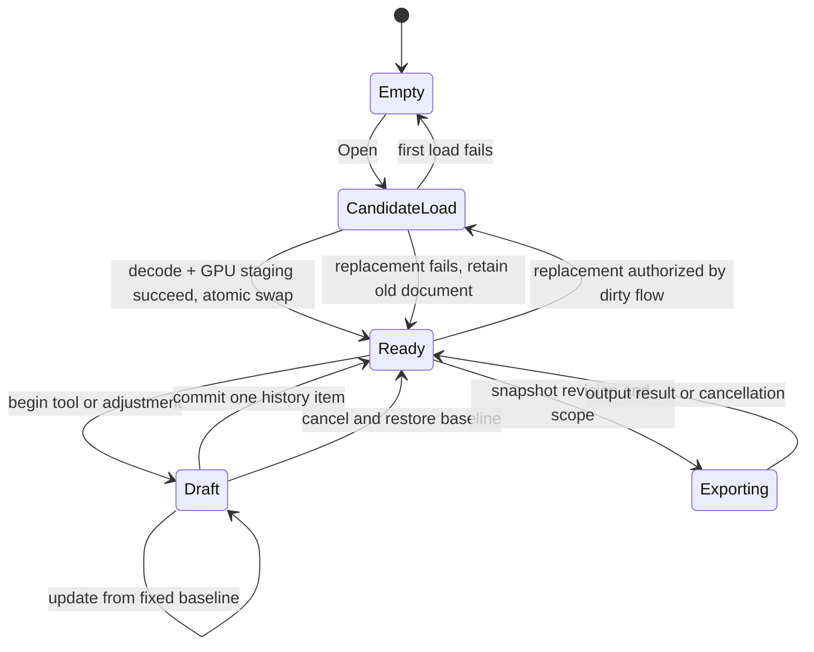

**Desktop version erratum:** the active committed target is SplatView 1.0.2 at `4e1be155511fb49f08fd8c863d785ac008a4c43a`. Earlier packet notes and immutable records retain their mistaken 1.0.4 labels; the [erratum](IMPLEMENTATION_STATUS.md#desktop-reference-version-erratum) preserves their exact source identities and bounded results.

### Current-source chrome implementation boundary

The active desktop target is **1.0.2** at `4e1be155511fb49f08fd8c863d785ac008a4c43a`. The retained native adapter uses the complete 785-leaf committed archive and original targets: ten generated projects, eight fresh code libraries and two loaded Basic/Pro observations with exact observed/unobserved RGBA-equality pairs. External codec/tool inputs remain separately identified. No native rebuild was required for this controller-only repair; historical R0 evidence stays under the erratum.

`SelectionMenus` serves both profiles: Basic has one full-width 44px Tool trigger, Pro retains Tool/Filter, and the real trigger carries all five selection tutorial targets. Both profiles share filter/transform/opacity cleanup. Tools follows Selection → Transform → Color in actual DOM order. Basic `TransformControls` provides Move/Rotate/Scale, Snap and Flip XYZ; local axes, pivot and numeric representations remain Pro. Basic gizmo drawing/picking uses world axes without changing the retained Pro preference. Dirty previews require explicit Apply/Cancel, a deliberate browser adaptation. Pro refinement spacing is 8px; Diameter uses 15px text, a 21px frame and a 6px label gap.

`queryMorphologyRange` owns metadata busy/work state but no longer clears an unrelated operation error when measurement starts. Two held-query cases independently cover successful measurement preserving the current error and failed measurement publishing its own error, with unchanged document/history and joined work release. The [new packet](docs/validation/README.md#current-desktop-chrome-20261016-02) has 5,601 passing CPU cases/165 files, typechecks/build, 60 production browser cases and one complete clean selected development run of 291 cases/24 files. Earlier partial/failed reports are retained without accepting their passing cases.

Fresh production browser captures precede detailed DOM/CDP observation and retain separate diagnostic after-observer images. Named full-bound comparison against the retained native captures measures 34/52 Basic and 43/65 Pro rows within a tolerance fixed at 0.5px; clipping remains separate. Basic headings are explicitly derived, Pro headings use native items, and twelve unlabeled numeric components remain unmapped. No matched scene pixels, full appearance or pivot-action equivalence is invented. The earlier packet removed 152 native intermediates (745,347,234 bytes); this requalification removed 16 cache files (2,811,209 bytes) after all owned processes joined. These are separate observed file-byte totals.

The committed source also requires Color/Fill Range and logarithmic Radius with same-pick amendments and sphere feedback (selection_ui.cpp:752-797,856-866; viewer_selection.cpp:107-181,547-564). Selection finish uses Check/Undo/X with finish-or-confirm, undo and clear semantics (selection_ui.cpp:545-620); transform finish uses Check/Undo/X with finish, undo-drag and cancel-session semantics (viewport_tools.cpp:412-453). These behaviors remain outstanding alongside the current tutorial target/order/copy and all eight localized control paths. Existing Basic gizmos and the current chrome results remain implemented within their recorded scope.

The retained web history limit is ten entries, still constrained by actual memory admission; current desktop defaults to 32 with a byte budget. Keep this explicit browser policy in recovery/history validation. Native Agent/loopback service controls are excluded from the browser-only scope alongside native companion integrations.

Pro Duplicate still requires real admitted native/GPU growth, coherent masks/history/topology and authenticated grown-state recovery before a working control. Preserve original-source authentication and qualify publication/refusal/cancellation/history independently. A successful Duplicate ends the prior alignment Reset baseline; the next alignment begins on the grown scene. Undo/Redo retains history frame metadata, and the immutable import binding remains unchanged. Pivot cycling, Range, three-button floating actions, current tutorial qualification, broader visual/assistive, retained-format/recovery, deployed HTTPS and measured operating budgets remain separate work. Cheap navigation/overlays/shader grading stay; expensive continuous variants remain optional. Mac hardware is optional.

### Independent KSPLAT input coverage

Thirteen original KSPLAT0.1 inputs now cover compression0/1/2, SH0-3, mixed-degree sections, reserved capacities and full/partial bucket traversal. Independent attribute and PLY-output oracles check every loaded source and fixed sampled IDs with numerical limits fixed before execution. Refused inputs retain edited native records, masks, output and executable Redo. Three ordinary production-page workflows open compressed inputs, reject a bad replacement, exercise Delete/Undo/Redo, inspect actual downloads and reopen PLY output.

[Qualification](docs/validation/README.md#ksplat-input-20261016-01) records 117 focused cases, 5,586 passing CPU cases in the full suite and nine production browser cases. Application, native and distribution bytes are unchanged; services joined and regenerable caches were removed. Current desktop authority is committed1.0.4; older R0 captures keep their historical scope. Broader SPZ/SOG/ordinary-PLY input variants, matched current-desktop visuals, recovery/HTTPS and measured limited-size operating budgets remain open. The implementation goal remains active.

### Desktop-aligned web interaction completion

Save/Download, Capture, Copy and Update Thumbnail now show a three-second successful-result state. Controller receipts follow the current document and real completion; failures, replacement and Close cannot publish stale success. Plain-control Escape returns focus to the viewport before a later scene Escape can cancel a tool. The Alignment menu owns outside presses and uses bounded 300 ms hover opening/dismissal with click pinning and keyboard access. Expensive scene previews remain omitted.

[Qualification](docs/validation/README.md#delivery-readiness-20261016-01) records 5,469 passing CPU cases and 148 browser cases against a fresh web build, including genuine downloads, atomic thumbnail storage and preserved native/GPU/history state. Native WASM bytes remain unchanged. Stale distribution assets and regenerable caches are removed; the README documents local build, limits, deployment and attribution. Available-browser evidence is the baseline; Mac/Safari/device checks are optional. Broader visual/assistive, format/recovery, HTTPS and measured operating-budget qualification remains open. The implementation goal remains active.

### Independent compressed PLY inputs

A deterministic 16-input packet now covers both packed chunk-bound layouts, both binary byte orders and SH0–3, including chunk-edge records and exact capped source membership. Independent bit readers and quaternion/covariance/SH math compare the actual shipping WASM decoder with fixed numerical bounds. Scoped PLY output is parsed independently. Refused opens preserve prior native attributes, masks, output and executable history; accepted edges follow their declared source policy.

[Qualification](docs/validation/README.md#compressed-ply-20261016-01) records 64 positive decoder executions, 110 focused cases and 5,447 passing CPU cases in the full suite. The fixture constructor is reproducible, and thresholds were fixed before execution. Application, native and distribution bytes are unchanged; caches are removed and shipping has zero stale files. These fixtures do not establish broad third-party interoperability, browser rendering or scene capacity. Broader visual/assistive, remaining format/recovery, HTTPS and measured limited-size operating budgets remain open. The implementation goal remains active.

### Saved-thumbnail opaque capture coverage

Actual Gaussian, point and mesh captures now check every pre-filter alpha byte across Black, Gray and White backgrounds. The saved-thumbnail workflow exercises a 1025-to-1024 resize, one PNG encode and atomic metadata/image storage, with unchanged native state and joined image ownership. [Qualification](docs/validation/README.md#capture-opacity-20261016-01) records 19 focused image CPU cases and 15 browser cases. Application, native and distribution bytes are unchanged from the Pro morphology build; caches were removed after the owned service joined.

The 14 retained arbitrary transparent-input WIC diagnostics remain a portable-filter limitation. They do not occur in these observed opaque capture workflows. Universal Fant, browser-encoder byte/color equality and wider visual/assistive, format/recovery, HTTPS and measured operating-budget acceptance remain open. The implementation goal remains active.

### Pro selection morphology; implementation in progress

Pro now exposes the desktop Grow/Shrink, Volume and Sigma strip with its full-width parameter row. Basic keeps refinement hidden; the Refine tutorial uses a presentation-only Pro layout. Volume compares Gaussian centers using the native reach, while Diameter displays twice that reach. Sigma retains ellipsoid contact and its half-step bounds. Method, raw reach and sigma are shared viewer-session preferences. Hover computation is omitted.

A read-only cooperative native task computes and caches the desktop scene-based range under bounded scratch ownership. It does not alter masks, scene data, dirty state, history or retained edit reset owners. Selection work retains current-view scope, atomic publication, cancellation and one-step Undo/Redo. Legacy sigma-only commands remain supported; the runtime requires morphology capability 2.

[Current qualification](docs/validation/README.md#pro-morphology-20261016-01) records 5,337 passing CPU cases, 230 selected browser cases and 26 actual native contract mains, plus the production build and TypeScript checks. Independent center-distance, range and history oracles cover this bounded feature.

Shipping contains 102 files and zero stale assets. Regenerable caches were removed after owned services joined; generated native binaries remain ignored by Git. The reference pins 30 committed desktop 1.0.4 source files. The earlier Gaussian view-modes item came from a different source state: this committed target has one Gaussian appearance path and no mode selector, cycle or preference. It is not an outstanding feature for this target.

Broader appearance/assistive, image/format/recovery, HTTPS and measured limited-size operating budgets remain open. The implementation goal remains active; Mac hardware is optional. No commit, push or deployment was performed.

### Current view only; implementation in progress

The desktop Frustum action now limits selection and selected edits to Gaussian centers inside the current camera frustum. Enabling clips the current selection once; orbit alone preserves it. Delete and crop use the live view, while selected color, transform and opacity sessions freeze their effective targets. Canonical selection and frozen GPU preview targets publish together. Undo/Redo, exports, Restore and whole-scene alignment retain their desktop scope.

[Current qualification](docs/validation/README.md#view-scope-20261016-01) records 5,282 passing CPU cases, 205 selected browser cases and 26 actual native contract mains, plus the production build and TypeScript checks. Native session/history/refusal contracts, independently expected actual-App membership and GPU oracle comparisons cover this bounded feature. Native recovery snapshots write internal codec version 2 with effective edit owners and retain reading of the prior internal version 1 layout.

Shipping contains 102 files and zero stale assets. Regenerable caches were removed after owned services joined; generated native binaries remain ignored by Git. The feature reference pins 20 committed desktop 1.0.4 source files.

Pro Volume/Sigma Grow/Shrink with Diameter and Gaussian view modes remain subsequent work. Broader appearance/assistive, image/format/recovery, HTTPS and measured limited-size operating budgets remain open. The implementation goal remains active; Mac hardware is optional. No commit, push or deployment was performed.

### SOG/SOGS admitted exports; implementation in progress

SOG and legacy SOGS now use native-derived admission and the owned download lifecycle. The frozen desktop quantizer, texture channels, metadata and ZIP serialization remain the complete-file byte oracle. Spatial ordering, SH palettes, RGBA textures, codebook scratch, metadata construction and WebP internal allocations have scoped lifetime grants. WebP receives an enforced aggregate workspace allowance, including live resize/clone overlap; it is a policy limit and can refuse an export. The worker encoder remains synchronous, with no mid-call cancellation guarantee. All nine formats now use the owned browser export path.

[Current qualification](docs/validation/README.md#sog-export-20261016-01) records 5,211 passing CPU cases, 120 selected browser cases and 24 actual native contract mains, plus the production build and TypeScript checks. Actual SOG/SOGS downloads are independently inspected and reopened, including nontrivial Selected/Remainder membership and executable Undo/Redo. The obsolete shipping filesystem-export fallback and its unreachable fault-injection main were replaced by direct codec/refusal contracts.

Shipping contains 102 files and zero stale assets. The pinned WebP notice is a reviewed public asset; [source attribution](docs/third-party/SOG_EXPORT_REFERENCES.md) identifies the exact allocation overlay and upstream notices. Regenerable caches were removed after owned services joined; generated native binaries remain ignored by Git.

The frozen 1.0.4 desktop source review still identifies Current view only scope, Pro Volume/Sigma Grow/Shrink with Diameter, and Gaussian view modes as subsequent work. Broader appearance/assistive, image/format/recovery, HTTPS and measured limited-size operating budgets remain open. The implementation goal remains active; Mac hardware is optional. No commit, push or deployment was performed.

### SPZ v3 admitted exports and current desktop review; implementation in progress

SPZ v3 now shares native-derived export admission and the owned download lifecycle with PLY, SPLAT, compressed PLY, KSPLAT, CSV and SPZ v4. The original desktop attribute packing and single-member gzip framing are preserved, including independent one-MiB raw-deflate blocks and an always-present final tail. Input staging, compressed blocks and zlib workspace have real lifetime grants and hard bounds; failed admission or response preparation preserves the prior output and Redo. The encoder remains synchronous inside the worker. SPZ v4 keeps its separate cooperative implementation and compatibility wrappers.

[Current qualification](docs/validation/README.md#spz3-export-20261016-01) records 5,130 passing CPU cases, 114 selected browser cases and 24 actual native contract mains, plus the production build and TypeScript checks. Native tests compare the complete gzip bytes against the frozen desktop writer across SH/scopes and block boundaries. Shipping has 101 files and zero stale assets. Regenerable caches were removed after owned services joined; generated native binaries remain ignored by Git.

The sibling desktop has advanced to 1.0.4. Its bounded frozen review identifies three retained-feature deltas for subsequent implementation: Current view only scope, Pro Volume/Sigma Grow/Shrink with Diameter, and Gaussian view modes. The existing parity ledger targets the earlier frozen desktop and does not prove these current behaviors. Expensive hover previews remain optional. The source review is recorded in the qualification; no current-desktop parity acceptance is claimed.

SOG/SOGS retain their legacy codec path. Complete WebP workspace and download ownership remain open, as do broader appearance/assistive, format/recovery, HTTPS and measured limited-size operating budgets. The implementation goal remains active. Mac hardware is optional. No commit, push or deployment was performed.

### Bounded attribute exports and clean build assets; implementation in progress

PLY, SPLAT, compressed PLY, KSPLAT and CSV now write directly into admitted native output buffers. Scoped masks and compressed-Ply ordering scratch have lifetime grants and a hard operation bound. Native workspace, the transferred buffer and the retained download Blob have separate credits. Format/scope plans are revision-bound, concurrent scoped plans coexist, cancellation joins its worker terminal, and failed encoding or response preparation preserves the prior output and executable Redo. Alignment replies preserve retained output accounting across Center, Scale, Plane, Floor and Reset. The desktop serializers remain the byte oracle.

[Current qualification](docs/validation/README.md#generic-export-20261016-01) records 5,089 passing CPU cases, 299 browser cases, 23 actual linked native contract mains, the production build and TypeScript checks. The attribute native main compares 120 complete outputs across five formats, SH0–3 and all three scopes through the direct sink and actual bindings, and exercises admission/backend/response refusal. Shipping has 101 files and zero stale assets. Regenerable Vite caches were removed after owned services joined.

Legacy SPZ v3 and SOG/SOGS keep their existing codec path; their complete native workspace and Blob accounting remain open. The five attribute writers are still synchronous inside the worker. These checks do not qualify physical memory, capacity, latency budgets, full desktop appearance or deployed HTTPS. The implementation goal remains active; Mac hardware is optional. No commit, push or deployment was performed.

# SplatView web implementation specification

### Desktop navigation return and repeated lifecycle observations; implementation in progress

Orbit/Look now follows the frozen desktop's return rule for manual selection tools: pressing the navigation control exits an active selection tool to Orbit, while cancelling an armed alignment action still enters Look. Cancelling an unfinished Polygon restores its selection baseline. Two actual-App Basic/Pro cases cover all seven manual tools, alignment cancellation, executable Redo and unchanged full-SH3 scene export. The existing worker, native editing operations and browser navigation policy remain authoritative.

The new bounded lifecycle collector observes 20 complete cycles in one production page, browser context and retained controller bridge, without reload or bridge replacement. Every cycle opens the pinned 256,000-record SH0 scene, selects and deletes the independently declared anchor, executes Undo/Redo, exports all visible records to SPLAT with explicit acknowledgement, downloads and independently decodes a JPEG capture, replaces the source and joins scene Close. Complete native mask artifacts, export membership and named pending-owner barriers accompany the raw records. This is a specific repeated lifecycle observation, not a general operating budget or measured scene-capacity guarantee.

[Current bounded validation](docs/validation/README.md#lifecycle-20261015-01) binds 8 passing production browser cases across 2 files, 10 passing development browser cases across 1 files and 151 focused CPU cases across 6 files. The qualification records the actual reports, source preimages and independently declared inventories; unit fixtures qualify collector consistency rules, not real performance. The camera screenshot helper excludes the canvas focus outline and separate brush-size hint DOM feedback from scene-pixel comparison. Polygon assertions check that active polygon geometry is cleared while permitting the intended hover cursor; scene-pixel, native-state and history checks remain intact. Product styling is unchanged, and the three earlier raw camera diagnostics, two actual camera probes and executed test preimages remain preserved. The raw retention report retains one page clock, logical-ledger observations, currently addressable native accounts and actual joined cleanup. These measurements do not represent physical JavaScript, process or GPU memory, and no latency, sustained-performance, full-matrix or capacity acceptance is claimed.

Generic non-SPZ4 export still has a known native-workspace and Blob ownership accounting gap. A zero logical ledger after joined Close does not prove that every export allocation was represented during its lifetime. Complete generic export accounting remains open; the separate explicit SPZ4 path and existing admission limits keep their original scope. This packet does not change arbitrary scene caps or close that gap through the repeated test alone.

The production build and both TypeScript checks pass. Shipping contains 101 files (97 runtime artifacts, 3 maps and its manifest), with zero stale assets. Cleanup removed 16 regenerable cache files (2,798,323 bytes), preserving source, fixtures, raw observations and reports. Owned local services and browser contexts have stopped and joined. No commit, push or deployment was performed.

The implementation goal remains active. Broader desktop appearance and assistive comparisons, remaining image/format/recovery behavior, deployed HTTPS, complete generic export ownership and measured limited-size operating budgets remain in the plan. Mac hardware is optional. Full appearance, release readiness, performance and capacity remain unaccepted.

### Sealed historical release-evidence validator and clean shipping assets; bounded local qualification

The reusable release contract, named JSON schema and CLI now join the exact application/native/deployment inventory to independently declared test cases, terminal outcomes, logs, reports, attachments and source applicability. Shipping checks recompute the application and deployment identities, verify every reviewed public asset against its deployed copy, and bind the full distribution including all three maps and its own manifest. Playwright project outputDir, command --output, terminal directory and complete output tree must agree. Exclusive output creation preserves previously written results.

The stable [capability inventory](docs/parity/capabilities-v1.csv) and [structured ledger](docs/parity/capabilities-v1.json) cover all 33 historical feature rows: 31 retained editor features, the optional separate WebGL viewer, and excluded native shell integration. Of 73 required evidence cells, the [current release-evidence packet](docs/validation/README.md#release-evidence-20261015-02) accepts two narrowly mapped checks: manual-tool feedback and actual clipboard confirmation/failure feedback. The other 71 cells remain pending. These mappings do not qualify broader native selection, image policy, desktop visuals, deployed hosting or capacity.

[Current tooling qualification](docs/validation/README.md#release-evidence-20261015-02) records 96 focused CPU cases across three files, both TypeScript checks, schema/ledger checks, and seven fresh local Chromium cases with five bound attachments. An independent Playwright collection pins the expected IDs/titles/projects. All 1,033 browser source/config/native/distribution files, including playwright.config.ts, match their before/after captures. Historical reports retain their original scope; they are not added to a new whole-editor acceptance total. The application, native publication and shipping distribution are unchanged from the preceding manual-feedback build.

The reusable genuine-offline fixture adapter remains pending until it binds source/native publication, authored patches, build commands and physical router artifacts to the applicable scene/build inputs. Its internal receipt checks cannot qualify an offline cell alone. Native, independent-format, visual, manual assistive and deployed-HTTPS adapters also remain pending. Standard Vitest JSON lacks observed retry/repeat diagnostics; no fields were added retrospectively. Benchmark JSON consistency does not establish a genuine collector, supported capacity or approved operating budget.

Build assets remain allowlisted: 87 reviewed public inputs, 97 runtime artifacts, three source maps and the manifest, totaling 101 distribution files with zero stale leaves. Regenerable caches are absent, the exact local service has stopped and joined, and all application service ports are closed. An initial cleanup removed caches before its accounting step failed; its diagnostic is preserved, and no removed byte/file total is claimed. The final clean-state and full distribution checks passed. The incomplete first assembly was moved to private diagnostics; current published evidence contains only the qualified packet and its inputs.

The implementation goal remains active. Independent format/visual tolerances, unresolved thumbnail precision, remaining browser/host recovery cases, genuine fixture applicability, assistive workflows, deployed HTTPS and real limited-size performance/history/retention measurements remain work. The 256-MiB unique-original and one-million loaded-preview caps remain admission policies. Dedicated Mac hardware is optional for this web app. This phase does not commit, push or deploy.

### Sealed historical manual selection feedback, genuine worker deadlines and observed-host policy; current implementation contract

A coalesced display-only overlay now shows the desktop tool operation colors, cursor/badges, brush radius, bounded trail and Rectangle/Polygon geometry; Volume uses the bounded 2D ellipse adapter. It performs no native/GPU queries or idle animation loop. Release-anchored Finish/Exit controls avoid viewer chrome and hide during physical canvas input, popups and tutorials. Finish closes a Polygon with at least three accepted vertices, or exits while preserving the last completed selection; Exit joins the existing cancellation path. Panel Close/Previous/Cancel share the existing accepted-vertex handlers, and actual fullscreenchange controls the translated fullscreen state. Clipboard writes still start synchronously from the trusted gesture; copyImage now returns completion after actual encode/write settlement and a current-source check. The UI shows its bounded success receipt only for a successful current operation and resets it on replacement or unmount. The seven real-App browser cases qualify this bounded workflow; broader paired desktop visuals and assistive validation remain open.

Two genuine worker timing cases now qualify the accepted-successor RELEASE deadline and foreign control isolation during a real held restore range. The deadline case waits for the worker’s unchanged 60-second control timer; a test observer suspends only its competing main-thread watchdog callback. The actual worker error after native cleanup reconstructs the already accepted successor once, preserving full SH3 data, GPU bytes, masks, all/selected/remainder exports and executable Undo/Redo, without rollback, duplicate commit, source reread or edit replay. Foreign recovery ID, request ID and operation-owner controls leave the same candidate intact before its authentic range is forwarded. The borrowed-WebCrypto host deadline and broader host/browser timing matrix remain separate work.

The benchmark validator adds a version2 contract for explicitly declared observed browser/host cells while preserving both version1 JSON schemas byte for byte. Its existing repetition, correctness-oracle, threshold and memory gates still apply; synthetic or pending diagnostics cannot become accepted observations, and v1/v2 packets cannot mix or silently downgrade. The original schema exporter/publication/check bind their unchanged production inputs; the separately recorded synthetic fixture-isolation repair is qualified by the final CPU suite, and a fresh schema check binds the final full source seal. These observations qualify this tooling contract only. No real performance measurement packet, approved operating budget, capacity acceptance or sustained-performance claim was created.

Fresh genuine A/B/C offline application builds and all 21 offline browser cases bind the current source, native publication and owned local fixture host. The fixture receipt binds each build, deployment/artifact inventory, service-worker router relationship and browser input receipt; host shutdown joins the observed process. This evidence covers the local HTTP fixture protocol and does not qualify a deployed HTTPS site.

[Current bounded manual-feedback qualification](docs/validation/README.md#manual-feedback-20261015-01) binds the fresh 158-module build, TypeScript checks, 4,444 CPU cases/135 files and 278 browser cases across disjoint accepted cohorts (manual 7/1, recovery 11/2, ui 238/16, shipping 1/1, offline 21/1; cases/specs). Each command, executed source seal, test input, genuine timing proof, offline fixture and cleanup receipt is hash bound. Native5/protocol24/UI-worker20/core ABI18/camera ABI4 remain unchanged. Explicit app.spec and polygon.spec oracle repairs check cleared active geometry while allowing the intended hover cursor, and await the coalesced first-point paint while the pointer remains held. Native selection, point and history assertions remain intact. Earlier build/CPU/schema and manual/recovery gates retain their exact original unexecuted overlay-test bytes; the final TypeScript check and broad UI rerun bind both repaired files. No product fix or rerun of the unchanged worker control timer is implied. Earlier diagnostic runs contribute no accepted cases; preserved historical qualification retains its original scope.

The reviewed public inventory remains 87 files, with 97 runtime artifacts, three maps and the manifest (101 distribution files), and zero stale assets or compiler intermediates. Joined local-service cleanup and the recorded removal of 16 regenerable Vite cache files/2,808,753 bytes leave no root TypeScript or tools bytecode cache. The existing allowlisted publication and Vite emptyOutDir policies remain unchanged. Native build and verification scripts retain Python -B; private validation/fixture assets stay outside shipping assets.

The overall implementation goal remains active. Remaining work includes the 14 additional WIC vertical-alpha differences and unresolved private precision, the remaining host/browser and borrowed-WebCrypto recovery timing matrix, qualified limited-size history/operation admission and repeated capacity/performance measurements, broader browser and image workflows, deployed HTTPS, paired desktop visuals and assistive validation. The 256-MiB unique-original and one-million loaded-preview caps remain admission policies. Mac hardware is not a prerequisite for this web app. This phase does not commit, push or deploy.

### Sealed historical Current desktop panels, WIC-derived thumbnails and recovery fault gates; current implementation contract

Selection Options now use the desktop tool-specific joined row: Live for Single; Visible/Edges/Live for Brush and Volume; Edges/Live for Rectangle and Polygon; Connected for Color; Visible/Edges for Fill. Toggles change preferences without creating an edit. Basic/Pro retain independent option preferences and scroll positions; Pro folding survives Tools hide/reopen and mode switches. Help opens the web About dialog with current version/build identity, feedback links, contained keyboard focus and Escape return.

Nine real-worker fault cases now qualify restore header/payload-copy corruption, mismatched source generation and compiled native-core binding, termination at the first held range, Close with the authentic cancellation terminal held, actual prepublication GPU loss and precommit checkpoint admission refusal. An 8,192-record SH3 case consumes the first genuine one-MiB range before termination at the second range; the first-range case claims prepared input only. Unpublished candidates never replace the accepted document. Failed candidates and held copies join retirement before credit returns; Retry preserves the accepted root, full native SH3 data, GPU bytes, masks, all/selected/remainder exports and executable Undo/Redo without source rereads or edit replay. A genuine precommit reservation refusal stops authority before external acceptance/commit and restores the predecessor including its existing Redo. Physical Worker.terminate uses the explicit ErrorEvent observation seam; corruption changes the genuine outgoing copy after reader verification, never the retained checkpoint.

The production thumbnail filter now matches all 17 preserved Windows WIC final fixtures, including the formula-generated 1025-to-1024 constant case. The WIC-derived general rule uses measured fractional-boundary redistribution, f32 accumulation, premultiplied alpha and a fixed16 reciprocal; identity crops preserve straight RGB. The raw crop, size clamp/no-upscale, opaque alpha, owned final PNG encode and atomic storage lifetimes remain qualified. Additional calibration matches 324 of 338 native measurements; 14 vertical alpha ramps remain unresolved. This bounded agreement does not establish complete Fant compatibility. Browser encoding, JPEG quantization, metadata, ICC behavior and cross-browser color transfer remain explicit adapters, with no encoded-byte identity claim.

[Current bounded desktop and recovery qualification](docs/validation/README.md#desktop-recovery-20261015-01) binds the fresh 157-module build, both TypeScript checks, 4,419 CPU cases/135 files and 277 browser cases across the disjoint accepted cohorts (development 15/2, ui 164/12, images 57/4, lifecycle 40/7, shipping 1/1; cases/specs). The canonical receipt binds each command, source seal, browser proof and native-thumbnail diagnostic. Native5/protocol24/UI-worker20/core ABI18/camera ABI4 remain unchanged. The earlier UI run remains diagnostic. Its three Volume assertions compared total ledger bytes despite legitimate checkpoint metadata changes; the corrected test oracle accounts for that exact recovery-credit delta and still requires every other entry, native/GPU data and history to match. This is a test-accounting correction, with no product leak fix claimed. Focused Volume verification is separate from the accepted broad UI rerun and is not counted twice. Historical broad native/tooling/offline evidence keeps its original scope.

The reviewed public input inventory remains 87 files. Deployment contains 97 current runtime artifacts, three maps and the manifest (101 files), with zero stale assets, compiler intermediates or Vite temporary files. Native build and verification scripts now invoke Python with -B so imports do not regenerate root bytecode caches. The existing Vite emptyOutDir and allowlisted publication policy remain unchanged; no extra public assets were added. Qualified cleanup joins local services and removes regenerable Vite cache files; the validation record and private diagnostics stay outside shipping assets.

The overall implementation goal remains active. Remaining work includes the 14 additional WIC vertical-alpha differences, the remaining recovery timing/host fault matrix including the native 60-second control timeout, a qualified history/operation admission envelope and repeated capacity/performance measurements, broader browser and image workflows, deployed HTTPS, matched desktop visuals and assistive validation. The 256-MiB unique-original and one-million loaded-preview caps remain admission policies. Mac hardware is not a prerequisite for this web app.

### Sealed historical Current owned raw image capture and transfer lifetimes; current implementation contract

Capture now owns raw RGBA pixels, GPU readback/scratch and encoded output separately. Row padding and BGRA targets are converted explicitly; captured camera, background, framebuffer and preview inputs are frozen before asynchronous allocation. Raw borrowers retain pixel credit through encoding, and GPU resources retain scratch credit through actual readback and submitted-work retirement. PNG and JPEG use checked browser MIME output; JPEG requests quality 0.95. Snapshot Download retains encoded ownership until its 60-second timer, pagehide or Close settlement. Copy calls the real clipboard.write synchronously in the trusted click with a pending PNG promise and joins both encoding and browser write settlement. Close, source replacement and device loss abort stale work and join pending tasks; allocation/URL reentry and late settlement cannot leave stale owners.

Saved thumbnails now crop the raw captured pixels directly, without encoding and decoding a full source PNG. The centered integer square crop clamps requested size to 1-1024, never upscales, uses a deterministic portable area filter and forces output alpha to 255. One final PNG encode remains owned through hashing, final-PNG storage validation and the atomic IndexedDB metadata/image transaction. Close cancels queued writes and preserves the previous complete pair. The validation decode consumes that final encoded thumbnail, rather than an intermediate source PNG.

[Current owned-image qualification](docs/validation/README.md#image-capture-20261015-01) binds the fresh 156-module build, 919-file source/native verification, both TypeScript checks and 4,416 CPU cases/135 files. Browser execution passes 147 cases across four disjoint cohorts: 12 new image cases/1 spec, 124 regression cases/8 specs, 10 lifecycle cases/3 specs and 1 emitted-production worker case/1 spec. Native5/protocol24/UI-worker20/core ABI18/camera ABI4 remain unchanged. The new cases inspect actual native/WebGPU PNG/JPEG pixels, trusted clipboard write/read, URL settlement, held allocation/readback/encoder/clipboard/IDB boundaries and joined Close. Earlier source-oracle failures remain preserved diagnostics; broad native/tooling/offline evidence retains its previous scope.

[Image implementation and source references](docs/third-party/IMAGE_CAPTURE_REFERENCES.md) retain 17 actual WIC fixture references. Ten portable-filter final fixtures match and seven filtered fixtures differ; native Fant byte parity is not qualified. The center-impulse result is 47 in the portable filter and 70 in the retained WIC output. Browser JPEG/PNG encoding, quantization, metadata and color-transfer behavior remain explicit adapters; encoded-byte identity with the desktop is not claimed.

Build output remains 97 current runtime artifacts, three current maps and the manifest (101 files), with no stale compiler intermediates or Vite temporary files. Two redundant large constant-fixture leaves (8,396,804 bytes) were removed; their source hashes and formula-generated reference remain preserved. The qualified cleanup records also bind joined local services and removal of regenerable Vite cache files.

The overall implementation goal remains active. Remaining work includes the seven Fant filter differences, broader image color/encoder and browser workflows, the recovery fault/timing matrix, qualified history/operation capacity and repeated performance measurements, deployed HTTPS, matched desktop visuals and assistive validation. The 256-MiB unique-original and one-million loaded-preview limits remain admission policies. Mac hardware is not a prerequisite for this web app.

### Sealed historical Current worker recovery under GPU-memory pressure; current implementation contract

When compatible native checkpoint import succeeds but replacement GPU coverage exceeds the available ledger credit, recovery now joins and retires the previous GPU mirror before retrying coverage once on that same imported candidate. The old GPU credit remains charged until its queue and borrowers join and its buffers are destroyed. The one-GiB ledger limit is unchanged; the fallback neither repeats native import nor replays edits or rereads the source. If credit is still insufficient, the accepted checkpoint remains available for explicit Retry or Close. Default-camera aspect uses the retained canvas when the old renderer has already retired. A retained, verified empty-startup worker keeps its genuine 32-MiB coverage; Close transfers that ownership without a duplicate reservation.

[Current bounded pressure-recovery validation](docs/validation/README.md#worker-pressure-20261015-01) binds a fresh 155-module build, source/native verification, both TypeScript checks and 4,394 CPU cases/133 files. Development passes 40 cases/7 specs: the prior 37 recovery cases plus 3 actual-worker ledger-pressure cases. The new cases verify delayed old-GPU retirement, same-candidate admission retry, retained-checkpoint Retry/Close and exact native SH3 scene, masks, exports and executable history. Separate graphics regression passes 6 cases/2 specs; emitted-production worker recovery passes 1 case/1 spec. Native5/protocol24/UI-worker20/core ABI18/camera ABI4 are unchanged. Native/tooling and broad offline evidence retains its historical source scope; those gates are not represented as rerun. Executed failures remain preserved diagnostics.

The current validation also records two separate local, quiescent one-million-record diagnostics: SH0 and SH3 both load, emit output and restore after real worker termination under the unchanged one-GiB ledger. These current observations supersede the earlier refusal for those two named configurations; the sealed older six-cell observation remains intact. Neither run establishes one-million-record retained-history capacity, arbitrary edits, physical memory limits, frame rate or a universal scene-size guarantee.

The full implementation goal remains active. Remaining work includes the W27a recovery fault/timing matrix, a qualified history/operation admission envelope and repeated capacity measurements; owned raw image capture, deterministic desktop thumbnail filtering and capture/download/clipboard output retirement; broader browser, deployed HTTPS, matched desktop visuals and assistive workflows. The 256-MiB unique-original and one-million loaded-preview caps remain admission policies. Mac hardware is not a prerequisite for this web app.

### Sealed historical Current applied-tool, history and transient worker recovery; current implementation contract

Actual worker recovery now qualifies applied color/transform/opacity Reset and unfinished-preview normalization, lost Undo/Redo acknowledgement windows, completed tolerance selection, discarded filter drafts and nonidentity alignment/default-camera roll lineage. The color regression applied 1.5 but preserved unfinished 1.75 after worker loss; reconstruction now publishes only the accepted grade. Physical Worker.terminate() is followed by the explicit ErrorEvent observation seam because termination itself emits no error event. No scene, native receipt or restored bytes are fabricated. The native checkpoint observer records the existing export fence while transform/opacity owners are active, and proves complete SH3 exports after clean owner end and during executable history.

[Current bounded worker-tool recovery validation](docs/validation/README.md#worker-tools-20261015-01) binds the fresh 155-module build, source/native verification, both TypeScript checks and 4,394 CPU cases/133 files. Development passes 37 cases/6 specs, including 17 new actual-worker cases (6 applied-tool, 8 history and 3 transient/alignment cases); 17 is a subset of 37. Separate graphics regression passes 6 cases/2 specs, and emitted-production worker recovery passes 1 case/1 spec. Native5/protocol24/UI-worker20/core ABI18/camera ABI4 are unchanged. Prior 91-case broad production, 21-case genuine offline/update, 22 native executables and tooling 75/76 with one declared skip remain historical unchanged-code evidence; those gates were not rerun for this application identity. Earlier executed failures remain diagnostics.

Separate [bounded local capacity observations](docs/validation/README.md#worker-capacity-20261015-01) record the following six input/configuration cells. These are local Chromium observations, with successful input loading and export separate from restoration admission.

| Loaded records | SH | Configuration | Observed recovery |
| --- | --- | --- | --- |
| 256,000 | 0 | Quiescent | Restored |
| 256,000 | 3 | Quiescent | Restored |
| 256,000 | 3 | One admitted full-scene history edit | Restored |
| 1,000,000 | 0 | Quiescent | Memory admission refused |
| 1,000,000 | 3 | Quiescent | Memory admission refused |
| 1,000,000 | 3 | Full-scene history edit attempted and refused; checkpoint remains quiescent | Memory admission refused |

The last cell does not establish retained-history capacity at one million records. The observations do not establish a general 256,000-record guarantee, arbitrary history depth, all SH/edit combinations or a safe one-million-record recovery envelope.

Full W27a remains open for the remaining recovery fault/timing matrix and a qualified recovery/export admission envelope. The 256 MiB unique-original and one-million loaded-preview limits are admission policies. Broader browser, deployed HTTPS, matched desktop visuals, assistive workflows and general measured performance/capacity remain separate plan work. Mac hardware is not a prerequisite for this web app. The overall implementation goal remains active.

### Sealed historical Current graphics retry after replacement-worker publication; current implementation contract

If the graphics device is lost while the previous scene is retired after a replacement worker has already published, Retry edit recovery now rebuilds graphics from that same healthy replacement worker. Previously this state retained native authority but had no unresolved edit token, leaving the retry action ineffective. The correction preserves the recovered document, source identity, exact SH3 data and selection masks, camera, Undo/Redo and saved-content baseline. It does not reconstruct another worker, reopen the source or replay an edit.

[Current bounded retry-correction validation](docs/validation/README.md#worker-retry-20261015-01) records a fresh production build with 155 transformed modules, source/native verification and both TypeScript checks, followed by 4,394 CPU cases/133 files. Fresh development browser coverage is 20 cases/3 specs: 12 live-worker reconciliation cases, 7 physical-worker termination cases and one post-publication graphics-loss/manual-retry regression. That regression destroys the actual published GPU device during old-scene retirement and verifies that manual retry retains the same new native worker while replacing graphics. Physical-worker scenarios retain the explicit ErrorEvent observation seam because Worker.terminate() itself emits no error event. The original failing regression and its exact sources remain diagnostics.

Fresh shipping checks cover 1 emitted-worker/native SH3 recovery case/1 spec and 2 literal root/project offline-emulation checks against this deployment. These are the current-build browser scopes. [Predecessor evidence](docs/validation/README.md#worker-recovery-20261015-01) for 22 native contract mains, tooling 75/76 with 1 skipped, build policy 39, broad production 91/5 and genuine offline/update 21/1 is inherited across verified unchanged native/tooling and corresponding workflow code. Those broad gates were not rerun for the new application identity. Their counts remain separate from the fresh checks.

Native ABI18/protocol24/UI-worker20/camera ABI4 and all five native publications are unchanged. The current deployment contains 97 runtime artifacts, 3 current maps and the manifest (101 files), with no stale assets, compiler intermediates or Vite temporary files. The previous cohort's obsolete bundles are retired; qualification evidence remains outside deployment. No native recompilation or new compiler cleanup is claimed for this correction.

Full W27a remains open for actual-death applied-tool Reset/normalization cases, lost Undo/Redo acknowledgement windows, the complete recovery fault matrix and recovery/export envelope measurements at 256,000 and one million loaded records. Deployed HTTPS, broader browser/assistive workflows, matched desktop visuals and measured performance/capacity remain separate plan work. The 256 MiB unique-original and one-million loaded-preview limits are admission policies, not measured recovery capacity. Mac hardware is not a prerequisite for this web app.

### Sealed historical Current authoritative-worker recovery with external commit decisions; current implementation contract

The running web app now owns an admitted exact checkpoint outside its authoritative document worker and can restore it into a fresh verified compatible worker. An accepted external decision before native commit dispatch is the linearization boundary: interruption before that decision restores the predecessor; interruption after it restores the accepted successor exactly once. The edit is not replayed, and restoration does not fabricate a receipt from the terminated native worker. Source/core/member-subset identity, the exact native scene/mask graph, executable Undo/Redo and the matching browser metadata remain bound to the checkpoint.

Transport uses bounded one-MiB chunks, separate retained/transfer credits and explicit joins before memory is returned. Replacement workers pass the existing build/native verification gates. The main-thread saved-content baseline, current/default cameras and alignment roll lineage remain owned through recovery; compatible published navigation can be retained only for the captured alignment branch. Applied color/transform/opacity metadata and native Reset bases are implemented, while unfinished previews are deliberately discarded under the checkpoint normalization policy. Their broader recovery fault coverage remains open below.

[Current bounded worker-recovery validation](docs/validation/README.md#worker-recovery-20261015-01) records 4,394 CPU cases/133 files, including 24 native-checkpoint cases; focused counts overlap the CPU total and are not additive. All 22 linked native contract mains execute. Tooling records 75 passed/76 total with 1 skipped, and build policy passes 39. Browser qualification records 19 recovery cases/2 specs: 7 actual authoritative-worker termination cases and 12 separate live-worker operation-reconciliation cases. Production regression passes 91 cases/5 specs; genuine offline/update fixtures pass 21 cases/1 spec, and 2 separate literal shipping root/project offline checks pass. These scopes remain distinct. Earlier executed failures remain diagnostics.

Each of the 7 actual-death scenarios terminates the real authoritative worker. Because Worker.terminate() emits no error event, the harness separately injects an explicit ErrorEvent through the owned worker wrapper to exercise the app's observable fatal-error path. The event seam does not replace the terminated worker's native output or the restored checkpoint bytes. These bounded local Chromium observations establish the named scenarios only; they do not qualify every fault window or tool session.

The current build transforms 155 modules and passes source/native verification and both TypeScript checks. Native ABI18/protocol24/UI-worker20/camera ABI4 requires recoveryCheckpoint:1. Cleanup removes 193 compiler intermediates/34,523,791 bytes. Deployment contains 97 runtime artifacts, 3 current source maps and the manifest (101 files), with no stale assets, compiler intermediates or Vite temporary files. Qualification evidence stays outside deployment.

Full W27a remains open: actual-death applied-tool Reset and normalization coverage, lost Undo/Redo acknowledgement windows, the complete recovery fault matrix and recovery/export envelope measurements at 256,000 and one million loaded records still need qualification. Deployed HTTPS, broader browser/assistive workflows, matched desktop visuals and measured performance/capacity remain separate plan work. The 256 MiB unique-original and one-million loaded-preview limits remain admission policies, not measured recovery capacity. Mac hardware is not a prerequisite for this web app.

### Sealed historical Current exact native checkpoint and external-store foundations; current implementation contract

W27 now has a qualified native checkpoint foundation. The explicit codec preserves complete CPU scene records and metadata, shared scene/mask owners, ordered native Undo/Redo, content and identity high-water marks, alignment lineage and Reset baselines, and applied absolute color/transform/opacity session bases. It cancels unfinished selection/filter drafts in a private projection and omits pending native color jobs while retaining the applied native scene. An outer transaction exports its current tentative graph; capture does not decide which snapshot is committed. The live document remains unchanged. Export streams bounded chunks from a locked graph; import validates and admits the whole candidate before publishing it atomically.

The external store retains immutable prepared and accepted checkpoint ownership, binds source, core and member-subset identities, and verifies header, payload, chunk and root digests. Retained and transfer memory receive independent credits; cancellation joins read/hash/lease retirement before ownership releases. These are codec and storage foundations. The running app does not yet coordinate an external precommit decision or automatically reconstruct a terminated authoritative worker.

[Current bounded foundation validation](docs/validation/README.md#recovery-20261015-01) records 4,243 CPU cases/128 files, including 24 actual native-checkpoint cases/one file and 117 external-store/hash cases. Those focused counts overlap the CPU total and are not additive. All 22 linked native contract mains execute. Tooling passes 44 cases and build policy passes 39. Browser regression passes 90 production cases/four specs and 21 offline/update cases/one spec; two separate literal shipping root/project offline checks also pass. These browser observations preserve existing workflows; they do not exercise authoritative-worker termination and reconstruction. Earlier failed attempts remain diagnostics.

The current build transforms 150 modules and passes source/native verification and both TypeScript checks. Native ABI18/protocol23/UI-worker19/camera ABI4 requires recoveryCheckpoint:1. Cleanup removes 193 compiler intermediates/34,523,791 bytes. Deployment contains 97 runtime artifacts, three current source maps and the manifest (101 files), with no stale assets, compiler intermediates or Vite temporary files. Qualification evidence stays outside deployment.

W27a remains open: worker/client protocol, precommit external decision coordination, matching browser alignment metadata, fresh verified-worker reconstruction and actual termination fault tests still need implementation and qualification. Recovery measurements at declared limits, deployed HTTPS, broader browser/assistive workflows, matched desktop visuals and measured performance/capacity remain separate work. The native workspace case covers 20,000 loaded records only. The 256 MiB unique-original and one-million loaded-preview limits remain admission policies, not measured capacity. Mac hardware is not a prerequisite for this web app.

### Sealed historical Current application cache and explicit updates; current implementation contract

W26 now stores a complete, verified application cohort: 97 runtime artifacts plus the exact manifest, 98 application URLs in total. A generic service worker stages a unique cache, verifies the manifest and every asset, reads the cache back, then atomically publishes its identity and preferred version in IndexedDB. Root and project-subpath scopes use separate metadata and caches. Scene files are excluded; W13 saved views and thumbnails retain their separate metadata policy.

Each live tab keeps its verified deployment and document owners. Durable client pins route fixed native URLs to that tab's cohort; a missing or evicted asset fails coherently instead of fetching a different build. The adapter does not call skipWaiting or clients.claim and does not automatically reload the app. A naturally activated compatible generic router can rebind an uncontrolled tab while its native worker, scene, masks, exact export and executable Undo/Redo remain owned by the original app.

An offered update uses the existing Save/Discard/Stay boundary. Save requires acknowledgement of matching whole-scene output; Selected output does not authorize replacement. A durable one-use navigation ticket fixes the chosen target even if another tab publishes a later version. Lost acknowledgements retry the same request identity; cancellation and consumption retain terminal receipts. A narrow unload permission lasts until browser navigation commits or is stopped.

Interrupted, corrupt or quota-refused staging leaves the older complete cohort usable. Cache retirement keeps live pins, stable offers, pending targets and two complete fallbacks; unknown or unresponsive owners defer physical-cache deletion. Restarted routers reconcile actual clients, and cancelled destinations retire only after positive closure evidence. Explicit checks can repair missing metadata using the same verified live identity, then offer a separately complete newer build.

This application-cache, client-pin and ticket logic is authored for SplatView. Browser lifecycle and client ownership use the [Service Workers specification](https://w3c.github.io/ServiceWorker/). Cached asset responses retain their original URL, consistent with [FetchEvent.respondWith](https://developer.mozilla.org/en-US/docs/Web/API/FetchEvent/respondWith). Reserved-client closure uses the [clients.get lifecycle](https://w3c.github.io/ServiceWorker/#clients-get), which waits for the client to become ready or be discarded. Where available, update navigation waits for the committed promise documented by [Navigation.navigate](https://developer.mozilla.org/en-US/docs/Web/API/Navigation/navigate); the legacy path waits for pagehide and actively stops an uncommitted transition at its deadline. These are API references, not claims of copied implementation code.

[Current bounded W26 validation](docs/validation/README.md#offline-20261015-01) records a source-bound local Windows Chromium qualification: 4,102 CPU cases/125 files, 39 build-policy cases, 90 production cases/four specs, two literal shipping root/project offline-emulation checks and 21 new browser scenarios/one spec. The selected final browser observations have zero failures, skips, retries or flakes. The 21 scenarios include actual host-wide outages returning 503 for all 98 application URLs. Those genuine fixture cohorts use the same shipping logic with captured comment/UI-identity variants; their provenance remains distinct from the literal shipping checks. These scopes overlap and remain separate. The production compatibility suite keeps its distinct sealed historical native fixtures. Earlier failed attempts remain diagnostics and contribute no cases to the selected final browser pass. The named test-oracle amendments preserve shipping application, native and runtime bytes. The current build transforms 150 modules and passes source/native verification and both TypeScript checks. Native ABI17/protocol23/UI-worker19/camera ABI4 and all five native publications are unchanged. Deployment contains 97 runtime artifacts, three current source maps and the manifest (101 files), with no stale assets, compiler intermediates or Vite temporary files. The 87-file public inventory remains exact; qualification evidence stays outside deployment.

This qualifies the named local Chromium workflows, including literal shipping root/project offline-emulation checks; it does not accept a deployed HTTPS host. Real root/subpath headers, MIME, CSP and offline/update behavior still require the separately planned `docs/validation/offline-update.json`. W27a reconstruction after actual authoritative-worker death remains open: it requires an admitted exact external checkpoint/journal, compatible source/core identity and committed Undo/Redo. Broader browser and assistive-technology workflows, matched desktop visuals and measured performance/capacity remain open. Mac hardware is not a prerequisite for this web app. The 256 MiB unique-original and one-million loaded-preview limits remain admission policies, not measured device capacity.

### Sealed historical Current build asset hygiene; exact public inventory

The build now requires exact membership in `tools/public-assets.json` for the 87 published non-native assets. Unlisted compiler objects, temporary files, obsolete scripts/icons and source maps fail before publication; a missing listed file also fails. Intentional asset additions or removals update the list and the corresponding `public/` files together. The five native publications remain independently verified.

[Bounded asset-hygiene validation](docs/validation/README.md#hygiene-20261015-01) records a clean production build, 32 passing build-policy cases and 90 passing production browser cases across four specs. The rebuild retires the four preceding script/map files and leaves 96 runtime artifacts, two current maps and the manifest (99 files), with no compiler or Vite temporary leftovers. Validation evidence stays outside deployment. Native ABI17/protocol23/UI-worker19/camera ABI4 bytes are unchanged; these checks do not claim a new native build or a full development-suite rerun.

### Sealed historical Live-worker edit outcomes and committed graphics recovery; current implementation contract

Edits now allocate a document, source-generation and client-generation scoped operation identity before native begin. A fixed native ledger retains active ownership and a bounded terminal receipt. Commit or rollback records its exact before/terminal revision, draft, pending-selection and retained-map state without allocation before releasing the checkpoint or publishing JSON. Explicit receipt retirement precedes a new operation. A fresh status can seal proven not-started and fence a delayed begin; expired or conflicting identities never become not-started proof.

A lost acknowledgement retains the controller continuation, prepared GPU candidate and admitted history, work and map owners. Status uses independent client transport while preserving serial worker execution. The mutation is never replayed. An active owner receives its own rollback; a proven commit installs the already prepared result once. Late or duplicate retired responses cannot publish again. Unknown outcomes block competing edits, source replacement, selection/maps, export and capture while preserving the last coherent mirror. One bounded automatic check can be followed by the explicit Retry edit status action.

A known committed edit survives device loss or refused GPU mask publication. Its validated native receipt is retained while graphics rebuilds from that same live authority. A lost retirement acknowledgement is reconciled before graphics recovery joins the retained edit lifetime. This preserves the distinction between an unresolved edit, an acknowledged rollback and a committed edit awaiting graphics. Genuine worker/native/GPU fault fixtures cover lost begin/commit/rollback/status/retirement responses, late duplicates, not-delivered commands, no-op/selection-only edits and Undo/Redo. [Operation recovery references](docs/third-party/OPERATION_RECOVERY_REFERENCES.md) record the authored browser adapter and retained desktop edit/history authority.

`native/wasm/operation_receipt.hpp` owns fixed receipt storage; `bindings.cpp` validates identified lifecycle and mutation commands before the existing desktop operations. `src/document/operationProtocol.ts` validates exact owners and snapshots. `CoreClient` parks the ordinary continuation behind bounded acknowledgement settlement and independent reconciliation, retaining the authoritative worker. The controller retires its operation after publication and resource cleanup. Worker controls carry the same owner through stream acknowledgements and cancellation. UI state distinguishes unresolved edit status from proven commit with unavailable graphics.

[Current bounded W04 validation](docs/validation/README.md#reconciliation-20261015-01) records 4,021 CPU cases/121 files, 12/1 focused browser cases/files and 90/4 shipped production cases/files, alongside the disjoint affected workflow coverage described below. These scopes overlap and remain separate. The original 520/25 affected process remains failed (518 passed, 2 failed). Qualified affected coverage is disjoint: 430/24 passing cases/files from its unchanged non-queue specs plus a fresh entire-queue 90/1 pass, covering 520/25 together. All original queue cases are excluded from the retained component. No single passing aggregate process is claimed. Two source corrections change only the queue alert assertion literal and current runtime identity expectations in one production compatibility test; its sealed old-core fixture, hashes and capability refusal remain intact. Application, native, generated, distribution and every other captured test input remain byte-identical. CPU and focused observations are reused only across those proven unrelated test expectation changes; retained affected and fresh queue coverage is also unchanged by the separate production expectation correction. The focused, retained non-queue, replacement queue and production components have zero failures, skips, retries or flakes. Their named coverage does not establish a full development-suite rerun. The original production attempt remains a failed diagnostic; the fresh full production pass supplies all current production qualification. All 22 linked native contract mains execute, including 20 operation-receipt cases/182 checks with 2 post-proof terminal publication refusals and 2 preparation refusals. The web build passes source/native verification and both TypeScript checks, transforming 144 modules. Native ABI17/protocol23/UI-worker19/camera ABI4 requires transactionReceipt:1. Deployable output contains 96 runtime artifacts, 2 current source maps and its manifest (99 files), with zero stale files, compiler intermediates or temporary Vite configurations. Cleanup removes 192 compiler artifacts/33,822,197 bytes while retaining qualification evidence outside deployment. Other earlier failed observations remain diagnostic history; only the authenticated non-queue component above contributes retained coverage.

W27a reconstruction of an actually terminated authoritative worker remains open: an admitted exact external snapshot/journal, source/core compatibility and committed Undo/Redo are required before reconstruction can be claimed. A live-worker receipt or a GPU copy cannot replace that material. W26 offline/update behavior, deployed-host acceptance, matched desktop visual acceptance, broader declared-browser/assistive workflows and measured performance/capacity also remain open. The 256 MiB unique-original input and one-million loaded-preview limits remain admission policies, not measured device capacity. Mac hardware is not a prerequisite for this web app; no Mac/Safari, physical trackpad or assistive-technology execution is inferred.

### Sealed historical Scene announcements, keyboard access and browser zoom; current implementation contract

The scene canvas now has localized instructions and a persistent polite, atomic status region. Stable current source, selected/visible counts, Basic/Pro mode and active tool or navigation are debounced by 150 ms and deduplicated. Combine is included for applicable selection tools. Held gestures and live previews retain the previous message; released Color/Fill work has a stable pending phase. Loading and recovery describe the current phase without claiming a successful replacement or edit. Existing alerts and dialog-owned status clear the scene message. The instructions and status copy have all eight supported locale paths.

Keyboard focus has a visible canvas ring. Faded toolbar, Tools, collection arrows and brand controls are inert and hidden from the accessibility tree; Tab reveals them synchronously before native focus traversal, and focused controls or open menus/dialogs retain visible chrome. Physical keyboard/pointer modality controls idle fading. Deferred scene replay retains its captured gesture operation without overwriting the currently held physical selection modifiers.

Compact reflow wraps desktop controls and scrolls their owning toolbar, Tools, menu or dialog. The focused browser fixtures use actual Chrome tabs.setZoom/getZoom at 100%, 200% and 400%, recording CSS viewport size, device pixel ratio and visual viewport scale. The named cases traverse toolbar/Settings, Pro selection and Presets menus, Save/Unsaved dialogs and Tutorial targets, including Large font cases, while retaining exact edited native data and executable Redo. The zoom extension is a test fixture outside deployment. Design references and the limits of these checks are recorded in the [accessibility references](docs/third-party/ACCESSIBILITY_REFERENCES.md).

`src/app/sceneAnnouncements.ts` derives neutral current-state descriptions without browser or controller side effects. `src/ui/SceneAccessibility.tsx` owns the persistent region, transient-message hold, immediate clear and delayed update. `src/ui/App.tsx` binds the stable canvas description, physical modifier state and hidden-control ownership. Compact CSS keeps each scroll owner local. The actual tab-zoom fixture records its browser API observations separately from product runtime assets.

[Current bounded validation](docs/validation/README.md#accessibility-20261015-01) records 3,893 CPU cases/119 files, 16/2 focused browser cases/files and 90/4 shipped production cases/files. Affected coverage is 286/17 affected cases/files qualified from disjoint parts: 280/16 passed cases/files from unchanged specs in the failed original observation, plus 6/1 passed cases/files in the complete fresh app-spec rerun. The original affected process remains failed with its exit code and report retained; all six app-spec cases are excluded from that observation. Only its unchanged selected specs are reused, and every selected case passed. The focused, production and fresh app-spec runs have zero failures, skips, retries or flakes. The exact test-only correction changes the hidden Tools pointer-events assertion to a DOM locator while preserving the later role-based wake, click and visibility checks. Application, native, generated build, distribution and every other test source remain byte-identical across this correction, including the reused CPU and focus inputs. The disjoint affected parts do not represent a single passing aggregate process or report. Other observed scopes overlap and remain separate; named development subsets do not establish a complete development-suite rerun. A separate 28-case build-policy observation remains supplemental. The web build passes source/native verification and both TypeScript checks, transforming 142 modules. Deployable output has 96 runtime artifacts, two current source maps and the manifest (99 files), with zero stale files, compiler intermediates or temporary Vite configurations. Native ABI16/protocol22/UI-worker18/camera ABI4 artifacts are unchanged; no native rebuild or standalone C++ test rerun was performed. Earlier failed build/browser observations remain immutable diagnostics; acceptance uses only the explicitly source-bound observations and disjoint selection described here.

Remaining acceptance includes broader keyboard and accessibility workflows, nonvisual exploration of arbitrary 3D geometry, matched desktop visuals, deployed-host/offline behavior and measured performance/capacity. Automated DOM, accessibility-tree and keyboard checks do not establish observed screen-reader speech or full WCAG conformance. F6 remains browser navigation. Mac hardware is not a prerequisite for this web delivery; no Mac/Safari, physical trackpad or assistive-technology execution is inferred. The 256 MiB unique-original input and one-million loaded-preview limits remain admission policies.

### Sealed historical Deferred scene input and popup ownership; current implementation contract

Scene selection presses admitted during genuine color processing now retain an ordered physical input stream instead of disappearing behind the busy state. The browser bounds it to 32 unreplayed presses and 65,536 event records, preserves every accepted motion record, and yields after each 512 replayed records. A press snapshots Combine, selection options, Brush/Volume radius and Color/Fill tolerance. Replay joins the original grading operation and color-session settlement, then applies accepted work in FIFO order against successive committed baselines, preserving native Undo/Redo ownership.

The owner is bound to its source/document generation, camera, renderer, dimensions and viewport bounds. Focus transfer, capture loss, cancellation, hiding, popups, source replacement and invalidating work retire it. Expected release of an earlier physical capture does not cancel a newer held press. Native mouse-down click counts remain available to Polygon, and a healthy live Single rollback can restore its baseline without dropping its physical reentry or later accepted records. Explicit Apply and explicit Auto remain the browser grading workflow; later grading changes are fenced while deferred input owns the scene. This does not add the desktop's separate 32-color-action queue or change the existing independent 1,024-request released Color/Fill FIFO.

Selection and Auto/Presets portals now retain outside-press ownership through primary click, physical right contextmenu and middle/right auxclick, including both sibling events when one right press emits both. A physical contextmenu with detail zero remains owned; keyboard clicks, ContextMenu and Shift+F10 retain independent activation. Fresh presses and lifecycle retirement release the previous owner. The actual underlying Tolerance editor, native/GPU state and executable Redo have independent browser oracles. Behavior and bounded browser adaptations are documented in the [deferred input source references](docs/third-party/DEFERRED_INPUT_REFERENCES.md).

`src/input/deferredPointer.ts` owns the bounded FIFO without motion coalescing. `src/ui/App.tsx` captures scalar event/options snapshots, preserves compatibility mouse-down click counts, separates physical capture from replay, and awaits selection release/rollback before advancing. `src/app/controller.ts` retains the original color operation, liveness checks and fixed work lease; later color updates remain fenced. `src/ui/menuPress.ts` and both popup components keep each outside physical activation owned through portal dismissal and retire ownership for explicit keyboard context requests.

[Current bounded validation](docs/validation/README.md#deferred-input-20261015-01) records 3,826 CPU cases/118 files, 23/2 focused browser cases/files, 215/9 affected workflow cases/files and 90/4 shipped production cases/files. These observed counts overlap and remain separate. The qualifying browser cohorts have zero failures, skips, retries or flakes. Development browser coverage is a set of named subsets; no complete development-suite rerun is claimed. The web build passes source/native verification and both TypeScript checks, transforming 138 modules. Deployable output has 96 runtime artifacts, two current source maps and the manifest (99 files), with zero stale files, compiler intermediates or temporary Vite configurations. Native artifacts and ABI16/protocol22/UI-worker18/camera ABI4 remain unchanged; no native rebuild or standalone C++ test rerun was performed.

The canonical receipt retains failed observations and their immutable source/report/trace phases separately, including the [earlier source phase](.build/deferred-tests/capture-04.json). Its final correction changes only [e2e/deferred-grade.spec.ts](e2e/deferred-grade.spec.ts): a cancelled Single may stop before native beginSelection, and a Polygon finalization fallback may restore and rebegin its original baseline. Neither branch requires a spurious intermediate command. A separate held-pointer case forces a genuine native preview before moving through the rollback boundary. Application, CPU and affected workflow input bytes remain unchanged across this test-only phase. Current qualifying counts come from the current receipt, without adding passing subtotals from earlier failed observations.

Remaining work includes announcements, broader keyboard access and 200/400% zoom/accessibility acceptance, matched desktop visual acceptance, deployed-host/offline behavior and measured performance/capacity acceptance. F6 remains browser navigation. The 256 MiB unique-original input and one-million loaded-preview limits remain admission policies. Mac hardware is not a prerequisite for delivery of this web app; no Mac/Safari, physical trackpad or assistive-technology execution is inferred.

### Sealed historical Desktop interaction parity; current implementation contract

Plain first-press T now saves the thumbnail and default view through the existing toolbar operation. It requires a focused, ready scene and the same availability checks as the button, with repeat and pointer-capture exclusion. Ctrl/Cmd+T stays browser-owned. Actual IndexedDB metadata and PNG checks cover Reset, renamed reopening and reload; native records, masks and executable Redo remain preserved.

Wheel follows the hovered canvas independently of keyboard focus. Ctrl/Meta-wheel remains unprevented for browser zoom; fresh tutorial/modal/menu state precedes both camera motion and Alt Brush/Volume sizing. Empty, invalid and already-handled deltas do no scene work. Local scroll containment preserves panel and popup scrolling at their edges. The output-acknowledgement click-through area can no longer resize a brush behind its receipt.

Auto/Presets now use 300ms hover-open and away-close timing, directional bridge traversal, click pin/unpin, same-hover suppression, grouped switching and bounded retirement. Hover preserves canvas focus and performs no color analysis, scene bake or history operation. Deadline timers stop when an open menu is idle. Keyboard navigation reveals the active Pro preset within its own scrolling popup. A shared primary-click guard prevents the dismissing outside press from also activating an underlying control; a fresh press and keyboard activation remain available. Selection menus also clear dismissal suppression after an outside-trigger choice, permitting the next genuine hover.

The behavior follows the [captured desktop interaction sources](docs/third-party/INTERACTION_REFERENCES.md). Native camera, color, persistence and export logic remain unchanged; explicit Apply remains the browser grading workflow.

`src/input/inputScope.ts` admits T without consuming it until App checks availability. `src/input/wheel.ts` keeps pointer ownership separate from keyboard focus. `src/ui/colorMenuInteraction.ts` supplies the pure timer/pin/suppression state, and `src/ui/menuPress.ts` tracks primary-click ownership through portal dismissal. Menu pending-hover scroll snapshots ignore already-completed ancestor scroll events while retiring on subsequent actual movement. The 40-row keyboard path scrolls its portal without moving the Tools anchor or accepting a stationary pointer as a new choice.

[Current bounded validation](docs/validation/README.md#interactions-20261015-01) records 3,794 CPU cases/117 files, 21/3 focused browser cases/files, 107/9 affected workflow cases/files and 90/4 production cases/files, counted separately. The qualifying cohorts pass without failures, skips, retries or flakes. These development cohorts are named subsets; the previous full-suite result retains its earlier source scope. The web build passes source/native verification and both TypeScript checks, transforming 137 modules.

Focused tests distinguish passive hover from intentionally replayed Redo/Undo (the latter advances the native revision twice). Saved camera comparisons normalize only JSON signed zero; every nonzero pose value remains exact. DOM Ctrl/Meta-wheel observations establish event admission, while ordinary mouse-wheel easing and Tools edge/middle scrolling have independent browser paths. Physical trackpad/Safari execution is not inferred. Native ABI16/protocol22/UI-worker18/camera ABI4 remains inherited without a native rebuild or main rerun.

Remaining work includes selection presses during an active grading bake, announcements and broader keyboard/zoom accessibility, non-primary popup context-menu/auxiliary-click ownership, matched desktop visual acceptance, deployed-host/offline behavior and performance/capacity acceptance. F6 remains browser navigation. The 256 MiB unique-original input and one-million loaded-preview limits remain admission policies. Mac hardware is not a prerequisite for browser delivery.

### Sealed historical W25 Input scope; current qualified contract

The stable [App input ledger](src/ui/App.tsx) and [input-scope policy](src/input/inputScope.ts) place Tutorial, current store modal state, registered menus, composition/editable fields and other UI focus before scene shortcuts. Scene key admission checks target and actual focus; physical key ownership and quarantine prevent late or repeated held keys from restarting scene actions after UI takes ownership. Scene and its captured gesture retain modifier continuity. Blur/hidden reset the ledger and native navigation/modifiers. Open/Save retain their admitted application scope; browser Find/zoom and UI text Copy retain browser ownership. Canvas image Copy and plain G keep their existing focused-scene boundaries.

[Shared dialog focus](src/ui/useDialogFocus.ts) gives Save and Unsaved changes initial focus, forward/reverse Tab containment, Escape semantics and usable return targets. A real download transfers focus to the kept-file acknowledgment; dismissal and acknowledgment preserve the existing dirty/pending navigation policy. The receipt describes a browser handoff, not a completed disk save. Hover-open menus notify App synchronously even while canvas retains focus. Tutorial keeps separate owned keys and drains them on real window blur.

Actual focused cases cover Basic/Pro UI denial with real canvas Undo/Redo, Save and Unsaved keyboard containment/return, download and output acknowledgment paths, held W cancellation across hover-open menus, trusted native Copy of selected help text, and Tutorial Shift through an actual outside-window release and return. Source-bound assertions compare native/GPU records and masks, revisions, source/document/history and camera movement where applicable. The independent shipped Save case verifies the worker command stream stays unchanged under UI/modal shortcuts, then exercises retained native Redo/Undo and exported bytes. Full development retains Tutorial, Language, Guides, Theme and grading/opacity regression coverage.

The [input source notice](docs/third-party/INPUT_SCOPE_REFERENCES.md) binds six exact captured native keyboard sources, the capture manifest and proprietary OpsiClear notice, and explains browser focus/Copy adaptations. Tutorial v3 retains its38-step/37-target catalog; generated Language source/provenance/parser/license bindings remain inherited. Existing Dear ImGui/ImGuizmo and other licenses keep their scopes. This packet adds no PlayCanvas source/runtime.

[Canonical bounded receipt](docs/validation/README.md#input-20261015-01) records actual local Windows Chromium/WebGPU observations: complete CPU (`test-results-input-units-04.json`) 3,727/114 cases/files; input focus (`test-results-input-focus-04.json`) 9/1 cases/files; affected interactions (`test-results-input-affected-01.json`) 106/4 cases/files; complete development (`test-results-input-full-02.json`) 981/54 cases/files; production compatibility (`test-results-input-production-01.json`) 89/3 cases/files. Browser cohorts use one worker, zero retries and zero failures/skips/flakes/global errors. Focus and affected cases also occur in full development; their totals are never added. Separate current policy 93/1 and build-asset 28/1 observations are supplemental; historical policy02 remains bound to its archived pre-correction source. Current web build (`test-results-coherent-startup-input-build-03.command.json`) transformed 134 modules. [Closing source/build capture](.build/input-tests/capture-06.json) binds 96 runtime artifacts/99 distribution files/2 current maps, with zero stale files, compiler objects/archives and Vite temporary configurations. 5 superseded Tutorial bundle/map names (5,123,646 bytes) are absent from deployable output; preserved qualification bytes remain retained. [Direct Vite transport proof](.build/input-tests/direct-h2-03/probe-report.json) records CA/ALPN h2, 32 stable literal-module responses and authenticated native Vite WSS without an upstream proxy. Production uses the shipped HTTP preview independently. [Final service closure](.build/input-tests/direct-h2-03/services-closed-03.json) verifies the exact direct service joined, ports 4173/5173/5273 clear and no Vite temporary configuration. Earlier service generations retain their own joined closures and source-bound transport observations. Native 21-main/48-leaf evidence remains unchanged through [qualified Tutorial](docs/validation/README.md#tutorial-20261015-01), Language, Guides, Theme and grading-input from [qualified opacity](docs/validation/README.md#opacity-20261015-01); no native compiler or main was rerun for this packet.

Immutable startup diagnostics remain distinct: policy01 failed to load the unsupported combined reporter before executing tests; policy02 uses the corrected reporter. Collector01 required a fictional standalone ToolsPanel file and wrote no capture; collector02 corrects that helper contract because ToolsPanel lives inside App. Those helper diagnostics are not product failures or acceptance scores. The first input focus observation finished5passed/4failed: two output cases exposed a zero-height floating dialog, and Unsaved-return/headless-focus assertions required correction. Its exact archive binds the App/CSS output layout fix and browser-source corrections. The second focus observation finished8passed/1failed because its final assertion expected Open despite a surviving Settings origin; that source phase changes only the expectation while retaining application/native/build/CPU/production bytes. The first complete-development observation finished965passed/16failed and remains separate failed history with its entire source/report/log/trace archive. The following correction phase changes exactly [src/input/inputScope.ts](src/input/inputScope.ts), [e2e/background.spec.ts](e2e/background.spec.ts), [e2e/color.spec.ts](e2e/color.spec.ts), [e2e/fill-shortcut.spec.ts](e2e/fill-shortcut.spec.ts), [e2e/gesture.spec.ts](e2e/gesture.spec.ts), [tests/input-scope.test.ts](tests/input-scope.test.ts); its actual source identities and fresh current commands are recorded independently. Earlier focus and full passing subtotals are never added to acceptance. Each archive predates its correction, and the initial/closing current captures bind identical product/test/native/deployment bytes; no pre-command capture is invented. Earlier direct-service generations were joined under their own observed identities. Earlier Tutorial and predecessor diagnostics remain sealed historical evidence.

Core ABI16/protocol22/UI-worker18, absoluteOpacitySession1/opacityBaseStream1 and camera ABI4 remain unchanged. Current typecheck (`test-results-coherent-startup-input-types-05.command.json`) is an actual command. Canonical receipt: 20,289,608 bytes, SHA256 540d0f21371856c9e9f811cdf6e4440bbd5115ce6d758b4eebac09c01a25910d. Only the former current Tutorial heading below is sealed; all subsequent historical bytes retain their original scope and counts.

This qualifies a bounded W25 input/focus packet. The web UI intentionally omits the desktop F6/Shift+F6 region ring and leaves those keys to browser navigation; this omission is not a release blocker. Plain T thumbnail, wheel routing, announcements, 200/400% zoom, broader accessibility and W18 commit/hover work remain open, together with matched desktop visual, deployed-host/offline and performance/capacity gates. Retain checked 256 MiB unique-original input and one-million loaded-preview admission policies; these are not measured capacity guarantees. Dedicated Mac hardware testing remains optional for browser delivery. This packet makes no execution claim for F6, Mac/Safari or assistive technology.

### Sealed historical W25 Tutorial; current qualified contract

The [Tutorial catalog](src/app/tutorialCatalog.ts) preserves native version3, 38 ordered steps and 37 semantic targets: nine toolbar, five fixed-header, twelve Selection, five Color and seven Transform steps. Filter intentionally appears twice; steps10-38 show Tools and only steps25,26,31,36,37 request Pro presentation. The first-run offer is available before a scene in an idle Gaussian viewer; geometry-only viewing defers the editing tutorial. Start/Skip, Back/Next, Finish, Close/Escape, progress and replay from Settings > Help follow the captured desktop flow.

Captured [tutorial.hpp](reference/targets/windows-r0-20261012-02/source/src/tutorial.hpp), [tutorial UI](reference/targets/windows-r0-20261012-02/source/src/app_ui_tutorial.cpp), [tools preferences](reference/targets/windows-r0-20261012-02/source/src/tools_preferences.cpp), [Settings replay](reference/targets/windows-r0-20261012-02/source/src/app_ui_settings.cpp), [onboarding admission](reference/targets/windows-r0-20261012-02/source/src/app_ui_default_apps.cpp) and [target registration](reference/targets/windows-r0-20261012-02/source/src/app_ui.cpp) provide source evidence for this port. The capture/source/proprietary notice bindings are retained separately from executable native qualification.

The [tutorial preference](src/app/tutorialPreferences.ts) marks an offer handled when it is shown, before Start or Skip. Any positive prior completed version suppresses a new offer; early Close, Escape and Finish save version3. Reload and explicit Help replay retain those semantics. Refused storage keeps the in-window handled/completed choice, dismisses safely and shows the native localized save error after closing; it neither reoffers repeatedly nor changes a document. Idle admission waits for active input, camera movement, processing, capture/gestures, popups and confirmations to settle.

The [tutorial coordinator](src/ui/useTutorial.ts) and [App projection](src/ui/App.tsx) show each step's Tools visibility, Basic/Pro mode and required section without calling an editor mode switch or selecting a real tool. Existing folds, Tools-body scroll and mounted numeric drafts are retained and restored, including an invalid grade entry. Real committed mode, mode preference, pending grade/opacity/filter/transform owners and representation remain authoritative. Missing controls receive a localized unavailable explanation; the tour does not create a filter, alignment, gizmo or sample scene to manufacture targets.

The [overlay](src/ui/TutorialOverlay.tsx) lives outside the inert scene/chrome wrapper and owns focus, Tab containment, Escape and navigation. Scene admission rejects tutorial input before PageUp/PageDown, selection modifiers, shortcuts, wheel, drop and pointer handlers. Key releases that began inside the tour remain owned after it closes. Closing restores usable prior focus or the stable Open action. Event-driven geometry reveals targets only within Tools content, clips highlights at scroll owners and joins adjacent same-row controls while keeping wrapped rows separate. Native candidate placement and viewport clamping keep Close and navigation reachable; only the explanatory body scrolls. Static highlights and reduced-motion styles require no scene-render timer.

Actual browser observations cover all 38 before-scene target steps, compact target revealing, Back/Next/Finish, prompt/replay/version/refused-save behavior, focus/input admission and retained collapsed sections/invalid numeric text. Small Korean, Medium Japanese and Large Simplified Chinese cards at 420x240 have actual PNG attachments and reduced-motion checks. Edited-scene observations compare exact native/GPU records and selected masks, source identity, camera and complete raw-renderer RGBA, then exercise actual native Redo and Undo after clearing the retained grade preview. Separate dirty opacity, active filter and numeric transform observations preserve their real native owners, GPU previews and masks across tutorial projection; explicit subsequent Apply remains usable. Production compatibility also exercises the shipped tutorial against its retained native scene and executable Redo. These are bounded local behavior observations, not matched desktop pixel acceptance.

The [authored tutorial translations](src/app/translations/tutorial.ts) add 10 browser-specific rows across the existing eight languages, while unchanged titles/bodies use the captured native translation catalog. Browser copy describes saved views instead of Explorer thumbnails, plain G for Fill, platform primary modifiers, admitted scene-collection navigation and browser fullscreen. Auto color and presets describe their implemented click/explicit-Apply behavior without claiming hover preview; Reset describes the pending color/opacity preview. The [source reference notice](docs/third-party/TUTORIAL_REFERENCES.md) cites all six captured native sources and each deliberate adaptation. Existing proprietary OpsiClear translation ownership and exact Dear ImGui/ImGuizmo notices remain intact.

[Canonical bounded receipt](docs/validation/README.md#tutorial-20261015-01) records local Windows Chromium/WebGPU: complete CPU (`test-results-tutorial-units-03.json`) **3,634/113**; Tutorial focus (`test-results-tutorial-focus-03.json`) **17/1**; complete development (`test-results-tutorial-full-03.json`) **972/53**; affected interactions (`test-results-tutorial-affected-01.json`) **4/4**; production compatibility (`test-results-tutorial-production-02.json`) **88/3** cases/files. Tutorial focus and the four selected affected interactions also belong to complete development; these overlapping scopes are never added. Every accepted browser cohort uses one worker, zero retries and zero failures/skips/flakes/global errors. The two earlier complete-development diagnostics finished 971 passed/1 failed and 968 passed/4 failed and remain separate failed history. The [source phase proof](docs/validation/README.md#tutorial-20261015-01) binds exactly three subsequent test/configuration changes: real pointer ownership before the AutoColor baseline snapshot, completed slider-focus restoration before the idle opacity Escape, and readiness at the configured test origin. Application, native, runtime and build identities remain unchanged; complete CPU/build reuse and unchanged production sources are explicit. The [direct Vite transport probe](.build/tutorial-tests/direct-h2-01/probe-report.json) verifies its private CA and ALPN h2, 32 successful literal-module responses in four eight-module bursts on one direct H2 connection, stable repeated bytes, and a genuinely authenticated native Vite WSS upgrade/connected/close. Accepted development cohorts use this private direct service with no upstream HTTP proxy; production runs independently against the shipped HTTP build. The earlier [controlled proxy fixture probe](.build/tutorial-tests/h2-proxy-02/probe-report.json) remains historical transport evidence, not a passing application cohort or proof of the first module502 cause. Native 21-main/48-leaf qualification is retained unchanged through [qualified Language](docs/validation/README.md#language-20261015-01), [Viewport Guides](docs/validation/README.md#guides-20261015-01), [Theme](docs/validation/README.md#theme-20261015-01) and [grading input](docs/validation/README.md#grade-input-20261015-01) from [the qualified opacity build/execution](docs/validation/README.md#opacity-20261015-01); no native compiler or main was rerun for Tutorial. The current web build (`test-results-coherent-startup-tutorial-web-build-02.command.json`) transformed 132 modules. [Closing source/build capture](.build/tutorial-tests/capture-04.json) retains 96 runtime artifacts/99 distribution files/2 maps with zero stale assets, compiler objects/archives or Vite temporary files. 5 superseded Language asset names (4,994,695 bytes) are absent from the current distribution; their preserved bytes remain historical evidence. [Original service closure](.build/tutorial-tests/services-closed-01.json), [intermediate observed-family closure](.build/tutorial-tests/services-closed-03.json) and [final direct-service closure](.build/tutorial-tests/direct-h2-01/services-closed-01.json) retain distinct identities. The intermediate launch attempt exited without serving; the actual Playwright-managed upstream family was observed and later absent, and its owned proxy was joined. Final closure verifies the single direct H2 service joined, ports 4173/5173/5273 empty and no temporary Vite configuration files.

Diagnostics remain separate historical observations. First Tutorial focus diagnostic (`test-results-tutorial-focus-01.json`) finished 15 passed/2 failed ([exact pre-correction archive](.build/tutorial-tests/focus01-preserved-01/manifest.json)): one oracle attempted native Redo while the retained pending grade still owned the next history action, and the transform oracle compared its pre-settlement owner snapshot with the asynchronously ready owner. The corrected tests reset that grade preview before exercising the actual saved Redo entry and wait for the real ready, dirty numeric transform before taking their baseline. Only e2e/tutorial.spec.ts changed before phase02; that historical comparison is distinct from the later three-path phase03 correction. First complete-development diagnostic (`test-results-tutorial-full-01.json`) finished 971 passed/1 failed ([exact unchanged-source archive](.build/tutorial-tests/full01-preserved-01/manifest.json)). Its sole failure received two HTTP 502 responses for required ES modules during tutorial startup and never mounted the app root, while HTML/harness requests returned HTTP 200. The old proxy's uncorrelated ECONNRESET observations do not establish that startup failure's underlying cause. Second complete-development diagnostic (`test-results-tutorial-full-02.json`) finished 968 passed/4 failed ([exact pre-edit archive](.build/tutorial-tests/full02-preserved-01/manifest.json)). Two startup failures occurred through the intermediate proxy. Its archived module-path request IDs retain two EADDRINUSE errors on requests that did not reuse a socket alongside counts for every other recorded error code; those two records are not a claim that all transport errors had that cause. Two existing interaction tests also raced UI timing: the AutoColor snapshot outlasted chrome's idle timer with the pointer over canvas, while queued slider-focus restoration reclaimed focus before the opacity test's scene Escape. Subsequent corrections establish real pointer ownership and await the actual range/canvas focus boundaries, retaining all native/GPU/history assertions and real clicks. The third changed path makes readiness follow the configured origin. The private direct Vite H2 transport replaces the development proxy without changing application/native/build assets. The intermediate separately launched Vite attempt had already failed with EADDRINUSE; actual upstream ownership belongs to the recorded Playwright-managed family, and closure does not mislabel that failed launch as serving or joined. Source phase proofs retain unchanged CPU/build/product inputs and unchanged production sources. Fresh accepted cohorts qualify the same shipped product. None of the three failed-run passing subtotals is added to acceptance scores. Earlier inherited Language CPU/browser and interrupted predecessor diagnostics retain their historical scopes; immutable preservation/validation attempts remain separate from completed qualification.

Core ABI16/protocol22/UI-worker18, absoluteOpacitySession1/opacityBaseStream1 and camera ABI4 remain unchanged. Current typecheck (`test-results-coherent-startup-tutorial-types-06.command.json`) and the web build are actual commands; native proof is inherited. Canonical receipt: 13,603,426 bytes, SHA256 1bb984f0efbe17853d0a9840b327d2297ac460676f5717e253f55e21e52bef9f. Only the former current Language heading below is sealed; every following Language, Guides, Theme, W18 grading and earlier historical byte retains its original observed source/counts and scope.

This qualifies only the bounded W25 Tutorial packet. Broader W25 keyboard/input work, W18 commit/hover interactions, matched desktop visual acceptance, deployed-host/offline and performance/capacity gates remain open. Retain checked 256 MiB unique-original input and one-million loaded-preview admission policies; they are not measured capacity guarantees. No Mac hardware test is a prerequisite for this web delivery, and no Mac/Safari runtime is claimed.

### Sealed historical W25 Language; current qualified contract

Settings now places the 44px [Language selector](src/ui/LanguagePicker.tsx) before Theme and Font size. The [captured native order](reference/targets/windows-r0-20261012-02/source/src/language.cpp) is System default, English, Español, Français, Deutsch, Português, 简体中文, 日本語, 한국어: System followed by eight fixed language autonyms. System follows the first supported browser display preference, including native two-letter regional matching and the English fallback; browser languagechange updates System live while an explicit choice remains fixed. The effective locale is reflected in html.lang and data-ui-language on loaded and empty viewers.

The [captured language interface](reference/targets/windows-r0-20261012-02/source/src/language.hpp), [lookup and preference implementation](reference/targets/windows-r0-20261012-02/source/src/language.cpp), [native translation table](reference/targets/windows-r0-20261012-02/source/src/translations.inc), [Settings UI](reference/targets/windows-r0-20261012-02/source/src/app_ui_settings.cpp) and [language contracts](reference/targets/windows-r0-20261012-02/source/tests/language_contracts.cpp) are source references. The [language reference notice](docs/third-party/LANGUAGE_REFERENCES.md), [generated provenance](src/generated/native-translations.provenance.json) and exact [served proprietary notice](public/licenses/SplatView-translations.txt) preserve OpsiClear ownership: Copyright (c) 2026 OpsiClear LLC. All rights reserved. These native translations are proprietary and are not relabeled MIT; generation grants no additional redistribution permission. Existing exact Dear ImGui/ImGuizmo notices retain their respective attribution.

Real pointer hover and visible keyboard navigation preview translated chrome without saving or moving the committed selected mark. Home/End and arrows visit all nine choices with wrap; click, Enter or Space commits. Escape, outside dismissal, Tab, window blur/hidden state, resize, actual ancestor scrolling and unmount cancel transient preview. The listbox reveals focused rows through its own scroll area in compact Settings; a stationary pointer cannot steal keyboard ownership after auto-scroll. Genuine pointer movement resumes hover. Commit/cancel restore focus, storage persists across reload, and a refused save restores the committed language with a usable error and selector. Retrying the same committed language still performs a write and clears the error when storage is available.

The [bounded generator](tools/generate-native-translations.py) strictly parses the pinned native C++ table without eval/exec. The separate [static JSON catalog](src/generated/native-translations.json) contains 592 unique exact English keys, 8 complete locale catalogs and 4,736 nonempty values; source casing and decoded Unicode remain exact. Its 11 format-bearing keys and 24 multiline keys retain ordered printf specifiers and 39 LF characters per locale. Native-compatible formatting preserves numeric precision, literal %% and unsigned integer checks. The authored browser-copy census is appearance 13 rows/0 aliases, editing 27 rows/1 aliases, selection 40 rows/10 aliases, web 106 rows/17 aliases; these rows complement captured keys and aliases without changing the frozen desktop.ts generation.

Translation reaches toolbar and Settings chrome, Basic/Pro labels, editing/selection controls, tooltips/ARIA, menus, dialogs, progress and composite messages. Preset and export descriptions use captured/authored localized display labels while preset identities, format wire IDs/extensions, numeric entry values, filenames and raw technical exception details stay stable. Language changes leave pending grade, native/GPU splat records and masks, source identity, camera, raw renderer RGBA capture and native Undo/executable Redo unchanged; they trigger no scene bake or scene-sized realtime CPU translation work. Qualified Guides, Theme and native opacity behavior remain retained within their existing scopes.

[Canonical bounded receipt](docs/validation/README.md#language-20261015-01) records local Windows Chromium/WebGPU: complete CPU (`test-results-language-units-04.json`) **3,593/110**; Language focus (`test-results-language-focus-03.json`) **13/1**; complete development (`test-results-language-full-01.json`) **955/52**; production compatibility (`test-results-language-production-01.json`) **87/3** cases/files, plus pure Python parser tests (`test-results-coherent-startup-language-parser-tests-01.command.json`) **16/1**. Focus cases also belong to the complete development run; CPU, parser and browser cohorts have separate scopes and their counts are never added. Each accepted browser cohort uses one worker, zero retries and zero failures/skips/flakes/global errors. Native 21-main/48-leaf qualification is retained unchanged through [qualified Viewport Guides](docs/validation/README.md#guides-20261015-01) and [Theme](docs/validation/README.md#theme-20261015-01) from [the qualified opacity build/execution](docs/validation/README.md#opacity-20261015-01); no native compiler or main was rerun for Language. The current web build (`test-results-coherent-startup-language-web-build-03.command.json`) transformed 126 modules. [Closing source/build capture](.build/language-tests/capture-05.json) retains 96 runtime artifacts/99 distribution files/2 maps with zero stale assets, compiler objects/archives or Vite temporary files. 5 superseded Guides asset names are absent from the current captured distribution; their preserved bytes remain historical evidence. [Service closure](.build/language-tests/services-closed-01.json) records both owned service exits joined and ports 4173/5173/5273 empty.

Diagnostics remain separate historical observations: preserved Language CPU diagnostic (`test-results-language-units-01.json`) 3,592 passed/1 failed ([exact archive](.build/language-tests/units01-preserved-01/manifest.json)); preserved browser diagnostic (`test-results-theme-focus-01.json`) 9 passed/4 failed ([exact archive](.build/theme-tests/focus01-preserved-01/manifest.json)); preserved browser diagnostic (`test-results-theme-focus-02.json`) 12 passed/1 failed ([exact archive](.build/theme-tests/focus02-preserved-01/manifest.json)); preserved browser diagnostic (`test-results-guides-focus-01.json`) 12 passed/2 failed ([exact archive](.build/guides-tests/focus01-preserved-01/manifest.json)); preserved browser diagnostic (`test-results-language-focus-01.json`) 10 passed/3 failed ([exact archive](.build/language-tests/focus01-preserved-01/manifest.json)); preserved browser diagnostic (`test-results-language-focus-02.json`) 11 passed/2 failed ([exact archive](.build/language-tests/focus02-preserved-01/manifest.json)). Their passing cases do not contribute to current Language qualification counts, and a failed 3,592/1 CPU observation is not aggregated with the complete current CPU pass. interrupted full-development command (`test-results-coherent-startup-theme-full-01.command.json`) has no completed JSON report, last-run record or cohort score; its owned processes were identity checked and joined before the predecessor product correction ([exact archive](.build/theme-tests/full01-preserved-01/manifest.json)). The earlier focused run on those archived product bytes (`test-results-theme-focus-03.json`) passed 13 cases and remains historical after that correction. Preservation preflights and immutable validator attempts remain separate. Current scores above come only from actual completed cohorts bound by the Language receipt; an earlier capture is not presented as proof of later changed test bytes.

Core ABI16/protocol22/UI-worker18, absoluteOpacitySession1/opacityBaseStream1 and camera ABI4 remain unchanged. Current typecheck (`test-results-coherent-startup-language-types-04.command.json`) and the web build are actual current commands; native proof is inherited. Canonical receipt: 8,843,212 bytes, SHA256 146dc78bd57cf43c5dc92d0d7b98fc3cd9b01dc6492da9c6981c0e696faa128d. Only the former current Guides heading below is sealed; all following Guides, Theme, W18 grading and earlier historical bytes retain their original observed source/counts and scope.

This qualifies only the bounded W25 Language packet. The current tutorial, broader W25 keyboard/input work, W18 commit/hover interactions, matched desktop visuals, deployed-host/offline and performance/capacity gates remain open. Retain checked 256 MiB unique-original input and one-million loaded-preview admission policies; they are not measured capacity guarantees. No Mac hardware test is a prerequisite for this web delivery, and no Mac/Safari runtime is claimed.

### Sealed historical W25 Viewport Guides; current qualified contract

The 36px [Viewport guides control](src/ui/App.tsx), using the captured Axes icon, now precedes Background in an intact wrapping pair. It cycles None, Grid, Axes and Both in [native order](reference/targets/windows-r0-20261012-02/source/src/viewport_guides.hpp), defaults to None and is disabled until a scene and renderer are ready. The choice belongs to the viewer UI instance: Reset, Close, source replacement and renderer recovery preserve it; saved camera data and page reload do not persist it.

The [captured native guides](reference/targets/windows-r0-20261012-02/source/src/viewport_guides.cpp), [homogeneous clipping](reference/targets/windows-r0-20261012-02/source/src/viewport_drawing.cpp), [toolbar placement](reference/targets/windows-r0-20261012-02/source/src/app_ui.cpp), [source scene colors](reference/targets/windows-r0-20261012-02/source/src/ui_design.hpp), [viewer](reference/targets/windows-r0-20261012-02/source/src/viewer.cpp) and [camera](reference/targets/windows-r0-20261012-02/source/src/camera.cpp) are the references. The browser DOM/SVG layer is the presentation adaptation; native algorithms, scene rendering and saved-camera format remain authoritative for their existing scopes. Actual browser coverage includes control order/state, complete group wrapping, native-sized glyphs, grid/axis projection and clipping, camera/resize updates, font/DPI behavior, interaction pass-through, source/reset/recovery retention, raw capture/surface exclusion, idle stability and exact scene/history preservation.

The [guide layout](src/input/viewportGuides.ts) draws the horizontal world XZ plane at Y=0 with camera-distance spacing quantized to 1/2/5 decades. A bounded patch attempts at most 82 grid lines and six axis segments, independently of scene size. Grid major/minor fade and XYZ colors follow captured float32/UNORM8 conversion; line segments clip against all six homogeneous viewport planes. Axis labels and the origin marker appear only when their projected positions fit the viewport. Scene background controls guide contrast independently of the UI theme.

The pointer-transparent [SVG presentation](src/ui/ViewportGuides.tsx) sits behind selection graphics and UI, stays outside chrome auto-hide and remains separate from raw scene capture and surface/query buffers. Logical guide strokes use CSS pixels with scale 1, independent of devicePixelRatio and Font size. Updates use the existing displayed-camera subscription plus resize observation; there is no guide-owned animation loop, and an idle camera/layout produces no guide churn. Guide work stays bounded and does not change scene/native/GPU records, masks, source identity, grade, camera state, queries, Undo or executable Redo.

[Canonical bounded receipt](docs/validation/README.md#guides-20261015-01) records local Windows Chromium/WebGPU: complete CPU (`test-results-guides-units-01.json`) **3,483/106**; Guides focus (`test-results-guides-focus-02.json`) **14/1**; complete development (`test-results-guides-full-01.json`) **942/51**; production compatibility (`test-results-guides-production-01.json`) **86/3** cases/files. Focus cases also belong to the complete development run; independent cohorts are kept separate and never added. Each accepted browser cohort uses one worker, zero retries and zero failures/skips/flakes/global errors. Native 21-main/48-leaf qualification is inherited unchanged through [the qualified Theme packet](docs/validation/README.md#theme-20261015-01) from [the qualified opacity build/execution](docs/validation/README.md#opacity-20261015-01); no native compiler or main was rerun for Viewport Guides. [Closing source/build capture](.build/guides-tests/capture-03.json) retains 95 runtime artifacts/98 distribution files/2 maps with zero stale assets, compiler objects/archives or Vite temporary files. [Service closure](.build/guides-tests/services-closed-01.json) records both owned service exits joined and ports 4173/5173/5273 empty.

Theme predecessor diagnostics are inherited as historical evidence only: preserved browser diagnostic (`test-results-theme-focus-01.json`) 9 passed/4 failed ([exact archive](.build/theme-tests/focus01-preserved-01/manifest.json)); preserved browser diagnostic (`test-results-theme-focus-02.json`) 12 passed/1 failed ([exact archive](.build/theme-tests/focus02-preserved-01/manifest.json)). Their passing cases do not contribute to Guides qualification counts. interrupted full-development command (`test-results-coherent-startup-theme-full-01.command.json`) has no completed JSON report, last-run record or cohort score; its owned processes were identity checked and joined before the product correction ([exact archive](.build/theme-tests/full01-preserved-01/manifest.json)). The earlier focused run on those archived product bytes (`test-results-theme-focus-03.json`) passed 13 cases and remains historical after that correction. The predecessor preservation preflight and earlier immutable validator attempts remain separate. Current Guides scores come only from the actual completed cohorts on the newly captured Guides source.

Core ABI16/protocol22/UI-worker18, absoluteOpacitySession1/opacityBaseStream1 and camera ABI4 remain unchanged. Current web build (`test-results-coherent-startup-guides-web-build-01.command.json`) and typecheck (`test-results-coherent-startup-guides-types-01.command.json`) are actual current commands; native proof is inherited. Canonical receipt: 6,179,426 bytes, SHA256 2792a114dae2fad7593a0290942751c1275a739c6e3e5cf4a426c161ac49e408. Existing Dear ImGui/ImGuizmo notices remain exact published/deployed copies. The sealed Theme, W18 grading and earlier sections below retain their original observed source/counts and historical scope.

This qualifies only the bounded W25 Viewport Guides packet. Language catalogs/previews, the current tutorial, remaining W25 and keyboard/input work, W18 commit/hover interactions, matched desktop visuals, deployed-host/offline and performance/capacity gates remain open. Retain checked 256 MiB unique-original input and one-million loaded-preview admission policies; they are not measured capacity guarantees. No Mac hardware test is a prerequisite for this web delivery, and no Mac/Safari runtime is claimed.

### Sealed historical W25 Theme; current qualified contract

Settings now places the [Theme selector](src/ui/ThemePicker.tsx) before Font size, with the captured [eight-choice order](reference/targets/windows-r0-20261012-02/source/src/ui_theme.hpp): System, Dark, Bright, Solar, Slate, Midnight, Forest and Rose. The native default is Dark. All sixteen captured palette fields and float32 tint interpolation feed semantic chrome tokens; root styling reaches body portals. The empty viewer uses the themed native window palette; a loaded scene keeps its renderer-owned background.

The [captured palette and contrast logic](reference/targets/windows-r0-20261012-02/source/src/ui_design.hpp), [preview/save flow](reference/targets/windows-r0-20261012-02/source/src/app_ui_settings.cpp), [default and persistence](reference/targets/windows-r0-20261012-02/source/src/tools_preferences.cpp) and [native Settings contracts](reference/targets/windows-r0-20261012-02/source/tests/tools_settings_contracts.cpp) are the references. A 44px selector, 28px menu rows and the exact ColorPresets icon retain the desktop shell. Portal, control, scrollbar, primary-action and error tokens follow their native semantic roles; light palettes use contrasting errors and action text. Small/Large compact Settings states, empty/loaded states, live System updates, reload/fallback, save refusal/retry and scene-shortcut ownership have independent actual browser coverage.

Hover and visible keyboard navigation preview a theme without saving. Click or Enter commits; Escape, outside dismissal, Tab, window blur/hidden state, resize, actual ancestor scrolling and unmount retire the preview. Opening and Home/End navigation fully reveal the focused row through the menu's own scroll area, including compact Settings; own-menu scrolling remains available. Keyboard navigation/commit follows the focused row and a stationary cursor cannot steal it after menu auto-scroll; genuine pointer movement resumes hover. Focus returns without a delayed animation-frame callback. A refused save restores the committed appearance, retains a usable selector and exposes an error; successful retry persists the choice.

The [preference module](src/app/themePreferences.ts) keeps committed and preview choices separate. [Browser appearance routing](src/app/useThemeAppearance.ts) resolves System with live prefers-color-scheme media changes; explicit choices remain fixed. Browser storage and media queries are host adaptations to desktop preferences/system detection. Theme does not enter the native worker or mutate native/GPU records, masks, source identity, grading, camera, selection, Undo or executable Redo. Scene overlay colors remain independent of chrome.

[Canonical bounded receipt](docs/validation/README.md#theme-20261015-01) records local Windows Chromium/WebGPU: complete CPU (`test-results-theme-units-03.json`) **3,422/105**; Theme focus (`test-results-theme-focus-04.json`) **13/1**; complete development (`test-results-theme-full-02.json`) **928/50**; production compatibility (`test-results-theme-production-01.json`) **85/3** cases/files. Focus cases also belong to the complete development run; independent cohorts are kept separate and never added. Each accepted browser cohort uses one worker, zero retries and zero failures/skips/flakes/global errors. Native 21-main/48-leaf qualification is inherited unchanged through [grading-input](docs/validation/README.md#grade-input-20261015-01) from [the qualified opacity build/execution](docs/validation/README.md#opacity-20261015-01); no native compiler or main was rerun for Theme. [Closing source/build capture](.build/theme-tests/capture-05.json) retains 95 runtime artifacts/98 distribution files/2 maps with zero stale assets, compiler objects/archives or Vite temporary files. [Service closure](.build/theme-tests/services-closed-01.json) records both owned service exits joined and ports 4173/5173/5273 empty.

Earlier attempts remain diagnostic: preserved browser diagnostic (`test-results-theme-focus-01.json`) 9 passed/4 failed ([exact archive](.build/theme-tests/focus01-preserved-01/manifest.json)); preserved browser diagnostic (`test-results-theme-focus-02.json`) 12 passed/1 failed ([exact archive](.build/theme-tests/focus02-preserved-01/manifest.json)). Their passing cases do not contribute to current counts. interrupted full-development command (`test-results-coherent-startup-theme-full-01.command.json`) has no completed JSON report, last-run record or cohort score; its owned processes were identity checked and joined before the product correction ([exact archive](.build/theme-tests/full01-preserved-01/manifest.json)). The earlier focused run on those archived product bytes (`test-results-theme-focus-03.json`) passed 13 cases and remains historical after that correction. The failed preservation preflight and earlier immutable validator attempts are retained separately; successful final qualification binds the corrected current source rather than reusing earlier-product claims.

Core ABI16/protocol22/UI-worker18, absoluteOpacitySession1/opacityBaseStream1 and camera ABI4 remain unchanged. Current web build (`test-results-coherent-startup-theme-web-build-03.command.json`) and typecheck (`test-results-coherent-startup-theme-types-04.command.json`) are actual current commands; native proof is inherited. Canonical receipt: 4,978,212 bytes, SHA256 a219b823d528bdc94057d92836e5ab528f759177ac470e29fd4183d12a05b398. Existing Dear ImGui/ImGuizmo notices remain exact published/deployed copies. The sealed W18 grading and earlier sections below retain their original observed source/counts and historical scope.

This qualifies only the bounded W25 Theme packet. Language catalogs/previews, the current tutorial and guides, broader keyboard/input work, W18 commit/hover interactions, matched desktop visuals, deployed-host/offline and performance/capacity gates remain open. Retain checked 256 MiB unique-original input and one-million loaded-preview admission policies; they are not measured capacity guarantees. No Mac hardware test is a prerequisite for this web delivery, and no Mac/Safari runtime is claimed.

### Sealed historical W18 grading inputs; current qualified contract

The [grading controls](src/ui/GradeControls.tsx) now use all fifteen captured [field formats and display scales](reference/targets/windows-r0-20261012-02/source/src/color.hpp) in 24px rows; Basic retains its four fields. Ctrl/Meta-click, right-click or Enter opens direct text; valid edits stage GPU preview and explicit Apply accepts it. Blank/invalid text fences Apply, Auto actions and presets. No scene-sized CPU bake runs per pointer or keyboard event. [Dear ImGui v1.91.9b attribution](docs/third-party/GRADING_INPUT_REFERENCES.md) and its full [distributed MIT notice](public/licenses/ImGui-MIT.txt) cover the adapted input policy.

Captured display units: Brightness 0-5× and Gamma 0.1-5 use two decimals; Contrast/Saturation/Vibrance use 0-500%; Temperature/Tint use -100 to 100; Shadows/Highlights use -100% to 100%; grading Fade/Shadow tint/Highlight tint use 0-100%; Shadow hue/Highlight hue/Hue shift use -180° to 180°. Percentage/degree fields use whole-number formatting. These presentation units do not alter native stored values or preset recipes.

The [input policy](src/ui/gradeInput.ts) preserves untouched raw precision, uses float32 display-unit Left/Right navigation with Ctrl slow/Shift fast and a rounding accumulator, and keeps text Escape field-local: restore the formatted entry value only when the current formatted value differs. Enter closes valid text without Apply; focused input keydown/keyup stays out of scene controls. Complete finite decimal/scientific parsing and browser range-grab geometry are deliberate browser adaptations to native scanf/ImGui.

Pro presets follow the captured sorted 40-name map; Basic keeps its explicit seven-name order. Pro Color folds with an independent Reset hit target. Source/profile/reset changes and folding clear local text validity; folding preserves staged grade/opacity and does not bake. Shared desired-vector ownership merges queued scalar and preset intent while an earlier clean owner is ending. Reset keeps the established opacity-before-neutral-grade order.

The [native slider wrapper](reference/targets/windows-r0-20261012-02/source/src/ui_widgets.hpp), [ImGui slider/text policy](reference/targets/windows-r0-20261012-02/source/third_party/imgui/imgui_widgets.cpp) and [preset contract](reference/targets/windows-r0-20261012-02/source/src/color_ui.cpp) are the references. Pointer/navigation formatting uses signed nearest-even decimal rounding; real text accepts additional precision and clamps only the edited finite field. Reopening or escaping untouched text never quantizes the raw value. A hidden-decimal edit can survive Escape when both values have the same formatted text. Source/reset/profile invalidation is separate from grade revision, so held native-owner settlement cannot close each new character or replace newer desired scalar/preset intent.

Placement erratum: Opacity follows all fifteen grading fields, after Hue shift; prior opacity prose after Tint was mistaken. Product code and tests already place it after Hue shift. See the [captured field loop and opacity row](reference/targets/windows-r0-20261012-02/source/src/processing_ui.cpp).

[Canonical bounded receipt](docs/validation/README.md#grade-input-20261015-01) records local Windows Chromium/WebGPU: CPU (`test-results-grade-input-units-03.json`) **3,370/102**; grading focus (`test-results-grade-input-focus-04.json`) **12/1**; affected 1 (`test-results-grade-input-affected-02.json`) **55/5**; production (`test-results-grade-input-production-02.json`) **84/3** cases/files. These independent scopes can overlap and are not summed into a full-development score. The earlier opacity 903-case full run remains historical. Native build/execution of 21 mains/48 output leaves is inherited byte for byte from the [qualified opacity receipt](docs/validation/README.md#opacity-20261015-01); no native compiler or main was rerun for this UI-only packet. [Closing capture](.build/grade-input-tests/capture-05.json) retains 98 distribution files/95 runtime artifacts/2 maps with zero stale assets, compiler objects/archives or Vite temporary files. [Service closure](.build/grade-input-tests/services-closed-01.json) records joined services and empty test ports.

Core ABI16/protocol22/UI-worker18, absoluteOpacitySession1/opacityBaseStream1 and camera ABI4 are unchanged. Current web build (`test-results-coherent-startup-grade-input-web-build-03.command.json`) and typecheck (`test-results-coherent-startup-grade-input-types-04.command.json`) are observed separately from inherited native qualification. Canonical receipt: 2,117,975 bytes, SHA256 `67c694e816e4ba4f6f7b80b73325485e5a2534c2ba654fb69f6bdafa073328c2`. The sealed opacity and earlier sections below retain their observed versions/counts; failed/interrupted attempts remain diagnostics in the current receipt.

This closes only the bounded grading-input packet. Broader W18 interactions and Settings, tutorial, focus/input, manual selection, matched desktop visuals, deployed-host/offline and performance/capacity work remain open. Retain the 256 MiB unique-original input and one-million loaded-preview policies with checked admission; these are not capacity guarantees. Mac hardware tests remain optional for this web delivery.

### Sealed historical W18 opacity Fade / boost; current qualified contract

Current contract: core ABI16/protocol22/UI-worker18/`absoluteOpacitySession1`/`opacityBaseStream1`, camera ABI4 unchanged. Pro Color adds **Fade / boost** after Tint, using the captured [processing_ui.cpp:248](reference/targets/windows-r0-20261012-02/source/src/processing_ui.cpp) control: 0-500%, neutral 100%, separate from grading Fade. Slider, numeric percentage entry and keyboard edits stage a cheap GPU preview; explicit Apply opacity accepts it, and pending Apply requests coalesce to the latest desired value. No scene-sized CPU bake runs per slider event.

Captured [processing.cpp:957](reference/targets/windows-r0-20261012-02/source/src/processing.cpp) freezes selected/global membership and excludes deleted records; [processing.cpp:984](reference/targets/windows-r0-20261012-02/source/src/processing.cpp) defines scale `s` in 0-5 and `clamp(s <= 1 ? alpha*s : alpha + (1-alpha)*(s-1)/2, 0, 1)`. Boost revives alpha-zero records and saturates safely. The native adapter changes opacity only, preserving XYZ, covariance, directional SH, bounds, alignment, default view, masks and source identity.

Native begin/apply/reset/end uses an absolute fixed entry scene/mask/scope and retained entry GPU payload. Repeated Apply derives from entry rather than the previously accepted alpha; zero and saturation need no inverse reconstruction. Changed accepted Apply creates normal Undo history; accepted no-op creates none and preserves Redo. Reset restores entry and is undoable when changed. Cancel opacity preview restores the last accepted scale/controls and cancels pending work without undoing earlier accepted Apply. Clean end materializes accepted content before releasing the GPU base.

Required nullable `opacitySession` has exactly `{id, baseId, epoch, appliedEpoch, selectedOnly, appliedScale}`. Monotonic IDs/request epochs, admitted transactions and fenced id/baseId/epoch base streams retain rollback/retry authority. Raw native competing edits/exports refuse active ownership; browser grading, transform/alignment, source, saved-view, capture and export boundaries settle accepted opacity ownership. Dirty opacity blocks capture/export until Apply or Cancel. Color Reset restores opacity entry before neutral grading; recovery reacquires the exact entry payload and mask, retaining accepted metadata after a reconciled GPU failure.

The existing 320-byte shared frame carries scale at float 59 and independent opacity scope at uint 79. Display projection and the downsampled map projection apply alpha before culling/support, then blending, contributor picks, depth/opacity, raw RGB weights and full-frame visibility consume the same preview. Alpha edits invalidate pending renderer queries and retained selection-map identities synchronously, including selected-mask dependency only for active selected scope. RGB grading/highlight remain excluded from raw map identity. The stable depth order already contains transparent sources, so opacity-only changes refresh projection without another depth-sort dispatch or scene-sized CPU alpha buffer.

[Canonical bounded receipt](docs/validation/README.md#opacity-20261015-01) qualifies local Windows Chromium/WebGPU: CPU (`test-results-opacity-units-03.json`) **3,318/101**; focus (`test-results-opacity-focus-02.json`) **18/2**; full development (`test-results-opacity-full-01.json`) **903/48**; production (`test-results-opacity-production-01.json`) **84/3** cases/files, plus [actual native execution](docs/validation/README.md#opacity-20261015-01) of all 21 linked mains. Scopes overlap; counts remain separate. [Cleanup](.build/opacity-tests/native-objects-cleanup-01.json) removes 183 compiler objects/27,230,269 bytes; 5 superseded hashed assets/4,224,311 bytes are absent from the current Vite output, while their named evidence copies remain protected; distribution retains 97 files/94 runtime artifacts/2 maps, with zero stale assets, compiler junk or Vite temporary files. [Closing capture](.build/opacity-tests/capture-05.json) binds current identities; [service closure](.build/opacity-tests/services-closed-01.json) records joined services/empty ports.

Identities: application `6ea1e7b59daf6a8a1a48072f41f383a556a580edd6964d26434a25876ed6c94d`, native `b7c41473683b01dcb070fa6e3405d2ace38a2256fd980f2302e111406b35a2b5`, deployment `beadf9dd1cec1da09168a835db25c43470b214dd0bbbce76451694be8ccd36ae`. Canonical receipt bytes/SHA256: 3,558,142/`3fc8684523eae0a6164aa7217c34eee85951b6b2e1e79b4a1d924754ea6f090b`. Counts above come only from bound final passing cohorts and overlap. Failed build/unit/browser or proof predecessors remain separate named diagnostics; required source locks, receipts and preserved predecessor copies remain retained.

Independent native formula/preservation/history/session-stream contracts, layered alpha-zero revival with analytic contribution/depth oracles, selected scope, downsampled covariance/pixel centers and held query/readback retirement qualify this local packet. Continuous opacity-only preview reuses sorting; explicit cooperative Apply remains the scene-sized path. No automatic release-bake parity is claimed.

Continue the broader W18 color controls and interactions, then retained Settings, tutorial, focus/input and manual-selection parity; opacity Fade / boost and W21 manual transforms are implemented within their recorded local scope. This qualifies only the bounded local opacity slice. Broader W18 grading interactions/retained preview traces, Settings, tutorial, focus/input, manual selection, matched desktop visuals, deployed-host/offline and performance/capacity work remain planned. Retain 256 MiB unique-original scene input and one-million loaded-preview policies with checked admission; these are not physical-memory or capacity guarantees. No Mac compatibility or publication claim is added; dedicated Mac tests are optional for this web delivery.

Existing W21/W22/build-hygiene sections and the earlier next-opacity plan below are sealed history; their observed contract versions/counts remain unchanged.

### Sealed historical W21 manual transforms; sealed qualified contract

Current contract: core ABI15/protocol21/UI-worker17/`proTransformSession1`, camera ABI4/`cameraTransformGizmo1`. Pro provides Translation/Scale XYZ, retained Pivot/scene-center, Flip X/Y/Z and independently retained Euler XYZ degrees, Quaternion wxyz, Axis + angle and row-major Affine 4x4. Native C++ owns composition, matrix conversion, ordered flip rotations, pivot and Move/Rotate/Scale with local/world axes and shared Local/Snap. Scene-center follows Flip Z and hides in matrix mode, which retains the appended-flip pivot. Native conversion maps user translation3/7/11 to GPU12/13/14. Flip X/Y/Z are ordered captured 180-degree rotations, not reflections.

Numeric preview/Apply is absolute against a fixed native entry scene/mask/scope and entry GPU geometry. Explicit Apply cooperatively bakes without compounding; clean end materializes accepted GPU content. Reset restores entry; Cancel preview restores accepted controls without undoing earlier Apply. Incremental gizmo release bakes once and ends its separate owner; cancellation restores the delta. No scene-sized CPU work runs per pointer event. Changed Apply retains normal Undo/Redo; no-op adds none. Invalid staged values cannot apply an older candidate. Without a numeric owner, Reset delegates available alignment Reset or stored defaults. Nonnumeric boundaries reset numeric fields without deriving rotation arrays from gizmo matrices.

Required owner/base/epoch metadata, admitted transactions and retained recovery authority fence publication and competing operations. Dirty numeric input needs Apply or Cancel before a gizmo; Basic/Tools-hide discard unapplied preview without inventing a bake. Manual transforms preserve directional SH and the alignment frame and clear the native default view. Geometry scope is independent of grading. Live CSS bounds/DPR fence update/release before ResizeObserver; inactive geometry scope stays false so unchanged query frames remain valid. Clean-owner grading/alignment requests join materialization with source-generation fences. Export/saved-view/source boundaries observe accepted content; raw exports refuse active ownership. Required transformSession and id/baseId/epoch streams retain frozen masks, including singular matrices without inverses. Capture also fences revisions, mode/focus/capture loss, Reset and disposal.

[Canonical bounded receipt](docs/validation/README.md#transform-20261014-01) qualifies local Windows Chromium/WebGPU: CPU (`test-results-transform-units-05.json`) **3,229/96**; focus (`test-results-transform-focus-04.json`) **134/7**; full development (`test-results-transform-full-03.json`) **885/46**; production (`test-results-transform-production-01.json`) **84/3** cases/files, plus [actual native execution](docs/validation/README.md#transform-20261014-01) of all 20 linked mains. Scopes overlap; counts remain separate. [Cleanup](.build/transform-tests/native-objects-cleanup-01.json) removes 178 compiler objects/25,235,704 bytes; distribution retains 97 files/94 runtime artifacts/2 maps, with zero stale assets, compiler junk or Vite temporary files. [Closing capture](.build/transform-tests/capture-08.json) binds current identities; [service closure](.build/transform-tests/services-closed-04.json) records joined services/empty ports.

Identities: application `021a433ca272b2b098bd3b722579ed077d4084317d59c69b487ceb8a2d2c093e`, native `bbfbd47a722559c6dea02bad86c7c0e5e31ca0f51a1409d0c31d0ea93de3a876`, deployment `78dba6c6880cd396e6b1884e3c05657685430da3c1a3fbe9ac95f54e0b532e4c`. Failed/interrupted predecessors remain separate diagnostics. Earlier build-hygiene/W22 sections and the planned-W21 subsection below are sealed history.

### Historical W18 opacity plan; implemented by the current packet

Desktop scale s0-5, neutral1 uses `clamp(s <= 1 ? alpha*s : alpha + (1-alpha)*(s-1)/2, 0, 1)`, reviving alpha-zero records independently of grading Fade. GPU preview precedes culling/support, blending and queries; explicit Apply/coalesced release performs an absolute native bake against frozen scene/mask/scope, without CPU work per pointer.

Propose required nullable opacitySession with owner/base IDs, request/applied epochs, accepted scale/scope; admitted begin/apply/reset/end and fenced base streaming. Retain entry GPU until end: zero/clamping cannot be inverted. Reset restores entry; Cancel restores accepted scale. Reuse rollback/recovery and ordered source/history/export/Color Reset settlement. Alpha changes projection/blend/pick/surface signatures, including selected-mask dependencies, but not sorting: alpha-zero IDs are already ranked.

Independent acceptance oracles:

1. Literal formula/boundary results and repeated absolute Apply, including zero, neutral, boost, saturation and cutoff-adjacent values.
2. Transparent revival and layered preview/bake color, contribution and depth against independent expectations.
3. Frozen selected/global scope with unchanged masks, unselected opacity, XYZ, covariance and SH.
4. Alpha-cull/support crossings, invalidated pending query/cache signatures and no opacity-only sort dispatch.
5. Noninteger X/Y downsampling, pixel-center and footprint boundaries with independent depth/opacity/visibility maps.
6. Changed/no-op history, Reset, Undo/Redo, held cancellation and last-accepted preview restoration.
7. Wrong stream IDs/epochs, computation/upload rollback, unknown commits retaining authority and exact base recovery.
8. Materialized capture/export/reopen under format quantization, dirty-preview refusal and source-boundary settlement.

Whole-plan/grading/UI, matched visuals, deployed-host/offline and performance/capacity gates remain open. Retain 256 MiB unique-original scene input and one-million loaded-preview policies with checked admission; these are not physical-memory or capacity guarantees. Mac testing remains optional.

### Sealed historical build output hygiene; bounded local qualification

This build-only increment tightens output and cleanup tooling; application UI and native behavior remain unchanged. Web build01 (`test-results-coherent-startup-build-assets-web-build-01.command.json`) passes 100 modules with typechecks/source-lock checks; tool tests02 (`test-results-coherent-startup-build-assets-tool-tests-02.command.json`) passes 28/28 after Windows8.3 realpath fixture corrections. Production01 (`test-results-coherent-startup-build-assets-production-01.command.json`) passes 84 cases/three files. Services are closed, ports5173/5273/4173 empty and Vite temp files absent.

Cleanup removes 40 disposable files (36 objects/four ILKs), **76,720,297 bytes/about 73 MiB**, and four seeded stale asset files. Distribution retains 96 files, 93 runtime artifacts and two maps, with zero stale assets/current compiler objects/temp files. The 105 predecessor mutable leaves/7,972,361 bytes remain preserved.

The [canonical receipt](docs/validation/README.md#build-assets-20261014-01) passes strict `build-assets-validation-02`, guarding 1,254 exact evidence leaves and the unchanged closing capture. Earlier W22 CPU3,125/full873 and eighteen actual native-main results retain their historical scope and were not rerun; unchanged native execution is reused. The full plan/W21 remains open; Mac hardware is optional.

### Sealed historical W22 interactive filter gizmos; sealed source contract

[FilterControls](src/ui/FilterControls.tsx) adds the captured joined Move/Rotate/Scale and Local axes/Snap controls alongside Reset/Pick center/Outline. The five desktop icons match captured bytes. Widget buttons are 28 by 28 logical pixels with 18-pixel glyphs; whole joined groups wrap with six-pixel separation and zero internal gap. Clicking the active widget toggles it off. Local/snap/outline preferences persist independently of the filter owner.

| Filter | Move | Rotate | Scale |
|---|---|---|---|
| Sphere | Center | Stored rotation; predicate unchanged | Uniform radius |
| Box | Center | Rotation vector | Full XYZ dimensions |
| Ellipsoid | Center | Rotation vector | XYZ radii |
| Frustum | Center | Rotation vector | Visible but disabled; lens fields unchanged |
| Opacity | None | None | None |
| Scale range | None | None | None |

[The shared geometry contract](src/document/filterGizmo.ts) supplies seven Move handles (three axes, three planes, screen), four Rotate handles (three axis rings, screen ring) and four Scale handles (three axes, uniform). [Portable C++ math](native/wasm/browser_filter_gizmo.cpp) owns rays, hit tests, constrained translation/rotation/scale, volume decomposition and snapping. Move/Rotate use selected local/world axes; Scale always uses local axes to avoid shear. Sphere axis scaling chooses the decomposed axis furthest from its starting radius and publishes a single spherical radius. Frustum scaling is refused by the native bridge as well as disabled in UI; range kinds supply no frame/session. Snap uses move0.1 scene units, rotate15 degrees and scale0.1 factors, enabled by persistent Snap or temporary Ctrl. Signed fmod ties at an exact half-step remain unchanged; no JavaScript rounding kernel substitutes for native math.

[The camera bridge](src/input/filterGizmo.ts) validates and decodes bounded frame/session/pose data; [CameraController](src/input/camera.ts) forwards it. It lazily allocates 6,319 float slots/**25,276 bytes** of scratch once per camera, with a **128 KiB camera stack**. A drag retains a detached fixed-size session, not a persistent native allocation. Camera revision/identity changes refuse stale updates. The [SVG renderer](src/ui/FilterGizmo.tsx) draws at most 512 native primitives using captured axis/screen/volume colors; it performs presentation only. Native volume lines replace the older projected outline while a widget is active. [App](src/ui/App.tsx) asks native hit tests before orbit/pick/pan, captures only actual handles, and lets misses retain normal navigation.

[Controller gesture ownership](src/app/controller.ts) captures the pose, filter owner/id/kind, current acknowledged candidate, operation and clean state in an opaque token. Updates stage only center/rotation/size/radius and cheap display feedback. Neither drag nor release issues Preview, changes a mask, creates history or destroys Redo. Numeric edits, Preview/Confirm and camera navigation are fenced while captured; ordinary filter Cancel remains separately available. Same-owner explicit Preview retains the selected widget while disabling capture admission during pending work. Exact selection predicates and latest-desired Confirm retain the numeric owner's fixed-baseline contract.

Escape during capture restores pose and deactivates the widget while retaining the filter; idle Escape cancels the filter. Enter is consumed during dragging/picking. Combine1..4 remains staged and survives pose cancellation. A restored pose becomes clean only when unchanged native candidate/definition metadata and current Combine prove the original acknowledged match; otherwise explicit Preview/Confirm is required. Desired revisions and native epochs remain monotonic. Lost capture, blur/hidden/resize, focus outside the canvas, owner/kind/camera/device change, Reset, hidden Tools, Basic/manual transitions and disposal settle gesture state before another owner takes input. Floating Confirm/Cancel hides during capture or an active editable widget. Local/snap/outline preferences remain stored after those transitions.

The [adaptation notice](docs/third-party/FILTER_GIZMO_REFERENCES.md) links the exact captured ImGuizmo source and MIT license, the adapted C++ source and distributed `public/licenses/ImGuizmo-MIT.txt`. No ImGui dependency or scene-sized continuous mask preview was introduced.

Current contract is core ABI14/selectionFilter1/protocol20/UI-worker16, with camera ABI4/cameraFilterView1/cameraFilterGizmo1. Native build03 (`test-results-coherent-startup-filter-gizmo-native-build-03.command.json`) passes 193 targets; [native execution02](docs/validation/README.md#filter-gizmo-20261014-01) passes all eighteen actual linked mains. The gizmo main covers nine suites/3,201 checks, 65 handle evaluations, 72 frames, 101 updates, 44 refusals and four alias cases. Web build02 (`test-results-coherent-startup-filter-gizmo-web-build-02.command.json`) passes 100 transformed modules; full CPU02 (`test-results-filter-gizmo-units-02.json`) passes **3,125 cases/91 files**, and focus02 (`test-results-filter-gizmo-focus-02.json`) passes **15 cases/two files**, comprising five actual-App gizmo cases and ten numeric-filter cases. These scopes overlap. Focus01 preserved fourteen passes and one actual layout failure: joined widget buttons inherited a 30-pixel flex basis. The scoped CSS correction restores the desktop's 28-pixel size without weakening the browser assertion; focus02 qualifies that correction.

Full development01 (`test-results-filter-gizmo-full-01.json`) passes **873 cases/45 files** in 21.0 minutes, with one worker, zero retries and zero failures/skips/flaky results/global errors. This is one complete passing cohort, not composite coverage. Production01 (`test-results-filter-gizmo-production-01.json`) passes **84 cases/three files**. CPU, focused, full development and production scopes overlap.

[Capture02](.build/filter-gizmo-tests/capture-02.json), **539,837 bytes/SHA-256 `9594267b4cb72f473abe440b6029d68c86a68f0150823e7e8b39f8bb69c1d1f4`**, binds 183 application inputs, 70 native adapters, 506 test/config inputs including 139 test-source files, 93 runtime artifacts and five native runtime pairs. App/native/deployment identities are `105d7567fcead63c375d5c6e7a7414b6434b77f73bf787ba3775d30299d568ab`, `db0f6babbcf8b6913a64d396483b8d19644ffb60b3436397f3ba1955c18b0c14` and `06de1cfaaff295d4a333148fbc8590311dc5729672669cc4d0e7899ebab0c29c`. [Cleanup01](.build/filter-gizmo-tests/build-assets-cleanup-01.json) removes 169 disposable compiler objects/22,908,791 bytes and verifies five already Vite-retired hashed asset paths/3,910,030 bytes absent: **26,818,821 bytes retired in this increment**. Distribution remains 96 files/two source maps with unchanged bytes and zero stale assets/compiler objects/temp files. [Clean capture03](.build/filter-gizmo-tests/capture-03.json), **499,434 bytes/SHA-256 `eeba901ae60ad414d8e854dda17550dcf686c6453b76c4a829cacf03b92b3509`**, verifies capture02 application, native/publication/executed, test and distribution inputs unchanged. Cleanup retired only indexed unbound compiler objects after all native mains had finished; browser runtime bytes were unchanged. [Closing capture04](.build/filter-gizmo-tests/capture-04.json), **499,434 bytes/SHA-256 `af495ba7d1b72bf0ca1e1bdb7c6509b9a53c2a46edc030c1b533c7670ec34807`**, verifies clean capture03 unchanged through the completed cohorts. [Owned service stop01](.build/filter-gizmo-tests/services-stop-01.json) and [closed01](.build/filter-gizmo-tests/services-closed-01.json) verify joined exit-zero services, ports5173/5273/4173 empty and no Vite temp files. The [canonical bounded receipt](docs/validation/README.md#filter-gizmo-20261014-01), **3,042,206 bytes/SHA-256 `cc021d878e59855f893a02ad0bf330352f9a16f43ebfb09770366ada806826d3`**, passes strict `filter-gizmo-validation-01` and guards 3,200 exact evidence leaves. It locally qualifies the numeric and interactive W22 packet on the recorded Windows Chromium runtime. Matched desktop visual, deployed host/offline, performance/capacity and whole-plan qualification remain open. The [qualified numeric predecessor preservation](.build/filter-gizmo-tests/numeric-filter-preserved-01/manifest.json) retains 887 exact copies. Mac hardware remains optional; the full plan and independent host/visual/performance scopes stay open.

Current next work: Next implement W18 Pro opacity Fade / boost, distinct from grading Fade, using an absolute fixed-entry scope and cheap GPU preview with explicit Apply/coalesced release. Then continue grading interactions and wider Settings, tutorial, focus/input and manual-selection parity. Whole-plan/grading/UI, matched visuals, deployed-host/offline and performance/capacity gates remain open. Retain 256 MiB unique-original scene input and one-million loaded-preview policies with checked admission; these are not physical-memory or capacity guarantees. Mac testing remains optional.

### Historical W21 transform plan; implemented by the current packet

Captured [processing_ui.cpp](reference/targets/windows-r0-20261012-02/source/src/processing_ui.cpp), controls289-377, requires Translation/Scale XYZ, Pivot with scene-center choice, Flip X/Y/Z and four entry modes: Euler XYZ degrees, Quaternion wxyz, Axis + angle, and Affine 4x4. Numeric edits are absolute against a detached fixed entry scene/mask/scope, not successive bakes. Reuse `ProcessingUi::transformRecipe()` and [native `transformMatrix()`](reference/targets/windows-r0-20261012-02/source/src/processing.cpp); extend the current generic binding into a transform-session owner. UI affine rows store translation at indices3/7/11; the native C ABI stores it at12/13/14. Transpose through the existing native matrix kernel and qualify nonsymmetric translation/rotation cases; do not duplicate composition in JavaScript.

Flip buttons are rotations, not mirror transforms. Captured [gsmod_presets.json](reference/targets/windows-r0-20261012-02/source/src/gsmod_presets.json), line307, and processing_ui.cpp68-80 use Flip X = Euler(0,180,0), Flip Y = Euler(180,0,0), Flip Z = Euler(0,0,180), composed in fixed X/Y/Z order around the chosen pivot. Preserve this explicit command contract even where older generic-transform prose describes mathematical reflections.

[Viewer transform sessions](reference/targets/windows-r0-20261012-02/source/src/viewer_processing.cpp), lines101-112/143-186, and [viewport tools](reference/targets/windows-r0-20261012-02/source/src/viewport_tools.cpp), line815/877-889, provide entry/preview/bake and gizmo routing references. Pass the cheap native-composed matrix to existing [GaussianRenderer position/covariance preview](src/renderer/webgpu/renderer.ts); the current controller supplies identity and needs a real session matrix. Release or explicit Apply performs **one cooperative bake** against the fixed baseline, with one changed history transaction. Avoid per-pointer CPU scene cloning/baking; GPU projection and sorting remain costs to measure, and explicit Preview/Apply remains an allowed browser difference.

A native owner must retain transform parameters, baseline scene/mask, independent `transformSelectedOnly`, pivot and preview metadata. Color scope currently shares the shader argument; separate those fields. Resolve selected pivot from native focus bounds once per selection revision, or choose scene center. Reset restores the native entry session, not only the current App Move fields. Carry the owner through [typed CoreClient](src/document/coreClient.ts), [worker](src/workers/document.worker.ts), summary/transaction DTOs, controller and atomic old-plus-candidate GPU publication. Cancellation/rollback must retain the previous scene, edits, source identity and executable history.

Manual transform commits preserve directional SH coefficients and the alignment frame, while clearing the saved default view as captured processing.cpp837 requires. The [current generic binding](native/wasm/bindings.cpp) retains that default view and needs correction within the new session packet. Alignment is distinct: it rotates directional SH and the alignment frame. Settle a transform owner before export, alignment or saved-view operations so they observe the accepted committed scene and matching metadata.

Reuse current fixed-size native gizmo math and [SVG drawing](src/ui/FilterGizmo.tsx) through a general matrix interface rather than a JavaScript geometry implementation. Specify capture/Escape/blur/lost-capture, source/history/selection changes, Basic/Tools-hide, Reset and disposal ownership before integration; mode-specific input and confirmation must not leak into orbit/navigation. Independent tests must cover matrix-layout conversion, all rotation modes, fixed flip order/pivot, absolute repeated edits, selected scope, covariance/SH/alignment/default-view metadata, one-transaction commit, native/GPU refusal and interrupted cancellation. This subsection is an implementation plan; current W22 runtime receipts do not qualify W21.

### W22 six-filter numeric preview; sealed predecessor contract

This sealed numeric predecessor records its own source and observed qualification. Its unimplemented-gizmo statements and planned next packet describe that historical scope; the active interactive-gizmo packet above supersedes them. Historical receipts, counts, identities, tables and later predecessor sections remain unchanged.


[SelectionMenus](src/ui/SelectionMenus.tsx) implements the captured Pro Tool/Filter pair: 44 logical-pixel height, six-pixel gap, half-width allocation, 18-pixel glyphs and viewport-clamped hover/pinned/keyboard menus. Choices are Sphere, Box, Ellipsoid, Frustum, Opacity and Scale; Off is display-only. Basic stays flat. Folding Pro Selection does not cancel its owned filter. Menu shortcut attributes describe actual App mappings, including Fill G, Brush B, Volume Shift+B, Rectangle X, Polygon P, Navigate Escape and primary+E for Color.

[FilterControls](src/ui/FilterControls.tsx) exposes the complete six-kind numeric packet. Shared spatial fields are Center, Size and an axis-angle rotation vector in degrees; Sphere adds Radius, Frustum adds FOV/Aspect/Near/Far, and ranges use minimum/maximum opacity or largest-axis scale. Scalars display three decimals and vectors two, with no steppers. Opacity/FOV sliders permit direct numeric entry. Defaults are center/rotation zero, size/radius one, FOV60/aspect1/near0.1/far100, opacity0..1 and scale0..100; scale100 follows the captured unlimited sentinel. Fields persist across kind changes; Frustum selection does not implicitly capture the camera. Reset preserves Combine and resets active-kind fields; Frustum Reset/Use current view capture native camera policy. Recommended maximum-scale appears only with an actual report value; this packet supplies none.

The [typed protocol](src/document/filterProtocol.ts), [controller](src/app/controller.ts) and [native owner](native/wasm/browser_filter.cpp) retain one entry baseline and desired/preview revisions. Finite invalid active values may remain staged; Preview/Confirm refuse them without publishing a stale candidate. Parameter/Combine changes stay cheap until **explicit Preview**; kind entry may preview once. Confirm joins work, evaluates latest dirty values and publishes one changed-mask history transaction. Cancel remains independently available during preparation/preview/refusal or cleanup-required states and restores baseline. Basic/manual transitions cancel first. Ordinary edits/output/morphology remain fenced. Manual `summary.selectionDraft` is not the filter owner.

[FilterOverlay](src/ui/FilterOverlay.tsx) projects display-only outlines: 192 segments for Sphere/Ellipsoid and twelve edges for Box/Frustum. Show volume, actual dominant-splat center picking and Frustum current-view capture are functional. Floating joined 30-by-28 green Confirm/red Cancel controls hide during popup/widget/pointer capture. Enter confirms, Escape cancels or exits center picking, and 1..4 changes Combine. Right-click captures selected-count policy at press; right-drag pans. Read-only filter Help omits manual-only rows and consumes dismissal keys/clicks before scene handlers, with Apple Cmd labels. Interactive Move/Rotate/Scale gizmos, local/world axes and snapping remain feasible follow-up; no nonfunctional controls are exposed.

Captured sources: [selection_ui.cpp](reference/targets/windows-r0-20261012-02/source/src/selection_ui.cpp), [processing_ui.cpp](reference/targets/windows-r0-20261012-02/source/src/processing_ui.cpp) and [viewport_tools.cpp](reference/targets/windows-r0-20261012-02/source/src/viewport_tools.cpp). [Filter admission](src/document/filterMemory.ts) reserves `32*N + 8 MiB + 16 KiB`, with history copies separately. Retain 256 MiB unique-original input and one-million loaded-preview policies; this allowance is not a closed allocator/process quota or performance guarantee.

Native build03 (`test-results-coherent-startup-filter-native-build-03.command.json`) and [native execution02](docs/validation/README.md#filter-20261014-01) pass, covering seventeen actual linked mains. Web build04 (`test-results-coherent-startup-filter-web-build-04.command.json`), full CPU04 (`test-results-filter-units-04.json`) at **3,059 cases/88 files**, and focus04 (`test-results-filter-focus-04.json`) at **179 cases/five files** pass. The current contract is core ABI14/selectionFilter1/protocol20/UI-worker16, with camera ABI4/cameraFilterView1.

Full browser03 (`test-results-filter-full-03.json`) finishes **867 passed/one obsolete ViewerShell heading-text assertion failure out of 868 cases/44 files**. Only that test assertion was corrected to accessible control names; product bytes were unchanged. Corrected complete ViewerShell01 (`test-results-filter-viewer-shell-01.json`) passes **four cases/one file**, with three cases overlapping earlier passes. This establishes **868 unique passing cases by composite coverage**, not a single passing 868-case rerun. Production01 (`test-results-filter-production-01.json`) passes **84 cases/three files**. CPU, focused, development and production scopes overlap.

[Closing capture06](.build/filter-tests/capture-06.json) verifies capture05's final inputs/artifacts unchanged. App/native/deployment identities are `669611b35a018d6861dfdf4c6bab5ca8dd2cd4bcb12d4cb82972179ceed628f3`, `ad3878b85c6ec8f7b45825cec52bc7e34aa406fd8a8ce3c4643882bec21374d7` and `039169c881ca6bad6c096ee10ea3a09e8a7f389122d748fe65d693ff64a0931a`. [Cleanup01](.build/filter-tests/build-assets-cleanup-01.json) deletes 165 disposable compiler objects/22,765,019 bytes and verifies five already Vite-retired hashed bundle/CSS/map paths/3,712,627 bytes absent: **26,477,646 bytes retired in total**. Current distribution has 95 files/two source maps, zero stale assets and zero disposable objects/temp files. [Owned service stop01](.build/filter-tests/services-stop-01.json) and [closed01](.build/filter-tests/services-closed-01.json) verify joined exits and ports5173/5273/4173 empty. The [canonical bounded receipt](docs/validation/README.md#filter-20261014-01), **4,408,998 bytes/SHA-256 `a7398244e9934da0ecc4ea33c2a8e58e8c15ea64eb84d8e3f88e2c2c250c424a`**, passes strict `filter-validation-03` and validates 3,614 unchanged evidence leaves. It qualifies the numeric W22 packet on the recorded local browser runtime. Earlier receipt-assembly diagnostics changed evidence handling only, with no product/build/test changes. Interactive gizmos, wider host/visual/performance scopes and the full plan remain open; Mac hardware remains optional.

### Historical numeric next packet: interactive filter gizmo contract (planned at predecessor scope)

This retained plan describes the sealed numeric predecessor. Its implementation steps and tables remain historical; current source status is given by the active gizmo section above.


The current numeric/filter-preview source does not yet implement these widgets. Adapt captured [viewport_tools.cpp](reference/targets/windows-r0-20261012-02/source/src/viewport_tools.cpp) controls178?233, volume composition472?484/decomposition528?555, capture/cancel557?655 and manipulation805?890; [processing_ui.cpp](reference/targets/windows-r0-20261012-02/source/src/processing_ui.cpp) supplies filter transitions388?484. The captured [ImGuizmo.cpp](reference/targets/windows-r0-20261012-02/source/third_party/ImGuizmo/ImGuizmo.cpp) supplies rays868?913, signed snap1340?1363 and constrained manipulation2329?2685. Retain its [MIT license and copyright notice](reference/targets/windows-r0-20261012-02/source/third_party/ImGuizmo/LICENSE) in adapted source/distribution notices.

| Filter | Move | Rotate | Scale |
|---|---|---|---|
| Sphere | Center | Stored rotation; predicate unchanged | Uniform radius |
| Box | Center | Rotation vector | Full XYZ dimensions |
| Ellipsoid | Center | Rotation vector | XYZ radii |
| Frustum | Center | Rotation vector | Disabled; lens fields unchanged |
| Opacity | None | None | None |
| Scale range | None | None | None |

Move needs axis, plane and screen handles; Rotate needs axis and screen rings; Scale needs axis and center-uniform handles. Preserve local/world Move/Rotate composition. Scale is always local even with world axes selected, as captured ImGuizmo2842?2843 prevents shear. Snap uses0.1 scene-unit translation,15-degree rotation and0.1 multiplicative scale factors, enabled by stored Snap or temporary Ctrl. Signed fmod snapping leaves an exact half-step unchanged; do not substitute Math.round. Scale ratios clamp to0.001 and resulting dimensions/radius to1e-6. Sphere scaling chooses the decomposed axis furthest from its drag-start radius. Shared center/size/rotation and separate radius/lens/range parameters persist; local/snap/outline preferences survive deactivation and Reset. Clicking an already active gizmo toggles it off.

Implement pure fixed-size C++ camera-ray, constraint, matrix/quaternion, decomposition and snap helpers; reuse captured reversed/infinite-depth ray handling. Keep scene data, masks and history outside this math API. SVG renders a bounded handle set using existing camera projections/colors; App routes handle hits and captured moves before orbit/pick/pan. Admission requires a ready spatial owner, enabled controls and no filter preview/cancellation or center-pick task. Suppress camera wheel/key navigation while captured. Extend blur/hidden/resize/lost-capture and owner/kind/recovery/device/disposal cleanup together. Drag/release call cheap staged-definition updates only; they issue no Preview or scene-sized work.

Add a controller-owned gesture token capturing detached pose, owner/id/kind, acknowledged preview metadata, starting operation/clean state and its own expected desired revision. Keep desiredRevision/nextEpoch/native epochs monotonic; never rewind them. Cancel restores pose only, retaining any Combine change. Rebind a restored definition as clean only when all intervening pose writes belong to the token and the unchanged native candidate, restored pose and current operation prove the original clean match; otherwise retain dirty and require explicit Preview/Confirm. Enter is consumed during dragging/picking. Drag Escape restores pose and deactivates the widget while retaining the filter; idle Escape cancels the filter. Lost focus/capture restores an active drag; Reset, kind/manual/Basic changes, hidden Tools and disposal settle/deactivate before their own transition. Parameter cancellation is distinct from filter-baseline cancellation.

Validate independently derived geometry, local/world rotations, local scaling, sphere uniformity, frustum refusal, signed snap ties and finite/reversed-depth rays, then focused actual-App capture/Escape/blur/resize/popup/stale-owner and no-Preview-on-drag traces. None of this planned behavior is qualified by the current numeric packet's runtime results.

### Selection/Cleanup actions; sealed predecessor qualification

This sealed predecessor records its own source and observed qualification. Its filter and platform-label limitations below describe that historical product; the active W22 packet above supersedes those source-state statements. Historical counts, identities and receipts remain unchanged.

[SelectionActions](src/ui/App.tsx) reuses joined 30 by 28 logical-pixel buttons, 18-pixel glyphs and four-pixel outer corners for `[All / Clear / Invert]`, then an eight-pixel gap and `[Delete / Keep]`. Whole groups wrap. Clear/Delete/Keep additionally require `selected > 0`; All/Invert are legal with zero selection or visible splats. Existing readiness, recovery and processing barriers remain. Restore deleted is a separate browser extension.

Reset cleanup is available for selected/deleted splats or an armed manual tool. Only successful native/GPU publication exits to Orbit and sets `tool=null`, `fly=false`, `autoOrbit=false`; geometry, camera and color retain their existing state. Ordinary manual actions cancel an unfinished gesture to its baseline before applying the action. `summary.selectionDraft` represents that browser manual baseline, not a desktop filter preview. No filter-preview owner or UI is implemented; its eventual disabling predicate must remain distinct.

The read-only Selection controls popup follows Tools panel sizing, prefers its left side with a 12-pixel gap, starts at y=12 and clamps to the viewport. It has a fixed Selection/Close header and a scrolling equal-column Control/Input table with conditional manual, brush/volume and polygon rows. Capture listeners consume keydown and keyup before scene listeners; Escape, Close and an outside click dismiss without changing selection, history, tool or unfinished gesture. Primary+Y/I/Shift+A and plain C/I provide the captured action aliases; repeated primary A/Z/I/Y presses are ignored.

Build01 (`test-results-coherent-startup-selection-actions-build-01.command.json`) passes; CPU01 (`test-results-selection-actions-units-01.json`) passes **2,987 cases/83 files**, and focus03 (`test-results-selection-actions-focus-03.json`) passes **eight cases/two files**. Earlier focus01/02 remain nonaccepted test-setup diagnostics. Regression01 (`test-results-selection-actions-regression-01.json`) finishes **177 passed/one obsolete Fill test failure out of 178 cases/six files**. Corrected complete Fill02 (`test-results-selection-actions-fill-02.json`) passes **23 cases/one file**; its 22 already-passing cases overlap regression01. This is composite relevant coverage, not one passing 178-case rerun. The Fill correction changes test setup only. Production01 (`test-results-selection-actions-production-01.json`) passes **84 cases/three files**, with one worker and zero retries, failures, skips, flaky results or global errors. The [bounded receipt](docs/validation/README.md#selection-actions-20261014-01) passes strict `selection-actions-validation-02` and qualifies this relevant local browser increment. It verifies current captures, the 105 preserved predecessor copies, the unchanged canonical SPZ receipt, the sole obsolete Fill test failure and corrected complete Fill replay, the passing CPU/focus/production scopes and absence of the five superseded assets. Initial receipt assembly01 remains a helper-only TypeError diagnostic; its versioned correction changes no runtime or test source. These checks overlap; no fresh complete development or native cohort is claimed.

[Capture02](.build/selection-actions-tests/capture-02.json) binds 173 app inputs, 63 unchanged native adapters, 92 runtime artifacts, five unchanged native pairs and 488 test/config inputs from its narrower roots. App/native/deployment IDs are `7de289be087bd9c34e3ab93515102d9eb77b2db4387ba6f1cc456931c8351a01`, `c2a3a34e6f1a9934450650c229d6d83377ad787db835a245490fff1faeae2d31` and `d030e96087cbb560ea72e90fec726bc278fdb1ddd695ffcd678d29222f929962`. [Closing capture03](.build/selection-actions-tests/capture-03.json) verifies capture02 inputs, artifacts and tests unchanged. The Fill test correction changes no product bytes. Hygiene finds 95 distribution files, two current source maps, zero stale assets and zero disposable compiler objects. No additional compiler objects require deletion. Rebuilding replaces five superseded distribution bundle/CSS/map files totaling 3,695,725 bytes (about 3.52 MiB); their old proof copies remain preserved. The sealed predecessor removed 159 objects/20,499,987 bytes. This bounded browser increment keeps the 256 MiB unique-original scene input and one-million loaded-preview policy bounds, with dedicated Mac testing optional. Owned service exits are joined, ports 4173/5173/5273 are closed and `.vite-temp` contains zero files. Filter preview, remaining desktop controls and wider host/visual/performance qualification remain open. Help still follows the captured Windows `Ctrl` labels; platform-appropriate `Cmd` labels on Apple platforms remain input/UI parity work, without a hardware test gate. The standalone document check is outside this bounded runtime receipt.

### SPZ v4 export; sealed predecessor qualification

This section records the sealed SPZ predecessor. Its observed counts, identities and receipt facts apply to that historical product; they do not qualify the active Selection/Cleanup source above.

The source implementation uses [explicit desktop export IDs](src/document/exportFormats.ts), with stable IDs 0..7, v4 ID8 and captured menu order `[0,8,1,2,3,4,5,6,7]`. Legacy v3 remains ID1 and compressed PLY retains its compound suffix. Dialog drafts reset from the accepted controller choice each opening; Cancel discards the draft. Successful preflight and admission remember the choice before encoding, and encode failure preserves it.

[The cooperative native writer](native/wasm/browser_spz_export.cpp) adapts [Capture02 Windows 0.12.116](reference/targets/windows-r0-20261012-02/source/src/scene_exports.cpp). Its private candidate uses checked per-stream Zstd bounds, at most 1 MiB of uninitialized input staging, admitted job/output controls and custom admitted codec allocations with a hard workspace bound. A step caps traversal/packing work and offers bounded input/output to at most one codec call; the fixed Zstd block kernel remains indivisible. SH0–3 raw attributes occupy 20/29/44/65 bytes per included loaded record before compression. These are format sizes, not measured preview capacity.

The host authenticates the same-revision native memory plan and exact admitted credits before acceptance, keeps old native output until successful prepared publication, and charges the native candidate plus ArrayBuffer/Blob overlap. Packing/compression yields through the worker pump. The final successful native step publishes output: cancellation before it preserves old output, while a later host abort may suppress Download and retain new native output with its credit. One admitted full-buffer copy transfers output; Blob credit remains through URL settlement, Close or disposal. Cancel/Close/disposal join the export owner, and fresh collection intake is fenced during export. This proves no output-copy latency or universal physical-memory ceiling.

[Native execution02](docs/validation/README.md#spz4-20261014-01) passes all **sixteen actual linked mains** after 181 native build targets. The SPZ main passes **seven suites/66 cases/43,576 assertions**: twelve literal SH0–3/scope exports, eight cancelled phases, eight admission refusals, seventeen actual C++ backend refusals, nine binding refusals and the 120,000-record input-staging boundary. The native closure is unchanged by the host color-settlement correction. Corrected web build02 (`test-results-coherent-startup-spz4-web-build-02.command.json`) passes with **92 transformed modules**; typecheck03 (`test-results-coherent-startup-spz4-types-03.command.json`) and [preflight03](.build/spz4-tests/preflight-03/verification.json) pass, with 52 served modules/maps and five named native responses. CPU04 (`test-results-spz4-units-04.json`) passes **2,969 cases/82 files**; focus03 (`test-results-spz4-focus-03.json`) passes **seven cases/one file**, covering explicit desktop IDs/draft Cancel, real v4 Download/reopen, legacy v3 framing, compound PLY filename, empty Selected refusal and settled-color exports in formats0/8 with retained isolated Redo. Production03 (`test-results-spz4-production-03.json`) passes **84 cases/three files**. These scopes overlap. Corrected full development02 (`test-results-spz4-full-02.json`) passes **854 cases/42 files** in 19.7 minutes, with one worker, zero retries and zero failures/skips/flaky results/global errors. Its strict report is 14,998,386 bytes/SHA-256 `6621ea431fe42fb76cad7f21f7f955662df5c2a87ab36095c399899794c199e5`; the observed exit0 terminal finished at `2026-10-14T17:21:55.5646871Z`. All required cohorts and closing identity/service checks have finished. The canonical receipt and independent audit below qualify this bounded local SPZ increment on the recorded Windows Chromium runtime; broader product and operating-environment gates remain open.

[Corrected source03](.build/spz4-tests/source-snapshot-03.json), 83,383 bytes/SHA-256 `cc2684cb086892f7fa963ef1f12a17921f7b7c82e41efebbf6361784b476d7fe`, binds **173 app inputs/63 native adapters/92 runtime artifacts/five native pairs**. Current app/native/deployment IDs are `a7ac5ac98d515ae3eaf8b30ba6e7fa587d8e079d36b019f2402fb49765fcda9f`, `c2a3a34e6f1a9934450650c229d6d83377ad787db835a245490fff1faeae2d31` and `57a6ba69b1d917941a74045a0312d06e864bc6a88d3e38888ad50be29cd6acd1`. Core ABI13 gains required `exportSpz4:1`; protocol19/UI-worker15 carries the plan family and export accounting fields. groupedSog3 and camera ABI4 remain unchanged. [Current inputs07](.build/spz4-tests/test-inputs-07.json), 96,966 bytes/SHA-256 `6a639fcf04fb102fe8506ac4a2ef16a672aea61f81896542474a4e58427f0700`, binds **490 test inputs/127 test-source files**. The final CPU/focus/full development/production cohorts use this same inventory. [Final post-source08](.build/spz4-tests/source-snapshot-08.json), 83,599 bytes/SHA-256 `414f7332552eef66a777dd6cd00f5c02eb3307f103835e12af4878bedee7a98b`, verifies source03 unchanged. [Final post-inputs12](.build/spz4-tests/test-inputs-12.json), 97,174 bytes/SHA-256 `a36b4920619e90482e7ab4019a1609bbf00f52103c5b47f724feff599e3c321e`, verifies all 490 input07 leaves unchanged through sealing. The earlier [post-source04](.build/spz4-tests/source-snapshot-04.json) and [post-inputs08](.build/spz4-tests/test-inputs-08.json) also close the completed browser interval unchanged. Product/native/generated identities remain unchanged; subsequent helper/reporting corrections introduce no runtime source or test change.

The [canonical SPZ receipt](docs/validation/README.md#spz4-20261014-01), **5,295,666 bytes/SHA-256 `f812cd5ca3a605467e4d952466f7c5b00dfc9adfa36e42ab24e3ca20611ce17a`**, passes strict `spz4-validation-05`. The [independent audit05](.build/spz4-tests/receipt-audit-05.json), **462,850 bytes/SHA-256 `df7bae99205808ef6bfb6e74e543702aec579bc626a1529fd32027bba23d3398`**, passes strict `spz4-audit-05`, reconstructing **1,551 physical leaves/47 strict commands**, sixteen actual native mains/38 unchanged binary-runner-publication leaves, the recorded native/CPU/browser cohorts and sixteen saved exports. Native execution predates the complete final test inventory; its native component and those 38 leaves remain unchanged. The [first receipt](docs/validation/README.md#spz4-20261014-01) is an assembly-only record and receives no independent qualification. Earlier failed audit attempts checked reporting/service schemas, CLI metadata and date labels; their corrections changed helpers or evidence metadata, with no further runtime source/test edits.

Doc01 structural verification (`test-results-spz4-docs-01.json`) passes with 199 tables, 1,795 local links, 250 anchors and 33 CSV rows. The runtime receipt binds [six immutable Doc01 copies](.build/spz4-tests/frozen-docs-01/manifest.json), comprising the four authored documents and two retained phase templates. Original mutable document paths are metadata only in that receipt. These final acceptance and receipt-link edits belong to the separate standalone Docs02 structural scope, outside the runtime receipt. Browser Undo is byte-proved and Redo remains enabled; linked native contracts separately qualify executable Redo. Qualification covers loaded-preview exports and the retained bounded ownership, key, history, cancellation and refusal oracles; it establishes no matched desktop visual, Mac, hosted/offline, performance, million-splat capacity, general physical-memory ceiling, full compiler closure or whole-plan completion.

Initial full development01 (`test-results-spz4-full-01.json`) passed **852 cases/42 files**, with initial CPU02 (`test-results-spz4-units-02.json`) at **2,959/81**, focus01 (`test-results-spz4-focus-01.json`) at **five/one** and web build01 (`test-results-coherent-startup-spz4-web-build-01.command.json`) at 92 transformed modules. Initial production01 (`test-results-spz4-production-01.json`) remains **nonaccepted: 73 passed/eleven failed out of 84/three**. Ten failures exposed export capturing its GPU scene before `settleColorSession()` could legitimately replace it, causing the ownership check to cancel valid exports. The correction captures the scene after settlement. The remaining failure was an obsolete all-capabilities assertion against the unchanged legacy core13/group1 fixture lacking the new `exportSpz4:1` capability. Intermediate production02 (`test-results-coherent-startup-spz4-production-02.command.json`) observed **83 passed/one failed**, with the color flows passing and that isolated capability assertion still failing; its exit1 terminal has no machine-readable report and is not acceptance. [The exact initial compatibility spec](.build/spz4-tests/initial-compat-test-01/manifest.json) is preserved before its assertion-only correction. [Inputs05/post06](.build/spz4-tests/test-inputs-06.json) closes that unchanged 490-leaf interval; current inputs07 differs only in `tests/production/build-compat.spec.ts`, while all other 489 leaves agree.

[Initial source01](.build/spz4-tests/source-snapshot-01.json), 83,383 bytes/SHA-256 `5befe6d8f07a01934a79d3ece56d00771d42ddaa69b86964411b0353f539e719`, binds initial app/native/deployment IDs `e56a50583bf5f0254339267ff35920d44aea4051c4b4907f812e7fd985c6e990`, `c2a3a34e6f1a9934450650c229d6d83377ad787db835a245490fff1faeae2d31` and `8e034806c31aada8f3dc3be7343f94f3f5d6170727cd212c98df716d115ee949`. [Initial inputs03](.build/spz4-tests/test-inputs-03.json), 96,800 bytes/SHA-256 `debc808696aeda003a732d0a09b0100dc53d86cd2d2ae45f5629a90bc500d630`, contains 489 leaves after the earlier template fixes. [Post-source02](.build/spz4-tests/source-snapshot-02.json) verifies source01 unchanged; [post-inputs04](.build/spz4-tests/test-inputs-04.json) verifies all initial 489 leaves before the real host correction and added regressions. Initial passing development/CPU/native evidence does not qualify corrected host bytes.

[Corrected build cleanup02](.build/spz4-tests/build-assets-cleanup-02.json), 1,977 bytes/SHA-256 `dd06e8ca92b943d33999959db33ae4ffb94999d53e45b5123f1fdd904612796c`, passes with zero additional objects removed, 194 retained current leaves and twelve protected indexed paths. The corrected distribution has **95 files: 92 runtime artifacts, one manifest and two current source maps**, with zero stale assets. [Initial cleanup01](.build/spz4-tests/build-assets-cleanup-01.json) separately removed **159 disposable compiler objects/20,499,987 bytes (about 19.6 MiB)** before the host correction. These hygiene checks retain sources, overlays, references and evidence, without root `public/wasm` enumeration or historical archive-member traversal. [Owned service stop01](.build/spz4-tests/services-stop-01.json) and [closed verification01](.build/spz4-tests/services-closed-01.json) pass: both verified service exits are joined, ports5173/5273/4173 are free and `.vite-temp` contains zero files. Persistent caches, current runtime assets and qualification evidence are retained.

Native execution01 (`test-results-coherent-startup-spz4-native-execution-01.command.json`) remains nonaccepted: its existing response main stopped at an independent schema expectation that omitted the new `exportBytes`/`exportOutputBytes` fields. The expected loaded/unloaded literals and scalar cases are corrected before the passing fresh execution02. CPU01 (`test-results-spz4-units-01.json`) remains nonaccepted at **2,950 passed/nine failed out of 2,959/81**: seven SSR selectors assumed `aria-label` was the first select attribute after autofocus was added; the other two assertions were stale Floor/geometry summary templates. [Three exact initial test files](.build/spz4-tests/initial-unit-source-01/manifest.json) are preserved. [Input01/post02](.build/spz4-tests/test-inputs-02.json) closes the unchanged failed CPU baseline before current input03. Those test-only corrections do not change the source01 product. Earlier narrow pure passes keep their original scope.

The [768-copy collection preservation](.build/spz4-tests/collection-sealed-mutable-inputs-01/archive.json) keeps the qualified predecessor. [Native contracts](native/wasm/spz4_export_contracts.cpp), [transport ownership tests](tests/export-transport.test.ts), [controller tests](tests/export-controller.test.ts) and [browser workflows](e2e/export-spz4.spec.ts) have the executed scopes above; prior collection/SH results below remain historical.

**Active delivery scope override: October 12, 2026:** this implementation delivers a browser web app. Per the user's clarification, dedicated Mac hardware, shipping Safari and VoiceOver-on-Mac testing are not delivery, release or next-work requirements. Validate locally in available browsers and qualify the deployed web host; compatibility and performance claims name only the exact observed environments. Simulated platform routing and browser-engine automation remain separately labeled. Desktop SplatView continues to define behavior and UI, with React/TypeScript, WebGPU and C++/WASM and no Electron delivery. This override supersedes older Mac-specific W09/W25/W28/W29 and phase gates below. Mac templates remain optional historical support material; historical receipts, counts, exclusions and source identities are unchanged, with no Mac/Safari compatibility claim.

Read these requirements with the [scope and release plan](WEB_PORT_PLAN.md) and [current implementation status](IMPLEMENTATION_STATUS.md). The current desktop UI and behavior authority is SplatView 1.0.2 at committed revision `4e1be155511fb49f08fd8c863d785ac008a4c43a`, using the [committed reference capture](.build/pro-morphology-tests/desktop-reference/manifest.json), [Pro morphology qualification](docs/validation/README.md#pro-morphology-20261016-01) and [UI interaction qualification](docs/validation/README.md#delivery-readiness-20261016-01) within their bounded scopes, subject to the [version-label erratum](IMPLEMENTATION_STATUS.md#desktop-reference-version-erratum). [R0 Windows 0.12.116](reference/targets/windows-r0-20261012-02/CAPTURE_MANIFEST.json) and its [matching Windows build](docs/validation/README.md#r0-20261012-01) remain historical foundation evidence. [SOURCE_LOCK.json](native/SOURCE_LOCK.json) preserves the older portable dependency package: its declared behavior label is 0.12.82 while captured Windows CMake declares 0.12.86. The [baseline erratum](docs/validation/README.md#r0-20261012-01) records that label cause and verifies all 919 old locked files unchanged; none of these bytes or old runtimes is relabeled as the current desktop target. The [current-target deltas](WEB_PORT_PLAN.md#current-target-feature-deltas) supersede older measurement, export-choice and tutorial requirements below. The committed target has one Gaussian appearance path and no Gaussian view-mode controls to implement.

**Bounded-input scope override: October 12, 2026:** retain SplatView's existing **256 MiB (268,435,456 bytes) per-scene input** and **one million loaded preview splats**, with central checks now implemented before body reads/staging and independently at the worker boundary. COLMAPView provides useful format-specific limit/warning patterns; it has no blanket desktop input cap to copy, so do not attribute the SplatView number to it. Future unpacked/grouped scenes sum their unique original metadata/resources under the same scene cap, alongside existing per-resource bounds. Preserve checked archive expansion, decoded/header/texture/count, GPU/device and old-plus-candidate admission limits. Compressed bytes cannot establish a decoded-memory ceiling. General C++/codec/filesystem allocation quotas are deferred unless a concrete supported load path needs them; they no longer block independent desktop UI/features or the bounded unpacked-SOG bridge by default. Central controller/probe/client/worker enforcement and intrinsic Blob-size validation have focused local qualification below. This override changes future sequencing, without altering historical receipt facts or claiming complete memory safety.

### Selected collection navigation; bounded local qualification

This section records the sealed pre-SPZ collection predecessor. At that seal, the source implemented selected-folder/drop discovery and lazy collection navigation at **core ABI13/protocol18/UI-worker14/groupedSog3**, retaining camera ABI4. [Collection acquisition](src/io/collectionAcquisition.ts) captures entry authority synchronously during drop; the directory picker supplies real `webkitRelativePath` values. Ordinary multiple-file selection also creates an [immutable owned catalog](src/io/sceneCollection.ts). No implicit filesystem-neighbor access is authorized. Catalog construction retains file/directory paths and lazy providers without reading metadata or unopened bodies; supported scene primaries alone become navigation entries, and WebP resources remain private.

| Boundary | Implemented ownership and behavior |
| --- | --- |
| Intake and retirement | Create the intake before asynchronous scanning or selection settlement. A newer request invalidates older callbacks. Cancel joins actual directory/getFile delivery, and catalog/preparation credit remains owned until callbacks and borrowed source work settle. Stay/supersession/dispose retire dirty-prompt staged catalogs; the accepted catalog has a lifetime independent of intake epochs. |
| Candidate publication | Stage native scene, source key and GPU mirror while retaining the incumbent. Publish document/key/camera/catalog/index synchronously only for a complete CPU/GPU winner, before old-owner retirement can await. Failed/cancelled next retains the exact old document, key, edits, executable Redo and accepted index. Close/dispose joins callbacks and source loads and clears retained navigation references/state. |
| Dirty navigation | Save/Discard/Stay uses the existing dirty barrier. Save resumes only after acknowledgement of matching full-scene output; an unmatched scope/revision remains protected. A refused replacement does not erase incumbent edits/history. |
| Desktop interaction | Edge chevrons and scene-focused PageUp/PageDown have no sidebar or wrap. Tools hides arrows but permits scene keys. Collision, faded chrome, repeat/modifiers/composition, popup/text/pointer ownership and load/save/processing barriers prevent competing navigation. |
| Group activation | Read admitted original metadata for the chosen primary, authenticate its complete declared union, and acquire only that graph. Resolve nested and in-root parent references against the explicitly selected root. Preserve original bytes, case and unique extras for identity; decoder-only rewrite does not enter the key. Unrelated neighbors remain unread. |

**Browser acquisition extension:** the selected collection can include nested groups and ordinary scenes globally under its root; desktop navigation uses immediate supported siblings and does not discover sibling SOG folders. This difference does not change desktop command meanings or UI/core alignment. The pinned COLMAPView [file scanner](https://github.com/ColmapView/Colmapview.github.io/blob/0a1d01c3c8c65f9c0a244f4608c50558c221c5fd/src/utils/fileScanning.ts) and [drop payload](https://github.com/ColmapView/Colmapview.github.io/blob/0a1d01c3c8c65f9c0a244f4608c50558c221c5fd/src/hooks/fileDropzoneDropPayload.ts), plus the [Entries API](https://wicg.github.io/entries-api/), are behavior/API references. The AGPL-3.0 application supplies no copied or adapted code to this independent adapter.

Collection ceilings are **65,536 entries including directories**, **4,194,304 UTF-16 path units**, **65,536 path components** and **depth 256**, with authenticated preparation reservations. Per-scene unique originals retain **256 MiB**, loaded preview retains **one million**, and metadata/full decoded roles/native/GPU/device/old-plus-candidate budgets remain separate. A catalog ceiling is not capacity/performance proof, and a compressed input cap is not a physical-memory guarantee. The [12-leaf nested fixture](tests/fixtures/scene-collection-nested-v1/manifest.json) retains unchanged independent v2-SH3 texture/numeric goldens, uppercase `asset/META.JSON`, nested textures and `../shared` references. Its [whole-original key](tests/fixtures/scene-collection-nested-v1/expected-source-key.json) covers eight unique originals, including repeated unused declarations, while excluding its private neighbor and outer root label. The independent eight-original digest is `dabb154326d88c7b1ae2b12e346643a0492afe55c8740f57850800e73542ef35`. The 182-leaf SH packet remains retained.

Corrected web build02 (`test-results-coherent-startup-collection-web-build-02.command.json`) passes with 90 transformed modules. CPU03 (`test-results-collection-units-03.json`) passes **2,860/76** and published-core calibration03 (`test-results-collection-native-unit-03.json`) passes **107/4**. Regression01 (`test-results-collection-regression-01.json`) passes all **21 previously failed titles across seven files** in 25.7 seconds, with one worker/zero retries and zero failures/skips/flaky results/global errors. These counts overlap. Focus03 (`test-results-collection-focus-03.json`) passes **66 cases/three files** (nine collection, 56 SOG and one Floor) in 2.0 minutes. Full development02 (`test-results-collection-full-02.json`) passes **847/41** in 19.8 minutes with observed exit 0. Both use one worker/zero retries and have zero failures/skips/flaky results/global errors. Focus/regression counts overlap the full cohort. Production01 (`test-results-collection-production-01.json`) remains nonaccepted: **83 passed/one failed out of 84 cases/three files**, with zero skips/flaky results/global errors. Its sole failure is the stale protocol17/UI13 expectation at `tests/production/build-compat.spec.ts:369`, before the older-core probe. The [exact initial spec](.build/collection-tests/initial-production-spec-01/manifest.json) is preserved; only those two expected-version constants change to protocol18/UI14. Product/app/native/deployment bytes remain unchanged. Production02 (`test-results-collection-production-02.json`) passes **84 cases/three files** in 2.5 minutes, one worker/zero retries, observed exit 0 and zero failures/skips/flaky results/global errors. All required cohorts have finished, and the closing receipt and independent audit below pass.

[Corrected source03](.build/collection-tests/source-snapshot-03.json), 82,537 bytes/SHA-256 `c2e36c703cbafb7aa4b4e8f7aa485314372e0ec52d0c73c8486aaa7784f29b0a`, binds 171 app inputs/60 native adapters/92 runtime artifacts/five native pairs. [Test inputs04](.build/collection-tests/test-inputs-04.json), 95,630 bytes/SHA-256 `e4202590f161501e0ca0f852638566673e5d1c62f8c78dd8ac7960eb455380cb`, binds 482 corrected inputs. Current app/deployment IDs are `cc12eea4e51de1c8374ff313fb7dc9408c371fcd37ec452121d1e64449cf3e50` and `a42cc793c9e62590e11d1059a0700fec392989cc7a5954ccea1f5ce92492aa45`; native ID remains `313861fc9ae12de3a1968d2887a153f76c567002003c2ba81fabede9afd0cb0c` with core13/protocol18/UI14/groupedSog3/CAM4 unchanged. [Post-source04](.build/collection-tests/source-snapshot-04.json) verifies source03 unchanged. [Post-inputs05](.build/collection-tests/test-inputs-05.json) verifies all 482 development/CPU input04 leaves unchanged before the production-only assertion correction. [Production inputs06](.build/collection-tests/test-inputs-06.json) captures the subsequent 482-leaf inventory: only `tests/production/build-compat.spec.ts` differs, while all other 481 leaves agree. Development/CPU tests do not import the changed production entrypoint. Development/CPU qualification therefore binds inputs04/post05; production02 binds inputs06/[post07](.build/collection-tests/test-inputs-07.json), which verifies all 482 production-stage leaves unchanged. These are distinct test inventories for the same product. [Final source05](.build/collection-tests/source-snapshot-05.json) verifies the same source03 product after every cohort. [Owned service stop01](.build/collection-tests/services-stop-01.json) and [closed verification01](.build/collection-tests/services-closed-01.json) pass: both verified process exits are joined, ports 5173/5273/4173 are free and `.vite-temp` contains zero files. The closing receipt and independent audit below qualify this bounded local runtime.

[Preflight06](.build/collection-tests/preflight-06/verification.json) passes 50 served modules/maps and five native responses against the corrected captures. Preflight05 (`test-results-coherent-startup-collection-preflight-05.command.json`) remains an invocation diagnostic: the explicit Node certificate CA was omitted. Owned services stayed verified and live; no restart was required. [Cleanup02](.build/collection-tests/build-assets-cleanup-02.json) removes zero additional objects, preserves 189 exact source/artifact/native leaves and verifies the corrected **95-file distribution with zero stale assets**. Production02, final source/test checks and the closing receipt/audit pass; collection acceptance is bounded to this exact local runtime.

[Sealed collection receipt](docs/validation/README.md#collection-20261014-01) accepts this **bounded local Windows Chromium collection runtime**, with 1,001,936 bytes/SHA-256 `ffa66f5e0f410c3bc4dbe7be0044af0871acbf799ccbd94513fe38b52adcfd1d`, **1,158 exact bindings and fifteen actual native mains**. [Independent audit02](.build/collection-tests/receipt-audit-02.json) passes **eighteen checks/1,158 physical bindings/zero issues**; its 17,533 bytes have SHA-256 `ba1cbe9eecc45b63584740d234d6a5129c63b98b61040ff44d68ea4e8752aee8`. Strict collection-validation-02 and collection-audit-02 both exit 0. The receipt closes source03/04/05 equality and the separately unchanged development/CPU inputs04/05 and production inputs06/07; it verifies the exact two-constant production assertion replacement and all 481 other unchanged leaves. All fifteen native mains and 36 native leaves remain unchanged, including SOG 29,431 checks/19,314 higher-SH checks; nineteen web-build tool steps remain qualified. Focus/regression/native-calibration counts overlap their wider cohorts. Predecessor archive metadata is bound without recursively re-auditing historical members. This accepts no whole-plan, Mac/host, matched native visual, measured performance, million-splat capacity or general physical-memory claim.

First-cohort evidence remains historical below. Native build01 (`test-results-coherent-startup-collection-native-build-01.command.json`) passes 174 targets; native execution01 (`test-results-coherent-startup-collection-native-execution-01.command.json`) passes fifteen linked mains, web build01 (`test-results-coherent-startup-collection-web-build-01.command.json`) passes, CPU02 (`test-results-collection-units-02.json`) passes 2,850/76 and published-core calibration02 (`test-results-collection-native-unit-02.json`) passes 107/4. Counts overlap. Initial focus01 is diagnostic, 64 passed/two authored boolean assertions failed out of 66; the harness command helper returns void. Its [original spec manifest](.build/collection-tests/initial-focus-spec-01/manifest.json) is preserved. Corrected focus02 passes its initial-source scope. At that checkpoint, failed full development01 prevented acceptance; corrected final cohorts pass above, with the current closing receipt/audit passing.

Corrected focus02 (`test-results-collection-focus-02.json`) passes 66 cases/three files with one worker/zero retries and zero skips/flaky results/global errors. Full development01 (`test-results-collection-full-01.json`) remains **nonaccepted: 826 passed/21 failed out of 847 cases across 41 files**, 22.9 minutes, observed terminal exit 1, with zero skips/flaky results/global errors. The two narrow-toolbar failures are stale control-count assertions: Open folder increases the toolbar from fourteen to fifteen controls, without an observed CSS layout failure. Product and accounting-fixture corrections now have the corrected captures, passing regression, full development02 and production02 above; the final receipt/audit passes below. [Post-run source02](.build/collection-tests/source-snapshot-02.json) and [test inputs03](.build/collection-tests/test-inputs-03.json) verify that the first cohort retained its source01/test02 bindings unchanged before fixes. [Original product/workflow files](.build/collection-tests/initial-full-source-01/manifest.json), [accounting fixtures](.build/collection-tests/initial-full-accounting-01/manifest.json) and the [toolbar assertion](.build/collection-tests/initial-full-toolbar-01/manifest.json) are preserved as exact diagnostic copies. Source02/test03 close the failed first-full baseline; corrected source03/input04 and final source05 with development/CPU post05 and production post07 are recorded above.

[Product capture01](.build/collection-tests/source-snapshot-01.json) binds 171 application inputs/60 native adapters/92 runtime artifacts/five native pairs, and [test capture02](.build/collection-tests/test-inputs-02.json) binds 482 inputs. The prior SH receipt `f2c2ff95a72462a7212c13035e12b1538f3cf8dafa061da23c9f03144e40964e` and twelve-check/1,043-binding audit retain their historical scope. [Mutable-input archive metadata](.build/collection-tests/sh-sealed-mutable-inputs-01/archive.json), SHA-256 `37d8385833768554cd9eeb550bfbacdea8dbb21ccada9dab6fab455916065fc5`, preserves 746 copies; this statement does not traverse or re-audit historical archive members. At that predecessor checkpoint SPZ4 export was next; its bounded local successor qualification is recorded above. Mac testing is not a gate, expensive continuous analysis remains optional, and host/offline/performance/whole-plan acceptance stays separate.

[Build cleanup01](.build/collection-tests/build-assets-cleanup-01.json) removes **153 unbound compiler objects/19,263,230 bytes (about 18.4 MiB)** while preserving 189 exact source/artifact/native leaves. Its initial distribution has **95 files: 92 runtime artifacts, one manifest and two current source maps**, with zero stale assets. The [publication workflow](tools/web-build.mjs) and [Vite configuration](vite.config.ts) retain a freshly emptied project-local distribution and copy only the qualified public/native closure. Keep sources, overlays, references and qualification evidence; this cleanup performs no historical archive-member traversal or root `public/wasm` enumeration. These are first-build hygiene facts, not qualification of the corrected build.

At this collection seal, SPZ v4 was next. The current nine-format successor above has bounded local SPZ qualification, with remaining desktop Selection/Cleanup controls next. Earlier statements of unimplemented grouping/navigation in the staged sections below describe their predecessor snapshots. The current collection section supersedes those status statements while retaining applicable design constraints and unclosed qualification gates.

### Bounded unpacked SOG SH1–3 implementation

This section records the sealed pre-collection SH successor. One flat v1/v2 SH0–3 group is implemented and has bounded local Windows Chromium qualification. Required **groupedSog3** changes the support identity without changing core ABI13/protocol17/UI-worker13, camera ABI4, the resource wire or seven-number `_sv_open_group` entry. The sealed SH0 sections below retain their predecessor scopes.

[Metadata](src/io/sogMetadata.ts), [acquisition](src/io/sogGroup.ts) and [worker staging](src/workers/groupSourceInput.ts) retain the complete original graph, lexical filename-only rewrite and byte-for-byte worker reconstruction. V2 has a known degree; legacy SH returns an unknown hint until centroid headers are read. Controller admission reserves SH3 for that hint and reconciles actual degree/count. Worker publication requires a matching known degree, or a nonzero degree for legacy declared SH. Fingerprints hash unique original metadata/resources, including unused extras, and exclude decoder metadata and unrelated neighbors.

[Native preflight](native/wasm/browser_sog_group.cpp) checks seven physical role headers and their complete RGBA sum before allocation. Five base planes and labels share dimensions. SH1/2/3 centroid widths are 192/512/960 (64 times 3/8/15 non-DC coefficients); legacy palette is 64 times height, while v2 declares 1–65,536 entries and permits unused extra rows. V2 palette uses numeric-only bounded truncation matching captured Windows size_t64; bands retain unsigned numeric/bool conversion. Codebook length/type checks do not reject unused float32-overflow entries globally. The captured decoder validates sampled little-endian RG labels, referenced centroid RGB/codebook values and finite half range; label B/A, centroid alpha, padding and unreferenced cells remain ignored. Position, quaternion and directional SH receive RDF-to-RUB conversion together. All seven planes remain resident before preview expansion; compressed aliases do not deduplicate decoded cost.

The [independent fixture packet](tests/fixtures/sog-group-sh/manifest.json) has 182 leaves, six bases and 33 policy rows. Full 48-half native expectations and active/padded GPU words cover inactive parity and used signed zeros without decoder-derived goldens. [Native execution01](docs/validation/README.md#sog-sh-20261014-01) passes fifteen mains/174 build targets, with SOG 29,431 checks including 19,314 higher-SH checks. Published-core calibration01 (`test-results-sog-sh-native-unit-01.json`) passes 100/three files and overlaps units01 (`test-results-sog-sh-units-01.json`), 2,723/70. Focus01 (`test-results-sog-sh-focus-01.json`) passes 57/two files (56 SOG workflows plus one Floor case), full development01 (`test-results-sog-sh-full-01.json`) passes 838/40 and production01 (`test-results-sog-sh-production-01.json`) passes 84/three. Browser runs use one worker/zero retries with no failures/skips/flaky results/global errors; counts overlap. Actual input retirement, native/GPU attributes, keys, edit/history/export/reopen, held-read cancellation, newer winners and joined GPU disposal are checked. Nineteen web-build tool steps pass separately.

The [898,694-byte sealed receipt](docs/validation/README.md#sog-sh-20261014-01), SHA-256 `f2c2ff95a72462a7212c13035e12b1538f3cf8dafa061da23c9f03144e40964e`, binds 1,043 exact leaves/fifteen mains. [Independent audit01](.build/sog-sh-tests/receipt-audit-01.json) passes twelve checks with zero issues. Before/after source and test captures agree. [Preflight03](.build/sog-sh-tests/preflight-03/verification.json) verifies 48 modules/maps and five native responses; its copied `groupedSogBoundary.capability:2` description is stale and receives no cap3 qualification. Actual frozen descriptor/native hashes are authoritative. Earlier certificate-invocation/cold-module failures remain diagnostics. The sealed-v2 archive is checked through manifest metadata only, without member traversal or historical re-audit.

Retain all original/metadata/preview/native/GPU/device/overlap limits and explicit cancellation. [PlayCanvas citations](docs/third-party/PLAYCANVAS_REFERENCES.md#sog-and-header-first-file-reading) supply format/lifecycle context, with no adapted code or additional codec. At this predecessor seal, folder/collection navigation and SPZ4 export remained next; the collection successor above now has sealed bounded local qualification, with bounded local SPZ4 qualification now recorded above; native UI comparison is separate where feasible. No hosted/offline, matched native visual, performance, million-splat capacity, general allocator/physical-memory or whole-plan acceptance follows; dedicated Mac testing is not required.

### Self-contained older-core compatibility fixture

[Owned core13/groupedSog1 fixtures](tests/fixtures/build-compat/core13-group1/manifest.json) replace the production test's former private-archive dependency while preserving exact actual module/WASM bytes, identity, licenses and provenance. Fresh local production (`test-results-compat-fixture-production-01.json`) passes 84/three files with that archive absent throughout; capability-only and shipped full-identity refusal still occur before source dispatch. The [packaging receipt](docs/validation/README.md#compat-fixture-20261014-01) binds 636 exact leaves (213,874 bytes/SHA-256 `5f78406d317b126da77e37c9ba7994a06a0f07c3dfeb96fd2462b599a14f050c`). This is a test-packaging qualification on unchanged sealed-v2 shipping bytes, with no new CPU/development/native, hosted/offline, Mac or performance acceptance.

### Bounded unpacked SOG v2 implementation

This section records the sealed SH0 predecessor. Its counts, identities and exclusions retain their historical scope; the higher-SH qualification above supersedes its supported-band limit.

[Acquisition](src/io/sogGroup.ts) and [worker staging](src/workers/groupSourceInput.ts) accept authenticated v1/v2 SH0 prepared groups. The original graph and independently reconstructed decoder document retain their byte/key checks; the wire and seven-number native entry are unchanged. Required groupedSog2 and the compiled identity prevent an older grouped decoder from becoming ready under the current application.

[Native preflight](native/wasm/browser_sog_group.cpp) adds bounded numeric v2 count conversion and codebook shape/scalar checks, followed by all five WebP headers/layout/source-capacity checks before the first RGBA plane. Codebook finiteness remains a sampled desktop-decoder rule. Each physical role plane is admitted even when compressed resources alias. The qualified v1 subset and existing transaction/retirement behavior remain.

[Native execution01](docs/validation/README.md#sog-v2-20261013-01) passes all fifteen linked mains; the grouped main makes 10,117 checks, including 5,864 v2 checks. Published-core calibration01 (`test-results-sog-v2-native-unit-01.json`) passes 30 cases/two files, units01 (`test-results-sog-v2-units-01.json`) passes 2,616/69, focus01 (`test-results-sog-v2-focus-01.json`) passes 15/2, full development01 (`test-results-sog-v2-full-01.json`) passes 796/40 and production01 (`test-results-sog-v2-production-01.json`) passes 84/3. Counts overlap; browser cohorts use one worker, zero retries and have no failures, skips, flaky results or global errors.

The [sealed receipt](docs/validation/README.md#sog-v2-20261013-01) is 778,485 bytes, SHA-256 `bc72e404b5cbb59b8fc0aad4407a14df99d6245b96348b7d3231ff475c568350`, and binds 860 exact leaves. [Independent audit02](.build/sog-v2-tests/receipt-audit-02.json) passes with zero issues. [Source01/post02](.build/sog-v2-tests/source-snapshot-02.json) agree on 169 application inputs, 59 native adapters, 92 deployment artifacts and five exact native pairs; [inputs01/post02](.build/sog-v2-tests/test-inputs-02.json) agree on all 273 test inputs. [Preflight03](.build/sog-v2-tests/preflight-03/verification.json) verifies 48 served modules/maps and five native responses. The [sealed v1 archive](.build/sog-v2-tests/v1-sealed-archive-01/archive.json) preserves 823 exact predecessor copies; The audit reads the sealed manifest and makes two exact original/copy metadata comparisons, with no recursive archive-member filesystem reads. The two older-core module files used by the current production compatibility test are separately rehashed.

Keep the 256 MiB aggregate original-input and one-million loaded-preview limits. Metadata, full decoded planes, native/GPU work, device limits and old-plus-candidate admission remain separately bounded; a compressed group below the input cap can still be refused. At this predecessor seal, folder discovery, multiple groups, unpacked higher SH and SPZ4 export remained separate future packets; later sections above record their implemented successors and exact qualification scopes. Costly continuous analysis is optional under the [responsiveness policy](WEB_PORT_PLAN.md#browser-responsiveness-and-optional-realtime-behavior); explicit commands, navigation, shader grading and desktop controls remain required. No host/offline, measured-performance, million-splat latency, general physical-memory, matched native visual or whole-plan acceptance follows. Dedicated Mac testing is not required.

### Bounded unpacked SOG implementation

This section records the sealed v1 predecessor. Its runtime identities, counts and exclusions are historical; the v2 section above records its sealed SH0 successor, and the higher-SH successor above has its own bounded local qualification.

Ordinary Open and drop now accept one flat `meta.json` plus its selected declared resources for v1 SH0. [Acquisition](src/io/sogGroup.ts) snapshots intrinsic file names/sizes, reads admitted metadata first, resolves the complete declaration union and retains separately admitted original/rewritten metadata. Missing resources, case aliases, traversal, multiple metadata files, unsupported versions/bands and original totals above 256 MiB refuse the candidate. Aliases stage/hash once; declared unused extras contribute to identity; unrelated selected neighbors receive no body reads. The scene catalog contains the single metadata entry. Folder discovery and unpacked v2/higher SH remain separate work.

[Source descriptors and budgets](src/document/sourceGroup.ts), [client](src/document/coreClient.ts) and [worker staging](src/workers/groupSourceInput.ts) carry a distinct grouped-load wire family at **core ABI13/protocol17/UI-worker13/groupedSog1**, retaining camera ABI4/alignment4. One globally outstanding range is at most 1 MiB. A native input block contains original metadata, unique compressed resources and rewritten decoder metadata; a separate checked descriptor names span lengths. Original resource SHA-256 and the canonical original-only key exclude rewritten bytes. The worker independently reparses staged original metadata and byte-compares its independently rewritten decoder document before native loading, preventing decoder substitution under an original key.

The seven-number [native entry](native/wasm/browser_sog_group.cpp) checks finite integral WASM32 values, heap bounds, disjoint input/descriptor spans, exact framing and size limits before borrowing either span. The disposable source overlay routes declared virtual resource names to the existing desktop SOG decoder. Group preflight uses the same parsed metadata owner and validates all five role headers/layouts/source capacity before any RGBA plane allocation. Each physical consumed role is admitted separately even when compressed resources alias. The 512 MiB native candidate budget includes input coverage and decoded/native work; separately reserved 64 MiB headroom covers non-plane raw DOM/codec work conservatively. It is not an allocator hook or a universal process-memory quota.

The controller provisions the bounded decode/GPU peak alongside the retained edited scene, then reconciles actual native heap/history coverage and persistent GPU allocations. Only the current candidate can publish records, masks, camera/default view, original fingerprint and catalog after the GPU fence. Cancellation and failures join actual unabortable reads, staging, native retirement and GPU disposal before releasing their credits. Explicit edit/history/export semantics and desktop panel layout remain in place; the hidden file chooser's extension filter is removed so declared resources can be selected.

Native build02 (`test-results-coherent-startup-sog-group-native-build-02.command.json`) passes 174 targets. [Execution02](docs/validation/README.md#sog-group-20261013-01) passes fifteen linked mains, with the new grouped main making 4,253 checks, nine independently checked sampled records and fifteen physical role planes across preview caps 3/2/1. Actual published-core calibration01 (`test-results-sog-group-native-unit-01.json`) passes twelve cases, including packed records/export after input retirement and refusal preserving executable Redo. Web build01 (`test-results-coherent-startup-sog-group-web-build-01.command.json`) passes source/toolchain verification, typechecks and production bundling. Units02 (`test-results-sog-group-units-02.json`) passes 2,585 tests/68 files. Focus03 (`test-results-sog-group-focus-03.json`) passes eight cases/two files, including the seven actual-App SOG cases: Open/drop, independent native/GPU attributes and keys, actual transform/history/PLY export/reopen, rejected edited replacement, held-resource Cancel, a newer metadata-read winner and Escape during a real allocated GPU result. Delegated destroy observations establish zero buffer destruction while held and exactly one after joined retirement. Full development02 (`test-results-sog-group-full-02.json`) passes all 789 cases/40 files and production01 (`test-results-sog-group-production-01.json`) passes 83 cases/three files. Counts overlap; browser cohorts use one worker/zero retries with zero failures/skips/flaky results/global errors.

The [closing receipt](docs/validation/README.md#sog-group-20261013-01) binds 804 exact leaves and fifteen mains, with source01/post02 and final test-inputs03/post04 unchanged. [Independent audit02](.build/sog-group-tests/receipt-audit-02.json) rehashes all 804 bindings and finds zero issues; only predecessor archive manifests are audited. [Current status](IMPLEMENTATION_STATUS.md#bounded-unpacked-sog-bounded-local-qualification) records precise identities and preserves the native-observer, legacy stale-control, JSON-import, stale-ABI and private audit-CLI failures separately. Unit01 versus final browser inventory differs only in the three archived E2E corrections; all executed unit and production files remain identical. Native/calibration runs predating the snapshots have post-run byte qualification rather than a claimed pre-run closure. No host, measured-performance, million-splat latency, whole-format or matched native visual acceptance follows. [Pinned PlayCanvas references](docs/third-party/PLAYCANVAS_REFERENCES.md#sog-and-header-first-file-reading) provide format/lifecycle context without copied or adapted code.

The Floor, Plane, Scale and Center sections below retain their sealed predecessor scope. Their exact Floor-era closure is preserved in the [complete Floor archive](.build/floor-tests/floor-sealed-archive-01/archive.json).

<a id="three-point-alignment-successor-in-progress"></a>
<a id="explicit-floor-integration-in-progress"></a>
<a id="explicit-floor-implemented-with-focused-local-qualification"></a>
### Explicit Floor; bounded local qualification

The implemented successor exposes `detectFloor`, targeted `cancelFloor(id)` and native-candidate-authorized `alignFloor(id, flip, camera, defaultCamera)` at core ABI12/protocol16/UI-worker12/alignment4. Camera ABI4 and alignment metadata V2 remain in use. Basic/Pro offer explicit Detect/Retry, fixed-candidate Flip, Level floor and Cancel. The sealed ABI11 Plane section below keeps its original scope, including disabled-Floor statements; its exact runtime was [archived before Floor](.build/floor-tests/plane-sealed-archive-01/archive.json).

Detection uses captured defaults: automatic threshold, 1,000 RANSAC iterations and at most 50,000 eligible samples, with captured MSVC random draw mapping. Sampling, axis sorting, scoring and refinement yield between bounded work chunks. An admitted native work owner covers sampling storage; the browser reserves a separate 16 KiB metadata allowance and job headroom. Point/axis/merge arrays use 2 MB at the sample limit before allocator/job overhead. Scratch is released before a small scalar candidate with weak scene ownership is retained. Navigation preserves detection-time sign; Flip only changes projected feedback. Continuous Floor fitting and Auto-on-hover analysis are excluded under the active user policy; cheap navigation, fixed overlays/candidate controls, manual shader grading and explicit cancellation remain. Storage/work bounds establish no million-splat latency guarantee.

Cancellation addresses the owned worker request and joins its terminal acknowledgement. Source replacement, edits, Close, recovery and disposal join detection/target retirement before releasing leases. Confirmation uses current cameras/yUp and the common all-record transaction; proven rollback keeps a retryable candidate and Flip, while an unverifiable durable commit disables editing and retires the old owner. Close/recovery/disposal now repeat cancellation/join after irreversible confirmation finishes. Three unchanged red/green boundary regressions (`test-results-floor-controller-late-cleanup-after-01.json`) verify that fix. Worker/client normalize missing pending only for the compact unloaded DTO with `loaded:false`, `kind:0`, `count:0`, `floor:null`; loaded omissions and unloaded Floor owners remain invalid. Stable scene listeners dispatch through the latest committed callbacks. Focused tests cover Enter, Reset/Undo Reset/Undo Floor/Redo Floor/Redo Reset, navigation/Flip, None/Retry, joined cancellation and compact popup bounds. [Three reviewed PNGs](docs/validation/README.md#floor-20261013-01) qualify local Basic/Pro presentation only.

Build04 (`test-results-coherent-startup-floor-web-build-04.command.json`) passes; [native execution02](docs/validation/README.md#floor-20261013-01) passes fourteen mains after 167 targets, including Floor 68,932 checks/96 captured-source runs/56 camera combinations. Current published-WASM checks (`test-results-floor-compact-unit-01.json`) pass 46 Floor native cases with SH 0-3 coverage plus 16 worker/client transport cases (62/two files). Units03 (`test-results-floor-units-03.json`) passes 2,492 tests/62 files and focus03 (`test-results-floor-focus-03.json`) passes eleven cases/two files and full development01 (`test-results-floor-full-01.json`) passes all 782 cases/39 files. Browser cohorts have zero failures/skips/flaky results/retries/global errors, with full01 at one worker/zero retries; counts overlap. [Source04](.build/floor-tests/source-snapshot-04.json), [inputs03](.build/floor-tests/test-inputs-03.json) and [preflight04](.build/floor-tests/preflight-04/verification.json) bind 206 test files, 34 modules/maps and five native pairs. Production01 (`test-results-floor-production-01.json`) passes 83 cases/three files at one worker/zero retries, with zero failures/skips/flaky results/global errors. [Post-source05](.build/floor-tests/source-snapshot-05.json) agrees with source04 on 166 app inputs, 54 native adapters, 92 artifacts and five native pairs; [post-inputs04](.build/floor-tests/test-inputs-04.json) preserves all 206 input03 test-file bytes after the final cohorts. [Sealed Floor receipt](docs/validation/README.md#floor-20261013-01) gives this packet bounded local qualification: 340,903 bytes/SHA-256 `b9e9b9289f203425af5d010cf1009637b80c1559ca8db6c069684eede25ac45e`, 832 exact bindings and fourteen actual mains. [Independent audit01](docs/validation/README.md#floor-20261013-01) passes with zero issues across 832 physical bindings/eight archive manifests (2,845 bytes/SHA-256 `4be00fe0a2b9a867163303943db0066def67633afd68aec1c14b881899a5d609`). It rechecks manifests, without re-auditing historical archive members or old Plane closure. Current IDs are recorded in the [Floor status](IMPLEMENTATION_STATUS.md#floor-detection-implemented-with-focused-local-qualification). This bounded local packet establishes no host/offline, performance, million-splat latency, Mac, matched native visual, full-domain or whole-plan acceptance.

### Three-point alignment; bounded local qualification

The current successor adds native `planeNormal` for three ordered float32 points and explicit `alignPlane` confirmation. Native code owns degeneracy, centroid, leveling rotation, all-record affine/covariance processing and degree0–3 directional SH rotation. UI Flip changes only the retained normal overlay; contributor picking and navigation do not bake the scene. Confirmation applies effective flip using the active camera's yUp and WorldUpright to both active and mutable default roll.

Core ABI11/protocol15/UI-worker11 with alignment3 carries V2 alignment metadata: cumulative frame, branchId, canReset and sorted retainedBranchIds from actual native Undo/Redo/reset roots. Camera ABI4 adds an orientation-only frame change for explicit saved/default roll lineage, avoiding unrelated old scale/translation overflow. JS checkpoints contain only bounded roll/frame/identity metadata, with a separate resource allowance; they retain no native scene or image payload. They publish with validated native/GPU commit, remain untouched on rollback, and clear on successful source replacement/Close. Reset camera replaces active checkpoint rolls with corresponding default rolls. Saved/default changes prepare every replacement before durable storage/publication.

The [sealed Plane receipt](docs/validation/README.md#align-20261013-01) gives this packet bounded local qualification: units06 passes 2,281 tests/56 files, captured-source/WASM calibration06 passes 190 overlapping tests/six files, focus05 passes 127 cases/seven files, full04 passes all 771 development cases/37 files, and production01 passes 83 cases/three files. The native build passes 160 targets and thirteen actual linked mains, including Plane four suites/18,357 checks and camera nine suites/426 checks. Each cohort passes separately with zero failures/skips/flaky results/retries/global errors. The 5,032,418-byte receipt has SHA-256 `f98e9907e38652718ebfec8fd2131c03a347f89eb96c176fb55ff435246fa9af` and binds 11,374 exact files and 87 diagnostic/predecessor executions. [Independent audit01](.build/align-tests/receipt-audit-01.json) passes with zero issues across 11,374 physical bindings and fourteen archives/10,307 members; its 5,930 bytes have SHA-256 `d962de64e24b84b0e3bb1f32e292325c6877b60e0e7f18f8fc24f24ae033a6c9`. Source03/post04 and all 195 test inputs06/post07 agree after every final cohort and observation05.

[Actual-App observation05](docs/validation/README.md#align-20261013-01) records three reviewed Basic/compact Pro PNGs and independent normal/control avoidance bounds. The ready popup retains a clear placement through Flip/navigation and stays reachable in the compact viewport. [The local test transport record](WEB_PORT_PLAN.md#three-point-align-plane-qualification-in-progress) preserves full01/02 at 770 passed/one startup failure each, full03 at 769 passed/two failures, and helper diagnostics without changing those outcomes or claiming their OS cause. The [sealed Scale archive](.build/align-tests/scale-sealed-archive-01/archive.json) preserves the exact prior runtime; historical Scale/Center receipts remain unchanged. No matched native visual, hosted/offline, performance, bit-exact/full-domain math, complete compiler/host closure or Mac qualification follows. Level floor remains disabled and next; continuous refitting is excluded from the required realtime scope.

For the next Floor packet, introduce a separate immutable read-only analysis owner and progress path. Detect/Retry captures native scene/mask identity and camera eye; it fences native edits while keeping navigation and cancellation available. Cooperative sampling, sorting, RANSAC point scans and refinement produce a small native-owned candidate with no content/history change. Confirm captures current active/default cameras, reuses the all-record affine/SH and WorldUpright transaction, and preserves the candidate after a proven refused-publication rollback. Keep the default detector settings and omit continuous refitting. The [next Floor design](WEB_PORT_PLAN.md#three-point-align-plane-qualification-in-progress) also requires actual-source qualification of the bounded MSVC random mapper before claiming equivalent sampling under WASM libc++. Private preparation with 24 fixtures, 96 chunked MSVC runs and approximately 2 MB sampling storage does not qualify integrated WASM/browser execution, performance or million-splat latency.

### Browser responsiveness policy

**October 13 scope override:** computationally expensive realtime variants may be omitted. The [active feature decisions](WEB_PORT_PLAN.md#browser-responsiveness-and-optional-realtime-behavior) supersede older mandatory Auto hover, per-pointer full-scene processing and exact automatic bake cadence. Preserve the desktop panel/control design, explicit commands, fixed editing baselines and correct committed/exported results. This policy changes future acceptance requirements; sealed runtime receipts and the current implementation remain unchanged.

Keep UI-only menu/focus behavior and uniform-based manual grading previews. Auto hover/focus must not launch native analysis or baking; retain all four explicit Auto actions. Exact filter evaluation, geometry baking, morphology and floor fitting run on release or an explicit action when continuous computation is unsuitable. Coalesce obsolete preview requests rather than queueing every pointer event; accepted commands retain their own transaction identity and cannot be silently dropped. Cancel restores the captured baseline and stale candidates cannot publish. Preserve command-side camera/default-view, covariance/SH, selection and history semantics when preview cadence differs.

For optional live histogram refresh, retain the rendered-RGB sampling definition and one owned readback. Settled-view or manual refresh may replace continuous updates when measured overhead harms navigation; distinguish pending/stale results from current bins. Keep authoritative selection queries and core rendering available. Optional display-quality reductions affect the viewport only and must not change native scene data, history or export.

The current execution paths explain this distinction. [Manual grade preview](src/app/controller.ts#L736) updates state and render uniforms; rendering still projects/draws the scene. [Auto menu hover/focus](src/ui/AutoColorActions.tsx#L138) only highlights an item. [Auto analysis](native/wasm/auto_color_analysis_job.cpp#L80) has bounded samples/scratch but scans scene eligibility; the [shipping Auto bake](native/wasm/bindings.cpp#L955) separately copies/processes the candidate and stages history. [Drawing](src/app/controller.ts#L427) already stops when idle; the [histogram](src/renderer/webgpu/histogram.ts#L8) bounds sample size/start cadence and readback ownership, although its invalidation can request an extra scene draw. [SelectionSession](src/input/selectionSession.ts#L64) already coalesces previews and preserves final release evaluation. These are workload observations, not measured bottleneck rankings.

Before promoting optional realtime behavior, compare enabled/disabled production runs with the same declared browser/device, source, camera, framebuffer and scope. Record frame/input latency, blocking work, extra analysis/render/readback starts and peak ownership. A cheap outline/uniform preview may remain realtime while its full native candidate is computed once. Refusal, cancellation, stale-result, recovery, Undo/Redo and independently checked output must pass for explicit/settled fallbacks. No timing threshold or million-splat performance guarantee is established here, and dedicated Mac hardware is not a gate.

### Two-point Scale; bounded local qualification

The historical sealed Scale packet carries core ABI10/protocol14/UI-worker10, `alignment:2`, camera ABI3 and `cameraFrame:1` alongside the existing camera input/transform capabilities. The native job uses the captured float32 target/factor/midpoint matrix, then the captured affine path's double position/covariance sums and float32 casts. All Gaussian members, including deleted records, transform; masks, opacity, directional SH and covariance padding remain unchanged. A shared Center/Scale baseline owns Reset until a meaningful selection/edit/history boundary retires it; a no-op selection does not retire it.

Two contributor picks and a meter target belong to the current scene/revision/tool. A duplicated last point is refused, scene Backspace removes the last point while preserving the target, and right-click clears the pair before exiting. Text Backspace edits the numeric field. Target editing schedules no native scan or geometry bake. Explicit confirmation stages native and GPU geometry and detached active/default cameras; admission, cancellation or completion refusal retains both accepted points and the target. Publication uses the existing transaction, ownership checks and GPU completion fence.

The pure camera frame export computes raw native float32 `inverse(oldFrame) * newFrame`; its homogeneous component is not normalized. The shared frame/transform path carries current navigation through Scale, Reset and history and converts saved views to original-source coordinates. The actual captured MSVC Scale oracle has twelve accepted cases and five refusals, with a real PLY seed derived through captured covariance-to-axes code. Real-core comparisons separately check seed decode rounding, position/covariance tolerances and exact native before/after opacity/SH/padding. This is scoped source calibration, not full captured Viewer execution or bit-exact cross-target math.

Units03 (`test-results-scale-units-03.json`) passes 2,142 tests/53 files and calibration02 (`test-results-scale-calibration-unit-02.json`) passes 131 overlapping tests/five files. Focus03 (`test-results-scale-focus-03.json`) passes 108 actual browser cases/six files, including Color and Connected regression checks. Full02 (`test-results-scale-full-02.json`) passes all 752 development cases/36 files and production01 (`test-results-scale-production-01.json`) passes all 83 cases/three files, including seventeen genuine cross-build cells. Browser cohorts have zero failures/skips/flaky results/retries/global errors. Build/native execution passes 160 targets/thirteen mains, including Scale five suites/14,178 checks and camera seven suites/340 checks. The final application build passes with the native outputs unchanged. [Actual-App observation02](docs/validation/README.md#scale-20261013-01) has four visually reviewed states; measured output stays below the header/Cancel, the blurred target has five significant digits without changing its float32 value, and popup/row bounds fit the viewport.

The [sealed Scale receipt](docs/validation/README.md#scale-20261013-01) binds 7,584 exact files, thirteen linked mains and 21 diagnostic/predecessor executions. Its 2,216,693 bytes have SHA-256 `c6470be12f19feb2797baa1f47ec0916578e8c57399629961c984271665d3f3d`. Final product snapshots02/03 and test inventories03/04 match before/after all final cohorts. [Independent audit03](.build/scale-tests/receipt-audit-03.json) passes with zero issues across 7,586 exact leaves, three archives/6,847 members and the preserved Center recovery records. Its 5,993 bytes have SHA-256 `07551d1f29ac03b4c119444364212163ec65c2deb6e86f97a3b31bef06c8fabf`. Earlier audit01/02 retain helper-only logical/physical lookup failures and exact before-fix helper/terminal/log copies; sealed receipt and runtime files remain unchanged. This is bounded local Windows Chromium qualification, with no matched native visual, host/offline, complete compiler/helper closure or performance acceptance. Full W19 and the retained plan remain open.

The first full browser cohort retains 750 passes/two failures of 752. It exposed a missing final UI notification when a public command's private selection barrier closed after the busy-state update, plus an ambiguous fixture that held the next GPU mapping rather than the Connected surface query. The controller now publishes a store notification only after the outermost barrier reaches zero, without changing scene/render fields; all six barrier boundaries use that release. A subscription regression proves the old observer stayed disabled while live getters were ready, then passes with the fix. The fixture now holds the real `Surface capacity readback` and asserts native selection/map state remains unpublished while held. The earlier CPU reader, three initial focus predicates, original popup CSS overlap and all predecessor outcomes remain archived with their original source scope. The final CPU/browser cohorts use one newly frozen 190-file test inventory. Within that sealed Scale packet, orientation/floor were disabled; the Plane successor above has separate bounded local qualification, and Level floor remains pending. Expensive continuous fitting/baking is outside the required realtime scope.

### Absolute grading and Auto Color; bounded local qualification

The October 13 implementation promotes the pure analyzer, admitted analysis owner and native color-session metadata into the browser adapter, then connects actual grade/Auto commands, worker summaries, controller ownership and Basic/Pro controls. The coherent contract is core ABI8/protocol12/UI-worker8/camera ABI1, with `absoluteColorSession:1`, `autoColor:1` and `colorBaseStream:1`. The increment has bounded local qualification below; full W18 interaction/visual acceptance remains open.

Native color sessions retain the immutable base scene, captured mask/scope, all 15 current/applied absolute values, and monotonic session/base/epoch/request identities bounded by 9,007,199,254,740,991. Typed summaries expose the active session's identities, selected-only scope, pending flag and both 15-value arrays. Manual current==applied is a no-op; Auto always follows the explicit action/bake path. Neutral can restore an already graded scene to its original base, while nonneutral quantized-equal output still has a new scene/history identity.

Read-only cooperative Auto analysis samples source DC from that base, omitting deleted splats and retaining the captured selected/global scope. It samples at most 65,536 eligible ordinals, preserves exact float percentiles/trimmed statistics and returns four bounded 15-field suggestions. Merge owns brightness/contrast/temperature/tint according to the selected action. Native analysis is separate from the display histogram. Scratch retires before writable bake allocation; final SceneEdits/history and metadata copies stage before no-throw publication.

The GPU keeps one active pregrade scene and applies the absolute grade once while native document records hold the bake. The controller checkpoints native edits and color metadata through admission, the GPU fence and commit. At selection/mask/transform/history/source boundaries, its `endColor` workflow first bakes unapplied values, then ends the native session, materializes the baked scene and resets the display grade; failed materialization joins native rollback. Native cancellation restores applied metadata, while controller rollback can preserve an entry or newer manual preview separately. The typed `_sv_pack_color_base` stream shares the bounded pack-length contract and reconstructs the base after device recovery when the session remains active. Settled native export reads the baked document without ending its session; pending export is refused and is not an operation-preserving observation.

Grade/Auto and an end boundary that bakes unapplied values reserve the existing scene allowance plus twice retained `historyBytes` for publication/checkpoint overlap. An already-applied end boundary reserves one history copy plus that scene allowance. Auto adds `8*min(N,65536) + 3072 + 1912 + 4 MiB`. Actual admitted owner/payload grants and census remain authoritative for their covered resources. This allowance is not a closed runtime/codec/MEMFS quota; retained scene/history/GPU ownership remains separately reconciled through completion. No timing or million-splat browser-performance guarantee is implied. The 256 MiB input and one-million loaded-preview policies remain.

Seven Basic/40 Pro preset choices and all four explicit Auto choices are connected. Busy deferred pointer-press replay and retained workflow/visual traces remain pending. Cheap preset hover and exact automatic slider commit cadence are conditional enhancements; Auto-on-hover analysis is outside required web scope under the responsiveness policy. The [pinned MIT PlayCanvas reference review](docs/third-party/PLAYCANVAS_REFERENCES.md) supplies execution/ownership examples only; no reviewed code was adapted, and desktop SplatView's formulas and session semantics remain authoritative. See the [session contract](#color-geometry-and-alignment-sessions) for current versus historical preparation.

The [sealed local receipt](docs/validation/README.md#auto-color-20261013-01) passes **1,968 units/48 files, 19 focused browser cases/one file, 239 affected development cases/13 files and 66 production cases/two files**, counted separately. Browser cohorts have zero failures/skips/flaky results/retries. Final units03/typecheck03/web-build03/native-build03/source04 and post-cohort source05/test-inputs04 pass. The 1,562,199-byte receipt has SHA-256 `538dc5f9b6accede25a2d08e728814e8ae5c4b053273a76edf598bc689517509`, binding 2,642 exact files, 161 application inputs and 92 runtime artifacts. This is bounded local acceptance; whole W18/full-plan acceptance remains open, with no fresh complete 718-case development run claimed.

Current app/native/deployment IDs are `1aa41fe2798dd9d1ed03dedc008739f2bc60dc507f5affc7f8fd9bd08fc10d4c`, `71b5d759b66f6a55afbe0e767b5caa1260aaebabd9fd9a968e6efbf6aef00311` and `f93fc1aee842691d82c3d5392c4950d347082eaab9f35e8f182e7150faf05b82`. [Final native execution](docs/validation/README.md#auto-color-20261013-01) passes 11 actual linked mains after the 146-target build: Auto analysis 45 cases/52,212 checks; metadata nine suites/287 assertions; actual color bindings 27 cases/9,096 checks, including colored White balance, settled active export and four terminal publication refusals. The [independent audit](.build/auto-color-tests/receipt-audit-01/audit.json) passes 2,642 observed files/222,730 assertions with zero issues and rehashes five archives/1,234 files. Its 1,492,472-byte report has SHA-256 `413be58567a51a7d6ab4c6085248c41c5f66c33ad288c19311c24cb081a516db`.

Failed regression01 remains **68 passed/five failed/165 unrun**; regression02 remains **235 passed/three failed/all 238 executed**; regression03 remains **237 passed/two failed/all 239 executed**. The latter's HTTP/source-map evidence identified an older served morphology harness matching archived input01; excluding generated/reference/native/WASM trees from Vite watching and restarting established the final app identity. Native identity stayed unchanged across that watcher correction. Initial unit/runner/focus diagnostics, earlier focus02/03 passes and all historical receipts retain their original scope and do not contribute a current passing union.

[Preflight01](.build/auto-color-tests/preflight-01/verification.json) passes 21 selected HTTP modules/source maps (29,522 bytes/SHA-256 `751532cebe8ada78f30e683699f2ca4bb285c803e7b77eb26101fcea94d89479`). The 179-file browser-input snapshots03/04 and source snapshots04/05 remain exact before/after the final cohorts. These observations do not establish execution-time transitive dependency/toolchain closure or deployed-host bytes.

[Actual-App observation01](docs/validation/README.md#auto-color-20261013-01) records four root-reviewed PNGs: Basic Auto menu/applied at 1280 × 720, Pro White balance/all 15 fields at 1280 × 900 and compact Pro at 640 × 300. The 105,839-byte report has SHA-256 `65679f73c1f5238423420b2da7e595a3276cd9560a7a9bde446072e1d5b5c0ae`. Scope is local Windows Chromium 156, default Small font/DPR1, with actual native actions; matched native camera/font/DPR, hosted/offline and performance acceptance remain open. No Mac gate applies.

### Historical Grow/Shrink and captured-icon packet; bounded local qualification

The following sealed packet retains its original counts, IDs and scope. “Current” in this historical section describes its captured-icon successor, before the October 13 live contract.

The [current icon successor](docs/validation/README.md#morphology-icons-20261012-01) passes 1,879 units/44 files, 27 focused browser cases/two files (21 morphology plus six Settings) and 66 production cases/two files, with no failures/skips/flaky results/retries. Typecheck01, build and source verification pass. Its 451,367-byte receipt has SHA-256 `95de0c7fa57d4fea9f8a672bfd7ae984cb59f27c9d23a45fc65f769f3e649d6e` and binds 822 exact-file bindings, including 457 archived original bindings, 158 current app inputs and 92 runtime artifacts. The independent audit passes all 822 bindings/1,428 checks with zero issues. Current app/deployment IDs are `b17472926563b9141f44f027782c194061a397eb4816fe796923e1ff9a75cf2c` and `eda78712d36034e8f41afbaadfe6ea0bffe00b63416cfdfb731ff120ca857b28`; native source/provenance and five exact artifact leaves remain unchanged at `351867cd57f9edfac461810e83b573f48d08b335fc46a75aca7c02f72c008431`, ABI7/protocol11/UI-worker7/camera ABI1/`selectionMorphology:1`. The earlier nine-main execution is reused; this successor performs no fresh native build/execution.

[currentDesktopIcons](src/generated/currentDesktopIcons.ts) supplies captured-target Grow/Shrink SVGs ahead of the legacy Icon palette. Generation verifies pinned `icons.def`, both SVG records/hashes and their mapping; seven new asset tests cover actual Icon rendering, tamper refusal and the new capture. The baseline 73-icon palette remains unchanged at 34,538 bytes/SHA-256 `aac4e0622fcd225a06ac70831effbdaedb1373ff4ad61325d29428ac9541b313`. [Current App observation](docs/validation/README.md#morphology-icons-20261012-01) is 59,521 bytes/SHA-256 `593ae3495c9699313c6e4b4c2a8fff89d19a14dced7fe469ae62042d923fa957`, with Basic/Pro at 1280 × 720 and compact Pro at 640 × 300. Exact SVG DOM checks precede PNGs; all three corrected states were visually reviewed. This is local presentation qualification, without matched native camera/font/DPR, host/offline or browser-performance acceptance.

The [original-packet archive](docs/validation/README.md#morphology-20261012-01) preserves all 457 bindings and was independently rehashed. The original 700-case development passing union, diagnostics and fallback-icon observations below remain historical and unchanged; focused/current cohorts do not establish a fresh complete 700-case regression. Whole W30/full-plan acceptance remains open, and no Mac gate applies.

The current W30 implementation adds exact desktop covariance-ellipsoid Grow/Shrink to native/WASM, worker/controller and Basic/Pro UI, with an immutable entry mask, deleted-source exclusion, one boundary layer per click, sorted sparse publication and sigma 1/default, 0.5-to-10 range/0.5 step/reset. The [detailed W30 contract](#grow-and-shrink-selection-w30) describes the implemented ownership and synchronous publication limits. The full WASM owner is 6,168 bytes; the embedded job alone is 6,024 bytes. Controller policy is `S + 6168 + 24*N + 4 MiB` with `S = 37*N + 44*M` and existing `historyBytes` added separately for transaction-copy overlap. This is an operation allowance, not a closed native allocator quota.

The [historical original runtime receipt](docs/validation/README.md#morphology-20261012-01) supplies bounded local qualification: 1,872 units/43 files, 66 production cases/two files and exact passing coverage of 700 unique development cases/33 files. Original all-browser01 remains **699 passed/one failed**; settings-correction01 passes six, overlapping five prior passes. The 21 focused morphology cases overlap and are counted separately. Final typecheck03, web-build01, source01, native-build02 and native-execution01 pass; nine fresh actual mains include morphology 27 cases/294 assertions/6,168-byte owner. The receipt is 206,122 bytes/SHA-256 `d3c9d488f95f9e094f7ed276101050dc4e78c99019ac155c973e30d421c23cec`, binding 457 observed exact files, 157 application inputs and 92 runtime artifacts.

Original development failure preceded Settings opening: roughly 6.2-second startup outlasted the three-second idle hide, and canvas intercepted 105 Tools-click attempts over about 53.7 seconds. The e2e helper now uses real pointer wake plus a visibility wait; product/App/native/UI bytes did not change. Original test bytes/trace/error context and the 10,381-byte diagnosis/SHA-256 `0051afdd4a49792d18975d14200fecaccd4f2fc2b753bd5c1106ec6a77de9e64` remain receipt-bound. Initial Windows-launcher SyntaxError ran no native main. Native diagnostics corrected legitimate 4-to-2 context consolidation/48-byte decrease with payload/live blocks unchanged, and valid map envelopes now exercise busy guards. Global empty-pointer Work-service retention was fixed. Diagnostics keep their outcomes; original whole-cohort failure is not relabeled passing.

[Original actual-App observation](docs/validation/README.md#morphology-20261012-01) records Basic/Pro at 1280 × 720 and compact Pro at 640 × 300; all three states were visually reviewed. Its 55,280 bytes have SHA-256 `1196618177b584a9c629469007d3a46152ff90b9c1a3fe7993bd360f544d5394`. Review detected Help fallback glyphs on Grow/Shrink because the legacy generated asset set omits their names; the successor above corrects and locally qualifies those assets. The original observation remains unchanged historical limited evidence, with no matched native camera/font/DPR visual acceptance, host/offline or browser-performance guarantee.

Sealed-packet app ID is `c0f5ba40795f4d3167cecec18004718980194601def339b60acc714d148efe6b`, native ID `351867cd57f9edfac461810e83b573f48d08b335fc46a75aca7c02f72c008431`, deployment ID `749a10a8bebd354f89d638106aae9f5b0618f33391bcef2f9ecb6ed5d1c4189c`; requirements are core ABI7/protocol11/UI-worker7/camera ABI1 and `selectionMorphology:1`. No Mac gate applies; 256 MiB/one-million-preview limits remain. The [histogram archive](docs/validation/README.md#histogram-20261012-01) preserves its 343 exact-file bindings without changing the original receipt, IDs or counts below.

### Rendered-view histogram and scene statistics

The renderer/UI packet has bounded local qualification. Follow captured desktop `src/app_ui.cpp:1012–1142`, `src/renderer.cpp:1900` and `src/shaders/histogram.hlsl`: bins describe actual display RGB including background, grading, selection highlights and deleted-source removal. Do not call clean `capture()` or histogram source DC coefficients. The stats row reports selected/visible splats and `SH{min(degree,3)}`; visible is loaded minus deleted rather than frustum/occlusion visibility.

Pin a 54-pixel field above the scrolling body, inset the plot by 4 pixels, and draw three 256-bin lines normalized by one shared `log1p` peak. Use `#ec6464`/`#7dd292`/`#69a5f5` at opacity 0.82, without axes or a legend. The WebGPU sampler binds the real current canvas texture with `TEXTURE_BINDING`, computes a center grid of `min(width,256) × min(height,144)`, rounds clamped RGB to byte bins and copies only 3,072 bytes for one asynchronous readback. Schedule at most 5 Hz only after changed display views; no idle polling or screenshot fallback. Optional sampler failure latches off that renderer's sampling without disabling editing.

Separately reserve 12,304 bytes for GPU/CPU overlap; these resources supply no native admission credit and do not change census/H/C/R meanings. Guard publication against panel hide, Close, document replacement and renderer recovery so stale data cannot repopulate the current panel. Native/WASM and the central 256 MiB/one-million-preview policy remain unchanged. Historical Settings and viewer-shell receipts retain their packet identities.

[Focused histogram qualification](docs/validation/README.md#histogram-20261012-01) passes 1,834 unit cases/40 files and 66 production cases/two files. Exact file/project/title coverage verifies 679 unique development-browser cases/32 files across three runs: initial01 remains 444 passed/five failed/230 unrun, remainder01 remains 261 passed/one failed, and final checkpoint-correction01 passes two. The latter runs overlap prior passing coverage by 27 and one cases respectively; failed runs retain their outcomes. Focus03 passes 13 overlapping cases/one file and is counted separately. Final typecheck05, web-build01 and source02 pass. The receipt binds 343 observed exact files, 153 application inputs and 92 runtime artifacts, is 142,470 bytes and has SHA-256 `ac6beb64bc722ca6a250e6d382bfc804dda7ba372208cfa7c10dd57f27553ad1`.

The histogram packet app input ID is `27eb08fb538d95522cfab75f424206a184ac34adccf008ef716d9f785d8eb3f0`; its deployment ID is `dacef8c72fdb7f309b088d20dd9cb685c4931799d6dba86ba7e6642334835d2c`. Native remains `d10f9d7f72adf377da2a14827a3b175ce31ba444b043acaf31d6fa088a41e7a5`, at core ABI7/protocol11/UI-worker6/camera ABI1. The five exact native artifact/provenance leaves match the prior Settings receipt; this packet claims no fresh native build or execution. Earlier receipts retain their exact identities and scope.

[Actual-App observation](docs/validation/README.md#histogram-20261012-01) covers Basic/Pro at 1280 ? 720 and compact Pro at 640 ? 300; Basic and compact Pro were visually reviewed. The 29,577-byte observation has SHA-256 `da0bc244feaac7e1144a5d7539d23101307d029b2d27984c81f005e0446c2c19`. These are local Windows Chromium observations, without matched native camera/font/DPR visual acceptance, deployed-host/offline qualification or a performance guarantee. The receipt does not assert a portable test/helper execution-source closure or a fresh full historical A/B/C cohort.

The full-plan backlog remains active: preserve bounded Grow/Shrink runtime and captured-icon qualification; whole W30, Auto Color, four alignments, Pro filters/transforms, Language/Theme/richer Help, bounded grouped SOG, recovery, matched visuals and hosting still need their own implementation/qualification. Dedicated Mac hardware is not a gate.

### Floating Settings panel

The extracted [SettingsDialog](src/ui/SettingsDialog.tsx) has bounded local qualification for the existing Settings actions in a native-sized floating panel. Widths match Tools at 300/336/375 pixels. Position is 12 pixels from the top, beside Tools with a 12-pixel gap or 12 pixels from the left when Tools is absent, clamped to the viewport. The fixed header owns joined 24-pixel General/Privacy/Help tabs, sized from natural label width plus 24 pixels and equal shared surplus. Only active content scrolls, resetting on tab change.

General retains real Font size, Close scene, saved-view import/export/cancel/status and recovery controls with their original guards. Privacy/Help state actual browser behavior; Language/Theme, native Default Apps, telemetry, tutorial and license controls remain unimplemented rather than simulated. Selected tab persists across close/reopen. Retain hidden panel IDs for ARIA relationships while unmounting inactive contents so font-preview cleanup runs. Roving Arrow/Home/End tabs are a browser accessibility adaptation. A transparent pointer shield consumes outside dismissal presses; existing modal focus/shortcut guards remain, an explicit difference from the native ordinary popup.

[Focused Settings qualification](docs/validation/README.md#settings-panel-20261012-01) passes 1,825 unit cases/38 files, 157 affected development-browser cases/14 files and 66 production cases/two files. Focus01 passes 13 cases/three files, overlapping the main inventories and counted separately. Browser runs have zero retries/skips/flaky results; final build01/typecheck02 pass. Real native/GPU checks cover panel geometry, preview cancellation, compact scrolling and outside wheel/drag behavior, alongside Control/Meta and production tabs. The receipt binds 420 distinct exact files/819 bindings and 92 runtime artifacts, is 182,982 bytes and has SHA-256 `cd3312d180a5732f3b6d00c3c69262a7e22e07a3774c5ca4068234076416aaf8`.

[Capture01](docs/validation/README.md#settings-panel-20261012-01) passes six helper-checked states: Small General/Privacy/Help at 1280 × 720, Medium commit, uncommitted Large hover and compact 640 × 240. Placement, width and tab bounds match the native contract. Captures are observations, not matched full visual parity: the native reference intentionally shows a failed scene while the browser uses a loaded scene, and font metrics still visibly differ.

The Settings packet app input ID is `4766b537dc5e00a36aa033d7a098af1c1f1538c9192aff908babe468a8b11433`; its deployment ID is `244879d5ce54609c5c48f75f4a60abff6fbca7d92e49ff43d6d7b78483326d36`. Native remains `d10f9d7f72adf377da2a14827a3b175ce31ba444b043acaf31d6fa088a41e7a5`, at ABI7/protocol11/UI-worker6/camera ABI1, with unchanged eight-main closure reused and no fresh native build/execution. Central 256 MiB/one-million-preview policy is unchanged. Histogram/stats were outside that packet and receive separate bounded local qualification above; Language/Theme, richer Help, Guides, Grow/Shrink, Pro filters and complete visual acceptance remain future work. Dedicated Mac tests are not a gate; historical receipts retain their exact identities and scopes.

### Viewer shell desktop alignment

The frozen App/CSS implementation uses desktop 0.12.116's captured `src/app_ui.cpp`, lines 816–859, as its visible shell contract. Grouped toolbar cells are 36 pixels with 22-pixel glyphs and 6-pixel group gaps: five file actions, five navigation actions with Guides omitted, three lens/fullscreen actions and one applicable Tools or Settings action. Geometry uses one Settings cell without an unused Tools reservation. The brand has a linked 32-pixel mark/48-pixel hit target; joined Undo/Redo have 24-pixel cells/16-pixel glyphs, Basic/Pro retains equal width with an 18 × 10 switch, panel order is Selection → Color → Transform and Background is one 14 × 14 swatch. The empty viewer has a 28-pixel heading at viewport-height/2 minus 30 pixels, 15-pixel detail and functional silver 154 × 28 Open button with the genuine 18-pixel Folder glyph and current limit caption.

Established commands and admission/lifetime behavior stay in place; this is shell markup/presentation work, with native algorithms, COLMAPView baseline logic and input limits unchanged. Inherited SVG paint defaults restore the missing Fullscreen/ExitFullscreen stroke without changing frozen icon bytes. Floating Settings tabs and rendered histogram/stats were outside this viewer-shell packet and receive separate successor qualification above; Language/Theme, richer Help, Guides, Grow/Shrink, filters and full UI parity remain separate work without placeholder controls.

[Focused viewer-shell qualification](docs/validation/README.md#viewer-shell-20261012-01) passes 1,825 unit cases/38 files, 151 development-browser cases/13 files and 66 production cases/two files, counted separately. Both browser cohorts have zero retries/skips/flaky results. Typecheck03, final web-build03 and the separately named benchmark typecheck pass. The receipt binds 433 observed files/855 bindings, 92 runtime artifacts and HTML integrity, is 212,035 bytes and has SHA-256 `0a0dc57f1d4f1f81d8a65a48383148a1185bf2d2e68853c1714c3cd4baa81c84`.

[Capture02](docs/validation/README.md#viewer-shell-20261012-01) passes four actual-App states at 1920 × 1080/DPR1, with before/after workspace app/native bindings and the source-matched demo1728 reference. Empty/Basic/Pro and the visible Fullscreen glyph were reviewed. These are local Windows Chromium observations, without verified deployed bytes or matched native DPR/fonts/camera, not complete visual acceptance. Preserve capture01's missing stroke, affected01 at 149 passed/two failed, focus01 at three passed/one failed and affected02/151 before the final icon-paint correction; only final current-source reports qualify this increment.

The viewer-shell packet app input ID is `550294701ea428dd85c540eb94ccc9dbe483e5629a3f3fdb3829c04f321d9341`; its deployment ID is `c6eb0e45f7321ecf8952fb0fef18b67f438d67bc6e89b795b370e8aa942099a4`. Native input remains `d10f9d7f72adf377da2a14827a3b175ce31ba444b043acaf31d6fa088a41e7a5`, at core ABI7/protocol11/UI-worker6/camera ABI1. Eight native mains are reused through unchanged exact native source/artifact/compile closure; no native rebuild/new execution occurred. The shell has bounded local acceptance. Floating Settings tabs and rendered histogram/stats have separate successor qualification above; Language/Theme, richer Help, Guides, Grow/Shrink, Pro filters, wrapped-row corners and complete visual acceptance remain pending. Preserve the unchanged 256 MiB/one-million-preview policy, native closure and bounded-input packet's sealed identities below.

**Bounded-input implementation qualification:** [the new focused receipt](docs/validation/README.md#limited-input-20261012-01) passes 1,825 unit cases/38 files, 128 development-browser cases/ten files and 66 production cases/two files; counts remain separate and both browser cohorts have zero retries/skips/flaky results. Final web-build02, full post-correction typecheck02 and the separately labeled benchmark typecheck pass. Eight native mains are inherited only through unchanged exact native source/artifact/compile closure from the JSON-cleanup receipt; no new native build/execution occurred. Preserve development01 at 124 passed/four failed from checking a transient refusal banner after subsequent Redo/Undo cleared it; test-only timing corrections precede passing development02. The receipt binds 399 observed files and 92 runtime artifacts, is 184,502 bytes and has SHA-256 `9b44af09f33b262216f4bc807dce9416c05cfca82a2bcddc84db33951942cca7`.

The bounded-input packet app input ID is `bec10c2738119b0a7cd47b0d6524ca2731825f74e579e306c0c9a864eb92fcae`; its deployment ID is `a46b0544c252278d06b6dc4463673242e798a1c18e667cea97178efc8a068ceb`. Native input ID remains `d10f9d7f72adf377da2a14827a3b175ce31ba444b043acaf31d6fa088a41e7a5`, at core ABI7/protocol11/UI-worker6/camera ABI1. This is focused local qualification, excluding fresh complete A/B/C, complete test/helper execution-source capture, matched desktop visuals, deployed-host, performance and whole-operation memory guarantees. [Implementation status](IMPLEMENTATION_STATUS.md#bounded-scene-size-delivery-scope) records the actual boundaries; visible desktop viewer/UI work is active, with one bounded unpacked SOG as the next input extension.

**Current source versus captured evidence:** the [portable01 receipt](docs/validation/README.md#legacy-summaries) remains the latest complete captured local runtime cohort, with its original W13 source/native identity:1,750 units/35 files,644/644 development/26 files and82/82 production/3 files, seventeen genuine fixture bindings, six native-memory attachments and final source/artifact audit. Focus89 across7 files overlaps full644. The earlier fixed native replies and font-size Settings snapshot has separate focused qualification at protocol10/UI-worker5/coreABI6/cameraABI1 and does not upgrade portable01. The implemented observational census now uses core ABI7/protocol11/UI-worker6/camera ABI1 with its own native/app/deployment identities and qualification below. Views01/heap04/source04 and preparation checks retain their historical scopes. [Current status](IMPLEMENTATION_STATUS.md#w13-portable-view-bounded-local-acceptance) preserves diagnostics and functional-only timing. Grouped SOG, explicit migration, native image parity, complete formats/editor/UI, actual Mac/host and measured performance remain open.

**Current portable and isolated proof boundary:** the portable container/App integration, exact stored-pair export, fresh-ID atomic import and output ownership pass the complete captured portable01 cohort and final build (`test-results-coherent-startup-portable-view-build-final-01.command.json`)/post-build verification (`test-results-coherent-startup-portable-view-fixtures-postbuild-01.command.json`). Isolated response01 and19-case shared metadata/response composition execute successfully within their contract scope; live C ABI/format quota integration remains pending. The [Windows WIC draft](../splatview-web-image-parity-draft-20261012/README.md) prepares actual repeated raw filter references; it does not accept a portable filter, encoded image, color transfer, renderer or Mac behavior.

The bounded verified-byte startup foundation was locally accepted on the [historical startup validation record](docs/validation/README.md#legacy-summaries): 305 units, 470 full development-browser cases and 47 production-preview cases, followed by a fresh build. The complete W04/handshake matrix remains open. References below to the 272-unit/470-browser cleanup packet identify historical acceptance of that frozen source and its preserved contracts; earlier counts and bundles must not be relabeled as current-source acceptance.

Captured coherent04/live-preview results: **393 units, 58/58 focused live-preview cases in 59.694 seconds and 78/78 production-preview cases in 150.863 seconds pass**. The terminal full04 diagnostic (`test-results-live-preview-full-04.json`) records **546 passed, 2 failed, 0 skipped and 0 flaky cases** from 548 in 777.651 seconds with 2 workers; its observed terminal (`test-results-coherent-startup-live-preview-full-04.command.json`) records nonzero exit. Acceptance of the captured live-preview packet remains pending: diagnose the failed full-run leaves, make any necessary correction, freeze a new source capture if covered bytes change, run current complete regression, then repeat final build/source/artifact verification after any correction and assemble bounded evidence. The captured final-build01 and post-build fixture verification pass with matching shipping IDs; they do not turn failed full04 into acceptance. No accepted live-preview-local receipt is claimed. [Coherent04](.build/cf/coherent04/fixture-set.json) seals 1,241 captured inputs; probe04 (`test-results-live-preview-native-probe-04.json`) verifies exact native/generated requirements. Focused Fill20/initialization13/coherent17/live58 overlap full/combined inventories and are not added. Frozen coherent03 remains accepted only for its historical 305/490/77 source. Full desktop parity, matching Windows execution, actual Mac, deployed/offline-host and product performance remain open.

The target is a static, local-first cross-platform browser web editor. Use React/TypeScript for the desktop-matched interface, WebGPU/WGSL for rendering and queries, and C++ compiled to WASM for scene decoding, editing and export. A useful WebGL viewing fallback is a separate compatibility deliverable and does not block the WebGPU editor. Electron, a server renderer and uploading local scenes are outside this implementation.

## 1. Architecture and core ownership

The main thread owns the view, input routing, DOM controls, command coordination and GPU device. One document worker owns the editable scene and committed history. Large scene arrays never enter React state. Codec jobs may use a disposable worker when their non-resumable calls would otherwise block document cancellation, provided the extra memory passes admission.

### Current project structure and staged extraction

The source review confirms the intended browser architecture is already present. Keep it: React/Zustand supplies compact UI state; `AppController` coordinates the document; `CoreClient` talks to a dedicated worker; the worker owns the C++/WASM scene; WebGPU owns persistent GPU resources. The camera/input module and GPU device currently run on the main thread. C++ is valuable for shared numerical behavior and codecs; moving the DOM or GPU submission wrappers into C++ does not establish a performance benefit.

| Actual module | Present ownership | Planned boundary |
| --- | --- | --- |
| [controller.ts](src/app/controller.ts), 1,840 lines at review | Startup, source replacement, admission, edits, gestures, recovery, outputs and saved views | Keep `AppController` as the facade. Later extract document-session, editing, output and render-loop owners one at a time, with explicit retirement/transaction joins. |
| [App.tsx](src/ui/App.tsx), 662 lines | Chrome/panels/dialogs plus keyboard/pointer routing and overlays | First extract existing components into `src/ui/components/`, `panels/`, `dialogs/`. Keep canvas lifecycle, gesture refs, polygon state and input dispatch together initially. |
| [coreClient.ts](src/document/coreClient.ts), 686 lines | RPC identity/revisions, source/map transfers, cancellation and native coverage | Retain one transport/owner authority; add typed command/capability changes coherently with worker and ABI. |
| [document.worker.ts](src/workers/document.worker.ts), 433 lines | WASM module, decode/jobs, transfers and export | Keep authoritative mutation off the UI thread. Separate only an independently owned codec job when cancellation and overlap admission are specified. |
| [renderer.ts](src/renderer/webgpu/renderer.ts), 576 lines | GPU scene, projection/sort/draw, query/capture and device lifetime | Retain the WebGPU backend. Extract passes/queries by resource owner after native semantics and measured bottlenecks are clear. |
| [bindings.cpp](native/wasm/bindings.cpp), 771 lines at review | Browser C ABI, document/edit transactions, maps, response/export ownership | Fixed replies, observational census, legacy SPZ/export cleanup, exact-input SOG JSON cleanup and fixed-buffer content keys are integrated. Apply the bounded input/decoded/texture/count/device and candidate-overlap policy before extending the resource bridge; retain exception containment and atomic publication. General raw-codec/filesystem quota work is deferred unless a concrete supported path needs it. |
| [uiPreferences.ts](src/app/uiPreferences.ts), [FontSizePicker.tsx](src/ui/FontSizePicker.tsx) | Browser UI-size persistence and reversible presentation preview | Keep preferences separate from scene/controller state; extend theme/language only against their own desktop contracts. |
| `src/io/`, `src/document/resources.ts`, `src/generated/` | Source/storage/portable adapters, resource ledger, generated identities/assets | Keep browser IO outside domain kernels. Generated files remain build outputs, never independent hand edits. |
| `native/upstream/`, `reference/windows/`, `tools/`, `tests/`, `e2e/` | Frozen dependencies/reference, build/provenance, unit/native and browser verification | A new native baseline gets its own package/identity. Keep reference expectations independent of the implementation being checked. |

**First extraction packet:** move `IconButton`, `BackgroundButton`, `ToleranceControl`, `SavedViewChooser`, toolbar, panels and dialog JSX without changing handlers, labels, disabled expressions, focus restoration or selectors. Move pure summary helpers and the download helper into `src/document/summary.ts` and `src/io/download.ts`, retaining compatibility exports where tests import them. Typecheck/build and existing affected App/gesture/recovery/background/saved-view cases verify the move; do not add tests that merely restate moved code. Run a complete release cohort when a new integrated runtime is proposed, rather than rebuilding every historical cohort after a documentation or pure helper change.

**Later owner extraction:** a document session owns its client, GPU scene and native leases; editing owns transactions and selection/tolerance/cleanup; output owns captured revisions, receipts, saved-view pairs and download retirement; a render-loop owner schedules presentation. Keep the existing facade while extracting one owner and its joins. Do not simultaneously replace RPC, history or admission. Shared controller/protocol/native integration has one owner at a time; independent UI inventories, fixtures, codec work and browser measurement collection can run in parallel.

**Repository housekeeping:** a local Git repository now indexes maintained app/build/docs/test inputs. No initial commit or remote has been created. [Attributes](.gitattributes) preserve exact bytes; [ignore rules](.gitignore) exclude generated WASM, SDK/build directories and local root run outputs. Frozen dependency/reference trees remain governed by their existing hash manifests and are not silently rebased. New run evidence should use a named directory such as `docs/validation/runs/<run-id>/`; preserve existing root receipt paths and frozen capture references. Do not recursively move/delete old evidence or reorganize captured dependencies to make the tree look cleaner. The main plan's R0–R5 table is the execution entry point; detailed contracts and historical evidence remain linked support material.

### Bounded SOG JSON cleanup authority

The actual SOG loader now preflights the exact borrowed `meta.json` bytes with a fixed-array, nonrecursive UTF-8/JSON grammar scanner. It qualifies at most 16 MiB, depth32, 65,536 tokens, 1,048,576 decoded UTF-16 units per string, 4,194,304 string units in total and 128 characters per numeric lexeme, with finite binary64 range checking. Duplicate keys and overwritten values count toward qualification. These bounds select a cleanup route; they add no input rejection, command limit, quota or admission credit.

A private, noncopyable `ParsedSogMetadata` owns qualification, destruction authority and the parsed DOM in that declaration order, keeping authority alive through normal destruction and parse exceptions. Qualified destruction avoids nlohmann's allocating flatten stack. An unqualified nested owner explicitly masks outer authority and restores it on retirement; it retains the original parser/destructor. The disposable overlay generates one pinned nlohmann header for the core and linked JSON contracts. Frozen dependencies stay unchanged, and the generator and generated inputs participate in build verification.

Source content keys also format the complete 32-byte SHA-256 digest into a fixed 64-character lowercase hexadecimal buffer before constructing one owning string. This replaces the vendor stream formatter, whose allocation failure can be swallowed and return a partial digest. The single final string allocation now propagates failure before candidate publication; hashing and cancellation behavior stay aligned with the desktop source. Independent Python `hashlib` archive hashes provide the contract oracle.

[Fresh linked native execution02](docs/validation/README.md#native-json-cleanup-20261012-01) passes all eight mains. The JSON suite reports 13 cases/3,838 assertions, 68 scans, 46 qualification refusals, six qualified destructions, 98 parse and 247 candidate allocation refusals, six ordinary refusals, five accepted fallback variants and the retained 65,536-point command path. It observes zero C++ allocation attempts/backend events after injected refusal through the observed unwind boundaries and a maximum sampled destructor stack delta of 1,056 bytes; independent archive identity checks total four.

[Fresh focused local validation](docs/validation/README.md#json-cleanup-20261012-01) passes 1,808 unit cases across 38 files, 117 development-browser cases across eight files and 66 production compatibility/initialization cases across two files. Both browser runs have zero retries, skips or flaky results. Clean native02, production web build01, typechecks, the 30-case toolchain-protection suite and 19 Node build-protection cases pass. Counts remain separate and overlap historical inventories. The receipt verifies 395 observed files, all 92 deployment artifacts and HTML integrity; it is 174,454 bytes with SHA-256 `3b8fe2e21c057374fb5877f261ba9c7146bb93330afb96a22012c2ab95c08af3`. It does not establish a fresh complete A/B/C cohort, complete execution-source capture for test/helper imports, matched visuals, deployed-host or performance acceptance.

The receipt preserves native01's swallowed content-key allocation failure, the superseded first native build, diagnostic incremental build, direct module execution that invoked no main, explicit factory diagnostic and the protection-test source-spelling failure. Later results do not relabel those attempts or upgrade older sealed receipts. The final census records 18,867 allocation attempts/18,864 blocks after removal of the stream-formatting allocations; its remaining contract counts and the SPZ/export results are unchanged.

The JSON-cleanup packet native input ID is `d10f9d7f72adf377da2a14827a3b175ce31ba444b043acaf31d6fa088a41e7a5`; app input ID is `d27f6502d5cab6a6de2e44df06fce725507ef90b20f4871fbc7d470809b63232`; deployment ID is `39e88df3a3bed5c994917ee74db2872a0f2f07878f82216a0a5e019cce5a20f8`. Core ABI7/protocol11/UI-worker6/camera ABI1 are unchanged. The focused receipt binds these identities; historical receipts retain their original bytes and scope.

The qualification is confined to the reviewed SOG loader lifetime. Separate SourceSnapshot parses, command/live-preview request DOMs and constructed export DOMs remain unqualified. The fallback destructor can still allocate, so this does not establish command-wide closed-refusal safety. Contract stack sampling is a regression observation, not an exhaustive stack high-water measurement or universal stack guarantee. Raw C codec workspaces and MEMFS JavaScript storage remain outside the scoped C++ census. Bounded unpacked/grouped support requires explicit input/resource/decoded limits and candidate admission; general raw-codec/filesystem quotas remain deferred unless a concrete supported path needs them. Complete UI, matched desktop visuals, deployed-host and measured performance acceptance remain open.

### SPZ stream and transactional export cleanup

The browser overlay now closes initialized legacy-gzip SPZ inflate/deflate streams on vector exceptions and ordinary codec errors. The frozen desktop source stays unchanged, and the transformation helper participates in the native build identity. Export serializes into privately owned temporary files, checks the complete file read and stages replacement bytes. It prepares the typed reply and retires the parsed request and file owners before swapping output; failures preserve the previous output, edited scene and undo/redo state. Old and new output coexist until publication, so this increment adds no memory quota or capacity guarantee.

[Fresh local validation](docs/validation/README.md#cleanup-20261012-01) passes all seven linked native mains, 1,808 unit cases across 38 files, 117 development-browser cases across eight files and 66 production compatibility/initialization cases across two files. Browser runs have zero retries, skips or flaky results; counts remain separate. Legacy-gzip SPZ has 18 cases/2,898 assertions with 37 initialized/37 ended streams and 103 raw allocations/103 frees. Export has 14 cases/1,345 assertions, 130 filesystem refusals, two invalid requests, one candidate-vector refusal and 24 successes. Typechecks and the clean native/production web builds pass. The receipt verifies 367 observed files, all 92 deployment artifacts and HTML integrity; SHA-256 `1737cac62f768f1686b43082ad287ad8ec31e810200a14adf4a4354f62ad15ed`. This is focused local qualification, excluding a fresh complete A/B/C cohort, matched desktop visuals, deployed-host and performance acceptance.

The historical SPZ/export cleanup snapshot has native input ID `68666aa16bc3ecc26195bd142a1bbb9ce3b1992dc0c16ddbda70e47550666119`; app input ID is `d97689ddd01df8db0becd246d50230558205c1d628f12d33ed4a0f7bdabbd385`; deployment ID is `0a1659daee739f3721114020f541a4afef2465fe5753d381467cda2a073bde5a`. Core ABI7/protocol11/UI-worker6/camera ABI1 are unchanged. Older census, response/font and portable receipts retain their own source identities and scopes.

The bounded SOG JSON cleanup successor is qualified separately above. Central bounded input enforcement is implemented; general raw codec allocation hooks are deferred unless a concrete supported path needs them. Explicit candidate admission remains required, and MEMFS JavaScript storage remains outside the C++ census. Unlink failure, close failure before descriptor retirement, SPZ v4/Zstd and command-wide closed-refusal safety are outside this cleanup packet. Format framing/retry checks do not independently decode every output format.

### Observational native allocation census

The [implemented census contract](docs/native-allocation-census.md) measures scoped C++ allocation ownership, including raw blocks, tracking headers, context setup and escaped allocation lifetimes. Both scene and admitted-history allocators tag exact granted payload once. It excludes raw C codec/malloc ownership, allocator fragmentation, exception ABI storage, JS/GPU/process memory and unscoped work. The worker copies the fixed borrowed census after request/output cleanup and authenticates its schema, strictly advancing sequence and physical union against the measured heap. Bootstrap `null` is limited to the pre-module boundary. Invalid census retires the client on every response family, including progress; ordinary measured native refusal remains recoverable. Census is observational: existing H/C/R accounting, admission credit and budgets are unchanged.

[Native execution](docs/validation/README.md#native-census-20261012-01) passes all five linked mains. Census reports 15 cases/2,351 assertions, 371 allocation-free observations, 106 binding queries and 20 ordinary refusals; response results remain 13/435 with 136 observations, zero operator-new calls, 16,549 static bytes and 16 refusals. Full units02 passes 1,808/1,808 across 38 files, and affected development tests pass 117/117 across eight files with zero retries/skips. The real-worker tests exercise fresh stable census after 40 MiB source staging, no additional credit and retained Redo/retirement. Typechecks and web build01 pass. [Focused local qualification](docs/validation/README.md#census-20261012-01) includes production02 at 66/66 across two files with zero retries/skips/flaky results and verifies 367 observed files, 92 deployment artifacts and HTML integrity. These unit/development/production/native counts remain separate. The first unit run retains its stale current-core ABI expectation failure; production01 retains 65 passed/one failed from the old legacy-core error-message expectation. Only test expectations/title changed for those corrections; preserved ABI6 legacy bytes and the production runtime are unchanged. The bounded SOG JSON successor above has separate focused qualification. Central bounded input enforcement is implemented; general candidate quotas and codec/MEMFS accounting remain deferred unless a concrete supported path needs them.

### Bounded native replies before codec quotas

The live [typed response adapter](native/wasm/response.hpp) replaces response Json DOMs and dynamically allocated serialized strings with two fixed 8,192-byte buffers. A preparation token is acquired before mutation; candidate Open finishes its reply before replacing the document. Summary, point, live-published, computation-failed and error shapes are preserved; the earlier response/font snapshot used protocol10/coreABI6, while the census envelope now uses protocol11/coreABI7. The sole variable summary string is validated as UTF-8 and at most 256 bytes before a scene is published. Existing edits/history retain that admitted format. Nonfinite numbers keep the previous JSON null behavior; diagnostic text beyond 512 bytes or invalid UTF-8 uses an immutable fallback. This is integrated application code, qualified separately from the older isolated dynamic-response/quota proof.

The worker retains one 22-byte canonical summary request for its module lifetime in [summaryQuery.ts](src/workers/summaryQuery.ts). Its native fast path bypasses request parsing, and internal telemetry/error refresh reuses that input rather than calling malloc again. Both fixed reply slots, their bookkeeping/literals and this request belong to the measured runtime remainder `H−C`; they never increase scene `memoryBytes` or actual covered payload `C`. This does not establish a global heap cap or coverage of arbitrary command parsing, JSON codecs, WebP, export/MEMFS or exception setup. General allocation enforcement for those paths is deferred unless a concrete supported path requires it; the bounded group bridge still needs explicit input/decoded limits and candidate-overlap admission.

The [linked contract runner](tools/run-native-contracts.mjs) executes the actual source-hash, geometry, live-selection and response mains, with bounded output and exact pre/post artifact hashes. [Execution02](docs/validation/README.md#native-response-20261012-02) passes all four mains; the response suite has 13 cases/435 assertions, 136 observations with zero operator-new calls, 16 repeated ordinary refusals and 16,549 static response bytes. Independent expected JSON is parsed outside the allocation observations. The refusal cases preserve edited/deleted/selected scene bytes, independent Selected/Remainder exports and executable Redo. Neither these observations nor fixed-buffer size is a whole-operation allocation-failure sweep.

### Font-size Settings increment

[UI preferences](src/app/uiPreferences.ts) and the [Font size picker](src/ui/FontSizePicker.tsx) implement captured 0.12.116 Small/Medium/Large increments: font/caption/panel values `0/0/1`, `2/1/1.12` and `4/2/1.25`. Text and panel widths scale independently of canvas DPR; icons, spacing and control heights retain their Small geometry. Hover and keyboard navigation preview an ephemeral value. Commit writes `splatview.ui-size.v1`; failed storage leaves the committed value intact and reports a retryable error. Escape, menu exit, Settings close, blur, hidden-page transition and component disposal cancel preview.

Settings owns keyboard focus and suppresses scene shortcuts while open, including when focus is outside the dialog. The picker portal participates in that focus boundary. This implementation is a partial W25b delivery: theme/language previews, About, tutorial and complete native/browser presentation acceptance remain open. Browser screenshots alone do not establish desktop pixel parity.

[Earlier focused validation](docs/validation/README.md#response-ui-20261012-01) binds its captured app/native/deployment identities and passes 1,769 units, 117 affected development cases, 66 production compatibility/initialization cases and five appearance/keyboard cases. The two actual-native font tests preserve full packed bytes, native/GPU masks, camera/background, dirty state and executable Redo. The compiled-entry test independently preserves exported native bytes and verifies no scene command during the Settings interaction. Earlier mask-decoding and premature-Redo-snapshot test failures, the CSS geometry failure and startup resource refusal remain separate diagnostics. This earlier targeted local validation retains its original scope. The [implemented census](docs/native-allocation-census.md) has separate changed-source qualification; a complete A/B/C cohort, native visual comparison, deployed-host and performance qualification remain separate. Dedicated Mac testing is outside the active delivery scope.

### R0 current-target reconciliation procedure

**Implemented source-capture boundary:** [capture-target.py](tools/capture-target.py) provides `capture --source DIR --destination NEWDIR` and `verify --destination DIR`. The destination must be new; failed attempts remain quarantined. Declared source/build/workflow roots receive two inventory/hash passes around copying, version metadata comes from captured CMake, and local verification checks the complete captured inventory without the live origin. Links/reparse points, changed files, added/removed files, unsafe paths and incomplete/tampered metadata are refused. [Capture02](reference/targets/windows-r0-20261012-02/CAPTURE_MANIFEST.json) contains 720 files at 0.12.116, tree SHA-256 `162c4bb2b129dc49169b3678e21b1b607a13bfd249f75cb1a2b3a5b7e8e9a2f4`. The 20-case observed suite (`test-results-coherent-startup-r0-capture-tool-tests-02.command.json`) passes 19 with one unavailable real-symlink privilege case skipped; real Windows junction and reparse refusal pass. This captures selected source declarations, not external toolchain/OS reproduction. The old web lock and compiled runtime stay unchanged.

**Implemented Windows reference boundary:** the [reference result](docs/validation/README.md#r0-20261012-01) binds Capture02, a copied 158-file static dependency payload, selected tool versions/hashes, the actual configure/build/test terminals and executable identity. SplatView and the selected native test binaries compile; the eight focused contract tests plus shared fixture setup pass 9/9. Post-build source and dependency checks pass. Compiler-startup diagnostics and failed attempts remain retained. This is a matching local reference for later traces, not full toolchain/OS reproduction, all 32 new contract fixtures, desktop/browser visual acceptance or Mac qualification. The browser's old native dependency package has not been rebased.

**Prepared native UI reference boundary:** [results](docs/validation/README.md#r0-20261012-01) bind four existing test commands, three binary identities, eleven unchanged fixture/manifest files and 81 PNGs. [Source-bound reproduction notes](docs/validation/README.md#r0-20261012-01) cover Gaussian Basic/Pro, points/mesh and Settings; the [root audit](docs/validation/README.md#r0-20261012-01) checks 143 output files and every PNG dimension, with representative visual inspection. Test-generated image sizes differ by route. They do not establish normal desktop-window/DPR/font/camera matching, paired browser pixels or Mac qualification. Retain Windows-only Settings outputs as native test artifacts without adding those controls to the web product. Add a separate test-only capture adapter for missing clean empty states and explicit comparison parameters; do not add production-native automation hooks merely for screenshots.

1. Retain the current source lock and accepted receipts. The [bounded review](docs/reviews/desktop-source-review-2026-10-12.json) is an observation, explicitly not an atomic/recoverable capture; desktop files changed during it. Identify a coherent current-target revision including required dirty/untracked inputs, then capture it into a new destination. Record source/product versions separately from Windows reference versions.
2. Resolve declared 0.12.82 versus captured CMake 0.12.86 with the manifest/tooling owner. Produce a new correctly labelled manifest; do not repair the old receipt by changing its inputs. Build the matching Windows reference from the new capture, record toolchain/asset identity, and use that executable for visual/behavior traces. The existing `build/Release` executable observed at 0.12.42 is unsuitable; the dist 0.12.115 label alone also does not prove a source match.
3. Classify changed Windows and Mac paths as domain/kernel, format/codec, GPU/query semantics, host adapter, UI/assets/content or tests. Review the 39 changed locked Mac paths selectively. New Mac `selection_candidates`, `filter_session`, `scale_analysis` and `query_coordinator` modules are candidates for reuse, not dependencies the web already consumes. Reconcile against current Windows behavior before adoption.
4. Refresh command enablement, default values, presets/assets, Basic/Pro controls, nine export choices, 38 tutorial targets and removed measurement controls. Map each new/changed contract to an independent expected fixture or trace. Add Grow/Shrink as W30; retire W23 without recycling its identifier.
5. Integrate one operation family at a time through the browser adapter. Refresh native/generated/app identities and capabilities as required by the actual change. Preserve old-source refusal, dirty state, history, output and ownership behavior. A source-sharing refactor is complete only when its desktop/browser consumers agree; a common repository is a later organizational option, not a prerequisite for the web product.

Mac Scene/Domain/storage contracts provide the best existing portability starting point. Ubuntu query read sets and demand-scheduling tests are useful references. Metal, D3D11 and Vulkan implementations remain host backends; share mathematical/query meanings and fixtures rather than replacing WebGPU with native frame packets. COLMAPView is currently an architectural reference: this review found no direct import/dependency/provenance marker in web `src` or `native/wasm`. Record exact file/revision/license provenance before claiming or introducing direct module reuse, and keep SplatView's native covariance/packed-SH representation and desktop UI contract.

| Boundary | Responsibility | Data crossing the boundary |
| --- | --- | --- |
| `src/app/`, `src/document/` | Command enablement, document identity, revisions, operation sessions, dirty/navigation state | Small typed commands, summaries and revision tokens |
| `src/ui/`, `src/styles/` | Desktop toolbar, Tools, Settings, tutorial, tokens and icons | Values, capabilities, progress and compact histograms |
| `src/input/` | Native camera semantics, focus, pointer capture, gesture cancellation and macOS modifiers | Camera snapshots and gesture samples in explicit coordinate spaces |
| `src/workers/`, `native/wasm/` | Authoritative scene, numerical algorithms, selection masks, history, codecs | Bounded input/output chunks, compact scene updates and query results |
| `src/renderer/webgpu/` | GPU buffers, projection, sorting, composition, overlays, queries and captures | Packed render pages, masks, camera and preview parameters |
| `src/io/` | User-selected sources, grouped SOG resources, downloads, optional file handles, metadata | File/Blob slices, related-resource manifests, encoded output |
| Storage adapter | Settings, saved views/thumbnails, optional recovery across reload | Versioned records; scene bytes only through an explicit persistence/cache policy; required in-tab worker recovery has a separate admitted owner |

### Shared C++ extraction

Use the Mac [Scene/Domain extraction](../splatview_macos/shared/CMakeLists.txt) as a portability starting point, reconciled against the newer Windows algorithms. The recommended integration home is the current Windows product repository, introducing shared core/controller/render-contract targets alongside its native host. This agrees with the existing [cross-platform sharing decision](../splatview_ubuntu/CROSS_PLATFORM_SHARING_REVIEW.md) and keeps new desktop behavior close to its tests.

Produce one canonical package consumed at a pinned revision through a source dependency or reproducible WASM artifact. The web build must not resolve live `../splatpreview` or Mac paths in production. Phase 0 freezes the actual source/dependency revision and consumption method; future desktop reconciliation updates that same package. Keep browser bindings outside domain algorithms, and deploy compiled artifacts rather than requiring a source checkout at runtime.

| Candidate inputs | Reuse | Required adaptation |
| --- | --- | --- |
| Mac `scene.hpp`, `scene_math.cpp`, `camera.cpp` | Covariance/SH scene layout, framing, camera math | Reconcile Windows changes, explicit scalar/SIMD builds and browser coordinate conversion |
| Mac `editing.cpp`, `selection.cpp`, `volume_selection.cpp`, `surface_selection.cpp` | State masks, operation baselines, screen/volume selection | Preserve frozen live-area/tolerance contracts and reconcile current R0 morphology/selection changes; remove host scheduling assumptions |
| Mac `geometry_tools.cpp`, `processing_kernels.cpp`, `color.hpp` | Affine transforms, SH rotation, grading, alignment and previews | Separate resumable work from native threads; preserve rounding, degenerate-input and cancellation rules |
| Mac `resource_budget.cpp` | Checked byte arithmetic, reservations and shared-allocation accounting | Include JS/GPU/codec reservations and browser operating ceilings; ledger totals are not measured process RSS |
| Windows `model.cpp`, `extra_formats.cpp`, `sog_export.cpp`, `scene_export_formats.hpp` | Complete current codec conventions and export scopes | Expose byte/resource readers and output sinks instead of native path/dialog/metadata dependencies |
| Windows presets, translations, tutorial and icons | Product content and desktop design inputs | Generate versioned browser assets; retain provenance and font/asset licensing |
| Native document/job orchestration | Generation checks, immutable inputs, save points and cancellation contracts | Implement browser orchestration around those contracts; native `std::jthread`, filesystem and condition-variable machinery are not a drop-in worker host |

Keep selection, deletion, grading, transform, alignment, export scope and history semantics in C++. TypeScript chooses a command and displays its result; it must not maintain an independent editable Gaussian model or duplicate preset math. Browser-only file identities, output receipts and GPU lifecycle belong in adapters.

Define platform-neutral semantic command keys and generate matching TypeScript types. The Windows command header includes host-specific message identifiers, so it should inform the command inventory rather than become the browser ABI. Keep enablement, session ownership and capability checks separate from shortcut labels.

Camera input must stay responsive without waiting for the document worker. The prototype already uses a separate small camera WASM module through [the camera controller](src/input/camera.ts); it does not route per-frame input through the document worker. Preserve the shared native camera/navigation math and validate captured snapshots against native traces. Any future TypeScript replacement needs the same independent trace comparison before adoption.

### Current implementation contract and planned changes

| Subsystem | Current contract | Next change boundary |
| --- | --- | --- |
| Scene and commands | One authoritative C++ scene/history per document worker; bounded source and render transfers; TypeScript coordinates commands. | Extend group acquisition/candidate decode after native quotas. Keep one owner of the worker/controller integration and do not create a second editable scene model in UI state. |
| Camera | Separate scalar camera ABI1 on the main thread, with native math and compact view snapshots. | Complete desktop framing/roll/up/FOV comparisons in observed browsers; retain responsiveness during document work. Physical Mac input qualification is optional. |
| Renderer | TypeScript WebGPU lifecycle with WGSL passes and native covariance/packed SH. | Optimize measured passes and transfer behavior without changing source IDs, render quality or query semantics. GPU algorithms remain WGSL even when CPU kernels use C++. |
| Runtime identity | [Runtime contract](native/wasm/runtime-contract.json): protocol11/UI-worker6, scalar core ABI7/camera ABI1 and explicitly versioned capabilities, including the observational allocation census. | A grouped worker family or changed native capability requires coherent generated requirements, compatible App/worker/native identities and new qualification. Older versioned evidence below retains its captured contract. |
| Product UI | Hand-written DOM controls use frozen-source generated tokens/icons/catalogs. Several control, layout and session states remain incomplete and unqualified. | Extend inventories and compare working states; retain desktop order/dimensions/operation boundaries, source-specific command availability and named browser differences. |
| Optional acceleration | Primary build uses ordinary workers and no required pthreads; SIMD/threads are not accepted substitutes for current scalar results. | Introduce separately identified variants only after parity, measurements in the declared observed browser/device and deployed-host capability checks. Mac hardware testing is optional. |

COLMAPView adaptations enter through the appropriate browser boundary: acquisition, worker transport, GPU lifecycle, capture or deployment. Each proposed import names the pinned upstream file/revision, license, SplatView contract, required data-layout changes and independent comparison. A desktop algorithm correction updates the shared core/reference contract first; the browser adapter then follows it. A browser host workaround stays in its adapter unless it represents a reviewed cross-platform behavior change. This procedure keeps reuse from becoming a second authority for product behavior or UI.

### WASM build and ABI

Pin Emscripten, CMake, codec versions and build flags. Produce a portable non-pthread build first; add a separately qualified SIMD artifact after scalar parity. Replace native parallel loops with a sequential execution policy that supports bounded stepping. Retain domain cancellation checks, but do not assume `stop_token` can observe a message while synchronous WASM blocks the worker event loop.

Use an explicit C ABI around scene/job handles. Illustrative operations are `create_document`, `begin_load`, `step_job`, `begin_edit`, `update_edit`, `commit_edit`, `cancel_edit`, `export_begin`, `export_step`, `release_buffer` and `destroy_document`. These names are proposed interfaces, not existing exports.

The prototype isolates one document per worker/module instance and exports `sv_abi_version`, `sv_open`, `sv_command`, `sv_step`, `sv_scene_ptr`, `sv_states_ptr`, `sv_pack`, `sv_pack_len`, `sv_output_ptr`, `sv_output_len` and `sv_map_write`. The rebuilt adapter exports `sv_live_preview`; actual probe04 (`test-results-live-preview-native-probe-04.json`) verifies its presence and native/generated capability agreement. The captured live-preview 393 units, 58 live focus, 78 production, final build01 and source/artifact consistency pass; terminal full04 failures keep complete packet acceptance pending. Core ABI6 retains explicit `beginTransaction`, `commitTransaction` and `rollbackTransaction`, the read-only current-position query, native SH-based `color` drafts, and completed-click `colorPick`, `colorTolerance`, `endTolerance` and `summary.toleranceSessionId`. It adds `selectionMapBegin`, `selectionMapCommit` and `selectionMapRelease`, bounded map writes and authoritative map-retention summaries; incompatible ABI/protocol versions are rejected. ABI6 also exposes `volume`, visible-only `brush`, `fillPick` and `fillTolerance` map consumers; `colorPick`/`colorTolerance` include Connected Color and authoritative accepted mode/map metadata. Camera math and smoothing/keyboard input use a separate camera ABI version 1 module. At coherent04, source, published native outputs and generated requirements agreed on protocol7/UI-worker2 and `liveSelectionOutcome:1`. Historical geometry04 artifacts require protocol8/UI-worker3 and `geometryPreview:1`; historical source01 adds `sourceHash:1` with bounded foundation evidence. The source04 range-family cohort declares protocol9/UI-worker4, retains coreABI6/cameraABI1/sourceHash1, and has bounded local acceptance in the current receipt. The earlier coherent03 deployment retains its historical protocol6/UI-worker1 identity. Grading/affine edits step over bounded records; Color/Connected matching, Volume/Brush/Fill kernels, map validation, input decode and file-oriented native encoders currently remain synchronous calls. A final resumable codec/kernel API remains missing. Additive commands and fields have kept ABI6: the ABI guard alone cannot identify an earlier cached artifact lacking them. The artifact/capability handshake below has [bounded frozen startup/genuine A/B/C/Fill acceptance](docs/validation/README.md#legacy-summaries); remaining initialization cells and new-source qualification stay open. W26 owns actual-host updates and caching. Move monolithic encoding to an admitted disposable snapshot worker or add output stepping before advertising prompt export cancellation.

The completed-click adapter lives in [selection_checkpoint.hpp](native/wasm/selection_checkpoint.hpp). Its explicit access to portable history uses a guarded `BrowserSelectionAccess` friend added only to the disposable build overlay. Reviewed transformations expose depth/opacity/visibility as borrowed const spans, reconcile the sampler's old dimension limit with ABI6's pixel cap, and permit admitted Fill/Connected flood regions to reuse the native selection-mask projection/ellipse path. Fill/Connected use independent X/Y map scale; existing tools initialize both to their prior scalar. Exact-anchor probes reject drift; the 919 captured source files remain unchanged. The build report covers the adapter headers, overlay transformations, codec inputs and output hashes. This locally verified access boundary does not establish upstream SDK authentication, independent cached-library reproduction or a matching Windows reference executable.

- Use fixed-width scalars and versioned plain-data descriptors. Never expose `std::vector`, C++ object addresses, exceptions or STL layouts as a JS contract.
- Treat returned buffers as borrowed until the next declared mutating call, or as owned until `release_buffer`; each descriptor declares which. Check offset, length and overflow before making a typed-array view.
- Reacquire WASM heap views after any call that can grow memory. A JS reference to an old heap view is not a stable scene handle. [Emscripten memory interaction](https://emscripten.org/docs/porting/connecting_cpp_and_javascript/Interacting-with-code.html).
- Translate domain failures into stable error codes with recoverable messages. Test the chosen exception configuration and allocation-failure handling; no C++ exception may escape the ABI.
- Do not allocate a whole input in JS, duplicate it into MEMFS, decode another scene, and retain all three by default. Feed File slices or bounded resources to decoders; account explicitly for codecs that still require complete compressed input.
- WASM memory usually retains its high-water allocation. Worker replacement can reclaim a closed document's heap, but must not destroy the only committed scene to cancel a job.

#### Coherent artifact and capability handshake

The bounded W04 verified-byte startup, genuine A/B/C and Fill regression packet is locally accepted by [305 units, 490 full development-browser cases, 77 production-preview cases and a fresh final build](docs/validation/README.md#legacy-summaries) on unchanged captured inputs. The complete handshake matrix below remains open; W26 still owns offline caching and update delivery. ABI6 is shared by builds with different additive commands and corrected semantics, so initialization now checks compiled application requirements, actual native identities and exact artifact bytes. The earlier [272-unit/470-browser cleanup report](docs/validation/README.md#legacy-summaries) qualifies its frozen pre-handshake source. Its cleanup ownership and graphics-publication contracts remain required regressions; subsequent reports retain their own capture boundaries and the full04 failures remain unresolved.

| Boundary | Present implementation | Remaining acceptance |
| --- | --- | --- |
| Native identity | `_sv_build_identity()` and `_sv_camera_build_identity()` return static JSON before scene/camera-input allocation. Core ABI6 and camera ABI1 report scalar variant, canonical native input identity and named semantic revisions; core also reports map layout1. | Genuine legacy core/camera refusal passes after valid byte hashes; independently emitted changed-semantic binary combinations and broader allocation counters remain open. |
| Compiled application identity | Generated entry/worker expectations now use protocol11/UI6, geometryPreview1/sourceHash1/coreABI7/cameraABI1 and the exact scalar native identity for observational census. Earlier coherent03/coherent04/geometry04/source04/heap04/portable01 and response/font snapshots retain their original versions. | Current census qualification is recorded separately above. Portable01 accepts its captured local/portable single-file W13 cohort with genuine bindings/final audit; a future grouped family requires a new coherent contract/build cohort. |
| Deployment closure | The Vite post-write tool inventories actual HTML/application/CSS, self-contained worker, native glue/WASM/provenance and runtime assets with explicit roles, paths, lengths and SHA-256. Canonical payload hashing excludes the final manifest and its own deployment ID. HTML has SRI for the application entry and stylesheets. | Local root/subpath preview, final post-regression build and 92-artifact audit pass. Actual host/offline loading and publisher authentication remain separate. |
| Verified execution | The main entry captures its own `import.meta.url`; `initializeRuntime()` verifies manifest expectations, URL/role closure and bounded streamed artifact bytes. Verified worker/glue bytes execute through Blob URLs; WASM is precompiled and supplied through synchronous `instantiateWasm`. | Tampered/truncated bytes for five executable roles pass. Full changing-response, browser compile/import/instantiate/timeout and retirement matrix remains open. |
| Admission/readiness | `CoreClient.ready()` gates all document operations; worker bootstrap independently refuses data/control traffic before ready. Actual worker/core identity is reported, and camera identity is checked before `_malloc`/input creation. Startup core readiness precedes graphics/camera readiness. | Ten direct pre-ready families pass on frozen coherent03. The captured live-preview production spec has eleven families. Current geometry-stream adds another family that must be refused before readiness; execute the revised inventory after rebuild. Complete held-client and recovery interactions remain open. |

The actual shared schemas are [contracts](src/build/contracts.ts) and [bootstrap messages](src/build/bootstrap.ts); [runtime contract](native/wasm/runtime-contract.json) owns the required semantics. Core revision1 capabilities are `atomicCheckpoint`, `selectionMap`, `volumeSelection`, `fillSelection`, `connectedColorSelection`, `toleranceCheckpoint`, `liveSelectionOutcome`, `geometryPreview` and `sourceHash`; camera requires `cameraInput: 1`. These native capabilities identify native behavior; controller-only cleanup authority belongs to application/worker contracts. The historical corrected-dependency native input identity `d6fa52885201cdba23289881ed7dcbf8c07d27c126ac930245afd4ac5421a6ab` belongs to its startup probe (`test-results-runtime-handshake-native-probe-01.json`). It is historical; source01 records its own native identity and passing generated/build checks. The source04 protocol9 cohort passes observed native compilation/execution, generated/app identity checks, complete local units/development/production and final audit. The older startup record retains native ID `65cab916c99c63585cdd969167db78c7b3f281bbb7361af0d1ac7e54ad24a210`. Application and deployment IDs are regenerated for each covered application build; they must not be copied from an earlier diagnostic run.

The [historical startup validation record](docs/validation/README.md#legacy-summaries) binds that snapshot's clean native rebuild (`test-results-runtime-handshake-native-build-01.log`), twenty isolated native verifier probes (`test-results-runtime-handshake-native-verifier-01.log`) and nineteen web-build verifier cases (`test-results-runtime-handshake-web-build-verifier-02.log`). The real compiled-module probe (`test-results-runtime-handshake-native-probe-01.json`) reads each static identity eleven times with allocation entry points blocked; the core scene remains unopened. The 305-unit pass (`test-results-runtime-handshake-units-03.json`) includes 33 new compatibility cases plus the retained 272 across eight files. The 47-case production-preview packet (`test-results-runtime-handshake-production-02.json`) passes in 31.6 seconds, and the full development regression (`test-results-runtime-handshake-all-02.json`) passes all 470 cases across seventeen files with two workers in 579.6 seconds (9.7 minutes). Both browser runs have zero failures, skips or flaky results and passed preview (`test-results-runtime-handshake-production-02/.last-run.json`) and full-run (`test-results-runtime-handshake-all-02/.last-run.json`) terminal receipts. A fresh post-run production build (`test-results-runtime-handshake-build-final-01.log`) and artifact audit (`test-results-runtime-handshake-artifact-audit-02.json`) verify the same 92-artifact deployment. This accepts the bounded startup foundation locally; native reference executable provenance, actual Macs, deployed hosting and product performance remain unqualified.

The first full development regression (`test-results-runtime-handshake-all-01.json`) is terminal with 469 passes and one failed Background Color-owner/retained-map case in 585.5 seconds; no skips or flaky cases. Its test-only harness rendered default view arguments while raw-map work waited. Four calls now match production grade/highlight/identity-geometry/selected-scope state, preserving intentional tone/empty values, guards and numerical oracles. Runtime/native/deployment bytes are unchanged. The corrected Background focus (`test-results-runtime-handshake-background-02.json`) passes 33/33 (eleven cases repeated three times) in 14.0 seconds and overlaps the full inventory. The [211-input capture02](docs/validation/README.md#legacy-summaries), canonical SHA-256 `7c65d196b13d930bcb6773d640918399dc858a4ca7d4b8123f15c9d05ac20d4d`, remained unchanged through units03, production02, terminal full attempt02 and the final build. Recorded snapshot application input ID is `2a477b20c4f24bf71f22183ea67397078ea5b2a9ddc1af2d5a5ac88a1eed0d4f`; deployment ID is `1bfc31e74b3335db31b7270f59214e06bd251ddc36ad9593fc1c5550a6db869e`. Keep attempt01 as diagnostic evidence without aggregating its counts.

##### Runtime initialization implementation sequence

The sequence below records implemented seams and their review boundaries. It preserves `new CoreClient()` for existing callers: construction starts a scene-free asynchronous bootstrap, and `ready()` joins it before any data operation. Startup can transfer that initialized client into the first load candidate rather than allocating another idle heap.

| Order | Implemented files and API | Ownership and behavior | Review boundary |
| --- | --- | --- | --- |
| 1. Shared descriptors | `src/build/contracts.ts`, `src/build/bootstrap.ts`, `src/document/types.ts` | Bootstrap messages are separate from document envelopes and have their own initialization identity. Normal envelope `BUILD_ID` is the generated application input ID; protocol revision comes from the same compiled descriptor. | Strict parsers reject unknown schemas/fields, malformed identities, absent semantics and missing/ambiguous singleton roles. Received descriptors cannot supply their own expected identity. |
| 2. Deterministic generation | `tools/build-core.py`, `tools/verify-toolchain.py`, `tools/web-build.mjs`, `native/wasm/CMakeLists.txt`, `package.json`, `vite.config.ts` | Generate native identity before compilation, verify native freshness, prepare the application descriptor before Vite, then write the deployment manifest after final output/SRI rewriting. Recheck covered inputs and copied native outputs. | UI-only rebuilds keep native identity; native adapters/profile changes invalidate freshness. Generated identities, timestamps, absolute paths and outputs do not hash themselves. Native source capture remains immutable. |
| 3. Verified asset owner | `src/build/runtime.ts`, `src/build/verification.ts`, `src/build/native.ts` | `initializeRuntime(entryUrl)` and `ensureRuntime()` join one pinned build context. Fetch at most eight artifacts concurrently; enforce 2 MiB manifest, 64 MiB artifact, 256 MiB set and 4,096-artifact verification ceilings. Retain exact executable bytes for later clients. | Reject redirects, credentials, queries/fragments, encoded/path aliases, duplicate URLs, foreign origins and base escapes. Bounded fetch/initialization failure settles callers and revokes candidate URLs. These verification ceilings are not editable-scene budgets. |
| 4. Application bootstrap | `src/main.tsx`, `AppController.initialize()`, `src/app/store.ts`, `src/ui/App.tsx` | Capture the actual entry URL before bootstrap; production has no lazy verification bypass. A failed cold bootstrap shows an actionable reload state. Controller tracks `bootstrapState` and runtime mode separately from graphics/selection recovery; core, camera, graphics and measured initial viewport/aspect must agree before editor readiness. | Candidate failure cannot mark a healthy active document failed or clear required selection cleanup. A delayed first resize notification cannot revise an unchanged ready view or end its selection owner. Preserve the separately accepted graphics-retry lock/publication order. |
| 5. Client/worker gate | `CoreClient.ready()`, `document.worker.ts` explicit `initialize`/`ready`/`initialization-failed` | Worker creation follows verified build acceptance. Listeners precede bootstrap; data operations await readiness outside their serialized queue. Worker checks its compiled descriptor, manifest/native bytes and actual identity before accepting any queued or fast-path control message. | No bootstrap queue deadlock, second native instance from duplicate initialization, stale accepted reply or pre-ready load/command/map/stream/mask/export/control work. Failed workers are terminal; retry creates a fresh candidate. |
| 6. Native loaders and camera | `loadCore()`, `CameraController.create()`, `instantiateVerifiedModule()`, `nativeModuleIdentity()` | Compile verified WASM and execute verified glue once via Blob import. The synchronous hook constructs an instance, invokes `receive(instance)` and returns exports. Validate static native identity before `_sv_open` or camera allocation; real factory injection remains for numerical tests. | The emitted glue ignores `Module.wasmBinary`; no unchecked binary fallback is allowed. Bound compile/import/factory settlement and abort/disposal, including factories which never settle. Module heap instantiation is distinct from opening a document. |
| 7. Candidate handoff | `AppController.open()`, `cancelLoad()` and staged GPU publication | Initialize new candidates from the tab's pinned bytes. Keep the existing client/scene/history and generation fence through decode, streaming and GPU fence; dispose only a failed/superseded candidate. | Late ready/error cannot publish source/camera/dirty state or retire a newer winning client. No automatic mutation replay or upgrade of the active authoritative worker. |
| 8. Test/evidence migration | Existing development suites, `tests/build-compat.test.ts`, `tests/production/build-compat.spec.ts`, `playwright.compat.config.ts` and immutable legacy fixture | Retain independent native/GPU/history/output oracles. Production compatibility tests must use the emitted app/worker/native paths and their own preview server. | Normal shipped-entry workflow and dedicated fault probes need separate receipts. A Vite development harness is not a production closure test. |

`getRuntimeVerificationMode()` reports `production-verified` only after manifest/artifact acceptance. Development explicitly reports `development-module-graph`: Vite serves imported source modules, so its graph is not claimed as a verified production closure, although native identities/readiness still apply. Production application and worker bundles are required to have no unresolved imports/dynamic chunks; HTML SRI binds the executed application/style bytes, while Blob execution binds worker/native glue to bytes already checked. The absolute native asset base is passed into Blob modules. Revoke worker URLs after bootstrap or failure and glue URLs after bounded factory settlement; retain pinned verified bytes for the tab's future candidates. This is in-tab compatibility protection, not W26 offline cache/update delivery.

The genuine [legacy core/camera fixture manifest](tests/fixtures/build-compat/legacy-abi6-camera1/manifest.json) preserves the original glue/WASM/provenance unchanged. Real legacy APIs report core ABI6/camera ABI1 with no identity export. Test refusal after their declared byte hashes pass, before native scene/input allocation; digest-only rejection is insufficient. Keep native capability/deployment evidence separate from frozen-source provenance and general lost-acknowledgement reconciliation. An edited tab keeps its accepted build; update/reload belongs at a safe-output or explicit-discard boundary.

##### Immutable compatibility fixture generation

The implemented [fixture generator](tools/build-compat-fixtures.py) and [real-module probe](tools/probe-compat-fixture.mjs) use unique short physical roots `.build/cf/<capture-id>/A`, `B` and `C`. Existing native/web builders derive their inputs from their own staged root. The first generation is incomplete; [recovery and qualification](#compatibility-fixture-recovery-and-qualification) below records its actual boundary. Keep the frozen 919-file source/reference package and its locks unchanged. Only reviewed staged browser adapters/UI inputs differ.

| Stage | Required procedure | Recorded invariant |
| --- | --- | --- |
| Freeze and inventory | Stop covered application/native/test/tool changes. Record exact file inventories before and after physical copying; reject drift. Copy `src`, qualified public artwork, configs, package locks, tools, adapter/dependency inputs and frozen native/reference files. Include tests/e2e when running the ordinary build, because TypeScript includes them. | Every input used by a stage has a captured hash and origin. Node modules resolve from the workspace ancestor; input symlinks and copied stale build caches are unnecessary. |
| Resolve pinned tools | Use the existing absolute `EMSDK` and verified CMake/Ninja executable paths; prepend their actual directories to stage `PATH`. Run each command with the stage as cwd and its staged scripts/config. | The stage cannot accidentally build shipping inputs or depend on missing staged `.tools` fallbacks. Installed tool/cache fingerprints must match existing locks. Serialize native builds against that cache; drift fails without relocking. |
| Establish A | Verify the shipping native build is fresh and copy only `splatview-core.mjs`, `splatview-core.wasm`, `splatview-camera.mjs`, `splatview-camera.wasm` and `build-provenance.json`. Emit A's app/worker/assets through the ordinary staged web build. | Record native reuse and A's original retained compile evidence, rather than claiming a new native compilation. Exclude unpublished compiler intermediates from copying without opening them. |
| Revise B | In staged `flood_selection.hpp`, add four bounds-checked diagonal visits only when `colors.empty()`; in staged `runtime-contract.json`, bump `core.capabilities.fillSelection` to 2. Keep Connected Color four-neighbor. Clean-build both B core and camera, then verify local compile evidence and emit B's web build. | ABI6/core, ABI1/camera, the captured protocol and map layout1 stay unchanged between A and B. Coherent03 uses protocol6; the next live-preview cohort requires protocol7 throughout. The whole adapter/contract tree contributes to the shared native-input ID, so camera must rebuild even though `cameraInput: 1` is unchanged. Shipping adapters remain four-neighbor Fill. |
| Revise C | Start from A's staged inputs, change CSS `--hover: #262626` to `#272727`, and reuse all five A native/provenance files exactly. Run the ordinary web build; perform no C native compilation. | Native ID, four executable hashes and provenance hash equal A. Real app input, compiled worker descriptor, emitted CSS and deployment identity differ. C points to A's original native evidence. |
| Probe real modules | Read both compiled native identities repeatedly before scene/input allocation; validate actual ABI/capabilities. Run the independent diagonal Fill fixture through the command entrypoints in A/B/C. | Fixed map 7×5, opaque islands at `[1,1]`, `[2,2]`, `[5,1]`, one splat per island, seed `[1,1]`, tolerance1: A/C mask `[1,0,0]`, B `[1,1,0]`. A capability-field change without this semantic difference fails qualification. |
| Seal and consume | After all commands terminate successfully, seal complete emitted inventories and receipts. Browser cells use the immutable emitted HTML, entry, worker, native files, SRI and manifest. New generation creates a new directory. | No compiler-input, compiled-identity or provenance rewriting to make a test pass. Recheck source/stage hashes and fixture inventories after browser execution. |

Make the semantic probe reproducible using the [existing core fixture helpers and diagonal case](tests/core.test.ts). Full and map dimensions are both 7×5; depth is 3; opacity is exactly `.5` at the three islands and zero elsewhere. Use camera `[0,0,0,0,0,3,1,90,1,0,1]`, three SH0 splats projected at the island pixel centers with diagonal covariance `1e-8`, an initially empty selection, Combine Replace (`0`), `visibleOnly: false` and `overlap: false`. Tolerance is `1`; empty cells still fail the separate `1/255` opacity eligibility threshold. No readback or independent TypeScript flood substitutes for the real native command.

The implemented receipt contains a schema version, capture ID, initial/final shipping inventory hashes, per-stage input inventories, exact before/after reviewed patch hashes, tool identities, commands/exit codes/log hashes, native compile-or-reuse ownership, actual native identities, semantic probe masks, web build IDs and final manifest/artifact inventories. `fixtureSetId` uses the web builder's canonical JSON rules, including ECMAScript number serialization, excluding its own identity and later browser results. Browser reports reference the immutable set separately. The active pointer records the receipt path and SHA-256 only after every build/probe succeeds. Absolute paths aid local replay but do not enter canonical input identities. A generator crash or partial build cannot publish an accepted fixture pointer. Source traversal excludes `public/wasm` before enumeration and addresses only the five qualified publications by exact name.

For a mixed-role identity test, use actual substituted bytes and their correct declared digests so execution reaches the identity check. Label such resealed fault sets separately from the coherent A/B/C builds. For an ordinary tamper test, retain the original declared digest and expect byte refusal. Retain the genuine legacy fixture unchanged. No fixture bypasses shipping runtime validation.

##### Compatibility fixture recovery and qualification

Capture `coherent01` is a retained failed attempt. A passes its ordinary staged web build and real native probe, including eleven static identity reads per module and the expected `[1,0,0]` Fill mask. B's Zstd archive downloads and passes its pinned hash, but CMake's extraction script receives Windows `Access is denied` while renaming the extracted directory into `_deps/zstd-src`. This occurs during configuration, before either B native target compiles. The log does not establish the underlying OS cause. C, `fixture-set.json` and the active pointer were never produced; A alone cannot qualify the complete matrix. Generation log (`test-results-coherent-startup-fixtures-01.log`), [B configuration failure](.build/cf/coherent01/logs/10-B-clean-native-build.log).

| Step | Scoped implementation | Acceptance before advancing |
| --- | --- | --- |
| Preserve diagnostics | Leave `coherent01` intact and unpublished; use a new capture ID after corrections. | No resume into old inputs, edited receipt, copied stale CMake/Ninja state or implied A/B/C pass. |
| Prepare verified dependency source | Implemented in `tools/build-core.py`: verify the pinned Zstd archive and materialize regular files directly into a fresh stage-local source tree. Permit only the two existing reviewed non-build symlink omissions; run the complete archive/tree comparison. Pass the absolute `FETCHCONTENT_SOURCE_DIR_ZSTD` override in recorded CMake argv. | Eleven focused dependency tests pass, including wrong hashes, escaping/duplicate entries, unexpected links, tampered trees and approved omissions. Existing partial trees fail closed. The captured upstream package remains unchanged. |
| Requalify native publication | The wrapper changed canonical native inputs. Shipping core and camera were clean-built; local compile evidence, static identities and real four-neighbor Fill probe pass, followed by the ordinary shipping web build. | Native build log (`test-results-coherent-startup-native-build-02.log`), real-module probe (`test-results-coherent-startup-native-probe-02.json`), twenty native-verifier checks, nineteen web-build checks and fresh production compilation pass. |
| Generate and seal a new set | Current `coherent03` captures the completed test-only command observer; A/B/C generation, B's actual clean native build and strict complete source/stage/artifact verification pass. Preserve pre-correction `coherent02` separately. | [Sealed receipt](.build/cf/coherent03/fixture-set.json): A/C masks `[1,0,0]`, B `[1,1,0]`; same ABI6/1, protocol6 and map1; B's changed native ID and capability2; C exact reuse of A's five files and compilation evidence. Fixture-set ID `370aee4b663f2491f2ba14fd2305b8e44153e346b7bd988cf11653789ff30fec`; receipt SHA-256 `98894def68472cde8b2a86416f1afed5ee0c2bfdf2184cbff46dcd42888ab11f`. |
| Execute real-build matrix | All seventeen cases (`test-results-coherent-startup-coherent-03.json`) pass through [the strict fixture loader](tests/production/coherent-fixtures.ts), repeated within the 77-case combined production run (`test-results-coherent-startup-production-03.json`). | Six coherent root/subpath workflows; four A/B and A/C cached-entry directions; six A/B worker/core/camera substitutions; one edited A tab pinned across host B and canceled late candidate. Terminal outcomes, resource/traffic gates and per-case fixture-receipt bindings pass; full 490-case development regression and post-build input/artifact verification pass, bound in the [current report](docs/validation/README.md#legacy-summaries). |

Camera allocation observation wraps genuine WASM exports and forwards their arguments and returns; it does not replace camera math. Mixed-role probes first pass the declared correct byte digests, then reach the actual compiled-worker or native identity gate. The edited-tab case's explicit host-manifest probe is test observation, not application hot-update behavior. The complete `coherent03` set and all seventeen cells pass; focused and combined executions overlap. Future covered changes require a new uniquely named source capture. Held client families, successful winning replacement followed by late events, cleanup-admission and real-host/offline cases remain additional requirements.

##### Production-preview compatibility failure matrix

The following matrix remains the acceptance target for immutable emitted fixture sets A/B/C and the genuine legacy fixture. Test-only wrappers observe the real worker/native call boundaries without substituting numerical implementations. Record worker creation/termination, artifact fetches, `_sv_open`/command/map calls, camera allocation/input creation, bootstrap transitions and final URL/byte/resource ownership. For edited-document cases, capture exact content/selection/deletion masks, Undo/Redo, camera/background, source identity, dirty/output receipt and exported bytes before the failed candidate, then compare them afterward. A healthy active document must still accept a valid edit/export; an already blocked recovery state must retain its authority and interlocks.

In the qualified coherent03 fixture packet, A is a coherent build of the current snapshot; B is an independently compiled native/application/worker set with the reviewed Fill connectivity/capability revision above and unchanged core ABI6; C is an independently emitted UI-only rebuild using A's exact native bytes/identity. Generate each in an isolated build tree, preserve the captured 919-file source package, and record its own canonical inputs, native provenance or explicit reuse, compiled descriptors, SRI and final manifest. Do not fabricate B by editing only a network manifest or ready reply. Cross A-entry/B-manifest and B-entry/A-manifest in fresh browser contexts; accept coherent C/C with native A and refuse A-entry/C-manifest and C-entry/A-manifest. Separately keep an edited A tab open while the host offers B and prove it remains on pinned A bytes with usable history/output; no fixture may upgrade the active worker in place. These boundaries pass in seventeen genuine-build cases and their repeats within the combined 77; the older 47-case report alone did not establish them.

| Case | Injection and expected refusal point | Required oracle |
| --- | --- | --- |
| Coherent controls | Cold open and edited-file replacement from one emitted set, at both site root and a project subpath; coherent UI-only C retains native A. | One accepted bootstrap per worker, exact native/GPU/export results and normal camera input. Hash/identity records match the actual emitted roles; no ambient relative import or second unchecked fetch. |
| Cached application mismatch | UI A receives coherent manifest/worker/core B with changed Fill semantics but ABI6; UI B receives manifest A. | Refuse at the compiled-application comparison before candidate worker creation or camera allocation. An existing edited A stays intact; A cannot accept B merely because B's artifacts agree with one another. |
| Genuine missing native identity | Serve the preserved legacy glue/WASM pair with matching declared byte hashes and ABI6/camera1. | Byte verification succeeds, then absent identity/semantics refuses before document/input allocation. This must not pass solely because a deliberately wrong artifact digest was caught earlier. |
| Wrong semantic/role/worker report | Omit a required checkpoint/map semantic, swap core/camera roles, or return a different compiled worker identity after a valid manifest. | Refuse at the corresponding descriptor or reported-identity gate; zero data-operation calls, no accepted summary and released candidate resources. |
| Malformed executable response | Missing/oversized/truncated asset, digest mismatch, or valid-hash bytes failing compile/import/factory initialization. | Bounded bootstrap/candidate failure without unchecked loading; zero native data operations in the failed candidate and settlement of its resources/waiters. Preserve a healthy active document. |
| Changing-server pinning | After a healthy tab accepts verified worker/glue/WASM bytes, offer different bytes for later requests under those URLs; open replacement candidates and edit/export repeatedly. | Executable fetch count remains one per accepted role; later clients execute retained verified bytes and valid native operations continue. Exact exports/history/masks agree. This differs from refusing a bad initial response. |
| Gate held and direct control traffic | Hold bootstrap, call every client operation, and directly send each worker request/control family before ready. | Client operations await readiness without transferring scene/map payloads; worker bypass attempts refuse without native work. Releasing coherent initialization executes each admitted operation once, with no bootstrap/document-queue deadlock. |
| Initialization settlement | Throw during glue import/instantiate, suppress ready until a bounded timeout, duplicate initialization, or dispose while a module resolves. | Every waiter settles once; no extra module or automatic restart. Candidate worker/URLs/bytes retire, a late ready response has no effect, and the active document remains usable. |
| Candidate superseded | Hold candidate A initialization, cancel it or open B, then deliver A's ready/error after B succeeds. | A cannot publish source/camera/dirty state, clear B's errors or dispose B's client. Verify exact winning document and no retained A lease. |
| Edited active document and cleanup authority | Fail replacement initialization after edits with an isolated Redo item; separately attempt replacement while terminal cleanup remains `required`. | Failed candidate preserves all captured active state and exact export. Required cleanup blocks candidate admission and remains explicitly recoverable; compatibility handling cannot erase that owner or reset `editingFailed`. |
| Host policy and URL closure | Exercise actual preview MIME/CSP behavior, redirects, duplicate normalized URLs, escaping bases and a worker with an unresolved imported dependency. | Invalid sets fail before data operations. The accepted worker closure executes under the documented host policy; import failure settles and releases ownership rather than leaving loading forever. |

The historical passing 47-case preview packet used the actual emitted entry and a separate `4173` preview server with `reuseExistingServer: false`. Its inventory is two coherent root/subpath workflows, ten synthetic descriptor faults, ten manifest faults, ten tampered/truncated role cases, two genuine legacy identity refusals, ten direct pre-ready worker families, one actual ready/duplicate case and two edited-candidate mismatch/cancellation cases. The edited-candidate checks compare exact exports, selected masks, revisions and isolated Redo, observe worker/Blob retirement, reject a late actual ready and run subsequent valid edit/export. This inventory does not execute an independently emitted changed-semantic build B or UI-only C, all held client families, all browser timeout/import/second-fetch failures, every superseded-open combination or actual deployed/offline policy. Keep those matrix requirements open.

The additional [initialization fault spec](tests/production/initialization-faults.spec.ts) and [helpers](tests/production/initialization-helpers.ts) pass all thirteen cases on the current production build: 74.5 seconds, no failed/skipped/flaky cases (`test-results-coherent-startup-init-03.json`), with repeats in the combined 77. The earlier 79.1-second receipt (`test-results-coherent-startup-init-01.json`) remains attached to its original source/build. Coverage includes core/camera compile, glue import, missing factory and genuine-factory rejection (eight); edited-candidate rejection; an actual 45-second candidate timeout; cancel during a hung factory; held-candidate supersession with a failing successor and late ready; and three open/edit/export cycles with one executable fetch per role. The real timeout case has a scoped 90-second test allowance. Failure/hold wrappers invoke the genuine factory first and retain real numerical work; they do not establish coherent-build provenance. Either initialization timer may settle the timeout, so the case does not independently prove both timers.

Despite this focused thirteen-case pass, held `CoreClient` operation families, a successful winning replacement followed by old ready/error, required-cleanup candidate admission, full camera/background/output-receipt/resource-peak oracles and actual-host MIME/CSP/redirect policy still need dedicated evidence. Current initialization 13 (`test-results-coherent-startup-init-03.json`) and genuine-build 17 (`test-results-coherent-startup-coherent-03.json`) repeat with the retained 47 in the combined 77-case production run (`test-results-coherent-startup-production-03.json`). Those overlapping runs qualify their named local cells; they do not complete the full matrix.

The [frozen coherent03 bounded validation record](docs/validation/README.md#legacy-summaries) binds compiled identities, exact source/artifact/report hashes, 305 units, full 490-case regression, combined 77-case production inventory and the final build. Genuine A/B/C and thirteen initialization cases pass and repeat within the 77. The [historical 305/470/47 startup record](docs/validation/README.md#legacy-summaries) retains its original source scope. Held-client families, successful-winner late events, cleanup admission and actual-host policy remain open. Keep the [272-unit/470-browser cleanup evidence](docs/validation/README.md#legacy-summaries) identified as historical. Neither local preview/regression nor a manifest file establishes real-host offline/update behavior, publisher authentication, actual Safari/Mac performance or complete desktop parity; W26 and observed-browser qualification retain their own evidence requirements; dedicated Mac/Safari qualification is optional under the active scope.

##### Next-packet verification handoff

The following commands are the repeatable recipe for the next changed-source packet, not an instruction to overwrite accepted evidence. Frozen `coherent03` seals the [Fill command-observer correction](#fill-shortcut-resource-oracle): 305 units, full 490-case regression, combined 77 production cases, final build and source/artifact audit pass. Preserve failed diagnostics and captures `coherent01`/`coherent02`/`coherent03`. For the new native live-preview source, first follow its [native build and contract sequence](#native-live-selection-computation-failure-packet). Use pinned tools, a new capture ID and new report names; do not aggregate focused cases with full-suite repeats or assume old case counts qualify new source.

```text
npm run typecheck
npm test
npm run test:web-build
python -m unittest discover -s tools -p test_verify_toolchain.py
python -m unittest discover -s tools -p test_build_core_dependencies.py
npm run build
python tools/build-compat-fixtures.py generate --capture-id coherent04
python tools/build-compat-fixtures.py verify
npx playwright test e2e/fill-shortcut.spec.ts --workers=1
npx playwright test --config playwright.compat.config.ts tests/production/initialization-faults.spec.ts
npx playwright test --config playwright.compat.config.ts tests/production/coherent-builds.spec.ts
npx playwright test --config playwright.compat.config.ts
npx playwright test --workers=2
python tools/build-compat-fixtures.py verify
npm run build
```

Use `coherent04` only if that directory has not been created; each attempt needs a unique ID. Captures `coherent01`, `coherent02` and `coherent03` are occupied and retained. If native inputs change, precede the sequence with a clean shipping native build, local provenance verification and real native probes. The first production build precedes production-preview tests; the sealed genuine set precedes its seventeen matrix cells. Set `SPLATVIEW_COMPAT_FIXTURES` explicitly to that capture's `fixture-set.json` for production runs and retain the selected receipt in each case. Capture source/artifact hashes before browser execution and check them after the full run/final build. The frozen coherent03 77 production and 490 development cases pass with that final build and sealed input/artifact audit; changed source requires new evidence. Future acceptance records actual terminal counts, including additions, rather than assuming these totals. Keep preview runs sequential on their configured port. Repeat focused checks only for a correction or unresolved concern; preserve older receipts separately.

Before acceptance, inspect actual leaf cases and terminal results, worker/Blob disposal, exact masks/export/Redo and source stability. The authored timeout case uses the real 45-second settlement path. Record any failed attempt and its correction, without changing numerical oracles to match results. Repeat only checks affected by a correction or unresolved concern. Observed-browser and deployed-host behavior still require their separate reports. Dedicated Mac/Safari reports are optional under the active scope.

## 2. Document protocol and asynchronous state

### Revision envelope

Every document request and result carries the protocol revision, generated application build identity and the revisions it actually depends on. Use monotonic counters within a document session; compare the full dependency tuple, not just a job ID.

```ts
type Revision = {
  documentId: string;
  sourceGeneration: number;
  contentRevision: number;
  selectionRevision: number;
  draftRevision: number;
};

type ViewRevision = {
  cameraRevision: number;
  viewportRevision: number;
  deviceEpoch: number;
};

type JobEnvelope = {
  protocolVersion: number;
  buildId: string;
  requestId: number;
  base: Revision;
  view?: ViewRevision;
};
```

Content revision identifies committed scene changes; selection revision also changes when only masks change. Draft revision identifies a pending preview. A source generation changes on replacement, reload or reconstruction of source IDs. A device epoch changes on GPU recreation. Undo moves to a stored content state but still issues fresh counters, so an old result cannot become valid again by coincidence.

| Message family | Required payload | Acceptance rule |
| --- | --- | --- |
| Load/probe/progress | Source manifest, count/format estimate, reservation, progress stage | Only the current candidate load may replace the active document |
| Edit begin/update/commit/cancel | Session ID, command kind, scope, parameters, fixed baseline | Session and captured source/content/selection dependencies still match |
| Render page/mask update | Source-ID range, layout version, bytes, expected total | Stage a coherent update; never mix pages from different revisions |
| Pick/surface/visibility result | Camera/viewport, geometry draft, selection dependencies, query ID | Renderer and document dependencies still match; stale results are released |
| Export result/progress | Captured content/scope revision, format, output manifest | Return the requested revision; completion must not mark a newer document saved |
| Failure/cancel acknowledgement | Code, job/session ID, released reservations | Restore the prior usable state and distinguish cancellation from failure |

Do not include camera dependency on a pure format encoder or a color change that is independent of view. Do include it on Color picker SH evaluation and screen/surface selection. Geometry changes invalidate projected data, pick maps and depth order. Selection changes invalidate selected-only previews. A color preview that changes alpha invalidates contributor/opacity queries even if geometry is unchanged.

### Load, edit and export lifetimes



The diagram simplifies independent view activity: orbit and chrome can continue while an admitted export runs. Start with at most one document-mutating job and one latest preview update; coalesce superseded absolute slider/region parameters. Retain the complete brush path and polygon vertices when batching input; dropping incremental stroke segments can create holes or change selection. An export may retain an immutable snapshot only if memory permits it. Otherwise serialize it and keep camera/UI responsive.

Replacement admission must account for the still-open document. Probe the new source and reserve decode plus GPU staging before starting. If old-plus-new cannot fit, keep the old document and explain the required close/lower-load action. Do not silently unload edits to attempt a new allocation.

For resumable jobs, return to the worker event loop after bounded units such as input records, output chunks or floor-fit batches. Cancellation stops between units and releases partial allocations. For a monolithic codec, a disposable worker is acceptable only if it owns no authoritative state; terminate it and release its inputs. Ignoring a stale completion alone does not cancel work.

### Atomic document and GPU updates

Treat command completion as a transaction across domain content, masks, history, rendering and reservations. Reserve the maximum working scene, history entry, new GPU buffers and retained old resources before mutation. Build the candidate scene/mask state and upload into a candidate resource set; commit the document summary and visible GPU set together after upload succeeds. Release old resources only after their submitted work retires.

An allocation refusal or cancelled upload before publication leaves the old document and GPU state usable. Device loss must preserve the authoritative worker state and enter renderer recreation, since buffers from a lost device cannot be reused. If the native API cannot yet provide a prepare/commit handle, use an explicit recoverable checkpoint with tested restoration and retain the old GPU set until rollback is complete. Do not depend on opportunistic Undo after destroying old buffers; Undo/Redo themselves need correct rollback directions. History admission must never fail after publishing the new scene.

The current adapter uses an exact `SceneEdits` checkpoint, including Undo/Redo and an existing selection draft, rather than issuing an inverse Undo. Immutable scene and mask storage is shared; copied history containers/deltas and candidate allocations still require working-memory admission. `sceneChanged` distinguishes a new geometry/SH allocation from a mask-only edit even when deletion changes the exported content revision. GPU allocation error scopes and candidate mask bind groups are validated before native commit. The ledger atomically redistributes working/history reservations before that commit, retains retirement reservations until the queue fence, and releases candidates on refusal or cancellation. Local fault tests cover these boundaries; they do not yet prove recovery when native commit succeeds but its acknowledgement is lost. A live worker needs an idempotent transaction identity/status query and deterministic interruption cases. Recovering a terminated worker additionally requires an admitted authoritative snapshot/journal; a status query alone cannot reconstruct lost scene/history memory. Keep that recovery guarantee separate from ordinary edit rollback.

Selection-only commands send a mask update, not a repacked SH/covariance stream. Acknowledged upload chunks are owned by exactly one sender/receiver, and cancellation resolves any pending acknowledgement so the worker cannot remain stuck. File-list/index changes belong to the same successful replacement transaction as the candidate document; a failed open must not change what Previous/Next means.

## 3. WebGPU rendering and queries

### Packed scene representation

Keep original source indices stable while deletion, visibility, sorting and draw compaction change. A render entry references a source ID; it is never the new editable index. Ordinary PLY points/meshes use a separate read-only path.

The [native upload layout](../splatpreview/src/renderer.cpp) has 40 geometry/opacity bytes followed by packed half SH. For degree `d` from 0 through 3, the byte stride is `40 + 4 * ceil(3 * (d + 1)^2 / 2)`. Its separate order buffer adds 4 bytes per Gaussian.

| Rendered SH degree | Packed scene bytes/splat | Scene plus one order buffer | At 1,000,000 splats, decimal MB |
| --- | ---: | ---: | ---: |
| 0 | 48 | 52 | 52 |
| 1 | 64 | 68 | 68 |
| 2 | 96 | 100 | 100 |
| 3 | 136 | 140 | 140 |

These are layout calculations, not total GPU allocations or benchmark results. Preserve the C++ 144-byte authoritative representation rather than expanding all SH coefficients into JS float arrays. Prefer WGSL `array<u32>` access with explicit word offsets and `unpack2x16float`, avoiding accidental struct-alignment padding and an optional shader-f16 dependency. Test CPU and shader interpretation with signed/rare half values. [WGSL specification](https://www.w3.org/TR/WGSL/).

A one-million SH3 packed buffer is 136,000,000 bytes, slightly above the portable 134,217,728-byte storage-binding default. Even this scene therefore needs an elevated binding limit or a correctly implemented paged layout. Determine limits before allocation. For a page, bound count by both `maxStorageBufferBindingSize` and `maxBufferSize`, allowing any required buffer-offset alignment. Verify the actual device limits after requesting them. [WebGPU limits](https://developer.mozilla.org/en-US/docs/Web/API/GPUSupportedLimits).

Phase 1 should request supported elevated limits and prove a small scene. Phase 2 publishes a supported load ceiling for the unpaged path. Larger paging is optional until implemented; page-local sorts followed by page-order drawing do not preserve global transparency. A paged implementation needs global ordered IDs plus a shader-addressing or globally ordered draw strategy that respects device binding counts.

### Capability admission before scene allocation

Capability detection has three steps: obtain an adapter, create the required pipelines/device, then admit the specific scene and operation. A successful adapter request is insufficient. Record requested and resulting device limits in qualification evidence.

| Requirement | Admission rule | Behavior if unavailable |
| --- | --- | --- |
| Core WebGPU | Secure context, usable adapter, successful WGSL/pipeline compilation and canvas configuration | Recoverable graphics message and Retry; use the separately qualified viewer only when available |
| Buffer and binding capacity | Check every actual storage/uniform allocation, binding range and aligned offset against device limits before publishing | Refuse the candidate and preserve the previous document; offer the supported sample budget where desktop sampling applies |
| Compute dispatch | Check workgroup size, invocation count, storage and maximum workgroups per dimension for projection/sort/query passes | Split dispatches with tested global indexing or refuse the operation; never skip records silently |
| Render/readback dimensions | Admit the framebuffer, capture textures, row-aligned readback and query maps against texture limits and the aggregate ledger | Bound resolution or reject that requested capture/map while retaining the scene |
| Scene identity | Scene, masks, query output and retired resources belong to one renderer epoch and explicit scene/view revision | Drop stale work and release its readback; rebuild from the authoritative worker after device loss |
| Optional accelerators | `timestamp-query`, shader-f16, SIMD and threads must have a correct baseline or separately qualified build | Use CPU elapsed timing, packed-half unpacking, scalar WASM and ordinary workers respectively |

The current prototype requests elevated buffer/binding limits, uses packed-half unpacking and non-pthread scalar WASM, and checks allocations. Full dispatch/query-map admission remains a completion requirement. Do not require optional shader-f16 or timestamp-query simply to display or edit a scene. [WebGPU device creation and limits](https://www.w3.org/TR/webgpu/#dom-gpuadapter-requestdevice).

#### Capability presentation and command availability

W04/W12/W25 will produce `docs/parity/capabilities-v1.csv`, a reviewed decision table for every visible command. Each row records source kind, graphics state, authoritative-worker state, cleanup state, required limits, operation budget, enabled/disabled state and localized explanation key. Derive toolbar, menus and keyboard admission from the same command policy. The runtime report records actual adapter/device limits and the refusal reason; a CPU name or `navigator.gpu` alone cannot enable an operation.

| Condition | Required presentation and state |
| --- | --- |
| No adapter, failed device or failed required pipeline | Keep the desktop shell, Help/Settings and an actionable graphics message. Retry performs one controlled graphics attempt. Preserve any authoritative document and its dirty state. |
| Gaussian scene admitted | Enable each completed tool only when its worker, graphics and cleanup prerequisites hold. Unfinished controls retain their explicit prototype status until implemented. |
| Ordinary point/mesh source | Apply W12b's source identity and view-only command policy. Retain source/loaded counts as metadata without inventing a visible native count card. Gaussian-specific actions cannot become enabled through a shortcut. |
| One scene, map, capture or export exceeds its budget | Explain the refused operation and retain the current scene. A per-operation refusal leaves other admitted operations available; it does not permanently change the application into a viewer. |
| Device lost or selection cleanup required | Expose the appropriate Retry graphics or Restore selection action and preserve its existing interlocks. Readiness returns only after authoritative state and the accepted GPU mirror agree. |
| Optional feature absent | Use the qualified scalar/packed-half/timing baseline. Offer WebGL only when its separate implementation and capability matrix are accepted. |

Acceptance includes absent/insufficient adapters, device-creation refusal, point/mesh sources, a budget refusal followed by a smaller successful operation, and restoration of the normal command set after recovery. Keep these tests separate from the operating-budget benchmarks.

### Pass schedule and invalidation

| Pass | Work | Recompute trigger |
| --- | --- | --- |
| G0 Upload | Incremental packed scene pages, masks and operation parameters | New scene or committed buffer changes; selection-only changes update masks |
| G1 Prepare | Transform centers/covariance, evaluate selected-only preview, project footprint and cull | Camera/viewport, geometry, mask-dependent preview or changed source data |
| G2 Order | Produce globally ordered original IDs with desktop-compatible depth/ties | Any change affecting view depth, membership or selected geometry |
| G3 Shade/composite | Evaluate SH and grading, draw Gaussian footprints with native alpha/clipping | Camera, scene/preview, selection highlight or viewport changes |
| G4 Read-only geometry | Points/meshes and compatible depth-aware tool overlays | Corresponding scene/view/overlay changes |
| G5 Queries | Contributor pixel, surface/opacity map, visibility/touched masks | Explicit tool request; reuse only a matching revision key |
| G6 Histogram | Sample actual display canvas RGB, including background/grade/selection highlights/deleted-source removal; reduce 256 bins/channel | Visible histogram and changed display image, at most 5 Hz; no idle polling |
| G7 Capture | Render a clean target without selection/chrome/logo | Capture, copy or thumbnail command |
| G8 Present | Final color-space conversion/composition to canvas | Updated scene or depth-aware overlay |

Port projection, clipping, grading and alpha thresholds from native reference fixtures before attempting a different raster algorithm. COLMAPView's projection/sort/raster separation is a useful design reference, but its sort precision, SH representation, fallback policy and camera invalidation are not automatically SplatView-compatible.

Reuse sorted indices on camera/parameter changes only when a proven dependency analysis says view-depth order is unchanged. Color-only adjustments can avoid sorting; selected geometry cannot. Preserve native SH rotation and half rounding when a preview is committed. Compare preview pixels against the baked exported/reloaded result.

Document view handedness, matrix storage/multiplication order, clip depth, canvas Y, CSS versus framebuffer pixels, device-pixel ratio and color-space conversion in one renderer contract. Both Direct3D and WebGPU use a 0-to-1 depth convention, but that fact alone does not establish matching projection or screen coordinates. Avoid extra gamma conversion from an sRGB texture, canvas or capture path.

#### Viewport readiness and observer delivery

The initial canvas backing default is not a valid ready viewport. Synchronize measured CSS dimensions, the chosen DPR policy, rounded positive backing dimensions and native camera aspect before `ready:true`. Store aspect at its actual Float32 precision; comparing an unchanged JavaScript ratio such as 1.6 directly against a Float32 value otherwise advances the camera revision unnecessarily.

Reuse the same synchronization for observer callbacks. An unchanged CSS/backing notification must preserve the view revision, surface cache and completed Color/Fill owner. A genuine backing or relevant CSS size change must still cancel captured pointer geometry and invalidate dependent work; suppressing every resize to hide a startup race would violate that contract. Geometry target allocation retains its asynchronous redraw/fence ownership and refusal behavior.

Qualification holds the actual first ResizeObserver delivery until after initialization and a completed Color pick, then releases it with unchanged layout. Assert coherent size/aspect at readiness, unchanged native owner/masks/history/output/GPU state and continued tolerance amendment. Next change dimensions and assert real invalidation. Keep original publication-refusal/export-barrier tests and camera state/projection checks; a fixed delay or an awaited first observer callback alone cannot establish the ready boundary.

### Contributor and surface queries

Single selection and alignment must use the rendered contributor, including occlusion. The native [contributor routine](../splatpreview/src/renderer.cpp) considers front-to-back contributions `weight = transmission * alpha`, updating `transmission *= 1 - alpha`; the strongest eligible contributor wins. Out-of-radius splats can still attenuate the candidates behind them. Native footprint support, the 1/255 cutoff, 0.99 alpha clamp and tie behavior remain part of acceptance.

Do not substitute a nearest-center raycast or overwrite an ID attachment with whichever fragment draws last. Prototype an ordered compute query over projected candidates for one pixel, using the same Gaussian alpha and draw order. A bounded candidate list must detect overflow and retry in admitted chunks or return an explicit unavailable query; truncation must not silently select a different splat. Optimize with tiles only after correctness evidence.

For surface depth, use front-to-back native composition: `w = T * alpha`, `D += w * viewDepth`, `A += w`, `T *= 1 - alpha`. Apply the native footprint, `1/255` alpha cutoff and `0.99` alpha clamp. Unlike the contributor routine, surface accumulation has no early-transmission exit: small rear weights can still materially change depth. Return finite positive `D/A` where `A >= 1/255`, otherwise depth zero; opacity is clamped to `[0,1]`. Volume brush consumes this surface rather than nearest-center depth. [Frozen surface and visibility shaders](reference/windows/src/shaders/splat.hlsl).

The native surface target is capped at **262,144 pixels**. For full framebuffer `W,H`, use `s = min(1, sqrt(262144/(W*H)))`, then `max(1,floor(W*s))` and `max(1,floor(H*s))`. Project covariance directly with focal X/Y derived from these actual floored dimensions. Scale the low-pass term `0.3` and eigenvalue floor `0.01` by `s²`, and the axis cap `1536` by `s`. Independent X/Y pixel ratios are still used to address the map. Reusing full-frame ellipses is not equivalent at noninteger scales, because the scalar filter/cap and independently floored focal dimensions differ. The native ID-only map has a separate 1,048,576-pixel cap. The `8 * 1024 * 1024` constant in CPU selection/flood validation is not the surface render resolution.

Visible-only requires a full-framebuffer footprint pass sampling the bounded surface, then atomic OR into one bit per original source. For each contributing footprint sample, retain a source if surface opacity is below `1/255`, or its center depth is no farther than `surfaceDepth + 3 * sqrt(forwardCovariance) + 0.005 * centerDepth`, where `forwardCovariance = forward^T * covariance * forward` uses the camera-forward axis. A source-ID winner per pixel, or testing only downsampled centers, loses valid contributing/thin splats. Touched-edge region selection separately intersects the projected full 3-sigma ellipse with the region mask; it must not inherit the raster opacity-support cutoff. Preserve these distinct semantics.

Connected Color additionally needs raw SH RGB accumulated with the same surface weights, divided by `A` and clamped to `[0,1]`. Exclude color grading and selection highlights. Use FP32 compute/storage for the baseline so it does not require optional float texture blending; an RGBA32F blend-target implementation would need the `float32-blendable` feature and separate qualification. [WebGPU optional features and format capabilities](https://www.w3.org/TR/webgpu/).

Use bounded readbacks with separate in-flight query IDs. Cache stationary hover and valid Color/Fill maps. Never await a GPU readback on every pointermove or stall the render loop for a histogram. Retain full and map dimensions, source membership, geometry/selected-geometry preview, camera, viewport, renderer ownership and device epoch in each applicable dependency key. Ordinary selected-mask changes can reuse a native surface when they do not affect geometry; selected-only geometry must invalidate it. Keep a query's captured selection checkpoint separate from the render-map cache key. Qualification includes noninteger map scaling and thin splats at DPR 1/2.

The current [surface module](src/renderer/webgpu/surface.ts) produces FP32 depth/opacity and optional raw RGB/full-frame visibility using 16 by 16 tiles and stable global order ranks. It admits a power-of-two candidate capacity (default 256, default ceiling 8,192); overflow retires the first attempt and retries once at the required admitted capacity, or refuses explicitly. It never truncates candidates. GPU scratch/readback/CPU output remain reserved through the retirement fence. Retained CPU channels use 8 bytes per map pixel for depth/opacity, another 12 for RGB when requested, and `4 * ceil(sourceCount/32)` bytes for visibility. Downsampling additionally admits a 48-byte-per-source map-projection buffer; full-resolution visibility retains the full-frame projection. Each result has explicit `dispose()`. Surface-specific snapshots permit ordinary selected-mask, grading and highlight changes while rejecting geometry/deletion/source, camera, viewport, renderer and device changes. A selected-only nonidentity geometry preview additionally depends on selected membership. The ABI6 bridge/cache own CPU/native copies and have actual controller lifecycle tests; Volume, visible Brush, Fill and Connected Color consume them. Native raster comparisons, complete consumer peak/latency accounting and actual Mac qualification remain open. Passing local query/transport/controller contracts does not accept W07b as a whole.

At most two frames should be in flight initially, following COLMAPView's bounded-submission pattern. Retire replaced resources only after submitted work no longer needs them, and retain their memory reservations until then. Attach a device epoch to resources and readbacks. On [device loss](https://developer.mozilla.org/en-US/docs/Web/API/GPUDevice/lost), preserve worker scene/history, discard GPU resources, try controlled recreation and repacking, then report a recoverable renderer failure if recreation fails. An optional viewing fallback must not silently discard edits or authoritative SH.

### Render, capture and histogram color contract

Before accepting W05/W13/W19b native image pairs, audit the frozen renderer, capture encoder and histogram shader together. Record canvas color space, render-target formats, shader input/output transfer functions, alpha mode/premultiplication, background composition and capture tagging in one versioned decision. Do not infer matching pixels from a default canvas configuration. This audit and final cross-platform policy remain planned.

| Path | Contract and acceptance |
| --- | --- |
| Display and grading | Identify where native SH/display grading, clamping and transfer conversion occur; make the browser path explicit and avoid duplicate conversion. Keep the qualified comparison mode fixed across adapters and record display/color-profile settings. Wide-gamut/HDR output is a separate qualification decision. |
| Background and alpha | Audit how translucent splats compose over black, gray and white, and how clear color reaches the final target. Record straight versus premultiplied alpha at every capture/readback boundary; test overlap and empty pixels so an alpha error cannot hide behind a black background. |
| PNG/JPEG capture | Use the same accepted scene/camera/background and display conversion as clean capture; exclude highlights/chrome. Record PNG alpha/tagging and JPEG flattening/quality behavior. Compare decoded pixel samples as well as file metadata, including export/reopen on actual Macs. |
| Rendered histogram | Consume actual displayed canvas RGB including background, grading, selection highlights and deleted-source removal, matching the current desktop source contract. This differs from clean capture and raw source/map RGB. Validate independent color patches, overlap, highlight/deletion changes and boundary bins; complete native transfer/color-profile comparison remains separate. |
| Selection maps | Preserve the existing ungraded raw SH RGB/depth/opacity contract. Cosmetic background/display changes do not change the raw map key or completed owner. The display color decision must not silently alter Color/Connected/Fill selection math. |

Acceptance artifacts are native-derived color/alpha patches and overlapping translucent fixtures, three-background captures, known-bin results and browser/native difference reports with reviewed tolerances. Plan a machine-readable `docs/parity/color-policy-v1.json` containing target format/color space, transfer stages, premultiplication, PNG tags, JPEG flattening/quality and the reviewed tolerance-policy identity. Attach that policy hash, native executable/source hashes, fixture hashes and browser/display configuration to each difference report; report per-channel error and the area exceeding tolerance. This manifest and native comparison reports are not yet implemented. Distinguish encoded pixel comparisons from photographed display appearance and OS compositor differences.

## 4. Memory admission and performance

### Measured optimization order after the source review

The highest-performance browser direction remains WebGPU/WGSL for GPU work with a worker-owned C++/WASM core. The shipping native contract currently declares a **scalar**, non-pthread variant, and [CMake](native/wasm/CMakeLists.txt) configures a 2 GiB maximum core WASM memory. The effective app limits are **256 MiB input and 1,000,000 loaded Gaussian splats** in [loadProbe.ts](src/document/loadProbe.ts); the renderer's 3M constructor ceiling is not product capacity. These limits are policy/configuration, not measured Apple memory or frame-rate guarantees. Export uses the loaded scene, so sampled input must stay visibly identified.

The following costs are observed in source; accepted performance evidence is still required for each claimed browser configuration. Implement the production-page collector before choosing an optimization. Freeze scene/trace/framebuffer and correctness expectations, then set target thresholds and compare variants in the same observed browser/device environment. Keep raw CPU/RAF/end-to-end samples, optional supported GPU timestamps and logical/physical memory observations distinct. A JSON validator or elapsed functional-suite time is not a performance result. Dedicated Mac hardware is not required for this scope.

| Critical path | Current source behavior | First experiment and correctness gate |
| --- | --- | --- |
| Orbit/render | [renderer.ts](src/renderer/webgpu/renderer.ts) projects every loaded splat; camera sorting generates keys then runs eight radix digits with five stages each; drawing submits six vertices per splat. | Low/high-overdraw SH0/SH3 orbit at standard/Retina framebuffers. Measure projection/sort/raster separately where supported; preserve canonical equal-depth order, original IDs and native pixel/query semantics. Evaluate compact visible lists or sort reuse only if they preserve those contracts. |
| Frame scheduling | [controller.ts](src/app/controller.ts) awaits submitted GPU work before scheduling the next frame. | Measure pointer-to-present latency, RAF intervals and queue completion. Compare bounded frames in flight only with explicit resource epochs, admission and retirement; unlimited submissions are not an optimization. |
| Contributor pick | [splats.wgsl](src/renderer/webgpu/splats.wgsl) performs an ordered O(N) scan in one GPU invocation. | Cold/warm p50/p95 across scene size/opacity/overdraw. Explore bounded spatial candidates or hierarchical reduction while preserving strongest-contributor ties and source IDs; prove refusal/fallback rather than truncating candidates silently. |
| Surface maps | Tiled map generation/readback and admitted retry/cache behavior in `src/renderer/webgpu/surface.ts`. | Cold/warm latency, cache hits, dense-overdraw retry/refusal and retirement peaks. Improve reuse/batching before adding larger caches; stale view/content/selection reads still refuse. |
| Grade/transform commit | Native scene cloning plus replacement GPU allocation, full packing/upload in bindings/controller. | Commit latency and old/new native/GPU overlap. Evaluate dirty-range/state-only uploads and buffer reuse only when layout, SH/covariance changes, rollback and device-loss behavior permit. |
| Load/cancel | Worker stages the complete source, then calls synchronous native decode. | Read/hash/decode/pack/upload samples and cancel-to-settlement/retirement. Optimize admitted copies or add codec stepping/disposable jobs; a queued Cancel message cannot interrupt a synchronous decode call. |
| Export/capture | Native export writes MEMFS, copies to a vector, then copies heap output into transfer bytes; capture/thumbnail has encoded-image overlap. | Per-format time and peak memory. Review owned/chunked output boundaries; add raw RGBA capture for thumbnail processing. Keep authoritative revision/scope and downloads alive through actual retirement. |

After baseline collection, test focused SIMD kernels against scalar independent oracles and the supported-browser matrix; do not globally change floating-point contraction or SIMD semantics to chase a score. Consider pthreads only after CPU profiling justifies a separate build and the deployed host supplies cross-origin isolation. Emscripten requires the relevant isolation headers and separate threaded/non-threaded binaries. [Emscripten pthreads](https://emscripten.org/docs/porting/pthreads.html).

Probe and request actual WebGPU limits, then page/bind resources accordingly. Unified Apple memory does not remove browser ownership, staging or GPU allocation costs. Device limits are exposed through adapter/device contracts and may be tiered; they are not available-memory measurements. [WebGPU supported limits](https://developer.mozilla.org/en-US/docs/Web/API/GPUSupportedLimits). Keep the unisolated static build as the primary product. WebKit's shipping WebGPU implementation supports the chosen direction, but SplatView support claims still need actual web-app results on each declared browser/device configuration; dedicated Mac/Safari results are optional. [WebKit Safari 27](https://webkit.org/blog/18325/webkit-features-for-safari-27-0/).

Admit an operation against the sum of live allocations and planned peaks, not only file size or splat count. Use checked multiplication/addition before decoding headers, ZIP expansion, texture dimensions or creating buffers. Count shared immutable allocations once, but account for distinct transfer and GPU copies separately.

| Resource | Initial accounting rule |
| --- | --- |
| Authoritative Gaussians | `144 * loadedCount` bytes from current native layout |
| Packed GPU scene | Per-degree stride above, plus retained old pages during replacement |
| Sort/projection buffers | Actual allocated capacities, ping-pong buffers, prefix sums and source IDs |
| Selection/deletion/history | Exact mask/checkpoint/delta sizes; full edited geometry snapshots when required |
| File and decoder | Retained compressed bytes, decoded buffers, codec scratch and related SOG textures |
| Transfers | Every non-shared WASM-to-JS copy, transfer chunk and staging allocation until consumed |
| Targets and readback | Width × height × actual bytes/pixel, multisampling and readback row padding |
| Exports and replacement | Output bytes, immutable export snapshot and candidate scene while old scene remains usable |

For illustration, 1M SH3 needs 144 MB authoritative scene plus 140 MB packed GPU scene/order, or 284 MB before everything else. At 3M that pair is 852 MB. A single RGBA16F target at 2560 × 1600 adds 32.768 MB; depth, additional targets and staging add more. Treat these decimal-MB arithmetic examples as a reason to measure aggregate peak usage, not as an advertised memory budget.

Choose a conservative configured operating budget for the declared measured browser/device configuration, then cap every operation by its projected peak and actual adapter limits. Browsers do not expose one reliable cross-browser free-memory value; `navigator.deviceMemory` must not be a requirement. Record process memory where platform tooling permits, ledger estimates elsewhere, and label them separately.

Start with 256k and 1M fixtures. A 3M release claim requires its own admission, frame-time and edit/export evidence. Match desktop sampling and loaded/source counts; export explicitly operates on the loaded edited subset. Never silently drop SH, discard history beyond the published policy, or change sampling to recover from a GPU allocation error.

| Metric | Initial engineering objective | Measurement |
| --- | --- | --- |
| Orbit rendering | About 30 fps on qualified 1M scenes at 1280 × 800 on the declared measured browser/device configuration | Median/p95 frame time, low/high overdraw and SH0/SH3; record adaptive resolution |
| UI responsiveness | Input/DOM stays responsive during decode, grading and export | Event/long-task traces plus observed pointer-to-preview latency |
| Cancellation | Prompt cancellation between bounded steps; target within 100 ms for resumable work | Measure worst observed latency separately for each codec/kernel; monolithic calls need a separate strategy |
| Histogram | At most 5 updates/s, at most 256 × 144 samples | GPU/CPU work and readback bytes; no work while hidden |
| Idle | No continuous frame, hover or histogram polling when state is unchanged | Scheduler counters; account separately for active fade/auto-orbit/loading |
| Retention | Open/edit/export/close cycles reach a stable live-resource plateau | Allocation ledger plus process/heap observations, including outstanding GPU retirements |

All targets are unmeasured proposals. Compare optimizations with a fixed fixture, browser version, hardware, viewport, SH degree and overdraw. Try native packed SH, bounded transfer chunks, buffer reuse and correct sort caching first; then measure WASM SIMD, projection compaction and tile-based queries. Optional timestamp queries need a supported-device path and CPU-side timing fallback. Do not infer Safari performance from Windows WARP, desktop Metal/Vulkan or Playwright WebKit.

### Early decisions that affect operating budgets

Resolve these design spikes before freezing W09 budgets, even where final feature acceptance is scheduled for W27/W28. Existing prototype caps omit a qualified recovery/export envelope and cannot establish full-editor capacity.

| Decision | Proposed direction | Evidence required before fixing the policy |
| --- | --- | --- |
| Outside-worker recovery representation | Versioned committed checkpoint plus compact journal, bound to source/core identity and loaded subset. Retain resolved masks/deltas rather than rerunning view-dependent GPU picks. Preserve committed content and Undo/Redo; end unfinished view-dependent sessions. | Reconstruct exact exported scene, selection/deletion and history after worker termination. If the journal cannot reproduce history, serialize the necessary history state and revise the admission cost. |
| Commit decision under lost acknowledgement | Record the in-tab decision/operation identity outside the document worker and define the ordering of recovery staging, native commit, acknowledgement and GPU publication before replay is possible. Reserve recovery material before accepting the edit. | Interrupt before commit, after native commit/before acknowledgement, and after acknowledged publication; recover the specified outcome exactly once. A camera-only record or a journal still inside the failed worker cannot pass. |
| Checkpoint/journal sizing | Choose frequency/compaction from measured serialized size and edit patterns; account for old/new checkpoints, journal growth, transfers and restoration workspace together. | Measure 256k/1M reconstruction time and simultaneous peak; include it in the measured browser configuration's editable-scene admission. |
| Durable output envelope | Qualify at least one baseline scene export path for an admitted editable scene, with explicit precision/SH limits. Admit its workspace alongside retained scene/history/recovery state; other formats may have stricter per-operation limits. | Perform that export after representative edits at the admitted boundary. If it cannot fit, reduce the editable budget or change export/snapshot ownership before promising that operating limit. Download handoff still has the documented browser receipt limitation. |

Recovery representation and commit ordering are proposed engineering decisions; the current implementation has neither complete unknown-commit reconciliation nor in-tab worker reconstruction. Keep the existing W04/W27 dependency and local-evidence limits until these gates pass.

#### Cancellation strategy by job family

| Job family | Proposed execution/cancellation boundary | Required check |
| --- | --- | --- |
| Decode | Independently owned candidate worker; terminate candidate ownership without touching the active document | Per-codec termination and scratch/transfer admission, retained old scene and released candidate allocations. |
| Grade/affine/floor fitting | Bounded fixed-baseline candidate steps in the document worker | Native-equivalent result/history, measured cancellation interval and complete candidate cleanup. |
| Color/Brush/Volume/Fill/Connected | Measure current synchronous calls, then step kernels that fail the qualified latency envelope | Preserve traversal/thresholds/exact masks and one-Undo baselines; no partially published mutation on cancellation. |
| Encode | Choose per format: bounded output steps or a disposable worker with an admitted immutable snapshot | Snapshot, codec, vector/MEMFS where used, transfer and Blob peaks; exact captured revision and safe termination. |
| GPU query/readback | Cancel logical ownership, reject late delivery and retire submitted resources after completion fences | Separate time to clear input ownership from GPU completion and final lease retirement. Submitted GPU work is not immediately interruptible. |
| Main-thread preparation | Bound conversions/validation/upload preparation when profiling identifies long tasks | Actual input responsiveness during large mask/upload operations; moving C++ into a worker does not cover these tasks. |

For each family record execution owner, input/output ownership, cancellation points, maximum admitted workspace and measured latency. The existing 100 ms objective applies only to qualified resumable paths. Current synchronous WASM behavior stays disclosed until its replacement passes both parity and cancellation checks. Threads do not remove the need for this protocol. [Emscripten worker/thread requirements](https://emscripten.org/docs/porting/pthreads.html).

### Prototype allocation model and tuning order

The current renderer allocates a packed scene, 4-byte GPU states, a 1-byte CPU state copy for exact selection/deletion dependency tracking, 48-byte projected records, two 8-byte radix-pair buffers and 4-byte ranks per splat. With 144-byte CPU Gaussians and a 1-byte native state mask, the base is `218 + packedStride` bytes per splat: 266/282/314/354 bytes for SH0/1/2/3. Add two 16-bin prefix arrays per 256 records, the smaller block/bin buffers, parameters and targets. At one million SH3 splats this is approximately 354.5 decimal MB before source bytes, codec scratch, edited candidates/history, output, transfer staging, query maps and retained old resources. This is a source-derived estimate, not measured resident memory.

The initial implementation uses 1 MiB acknowledged transfer chunks and drains submitted writes after approximately 16 MiB. It submits at most one render frame at a time. Tune those values against actual browser traces rather than increasing concurrency by default. The non-pthread core has a 2 GiB configured WASM growth maximum and an 8 MiB stack; neither is a browser allocation guarantee. The earlier export model additionally staged a native MEMFS file, an output vector, a transferred buffer and a browser Blob. The current SPZ v4 path above admits its private native candidate, codec workspace, transferred ArrayBuffer and browser Blob overlap. Large-export capacity and measured copy latency remain separate qualification.

Optimize in this order, keeping a fixed correctness oracle:

1. Eliminate unchanged scene uploads and unnecessary sorting; selection transmits masks, and color-only changes reuse order.
2. Keep stable buffers, bounded transfers/readbacks and no hidden/idle work. Measure replacement and capture peaks separately from steady-state orbit.
3. Reduce projected/raster work through correct culling and measured render resolution; record effective framebuffer size for every frame-time result.
4. Optimize ordered pixel queries with tiles/candidates, explicit overflow handling and bounded work. Preserve all occluding contributions.
5. Benchmark WASM SIMD for decode/edit/export kernels against scalar output, then consider paging, optional threads or more GPU kernels as separately qualified changes.

### Performance measurement protocol

For each hardware/browser cell, run the same hashed fixtures at 256k and 1M records, SH0 and SH3, low and high overdraw, 1280 by 800 and a Retina-sized framebuffer. Record the adapter/device limits, power mode, browser/OS version, build ID, warm/cold cache state, sampling and any adaptive resolution. Three million records is an additional admission and performance gate.

Make overdraw reproducible. Each fixture manifest records the generator version/seed or exact input hash, source order, scale/covariance and opacity distributions, camera path/keyframes and projection settings. At fixed trace checkpoints record visible projected-splat count, clipped projected-footprint area sum divided by framebuffer area, covered-pixel fraction and sampled overlap percentiles. Use the renderer's documented footprint/clipping convention; these are workload descriptors, not GPU execution-time estimates. Low/high labels identify fixed manifest entries rather than a changing visual judgment. Keep low/high pairs at the same record count and SH degree so footprint/overlap is the intended difference.

Separate file reading, resource hashing, canonical hashing, metadata parse/rewrite, candidate resource staging, decode, WASM packing, worker transfer, GPU upload, first present, sort, raster, query, edit commit and encoding. For W11 record read-credit and consumption-acknowledgement waits, transferred bytes, original/staged metadata totals and canceled-read retention time; bounded reads do not remove the native decoder's complete-input peak. Record median/p95 frame time over a fixed orbit trace after warm-up; do not label wall-clock queue completion as isolated GPU execution time. Use supported timestamp queries for pass timings or explicitly label CPU-side elapsed timings. Measure input responsiveness and cancellation during jobs separately from throughput.

| Benchmark scenario | Hold constant | Record separately |
| --- | --- | --- |
| Cold open and warm reopen | Hashed asset/resource graph, source/loaded count, SH degree, sampling, browser profile/cache policy | Read/hash/canonical/metadata/staging/decode/pack/transfer/upload/first-present times; credit waits and old-plus-candidate/retiring-read peaks |
| Orbit and idle | Fixed camera trace, effective framebuffer, overdraw class, resolution policy and power mode | Frame median/p95, sort/raster or labeled elapsed time, dropped/blocked frames, long tasks, then idle/hidden scheduler work |
| Contributor and surface query | Fixed pixel/path, full/map dimensions, channels and tile capacity | Queue/readback latency, retry/refusal count, transferred bytes, scratch peak and retained map size |
| Edit and tolerance | Fixed pre-click mask, operation, scope and absolute parameter trace | Pointer-to-preview latency, native step time, mask/geometry transfer bytes, history peak, cancellation and Undo/Redo time |
| Export and repeated cycles | Format/scope, edited revision, codec settings and cycle sequence | Encoding/Blob/download-handoff time, simultaneous copies, worker/GPU retention and final live allocation plateau |

Each report stores raw samples and sample count alongside summaries, plus app/core/camera hashes, fixture hash, OS/browser, machine/RAM, adapter limits and timing method. Label ledger totals, JS heap estimates and measured process memory as different quantities. Compare before/after optimizations on the same cell; a faster low-resolution render does not demonstrate unchanged visual quality or query parity. Device loss, thermal/power state or adaptive-resolution changes must be recorded with the affected samples.

Run repeated open/edit/export/capture/replace/close cycles and compare live ledger totals, WASM high-water memory, observable JS heap and process memory where available. A stable ledger alone cannot prove driver/Blob/browser reclamation. An objective passes only with its fixture, resolution and environment attached; there is no universal maximum-splat or frame-rate claim.

#### Repeatable benchmark packet

Use this initial repeat protocol for W09, then retain it for before/after comparisons at W28. These are proposed measurement procedures, not collected results or supported-capacity claims.

| Run | Minimum procedure | Output |
| --- | --- | --- |
| Open | Three cold opens with the app/cache policy recorded, then five warm reopens of the same hashed asset | Individual read/decode/pack/transfer/upload/first-present samples; distinguish cold app startup from cold scene input. |
| Orbit | Five-second warm-up, followed by three 30-second runs of the same deterministic camera trace | Per-frame elapsed samples, p50/p95, effective framebuffer, sort/raster timing method and long tasks; include a subsequent idle/hidden interval. |
| Selection | Thirty requests per fixed pick/query/amendment case after initialization; separate cold acquisition from warm reuse | Pointer-to-preview, query/readback/adoption/native/publication/retirement boundaries, failures and exact source-mask oracle. Held-query/publication traces test order separately from timing. |
| Export | Three runs for each format/scope chosen for the first packet; expand to eight families/nine choices and three scopes for final qualification | Encode, output-copy/Blob and download-handoff samples; captured revision, output hash/precision and simultaneous allocation peaks. |
| Retention | Twenty open → edit → Undo/Redo → export → capture → replace → close cycles with fixed inputs | Live reservation totals after each settled cycle, WASM high-water mark and available JS/process observations; report pending GPU/Blob retirement separately. |
| Sustained qualification, W28b | Ten-minute fixed high-overdraw SH3 orbit trace at the proposed maximum supported count/framebuffer, followed by the query trace while the machine remains warm | First/last-minute frame p95, warm query/operation p95, memory and power/thermal drift. Supported budgets must meet their thresholds during sustained intervals; short cold runs alone do not qualify them. |

Fixtures cross declared 256k/1M, SH0/SH3, low/high-overdraw and explicit CSS/framebuffer/DPR cells in available observed browser/device configurations. The former minimum/newer-Mac and Safari/Chrome matrix is optional historical support material. Three million remains a separate gate. Do not combine different cells into a single fps claim. Keep measured power/thermal conditions where available, failed runs and refusal rates in the report; a later diagnostic run does not erase them.

The planned performance JSON needs a schema version, run ID, UTC timestamp, app/core/camera and fixture hashes, exact observed OS/browser/device/RAM when available, adapter features/limits, source/loaded counts, SH/overdraw descriptors, CSS/framebuffer/DPR, cache/power/resolution policy, timing method, operation parameters, raw samples with units, failures, memory categories and summarized percentiles. Missing measurements are explicit null/unavailable values. Label local automation, simulated platform paths and any separately observed hardware environment; no result establishes compatibility or GPU performance on an unobserved platform.

#### Controlled performance experiments

These experiments follow the baseline W09 measurement and do not change supported budgets by themselves. Sweep one variable at a time, interleave the baseline to expose thermal drift, and repeat the protocol on each target browser. Keep fixture/camera/framebuffer, source order, grading, masks and output settings fixed. Record unsuccessful/refused runs alongside successful timings.

| Experiment | Initial comparisons | Decision and correctness guard |
| --- | --- | --- |
| Worker transfer chunks | Current 1 MiB versus 256 and 512 KiB, for the same byte volume; retain acknowledged ownership and the 1 MiB ABI6 map maximum | Compare transfer/adoption p95, message count, main-thread long tasks and retained sender/receiver peaks. Exact packed bytes, map IDs and acknowledgment cleanup must agree. |
| GPU upload draining | Current approximately 16 MiB versus 4 and 32 MiB between completion drains, keeping transfer chunk size fixed | Compare upload/first-present p95, UI response and outstanding staging/retirement peak. Every path preserves failed replacement and cancellation rollback. |
| Dominant renderer pass | Once projection, sorting or rasterization is measured dominant, compare one admitted workgroup/radix/pass configuration at a time | Compare pass and end-to-end p95, scratch/retirement peaks and refusals. Preserve exact global source ordering/ties, contributor IDs, masks and reviewed pixels. Retain the baseline when the result is inconclusive. |
| Query candidate capacity | Current admitted capacity versus half/double where device and ledger limits permit; use the same overlap fixtures and retry policy | Count overflows, retries, refusals and end-to-end p95/peak. A smaller or faster path cannot truncate contributors or weaken full-frame visibility. Recheck exact IDs/depth/opacity/RGB/masks. |
| CPU scalar/SIMD | Separate scalar and SIMD builds for an identified decode/edit/flood/encode bottleneck, with transfer stages timed separately | Compare throughput, p95 cancellation/input latency and workspace. Preserve threshold masks/history exactly and format/math results within the reviewed tolerance manifest; retain scalar capability fallback. SIMD does not accelerate WGSL. |

Keep a change only when repeated samples show an improvement in the measured bottleneck without a correctness, responsiveness or admitted-memory regression. A lower median alone is insufficient. Record the chosen parameters, artifact hashes and before/after raw samples; an inconclusive experiment retains the baseline. Optional threads remain a separate host/build qualification, beyond this initial sweep.

Freeze `docs/parity/tolerances-v1.json` under W01/W05 before native visual acceptance or optimization. This planned versioned artifact records each metric, fixture/reference identity, units, absolute/relative threshold, image region and rationale. Use exact source IDs, masks, discrete history/owner states and lossless byte fields; specify float tolerances per camera/covariance/SH operation, per-format quantization bounds and reviewed cross-API image regions/tolerances. DOM geometry has its own one-CSS-pixel rule. A global screenshot similarity threshold cannot override a wrong selection or transform.

The following W09 artifacts separate integrated validation tooling from the pending collector and measured profiles. W28 extends this same report/target contract rather than inventing a second benchmark.

The W09 validation/performance owner implements the minimum fixture manifest, in-page collector and schema validator before accepting measured browser budgets. Its first packet covers production open, fixed orbit, one query/edit/export path and retained-memory barriers, with raw units and correctness checks. W28a expands that same collector to remaining traces and optimization comparisons; W28b owns complete-workflow, sustained and supported-capacity qualification. Manual browser smoke can precede the collector but cannot substitute for its measurements. Dedicated Mac/Safari testing is optional and no such result is claimed here.

| Artifact | Required implementation |
| --- | --- |
| `tests/fixtures/bench/manifest-v1.json` | Hash every input and deterministic trace; record expected loaded count/SH/overdraw and exact correctness oracles. Initial trace IDs: `orbit-fixed-v1`, `contributor-cold-v1`, `surface-rgb-upgrade-v1`, `connected-amend-v1`, `fill-amend-v1` and `retention-cycle-v1`. |
| `tools/bench/run.ts`, proposed `bench:run` | Drive the production build at a supplied base URL, select a fixed matrix cell/trace, collect raw samples and refuse undeclared fixture hashes. Automated Chromium execution and an in-page collector for manually launched shipping Safari share the report schema; label their hosts separately. |
| `tools/bench/schemas/benchmark-report-v1.schema.json`, `tools/bench/schemas/benchmark-target-v1.schema.json`, `tools/bench/validate.ts`, `tools/bench/cli.ts`, `bench:validate` | Integrated structural schemas and semantic validator. Check units/repeats, hashes, raw samples, required observations, correctness and per-cell/per-phase ceilings. Emit an exclusive validation receipt; missing/pending evidence cannot qualify a result. Real fixtures/collector/approved targets remain pending. |
| `docs/validation/benchmark-targets-v1.json` | Planned versioned target profiles, separate from measured reports. Bind each required cell to hardware/browser class, fixture/trace, SH/count/overdraw, framebuffer and quality policy; define timing/retirement/memory/refusal thresholds and their evidence basis. Profiles remain pending until actual baseline review supplies values. |
| `docs/validation/runs/<run-id>/` | Save environment/fixture/build manifests, raw JSON, validated report, screenshots, diagnostic traces and explicit refusal/failure records. `docs/validation/phase-1.md` remains optional historical Mac support material; it is not a substitute for raw results. |

Each target profile has a schema/profile version and hash, cell ID, status, metric names/units, comparison rules, required sample/repeat counts, timing method and quality policy. Required metrics include orbit frame p95, pointer-to-accepted-preview p95, cancel-to-operation-settlement and cancel-to-resource-retirement envelopes, admitted peak/live ceilings and separately available physical-memory observations. Define permitted refusal conditions/rate and required successful counts so fast refusals cannot qualify an unusable cell. A missing optional physical-memory observation is explicitly unavailable; missing required measurements or pending thresholds leave the cell unaccepted.

The validation owner reviews the first observed browser baseline, records provisional profiles and freezes their hashes before controlled optimization. Each benchmark report references the target hash as well as its build/fixture hashes; the validator recomputes percentiles from raw samples and checks every required metric and correctness oracle. Later threshold, fixture or quality changes require a new profile and rationale. Preserve previous results against their original profile; no post-run threshold adjustment converts a failing run into a pass. W28b promotes only profiles that also pass sustained qualification into supported operating budgets.

**Integrated validator tooling:** [schema/types](tools/bench/schema.ts), [structural shapes](tools/bench/shapes.ts), [pure validator](tools/bench/validate.ts), bounded Node I/O/CLI and both structural schemas are live. 68 adversarial cases (`test-results-benchmark-validator-units-01.json`) pass and overlap the recorded pre-W13 1,535-unit inventory; strict tooling TypeScript is part of the production build. The validator checks All/Selected/Remainder membership, exact versus independently bounded export comparison, full loaded workload, raw-sample padding, required timing observations and per-cell/per-phase memory ceilings. JSON consistency does not attest hardware, original fixture bytes or executed traces. No collector, approved real target profile, actual-Mac measurement or sustained qualification is established.

#### Collector prerequisites and schema extensions

The integrated v1 tooling is narrower than the complete measurement requirements. Implement these explicit handoffs before accepting the corresponding performance claims; do not assume that a report template or generic measurement map already supplies them.

| Packet and owner | Concrete addition | Acceptance |
| --- | --- | --- |
| Renderer capability snapshot — renderer/validation | Preserve an immutable diagnostic snapshot during adapter/device negotiation: advertised limits/features, requested limits/features, resulting device limits/features and initialization failure stage. Record optional adapter identity and timestamp support as observed or unavailable. | Production collector reports actual negotiation from the actual production web app in the declared browser/device environment. Missing optional information does not become an invented value or a support failure by itself. Keep diagnostics out of routine product controls. |
| Cancellation contract — benchmark/controller | Current `Attempt` has operation-start/settlement/retirement clocks, but no cancellation-request field. Add a versioned request timestamp, expected outcome and required successful/repeat counts; identify the actual user/controller cancellation request in the same monotonic clock domain. | Compute cancellation-to-settlement and cancellation-to-joined-retirement from that request. Reject absent/reordered clocks, incomplete repeats and start-to-finish samples presented as cancel latency. Cover synchronous codec termination and pending read/GPU retirement separately. |
| Ordinary geometry identity — benchmark/geometry | Current `FixtureIdentity` requires Gaussian SH0/3. Extend the versioned report/target contract for Gaussian/points/mesh, original/retained vertex counts, triangle count and vertex/index/depth allocation observations. | Geometry fixtures cannot pass by being labeled SH0 Gaussians. Check decoded topology, first frame, opaque depth/orbit and repeat-cycle retention against independently expected data. |
| Workload/collector — validation | Add hashed deterministic scenes/traces, named pipeline timing boundaries, raw samples and effective framebuffer/quality metadata; bind them to the actual production artifact identity. | The existing validator receives independently declared build/fixture/target hashes. Optional GPU timestamps remain distinct from queue elapsed timing; local Chromium automation remains distinct from actual-Mac execution. |

Update TypeScript types, strict shape validation, exported JSON schemas, semantic validation and fixtures together. Version incompatible report/target changes explicitly; keep v1 results under their original contract. Add meaningful rejection cases for fabricated source kind/topology, cancellation clock order, missing observations and incompatible target/report versions. Then implement the collector and exercise a small real report before expanding the64-cell matrix. Target approval follows actual baseline review; schema acceptance cannot establish a supported frame rate or memory ceiling.

Declare the active measurement cells from the available observed browser/device configurations, fixed count/SH/overdraw fixtures and CSS/framebuffer/DPR policies. The earlier 64-cell two-Mac-tier proposal is optional historical support material, not an active required matrix. Begin with local browser correctness and the 256k SH0 baseline; expand to the cells needed for the specific budget claim. Save baseline reports as unaccepted while profiles are pending and freeze target hashes before controlled comparisons. Sustained qualification remains a later gate. Cancellation needs its actual request clock, expected outcome and repeat contract; operation-start settlement/retirement samples alone cannot qualify cancel latency.

The available command is `npm run bench:validate -- --report FILE --target FILE --build FILE --output NEW_RECEIPT`, with arguments in that order. It bounds each input, binds their hashes and refuses overwriting an output receipt. Exit0 means accepted against the supplied reviewed contract; exit2 means structurally valid but unaccepted, and exit1 means invalid. `npm run test:bench` runs the68 cases; `npm run typecheck:bench` checks tooling. The initial collector command remains planned: build/preview, then `npm run bench:run -- --base-url http://127.0.0.1:4173 --manifest tests/fixtures/bench/manifest-v1.json --trace orbit-fixed-v1 --out docs/validation/runs/<run-id>`. It must emit the report and target/build references consumed by the existing validator.

Run the eventual equivalent collector against `https://splatview.github.io/` for deployed acceptance. Local preview isolates production bundling; it does not establish host permissions/cache policy. Record deployed artifact identity and limit support claims to the environments actually observed; optional Mac runs are not a prerequisite. Keep the historical isolated handoff and its observed units/typecheck receipts under their original scope.

| Measurement category | Collection and interpretation |
| --- | --- |
| Frame/operation timing | Use monotonic browser timestamps at named CPU/query/publication boundaries. A frame callback is not proof of physical presentation. GPU timestamp queries are optional and require an advertised/requested feature; otherwise label elapsed submission/completion timings. |
| Reservations/native live resources | Save resource-ledger and native allocator/category snapshots at defined barriers, including scratch/history/maps/recovery/output and retirement. These are accounted values, not total process memory. |
| WASM memory | Record actual linear-memory byte length and its high-water mark separately from live allocations. A grown heap may not shrink after a document closes. |
| JS heap/process footprint | Attach available browser profiler/heap recordings and OS process observations with method, process attribution and sampling interval. Do not depend on Chromium-only heap APIs for Safari. If attribution is unavailable, report that limit rather than assigning GPU or worker bytes by subtraction. |
| GPU/Blob retention | Record allocated resource sizes, submitted-work fences and released object/URL ownership. Accounted GPU bytes and dropped Blob references do not prove driver/OS reclamation; attach available observations and distinguish logical release from final retirement. |

The initial desktop-quality policy keeps adaptive resolution disabled and uses the full configured framebuffer. If Retina raster cost justifies an experiment, first review an interaction-only policy: record trigger metrics, scale floor/ceiling, hysteresis, settling interval and full-resolution restore deadline in the target profile. Settled views restore the configured framebuffer; capture uses its explicitly requested dimensions and thumbnails retain the native crop contract. Persistent lower-resolution operation is a separate visible quality profile and needs its own acceptance.

Record the actual render target per frame and freeze dimensions/camera for each contributor/surface request; resizing invalidates incompatible pending results before publication. CSS layout, native source attributes and precision remain independent of render scale. Raw selection maps retain their native projection and full-frame visibility contract. Compare equivalent effective resolutions, then exercise scale changes during pending picks/maps, tolerance owners, capture and graphics recovery. Require correct source IDs/history/view after each transition and the documented full-quality settled/capture result.

#### Selection-query measurements and decisions

Measure these paths individually on each qualified Mac/browser cell at 256k and 1M loaded sources, SH0/SH3, low/high overdraw and DPR 1/2. Include a layer with large hidden footprints, a thin visible layer and a noninteger map scale. Record cold acquisition separately from warm cache reuse; report p50/p95, raw samples, failures and native/GPU/JS peaks. End-to-end time includes queueing, readback, adoption and mask publication; isolated GPU time needs supported timestamps.

| Operation | Measurement boundary | Correctness and performance decision |
| --- | --- | --- |
| Single/contributor pick | Pointer request through guarded contributor result and native mask publication | Match expected original ID; measure queue delay separately from the fixed click threshold. A center/ray approximation cannot replace the contributor oracle. |
| Depth/opacity map | Cold query through ABI6 adoption; then identical warm request | Match depth/opacity oracle and exact dimensions. Warm compatible reuse must avoid another GPU readback/adoption. |
| Visibility upgrade | Existing depth map through full-frame visibility and channel upgrade | Record footprint tests/candidate retries, transient old-plus-new maps and queue retirement. The 262,144 map-pixel cap is not a visibility work bound. |
| Raw RGB upgrade | Existing map through raw SH composition and channel upgrade | Preserve raw color independent of grading/highlight. Record extra bytes and whether Connected enablement needs one upgrade. |
| Brush/Volume | Captured full path through sampling/intersection, candidate upload and release/Undo | Same supplied path yields the same live/deferred mask. Separate map acquisition from synchronous native work, COW/history peaks and pointer-to-preview latency. |
| Fill/Connected tolerance | Completed pick through absolute amendment and GPU mask publication | Reuse seed/map/baseline with zero tolerance-only readbacks; measure flood/source scan separately. Smaller tolerance removes matches without adding history. |
| Cancel/stale/loss | Cancellation/invalidation through cleanup join and last lease retirement | Report time until input ownership clears, native work returns and GPU resources retire separately; late results never publish. |

W09 establishes provisional latency and memory envelopes; W28 repeats them with the complete workflows and freezes the release thresholds. If a cell fails, first identify sort, raster, visibility traversal, readback, transfer, native scan or allocation cost. Optimize that stage against the same mask/pixel oracle, or reduce the admitted scene/operation budget and retest. Do not infer query responsiveness from orbit fps or accept a faster query that changes selected IDs. The existing 100 ms cancellation objective applies to resumable jobs; it is not a current guarantee for synchronous Volume/Color or submitted GPU work.

## 5. Editing and history contracts

### Manual selection

Present tools in current desktop order: Single splat, Brush, Volume brush, Box select (Rectangle), Polygon, Color picker, Fill. Preserve the actual desktop control labels. Basic and Pro use the same domain commands. Combine/visible-only/touched-edges/Live form two independent profiles, one per mode, shared across its tools. Basic defaults to Add/visible/edges with Live off; Pro defaults to Replace with all three off. Only the window mode persists across launches for these profiles. Brush size is shared (native default 48); Color and Fill remember separate displayed tolerances (native default `0.01`, shown as 1%), and Connected colors starts off. These defaults and independent remembered values are now implemented locally; they still require native/Mac interaction qualification.

Keep Visible only, Include splat edges and Live selection visible in the native option group. Disable inapplicable controls without changing remembered values: visible-only is enabled for Brush, Volume brush and Fill; touched edges is disabled for Single and Color; Live is disabled for Color and Fill. Connected Color independently enforces visibility and footprint overlap. Preserve the locally verified active-tool, modifier highlight and live Combine replay behavior. The previous Polygon/Single snapshot completed local gesture qualification with 258 passing units, 450 passing browser cases and a verified production build. The historical cleanup snapshot locally accepted retained authority and explicit recovery with 272 units, 141 focused cases, all 470 browser cases and a production build; the current handshake packet repeats the retained browser inventory and fresh-build checks. Browser validation of the written plain-G Fill shortcut and native/Mac input gaps remain explicit. Mode changes preserve completed edits, camera/history and the shared armed manual tool. Defer profile changes during captured nonpolygon work and released picks; a queue-empty completed owner's waiting first RGB amendment remains eligible to switch profiles and must survive that switch. Both the W17e.6 allowed transition and W16q released-pick/profile deferral are implemented and locally verified; remaining shortcuts and native/Mac qualification remain open.

| Tool/session | Baseline and query | Commit/cancel acceptance |
| --- | --- | --- |
| Single | Strongest rendered contributor and captured combination operation | Live previews the press once; displacement over 5 CSS pixels restores the baseline. A release in the same containing framebuffer pixel confirms the accepted press without a second query, including a valid null contributor; a moved eligible release may repick. Release outside does not edit. Empty Replace/Intersect clears, Add/Subtract preserves. Stationary/held/null-miss and canceled/reentered traces pass locally; native/Mac qualification remains |
| Brush | Screen-space stroke, footprint/visibility rules, original selection | Live and deferred results agree; one Undo for the entire stroke |
| Volume brush | Cached composited surface and anisotropic 3D intersection | Accumulate stroke volume from the fixed baseline; cancellation restores it |
| Rectangle | Projected footprint or center according to active options | Live shrinking removes previous matches; release commits once |
| Polygon | Fixed baseline and current polygon including live cursor segment | Backspace updates preview; Enter/first point/double-click closes; Escape restores baseline |
| Color picker | Picked source ID, captured camera and pre-click mask; optional raw RGB/visibility map | Compare native view-dependent SH colors; Connected colors adds connected-region/visible/footprint constraints; last valid pick can be adjusted with Tolerance |
| Fill | Captured opacity/surface map, clicked pixel and pre-click mask | Connected 2D opacity region cannot cross empty gaps; last valid pick can be adjusted with Tolerance |

For every live region, compute `combine(originalMask, currentRegion)`, not `combine(previousPreview, currentRegion)`. That distinction is essential for Replace, Subtract and Intersect when an area shrinks. Apply current modifier precedence through native operation enums. Proposed macOS modifiers are Shift for Add, Cmd for Subtract and Shift+Cmd for Intersect; keep Cmd app shortcuts and Option brush-size gestures explicit in labels and verify conflicts in Safari.

Ordinary Color picker evaluates each Gaussian's SH at its own direction from the captured camera eye, clamps RGB to `[0,1]`, and compares squared RGB distance against the picked contributor with `3 * t^2`. The displayed fraction `u` is converted to domain tolerance **`t = u^2`** before Color, Connected Color or Fill; do not square twice in the adapter or omit the UI conversion. Deleted sources are excluded. An empty/invalid/deleted Color seed preserves the mask, including Replace/Intersect. [Frozen selection algorithms](reference/windows/src/selection.cpp).

Connected colors is a Color-picker option, distinct from Fill. Compute the same per-source SH matches, flood the raw composited RGB map from the clicked pixel, then select only matching sources whose full 3-sigma footprint touches that region and whose global visibility bit is set. The flood uses four neighbors, requires finite opacity `>= 1/255`, and measures RGB distance from the seed against `3 * (t^2 + (4 * FLT_EPSILON)^2)`. The small extra term admits compositing noise at exact-color boundaries. Fill instead measures `abs(pixelOpacity - seedOpacity) <= t`, also seed-relative and four-connected, without crossing empty gaps. Neither algorithm may drift across a gradient by comparing only successive neighbors. Map the clicked pixel and region with independent X/Y scale factors.

Use the native logarithmic 0–100% slider and exact numeric entry, with independent Color/Fill remembered values. Tolerance-only updates change the last valid pick immediately, without another click or GPU readback. Recompute from the pre-click selection checkpoint so reducing tolerance removes earlier matches. The original click and all valid tolerance changes occupy one Undo step. Toggling Connected colors revises that same checkpoint; turning it on may acquire the missing RGB/visibility map once. View, geometry, source, selection history, incompatible tool or checkpoint changes end the session. Explicit selection-option edits also end it, following native `setSelectionOptions`; Basic/Pro profile restoration is a distinct transition that preserves it. Do not expire it merely because its own selection revision advances. Combine affects the next click; the completed checkpoint retains its captured operation. Cache the contributor/map only while its true dependency key is valid. [Frozen tolerance implementation](reference/windows/src/viewer_selection.cpp).

ABI6 retains the original `color` draft command and the admitted completed-click checkpoint introduced in ABI5. `colorPick` captures source/camera/operation and the pre-click mask, `colorTolerance` derives an absolute amendment from that baseline, and `endTolerance` releases the owner without another edit. All successful amendments use fresh monotonic revisions. Returning to the original baseline removes the click's history entry; a no-op initial click may become an edit later. Empty/deleted/refused new picks preserve an existing valid owner. Native transaction rollback restores checkpoint, selection and logical history together; spare history-vector capacity may decrease without changing those logical results. Session IDs prevent stale owner updates, but do not implement lost-commit-acknowledgement reconciliation.

The browser Color/Fill paths capture a release within 5 CSS pixels, square the displayed tolerance once, use mask-only publication, and serialize/coalesce absolute amendments. Color captures a contributor and original framebuffer pixel; Connected additionally retains raw RGB/visibility, while Fill captures an opacity-map seed and retains its immutable map. Logarithmic and exact numeric entry remain usable while the pick or amendment runs. W17e.6 implements four source-confirmed viewer-wrapper distinctions for waiting-upgrade cancellation, empty first enable, an allowed profile transition, and an initial valid-contributor/transparent-map pick. Its native/production, focused Connected and broader regression checks passed on the recorded snapshot. Those wrapper fixtures supersede the earlier Connected expectations. W16q implements ordered released clicks and deferred profile changes. The historical full snapshot passed 381 browser cases and 251 units, with production compilation/assets/typecheck. The previous Polygon/Single snapshot passed 258 units and all 450 browser cases across 16 files, followed by a verified production build. Historical W04 bounded terminal cleanup passes 272 units, 141 focused cases and the complete 470-case regression, followed by a fresh production build. The previous gesture snapshot added 69 browser cases relative to the historical 381-case snapshot: 22 gesture and 47 Polygon cases; the current snapshot adds twenty cleanup-fault cases. Earlier focused and failed full receipts remain separate diagnostics. [Snapshot and historical cleanup evidence](IMPLEMENTATION_STATUS.md#local-evidence). Complete native-reference comparison and observed-browser acceptance remain required; dedicated Mac acceptance is optional.

Live Single, Brush, Volume brush, Rectangle and Polygon use a single active gesture session. Captured nonpolygon gestures distinguish expected release from unexpected capture loss. Polygon spans several clicks and needs its separate press/capture contract below. Escape, blur, lost capture and mode/tool changes must follow the applicable desktop cancellation boundary; distinguish expected release from unexpected lost capture, released picks from waiting first RGB amendments, and allowed profile transitions from explicit option assignments. Color without a contributor and Fill without a valid opacity seed preserve the previous owner/mask. An initial Connected pick with a valid contributor but transparent mapped seed preserves the current mask while creating a new owner; empty first enable on an existing owner restores its original baseline, as specified in W17e.6.

Single/Brush/Volume/Rectangle/Polygon now have a browser session coordinator. It owns a native draft, evaluates each absolute shape/full brush path with `fromBaseline`, serializes/coalesces previews and asynchronous picks, joins required query/shape publication, and confirms one history item. Accepted native draft cancellation restores the original selection and Redo. CSS coordinates and brush radius are converted to framebuffer pixels while SVG overlays stay in CSS pixels. Polygon clicks remain accepted while its cursor preview is processing. Volume and visible-only Brush acquire cached ABI6 maps through a gesture-owned AbortSignal and recheck scene/view/tool/options before atomic publication. Color/Fill release ends pointer dragging immediately, allowing tolerance updates while the pick waits; pending replacements receive those values rather than amending the previous owner. Connected amendments serialize absolute tolerance/mode pairs and guard their map upgrade. Default cancellation ends an owner logically waiting for its first RGB map, retaining the committed mask/history and requested Connected preference; a nonwaiting owner survives. Logical waiting is distinct from a canceled physical readback and from native map publication. Cancellation snapshots the geometric owner at entry so older asynchronous cleanup cannot cancel a newly started gesture. A refused confirmation cancels its restored draft and retains the actionable error. Genuine fatal Polygon publication failure joins rollback, restores the original baseline/Redo and automatically retires the failed session and UI owner when restoration succeeds; the first Redo acts directly and the armed tool admits a new Polygon. The previous 450-case local regression passed 58 gesture, 47 Polygon, 16 Volume, 11 Background and 90 queue cases. The historical bounded terminal-cancellation snapshot passed 272 units, 141 focused cases and all 470 browser cases, followed by a production build. Remaining acceptance includes native algorithm-worker failure parity, browser validation of the written Fill shortcut, broader post-recovery queue and future-folder fences, native visible/touched-footprint comparisons and actual Retina/Safari interaction. Per-mode profiles, defaults, live Single, Volume/visible-Brush, Fill and Connected Color have local development coverage.

### Color, geometry and alignment sessions

Use an immutable baseline at session start. Every slider or numeric update derives from that baseline, so repeated Auto, reset, preset hover and reversing a slider do not compound errors. Preserve all 15 Pro grading fields and separate opacity Fade/boost behavior. Hover is a temporary render overlay. Native grading previews through uniforms, then commits one changed CPU revision when the active control is released; a multi-control grading session can contain several Undo items. Follow [the declared preview/bake contract](reference/windows/src/viewer.hpp), [UI commit boundary](reference/windows/src/app_ui.cpp) and [history replacement](reference/windows/src/editing.cpp). Confirm this source-defined cadence with matching native execution before accepting web parity.

The paragraph above defines the desktop reference. Under the [browser responsiveness policy](#browser-responsiveness-policy), explicit Apply or a coalesced release commit is a permitted web cadence, cheap preset hover is optional, and Auto analysis/baking happens only on an explicit action. Fixed-base values, no-op/neutral restoration, scope, history and preview/baked/export agreement remain required.

**Historical pre-integration Auto prerequisite:** before the October 13 increment, web `store.grade` was a transient GPU preview; each native grade commit started from current `edits->scene()` and reset the preview. The WASM target lacked desktop `Document::colorBase_`/`appliedColor_` session ownership. The prerequisite was retained native base/applied metadata, a matching absolute GPU display owner and transaction snapshots across Undo/Redo, replacement, cancel and recovery. The current increment implements that browser adapter boundary, with qualification recorded above. Merely sending an Auto suggestion to the former current-scene grade command could not establish desktop semantics: its neutral grade still created/replaced a scene and cleared Redo, including equal-byte results.

Captured desktop `viewer_processing.cpp:486–501` color completion updates native edits/scene/applied grade while deliberately retaining the renderer's PRE-GRADE scene and drawing absolute `settings.color`. `endColorSession` at lines369–377 switches the renderer to the baked scene and resets the baseline/sliders. The former web path uploaded the baked GPU scene and reset grade; retaining absolute sliders over that bake would apply the grade twice. The new native/GPU baseline owners follow this captured lifecycle. Auto analysis remains read-only over its captured baseline.

The historical isolated host-02 Auto preparation reports 109 bitwise captured-source fixtures across 129 jobs/91,474 assertions and cancellation in all 11 phases, with zero observed job heap allocations. The oracle is captured Windows source compiled on host MSVC `/fp:strict`, not desktop-binary invocation. Caller-owned scratch is 527,360 bytes at one million splats. Host Job/analysis-owner/result are 1,504/2,080/344 bytes; owner plus scratch is 529,440 bytes. Analysis-only bridge-host02 reports 10 source-oracle fixtures/25 owners/896 assertions, 12 stale-key/owner variants, four admission refusals and zero observed step/cancel/result allocations. These remain isolated CPU preparation; they did not qualify the later shipping session/bake or UI integration.

The private [WASM layout probe](.build/auto-color-draft/wasm-layout-01/verification.json) measures Job/analysis-owner/result at 1,404/1,912/344 bytes, with owner plus scratch at 529,272 bytes. Its receipt is 19,303 bytes/SHA-256 `a848e3b3ec0d6a47442b50900e049196a4f023710e61244779fad72b9826f5ec`; sources/cache remain unchanged. This executes layout reporting only, not the WASM analysis algorithm or native grants/census/publication. That layout-only result did not qualify native color-session integration, worker or browser/UI behavior. The October 13 increment above has separate bounded local qualification; define retained scene/color/history/GPU overlap independently of algorithm scratch. The [isolated contract](.build/auto-color-draft/CONTRACT.md) and [next integration proposal](.build/auto-color-draft/NEXT_IMPLEMENTATION.md) are preparation references.

An affine edit transforms covariance as `A * covariance * transpose(A)` and applies the desktop SH-orientation rules, including reflection and nonuniform/sheared transforms. A browser render-only scale/quaternion approximation must not become the exported result. Geometry previews, pick queries and final CPU baking must agree for selected-only and whole-scene edits.

All four alignment actions remain in Basic: center, two-point scale, three-point align and Level floor. Capture camera, default view, roll/up and alignment baseline as native history requires. Floor fitting is a cancellable admitted job. Degenerate points, zero-length scale references, insufficient floor support and outliers produce native-equivalent outcomes.

One filter is active at a time. Capture its entry selection, preview from it, Confirm one selection-history step, and Cancel restore that exact mask. Switching filters must finalize/cancel according to desktop rather than accidentally accumulating previews. Keep the filter's own reset distinct from Cleanup reset.

Exact filter evaluation may run on control release or an explicit Preview action; per-pointer recomputation is optional under the responsiveness policy. Lightweight enclosure/shader overlays can follow the controls immediately. Desktop already defers CPU processing during dragging/active controls in [processing_ui.cpp](reference/targets/windows-r0-20261012-02/source/src/processing_ui.cpp#L134); retain the filter command and its mask semantics.

| Work package | Implementation boundary | Required behavior and decisive checks |
| --- | --- | --- |
| W18 native color sessions | Implemented native metadata/analyzer, worker/client protocol, retained GPU base and Basic/Pro controls; bounded local qualification | Preserve fixed scope/base and all 15 absolute values through repeated grade/explicit Auto, no-op/neutral restoration, rollback and base-stream recovery. Finish retained preview/Apply boundaries, busy deferred presses and matched SH0/3 selected-scope preview/export/reopen traces. Cheap preset hover and exact automatic commit cadence are conditional; Auto-on-hover analysis is excluded. |
| W19a alignment | Dedicated whole-scene alignment operation, contributor point session and revision-keyed camera/default-view adapter; first slice W19a1 Center | Apply accepted alignment to every Gaussian, including cleanup-hidden/deleted records. Preserve current navigation through history frame changes; carry distinct alignment branch identity and roll policy. Finish Center confirm/cancel/Reset/Undo/export before scale, orientation and candidate-only floor fitting. |
| W19b histogram | GPU RGB reduction, compact result, fixed panel area | Follow the native rendered-image definition, not a histogram of source SH coefficients. Check known-color regions, empty/background policy and preview changes. Read back compact bins at the stated rate limit; opening/closing or hiding the panel must start/stop work without reuploading the scene. |
| W21 Pro transforms | Fixed geometry baseline, numeric/matrix/pivot controls and canvas gizmos | Preserve local/world axes, pivot, snapping, axis locks, flips and native numeric entry. Test selected and whole-scene nonuniform scale/shear/reflection with independent covariance/SH expectations, then chained preview/commit/Reset/Undo/export. Handle singular or nonfinite inputs according to the native command contract. |
| W22 filters | One active native selection session and native panel controls | Implement sphere, box, ellipsoid, frustum, opacity and scale filters. Preserve the entry mask through parameter changes and filter switching. Confirm adds one history step; Cancel and filter Reset restore their distinct native baselines. Include empty matches, range boundaries and all applicable Combine/scope rules. |
| W30 Grow/Shrink | Reconciled native morphology kernel, immutable selection baseline and asynchronous candidate publication | Match covariance-ellipsoid contact, radius controls, one boundary layer per click, original IDs, no-op history and stale-result refusal. Full packet below. |
| W23 measurements — retired | Historical frozen-baseline contract only | Current desktop removed these tools, units and measurement CSV. No active implementation or release gate depends on this row. |

For each package, resolve the desktop command's enablement and reset/cancel behavior before exposing the control. Complete the domain command, preview, final publication, Undo/Redo and output agreement as one reviewable workflow. A visually present field with a different baseline or commit boundary remains unfinished.

#### First alignment vertical slice, W19a1

**Implementation update, October 13:** Center has a dedicated native adapter, typed alignment metadata, contributor-picked browser controls and frame-aware camera/history/saved-view ownership. The [sealed Center receipt](docs/validation/README.md#alignment-20261013-01) and [independent audit06](.build/alignment-tests/receipt-audit-06.json) qualify that historical runtime. [The sealed Scale packet](#two-point-scale-bounded-local-qualification) adds qualified two-point confirmation and camera ABI3. The Plane/CAM4 successor above has separate bounded local qualification; Level floor remains disabled. All W19 remains incomplete. The description below records the desktop source contract used for the implementation.

The October 13 read-only review defines a dedicated alignment packet before the four buttons can share a browser implementation. Captured [processing.cpp:1025–1038 and 1143–1152](reference/targets/windows-r0-20261012-02/source/src/processing.cpp) requires visible support, then transforms **every** Gaussian, including cleanup-hidden/deleted records, rotating directional SH and updating frame/default view/alignment branch identity. Portable [processing_kernels.cpp:372–399](native/upstream/splatview/src/core/processing_kernels.cpp) excludes deleted records; live [bindings.cpp:856–864 and 1008–1019](native/wasm/bindings.cpp) likewise skips them and lacks SH/frame/default-view/alignment-history publication. The generic transform command cannot supply exact alignment semantics.

Start with contributor-picked one-point **Center**, including explicit confirm/cancel, whole-scene translation, camera/default-view ownership, cumulative alignment Reset, Undo/Redo and export/reopen. Settle active color before capturing its scene/mask baseline. Captured [viewer_processing.cpp:101–111, 156–208 and 599–689](reference/targets/windows-r0-20261012-02/source/src/viewer_processing.cpp) retains the initial alignment baseline, applies each accepted step to current geometry and validates invertible cumulative frames. Undo/Redo carries the user's **current** navigation/zoom/lens through the old-to-new frame change; it must not restore a complete historical camera snapshot. Distinct alignment branch identity matters even for equal matrices, with revision-keyed roll checkpoints bounded to 32 and retained according to actual history/reset owners.

Publish typed native frame/default-view/branch and controller camera metadata atomically with geometry through the existing admitted transaction and GPU completion fence. Center and scale use PreserveView; align/floor use WorldUpright, clearing roll, with effective flip `userFlip XOR !camera.yUp` ([viewport_tools.cpp:382–389](reference/targets/windows-r0-20261012-02/source/src/viewport_tools.cpp), [camera.cpp:158–163](reference/targets/windows-r0-20261012-02/source/src/camera.cpp)). Accepted world points survive orbit/pan; source/edit changes retire them, while pending/hover picks retain camera/frame/device keys. Follow native right-click clear-then-exit, Escape/Backspace/Enter, four-pixel click threshold and scene-adjacent confirmation. Saved views also need edited-to-original coordinate conversion through the inverse alignment frame before persistence, with the reverse conversion on restore.

Independent Center exits compare translation of selected, unselected and deleted records (including later Restore deleted), unchanged covariance/SH, active/default camera deltas, cumulative Reset and divergent-branch Undo/Redo, original-source saved-view roundtrips, and export/reopen. Cancel, stale picks and refused admission/GPU staging retain geometry, masks, camera/default view and executable history. This accepts only W19a1 after actual linked/browser qualification. Later scale/orientation need degenerate and independent SH-rotation fixtures; floor fits a candidate from current scene/mask with selected scope when present, omitting deleted/nonfinite support and opacity below 1/255, then requires explicit confirm/flip/cancel before applying to **all** Gaussians. Existing 256 MiB input/one-million-preview limits remain, without a Mac gate or new quota claim.

#### Required camera reconstruction follow-up, W19a1c

The initial Center adapter translated float32 targets and preserved stored distance/orientation/roll. Captured [Camera::transformed, camera.cpp:115](reference/targets/windows-r0-20261012-02/source/src/camera.cpp) instead transforms eye and focus separately, then reconstructs distance, yaw, pitch and roll. A valid translation of `2^24` with yaw `.5` and distance `3` can quantize the eye/focus X offset to `2`, changing reconstructed distance/orientation materially while both states remain valid. The initial candidate and its failed/regression observations are preserved; they do not supply current camera acceptance.

W19a1c implements camera ABI2 `sv_camera_transform(state11, frame16, out46, policy)`. It copies inputs and prepares all state/view/projection/eye fields locally, validates the captured camera rules and writes output only on success, including overlapping buffers. The browser owns 292 bytes of fixed scratch per camera and returns detached state without changing live pose, input, revision or background. Current active and mutable default cameras use it before native/GPU commit; source-coordinate saved views use the same kernel. Original-frame saved conversion skips reconstruction as desktop does, while an equal-frame divergent alignment branch still reconstructs. Default and restored radius comes from current scene bounds; older stored web radius metadata stays readable. This constant-size camera work remains retained under the responsiveness policy, without repeated full-scene analysis.

Actual captured Windows `camera.cpp` was compiled separately with MSVC and emits 16 fixtures. Real camera WASM comparisons cover ordinary/identity/decimal/large-target cases, both yUp conventions, roll, policy and subsequent orbit/zoom with bounded cross-target tolerance. The 13th linked main separately tests the portable-kernel export, refusal and aliasing boundary. Current 2,085 units/52 files, 45 focused browser cases/three files, the complete 740-case development cohort/35 files and 83 production cases/three files pass, counted separately. Production01 retains 82 passes/one failure from an obsolete legacy-camera error expectation; the exact test-only correction passes in production02 on the unchanged app. Unit/development inputs06 and production inputs07 differ at only that test, with 186 unchanged files; final inputs08 and source07 verify the post-cohort state. The 1,568,456-byte sealed receipt has SHA-256 `cb2363742272fe8d6e3c03746dedf405dcea5961e8130612a6edd67b40b23ed8`. Independent audit06 verifies 5,883 bindings, 5,884 exact leaves and eight archives/5,038 members with zero evidence issues. Audit01–05 remain private helper-assumption diagnostics; no sealed or tested inputs changed. No exhaustive camera-domain, bit-exact SSE/WASM, complete compiler/host dependency closure, matched visual, deployed-host/offline, performance or Mac qualification follows.

#### Next alignment slice: two-point scale, W19a2

Keep the desktop fixed meter unit: two contributor picks initialize the editable target to their measured distance; no retired unit selector is required. Captured [geometry_tools.cpp:74–84](reference/targets/windows-r0-20261012-02/source/src/geometry_tools.cpp) and the portable kernel agree: compute distance in double from float32 points, convert `target / distance` to float32 and accept the inclusive factor range `1e-6` to `1e6`. Use the float32 midpoint `a * .5f + b * .5f` and row-vector `T(-mid) * S(s) * T(mid)`. The initial target is the distance rounded to float32 ([viewport_tools.cpp:413](reference/targets/windows-r0-20261012-02/source/src/viewport_tools.cpp)); dividing it by the original double distance need not produce bit-exact factor one. Coincident/nonfinite points, nonpositive/nonfinite targets, unusable cumulative frames and unrepresentable geometry/cameras refuse before publication.

Extend the dedicated alignment session and cooperative job. Scale every Gaussian, including deleted records, around that midpoint; preserve masks, opacity and directional SH, and transform covariance with `A C Aᵀ`. Captured [processing.cpp:193–232](reference/targets/windows-r0-20261012-02/source/src/processing.cpp) evaluates position and covariance affine sums in double using the float32 matrix, then casts results to float32. Qualify against that arithmetic rather than rounding each term independently. Positive uniform scaling leaves directional SH unchanged ([processing.cpp:323–334](reference/targets/windows-r0-20261012-02/source/src/processing.cpp)). Center and Scale share the original uninterrupted alignment scene/mask baseline, cumulative frame and Reset/history rules. Do not route Scale through the selected-only generic transform. Admission must account for the old native/GPU scene, candidate, history checkpoint and staging at the same time.

Camera ABI2 already returns a checked, unpublished transform result and accepts positive uniform scale, using captured [Camera::transformed, camera.cpp:115](reference/targets/windows-r0-20261012-02/source/src/camera.cpp) and the portable implementation. The current translation-only TypeScript frame adapter deliberately refuses Scale. Add and qualify native float32 frame inversion/composition for `inverse(oldFrame) * newFrame`; the current JavaScript double cofactor inverse is not an independent DirectX float32 oracle. Carry both the user's current active camera and the separately retained mutable default through that delta, including eye/target, distance, radius, orientation and roll arithmetic. Keep lens/yUp; fit the default radius to current scene bounds. Source-coordinate saved views need the same qualified forward/inverse frame path. Update ABI/capability and coherent build checks if the export contract changes.

The UI adds a second accepted point, measured segment, target distance with `(m)`/`m`, and explicit Set scale/Enter. Backspace removes the last point while retaining the target; right-click clears points and target, then exits. Keep scene-adjacent confirmation, Cancel, four-pixel click thresholds and navigation routing. Match the captured duplicate-pick refusal, which removes the previous point without confirming a scale ([viewport_tools.cpp:403–421](reference/targets/windows-r0-20261012-02/source/src/viewport_tools.cpp)). Target edits and point markers remain cheap; full-scene baking occurs only on explicit confirmation under the responsiveness policy.

Qualify independently measured positions/covariance and byte-identical opacity/SH for selected, unselected and deleted members; midpoint invariance; range/degeneracy and decimal precision; Center→Scale→Reset; current-navigation Undo/Redo; original-source saved views; export/reopen; and stale/cancel/admission/GPU/commit refusal. A malformed committed acknowledgement must keep candidate GPU/camera owners unpublished and require source recovery. Enable Scale only after these native, controller and real browser paths pass. Three-point orientation, WorldUpright roll checkpoints and explicit candidate-only floor fitting remain later slices.

#### Grow and Shrink selection, W30

Use captured Windows [selection_morphology.cpp](reference/targets/windows-r0-20261012-02/source/src/selection_morphology.cpp), [viewer_selection.cpp](reference/targets/windows-r0-20261012-02/source/src/viewer_selection.cpp) and [selection controls](reference/targets/windows-r0-20261012-02/source/src/selection_ui.cpp) as the fixed R0 inputs. Neither reviewed Mac nor Ubuntu implements this workflow; their fixed three-sigma Volume sphere/ellipsoid test is a different operation and cannot serve as the expected Grow/Shrink result.

Each click computes one boundary layer against an immutable source-selection baseline using finite 3D covariance-ellipsoid contact. It is independent of camera direction and brush visibility, excludes deleted splats, and preserves fully selected disconnected islands. Empty/all-selected scenes remain unchanged. Contact sigma defaults to 1, spans 0.5–10 in 0.5 increments and affects the next action rather than retroactively amending a previous click. Basic and Pro expose the same Grow/Shrink actions; Pro's separate filters retain their own sessions.

The isolated `.build/morphology-port-draft` remains pre-integration supporting evidence: 612 host-CPU jobs/1,126,893 assertions include 100 comparisons with byte-identical captured desktop code and million-splat fixtures. Its host job is 6,120 bytes; the executed standalone WASM job is 6,024 bytes. Its `wasm-01/verification.json` remains 7,031 bytes/SHA-256 `3e61dfb4fcb488933370d13e20bfb2cc8e0ac0c84dbaf57e9e864dc7d5dbccfe`; that isolated probe establishes neither shipping ownership/history nor browser timing. The integrated implementation now retains the contact/shape/bounds calculation and cooperatively budgets initialization, BVH construction, partition/radix fallback, queries, contacts and sorted result emission through `step(maxWork)`.

One stable `BrowserMorphologyJob` owns the immutable scene/mask references, six admitted POD arrays and in-place job. Actual WASM32 full-owner layout is 6,168 bytes, asserted in the shipping adapter; this differs from the 6,024-byte job alone. Scratch is `S = 37*N + 44*M` bytes, where exact median-split node capacity M uses leaves of at most 16 entries: one million splats need 131,071 nodes and 42,767,124 scratch bytes. Existing AdmittedAllocator grants precede physical allocation and retain the generated census tags. POD default construction performs no scene-sized dispatch fill. Each action rebuilds and retires its index; no free cache is retained.

The controller reserves `S + 6168 + 24*N + 4 MiB` as conservative operation work, then adds existing `historyBytes` separately for transaction-copy overlap. Sparse native Changes can require `8*K` bytes; the immutable baseline forces an additional N-byte mask COW while old mask, full scratch and history remain live. Native deque block/map allocations and later input/copy/expanded-state/GPU staging retain their own accounting. The policy's 24N allowance and bookkeeping margin are not an exact census, process ceiling or closed raw allocator/codec/MEMFS quota. Physical storage retires before its grant; the empty global unique_ptr also releases its deleter's Work service.

Native dispatch uses `{command:'morphology',mode:'grow'|'shrink',sigma}` through existing command/step exports. Captured scene/content/selection revisions and exact mask owner guard publication. The BrowserSelectionAccess friend validates sorted unique live overrides and deletion bits, reserves exact Changes and calls existing commit once; no geometry copy or whole-mask sort publishes selection. Empty diffs preserve Redo/revisions; successful selection changes preserve content/export dirty semantics. Existing transaction/checkpoint and renderer journal remain authoritative until GPU publication succeeds. Ordinary cancellation, rollback, replacement and previous job-reset paths retire both job families, and conflicting selection-map begin/adopt checks cover morphology too. Native capability `selectionMorphology:1` and UI-worker7 are integrated with ABI7/protocol11/camera ABI1 unchanged.

The worker now yields a MessageChannel task between batches, checks cancellation before/after yields and between 4,096-work native steps, and stops each batch at 8 ms or 256 steps for a coarse/frozen clock. These are cooperative scheduling bounds, not maximum callback or cancellation latency. Final sparse conversion/history application remains O(K), and existing mask COW remains O(N), synchronously within final publication. Measure this O(N+K) stage and actual browser million-splat behavior separately; isolated host timings do not establish browser performance. The original bounded runtime packet above binds fresh nine-main native execution, units, exact 700-case development passing coverage and 66 production cases. Original all-browser01 retains its 699-pass/one-failure result; correction is counted as the deduplicated passing union. The icon successor separately qualifies current presentation with 1,879 units/27 focused browser/66 production cases, reusing unchanged native execution. It does not establish a fresh full 700-case run; whole W30 and matched native/App visuals remain open.

Independent fixtures cover anisotropic/rotated covariance, contact/radius boundaries, chains requiring multiple clicks, disconnected components, deleted neighbors, empty/all-selected masks and original IDs through sampling. Check the exact source mask after every click and Undo/Redo. Include stale source/selection replacement, held cancellation, dense-contact allocation refusal and immediate reuse of the prior edited document. A shared core test alone does not complete the real Basic/Pro App workflow or current native interaction comparison.

<a id="measurement-state-and-dedicated-csv-w23"></a>
#### Historical measurement state and dedicated CSV, W23

**Retired from the active current-desktop target.** The following contract documents the older frozen reference only. Preserve it for traceability; do not implement its UI or treat it as an unmet release requirement.

Use [the frozen viewport-tool implementation](reference/windows/src/viewport_tools.cpp) for point ownership and retention. Distance uses two points; angle uses three with the **second point as the vertex**. A new source generation clears completed measurements even if the bytes match. Replacement within the same source preserves them only when Gaussian count and every XYZ position match; SH, opacity or covariance-only changes need not clear them. When not dragging, a revision change clears unfinished points/hover/floor work. Hiding Tools cancels active point/gizmo work. Entering Basic cancels measurement picking and gizmos while retaining eligible Center/Scale/Align picking; both preserve completed measurements. Keep at most 32 completed items, evict the oldest when accepting another, and provide per-item removal and Clear measurements. This is session state; persistent measurement recovery is not established by the desktop implementation.

The units are scene units, m, cm, mm, in and ft. Physical units assume one scene unit is one meter until calibrated by two-point scale. Preserve native conversion factors and rescale a positive pending scale target when units change so its physical length stays fixed. Test known distances and angles independently, position/count changes versus color-only Undo/Redo, source replacement, 32-to-33 retention and unit changes during scale entry.

The measurement CSV is separate from Gaussian scene CSV and has this exact header:

```csv
id,type,value,unit,p1_x,p1_y,p1_z,p2_x,p2_y,p2_z,p3_x,p3_y,p3_z,coordinate_unit
```

Use CRLF, classic-locale numeric formatting and native `float::max_digits10` precision. IDs are current one-based list positions, renumbered after removal/eviction. Types are `distance` and `angle`; distance values use the chosen unit and leave all `p3_*` fields empty. Angles use degrees and `unit=deg`. Coordinates remain stored scene coordinates and `coordinate_unit=scene units` regardless of display unit. Empty export refuses until a measurement is complete. Compare parsed values and exact schema/formatting independently; scene CSV cannot satisfy this contract.

### History and command enablement

Target the native ten-step history with shared immutable scene storage and compact mask deltas. Reserve the required history cost before accepting a geometry edit. If a published browser policy retains fewer steps for a large scene, report it and apply it consistently; do not evict entries unpredictably halfway through commit.

Reset Color/Transform returns to the relevant adjustment baseline, including alignment where desktop does so. Cleanup reset restores hidden splats, clears selection and exits unfinished tools while preserving color/geometry edits. Undo/Redo invalidates in-flight previews, picks and tolerance checkpoints. Selection-only history and dirty/save semantics must be copied from native contracts, not inferred from the number of Undo entries.

Compute command availability from document kind, renderer capabilities, active session, scope and job status. Ordinary PLY points/meshes remain read-only. Selected/Remainder exports and selected-only controls use the same source-ID mask as rendering. Current Grow/Shrink and retired measurement commands must be reflected consistently in toolbar, shortcuts, direct calls and capability declarations.

## 6. Browser files, output and persistence

### Input and output qualification matrix

Keep one fixture record for each supported decoder branch, rather than using an export/reopen smoke test as the input matrix. The frozen loader is the authority for accepted layouts; filename extensions alone do not identify the codec or version.

| Family | Required valid fixtures | Adversarial or boundary fixtures |
| --- | --- | --- |
| Gaussian PLY | ASCII, binary little-endian and big-endian; reordered scalar properties; required position, log-scale, quaternion, opacity and DC fields; optional normals; SH0/1/2/3 and SH4 input retaining degree3 | Missing required fields, duplicate/list properties, truncated header/body, wrong types/counts, nonfinite values, incomplete SH layouts, zero and sampled counts |
| Compressed PLY | Binary LE/BE; 12-field position/log-scale and 18-field RGB chunk bounds; 256-record chunks plus partial last chunk; absent SH or 9/24/45 byte SH properties | Bad chunk counts/bounds, incomplete packed records, unsupported SH property sets and expansion/resource refusal |
| SPZ | Versions 1, 2, 3 and 4, including their gzip/Zstandard and SH/rotation conventions | Bad magic/version, truncated compressed stream, count overflow, malformed attributes and codec scratch refusal |
| SPLAT | 32-byte records, representative rotations/scales/opacities and multiple colors | Partial record, zero/huge input, nonfinite decoded geometry and explicit SH loss |
| KSPLAT | Version 0.1; compression 0/1/2; SH0-3; multiple sections, full and partial buckets, reserved/empty sections | Unsupported versions/modes, inconsistent section/count/bucket ranges and truncated payload |
| Bundled SOG/SOGS | Metadata v1 and v2 independently of suffix; root/nested single meta.json; stored/Deflate ZIP32 entries; SH0-3 | Missing/duplicate metadata or textures, path traversal, ZIP64 rejection, invalid dimensions/codebooks/palettes, mismatched counts and decompression limits |
| Unpacked SOG | Selected folder or metadata plus validated relative WebP resources, including nested and in-root parent references; v1/v2 metadata and optional SH groups | Partial selection, colliding relative names, missing resources, root escapes, unsupported paths and cancellation without replacing the old document |
| Ordinary PLY | Point colors; mesh faces/triangulation; supported ASCII/LE/BE cases | Invalid face indices/counts, degenerate geometry and unavailable edit/export controls |

For every valid case record decoded count, loaded/source count, SH degree, coordinates/covariance/opacity/SH checks, initial framing, sample policy and resource peak. Keep independent codec/attribute evidence where available. For every failure record retained old-document state, error, cancellation behavior and released candidate allocations. Mark synchronous decoder/export calls as noninterruptible until a bounded job or disposable worker provides prompt cancellation.

For output, cross eight families/nine implemented choices with All/Selected/Remainder, SH0/3 and edited/deleted data. Web SPZ output includes v4 and legacy v3. SOG output is metadata v2 and SOGS output is legacy v1. The [SPZ v3](docs/validation/README.md#spz3-export-20261016-01) and [SOG/SOGS](docs/validation/README.md#sog-export-20261016-01) receipts record bounded ordinary-App scope/reopen/history and owned-export qualification; all nine choices use the admitted owned path. Check each codec's quantization/SH loss, count and independent interoperability; CSV is verified as a table and is not reopened as a scene. Include cancellation, empty scope and large-output peaks separately. Bounded codec receipts do not complete the independent interoperability or operating-capacity matrix.

Frozen implementation references: [compressed PLY and SOG](reference/windows/src/model.cpp), [KSPLAT](reference/windows/src/extra_formats.cpp), and [export format definitions](reference/windows/src/scene_export_formats.hpp). The browser also implements bounded related-file/folder SOG groups, including v1/v2 SH0–3, original-resource identity, checked staging and atomic candidate publication. The [higher-SH group receipt](docs/validation/README.md#sog-sh-20261014-01) and [resource bridge contract](#unpacked-sog-resource-bridge) record its scope; bundled export ownership has the separate [SOG/SOGS receipt](docs/validation/README.md#sog-export-20261016-01).

#### Independent format comparison records

W01/W10/W24 own the planned `tests/fixtures/format-tolerances-v1.json`. Version it independently of application releases and reference it from every decoder/export comparison report. Each record identifies format/version/layout, fixture SHA-256, encoder and independent decoder revision, source attribute policy, comparison space, error metric, tolerance derivation and intentionally absent attributes. Record exact count/order/source membership separately from numerical tolerances. Code that produced the export cannot be its only decoding oracle; where an independent implementation is unavailable, mark that cell pending and attach the frozen reference executable result plus an independently parsed attribute check.

| Attribute | Comparison policy to define before accepting fixtures |
| --- | --- |
| Position and scale | Units and absolute/relative error; representable ranges and clipped/saturated cases. Derive quantization bounds from the selected codec/layout rather than selecting an epsilon after observing a failure. |
| Rotation/covariance | Compare reconstructed covariance or equivalent orientation, accounting for quaternion sign equivalence; include anisotropy, reflection/shear baking and extreme scales. |
| Opacity and DC color | Compare in the codec's documented linear/logit/color representation, including endpoint quantization and defaults. Keep display color transfer outside this attribute check. |
| Higher SH bands | Match retained degree, coefficient ordering and quantization; explicitly name omitted bands and format losses. Test SH0 and SH3 independently. |
| Selection and deletion scope | Require exact exported source membership/count for All/Selected/Remainder, including empty and edited/deleted cases. Numeric tolerance cannot excuse a wrong source set. |
| Scene CSV | Check exact schema, row/count policy, delimiter/newline/locale and numeric round-trip precision. Measurement CSV is retired from the current target. |

The format owner prepares valid and malformed inputs plus the policy. The validation owner runs the independent decoder and publishes per-attribute maxima/distributions and the worst offending source ID. Review policy changes explicitly; changing a tolerance invalidates the affected comparison evidence. Tiny round trips remain development checks until these records and their independent reports exist.

The next cross-format W10 deliverable is a branch-to-fixture index, planned as `tests/fixtures/format-coverage-v1.json`. Each row names the frozen decoder source/branch, format/version/layout, valid fixture and malformed counterpart hashes, independent oracle/revision, tolerance-policy record, sampling/count expectation, cancellation mode and evidence status. Incorporate the written small PLY/SPLAT packet below and inventory remaining branches before collecting more smoke files. Missing or unavailable independent comparisons remain explicit pending rows; a broad format name cannot hide an untested version, byte order or SH branch. Fixture collection proceeds in parallel with W11; viewer acceptance requires the completed relevant rows.

##### First PLY/SPLAT independent qualification packet

This first small native-decoder/export packet is written and passes 44/44 actual-WASM cases (`test-results-format-ply-splat-units-04.json`), also included in the historical 1,261-unit run (`test-results-viewer-foundations-units-02.json`) and current units04. The [hashed manifest](tests/fixtures/formats/ply-splat-v1/manifest.json) binds ten valid inputs, the frozen source branches and provenance. Shared ten-source analytic records carry independently recognizable positions/colors, anisotropic scales, nontrivial rotations and SH coefficients. The [independent test](tests/format-ply-splat.test.ts) uses separate literal records, matrix math and output-byte parsers; it does not import the fixture builder or obtain expected attributes by native encoder/reopen. Renderer, browser workflow, large-scene and complete W10 qualification remain separate.

| Valid inputs | Count | Independent purpose |
| --- | --- | --- |
| SH3 PLY: ASCII, unaligned binary LE float32, binary BE float32, and reordered LE mixed scalar types | 4 | Same logical records across encoding, alignment, property-name lookup and scalar conversion; include optional normals and unrelated properties without making them required. |
| ASCII Gaussian PLY with SH0, SH1, SH2 and SH4 input | 4 | Contiguous rest-property sets of 0/9/24/72; SH4 retains the first 15 coefficients per channel as degree3, with the correct original per-channel stride. |
| Frozen PlayCanvas `minimal.splat`, four sources | 1 | Reference input at `native/upstream/splatview/tests/fixtures/minimal.splat`; bind its locked bytes and third-party provenance, parse its32-byte records independently and compare all four sources. |
| Custom anisotropic SPLAT, ten sources | 1 | Exercise float32 positions/scales, byte color/alpha and centered-byte w/x/y/z quaternion normalization without relying on the frozen fixture's values. |

For Gaussian PLY, require `x/y/z`, `scale_0..2`, `rot_0..3`, `opacity` and `f_dc_0..2`; missing normals are valid, while missing required Gaussian attributes are refusals. Rest counts0/9/24/45/72 represent SH0/1/2/3/4 input, with retained degree at most3. Run the ten-source generated inputs uncapped and capped at three: independently require original source IDs **3,6,9**, in that order, from `floor(((outputIndex+1)*10-1)/3)`. Count equality without exact membership does not pass. The frozen four-source input remains a separately identified full-count fixture.

Compare independent float/byte parsing and analytic position conversion, normalized-quaternion covariance `R diag(scale^2) R^T`, log-scale/opacity transforms, DC conversion, SH channel/coefficient order and coordinate-sign changes. Derive float32, packed covariance/half-SH and byte quantization bounds before execution; report maxima and the worst source/component. Include tiny-scale relative covariance checks. SPLAT explicitly has SH0; higher-band loss cannot be hidden by a broad color tolerance. Preserve exact source/loaded counts, format/degree and source-ID order separately from numeric bounds. Selection/export checks use recognizable source membership for All/Selected/Remainder, including the capped subset and deletion, rather than permitting a numeric tolerance to hide a wrong record.

Give every counterpart an explicit expected outcome: refused, accepted with ignored fields, or accepted with defined truncation/sampling. Freeze this policy before execution; unusual data is not automatically a malformed native input.

| Source-reviewed case | Expected fixture outcome |
| --- | --- |
| Missing required Gaussian field, duplicate element/property, unknown scalar type or Gaussian vertex list | Refuse while preserving Gaussian classification. Removing every Gaussian marker can instead produce an ordinary point cloud; opacity alone is not a Gaussian marker. |
| Contiguous SH prefix with later orphan properties | Prefix counts 0/9/24/45/72 are accepted. Removing f_rest_9 from SH3 can produce SH1; removing f_rest_8 leaves prefix8 and refuses. Missing f_rest_0 can produce SH0. Retained channel stride follows the contiguous prefix. |
| SH4 truncation | Retain indices 0..14, 24..38 and 48..62 of the original three 24-coefficient channels, rather than the first 45 flattened values. |
| ASCII declared integer type with fractional/out-of-range numeric text | Native Gaussian ASCII reads numeric doubles without enforcing that declared integer range. Record the accepted conversion; use mutually representable values for cross-encoding equality fixtures. |
| Invalid geometry in sampled-out source0 versus retained source3 | Ten-source cap3 can skip geometry validation for source0, while source3 must refuse. ASCII still consumes every token, so a malformed skipped token refuses. Compare capped and uncapped outcomes. |
| Nonfinite attributes | Retained invalid geometry/SH and NaN opacity refuse; binary infinite opacity can map to valid sigmoid endpoints. Ignored properties or dropped SH4 coefficients have separate acceptance outcomes. |
| SPLAT centered-byte quaternion | Bytes128/128/128/128 encode zero and refuse; bytes0/0/0/0 encode a nonzero quaternion and can normalize successfully. Zero records and partial32-byte records refuse. |

The cases above now have supplementary in-memory mutation coverage in that 44-case run; they are not extra valid fixtures or a complete malformed-input corpus. Refusal checks preserve native scene bytes, selection, history and memory, then actually execute Redo/Undo on the prior edited owner. App candidate cleanup remains an integration gate. Independent covariance uses D R diag(scale^2) R^T D with D=diag(1,-1,-1); source scalar conversions precede the math. PLY uses log scales and sigmoid opacity; SPLAT uses linear scales and alpha/255. SH channel/coordinate parity includes signed zero in absent bands, and PLY opacity endpoints include the native clamp/logit policy.

The format owner owns the written [fixture directory and numeric policy](tests/fixtures/formats/ply-splat-v1/README.md), its manifest and [reproducible builder](tools/formats/build-ply-splat-v1.mjs); independent validation owns the separate expected values/math. The read-only reconstruction check (`test-results-coherent-startup-viewer-foundations-format-check-01.command.json`) verifies all ten inputs and the manifest. The manifest pins seven native source paths and the unchanged PlayCanvas fixture's revision/license. Frozen fixtures/upstream remain unchanged. The broader branch-to-fixture and cross-format tolerance manifests are still planned. SPZ, compressed PLY, KSPLAT and SOG remain separate packets; these ten inputs do not qualify their versions, large allocation/cancellation behavior or independent third-party decoder interoperability.

The fixed `ply-splat-numeric-v1` policy uses relative covariance bounds without a global absolute floor: decoded `4e-6 * max(scale^2)`, PLY export `1e-5 * max(scale^2)` and SPLAT export `0.09 * max(scale^2)`. The last bound derives from centered-byte quaternion perturbation. Opacity bounds are decode 2e-7, PLY 3e-7 and SPLAT 0.5/255+2e-7; source IDs/count/order and generated packed SH are exact. The observed log reports maxima, fractions of the fixed bounds and worst source/components. Rounded highest observed bound fractions include decoded covariance 0.032, PLY export covariance 0.020, SPLAT export covariance 0.072 and SPLAT alpha 0.999898. These values describe this small packet; renderer tolerances and wider-format policies remain separate.

##### Next compressed-PLY independent qualification packet

This is planned W10 work; the ten-input packet above does not qualify compressed PLY. The format owner owns proposed `tests/fixtures/formats/compressed-ply-v1/` and its reproducible builder under `tools/formats/`; an independent validation owner owns proposed `tests/format-compressed-ply.test.ts` and literal records/bitfield readers. First pin both frozen compressed-PLY decoder layouts and their source branches in the coverage manifest, including their actual SH and sampling support. Do not force them into ordinary Gaussian PLY's schema or refusal policy.

| Packet part | Independent acceptance |
| --- | --- |
| Both packed layouts | Construct recognizable positions, anisotropic scales, rotations, opacity/color and supported SH from documented packed fields. Independently unpack bit fields and derive covariance/coordinate signs; freeze per-field quantization bounds before native execution. Include unaligned data and chunk-boundary records where the layout permits them. |
| SH and sampling | Cover SH0 and supported higher bands, channel/coefficient stride, chunk metadata and full versus capped decode. Require exact retained source IDs/order and counts separately from numeric tolerances; omitted unsupported bands need an explicit loss policy. |
| Edge/refusal policy | Pair each valid layout with source-reviewed truncated headers/chunks/records, inconsistent counts, invalid required properties and malformed retained attributes. Record accepted ignored/truncated fields and sampled-out behavior rather than assuming every unusual input refuses. |
| Export and old-owner preservation | Parse exported bytes independently and verify All/Selected/Remainder membership after an edit. Execute retained Redo/Undo after refused open. Add actual App candidate/read/upload refusal separately; native decoder success alone cannot accept browser publication or large-scene capacity. |

The exit is a hashed, reproducible branch-specific fixture packet and actual shipping-WASM comparison report. Independent third-party interoperability, renderer pixels, complete W10 variants and observed-browser qualification remain separate gates; dedicated Mac qualification is optional.

#### Ordinary PLY point and mesh contract, W12b

Keep ordinary geometry as a distinct native source kind. The frozen [PLY preview loader](reference/windows/src/ply_preview.cpp), [geometry shader](reference/windows/src/shaders/geometry.hlsl), [renderer](reference/windows/src/renderer.cpp) and [geometry contracts](reference/windows/tests/ply_preview_contracts.cpp) supply these implementation requirements:

| Boundary | Source-defined behavior and required browser proof |
| --- | --- |
| Points | Opaque, unlit, vertex-colored circular sprites. Radius is `clamp(min(framebufferWidth, framebufferHeight) / 160, 1.3, 3)` framebuffer pixels, with no extra UI/DPI multiplier. Compare colored/uncolored points at DPR 1/2 and different framebuffer sizes. |
| Meshes | Filled, opaque, two-sided indexed triangles with depth testing. Face lighting uses the world-position derivative normal and `0.35 + 0.65 * abs(dot(n, normalize(0.4, 0.7, 0.5)))`; degenerate derivatives use 1. Input normal attributes do not drive this shader. Verify nearest-face occlusion independently of draw order. |
| Faces | Accept the frozen integer-list aliases. After adjacent/closing-duplicate cleanup, faces with exactly three remaining indices retain supplied order, including native-accepted degenerate triangles; fewer than three are omitted. Larger polygons use native dominant-axis ear clipping with its supported collinear cleanup and preserved winding/cutouts. Refuse out-of-range indices, failed ear search and meshes with no emitted triangles; failed ear search is not general nonsimple-polygon validation. Retain native 1,024-corner/face and 60-million-total-corner bounds within browser admission. |
| Color | A missing complete RGB triple defaults to opaque `(200,200,200)`. Preserve alias precedence, native integer/normalized-float conversion, finite checks and byte rounding. Input alpha does not make these surfaces translucent. |
| Counts and sampling | Distinguish original vertices/faces from retained vertices/triangles. Preserve deterministic native sampling/compaction and `PLY point cloud` / `PLY mesh` source identity. The native status string uses retained vertices and View only; no new visible count card is implied by that internal string. |
| Camera | Fit retained-vertex bounds with native midpoint/radius, minimum radius 0.05, y-up and native camera defaults. A matching saved view can override the fit; Reset follows the native fit/saved-view boundary. |
| Commands | Keep navigation, Capture, Copy, Background, supported PLY Thumbnail and Fullscreen under normal readiness/busy gates. Save and Tools stay disabled; opening ordinary geometry closes an existing Tools panel/tutorial. No Gaussian selection, grading or scene export is available. Use the native Tools explanation. |

Acceptance fixtures include colored/uncolored points, triangles, convex and concave polygons, duplicate/degenerate corners, invalid indices, sampled sources, mixed front/back winding and overlapping near/far faces. Attach native/web image pairs and independent decoded counts/bounds. Matching native execution, cross-API color-transfer tolerance and actual Mac rendering remain open qualification work; ear clipping does not establish support for every nonplanar/self-intersecting polygon.

##### Implementation sequence and ownership

Standalone ordinary PLY depends on W05 admission and W10 decoder fixtures; it does not depend on the unpacked-SOG resource bridge. W11 grouping can proceed independently. W12c integrates grouped navigation after both paths work. The existing frozen 919-file native dependency package remains immutable; current-desktop target reconciliation follows R0 without relabelling its historical acceptance. Implement browser ownership/transport in browser-owned modules; any required scratch adaptation belongs in the disposable browser overlay or a conservative adapter reservation, with reviewed native behavior unchanged.

| Order | Owner and concrete change | Completion condition |
| --- | --- | --- |
| 1. Read-only native owner | `native/wasm/bindings.cpp` and `browser_geometry.hpp`: retain ordinary geometry separately from Gaussian `SceneEdits`; dispatch summaries through the current scene and admit parser scratch before decoding. Preserve the Gaussian-only editing invariant. | Real WASM opens points/meshes and reports source kind, original vertices/faces, retained vertices/triangles, sampling, bounds and fitted camera. Edit/export commands refuse before mutation. |
| 2. Versioned transport | Native exports/CMake/runtime contract plus `src/document/types.ts`, `geometry.ts`, `coreClient.ts`, `src/workers/document.worker.ts` and `src/workers/wasm.ts`: geometry descriptor and acknowledged vertex/index chunks. | Check layout, counts/ranges, response family and revisions. Geometry emits no Gaussian masks; stale/canceled responses release candidate copies. Rebuild/verify required native outputs. |
| 3. Admission and rendering | `src/document/loadProbe.ts`, `resources.ts`, `geometry.ts`/`geometry.wgsl` under `src/renderer/webgpu/`, and renderer integration: geometry peaks, vertex/index buffers, opaque point/mesh pipelines and depth targets. | Native point size/colors, derivative lighting, two-sided triangles, nearest-depth occlusion and retained bounds; no Gaussian sorting or selection buffers. |
| 4. Publication, capture and recovery | Controller/renderer: stage the complete candidate before publication, share the viewport/capture geometry draw path and reconstruct geometry from the retained native owner after graphics loss. | Failed replacement retains old content/history/camera/source index. Recovery preserves source identity/camera/background; resized/offscreen targets and retired resources release. |
| 5. Source command policy | Controller entry points and App: source-kind gates for Tools, Save, shortcuts, direct commands and queries; close prior Tools/tutorial state. | Navigation, Capture, Copy, Background, supported saved-view/thumbnail and Fullscreen remain available. No Gaussian editing or scene export can start. |
| 6. Independent qualification | Decoder/ABI fixtures, transport units and browser lifecycle cases, then frozen Windows image pairs and actual Mac runs. | Records bind source/build/environment hashes and prove their stated boundary; portable software images alone do not establish Windows GPU or Mac appearance parity. |

At the coherent04 compiled boundary, `sv_open` unconditionally constructs `SceneEdits`, which rejects ordinary geometry. The current W12b implementation instead stages a separate immutable geometry owner and summary before publication; it preserves the Gaussian-only `SceneEdits` invariant. The rebuilt cohort passes actual native geometry contracts and the focused renderer/App cases; bounded local cohort acceptance now passes on geometry04; native/Mac comparisons remain pending. Native geometry uses 16-byte XYZ/RGBA8 vertices and uint32 triangle triplets. Preserve literal native colors and indices through transport.

##### Versioned transfer and cancellation contract

The geometry bridge was introduced under document protocol8/UI-worker3 with core ABI6/camera ABI1 and geometryPreview1. The accepted source04 cohort uses protocol9/UI-worker4 and retains that geometry ABI/capability. Heap04 accepts the captured protocol10/UI-worker5 wrapper around the unchanged geometry descriptor, including authenticated initialized heap/allocation telemetry and joined native retirement. Later W13 controller/renderer changes require fresh changed-source qualification. Native identities and generated requirements must agree; historical coherent04 protocol7 and geometry04 protocol8 receipts retain their own source scope.

| Surface | Required contract |
| --- | --- |
| Descriptor | Exact fields: `layoutVersion:1`, `kind` 1 points or 2 mesh, `vertexCount`, `triangleCount`, `vertexStride:16`, `indexStride:4`, `vertexBytes`, `indexBytes`, `revision`, `contentRevision`. Require checked `vertexBytes = 16 * vertexCount` and `indexBytes = 12 * triangleCount`; points have zero triangles. |
| Read-only summary | Loaded, zero selected, all retained vertices visible, SH0, no Undo/Redo, pending job, transaction, selection draft or retained selection map. Summary kind/count/revisions must match the descriptor. Original vertices/faces and sampling remain distinct metadata. |
| Native ranges | `sv_geometry_range(channel, first, count)` and `sv_geometry_range_len` expose borrowed immutable bytes. Channel0 counts 16-byte vertices; channel1 counts 4-byte indices, not triangles. Validate pointer alignment, exact length and heap bounds before copying; zero/invalid ranges refuse. |
| Worker response | `geometry-stream` produces `geometry-chunk` messages with descriptor, channel, chunk ID, first/count and transferred bytes. Channels are `'vertices'` and `'indices'`. Require contiguous complete vertex coverage before indices and exact descriptor/revisions. Each chunk has `count = min(floor(1 MiB / stride), remaining channel units)`. Reject unknown descriptor fields/layouts, wrong families, gaps, overlap, duplicate chunks and early success. |
| Acknowledgement | Acknowledge only after the upload callback fulfills successfully and captured revisions remain current. Callback rejection emits no acknowledgement. A held callback keeps candidate resources admitted. Cancellation/disposal prevents late acknowledgement and joins that callback before releasing its lease, even if the worker has already terminated. |
| Final publication | Fence uploads, revalidate authoritative summary and source identity, then publish native/client/GPU/camera together. On failure, dispose the candidate and retain the old document. Recovery repeats this check against the still-live authoritative worker. |

Only `summary`, `cancel` and `cancelSelection` are accepted as read-only native reconciliation commands; other edit/map/export commands refuse before mutation. Geometry never flows through Gaussian packed attributes or mask streaming. Renderer/controller APIs use a discriminated scene kind and refuse Gaussian-only calls at runtime as well as in TypeScript. React receives only compact summaries and capabilities.

##### Source command availability

All entries also honor readiness, busy state, cleanup authority, active modal scope and graphics availability. This matrix defines source compatibility; it does not bypass those interlocks.

| Command family | Gaussian source | Ordinary point/mesh source |
| --- | --- | --- |
| Open and selected-source previous/next | Available, including dirty Save/Discard/Stay | Available; grouping/navigation implementation remains W11/W12c |
| Orbit/pan/look, Reset, up/FOV, background, fullscreen | Available | Available with native geometry fit |
| Clean Capture and Copy | Available with admitted healthy GPU path | Available through the same geometry draw path and a separately admitted capture depth target |
| Saved view and Update Thumbnail | W13, browser metadata adaptation | W13 for supported PLY; no filesystem thumbnail integration |
| Save scene, Tools, Undo/Redo, selection/Grow/Shrink, grading, alignment, transforms, filters | Available when implemented and admitted | Disabled; shortcuts and direct controller/native calls also refuse before mutation |
| Contributor double-click focus, selection/surface maps and tolerance queries | Gaussian query path | Unavailable; no fake Gaussian buffers or maps |

Opening geometry closes stale Tools/export state. Preserve the desktop Tools explanation, `Editing tools are available for Gaussian splats only.` Keep desktop toolbar order and existing source status conventions; do not add an unrelated geometry dashboard. Navigation and supported capture stay usable after a refused edit attempt.

##### Geometry memory admission

Use source-specific estimates; the Gaussian estimate and `count * 144` history deduction do not apply. Mesh decode retains every source vertex before triangle sampling/compaction, even when the preview is capped. The native remap table is ordinary scratch and requires Work admission before allocation. Keep the frozen loader unchanged: add admitted scratch through a reviewed browser overlay or reserve a checked conservative peak at the browser adapter before calling it.

Reserve the overlapping peak of the old document, source/read/WASM copies, complete candidate vertices, triangulation/remap scratch, triangle storage, compaction/shrink overlap, acknowledged upload copies, final GPU vertices/indices and depth/capture targets. Apply checked arithmetic to every count/stride/framebuffer product. A one-million retained-preview cap does not bound a mesh's full source vertex table; original face count also does not equal emitted triangle count. Distinguish physical WASM heap/process measurements from payload reservations.

Reconcile retained sizes only after decode/upload ownership permits it. Refusal at any stage preserves the old document. The baseline uses bounded acknowledged copies and makes no zero-copy claim. Double-click contributor focus and selection/surface queries remain Gaussian-only, matching the frozen viewer's editing-owner boundary.

The current source uses the following conservative preflight. Let `V`/`F` be original vertex/face counts, `Vr` retained vertices, `H` header bytes, `P` total properties, `E` elements and `Pv` vertex properties. Every product/sum uses checked arithmetic. The probe reads at most 1 MiB; native code remains authoritative for values, types and topology. Gaussian attribute prefixes or a `chunk` element route to the Gaussian path, including compressed SH cases.

| Reservation or bound | Current implementation decision |
| --- | --- |
| Header/input ceilings | Input at most 256 MiB; PLY header at most 1 MiB, 64 elements, 256 properties per element and 10 million records per element. Browser preflight and native scanner both enforce bounded admission; native validates the complete header/body. |
| Retained records | Points retain at most `min(V, 1,000,000)`. Mesh triangle bound is `T = min(1,000,000, 1022 * F, 60,000,000)`; retained mesh vertices are bounded by `Vr = min(V, 3 * T)`. One million triangles can therefore retain up to three million vertices before tighter budgets refuse the candidate. |
| Native parser/remap work | `S = 8*H + 256*P + 256*E + 8*Pv + 64 KiB`; meshes add `4*V + 8192` for remap and bounded polygon scratch. Reserve before entering the frozen decoder. Real SceneVector capacity/growth grants remain authoritative. |
| Candidate decoded/upload peak | Points: `16*Vr + S + 16*Vr + 20 MiB`. Meshes: `32*V + 36*T + S + 16*Vr + 12*T + 20 MiB`. Terms cover native vertex shrink overlap, triangle growth overlap, final GPU channels and bounded upload staging. The old document retains its own reservations. |
| Source and probe copies | Reserve 8 MiB while probing, then release it. For original input bytes `B`, stage `B + 64 KiB`; each range `0 < L ≤ 1 MiB` separately owns broker `2L` and receiver `L`. The module starts with 32 MiB admission, then protocol10 reconciles its measured remainder `R = H-C`. Register only actual native staging `B` in C; decoded/GPU peaks and the old document keep separate owners. See the [range ownership](#source-range-protocol-and-read-credit-ownership) and [retained-heap gate](#retained-wasm-heap-accounting-w09). |
| Viewport depth | Reserve `4*W*H` before each depth32float allocation. During resize admit old plus new targets; publish only after checked GPU allocation succeeds. Hold stale/pending/retiring targets until GPU completion, including rapid A-to-B-to-A resize. |
| Clean capture | Admit `ceil((4*W)/256)*256*H + 12*W*H` for Gaussian or `+ 16*W*H` for geometry: padded readback, color, pixel copy, canvas backing and optional depth. At aligned widths this is 16/20 bytes per pixel. Encoder/Blob lifetime and observed browser/driver overhead still need aggregate qualification. |
| Retained geometry lease | After successful upload/fence, reconcile to native summary memory plus actual GPU vertex/index bytes and 64 KiB overhead. Depth remains independently leased. Release the old scene only after candidate publication and join resource retirement. |

These are development admission rules under the existing 1 GiB browser reservation ledger and 512 MiB native budget, not measured Mac capacities or process-memory limits. A source below the file/record ceiling may still be refused. WASM heap high-water, driver allocations and browser copies require observation. Synchronous native decode cannot process a cancellation message until it returns; UI cancellation prevents publication and joins disposal rather than claiming immediate kernel interruption.

##### Independent geometry acceptance

| Fixture group | Required independent oracle |
| --- | --- |
| Decoder/topology | ASCII/LE/BE colored/default-gray points; RGB aliases/rounding and ignored alpha/normals; convex/concave polygons, duplicate/degenerate corners and invalid indices; deterministic point sampling and mesh compaction. Assert literal attributes/indices, source/retained counts and bounds. |
| Rendering/capture | Near/far colored faces in both draw orders, mixed winding, known lighting normals and concave cutouts; point radii at several framebuffer sizes/DPRs; clean captures on all backgrounds; geometry/Gaussian transitions and resize. |
| Lifecycle/policy | Replace an edited Gaussian with malformed/canceled/refused geometry, cancel held upload, lose/rebuild graphics and exercise toolbar/shortcut/direct-controller edit/export attempts. Verify retained native/GPU content/history/camera, exact terminal reservations and no Gaussian work for geometry. |

Run these gates in order; do not overlap a development browser run with source generation or native/app builds.

| Gate | Concrete execution and failure oracle |
| --- | --- |
| Native ABI and decoder | Rebuild the exact core/camera cohort; run actual `splatview-geometry-contracts` main and retained live-selection contracts. Verify ASCII/LE/BE, topology/color/sampling, bounded borrowed ranges, all read-only refusals and preservation of an edited Gaussian/Redo after failed native open. |
| Transport and admission units | Run descriptor/client/actual-worker tests and probe/capture arithmetic cases. Include wrong family/layout/revision/range/length, duplicate/early completion, held callback cancellation/disposal and budget refusal before allocation. A callback still in progress must retain its candidate lease. |
| Renderer fixture | Preserve the 22 locally passing actual-WebGPU cases. Compare independent pixels for depth/order/winding, byte colors, lighting and point radii; test capture/background equivalence, query refusal, resize allocation failure and rapid resize target retirement. Repeat in the current full regression and on actual Macs. |
| App/controller fixture | Preserve the 17 locally passing real-native points/meshes cases through `open` and the desktop App. Verify native fit, buttons/shortcuts/direct calls, geometry/Gaussian transitions, old scene/Redo/camera/source-index preservation, held upload cancellation and graphics rebuild. Asynchronous checked target completion now schedules the current renderer's redraw; the stationary resize case passes. |
| Historical geometry04 baseline | Geometry04 accepts 611 unit assertions, full589 and production81 with zero failed/skipped/flaky results. All seventeen genuine A/B/C attachments bind the same capture. Final build02 and exact source/generated/native/artifact verification pass; see the [bounded receipt](docs/validation/README.md#legacy-summaries). Preserve geometry03 production02 and failed full01/full02/production01 scopes. Whole W12b, Windows visual pairs and actual Mac/host/performance remain open. |
| Native visual and browser proof | Attach frozen Windows GPU/browser pairs with viewport/DPR/camera/background/font/build identity. Separate numerical, pixel and input evidence; existing functional Chromium checks do not establish paired native visuals. Dedicated Mac/Safari results are optional and not a gate. |

The first native geometry visual packet has a capture owner for the verified Windows executable and a separate validation owner for fixture/view/pixel expectations. Pin original/retained geometry counts, decoded colors, fitted camera, background and effective framebuffer before comparing scene pixels. Review numerical and pixel tolerances per fixture; unexplained differences remain failures, while platform font differences belong only to the chrome comparison.

| First visual fixture | Matched outcome |
| --- | --- |
| Colored and default-gray points | Exact loaded positions/colors and native point footprint at baseline and Retina framebuffer; near/far overlap checks depth order. |
| Lit near/far triangles | Same camera, lighting, winding, vertex-color interpolation and opaque occlusion, including reversed input order. |
| Concave polygon mesh | Same retained triangulation/counts and visible silhouette from the pinned view; clean capture matches the viewport color/depth policy. |

Capture a new source/build snapshot after runtime changes and keep earlier receipts tied to their original bytes. Geometry03 follows the loader-order correction: ABI check precedes native identity validation, and geometry-export validation follows identity. Genuine legacy fixtures retain their real bytes and exact missing-identity oracle. The bound native execution (`test-results-geometry-native-execution-01.json`) records both actual linked contract mains and identical before/after artifact hashes. The [bounded geometry receipt](docs/validation/README.md#legacy-summaries) is accepted after complete passing reports, final build and unchanged-source/artifact checks. Its scope is local regression; it does not qualify the remaining W12b visual/performance gates. Frozen Windows/browser image comparisons remain a separate requirement; dedicated Mac image comparisons are optional. Unpacked SOG shares candidate admission/publication and selected-source identity but needs its own manifest/range/staging bridge; standalone ordinary PLY can proceed first.

##### Geometry performance and capacity cells

Add ordinary geometry to W09/W28 alongside the Gaussian workloads. These are proposed measurements, not current frame-rate or capacity claims. Start with 256k and 1M colored points, then meshes around 250k and 1M retained triangles where admission permits; record the actual source/retained vertices and faces/triangles rather than comparing count labels alone. Include sampled input, small triangles and overlapping large faces. Use the same fixture/camera hashes on actual minimum and newer Macs in normal-launch Safari/Chrome, at 1280×800 and a recorded native Retina framebuffer.

| Measurement | Required boundaries and observations |
| --- | --- |
| Open and first usable frame | Separate file reading/probe, native decode, descriptor/range copies, GPU upload/fence and first draw. Record cold/warm runs and source/retained counts; a sampled preview must identify its reduction. |
| Transfer and steady rendering | Record actual vertex/index bytes, chunk count, upload drain count and retained GPU bytes. Report orbit p50/p95 frame times and raw samples at fixed resolution, with opaque point/mesh pipeline identity. Geometry must perform no Gaussian sort, mask upload or selection-map work. |
| Resize and capture | Record admitted and observed peaks for old/new viewport depth, pending/stale targets and clean offscreen color/depth/readback. Include idle resize, rapid A→B→A, Retina capture and refusal that retains the usable target. |
| Replacement and retirement | Measure the coexistence of old native/history/GPU owners, input copies, full-source vertex/remap/triangulation scratch, candidate upload and depth targets. Record cancel-to-owner-clear and fence-to-final-release separately. |
| Graphics retry and capacity | Rebuild from the retained authoritative geometry owner; compare view/background/capture and terminal reservations. Probe the proposed upper operating budget with representative topology and source expansion, while keeping an existing document usable on refusal. |

Store geometry measurements under the same versioned benchmark schema, with `sourceKind`, original/retained counts, triangle count and separate vertex/index/depth byte fields. Gaussian SH/overdraw targets and the proposed 1M-splat/30fps objective do not establish geometry performance. Require sustained runs and observed browser/driver/WASM memory before publishing a capacity limit for the observed browser/device configuration.

### Source acquisition and grouping

Build a source adapter around file input, multiple files, folder input and drag/drop. Optional Chromium File System Access integration is an enhancement; Safari workflows must be complete without it. Derive natural-order previous/next only from explicitly selected sources. Group a SOG folder into one asset with a virtual root and validated related textures.

Validate virtual paths, duplicate entries, traversal, absolute paths, archive counts, expansion sizes, texture dimensions and metadata references before allocation. Preserve case-sensitive names and reject ambiguous resource collisions. Treat WebP attributes as data; use the pinned codec so browser color management cannot alter them. Validate gzip/Zstandard payload sizes and all codec-produced lengths against the admission ledger.

Keep the selected File/Blob resource table outside WASM and provide bounded ranges as needed. WASM-to-JS rendering transfers require real copies without shared memory; choose and measure chunk sizes rather than calling them zero-copy. Transferring an ArrayBuffer detaches its sender view, so ownership and acknowledgement must be explicit. Closing or replacing a document releases retained Files, chunks, maps and candidate jobs.

#### Collection discovery and navigation policy

Create a bounded immutable catalog from acquired descriptors before publishing a selection. Freeze collection count/path-byte bounds in the admission profile. Validate acquisition collisions globally; discover only eligible primary files under the frozen format policy, not texture entries. Resolve and validate each candidate's complete SOG graph when that primary is opened. Do not read/hash unopened neighboring asset bodies to populate the catalog or preload their scenes.

| User action or failure | Required behavior |
| --- | --- |
| Open multiple files/folder | Choose the first eligible primary in the versioned display order. Preserve an explicitly chosen primary when opening a specific file/group. Empty or invalid acquisition retains the prior scene and catalog with an actionable error. |
| Malformed or incomplete neighboring group | Keep its catalog entry available for a deliberate attempt; report its failure on open. Do not silently skip assets or read every neighboring metadata/texture body in advance. |
| Previous/next target fails or is canceled | Keep the current scene, content key and catalog index. Retrying targets the same entry; failed attempts cannot move the committed index. Bound or cancel repeated navigation requests through the candidate coordinator. |
| Multiple `meta.json` primaries | Keep separate stable entries and exact acquisition paths. Use a folder/relative-path display hint or existing filename tooltip to disambiguate; primary basename still supplies the native sort key. Do not alter the desktop toolbar or introduce a new navigation panel. |
| Declared texture shared by groups | Resolve within each candidate's acquired graph and include it once per asset key. A reference is not independent permission to read a different acquired root or cache another scene. |
| New winning collection or close | Swap catalog/index with the winning client/scene/key synchronously; release old File/Blob owners after their actual pending reads settle. Close clears retained handles as well as the visible document. |

Keep display label, primary sort basename, acquisition lookup path and fingerprint path as separate fields. The portable display-order policy below is independent of resource fingerprint ordering. Review matched desktop/web captures for empty acquisition, loading, duplicate metadata labels, failed previous/next, dirty navigation and ordinary-geometry command availability. The desktop toolbar/panel hierarchy and current scene remain recognizable in each state.

#### Bounded source identity, W11/W13

Implement one versioned fingerprint before W13 persists source-matched views. The fingerprint describes selected content, not a physical file or permission to reopen it. A filename, modification timestamp, session ID or whole-file `arrayBuffer()` is not the durable identity algorithm. Keep names/timestamps separately as display and ambiguity-resolution hints.

| Boundary | Version-one delivery contract |
| --- | --- |
| Per-resource digest | SHA-256 over exact file bytes, computed incrementally in a worker. Read and acknowledge chunks of at most 1 MiB, starting with one in flight. Reserve read/receive/hash-work buffers before reading; retain candidate/operation identity through every response. Do not accumulate all chunks or place bytes in React. |
| Single-file asset | Use one resource with an empty logical path and primary role. Renaming or copying identical bytes preserves the content key. Source format/name hints remain separate metadata and are revalidated on open. |
| Multi-resource asset | Include the primary SOG metadata and every validated referenced resource once; exclude unrelated selected files. Canonical paths contain nonempty components separated by `/`, relative to the selected asset root. Acquisition rejects literal backslashes inside selected filename components, invalid string encodings and duplicate/ambiguous paths. Preserve case and Unicode code points without folding or normalization. Sort entries lexicographically by their UTF-8 path bytes, independently of selection order. Renaming the outer selected folder does not change these paths. |
| Deterministic asset root | First validate and resolve the complete declared union against the acquired folder root. Compute the maximal shared directory-component prefix of the primary and that union, comparing exact case/Unicode; strip only that prefix for fingerprint paths. Keep acquisition lookup paths separately. Filenames and original metadata bytes remain identity components. Selecting a containing collection versus the asset subfolder must yield the same key when both acquire the same referenced graph; unrelated neighbors cannot move the asset root. |
| Canonical asset digest | Hash ASCII prefix `SplatViewSource` followed by a zero byte, ASCII `v1` and a zero byte; then an asset-kind byte (`0` single file, `1` resource group), uint32 resource count, and sorted entries. Each entry contains a role byte (`1` primary, `0` referenced), uint32 UTF-8 path length, path bytes, uint64 file-byte length and the 32-byte resource digest. Require exactly one primary entry. Integers are unsigned big-endian; refuse overflow instead of truncating. SHA-256 of this encoding is the asset digest. |
| Persisted record | Store scheme `splatview-source-v1`, asset digest, resource count, total bytes and source-kind hint alongside the saved camera/background/thumbnail schema. Keep the outer folder/file display name outside the digest. A portable bundle declares the same scheme and validates its view schema before use. |
| Cancellation and publication | Hashing is candidate-scoped and cancellable between bounded reads. Stale responses receive no new read credit and their copies retire. Publish a fingerprint only after all expected resources/digests match the admitted descriptor; a partial hash cannot become a saved-view key. Failed/canceled replacement preserves the old source key and metadata owner. |
| Compatibility and ambiguity | Unsupported schemes or corrupt records refuse matching without discarding the active scene. Migrate known older records explicitly or request a record choice; do not silently treat filename-only hints as a version-one match. Identical content copies may intentionally share a digest, so multiple saved records need an explicit choice or portable import. |

The implementation packet owns `src/io/` source descriptors, candidate-worker hashing, controller integration and versioned storage/portable records. The single-file path uses the verified native hash/staging owner and browser broker; source04 accepts that wire/key publication historically, and portable01 accepts current matching local/portable single-file persistence. Grouped complete identity/publication remains open. Pure path/canonical primitives stay in `src/io/paths.ts` and `fingerprint.ts`; retain independent literal vectors and mutation/refusal checks alongside actual transport/decode/publication evidence.

##### W11 integration order and ownership

| Step and owner | Concrete implementation | Required result before dependent work |
| --- | --- | --- |
| 1. `src/io/` path and canonical primitives | Preserve exact case/Unicode, validate numeric array snapshots, reject file/directory collisions, resolve metadata-only separators and emit owned canonical segments without a concatenated table. | Independent literal byte/digest vectors, adversarial input mutation, safe integer bounds, async-consumer refusal and a multi-megabyte UTF-8 path with every emitted backing buffer at most 1 MiB. These primitives alone do not establish a file fingerprint. |
| 2. Browser native hash owner and bindings | Add a fixed-memory incremental SHA-256 owner outside frozen upstream. Reuse the pinned compression primitive with a fixed partial block, length and digest state; enforce begin/update/finish/reset and exact sequential offsets. | Published empty/short/million-byte vectors and boundary splits; compare independently with the frozen reference; invalid lifecycle, oversize/overflow and incomplete finish cannot publish a digest. Measure owner/scratch bytes on the actual WASM ABI. |
| 3. Verified worker and client protocol | Preserve the single-file source family in the existing verified candidate worker. Bind candidate, operation, resource, request, offset, expected bytes and final descriptor; allocate one read credit initially. | Source04 accepts protocol9/UI-worker4; heap04 accepts the captured protocol10/UI-worker5 telemetry/retirement cohort. Later W13 source needs fresh qualification. Any future grouped family requires reviewed contracts, coherent identities and fresh compatibility evidence. |
| 4. Browser acquisition/read owner | Keep File/Blob handles outside WASM; reserve the read, transferred receive and native-copy peak before each at-most-1-MiB slice. Hash the original complete resource bytes before native open. | A canceled already-started `slice().arrayBuffer()` is joined before its lease releases; it issues no successor credit and cannot populate another candidate. Unrelated selected neighbors incur zero reads. |
| 5. Atomic controller source publication | Publish the source selection, index, content fingerprint, client, scene and camera in one synchronous winning-candidate swap. Retire old GPU/worker owners after that swap. Clear retained handles on close/disposal. | Hold the old GPU retirement fence, open a newer winner, then settle the older invocation: it cannot overwrite the newer list/index/key. Failed replacement preserves all previous navigation and saved-view ownership. |
| 6. SOG grouping and W12c navigation | Validate metadata and the complete declared resource union, fingerprint original bytes/paths, stage candidate-only decoder names and navigate grouped assets using the versioned portable desktop ordering policy. | Independent unpacked v1/v2 attributes and malformed/missing/canceled-resource failures; independent comparator goldens, documented Win32 differences and stable browser ordering. Do not assume locale collation agrees. |
| 7. W13 storage and Thumbnail | Bind a validated complete content key to one immutable view/image pair, version IndexedDB and portable records, and resolve identical-content ambiguity explicitly. | Changed referenced bytes cannot restore the old view; outer-folder rename/reordered selection can match. Denied/quota/evicted/corrupt records preserve the active document. |

The frozen `picosha2::hash256_one_by_one::process()` copies its complete supplied range into a vector and retains its capacity after erasure/reset. Do not count that wrapper as a zero-allocation hash owner. The bounded browser owner can reuse `picosha2::detail::hash256_block` with fixed storage while retaining the frozen 919-file package unchanged. SubtleCrypto's whole-message digest is unsuitable for the bounded file-read contract. Pure canonical encoding may synchronously feed this owner; backpressure remains at the asynchronous File/Blob read boundary.

Asset-root derivation is implemented in the pure resource-graph preparation before canonical encoding; the generic path resolver separately supplies acquisition-relative lookup paths. Passing graph fixtures compare selecting `Collection` with selecting `Collection/Asset`, including nested metadata, in-root parent references, unrelated neighbors, reordered acquisition and a single-directory resource group. Actual acquired-byte binding and grouped publication remain pending. Strip whole directory components only, never a textual filename prefix. Preserve distinct case/Unicode names and require a referenced sibling outside a narrower acquired root to be selected rather than guessing it. The existing literal group vector has an empty common directory prefix and remains unchanged.

Acceptance includes empty/tiny/multi-chunk files; two distinct files with identical size/name/time; renamed identical copies; reordered folder selection; nested Unicode/case-sensitive resource names; changed referenced bytes; unreferenced neighbors; duplicate aliases; malformed canonical lengths; a held read canceled during replacement; and denied/quota-failed storage. Assert literal canonical bytes/digests with an independent hash implementation, bounded outstanding bytes, unchanged prior-document key/view on failure and exact final ownership. Full-file buffering is not an acceptable implementation of the bounded fixture.

##### Bind hashing to decoder input

The hash and decode paths must share candidate-owned bytes. Historical source01 used a complete `File.arrayBuffer()` followed by a WASM copy. The locally accepted source04 single-file path uses bounded reads into the admitted final native input buffer and hashes each borrowed range there synchronously before acknowledging it; `_sv_open` borrows that same allocation. Heap04 accepts this binding and its overlapping protocol10 admissions within its captured local scope; subsequent W13 source changes require fresh qualification. The separate bounded header preflight is an allocation estimate, not the identity pass; native decode revalidates its input. The source still requires complete native decoder input and does not establish streaming codec behavior.

| Candidate stage | Required implementation and observable invariant |
| --- | --- |
| Describe and admit | Snapshot the acquired resource descriptors and complete group before reading bodies. Reserve the old document plus candidate native resource staging, metadata parser overhead, read/receive copies, decoder work and eventual upload peak. Content-byte ceilings alone do not establish aggregate admission. |
| Read and consume | Issue one at-most-1-MiB resource read credit. Validate candidate/operation/resource/request, exact offset and expected length; copy into the final admitted staging range and hash those same bytes. Acknowledge only successful consumption, then issue the next credit. |
| Original metadata and decoder metadata | Hash the owned original metadata bytes. Derive and retain a separate decoder-only copy with opaque filenames and separate byte lengths. Stage the exact texture bytes already hashed; retain both descriptor sets through cleanup. |
| Complete the content key | Finish each resource only at its declared total, then feed the canonical encoder to the fixed native hash owner. Use `prepareCanonicalSource(input)` to obtain one private validated snapshot, frozen summary scalars, `canonicalByteLength` and repeatable synchronous `write`. The length is `24 + Σ(45 + UTF8(path).length)`, distinct from total source-file bytes; begin the hash with that exact length and verify emitted/consumed totals. Avoid a second mutable descriptor pass or duplicated unchecked arithmetic. |
| Decode and prepare | Invoke native open only after the complete required staging graph and resource digests agree. Revalidate the actual decoded source kind/count/layout; display-format hints cannot bypass native validation. Prepare/fence GPU resources while the old scene stays usable. |
| Publish once | In one synchronous winner check, install client, scene, camera, selected-source list/index and completed content key. Retire old owners afterward. An older invocation returning from disposal cannot assign navigation or metadata state over a newer winner. |

Keep the pure grouping API explicit: acquisition lookup paths and fingerprint paths, original and decoder descriptors, declared entries including extras, separately owned metadata buffers, and original/staged byte totals. Output resource count is bounded by forty references plus primary; validating acquired descriptors still scales with the selected collection's count/path lengths. Adopt the written bounded parser/catalog/graph below, including unknown and overwritten fields, private originals and separately admitted path/string occurrences. Their pure passing tests do not establish actual acquired-byte or decoder lifetime ownership. Admit acquisition and rewrite overlap before construction and release transient representations before WebP decoding; plain JSON parsing after only a metadata-size check remains insufficient.

| Cancellation boundary | Owner that must settle before release |
| --- | --- |
| Started Blob read | Join the actual `slice().arrayBuffer()` promise; suppress successor credit and discard its result if stale. An AbortSignal alone does not settle that read. The browser broker retains the canceled token/reservation even after worker disposal; retiring reads still count against replacement admission. |
| Transferred range | Settle the worker consumption/acknowledgement owner or terminate that candidate worker before releasing its receive/native-copy reservation. No late response can attach to another resource or candidate. |
| Native hash and staged resources | Reset/delete the candidate hash owner and free only that candidate's staged allocations after no synchronous decoder call can still borrow them. An explicitly chosen VFS alternative also removes its candidate-only files. A canceled partial digest is never a source key. |
| GPU preparation or retirement | Join the owned upload callback/fence and retain its reservation until completion. Winning publication and old-owner retirement are separate boundaries. |
| Saved-view persistence | Capture the completed source key and immutable view/image pair. A stale storage completion cannot change the newly active source or clear a newer dirty state. |

The C ABI review must reject unsafe JavaScript numbers before integer coercion, validate heap ranges by subtraction, use opaque handles rather than exposed object pointers, and refuse stale/deleted/wrapped handles. Finish completes the internal digest; digest copies exactly 32 caller bytes only on success. Reject output overlap with protected owner state and leave prior state/output unchanged on invalid calls. Heap containment alone is not allocation ownership: the verified worker must own staging/output allocations and never forward message-provided raw pointers. Record owner and compression scratch on the actual WASM ABI. Geometry04 does not contain these exports or capability. Subsequent source additions are distinguished from qualified native artifacts below.

##### Native hash foundation qualification

The source-hash bindings/contracts, prepared canonical encoder, typed facade, browser read broker and single-file staging owner retain their source01/source04 historical qualification. Heap04 accepts retained-heap protocol10/UI5; [portable01](docs/validation/README.md#legacy-summaries) accepts the current local/portable single-file W13 source with complete captured regression and final audit. None accepts grouped identity/staging. The source-wire native build (`test-results-coherent-startup-source-wire-native-01.command.json`) remains evidence of its recorded compilation, not a newly executed build.

| Boundary | Exact qualification work |
| --- | --- |
| Shipping native surface | Export only `sv_source_hash_create`, `delete`, `begin`, `update`, `finish`, `digest`, `reset`, `state`, `expected_bytes` and `consumed_bytes`, with the shared prefix on each name. One fixed slot belongs to one candidate module instance. Observation/fault/exhaustion helpers stay private to the standalone contract translation unit. |
| Numeric and memory rules | Validate nonnegative safe integer byte counts and exact offsets; reject oversized chunks, unsafe uint32 pointer/length arguments and protected-slot overlap before state change. Validate signed wasm i32 handle returns before zero extension. Empty resources may hash, but still must pass the actual decoder's input rules. |
| Lifecycle and output | Create/begin/sequential update/finish/digest/reset/delete have explicit refusal behavior. Incomplete finish, repeated/stale operations and permanently exhausted handles cannot publish a key. Digest copies exactly 32 bytes into owned output; callers cannot retain a borrowed native digest. |
| Actual compilation and execution | Clean-build the shipping core plus the main-only `splatview-source-hash-contracts` executable. Execute its linked WASM, published vectors, boundary splits, registry/lifecycle/overlap/refusal and exhaustion cases. Record actual assertion/case counts, owner/slot/schedule/word/pointer/size bytes and artifact hashes before/after execution. Temporary prototype results do not qualify this target. |
| Loader and artifact integration | Preserve `loadCore` refusal order: ABI, static identity, geometry exports, then hash exports. Historical source01 bound sourceHash1 to protocol8/UI-worker3 and source04 accepts protocol9/UI-worker4. Heap04 binds native provenance, generated requirements, emitted artifacts and genuine A/B/C fixtures for its captured protocol10/UI-worker5 application cohort. Repeat the relevant coherent gates for changed source and every future group capability. |
| Regression boundary | Run prepared-encoder/read-broker/facade units and typecheck, actual-core contracts, production build and relevant browser replacement/cancellation/legacy-asset cells. Full current-source regression and final artifact audit precede a new accepted local receipt. Retain geometry04 and failed attempts under their original identities. |

Historical source01 foundation qualification includes a clean 93-target build (`test-results-coherent-startup-source-hash-native-01.command.json`) and actual linked execution (`test-results-source-hash-native-execution-01.json`): hash106 cases/1,374,314 assertions, geometry257 assertions and retained live contracts pass. Recorded wasm32 sizes are owner152 bytes, slot160, word/pointer/size4 each and compression schedule256; these fixed sizes are not an aggregate memory measurement. Its native publications and six contract artifacts match before/after execution. Its production build enabled `loadCore`'s hash-export check after ABI/static identity/geometry checks. 772 units (`test-results-source-foundation-units-04.json`), 35 focused development cases (`test-results-source-foundation-browser-01.json`), 81 production cases (`test-results-source-foundation-production-01.json`) and post-browser verification pass for [source01](.build/cf/source01/fixture-set.json). These historical receipts do not qualify the later protocol9 wire; source04 now separately accepts its complete local development/production regression and final audit.

The prepared object keeps resource digests private; its writer emits owned bounded segments and can restart without caller mutation changing the bytes. The facade owns its output allocation and refreshes heap views after native calls. The staging helper admits final input plus its retained 32-byte digest, 96 bytes of hash/digest work, and three times canonical segment capacity for scratch/emission overlap. The fixed native slot belongs to the module baseline; read/receive leases belong to the caller. Source01's 51 staging tests include real shipping-WASM same-allocation PLY decode. The written active path now calls that helper; fresh transport, cancellation, decoder and winner-publication evidence is required to qualify it for user-opened files.

##### Source range protocol and read-credit ownership

The source-range family lives in [shared types](src/document/types.ts), [source validators](src/document/source.ts), [CoreClient](src/document/coreClient.ts) and the [document worker](src/workers/document.worker.ts). Source04 accepts its protocol9/UI-worker4 message path; current protocol10/UI-worker5 retains these transitions and adds initialized heap/allocation telemetry. It uses the existing verified worker and common build/document/request envelope. The states below remain the contract for changed-source qualification. File/Blob handles stay on the main side; native pointers and arbitrary virtual paths never cross this wire.

| Message and allowed transition | Exact contract | Ownership change |
| --- | --- | --- |
| Client → worker `source-load`: ready → preparing input | One frozen descriptor has exactly `kind:'single'`, opaque operation/resource IDs, uint32 byte length `F`, empty `path` and `role:'primary'`. Supply bounded format selector0–4, positive uint32 preview/decode limits and exact `sourceBudgetBytes = sourceWorkerBytes(F)`. The main side snapshots the intrinsic Blob size, filename hint and synchronous admission/current hooks before queued work. | Main stage admission precedes posting. Worker creates one candidate-local staging/hash owner; the prior controller document remains active. Group descriptors are currently refused. |
| Worker → client `source-range-request`: waiting for credit → reading | Echo operation/resource IDs plus `rangeId`, `offset`, `length`. First ID/offset are0; the only allowed length is `min(1 MiB, F - consumedOffset)`, greater than0. Validate the common envelope and exact next range before starting Blob I/O. | Worker reserves receive credit before granting it. Main reserves its matching receive credit, then broker read/receive copies. A second request while reading or awaiting consumption is a candidate failure. |
| Client → worker `source-range`: reading → awaiting native consumption | Echo the granted range and transfer exactly its fixed ArrayBuffer. Reject wrong identities/ranges, short/long, shared, resizable or detached buffers before native access. Worker routes this control directly to its waiting read owner, outside the document-operation queue. | Successful posting detaches the sender buffer; broker `consume()` then releases its sender lease. Worker retains the delivered copy until synchronous staging copy/hash consumes it. Posting failure abandons the broker chunk and fails the candidate. |
| Worker → client `source-range-consumed`: awaiting consumption → next credit or decoding | Echo the exact range after copying into final native input and hashing that same range. This message carries the range, not a separate cumulative-byte field; each side advances its own cumulative counter once by the validated length. Require a successfully sent range and no still-running sender delivery. | Worker releases the received copy; main releases its matching receive reservation after validating the acknowledgment. Only then may the next range advance. Duplicate, premature or mismatched acknowledgment cannot advance credit. |
| Worker → client `source-load-result`: all bytes consumed and decoded → candidate GPU preparation | Echo operation/resource IDs, explicit `consumedBytes === F`, native summary and complete scalar fingerprint. Require all local counters at `F`, broker complete, no live range/delivery, valid initial native state and fingerprint matching the descriptor/decoded format. Worker finishes staging cleanup before sending success. | Input/hash staging retires after synchronous decode. The result is still candidate-owned: the controller must prepare/fence its GPU mirror and recheck authority before publishing it. |
| Worker `progress`: an active nonterminal phase → same phase | Require string stage length at most 128 and finite fraction in0–1. Report readiness from consumed/decode/GPU milestones, not a partial digest. | No new credit and no publication. The written worker emits phase progress; per-byte progress remains a separate refinement. |
| Cancel, error or malformed active message: any nonterminal phase → retiring → terminal | Bind the failure to that candidate and common envelope. For an active source load, main cancellation or disposal terminates its candidate worker immediately; controller replacement also disposes a candidate still initializing or queued. Direct worker cancellation rejects a waiting receive owner or marks a delivered borrower stale. Invalid source traffic cannot fall through to geometry/map/export handlers. | Revoke publication/new credit immediately, retain actual pending browser reads, and join them in the returned load finalizer. Clear owners exactly once; late messages cannot revive a retired candidate or mutate a successor. |

Operation/resource IDs are nonempty strings of at most 128 UTF-16 code units; range IDs, offsets and lengths are uint32 and checked against the admitted descriptor without overflow. Initialization gates every request/control family before native work. The broader uint32 wire ceiling is not a supported scene-size promise: controller preflight still has its own input/preview/admission limits. For `F = 0`, issue no range request; hashing may finish, but successful load still requires the real decoder to accept the input.

There are three distinct offsets: the broker's successfully transferred bytes, the worker's copied/hashed bytes, and the client's acknowledged consumed bytes. A transfer alone advances only the first. The worker can send its next request after posting consumption, and ordered worker delivery must let the main side validate that acknowledgment before accepting the successor. Test doubles must deliver worker responses asynchronously; synchronous `postMessage` reentry would fabricate a consumption acknowledgment before sender cleanup completes.

`SourceReadBroker.read()` reserves `2 × length`, starts one Blob slice and returns a lease-owned chunk. Its `consume()` means successful synchronous browser consumption/transfer and advances its local offset once. It does **not** mean that the worker has consumed the range. Call `consume()` only after `postMessage` returns; call `release()` if transfer fails. The coordinator waits for the separate worker consumption message before requesting the next range.

| Reservation or owner | Begins and ends |
| --- | --- |
| Old document and GPU owners | Remain admitted through candidate preparation; retire only after the winning publication and actual fences/joins. |
| Final native input or candidate resource staging | For current single-file work, the main stage reservation is `sourceStageBytes(F) = F + 64 KiB`; the worker's local limit is `sourceWorkerBytes(F) = sourceStageBytes(F) + min(F, 1 MiB)`. This bounds final input and hash/canonical work, plus one worker receive credit. Hold staging through synchronous decode, then free it at terminal cleanup. Group resource-table/decoder admission needs its own qualified profile; an optional VFS adds explicitly admitted filesystem copies. |
| Main-thread read owner | Reserve `2 × length` before Blob I/O; retain through delivered chunk transfer/consume. Cancellation during an actual read holds the reservation and Blob reference until that promise settles. |
| Worker receive credit | Admit `L` in the worker before its request and in the host ledger before Blob I/O. The host receive lease survives broker transfer and ends on matching consumption or joined candidate finalization; worker termination cannot release a still-running main Blob read. |
| Hash/canonical/output scratch | Reserve fixed owner/output and bounded canonical staging before allocation. Reuse the native owner sequentially across resources and canonical digest; retain completed resource digests for the private prepared table. |
| Metadata/parser/codec/GPU preparation | Admit overlapping original/decoder metadata, bounded parse/text/object representations, decoder work, decoded scene, upload staging and GPU resources before each corresponding stage. Include retiring canceled reads and any export/history/recovery owners. |

For the initial conservative profile, admit `old retained + final native input/group resources + main read (2L) + worker receive (L) + hash/canonical + parser/codec/decoded + upload/GPU`, plus unrelated still-live operation owners. Count only simultaneous lifetimes, but do not subtract an allocation merely because a request was canceled or a transferable was detached. Any later reduction needs an explicit ownership handoff and measured evidence; accounting must never have a gap between sending and consuming a range.

The controller reserves an initial32 MiB module allowance before startup/candidate initialization, then reconciles that owner's measured retained remainder under protocol10/UI-worker5. It preserves old scene/history/module owners through joined read/GPU retirement. [Heap04](docs/validation/README.md#legacy-summaries) accepts this bounded local integration; source04 retains the former protocol9 baseline. Logical reservations and zero input credit do not prove process-memory recovery: `_free` does not shrink WASM linear memory. Measure active/retiring high-water marks and browser/driver observations before publishing capacity limits.

##### Retained WASM heap accounting, W09

Protocol10/UI-worker5 retained-heap integration in the worker, [CoreClient](src/document/coreClient.ts), [controller](src/app/controller.ts), [nativeMemory.ts](src/document/nativeMemory.ts) and [ResourceLedger](src/document/resources.ts), plus App/store overage/Close presentation, has [heap04 bounded local acceptance](docs/validation/README.md#legacy-summaries). Current units06 with1,330 cases, TypeScript07/build06, full04 with601 and production01 with82 pass, followed by final build/audit. All six real native-memory cases and the exact recovery oracle pass inside full601. The earlier recovery failure omitted four bytes of conservative history credit: freeing a detached native mask lowers C by4 at unchanged H, raising R by4 while history keeps its capacity until successful GPU replacement. The corrected oracle requires exact H/C/R, lease identities, retained state and retry returning to baseline. Historical live-focus02 with125 passes, live-focus01 with124/125 and other failed/interrupted attempts retain their original scopes. Native02 linked execution is reused through unchanged native closure; current app checks are fresh. Actual-Mac operating budgets remain a separate W09 exit.

A published native allocation summary describes live payload after temporary request/path scratch has retired. In `sv_live_preview`, destroy the admitted request before serializing the result; then the worker samples fresh native allocation and actual heap at its send boundary. The two actual-WASM Polygon/Brush regressions in [live-preview-core.test.ts](tests/live-preview-core.test.ts) compare published and fresh summaries inside a real outer transaction, while retaining exact masks, rollback and executable Redo. A larger payload cap cannot repair a lifetime mismatch.

Measure each client's actual linear-memory size `H = module.HEAPU8.buffer.byteLength`, refreshing the view after possible growth. Let `C` be that same client's still-covered live native allocations, including only portions of source/scene/history/map/work reservations actually inside this heap. Exclude JavaScript buffers, GPU resources, other clients and the module allowance being reconciled. The retained residual is `R = max(0, H-C)`: reconcile the module allowance to that residual instead of adding another whole-heap reservation on top of covered native payloads. A generic source lease's JavaScript/hash allowance is not automatically native coverage.

| Boundary and owner | Written behavior and required qualification |
| --- | --- |
| Worker measurement and protocol | Written protocol10/UI5 reports checked actual heap bytes and a fresh compact allocation summary after staging/decode/cleanup and every ordinary send boundary. Bind telemetry to initialization/client/request and the actual module. Rebuild and regenerate native/app/genuine-fixture identities; protocol9 results do not qualify these fields. |
| Load finalizer and ledger | Reconcile inside the client's load finalizer before releasing its stage reservation or resolving ownership to the controller. Compute coverage after the intended releases and atomically rebalance residual plus covered leases; the same rule precedes later history/map/native-coverage releases. No observable gap may release native coverage while retaining an undersized module allowance. Retiring Blob reads remain separately admitted until actual settlement. |
| Candidate, active and retiring clients | Maintain separate H/C/R records and module leases. A winner keeps its residual through its live document; old clients retain theirs through actual retirement. Candidate refusal/cancellation terminates its independent worker, joins outstanding browser reads and releases each owner once. Missing/stale/invalid measurement cannot authorize publication or early lease release. |
| Refused reconciliation | Candidate refusal retires it while preserving the old document; measured active overage blocks new admission while retaining the sole committed native owner. App overage/Close barriers pass inside heap04 full601. Protocol faults remain fatal. Observation cannot enforce a hard allocation cap retroactively. |

The runtime/client/controller/ledger owners must review this handoff together. The written `NativeHeapAccounting` owns each client remainder lease and registered native portions of existing leases. `reconcile(snapshot, updates)` installs measured growth and newly covered native payload in one ledger transition; observing the whole H before registering already-admitted payload would double-charge it. `updateCoverage()` handles unchanged-H ownership changes and commits its private registry only after the ledger succeeds. Reject duplicate/foreign/retired/cross-client leases, external remainder changes and coverage above measured H; future allocation peaks are not actual native coverage. Preserve original lease identities. Register only F of source staging's F+64 KiB as native coverage; broker 2L, receiver L and fixed JS work remain separate. Geometry's mixed scene lease needs its native portion distinguished from GPU bytes.

The active-owner path records measured retention through `retainObservedNativeHeap()`: only the remainder may grow and other reservations may only shrink. `overageBytes` records excess; ordinary admission stays blocked and safe cleanup remains possible. A candidate whose valid measurement cannot be retained latches its unreconciled heap and can only retire. Activation, dispatch guards, telemetry authentication, load finalization and retirement joins pass within heap04 bounded local qualification. Unit cases cover actual `WebAssembly.Memory.grow()`, stale views, unchanged-H history/map transfers, combined H/C installation, getter snapshots/reentrancy, overlapping owners and narrow overage credit transfer below. Physical caps and Mac capacity require separate proof.

Worker ready/control/result/error/cleanup/stream responses carry a copied, client-bound heap snapshot with an increasing sequence and checked heap bytes. Require safe integers,64 KiB page alignment, nondecreasing heap size and the compiled maximum. Valid late responses without a pending request still reconcile retained growth. Source-result-only measurement misses later packing/export growth. These fields are written in protocol10 and absent from the accepted protocol9 source04 capture.

Qualification needs real WebAssembly.Memory growth, staged-input cleanup retaining H, unchanged-H history/map release, held canceled Blob reads, valid late responses, foreign/duplicate/retired lease refusal, overlapping old/new retirement and measured active overage. No intermediate coverage-release gap or cross-client update is allowed. Compare logical reservations with actual heap/process/GPU observations on the declared observed browser/device configurations. Pre-growth hard limits, camera heap coverage and browser/driver reclamation remain separate gates.

After each awaited read, receive or GPU preparation, recheck candidate authority before continuing. The client keeps source owners outside its pending-request map; `stopWorker()` revokes/terminates immediately while `load()` still awaits broker retirement and any sender delivery in its finalizer. Thus clearing pending requests cannot release controller admission while an actual Blob promise remains held. Rejecting or terminating a candidate never substitutes for restoring the previous committed scene. Synchronous native decode/hash cannot process a queued cancellation message mid-call; main-side termination can discard that independent candidate.

The first integration checkpoint uses a single file and the existing native byte decoder. It must prove an independently expected digest, exact decoder-input binding, one outstanding credit, admitted peak, held-read cancellation, transfer failure, wrong/duplicate/late response rejection and unchanged old scene/history/navigation. Grouped SOG then reuses the same lifecycle with a validated complete resource graph and separate original/decoder metadata.

###### Protocol10 telemetry and atomic finalization

The worker owns sampling; the client authenticates and accounts it before callbacks or pending-request early returns. A telemetry query failure cannot publish fabricated zero/stale values. It must latch failure and end the faulty worker while the caller retains its admission until retirement. The new unloaded native `summary` permits measurement before a scene exists; other scene commands still refuse without a loaded scene.

| Response boundary | Required envelope and interpretation | Independent negative/ordering oracle |
| --- | --- | --- |
| Ready | Matching initialization/build/native identity; measured heap; `allocation:null`. No loaded allocation can be smuggled into initialization. | Wrong identity, malformed/non-page heap, sequence reuse and any non-null ready allocation reject before client readiness. |
| Initialization failure | `allocation:null`; either adopted heap plus matching `moduleInitializationId`, or both module identity/heap null when no accessible module was adopted. | Null does not prove the factory allocated nothing. Terminate the worker before returning bootstrap credit; never infer zero retained bytes from failure alone. |
| Ordinary result/error/control/stream | Matching initialization and document/request envelope; increasing heap sequence; fresh copied `loaded`, `kind`, `count`, `memoryBytes`, `selectionMapBytes` and retained map IDs. No borrowed native views cross the boundary. | Impossible allocation, duplicate IDs, foreign/future request or revision, shrinking/stale heap and wrong module fail closed. A valid late result still accounts retention without invoking an absent caller. |
| First source range | Source staging is allocated; register exactly original input `F` as native coverage inside the separately admitted `F+64 KiB` stage lease. | Reading progress alone cannot claim F before native staging exists. Browser `2L` and worker receive `L` credit remain separate from native coverage. |
| Source completion | Park valid latest telemetry during finalization; join outstanding broker reads and deliveries. Atomically install latest H, full decoded native coverage and stage0/C0, then release stage ownership and resolve load. | Large input/tiny output retains its grown H; a held canceled read keeps admission. No controller callback after load resolution may repair a prior credit gap. |
| Retirement | Revoke dispatch and terminate promptly; retain source/map/native/work/module credit until actual read, upload/GPU-fence and edit finalizers settle. Release each owner once. | Held read and held upload are separate barriers. Repeat cancel/close and overlap old retirement with a newer winner; the newer document/key cannot be cleared by the older finalizer. |

The controller planner separates stable scene/history coverage from the current operation's actual native work. A future peak reservation starts with native coverage0. Ordinary admission still applies before work; only subsequent measured actual payload can consume its covered portion. Map ownership follows fresh retained IDs, including rollback/checkpoint retention, before a released native map's credit moves into R.

`transferCoverage(updates, maximumNativeBytes)` and the ledger's narrow `transferRetainedNativeCoverage()` redistribute existing retained credit after native work completes. They accept no new H, require the active measured owner and original live lease identities, bound total C by the fresh actual allocation summary, and prohibit any increase in aggregate admitted bytes. This permits work→history or R→restored history while already over budget; ordinary `reserve()`/`rebalance()` remain blocked. Validate the whole transition before changing leases, registry or peak. Reject future payload, duplicate/foreign/dead/cross-client leases and aggregate increases without partially committing state.

###### Retained-overage recovery and command policy

The workflow in controller/store/App and its policy tests passes within [heap04 local acceptance](docs/validation/README.md#legacy-summaries), including all six actual App memory cases in full601. Historical browser03 retains its six-case focused scope. Desktop visual and actual-Mac acceptance remain pending. A retained heap cannot shrink through `_free`, Undo or graphics recreation. Distinguish measured memory pressure from graphics-only device loss and a failed authoritative worker.

| State | Commands and visible result | Recovery condition |
| --- | --- | --- |
| Candidate cannot fit | Reject candidate publication, settle its reads/uploads and retire its worker. Preserve active source/key, edits, history and camera; show the refused operation and budget reason. | Candidate retirement frees its actual ownership; retry only if a fresh admission succeeds. Never automatically reduce sampling/SH or overwrite the active scene. |
| Active measured overage, worker authoritative | Keep the committed document visible and report that operations requiring new memory are paused. Permit only proven cleanup/rollback and already-covered transfers. A finishing operation may settle within its existing admission. | Resume when measured/accounted totals fit after real retirement. The UI must not claim graphics retry will reclaim retained H. No new map, scene, edit or export allocation bypasses admission. |
| Persistent overage after cleanup | Explain that retaining the live native heap still consumes the budget. Show only available protection paths: already-produced output, or a freshly admitted export/reconstruction if one can fit. | Deliberate document close/reload can retire the heap; disclose unsaved edits before that destructive choice. Do not terminate the sole committed worker automatically or promise an export that needs unavailable scratch. |
| Worker invalid or terminated | Enter the existing authoritative-worker failure path, retain external recovery material and prevent replay of uncertain edits. | W27a status reconciliation and admitted reconstruction are required. A graphics-only retry cannot reconstruct a lost native document. |

Accept this policy with an actual App trace that records visible state/available actions together with native ownership and admission. Include an overage that persists after map/history cleanup, an operation already finishing inside covered credit, a refused export and deliberate close with unsaved changes. Logical accounting tests do not accept total browser/process/GPU memory or user recovery by themselves.

Edit completion and rollback redistribute existing history/work credit at unchanged measured H. With combined admission A, current actual native coverage C0, next history admission H1 and next native coverage C1, the remaining work credit is `A-H1+C1-C0`. Its minimum is the actual GPU/mask retirement still owned. Native history can consume the original scratch allowance; retaining that entire allowance again caused browser01's tiny-scene edit refusal. Browser03 and the actual-WASM controller case now exercise selection, grading, Undo/Redo and physical retirement with the strict aggregate-no-increase check intact. A refused final source adoption preserves its original admission error; only independent cleanup failures create a cleanup aggregate. The client regression also proves the stopped stage remains admitted until joined candidate retirement.

The written `memoryOverageBytes` store value is separate from transient errors and graphics state. Accounting commits synchronously; the client's microtask notification updates the persistent notice afterward. Dismissing an error cannot resume admission or hide pressure. Close appears in that notice and Settings, preserving desktop toolbar order. `closeScene()` cancels candidate work and joins an in-flight edit/commit before the dirty decision; Stay preserves the accepted source/key/history. Explicit Discard clears the document and joins canceled source finalizers, uploads/GPU fences and native owners before their credit becomes reusable, while retaining renderer/camera for the empty viewer. An already-produced matching All-output acknowledgement can satisfy protection; Selected/stale receipts and a newly refused export cannot.

The current actual-worker test seam uses valid three-record PLY padded to40 MiB to exercise real staging/free. Controlled ledger tightening over that genuinely grown heap tests refusal/overage policy; it does not simulate a browser allocation ceiling or measure Mac capacity. No shipping test command, fabricated telemetry or unsafe external `Memory.grow()` is required. The held-read expected reservation increment is measured candidate H plus64 KiB stage workspace, `3L` read/receive copies and the independent decoded peak; after staging retires, native coverage is actual summary memory and `R=H-C`. Record each reached barrier, actual lease/worker state and preserved output/Redo. A fixture setup failure cannot qualify a later barrier.

Local W09 exits with current rebuilt artifacts, actual native contracts, units/typecheck/build, emitted worker/App cases, genuine A/B/C compatibility, full development/production regression and final audit. Actual-Mac W09 additionally needs the planned benchmark collector/validator, normal-launch Safari/Chrome measurements and declared operating budgets; neither exit implies the other. Camera heap accounting, pre-growth hard caps and browser/driver reclamation remain explicit separate work.

##### Single-file integration implementation order

The coordinated worker/client/controller source change has bounded local acceptance in the [source04 receipt](docs/validation/README.md#legacy-summaries). The following checklist remains its qualification contract; historical helper tests alone cannot accept a changed message path. Preserve the desktop open/drop/previous/next flow. Grouped I/O and saved-view matching reuse the accepted ownership boundary while adding their own admission, identity and integration gates.

| Step and code owner | Concrete change | Required refusal/lifetime evidence |
| --- | --- | --- |
| 1. Shared contracts — [types](src/document/types.ts) and runtime contract | Source04 accepts descriptors and source-load/range/consumed/result families replacing whole-File load traffic at protocol9/UI-worker4. Current protocol10/UI-worker5 adds heap/allocation telemetry while retaining ABI6/cameraABI1/sourceHash1. | Typecheck validators and every consumer; regenerate exact identities, then prove pre-ready refusal for every new request/control family and genuine legacy/mixed-build refusal. No File, Blob or native pointer crosses this wire. |
| 2. Main read owner — [CoreClient](src/document/coreClient.ts) and read broker | Written host admission reserves stage and matching receive/read credits, transfers one exact range, consumes sender ownership after posting and waits for native acknowledgment. | Use genuine Blob reads and real transferable detachment. Assert full chunks/short tail, one credit, exact peak/retained leases and no I/O after refused admission. Wrong identities, overlaps and duplicate/premature acknowledgments must fail without advancing counters. |
| 3. Worker staging — [document worker](src/workers/document.worker.ts) and staging owner | Written direct control routing feeds `stageSingleSourceInput()`; `_sv_open` borrows its same allocation and the fingerprint uses the actual decoded format. | Execute the actual worker/native pair with independent original-byte/canonical digests and decoded-attribute oracles. Cover read rejection, malformed buffers, final-range boundaries and empty decoder refusal. Prove no load/control queue deadlock and no second whole-file staging copy. |
| 4. Cancellation and shutdown — client/worker owners | Written shutdown revokes/terminates immediately; source owners remain reachable outside cleared pending requests until actual read/delivery settlement. | Hold a real read, dispose the candidate, open a successor and retain old admission until settlement. Exercise early terminal, malformed control, posting failure and repeated cancellation; require one terminal, exact cleanup and zero stale successor payloads. |
| 5. Complete winner — [controller](src/app/controller.ts) | Written client validates the complete result; controller adds the immutable fingerprint to the synchronous catalog/index/client/scene/camera swap and clears it on disposal. | Hold old GPU retirement while a newer source wins, then finish the older invocation. Assert the newer literal key/catalog/index/view survive. Decode or GPU refusal after a complete hash must retain old edits, isolated Redo and key. |
| 6. Aggregate admission — controller/client/worker owners | Written estimates now include the module allowance, final native input, main2L/workerL range owners, decoder/codec work and GPU preparation, alongside old/retiring owners. | Observe held boundaries and terminal release, then measure heap high-water and repeated replacement on supported hardware. Ledger totals/helper tests alone cannot accept complete browser/process peaks or operating limits. |
| 7. Emitted build review — validation/build owners | Adapt direct-worker tests and harness consumers, rebuild changed runtime identities, capture new genuine A/B/C fixtures and execute the full current-source regression plus production/final-audit gates. | Require independent expected keys and decoded attributes, pre-ready refusal for every new family, held-read cancellation, transfer failure and mixed-build refusal. Preserve prior receipts and failed attempts; actual Mac/host/performance gates remain separate. |

Review a complete single-file result before enabling groups: independently expected key after open, successful replacement with a different key, rejected/canceled replacement retaining the old key, rapid navigation with an older retirement held, and close with all reads/allocations settled. A successful hash without a decoded and published scene is not a saved-view match.

The fingerprint validator accepts exactly scheme, lowercase64-hex asset digest, resource count1, total original bytes `F` and source-kind hint matching the actual native `summary.format`. Its initial native-state gate requires loaded/ok, kind0–2, uint32 count/source count/revisions, count no greater than source count, SH degree0–3, safe nonnegative memory bytes, selected0 and visible no greater than count. Draft/transaction/pending/sceneChanged/Undo/Redo must be false; maps must be null/zero/empty. Center has exactly three finite numbers, radius is finite/nonnegative, y-up is boolean and camera has exactly eleven finite numbers, including no sparse holes. Geometry additionally passes its authoritative descriptor and preflight/upload checks. These are message acceptance conditions; they do not let the main thread infer a digest from a filename or reimplement native decode.

Publication remains later than hash completion: the candidate worker's validated result, controller generation/renderer ownership and completed GPU fence must all agree. Publish the fingerprint with its scene/client/catalog/index/view in one synchronous turn; only afterward retire old owners. A canceled hash, a decoded-but-refused GPU candidate or a late terminal cannot become a saved-view key. The [client](tests/source-client.test.ts), [contract](tests/source-contract.test.ts) and [worker](tests/source-worker.test.ts) suites pass within the 986-unit source04 local evidence, alongside full595/production82 and final audit. Their logical ownership coverage does not establish retained-heap accounting or physical capacity. After relevant changes, repeat actual-native execution, units/typecheck/build, affected actual-App cases, genuine A/B/C production, complete regression and final source/artifact audit before extending the accepted receipt.

##### Desktop filename ordering

Windows orders filenames with `StrCmpLogicalW`, followed by an ordinal UTF-16 tie-break. The present browser `localeCompare(undefined, {numeric:true, sensitivity:'base'})` is not an equivalent comparator. A Windows API characterization against pinned Node 24.21.0 over 100 valid filename components and 854 ordered comparisons found 212 disagreements with that expression; pinning `en-US` and adding the ordinal tie-break still left 88. One ordinary example is Windows `scene000.ply < scene00.ply < scene0.ply`; hyphens, case, Unicode and long digit runs require explicit review too. The retained characterization (`test-results-source-order-characterization-01/characterization-receipt.json`) characterizes those inputs on Windows build 26100 and Node/ICU 78.3; it is not browser execution, a matching desktop executable, or a complete collation specification.

For W12c, reuse the numeric structure of the [frozen portable desktop comparator](native/upstream/splatview/src/core/document.cpp): compare ASCII digit runs by significant length/digits, then total run length so fewer leading zeros sort first. Pin ASCII case folding and unsigned UTF-8 comparison for nonnumeric content, followed by exact ordinal UTF-16 basename and full acquisition-path ties. Version this browser policy and avoid ambient C/browser locales. This is a deliberate display-order adaptation, not Win32 or complete Mac Unicode parity.

Compare it against the frozen desktop comparator with independent goldens for digit runs/leading zeros, punctuation/spaces, case, composed/decomposed Unicode and non-BMP names.

The Windows single-folder cohort sorts supported regular files; unpacked SOG navigation uses the primary metadata basename (`meta.json`), even when the opened directory name is displayed. It does not enumerate sibling SOG directories. Browser collection navigation across selected groups and its full-path tie are explicit extensions; preserve separate display labels, primary sort keys and fingerprint paths. Record the known Windows differences in folder-navigation acceptance and require stable previous/next order across supported browsers. Fingerprint resource order remains lexicographic UTF-8 bytes and must never depend on display ordering.

#### Unpacked SOG resource bridge

This W11 resource bridge is implemented for bounded v1/v2 SH0–3 groups, with the [higher-SH receipt](docs/validation/README.md#sog-sh-20261014-01) and preceding group receipts recording its local qualification. Treat one metadata file and its referenced textures as a single candidate asset. `src/io/` owns the selected Files/Blobs; the worker receives resource descriptors and copied ranges, never unrestricted filesystem access.

| Boundary | Required fields and behavior |
| --- | --- |
| Candidate manifest | Candidate/operation ID, virtual-root ID, metadata resource ID and entries with opaque resource ID, case-sensitive relative path and checked byte length. IDs are valid only within that candidate. Keep the browser File/Blob handle outside WASM. |
| Scene and resource caps | Before resource body reads, sum unique original metadata and every final declared resource with checked arithmetic and enforce the same 256 MiB scene-input cap. Aliases count once for original input; retain independent metadata, path, resource-count and per-resource bounds. Rewritten metadata and role-specific decoded outputs consume separate admitted memory. |
| Path resolution | Selected resource paths use the canonical `/` components above. Only the metadata-reference resolver translates `\` to `/`, then resolves relative to the metadata file's parent: skip `.`/empty components, process `..` only while remaining inside the selected root, and match the canonical resource table. Reject absolute/drive/UNC paths and external URLs before conversion, root escape, duplicate selected entries and collisions after this path policy. Multiple references to one canonical resource include it once. Preserve case and Unicode code points; never silently fold distinct entries into one. Literal backslash filenames in grouped resources are refused as ambiguous. Unreferenced neighboring assets are not decoded. |
| Range request | Candidate/operation ID, request ID, resource ID, nonnegative offset and requested length at most 1 MiB. Check offset plus length against the descriptor and admission budget before reading. Response echoes identity/offset and transfers exactly the owned bytes or an explicit error. Stale/canceled responses are discarded and released. |
| Ownership and backpressure | Start with one acknowledged range in flight per candidate. Reserve browser-read, worker receive and native staging copies before transfer; release each owner only at its documented acknowledgment/consumption boundary. Cancellation settles outstanding requests without altering the active document. |
| Native decoder boundary | Prefer a candidate-local checked opaque-name→read-only native span table and a thin wrapper around the portable `loadSog` read callback. Stage the complete validated graph before synchronous decode; no callback services asynchronous browser I/O. Admit staged originals, decoder metadata, codec workspace and decoded candidate together. A candidate-only VFS is an explicit alternative requiring separate filesystem/copy admission and cleanup evidence. |
| Group commit | Decode v1/v2 metadata and attributes using data-preserving WebP, validate counts/layout, prepare candidate GPU resources, then replace the old document as one asset. Missing texture, malformed payload, cancellation or admission refusal retains the old source index/content/history/camera. Join outstanding reads/uploads and dispose candidate handles, native buffers and ranges at terminal failure or close. |

Acceptance uses independent unpacked v1 and v2 fixtures with optional SH groups, nested roots and exact attribute oracles; add duplicate/missing/escaped resources, a held range canceled during staging, refused staging/decoder/GPU allocation and failed replacement with an edited old scene. Record resource count, staged byte peak, decoded count, SH degree and exact final reservations. Folder previous/next orders grouped assets rather than individual texture files.

##### Declared resource inclusion and decoder names

The frozen native SOG loader and source snapshot reject `/`, `\\`, `:` and any `..` substring in resource names. Browser grouping must still support validated nested relative resources. Map each admitted original resource to an opaque safe basename in a candidate-only resource table. A separately owned decoder-metadata writer rewrites **every final known-group `files` declaration**, including extras and aliases, preserving array order. Hash the original metadata bytes and original canonical resource paths; rewritten decoder names must never enter the durable content key. Refuse a metadata self-reference and never pass a selected path to an unrestricted host filesystem. The optional VFS alternative uses the same opaque-name contract.

| Metadata field or bound | Resource/staging contract |
| --- | --- |
| Known groups | Collect `means`, `scales`, `quats`, `sh0` and present non-null `shN`. Unknown JSON groups contribute through the original metadata bytes but do not name resource files. |
| Declared `files` arrays | Include every string, including declared extras beyond the decoder's consumed positions; allow at most eight per group. Resolve and deduplicate canonical aliases; each declared file must exist and be staged. Only the required positions are decoded as WebP. |
| Required positions | `means` requires at least two; `scales`, `quats` and `sh0` at least one each; non-null `shN` at least two. Missing/null `shN` means SH0. Preserve native version/layout validation before decoding. |
| Input bounds | Metadata at most 16 MiB; at most forty distinct referenced resources plus the primary. Catalog byte lengths are uint32 descriptors; this is not permission to allocate a uint32-sized texture. Tighten limits for the operation, inspect bounded texture headers and admit codec workspace before decoding; validate actual decoded dimensions and attributes before publication. No universal 512 MiB per-texture format bound or physical-memory guarantee is established. Aggregate old-document/staging/codec/GPU admission still applies. |
| Supported layouts | Version 1 (default or explicit) and version 2; source count 1 through 10 million. Validate v2 bands 1–3, palette 1–65,536 and codebook 1–256; v1 SH centroid widths 192/512/960. Validate decoded dimensions, pixel counts, palette indices and all attribute lengths before publication. |
| Identity differences | Metadata whitespace and reference spelling change the original-byte key. Reference aliases include a canonical target once; selection order and outer folder label do not change the key. Percent escapes are literal filename text; case and composed/decomposed Unicode names remain distinct. |

Keep original and decoder-only descriptors separate until terminal cleanup. A failed range, malformed texture, canceled candidate or refused allocation cannot leave a partly staged group eligible for publication or let stale resource IDs attach to a later open.

##### Grouped SOG integration order

Grouped I/O follows qualified single-file W11c/d. It reuses the source credit/cancellation boundary, while adding complete-graph discovery and native resource staging. The current `kind:'single'` descriptor and byte-open entry do not implement this bridge. The pure parser/catalog/graph below has bounded passing unit evidence; actual acquired-byte binding, folder acquisition and grouped-source runtime qualification remain unfinished.

| Packet and owner | Concrete next integration | Exit before dependent work |
| --- | --- | --- |
| Acquisition catalog — browser I/O/controller | Bind selected File/Blob owners to the written immutable catalog; adopt or tighten its collection/path ceilings and preserve display basename, acquisition lookup path and fingerprint path. Discover eligible primaries without reading unopened neighbors. | Pure descriptor/collision limits pass. Prove actual handle/byte-length ownership, duplicate basenames, exact Unicode/case names, explicit-primary selection and zero neighboring body reads. Keep desktop controls and the documented portable-order difference. |
| Bounded metadata — parser/grouping | Adopt the written admitted UTF-8/grammar/schema parser and depth/token/string limits, including unknown fields. Separately admit acquired input/read ownership and later decoder serialization. | Pure parser123 passes. Prove original acquired bytes remain the hash/decode authority, retained preparation ownership survives awaited integration work and malformed metadata leaves the old source intact. Calibrate logical estimates in browsers. |
| Complete declared graph — grouping | Adopt the written resolver for every known-group declaration, extras, aliases and exact asset prefix. Bind the private graph to actual acquired originals and retain paths for hashing. | Pure graph75 passes including parent-root invariance and missing references. Prove actual changed referenced bytes change the complete key, all declared resources are acquired/staged once and failed or stale reads preserve the old document. |
| Group wire/staging — client/worker/native bridge | Add a bounded group descriptor/primary ID and per-resource brokers to one candidate, retaining one outstanding range across the entire graph. Hash each original resource once, then canonicalize the complete digest table. Stage admitted textures and a separate rewritten metadata copy under opaque candidate-only basenames. | Review the browser-owned group-open/resource-reader API and cleanup boundary before changing the ABI or message schema; version it coherently. Original metadata cannot be replaced by rewritten bytes in the key. No asynchronous read is serviced from a synchronous native callback. |
| Decode, navigation and W13 handoff — native/controller/validation | First publish one explicitly chosen group using the vertical slice below. Decode with pinned data-preserving WebP, validate dimensions/counts/SH/attributes and fence GPU resources. W12c folder discovery/previous-next and W13 restoration follow qualified group publication. | Independent unpacked v1/v2 attribute fixtures; malformed/missing/late/canceled texture and staging/codec/GPU refusal; exact resource/read cleanup, old edits/Redo/key retained and stable portable ordering. Measure the aggregate group peak before enabling its operating profile. |

The pure parser/catalog limits and logical admission defaults are now implemented. Remaining design and runtime gates are the group-open native resource-reader interface, acquired-byte/serialization/texture lifetimes and measured retained module/codec accounting. Adopt or tighten the written preparation limits in the acquisition/runtime contracts before dependent work, and calibrate their logical estimates against browser observations. Keep the desktop shell and explicit selected-resource access boundary.

<a id="first-grouped-sog-vertical-slice-w11e"></a>

##### First grouped SOG vertical slice, W11e

This is the preserved preparatory design. Its pending-group statements are superseded by the qualified flat v1/v2 SH0–3 implementation above; original proposal details and evidence counts retain their historical scope.

Implement one explicitly chosen flat `meta.json` plus its declared selected Files, initially **v1 SH0 only**, before W12c folder discovery/navigation or later v2/higher-SH support. This is planned integration, not an implemented group-open API or qualified SOG viewer. Every live source contract is still single-source, and current UI eligibility filters metadata/resources; change that acquisition path with the group adapter. Reuse the existing candidate worker and single-file read-credit lifecycle; preserve the edited old document until a complete group and GPU scene win together.

Acquisition order is explicit: first admit/read original metadata under its 16 MiB ceiling and preparation/read credits, then authenticate the complete graph, then sum unique ORIGINAL metadata plus every declared resource/extra against the existing 256 MiB scene cap. The graph/aggregate cannot be known before metadata is read. Reject an oversized group before any texture-body read or native staging; unrelated selected neighbors do not enter the group total and remain unread. Keep one GLOBAL outstanding range of at most 1 MiB across all brokers, rather than one range per resource. Aliases count once as compressed original input, but each consumed role requires a separate decoded plane: v1 SH0 needs five RGBA outputs even when two roles alias one compressed resource. Retain the one-million loaded-preview limit. Header-side/pixel-slack patterns may follow COLMAPView; do not copy its 50-million point or 1 MiB metadata policy.

| Owner and file boundary | Reviewable change and prerequisite |
| --- | --- |
| Acquisition — `src/io/` and controller catalog adapter | Bind actual selected File/Blob handles and intrinsic byte lengths to the authenticated catalog and original metadata preparation from `sogMetadata.ts`/`sogResources.ts`. Adopt their limits. Keep those private owners live across awaited reads; do not accept an unauthenticated lookalike descriptor or infer missing neighbors from disk. |
| Decoder metadata — proposed `src/io/sogDecoderMetadata.ts` | Own a separate deterministic rewrite from the authenticated final graph/metadata. Assign safe opaque names in canonical resource order; aliases of one resource share a name. Rewrite every final known-group files entry, including decoder-unused extras and repeated aliases, preserving positions and schema semantics. Pre-count and admit output length and overlapping representations; emit bounded UTF-8 chunks rather than an unadmitted giant string/table. Original bytes and canonical paths remain the sole key authority. |
| Range/hash transport — `src/document/source.ts`, `types.ts`, `coreClient.ts` and `document.worker.ts` | Review a group descriptor and per-resource state machine before a coherent protocol/native identity change. Keep one global outstanding range across the whole candidate, sequential offsets and exact resource/operation IDs. Hash each unique original resource once, including declared extras; finish the complete canonical digest table before decode/publication. Decoder-only metadata is separately owned and never substituted into the key. |
| Native adapter — browser-owned `native/wasm/` bindings and disposable build overlay | Prefer a checked candidate-local opaque-name→native read-only span table with a thin synchronous wrapper around portable `loadSog`'s read callback. Use an exact-anchor disposable `model.cpp` overlay with reviewed match counts; leave frozen upstream unchanged. Proposed `_sv_open_group` is not implemented; its [design contract](#proposed-native-sog-group-entry-and-staging-contract) follows below. Review pointer/length/ownership, native callback copy behavior, failure and close lifetimes before adding exports or changing protocol/generated identities. A general VFS is optional and must admit its extra filesystem and read copies. |
| Publication — controller and renderer owners | Reuse the same winning tuple: catalog/index, fingerprint, client, scene and camera. Retain the old edited owner through the actual GPU completion fence before synchronous installation, then retire it. No old finalizer, rejected decode or stale range can clear a newer key or replace old edits/history/Redo. |
| Independent validation — proposed `tests/fixtures/sog-group-v1/` and grouped-source tests | Pin original metadata/texture bytes and independent decoded attributes/canonical digest. Test actual worker/native decode and actual App publication separately; reuse neither production rewrite logic nor native reopen as the expected-value oracle. |

A rewrite owner may become independent of the parser/catalog only after authenticating and privately copying the original metadata and required descriptors under its own leases. Release its temporary graph explicitly; later parser/catalog disposal cannot invalidate an independently retained owner. Prefer bounded lexical splicing of the original UTF-8, changing only final known-group filename tokens so unknown fields, duplicate-key semantics, whitespace and numeric lexemes remain intact. The original writer emits unchanged bytes for identity; the decoder writer emits separately counted rewritten bytes. Disposal during emission revokes publication immediately and defers credit release until the borrower unwinds.

| Overlapping owner | Required lifetime/accounting |
| --- | --- |
| Acquired metadata, parser/catalog/graph | Keep authenticated private originals and every retained path/binding charged until their borrowers finish. Acquisition/read credit is additional to parser/graph allowances. Snapshot disposal must not invalidate an asynchronous borrower. |
| Original native staging and range credit | Admit all original resource buffers plus broker2L/receiverL, hashes and canonical work. Stage each unique target once. Native spans remain valid through synchronous decode; refresh JS heap views after possible growth and validate exact native bounds before every copy/callback. No raw message pointer or arbitrary path is accepted. |
| Rewritten metadata | Independently count, bound at 16 MiB and qualify the exact rewritten bytes after filename splicing; original qualification does not authorize transformed JSON. Admit overlapping normalization/serialization work and any final contiguous native input before allocation. Keep output chunks bounded and preserve original metadata independently through hash/cleanup. |
| Codec, decoded scene and GPU | Admit WebP workspace, callback-created copies if any, decoded native attributes and GPU upload/retirement alongside staged originals and the old edited owner. Register only measured actual native payload as C under W09; freeing staging can increase R without shrinking H. Release each owner only after its decoder/read/upload join. |

The first independent fixture is **v1 SH0**, with required texture positions, one declared extra, one alias to an existing target and one acquired unrelated neighbor. Require literal decoded attributes and a complete original-byte canonical key; the extra is acquired/hashed/staged but not decoded, the alias is included once, and the neighbor incurs zero body reads. Reordered acquisition and containing-root versus asset-root selection must preserve the key for unchanged originals. Changing extra bytes must change it; changing metadata reference spelling can also change it because original metadata is hashed. Deterministic decoder names cannot hide either difference.

**Integrated independent fixture:** [tests/fixtures/sog-group-v1](tests/fixtures/sog-group-v1/README.md) contains three sources in2×2 textures, the original unpacked resource tree, an identical-body bundled SOG, three valid-ZIP negatives, fixed high-precision attribute records and seven canonical key vectors. [generate-sog-fixtures.py](tools/generate-sog-fixtures.py) and its standalone libwebp encoder reproduce the15 generated files byte-for-byte; the manifest binds generator/reference/input hashes. The original group key is `126dfdd28649b4c968ad8d1755042aa3616113315ee080664fad89f2e8bfec22`; the whole bundled-file key is separately `919b0ab29b0dea5c12192dbc075c8ac7f6cf1df3dec758fd6d40d0d06e862b4f`.

The current seventeen-case native/preparation packet (`test-results-sog-v1-format-units-02.json`) passes: bundled default-v1 SH0 attributes, exact cap2 IDs1/2 and cap1 ID2, exact half-DC/absent-SH bits, independently parsed PLY/SPLAT membership and refusal preserving old scene/masks/output/Redo. Pure preparation checks original-byte identity, opaque decoder names/aliases, declared-extra acquisition and zero neighbor reads against independent key vectors. Position/opacity/covariance tolerances were fixed before native execution. This does not execute a native grouped entry, WebP quota interception, browser group publication or v2/higher-SH variants; use the same oracles for those subsequent gates.

First prove successful one-group publication and missing/arbitrary-extra/malformed-texture/admission refusal preserving the old edited scene, key, camera and executable Redo/Undo. Add held Blob-read and actual GPU upload cancellation, oversize aggregate refusal with zero texture reads, original and rewritten 16 MiB boundary cases, failed replacement and newer-winner/old-retirement traces in this first bounded slice. Then add v2 and supported higher-SH attribute fixtures. Join reads, native borrowers and GPU fences before reuse; no timeout, termination or detached buffer alone proves final release. Only those later gates can enable their respective layouts, W12c navigation or W13 source-matched restoration. Actual Mac is optional; aggregate physical-memory qualification remains separate.

###### Proposed native SOG group entry and staging contract

**Design checkpoint before implementation:** the native bridge owner and an independent reviewer record the accepted descriptor version, numeric/span validation, alias/extra ordering, decoder-name lookup, borrowed-input lifetime and candidate failure-before-swap rules. Trace the pinned reader's callbacks and codec calls to enumerate every compressed-input copy, decoded WebP workspace and scene/response allocation. Resolve any copy not covered by the proposed budget before adding the export. The handoff includes literal valid/refused descriptor fixtures and an old-plus-candidate peak formula; protocol/client owners consume this fixed contract. Review of the proposal is distinct from the subsequent linked-WASM acceptance below.

**Bounded support needs checked inputs and decoded admission.** The pinned reader parses the metadata DOM before its static schema checks, and nlohmann allocates unknown/overwritten fields, strings and parser stacks outside SceneMemory. WebP's external RGBA destination also leaves internal codec allocations; current loading accepts lossless and lossy/alpha inputs. Enforce original-byte/resource/metadata limits, inspect features and dimensions before decode, and retain checked decoded-role/count/device and old-plus-candidate admission. Trace actual codec copies/workspaces for supported variants. If a concrete variant has an unjustified peak, tighten its supported bounds or refuse it until resolved. A 256 MiB input cap, dimensions or an arbitrary `nativeWorkBytes` estimate do not establish a complete vendor-workspace or physical-memory ceiling.

Bundled SOG through `sv_open` reaches the same JSON/WebP path. Keep its archive/input and expanded-member admission alongside the new group's aggregate-original/resource policy. Preserve the current `sv_json::ParsedSogMetadata` exact-input preflight/DOM cleanup ownership in the candidate-only wrapper and independently qualify rewritten metadata. Inspect WebP features and dimensions, calculate each consumed role's decoded bytes and admit all five SH0 planes before their allocation; current `loadSog` checks after allocation cannot supply this ordering. Exercise malformed-content, input/decoded/admission and observed allocation failures through both entries, retaining the previous edited scene and executable Redo on refusal. General shared JSON/WebP allocation interception remains deferred hardening unless a concrete supported path requires the stronger guarantee; it is not a blanket prerequisite for this bounded bridge or independent desktop UI work.

The isolated [quota-composed-01 compile/main receipt](../splatview-web-native-quota-draft-20261012/runs/quota-composed-01/command.json) now passes19 cases/10,397 assertions and seven allocation sweeps with1,164 injected refusals. It exercises one shared quota authority across parsed metadata, typed response construction, actual SceneAllocator overlap and serialized storage. Its seven unrefused terminals include four expected schema/serialization errors; they are not seven successful operations. This is isolated allocator/response proof, with44 inputs/10 tools unchanged and one actual runtime lifecycle. Live C ABI response/error/summary quotas and format composition, SOG decoding/group bridge and App old-edit/Redo refusal still require integration and execution.

| Bridge admission boundary | Required first implementation and proof |
| --- | --- |
| Checked input preflight | Validate the descriptor, checked unique-original/staging/descriptor sums and 256 MiB aggregate-original cap before resource reads/staging. Validate metadata/schema/numeric conversions and actual WebP features/dimensions for every decoded role. Keep the existing 16 MiB native metadata ceiling and explicit browser-preparation bounds; the JSON scanner's qualification bounds still select cleanup rather than silently adding input rejection. Do not trust a caller's census. |
| Known concurrent payload | Charge five RGBA decoder invocations, or seven with SHN, even when roles alias one compressed resource. Compressed aliases stage once; each invoked texture has its own decoded allocation. Include simultaneous Gaussian/bounds payload and old-owner retention. Declared extras are staged/hashed but not decoded. These known payloads are lower bounds, not vendor-workspace ceilings. |
| Codec/work envelope | Review actual parser/codec copies, dimensions and content-dependent workspace for the bounded supported variants. Use explicit conservative admission and observed peaks; restrict or refuse a concrete variant that lacks a justified envelope. A caller `nativeWorkBytes` scalar is not enforced allocation accounting. General parser/WebP interception is deferred unless this path needs it; keep the export disabled until actual linked decode, ownership and refusal contracts pass. |
| Conservative overlap and W09 | Reserve known old-plus-candidate input, metadata, per-role RGBA, scene, descriptor, decoder work and GPU upload/retirement overlap before allocation. Count each actual native allocation once as coverage C; overlapping admission grants are not additional measured payload. Continue observing retained heap H and remainder R after success/refusal. Estimates, original-byte caps and ledger agreement do not establish browser process or GPU capacity. |
| Refusal fixtures | Exercise oversized aggregate originals/resources, malformed metadata, excessive decoded dimensions/counts, content-dependent codec variants, repeated aliases, admission boundaries and observed allocation failures. Each refused candidate releases its work owners and preserves old output, masks, maps, history and executable Redo. Prove response preparation failure before the owner swap separately. |

###### Candidate quota design and proof order

The native quota remains an isolated implementation draft, with no live decoder/API change or accepted linked quota proof. The following design is deferred under the bounded-input product scope; it applies if a concrete supported path requires an enforced allocation-refusal guarantee. It is not a prerequisite for every viewer feature or the bounded group bridge. Its ceiling would bound intercepted allocation requests, not physical browser-process memory. Preserve these requirements when making that stronger claim.

| Boundary | Required implementation detail and independent proof |
| --- | --- |
| Allocation ownership | Cover scalar/array/aligned/nothrow/sized C++ allocation forms with uniform raw storage headers. Charge requested storage including headers/alignment before backend allocation. Keep an allocation's original quota context alive until its free, even if it outlives the decoding scope. No allocator hook may allocate through STL or recursively call ResourceBudget. Test alignment, overflow, constructor failure, escaped owners and allocate-copy-free reallocation peaks. |
| Parser cleanup | Scan full UTF-8/JSON grammar, strings/numbers, unknown fields and overwritten values allocation-free, with depth capped at32, before constructing the DOM. The pinned JSON destructor can allocate an iterative flattening stack, including on duplicate-key overwrite. Any disposable destruction adaptation must make bounded cleanup allocation-free under exhausted quota, remain valid during exceptions/temporary destruction and retain ordinary behavior outside the bounded path. Sweep failure at every parser allocation. |
| WebP binding | Route the pinned decoder's real safe/public/copy/palette allocation paths through noexcept quota C hooks. Prove strong symbol/link-map binding and that an SDK allocator object cannot silently win. Test actual lossless and supported lossy/alpha decoding under successive allocation refusals; alias roles still allocate distinct RGBA outputs. A synthetic C-hook test alone is insufficient. |
| Scene overlap and W09 | Tag an actual direct SceneAllocator allocation only after SceneMemory admits it. Candidate native coverage is the union of measured scene payload and intercepted request storage, subtracting only the exact covered payload overlap. Reservation ceilings/control blocks are not duplicate payload credit. Free charges to their original owner; keep actual heap high-water observations separate. |
| Failure before publication | Complete fallible result/summary serialization before the no-throw scene swap. Audit bounded topology and allocation-safe destruction for every quota-scoped DOM, including response/summary/error temporaries, not only input metadata; keep the safe cleanup scope active until all such temporaries die. Release DOM/WebP work at the specified barrier and retain accounting for valid escaped allocations through their original owner. Emit fallback diagnostics after quota unwind using the reviewed runtime/emergency allowance. Prove old scene, masks, maps, history, output and executable Redo survive allocation/serialization failures. |
| Unintercepted runtime allowance | Identify allocator fragmentation/metadata, exception ABI/emergency storage and other raw runtime allocations outside interception. Record their reviewed bounded allowance and actual observations; a quota ceiling cannot imply exact total process memory. Bundled archive/libdeflate staging has separate admission. |

Proof order: allocator primitive and cleanup contracts → actual JSON ordinal sweep → real WebP binding/refusal sweep → shared bundled/grouped reader integration → regenerated native/build/capability identities → actual group worker/App workflows and coherent qualification. Keep frozen desktop/vendor sources unchanged; any exact guarded adaptation belongs to a disposable build overlay with source hashes and unconditional checked anchors that remain enforced under Python optimization. The existing single-file ABI has no caller work-quota argument, so its bundled policy or a versioned API addition must be explicitly reviewed before integration.

The inspected allocator contracts are in pinned [model.cpp](native/upstream/splatview/src/core/model.cpp), [model.hpp](native/upstream/splatview/src/core/model.hpp), [nlohmann/json.hpp](native/deps/include/nlohmann/json.hpp) and the exact SDK libwebp1.6.0 decoder/safe-allocation source. The native owner records exact source/adapter hashes if this deferred packet is implemented. A preflight floor or validated estimate can improve early refusal, but cannot substitute for real interception when claiming an enforced allocation quota. The bounded product's input/decoded/admission policy makes no such quota claim.

This is a reviewed implementation proposal, not a shipping export or accepted decoder. Keep the existing single-file entry unchanged. The smallest additive group entry is:

```cpp
const char* sv_open_group(
    double blockPointer, double blockBytes,
    double descriptorPointer, double descriptorBytes,
    double maxSplats, double budgetBytes, double nativeWorkBytes);
```

Validate every scalar as finite, integral and within the reviewed wasm32 range before casting. Passing numbers as doubles allows the native entry to reject invalid values before JavaScript-to-i32 conversion silently truncates them. Recheck each pointer/span against the current heap using subtraction-based bounds checks; descriptor and input block must be disjoint. The worker facade owns allocation and construction, and does not accept arbitrary caller pointers as messages.

| Native input | Proposed exact layout and rule |
| --- | --- |
| Descriptor | Explicit little-endian uint32 fields: four-byte ASCII magic `SVSG`, layout version1, unique declared resource count N, original metadata length M, rewritten metadata length R, then N resource lengths, including unused extras. Total is `20 + 4N` bytes; N is1–40. No trailing fields/bytes. This descriptor is private decoder input, separate from the existing big-endian source-key encoding. |
| Contiguous block | Exact concatenation `original metadata M`, unique original resource spans in canonical resource-path order, then decoder-only metadata R. Checked addition must equal blockBytes; no padding or unlisted trailing input. Resource aliases do not allocate another compressed span; consumed-role decoded outputs remain separate. |
| Decoder names | Derive `meta.json` and ordinal names `r0000.webp` through `r0039.webp` inside the adapter. The decoder callback returns only the corresponding borrowed read-only span; every other request refuses. User-selected paths, URLs and resource IDs do not enter native filesystem resolution. |
| Metadata limits | Original M adopts the existing16 MiB ceiling. Give R its own explicit ceiling and checked count, initially16 MiB; a legal original near the limit can expand beyond it during rewriting and must then refuse before staging. Do not truncate JSON or silently change original identity. A later shorter-name/minified representation needs its own equivalence review. |
| Staging lifetime | Admit M, every unique texture, R and descriptor before allocation, alongside JS preparation/range buffers, codec work, the candidate decoded scene/GPU mirror and the old edited document. The synchronous reader borrows the block only during the native call. Release staging after all borrowers finish; poison/free tests must prove the published scene owns its decoded attributes. |

Expose a candidate-only thin wrapper around the frozen portable `loadSog` read callback through browser-owned headers and an exact-anchor disposable `model.cpp` overlay. Require one expected anchor/match and fail the build on drift. Preserve `sv_json::ParsedSogMetadata` cleanup ownership; transformed bytes require their own qualification. The frozen919-file package remains immutable. The existing loader's data-preserving WebP decode and tracked decoded-scene allocations remain authoritative; the bridge must not manufacture a second compressed-input snapshot or a general filesystem without separately admitting it.

Construct the candidate scene, editing owner, fitted bounds and serialized response before swapping the authoritative owner. Release temporary source/work grants at the correct lifetime boundary before publishing the fresh allocation summary. Any validation, codec, allocation or response-serialization failure before the no-throw swap retains the old edits, masks, selection maps, output, history and executable Redo. `sourceBytes` reports original aggregate input; rewritten metadata contributes to staging memory but never to the original content key. W09 registers only actual staging/descriptor/native allocations as coverage C; releasing them can move bytes to R at unchanged H.

For the browser group wrapper, leave native `sourceContentKey` and `sourceFileIdentity` empty and native `defaultView` absent. Set `sourceBytes` to original M plus unique original resources; retain native bounds/framing. Publish only the complete original-byte browser fingerprint. Desktop filesystem preference jobs consume those opaque provenance fields and are outside this bridge. Do not claim desktop-key compatibility: the desktop SOG snapshot hashes its textual basename manifest, while the browser uses its versioned binary resource framing and normalized paths. W13 owns matching browser view/background restoration and Reset, including any explicitly reviewed desktop-view import mapping; opaque decoder names cannot become persistence identity.

The integration owner updates native bindings/CMake contracts, the controlled build overlay/provenance checks, WASM type/export gates, runtime capability declarations, source eligibility and worker/client staging together. Current core ABI7/protocol11/UI-worker7 do not advertise groups. A future additive `groupedSog:1` capability may retain core ABI7 only if reviewed old exports/semantics remain compatible; the new wire family requires coherent future protocol/UI-worker expectations and genuine compatible/incompatible build fixtures. Do not claim that capability until the real compiled export and contract tests exist.

| First native contract packet | Independent acceptance requirement |
| --- | --- |
| Numeric/descriptor/span refusal | Fractional/nonfinite/overflow values, wrong magic/layout, wrong count/length/total, overlapping/out-of-heap spans and an unknown decoder name refuse without changing the current owner. |
| Successful v1/v2 decode | Pinned lossless attribute-WebP fixtures have independently calculated decoded means/scales/rotations/colors/opacity/SH and retained sampling IDs. Alias and extra-resource cases use literal expected original digests and keys. |
| Borrowed-input ownership | Original and rewritten inputs are unchanged by decode; overwriting/freeing staging after return cannot change published attributes, masks, export or history. |
| Atomic failure and accounting | Start with an edited scene and working Redo. Fault malformed WebP, budget refusal and response serialization independently; retain exact old output/history/map authority. Temporary grants retire and measured heap/high-water remains observable. |

Only this packet's real native tests accept the bridge. Grouped hashing/range transport, actual App publication, GPU/read cancellation, folder navigation and Mac qualification retain their later gates.

###### Decoder preparation authority and integration gate

The independently reviewed seven-file preparation packet is integrated. The live focus (`test-results-sog-preparation-units-01.json`) passes318 cases: metadata123, resources75 and decoder-rewrite120; the complete current unit run (`test-results-sog-v1-all-units-01.json`), typechecks and production build pass. The affected browser run (`test-results-sog-preparation-browser-01.json`) passes96 native-memory/queue cases. Native grouped decoding, grouped wire and App publication remain unimplemented. These narrower checks do not replace the captured heap04 runtime receipt.

The subsequent [source-count numeric packet](tests/sog-numeric-native.test.ts) binds four independently generated standard-ZIP inputs: numeric count1 and boolean count`true` for each of v1/v2. Both numeric counterparts decode successfully in the shipping WASM; both boolean inputs refuse while preserving exact old scene/mask/export/summary fields and executable Redo/Undo. The focused report (`test-results-sog-numeric-units-01.json`) passes128 cases, comprising123 metadata cases and5 actual-native fixture cases. The [generator](tools/generate-sog-numeric-fixtures.py) and [manifest](tests/fixtures/sog-numeric-v1/manifest.json) are hash-bound; two generation runs match. This is source-count numeric-kind evidence, not complete v2 interoperability or an enforced allocation quota.

Accordingly, the live TS preflight now rejects booleans for v1 shape dimensions and v2 count before its bounded integer conversion, matching the frozen loader's `vector<uint64_t>`/`uint64_t` access. Do not apply this change to every numeric field: generic version/bands/float conversion has different pinned semantics, and `size_t` behavior depends on actual C++ type identity in each ABI. Before enabling grouped decoding, write a field-by-field policy for boolean, fractional, negative, finite-overflow and unused-codebook values; independently execute the shipping wasm32 cases and any desktop mapping being claimed. Preserve conservative bounds, and document a deliberate refusal where the browser cannot represent a desktop value safely.

Preserve the isolated87/102-case diagnostics and later units08/typecheck08 handoff as historical evidence. Review corrected callback ordering in both outer rewrite and parent factories: hooks/getters can revoke preparation, original-byte credit or newly admitted graph credit. Repeating arbitrary getter checks cannot close that gap. The final private barrier therefore runs after caller callbacks and before each materialization/emission.

The live additive ledger API issues a frozen opaque credit identity from a private entry and explicitly binds a one-to-one wrapper to its authenticated backing reservation. `resourceLeaseCredit`, `bindResourceLeaseCredit`, `resourceCreditBytes` and `assertResourceCredit` are exported by [resources.ts](src/document/resources.ts). Run caller hooks/getter validation first, then one hook-free audit of all original-M, preparation/emission credits and owner liveness immediately before copy, descriptor construction or the next emitted chunk. Reject forged/unbound credits, retired reservations, rebinding and double admission; legitimate nested/idempotent bindings remain supported. Join borrower cleanup before refusal.

Apply this barrier inside each invoked parser/catalog/graph factory immediately before its own materialization as well. An outer decoder check after a factory returns cannot prevent that factory from allocating under already-revoked credit. Include all participating parent and newly admitted child credits in the final private audit after caller hooks/getters; review the additive API and affected factories together.

| Integrated internal operation | Authority and compatibility contract |
| --- | --- |
| `resourceLeaseCredit` | Obtain a frozen opaque identity backed by one genuine private ResourceLedger reservation. Caller-supplied byte fields do not create or increase that identity's credit. |
| `bindResourceLeaseCredit` | Explicitly bind a wrapper to the same complete underlying reservation. Nested one-to-one wrappers retain one identity, deduplicated when auditing overlap. The binding does not make the wrapper a new ledger entry or change `ledger.owns` and native-coverage rules. |
| `assertResourceCredit` | Read private active/size state without getters or other caller code. Run arbitrary current/getter validation first, then check every required private credit and owner immediately before materialization, original-byte copy, descriptor construction or emission. |
| Getter/callback observation | Inspect custom `bytes` and `resize` getters through the synchronous-source hook before type validation, so a Promise-valued getter's rejection is observed even when the value is refused. Reentry, disposal and resize failures preserve the primary refusal and joined borrower cleanup. |

The integrated seven-file packet is `src/document/resources.ts`, `src/io/sogMetadata.ts`, `src/io/sogResources.ts`, new `src/io/sogDecoderMetadata.ts`, the two existing SOG unit files and new `tests/sog-decoder-metadata.test.ts`. Existing valid unit providers now bind their genuine backing reservations explicitly; malformed/unbound refusal cases and the original getter-error assertions remain intact. The independent SOG format test also exercises original-byte catalog/decoder preparation. Future acquisition adapters must use the same authenticated binding policy.

This private, realm-local API does not cross the worker wire. Standalone custom-ledger leases and suballocated shares are outside this binding policy; supporting them would require a separately designed trusted child allocator, with independent identity and overlap accounting. Using the API must not silently infer authority from an arbitrary lease, subdivide one reservation or count one identity twice. Keep ordinary non-SOG ResourceLedger callers unchanged unless an actual affected call site requires migration.

| Rewrite integration gate | Required result |
| --- | --- |
| Hook ordering | Graph-current disposal of preparation, a preparation getter releasing original M, and a catalog getter releasing new graph credit refuse before each factory's materialization, decoder descriptor construction or first/next consumer. Do not publish a partial owner/chunk. |
| Independent identity | Original writer remains byte-for-byte identical; decoder writer changes only final known-group filename tokens. Aliases/order, duplicate-key semantics, unknown fields, whitespace and numeric lexemes retain their reviewed meaning. |
| Lifetime and budget | Source/preparation/emission allowances cover all overlaps. Disposal during emission immediately revokes further use and releases credit only after its borrower unwinds. Release/resize/reentry and callback failure leave no owner or credit behind. |
| Existing-provider compatibility | Every currently valid SOG provider has genuine ledger backing or an explicitly bound one-to-one wrapper. Existing metadata123/resource75 assertions stay intact; malformed/unbound and getter-failure paths retain their intended refusal. A new standalone/suballocation policy requires its own reviewed packet. |
| Integration review | Independent review and applicable current units/typechecks/build plus affected browser checks pass. Preserve these gates when wiring the native/client consumers. Pure preparation evidence does not accept group decoding or W12c. |

##### Bounded SOG metadata and resource graph packet

The first W11e pure preparation packet is written in [sogMetadata.ts](src/io/sogMetadata.ts) and [sogResources.ts](src/io/sogResources.ts). Its 123 metadata cases (`test-results-sog-metadata-units-02.json`) and 75 resource-graph cases (`test-results-sog-resources-units-02.json`) pass in observed focused runs. It consumes admitted original metadata and an immutable selected-resource catalog, then returns a frozen candidate descriptor with private original-byte ownership. It does not read textures, change group wire/native ABI, stage native resources or publish a scene. Actual acquired-byte provenance, complete hashing, decoder binding and old-document preservation remain grouped-wire integration gates. Complete group I/O follows qualified single-file ownership.

| Written pure parser default | Bound and interpretation |
| --- | --- |
| Original metadata | At most16 MiB, matching the frozen native schema ceiling. |
| Container depth | At most32, counting the root as1; known SOG fields need roughly three levels. |
| Values and keys | At most65,536 total tokens, counting JSON values and object-member keys, including unknown fields and overwritten duplicate occurrences. |
| Decoded strings | At most1,048,576 UTF-16 units individually and 4,194,304 cumulatively, counting keys and values. These are additional browser admission limits, not native acceptance claims. |
| Numbers | At most128 characters per numeric token; require valid JSON grammar and finite conversion. |
| Declared resources | Five known groups, at most eight entries each and forty declarations before canonical deduplication; at most forty referenced targets plus the primary. |

Use an iterative grammar/limit preflight before constructing a JSON graph. Validate UTF-8 and escaped surrogate pairs; recognize escaped keys, count every token and preserve native last-key-wins behavior without allowing overwritten values to evade limits. A plain `JSON.parse` after only the byte-size check is insufficient. Unknown groups remain bounded and contribute through original bytes, but their `files` fields cannot import unrelated selected assets.

For metadata bytes M, preflight-counted tokens N and decoded string units S, the written logical parser allowance is `2M + 256N + 2S + 64 KiB`. Preparation admits the caller/private-copy overlap as 2M before copying, then text and graph/string work before materialization; checked arithmetic and retained allowances cover the pure owner's lifetime. Acquisition/read owners remain separately tracked by the integrating caller. The per-token charge is an estimate requiring browser qualification, not a hard JS heap bound. Later decoder rewriting separately admits retained descriptors, scanner/span work, bounded output chunks and final native encoded bytes; any serialized text is an additional allocation.

Path preparation has a separate peak: pre-count components, string work and UTF-8/canonicalization bounds before using split/replacement helpers. Consume an already bounded, globally validated immutable catalog lookup; metadata token limits alone do not bound catalog or path-work allocations. The pure preparation catalog defaults to 65,536 resources, 4,194,304 cumulative UTF-16 path units and 65,536 cumulative path components; overrides may only tighten these browser policies. Resource IDs are at most 128 units and byte lengths are uint32 with checked aggregate totals. These preparation ceilings do not admit texture contents or establish physical capacity; the acquisition/navigation owner must adopt or tighten them before integration.

Catalog census reserves `64 KiB + 256N` before descriptor snapshots, then adds `4P + 64K + 2I` before lookup/path helpers, where P is cumulative path units, K components and I ID units. Graph preparation separately admits resolver work before normalization, then all retained string occurrences in both unique resources and every binding, including aliases. Counting only unique paths would undercharge repeated long fingerprint paths. Metadata/catalog factories remain private and authenticated; original bytes have a separately admitted independent-copy API. Full current/credit audits precede final private liveness barriers, so a callback disposing the other parent cannot return a live graph. Graph-owned strings remain charged until graph disposal even when a borrowed parent has been disposed.

Require all native groups/positions and v1/v2 count/bounds/codebook/SH fields before a complete descriptor exists. Include every final known-group declaration, including extras; overwritten declarations and unknown groups do not add resources. Resolve against the acquired root, refuse missing targets and metadata self-reference, deduplicate aliases, then strip the maximal shared directory-component prefix. Keep acquisition path, fingerprint path and display/sort key distinct; original bytes remain the identity source and decoder names remain separate.

Preserve source-reviewed bounded native conversions in a private normalizer. Missing version defaults to1; explicit1/2 are supported, null/string refuse, and native integer conversion also accepts true as1 and truncates representable fractions such as1.9/2.9. Refuse unsafe/nonfinite/out-of-range conversions before casting. Any stricter browser integer policy needs an explicit difference record. Missing/null SHN means SH0; required groups cannot be null. V1 SH degree remains unknown until centroid dimensions decode, while v2 declares its bands/palette. Validate these static expectations with fixtures before calling them native parity.

Independent fixtures cover exact-limit/limit+1 byte/depth/node/string cases, unknown-field bombs, malformed UTF-8/JSON/escapes, duplicate/escaped keys, default/explicit v1 and v2, missing/null SHN, required arities and schema bounds. Graph fixtures cover declared extras, repeated aliases, self-reference, missing resources, nested/in-root parent references, root escape, unrelated-neighbor exclusion, selection-order invariance, parent-collection/subfolder identity and exact case/Unicode/percent-literal names. Refusal returns no partial group or mutable original-byte exposure. Texture attributes, staged-read cancellation, old edits/Redo/key preservation and native resource/GPU cleanup remain later integration gates.

COLMAPView's pinned `sogBundle.ts` is a validation-pattern reference, not a bounded parser to copy unchanged: it uses plain JSON parsing, a 1 MiB metadata cap, different count/layout rules and Spark-specific texture checks. Record exact originating revision/file/license for any reused code; its application AGPL license is separate from vendored gs-toolbox's Apache license. Frozen native source remains immutable. Pure W13 schema/storage fixtures may proceed independently, but applying a saved record requires the qualified complete key for its source kind; grouped restoration waits for W11e group publication.

### Export and dirty navigation

Export captures a fixed committed content revision, selected scope and format settings. End or explicitly commit/cancel the active draft according to desktop before capturing. Run encoders against that immutable state; never export a DOM preview or GPU float approximation. Use streaming sinks where practical, while admitting full buffers required by codecs or the download API.

The pre-export barrier must include pending selection readbacks that have not created a native draft or tolerance owner yet. Choose the native-equivalent resolution, await it, and only then capture scope/revisions. A delayed Color pick must not commit after an export silently captured the earlier mask. Test this with a held GPU readback, not only an already-running native amendment. A later unrelated edit may coexist with an immutable export only after that export's captured state and memory ownership are explicit.

| Output | Required behavior |
| --- | --- |
| PLY | Preserve native property conventions, supported SH and full affine/covariance result |
| Compressed PLY | Native chunk layouts and documented quantization; test final partial chunks |
| SPZ | Native v4 and legacy v3 output, reference-decoder checks, bounded compression scratch |
| SPLAT | Explicit higher-SH loss and fixed attribute precision |
| KSPLAT | Correct section/bucket/quaternion conventions and limits |
| SOG and SOGS | Correct versioned metadata, data-preserving WebP and bundle/resource naming |
| Scene CSV | Native selected scope and scene columns; distinct from measurement CSV |

The table groups SOG/SOGS; the web menu and current target have nine choices across eight families, including SPZ v4 alongside legacy v3. Every one supports native All/Selected/Remainder behavior where the desktop contract permits it. Current bounded ownership and ordinary-App scope/reopen coverage is recorded in the [SPZ v3](docs/validation/README.md#spz3-export-20261016-01) and [SOG/SOGS](docs/validation/README.md#sog-export-20261016-01) receipts. Use independent decoders and format-specific tolerances; tiny-scale tests need relative covariance error so a permissive absolute tolerance cannot hide severe enlargement.

Use separate state for `exportedRevision`, an optional `confirmedWriteRevision`, and any user acknowledgement of keeping a download. Successful browser byte generation/download dispatch is not proof of a disk write. A newer edit or a different document must never be cleared by completion of an older export.

For in-app replacement/previous/next, show desktop-style Save/Discard/Stay when required. A successful permitted file-handle write can advance a matching save point; a Safari download-only workflow must explicitly acknowledge its unverified handoff before continuing or retain navigation protection. Avoid repeatedly downloading automatically while a navigation prompt is open. Tab closure uses the browser's generic `beforeunload` behavior and cannot await an encoder.

Capture uses a clean render with the current view and no controls, selection or logo. JPEG download follows quality 0.95 or a qualified pinned quality-95 encoder. Copy writes PNG and handles Safari transient activation: initiate the supported clipboard operation in the original click path, using an asynchronous image promise only where qualified, and offer download when unavailable. Do not defer the entire clipboard API call until after a long render and assume the gesture survives. [Clipboard behavior](https://developer.mozilla.org/en-US/docs/Web/API/Clipboard_API).

#### Output naming and remembered format

Follow [the native save-dialog naming rules](reference/windows/src/save_dialog.cpp) through a browser output adapter. Changing scene format preserves the typed base name and replaces recognized suffixes longest-first, including `.compressed.ply`; it must not produce an accidental double suffix. Remember the selected scene format for the tab/session independently of image output. Preserve current native `-preview` and `-view` suggestions, or record a specific browser naming adaptation; measurement output is retired. Test dotted/Unicode/empty names, format changes after typing, cancel/reopen and separate scene/image choices. Download receipts describe the proposed filename and captured revision; they cannot certify the browser's final disk path.

### Saved views and recovery

Give each open source a session ID. Persisted matching uses the [bounded versioned source fingerprint](#bounded-source-identity-w11w13), with selected-folder/resource context as separate hints; it must not claim physical identity. A multi-file SOG fingerprint includes the validated metadata and every referenced resource in deterministic order. Size, filename and modification time are hints. Identical copied files can remain ambiguous; offer a saved-record choice or portable metadata import.

Version local records with source fingerprint, app/schema version, camera including roll/up/FOV/background, thumbnail reference and display metadata. Store settings and small records in IndexedDB; use OPFS only when justified for larger cached or recovery data. Include storage migration and quota-failure paths. Origin storage can disappear and changing domains changes the storage namespace. [Storage limits and eviction](https://developer.mozilla.org/en-US/docs/Web/API/Storage_API/Storage_quotas_and_eviction_criteria).

Update Thumbnail keeps the desktop toolbar action and captures a matching clean PNG/default view. Offer a versioned portable metadata bundle containing a small JSON record and PNG; the packaging and suffix must not masquerade as a Gaussian scene format. Import verifies its source fingerprint and schema before applying the view.

Thumbnails use the [native centered-square rule](reference/windows/src/thumbnails.cpp): take the largest centered square without padding, downsample to at most 1024 by 1024, and never upscale. Use clean scene pixels including the chosen background. Ordinary capture retains the viewport aspect ratio. Qualify odd-sized landscape/portrait crops, small inputs, all backgrounds and stale completion against the immutable view/image pair. App-local storage implements the browser adaptation of Update Thumbnail; it does not install Finder thumbnails.

#### Saved-view delivery steps and acceptance

Single-file local restoration consumes the qualified complete fingerprint, decoded kind and winning document publication. [Portable01](docs/validation/README.md#legacy-summaries) locally accepts restoration and portable import/export for Gaussian, points and mesh independently of grouped SOG/folder navigation. Grouped records wait for W11e's complete group key. Explicit schema migration, native filtering/color-transfer parity, image clipboard, actual Mac and deployed-origin behavior retain separate exits; the121 pure schema and89 independent-container cases are subsets of current1,750 units.

| Step and owner | Implementation and acceptance |
| --- | --- |
| W13a schema/storage | Validate a versioned record containing scheme/digest, resource count/total original bytes, source-kind hint, immutable camera/up/roll/FOV/background, thumbnail identity and display hints. Store metadata and matching thumbnail in one IndexedDB transaction. Partial writes never become restore candidates. Bound the retrieval envelope and encoded body before JSON parsing; reserve image/decode work before requesting or decoding it. |
| W13a restore/import | After complete source identity and decoded-kind validation, look up matching records before the winning view is published. Validate all finite/range/enum fields and schema; resolve multiple compatible records explicitly. A missing/corrupt/unsupported/denied record leaves native initial framing available. Portable import verifies the source key before applying any camera state. |
| W13b Update Thumbnail | In the original toolbar position, capture one source/document/content/view/request identity and clean render. Snapshot matrices, eye, background, grade, geometry and framebuffer before asynchronous GPU allocation. Crop/downsample using the native rule, then persist the exact paired view and PNG. A newer request, changed content/source, close or cancellation must abort an obsolete transaction before durable commit; rejecting after completion cannot undo a stored pair. |
| W13b Capture/Copy | Ordinary capture keeps viewport aspect and current background, omits chrome/highlight and proposes the native filename. Qualify JPEG encoding separately from PNG clipboard. Initiate clipboard access from the gesture-qualified path; a permission/activation failure leaves a usable download action and unchanged scene/history. |
| Validation | Cover new/reopened/renamed/copied sources; identical-content record ambiguity; changed referenced texture or metadata; mismatched portable bundle; portrait/landscape/odd/small crops; all backgrounds; quota/denial/eviction/migration/partial-write failures; and held old image/storage completion after a newer winner. Compare exact view identity and decoded thumbnail pixels, not only a successful database call. |

The written local envelope uses a bounded JSON Blob body rather than an arbitrary parsed metadata tree. Current policy limits matching entries to64, encoded metadata to8 KiB and a PNG to16 MiB. Check the envelope/body size before reading/parsing; validate PNG signature and IHDR dimensions before `createImageBitmap`, then decoded dimensions and SHA-256 against the record. These are application limits and logical reservations; IndexedDB/browser-internal structured-clone and decoder allocations are not physical-heap measurements. Do not claim arbitrary corrupt same-origin records are cost-free to retrieve.

Retained records have an owner beyond the lookup transaction: transfer the admitted record collection to the active chooser/default-view lifetime before releasing parse/decode workspace. Choosing one record replaces collection ownership with the chosen-record owner; dismissal, replacement and Close/dispose retire the appropriate retained owner after references and pending work are cleared. A zero-record result needs no retained-record reservation. Test exact live-ledger return to baseline on cancellation/refusal and joined retirement. Propagate a genuine resource-admission refusal distinctly from corrupt stored data; do not mark a valid view corrupt because its read/decode/retention budget is unavailable.

| Required real-browser probe | Hold or failure point | Independent result |
| --- | --- | --- |
| Immutable requested view | Hold actual checked GPU allocation after snapshot; change camera, background and viewport before release. | PNG dimensions/pixels and saved camera/background correspond to the original request. A later interactive view remains valid, with no scene edit/history change. |
| Cancellation before storage commit | Hold the real read-write transaction after metadata and PNG writes are queued; start a content edit, replacement, Close or newer thumbnail request. | Obsolete transaction aborts before commit. Previous complete pair remains byte-for-byte intact or the latest request alone commits; stale completion cannot alter winner/status. |
| Atomic quota/refusal | Let metadata put queue, then fail thumbnail put or abort the transaction. | No half-pair becomes eligible. Previous metadata/PNG and active scene, selection, dirty state, history and executable Redo remain valid. |
| Corrupt metadata/image admission | Insert an oversized metadata Blob, missing image, incorrect hash or mismatched PNG IHDR. | Oversized body is not parsed and a dimension bomb is not decoded. Invalid candidates are skipped/refused with native initial framing still usable; reservations retire. |
| Source identity and chooser | Reopen identical bytes under a new outer name; also provide multiple valid records and changed-content inputs. | Full fingerprint plus decoded kind determines eligibility. Multiple records offer explicit choice; changed content cannot inherit an unrelated saved view. |
| Actual App behavior | Use toolbar Update Thumbnail, camera/background controls, Reset, file input and chooser keyboard flow. | Desktop position/labels and command enablement agree; focus stays in the chooser and returns deliberately. No shortcut opens a conflicting dialog behind it. |
| Close/disposal and recovery | Close or lose graphics while capture/storage is held, then release the held operation. | Join real pending work before retiring renderer/client/leases. Old callbacks neither publish nor retain resources; reopening remains usable. |

The [current W13 receipt](docs/validation/README.md#legacy-summaries) binds units03 (1,750/35 files), typecheck04, build02, focus03 (89/7), full01 (644/26) and production01 (82/3), all required leaves passing once without retries/skips/flaky results. Final build01 (`test-results-coherent-startup-portable-view-build-final-01.command.json`) and post-build verification01 (`test-results-coherent-startup-portable-view-fixtures-postbuild-01.command.json`) pass on portable01. Focus89 and six native-memory leaves overlap full644;17 genuine production bindings and the final92-artifact/95-file audit pass. The [UI differences](docs/parity/ui-differences-v1.csv) record local chooser/portable controls without accepting native visual/Mac accessibility parity. The [historical views01 section](IMPLEMENTATION_STATUS.md#w13-working-draft-and-qualification-boundary) retains its receipt, exact older results and diagnostics; no earlier attempts are relabeled.

This is functional qualification only. The [assembly and timing boundary](IMPLEMENTATION_STATUS.md#w13-functional-timing-boundary) preserves the earlier refused assemblies and independent wall/monotonic clock observations; aggregate end containment and performance remain unaccepted. Use the separate benchmark collector and actual-Mac gates for timing or operating-budget claims.

The [isolated WIC reference](../splatview-web-image-parity-draft-20261012/README.md) retains actual17-fixture/9-analytic-check runs03/04, matching Factory1/2 outputs and51 repeated raw-byte comparisons. The original GUID transcription failure remains preserved. Root rechecked102 raw-file hashes and both manifests/logs. These raw BGRA references prepare a deterministic portable filter; they do not qualify encoded images, color transfer or Mac behavior. The next image packet requires owned raw RGBA capture, a WIC-qualified deterministic filter, correct MIME/encoding and retained output ownership through real settlement.

Local saved-view completion does not close every image-output gate. Compare decoded thumbnail pixels with a native reference for centered crop, resampling and color transfer; encoded PNG byte equality across encoders is not the image-parity oracle. Qualify JPEG quality95/0.95 output and gesture-initiated PNG clipboard separately. Portable bundles have bounded local portable01 acceptance; schema migration, native image output, actual Mac and deployed storage retain their own follow-up exits.

Keep saved-view status in the existing desktop action/status treatment. It records a default view and thumbnail, not a saved edited scene. Export receipts and dirty-navigation policy remain authoritative for scene data. Review actual Safari reload/reopen, storage failure and clipboard behavior on the deployed origin; local unit storage doubles cannot establish those host results.

#### Portable-view packet and migration work

The [portable container](src/io/portableSavedView.ts) and App integration now implement `<base>-view.splatview-view.zip` with exactly two stored, uncompressed members, `view.json` and `thumbnail.png`, using the strict schema1 record/image pair. Portable01 accepts this source under complete bounded local runtime qualification. Fixed members avoid a general archive extraction feature; the suffix distinguishes view metadata from an editable scene. Import/export live in existing Settings, with a separate browser file input and current status feedback. Ordinary point/mesh viewers have a compact Settings entry after disabled Tools so these document actions remain reachable; Gaussian toolbar order is retained. Record this necessary browser difference and qualify matched visuals/Mac accessibility separately. Explicit prior-schema migrations remain unimplemented.

Current container units (`test-results-portable-view-all-units-03.json`) include89 independent cases within the1,750-unit suite; browser03 (`test-results-portable-view-browser-03.json`) passes89 affected cases, including20 portable probes. The latter exercise matching renamed Gaussian/points/mesh, decoded PNG equality, fresh IDs, dirty/history preservation, real held reads/RW transactions across competing operations, a held export bitmap with separately retained comparison metadata, and actual Gaussian/point Settings controls. These focused cases overlap the accepted full644 inventory and are not additive. Successful JSON import compares each camera scalar using numeric `===`: JSON serialization maps `-0` to `0`. No input normalization, tolerance or coercion is introduced; refusal snapshots, native summary/CSV/history and ownership remain exact. [Status](IMPLEMENTATION_STATUS.md#w13-portable-view-bounded-local-acceptance) preserves the earlier signed-zero and TypeScript diagnostics. Complete captured local runtime qualification passes in portable01; actual Mac/host qualification remains pending.

| Implementation boundary | Concrete contract and proof |
| --- | --- |
| Container admission | Check the selected Blob length before reads: at most16 MiB PNG,8 KiB JSON and2 KiB container overhead. Read bounded directory/header ranges first. Refuse compression, encryption, ZIP64, data descriptors, duplicate/extra members, unexpected names, comments, overlap, out-of-range offsets and inconsistent local/directory lengths or CRCs. No paths are extracted and no member selects another file. The pinned independent Python zipfile/zlib literal and adversarial container cases qualify this profile locally; unit image decoding is explicitly stubbed and real browser decoding is covered separately. |
| Metadata and image | Reuse the strict schema1 validator, fatal UTF-8 decoding and complete five-field fingerprint plus decoded source kind. Check exact member sizes, PNG signature/IHDR, encoded SHA-256 and actual decoded dimensions in the same admitted order as local storage. No base64 image in JSON and no whole-scene payload. An unsupported version applies nothing. |
| Import publication | Fully validate both members against the current document before storage or camera mutation. Bind the import to document/source/request identities; a replacement, Close or newer import invalidates it. Assign a fresh local record ID and local timestamps while retaining the validated view, source, image and display hint. Reimporting a bundle cannot overwrite an unrelated record by its supplied ID. Commit both stores atomically, then apply only to the still-current document; if the document changed after commit, the valid stored pair may remain but cannot alter the new view. |
| Export ownership | Export one already validated pair under its retained owner; independently retain the original comparison record while a newer import can replace the controller default. Reserve header/JSON construction and Blob/output lifetime separately, preserving the immutable PNG Blob rather than base64 or an unbounded concatenated buffer. An IDB clone loses known imported-backing identity, so output conservatively retains PNG bytes plus20,480 bytes for possible old container backing and new JSON/headers; this is logical admission, not physical memory measurement. A download handoff does not verify a disk write or clear scene dirty state. Release output at actual URL revocation; Close/dispose join transfers and settle owned downloads. |
| Migration | Database version1 and record schema1 are independent version axes. Keep the existing missing-background-to-black compatibility rule. Add migrations only for an explicit known prior schema, with bounded reads and one atomic metadata/image update. Refuse future schemas without deleting them; abort or blocked upgrade leaves existing valid pairs available after retry. Test quota refusal during migration and concurrent old-tab `versionchange` closure. |
| Acceptance | Round-trip camera target/yaw/pitch/distance/radius/roll/up/FOV/background and decoded PNG pixels on matching renamed Gaussian, point and mesh inputs. Use the current viewport aspect. Reject changed content/kind, tampered image/hash, truncated/overlapping members and unsupported schema without camera/history mutation. Hold real import reads and transactions across replacement/Close/newer import; preserve prior bytes, selection, dirty state and executable Redo. Actual Safari download/select/import and deployed-origin persistence remain separate execution cells. |

Keep schema migration, portable packaging and image-output qualification independently reviewable. The initial portable package supports one view; bulk catalogs and automatic scene recovery need separate bounded designs and are outside this packet.

#### Preference scope and failed storage

| Preference | Lifetime and browser adapter | Acceptance |
| --- | --- | --- |
| Language/system choice | Persist a versioned choice independently of document data; resolve system language at the native boundary. | A partial update preserves mode/tutorial settings; eight catalogs and system choice work after reload. |
| Basic/Pro mode | Persist a successfully applied mode, not a still-deferred request. New tabs load it; an existing editing tab retains its current mode. | Queue-deferred changes do not persist early; unrelated storage events cannot interrupt an active gesture or adjustment. |
| Selection profiles | Keep independent Basic/Pro options in the window lifetime described above. | A stored window mode cannot silently make selection options or tolerance global cross-tab preferences. |
| Tutorial seen/version | Persist native tutorial version 2 on its native completion/dismiss/close boundary. | Replay starts at step 1; Finish is not the only event that records seen state. |
| Storage failure | Retain the active in-memory choice and show an inline persistence failure; support denied/quota/evicted storage without losing edits. | No document/history reset, partial preference overwrite or repeated write loop. Migration refuses corrupt records safely. |

Use [tools preferences](reference/windows/src/tools_preferences.cpp), [mode contracts](reference/windows/tests/tools_mode_contracts.cpp) and [Settings](reference/windows/src/app_ui_settings.cpp) as scope authorities. Browser records need an explicit schema and independent partial updates. Saved camera metadata, UI preferences and admitted scene recovery have separate lifetimes and must not imply one another.

#### Offline installation, updates and multiple tabs, W26

The offline package caches application assets by default. User-selected scene bytes require a separately explained and explicitly enabled recovery/cache policy. Saved-view metadata and thumbnails follow W13's storage policy; neither is a scene backup. W26c will produce `docs/validation/offline-update.json` from the deployed HTTPS origin and root/project-subpath hosts.

| State | Ownership and transition |
| --- | --- |
| First online visit | Run the normal verified-byte startup. Prepare a versioned application cache using the final deployment manifest; offline availability remains pending while installation is incomplete. |
| Installing a cohort | Stage the complete required shell/worker/native/artwork set under its deployment ID. Verify required entries before publishing an offline-ready marker. Interrupted download, hash failure or quota refusal leaves the previous complete cohort usable and the new cohort unpublished. |
| Offline ready | A cold offline start resolves one complete accepted cohort. Its ordinary manifest/identity checks still run. Missing or evicted entries produce an actionable offline-unavailable state with online retry. |
| Update offered | Keep each active tab on its admitted app/worker/core/camera bytes. Display a small update action within the existing shell. An edited tab may continue editing/exporting its admitted build. |
| Activation deferred | Apply Save/Discard/Stay before a user-requested reload of dirty work. A background update cannot replace a worker, replay an edit or reload the document automatically. Save/download receipts keep their existing guarantees. |
| Multiple active versions | Tabs A and B may retain different complete cohorts. Existing worker resources stay owned by their tab. Cache retirement preserves cohorts needed by active clients; unknown client state defers destructive cache cleanup. |
| Obsolete-cache retirement | After client reconciliation, retire unreferenced complete/staging cohorts within the reviewed storage policy. Browser-managed eviction remains possible; qualify the resulting offline failure and online retry. |

Acceptance includes first visit with no prior cache; interrupted installation; wrong-hash and quota failure with an older usable cohort; offline cold reopen; two A/B tabs with edits and isolated Redo; update deferral followed by explicit Save/Discard/Stay; and restart after stale staging or evicted cache entries. Capture cache/deployment IDs, client ownership, exact masks/history/export bytes, candidate retirement and command/fetch counts. This lifecycle remains planned; the passing pinned-byte startup and genuine fixture generation are narrower prerequisites. The primary build continues to work without shared-memory threads. A future threaded build requires its own hosting and isolation qualification. [Emscripten thread hosting requirements](https://emscripten.org/docs/porting/pthreads.html).

#### Background and saved-view contract

The frozen [model](reference/windows/src/model.hpp) and [camera](reference/windows/src/camera.cpp) define Black/Gray/White, shades 0/0.5/1, default black and background as part of SavedView. The [toolbar](reference/windows/src/app_ui.cpp) places Background after Copy and before Thumbnail, with three tone dots/current underline. [Metadata](reference/windows/src/file_metadata.cpp) serializes black/gray/white, treats a missing field as black and rejects other strings. Explicit thumbnail/default-view saving persists it per source; cycling background alone does not write a global preference or edit scene history.

| Boundary | Required browser behavior and evidence |
| --- | --- |
| Display/capture | Cycle Black → Gray → White → Black using native shade/color handling. Clean captures retain the chosen background while omitting chrome/highlight; empty pixels and compositing match the reference. |
| Queries/amendments | Background is absent from the frozen surface key, and raw connectivity RGB excludes backdrop/tint. A background-only change preserves raw maps and completed Color/Fill owners: exact masks/history stay fixed, tolerance remains adjustable and no extra raw-map readback occurs. |
| Histogram | Histogram samples actual display RGB including background, grading, selection highlights and deleted-source removal. It refreshes when changed display pixels rasterize; it differs from clean capture and the raw RGB connectivity channel. |
| Save/Reset/reopen | Browser local/portable saved-view records include background. Update Thumbnail stores matching pixels/view; Reset and matching-source reopen/import restore it. Older metadata defaults to black; malformed values fail without replacing the current scene/view. |

The frozen dependencies are [surface key and owner checks](reference/windows/src/viewer_selection.cpp), [capture/reset](reference/windows/src/viewer.cpp), [render/map/histogram passes](reference/windows/src/renderer.cpp) and [histogram shader](reference/windows/src/shaders/histogram.hlsl). W12a owns view/render integration; W13 owns persistence/capture; W19b owns histogram acceptance.

Background remains outside native camera ABI1, camera revision, raw-map signature and sort dependencies. The historical eleven-case packet used black on Reset/new source and preserved background on refusal/recovery. Portable01 locally accepts matching saved camera/background on Reset, renamed reopen and portable import, immutable grade/background capture and native framing/black fallback for absent/corrupt records. The rendered histogram has separate bounded local qualification above; native display-transfer/image comparison remains pending. Dedicated Mac testing is optional.

Because background is outside `camera.revision`, capture/persistence request identities and rendered-histogram cache keys must include it explicitly. Raw surface-map identities continue to exclude it. Before thumbnail generation, capture one immutable source/document identity, content revision, camera including roll/up/FOV/background, and viewport. Persist that exact view/image pair or discard a completion made stale by replacement or a newer thumbnail request; never read the camera again after asynchronous PNG generation to populate its metadata.

The display acceptance packet uses independently computed premultiplied overlap colors, reads actual framebuffer/PNG capture pixels, and checks empty pixels for all three tones. JPEG flattening/tagging and browser clipboard transfer remain separate W13 qualification. Query tests retain exact selected IDs, history, owner/map IDs and readback counts across cycling, including a first Connected amendment waiting for its RGB map. Require zero additional raw-map readback, sort generation and packed-source upload from background changes. Display pixels and raw connectivity RGB have different contracts; a matching screenshot alone cannot prove map ownership is preserved.

Distinguish in-tab worker recovery from persistence across tab/browser termination. W27 retains in-tab reconstruction in the full-editor plan: keep an admitted snapshot/journal outside the authoritative worker, bind it to exact source/core versions, restore committed content and Undo/Redo, and deliberately cancel unfinished drafts. Admit the recovery data before the corresponding edit becomes committed; a controlled error after worker loss is failure handling, not successful reconstruction. This path remains unimplemented and its memory/latency costs need qualification.

Recovery across reload, tab closure, browser crash or origin eviction is an optional persistence package. It needs versioned IndexedDB/OPFS data, quota policy and explicit user-facing limits; saved camera/tool preferences do not recover edits. Ordinary exported scene files remain the durable user-controlled result. Neither package can promise survival of all browser/OS failures.

## 7. Desktop UI implementation and acceptance

### Reference capture manifest

Every desktop/web visual pair needs the same scene hash, edited-state or operation-trace hash, camera including roll/up/FOV/background, content size, DPR, Basic/Pro mode, selected scope, tool/options, expanded sections, scroll offsets, open menus and idle/hover/focus state. Record the native executable's verified source/build provenance and the web UI/core/camera build IDs. Version the token/icon inventory with the pair.

Freeze a named font profile before approving geometry or screenshot pairs. The initial browser profile uses the observed platform system font through an explicit platform CSS stack; the Windows reference records its locally installed desktop font. Do not package Windows fonts. Each profile records CSS family order, weights/style, body/title sizes, OS/build and measured widths/ascent/descent for fixed Latin/numeric and eight-language reference strings. Bundled fonts additionally record file SHA-256 and license provenance; system-file hashes may be unavailable and are labeled as such. Capture only after `document.fonts.ready` and expected glyph coverage are checked. A bundled metric substitute requires a reviewed new profile, not silent fallback during a capture.

Run the same fixed/wrapped controls immediately below/at/above the 238-logical-pixel breakpoint at DPR 1/2, with normal/long translated labels, numeric fields and open menus. Record missing-glyph/fallback outcomes. Approved rasterization differences cannot excuse clipped required actions, changed tool order or incorrect panel/row geometry.

Measure chrome geometry separately from scene pixels: target the specified logical dimensions with no unexplained drift over one CSS pixel, exact generated icon/order/token values, and the native field/menu/scroll relationships. Document font metrics/rasterization and browser-owned dialogs as approved differences. Use independent scene/query fixtures and a reviewed image tolerance for cross-API rendering; a whole-page screenshot score must not hide a wrong contributor or an incorrect panel. Disabled placeholders remain unfinished. An explicit Apply or settled preview boundary may be an accepted responsiveness adaptation when it preserves the retained command/session contract and is recorded in the affected state.

W25a will record each permitted difference in `docs/parity/ui-differences-v1.csv`: stable difference ID, affected control/state, native and web capture IDs, expected logical geometry, observed difference, browser/font reason, review status and evidence path. Limit each record to the named adaptation, such as macOS shortcut labels, browser-owned file/download UI, font rasterization or app-local thumbnails. Record source-kind, normal/busy/recovery/empty states and keyboard focus in the capture inventory. Unexplained layout drift, altered tool order or different edit/Undo boundaries remain defects.

Accept processed glyphs as well as source artwork. The frozen [icon assembly](reference/windows/cmake/Icons.cmake) removes root styling and uses inherited stroke width 1.75; directly copying a raw root with stroke width 2 can pass source checks while rendering differently. Generate or normalize the web glyphs to the same effective rules, record processed output hashes, and compare 22-pixel toolbar/19-pixel selection glyphs on their actual surfaces. Keep the frozen source artwork unchanged.

#### First viewer-shell parity review

This planned first capture packet reviews the existing desktop shell before the complete Basic/Pro review; it is not current visual acceptance. The UI owner prepares matched states and fixes unexplained geometry/interaction differences. The validation owner owns planned `docs/parity/ui-captures-v1.json`, pairing each stable state ID with reference/web capture paths and hashes, verified executable/source/build and web artifact identities, fixture/view/background, logical size/framebuffer/DPR, OS/browser/font/language, command/focus/idle state, interaction trace, result and approved difference IDs. Missing reference or paired browser capture remains an explicit pending cell. Dedicated Mac capture is optional and does not block this browser UI review.

| First state set | Review and independent outcome |
| --- | --- |
| Empty/initializing, loading/Cancel and failed replacement | Native logo/toolbar geometry, progress/status/error placement and usable keyboard focus. Candidate status cannot replace the accepted model/view; cancel/refusal preserves the old scene and edits. |
| Loaded Gaussian and ordinary point/mesh PLY | Same shell hierarchy, title/model and command placement; Tools/Save/edit availability follows source kind. Compare black/gray/white display and clean capture without adding new permanent panels. |
| Gaussian with Tools open → points/mesh → Gaussian | Capture each winning source and its command policy, Tools closure/restoration rules, model title and keyboard focus. No stale Gaussian tool/shortcut mutates geometry; returning to Gaussian restores the documented usable shell. Refused replacement retains old content/history/view. |
| Graphics loss → unavailable → retry | Preserve authoritative source/title/content/history, show usable retry/help and apply the documented command interlocks. Successful recovery restores the same view and keyboard focus; failed retry retains the healthy worker and actionable state. |
| Tools/Settings, hover/focus and idle chrome | Existing native-position controls, processed glyphs, pressed/disabled states, anchoring, focus and wake/fade behavior. Record temporary or unfinished controls as defects/pending scope rather than approved differences. |
| Memory pressure, dirty Stay, closing and reopen | Capture persistent overage notice/Close in Settings without changing toolbar order. Stay returns focus to the initiating control and retains edits/key; closing disables conflicting opens until owned reads/uploads/native retirement join. Reopen restores usable canvas/command focus after settled close. Pair captures with actual H/C/R/owner traces, not a transient-error screenshot. |
| Narrow and Retina | Fixed 1280-by-800 logical baseline, recorded DPR 1/2 and the below/at/above 238-logical-pixel option-row boundary where applicable. Compare DOM/control geometry separately from scene pixels and platform font rasterization. |

Review success/refusal/retry interactions with affected states, retaining content/history/camera/source-key observations. Record narrow browser adaptations in the difference ledger: dialogs/chrome, Mac shortcut labels, font rasterization, selected-folder access, download receipts and app-local thumbnails. The [local saved-view chooser record](docs/parity/ui-differences-v1.csv) now joins the index; grouped navigation joins after implementation. This shell review does not replace all-panel W25, native rendering, browser accessibility or deployed-host qualification.

#### Native panel geometry and state details

| Area | Concrete target | Acceptance state |
| --- | --- | --- |
| Basic Cleanup | Joined Navigate + seven-tool strip; 30×28 selection controls and compact Combine/options icons | All tools/defaults/order, active-tool reclick and Navigate; no checkbox-details substitute in the accepted layout. |
| Pro Cleanup | Adjacent Tool and Filter icon menus, with one active filter | Open menus, current indicator, selection/filter transition and confirm/cancel. |
| Combine/options | Same row at ≥238 logical pixels content width; options below when narrower | Capture immediately below/at/above the threshold at DPR 1/2 and verify effective tool-specific availability. |
| Sections | Basic flat separator headings; Pro folds with reset independent of fold hit area | Reset must not accidentally fold; independent mode scroll/fold state and translated headings. |
| Fixed Tools regions | Header/model/scope and 54-pixel histogram region above the scrolling body | Long model/translated text ellipsis, expanded body overflow and menu positioning. |
| Settings | 300-pixel popup anchored left of Tools, clamped to viewport; fixed title/tabs, scrolling content | General/Privacy/Help, narrow viewport clamping, focus and dismissal; the current centered backdrop dialog is temporary. |
| Folder overlays | Separate 36×64 previous/next controls, hidden with Tools open or overlapping controls | First/last item, PgUp/PgDn, empty/single-item groups and idle fade. |
| Logo/Polygon | 32-pixel logo with 48-pixel link target; polygon point count plus Close/Previous point/Cancel | Hit geometry, native placement and complete keyboard/pointer polygon actions. |

Source authorities are [selection UI](reference/windows/src/selection_ui.cpp), [section widgets](reference/windows/src/ui_widgets.hpp), [toolbar/overlays/header](reference/windows/src/app_ui.cpp) and [Settings](reference/windows/src/app_ui_settings.cpp). These are retained desktop design details rather than new panels. Complete their real command paths with their presentation; local toolbar smoke tests do not accept the remaining states.

### Pointer and navigation contract

| Interaction | Desktop behavior to preserve | Browser acceptance |
| --- | --- | --- |
| Wheel and keyboard | Shared smooth-scroll/key-navigation math, speed modifiers and camera mode | Native traces; normalize wheel units; stop accumulated input on blur/hidden/reset; qualify observed-browser input, with physical Mac trackpad checks optional |
| Wheel over controls | With no captured scene gesture, Tools, Settings and scrollable icon lists own wheel/trackpad events in their UI scope | Test top/middle/bottom and delivered momentum tails: no camera/brush command, mutation or page scroll chaining. Returning to canvas restores native wheel/modifier behavior; preserve browser zoom. Physical Mac trackpad and Safari checks are optional future compatibility work. |
| Right pan | Start only after displacement exceeds 4 logical pixels; include the full press-to-current displacement; returning to origin remains a drag | Threshold equality/crossing, pointer capture, CSS/framebuffer conversion and safe release |
| Right click | Clear selection only after a clean eligible click with unchanged document state; unfinished Polygon cancels first | No clear after drag, out-of-bounds release, capture loss, intervening edit or another button gesture |
| Middle drag | Follow left-button Orbit/Look navigation behavior | Same view outcome as the equivalent left drag; correct active-tool ownership |
| Double click | With no selection tool, focus an eligible contributor within 8 logical pixels and return to Orbit; Polygon closes its own gesture | Empty/off-radius clicks, actual source coordinate after edits, DPR2 and stale query rejection |
| Frame scheduling | Apply native input only while active and sleep when idle | No hidden work; reset elapsed timing on wake; browser resume does not produce a large movement jump |

Standard primary-mouse paths have local browser tests. Multi-button chords, native DPI sensitivity and delivered wheel behavior remain explicit qualification cases in declared observed browsers. Safari pointer sequencing and physical trackpad inertia require their own evidence only for optional future compatibility claims. All view-dependent requests capture the scene, camera, viewport, preview and renderer dependencies they use.

#### Replayable parity trace contract

W01 supplies a versioned JSON trace schema shared by native contract adapters and browser harnesses. The schema is planned; existing tests and screenshot hashes do not yet form this shared replay format. Start with queued Color/Fill and one live Rectangle trace, then reuse it for camera, color, alignment and Pro sessions.

| Trace field | Required content |
| --- | --- |
| Identity and initial state | Schema version, frozen source/build IDs, independently hashed scene/resources, initial source-ID selection/deletion masks, camera/up/roll/FOV/background, viewport/DPR, profile/tool/options, tolerances and requested Connected preference. |
| Logical input | Ordered pointer/key/wheel/menu/control events in declared CSS/framebuffer coordinates, button/modifier state and explicit camera tick durations. Keep raw event logs for host diagnosis; a logical replay must not depend on wall-clock scheduling. |
| Barrier and action | Named checkpoints such as release admitted, query delivered, candidate ready, publication held, rollback settled and export captured. Browser adapters control delivery around real operations; native adapters expose the equivalent logical state without pretending to reproduce GPU scheduling. |
| Expected state | Independent exact source-ID masks and logical Undo/Redo items; symbolic owner identities/lifetime, requested versus accepted mode, profile/options, query counts, output scope/content and declared image/numeric tolerances. Actual handle/revision numbers can differ; revisions must be fresh and owner transitions must agree. |
| Terminal resources and receipt | Per-platform expected final drafts, owners, map retention and resource leases; exported artifact hashes or independently decoded attributes. Attach runner/executable hashes, outcome per barrier and limitations. Retained native/JS/GPU resources need platform-specific expectations rather than equal byte totals across APIs. |

Reject an incompatible trace version or missing fixture before replay. A mismatch identifies the first differing barrier and preserves both states for review. Shared implementations are not independent oracles: retain analytic expected values, and label a source-only native contract separately from a trace executed by a verified Windows binary.

W01 owns the planned `docs/parity/trace-v1.schema.json`, `tests/fixtures/parity/manifest-v1.json` and `tests/fixtures/parity/traces/` inventory. Start with `color-queue-add-remove-v1.json` and `rectangle-shrink-combine-v1.json`; add the Polygon/profile and waiting-Connected traces after their source tables are reviewed. Each trace references the versioned tolerance manifest and supplies its own independent per-barrier expectations.

Reserve `tools/parity/replay-browser.ts` (proposed `parity:browser`), `tools/parity/replay-native.py` and `tools/parity/compare.py`. Both adapters emit the same logical receipt schema plus host-specific resources. The browser runner accepts `--base-url`, `--trace` and `--out`; the native runner additionally requires `--executable` and a matching reference manifest. The comparator accepts the trace and both receipts, fails at the first divergent barrier and writes expected/browser/native state plus fixture/build identities. These paths and entry points are planned, not existing tools.

Accept W01 only after one shared trace runs through real browser worker/WASM/GPU and the verified Windows adapter, an intentionally altered expected mask produces a useful first-divergence failure, and stale schema/fixture/build identities are refused. Source review and browser-only replay can progress earlier but leave executed native parity pending.

### Component implementation

Use DOM controls over the full-viewport canvas. Generate CSS variables from the frozen desktop [design tokens](reference/windows/src/ui_design.hpp), map [native icons](reference/windows/src/icons.def), and export catalog/preset/tutorial data from those same locked inputs through [asset generation](tools/generate-assets.py). The web build must not silently consume live sibling edits. A desktop baseline update reviews source identity, generated inventory and matching comparison captures together. Do not copy COLMAPView galleries, reconstruction panels or toolbar styling into the product.

| Component | Responsibilities and parity cases |
| --- | --- |
| `ViewportShell` | Resize/DPR, canvas focus, file drop, local prompts, projected labels and status |
| `FloatingToolbar` | Native order/icons, 36 px controls, 6 px gaps, 12 px inset, row wrapping, pressed/disabled states |
| `ToolsPanel` | Native 300 px width/clamping, fixed header/model/scope/histogram, scrolling body, Basic/Pro state |
| `ColorControls` | Basic fields, full Pro grading, resets, presets/hover, Auto and exact scope |
| `TransformControls` | Four Basic alignment actions; Pro numeric/matrix/pivot/gizmo/snap controls |
| `CleanupControls` | Seven-tool order, options, live mode, tolerance, crop/delete/restore and filters |
| `GrowShrinkControls` | Current covariance-contact actions/radius; native availability, no-op and one-step history |
| `SettingsPanel` | General/Privacy/Help, languages, font/theme preview, About, tutorial and browser-specific storage/support content |
| `ChromeVisibility` | Three-second idle delay, reversible 350 ms fade, keep-visible conditions and no hidden hit interception |
| `OutputDialog` | Native formats/scope plus browser filename/download status and recoverable failures |

Keep browser implementation terms such as WASM, device epoch and worker queues out of routine user flows. Describe a capability failure in terms of the unavailable action and a useful next step. Keep Basic the initial mode, all four Basic alignment actions, current section order and independent Basic/Pro scroll state. Font rasterization and browser dialogs can differ; panel placement, hierarchy, control dimensions and interaction state should agree.

Route keyboard input by focus and active tool before camera navigation. Text fields retain selection, arrows, Delete, Copy and Undo behavior. The canvas supports app Undo/Redo and Delete/Backspace; Cmd+C copies the scene image only in the correct context. Show Cmd/Option labels, avoid interfering with Cmd+W or browser address/tab shortcuts, and retain toolbar access when a shortcut is unavailable.

Desktop and web reference captures should use the same scene, camera, logical content size, mode, section scroll and control state. Cover 1280 × 800, 1024 × 768, 800 × 600 and a narrow 480 × 640 content area at DPR 1 and 2 where supported. Small-screen captures test clamping/wrapping, not a separate mobile product. Compare DOM chrome separately from scene pixels so antialiasing or GPU color differences do not hide panel regressions.

Add semantic labels, keyboard focus, numeric-field behavior, tooltips and reduced-motion handling with the same presentation. Test menus, scrolling, drag cancellation, idle fade reversal, fullscreen return, hidden-page resume and context-menu interactions. Reuse eight explicit language catalogs plus system-default choice and the current 38 tutorial steps after R0 reconciliation; update browser-specific filesystem and thumbnail wording.

#### Control inventory and interaction details

Before accepting W18/W19/W21/W22/W30, complete the reviewed [controls-v1.csv](docs/parity/controls-v1.csv) inventory. Its first grading-only slice contains 65 records/35 columns: all 15 fields (four Basic), four automatic actions, all 40 Pro presets including seven Basic choices, two selectors, Color reset and numeric/menu rules. Each record has frozen source/line anchors and explicit native-execution/web-parity pending status. It excludes opacity, transforms, alignment, selection/Grow/Shrink, filters, toolbar, Settings, tutorial and other UI; reconcile those slices against R0. Measurements are retired.

Give every visible field/action a stable key, native source location, label/order, Basic/Pro availability, default/range, display scale/precision, enabled condition, tooltip, reset scope, session boundary and backlog owner. Generate authoritative field/preset values where possible, then review UI-specific metadata against the frozen source. Keep this inventory alongside each panel implementation; W25 integrates completed controls rather than supplying all interaction semantics at the end.

| Control family | Concrete native requirement | Independent acceptance |
| --- | --- | --- |
| Basic color and automatic actions | Basic fields are Brightness, Contrast, Saturation and Temperature. Both modes expose explicit Auto, Exposure, Contrast and White balance. Basic presets are neutral, warm, cool, vibrant, muted, cinematic and grayscale in native order; Pro uses the full catalog. | Exact order/default/reset and field-session traces; optional preset hover changes no pending/dirty/content/history state. Commit follows the retained native or accepted explicit/settled web boundary; Auto hover runs no analysis/bake. |
| Pro grade versus opacity | Grading Fade and opacity Fade/boost are separate controls; opacity spans 0–500%. Preserve every native field's scale, range and Reset scope. | No shared state between similarly named controls; zero/full/boost opacity, selected scope, preview/bake and Undo/export agreement. |
| Numeric entry | Right-click opens the numeric editor. Parseable text updates the field through display conversion and range clamp. Enter accepts the text and leaves the editor. Escape restores the editor's captured entry text and exits that field. Formatting without an edit never rounds stored data. | Test percent/multiplier/degree conversions, invalid/incomplete text, bounds and focused-field shortcuts. Escape alone does not cancel the surrounding adjustment session or establish bit-exact pre-entry float restoration. |
| Brush and tolerance | Brush size is a shared 8–320 logical-pixel diameter, default 48, with bracket keys and Option+wheel. Color/Fill tolerance is separate, 0–100%, with logarithmic travel, fine 0.0001% control and unrounded applied values. | Compare stored values, displayed values and masks separately; native pointer/key/field boundaries plus observed-browser DPR and wheel delivery. Physical Mac/Retina checks are optional. |
| Selection options | Visible only, Include splat edges and Live remain visible; disable inapplicable controls while preserving remembered values. Live is disabled for Color/Fill. | Stable row geometry and both profile values survive tool changes; no hidden options or accidental same-value edits that terminate the wrong owner. |

Authorities: [mode definitions](reference/windows/src/tools_mode.hpp), [color definitions](reference/windows/src/color.hpp), [color controls](reference/windows/src/color_ui.cpp), [Pro processing controls](reference/windows/src/processing_ui.cpp), [numeric widgets](reference/windows/src/ui_widgets.hpp) and [selection controls](reference/windows/src/selection_ui.cpp). The frozen ImGui numeric editor applies parseable changes before Enter; a browser Enter-only Apply model would change behavior. Whole-session rollback remains the surrounding domain contract.

#### Icon-menu state machine

Implement the native [selection menus](reference/windows/src/selection_ui.cpp) and [color menus](reference/windows/src/color_ui.cpp) as an owned transient scope. Hover opens after 300 ms without applying an item. Entering the list or crossing the selector/list bridge toward it keeps it open; an unpinned menu closes after 300 ms away. Clicking pins it, and clicking that pinned selector again closes it. Moving between grouped selectors switches the active menu. Settings/help/modal scopes block unrelated menu activation.

Placement tries left, right, then below/above with viewport clamping. Keyboard focus can drive color hover preview; dismissal removes the preview without committing an edit. Trace hover-delay boundaries, bridge traversal, away/return, pin/unpin, selector switching, focus/Escape and clamping at DPR 1/2 and narrow widths. Content/masks/history stay unchanged until an actual selection. Menu timers sleep when closed or hidden; idle fading cannot hide an owned open menu or leave invisible hit targets.

Menu opening/focus/dismissal remain ordinary UI requirements. Costly item previews follow the responsiveness policy: Auto items change only their highlighted/focused state until activation, and optional preset hover uses a separate temporary overlay over the retained GPU baseline without native analysis or baking. It must not change pending/dirty state by treating hover as a manual edit. Omitting the preview leaves menu order, labels, icons and explicit action behavior intact.

#### Tutorial workflow, W25c

Reconcile and freeze the current [38-step tutorial](../SplatPreview/src/tutorial.hpp) and [target routing](../SplatPreview/src/app_ui_tutorial.cpp). The older frozen version-2/22-target content is historical. Current first-run flow offers Start/Skip once, can run before a scene is open and remains replayable from Settings > Help. Basic/Pro tutorial previews do not change the saved mode. Adapt agreement/help wording to the browser product and omit default-app setup. Each step reveals its actual target by opening the needed section and scrolling it into view; the card leaves the control usable and yields to alignment confirmation.

Capture the prior Tools visibility, section folds and per-mode scroll positions before starting. Closing, Escape or Finish restores them, removes outlines and stops tutorial animation work; reduced motion uses a steady outline. Reading/dismissing/replaying changes UI preferences only, with no scene/history mutation. Test first-visit/replay, every target, Basic/Pro transitions, narrow/translated layouts, alignment prompts, close midway and denied preference writes. Recording seen state follows native dismiss/close as well as Finish. These interactions ship with the affected panels and tutorial package, followed by W25's combined visual/focus review.

<a id="mac-accessibility-zoom-and-keyboard-review-w25d"></a>
#### Browser accessibility, zoom and keyboard review, W25d

Produce a browser accessibility report from the available observed environments. Run local DOM, keyboard, focus and zoom checks; record any manual assistive-technology review separately with exact tool/browser/OS, locale, font profile, CSS viewport, browser zoom, DPR and build IDs. Dedicated Safari/VoiceOver-on-Mac testing and the older `accessibility-mac.json` proposal are optional historical support material, not active delivery gates. Automated or simulated platform checks do not establish unobserved assistive-technology compatibility.

Required tasks are: enter and leave the canvas; traverse the native-order toolbar and Basic/Pro panels; open/dismiss icon menus and anchored Settings; edit a numeric value and use field Enter/Escape; navigate output and Save/Discard/Stay dialogs; hear progress/error/recovery announcements; and return focus after close, failed replacement or graphics retry. Verify hidden/faded controls leave the focus order and that modal keys cannot reach the scene. Run at 100%, 200% and 400% browser zoom with narrow and explicit DPR layouts; required controls must remain reachable through wrapping, clamping and scrolling.

Give the canvas a localized accessible name and concise navigation/selection instructions, and expose selected counts, mode, operation and actionable errors through DOM status. State the supported nonvisual workflows in the report. Arbitrary 3D scene interpretation needs its own design and evidence; toolbar labels alone do not establish it. Reduced motion removes tutorial/fade motion while retaining state and cleanup behavior. Capture failures as explicit remaining work for W25d.

### UI state acceptance matrix

Capture each state with the qualified desktop reference and browser at the same logical size, scene/camera and DPR. A base screenshot of the toolbar is insufficient to accept a panel's interaction states.

| State | Visual comparison | Behavioral comparison |
| --- | --- | --- |
| Empty and loading | Logo, toolbar availability, progress/error placement and panel clamping | Opening/cancelling does not trap focus; replacement failure restores the existing document and source index |
| Basic open/scrolled; Pro sections folded/scrolled | Header/model/scope/histogram remain fixed; native section/control order and scroll position | Basic retains flat headings and all four alignments; switching sections does not alter adjustment baselines |
| Pro open, back to Basic | Full fields, matrix/pivot/filter/measure controls and independent folding/scroll | Preserve completed edits/camera/history and the shared armed manual tool; apply native cancellation rules to unfinished Pro sessions |
| Active selection | Tool icon, cursor, stroke/region overlays, applicable option rows and exact control labels | Native visible/edge applicability, all Combine modes, modifiers, live/deferred commit, capture loss and active-tool click behavior |
| Completed Color/Fill pick | Tolerance row stays in place, native numeric display/entry and enabled Connected checkbox where applicable | Slider remains usable while amendments coalesce; exact entry, Escape, no repeated tolerance-only readback and one Undo across mode/tolerance amendments; qualify native-reference and observed-browser interaction states |
| Numeric/color/gizmo session | Hover/pressed/focus/disabled states, native value formatting and confirmation/cancel prompts | Fixed-baseline preview, same commit boundary, reset scope and text-field shortcut isolation |
| Menus and presets | Native anchoring, item order, selected/disabled state, hover preview and viewport-edge clamping | Keyboard/focus dismissal, hover without edits, committing a selected item and restoring preview on cancel |
| Output and dirty navigation | Native formats/scope and Save/Discard/Stay with limited browser wording | Captured revision, pending-query barrier, error/cancel retention and download receipt without claiming a confirmed disk write |
| Persistent memory pressure and Close/reopen | Notice and Settings Close placement, dirty Stay/Discard, closing availability and empty-viewer focus | Stay preserves edits/history/key and returns focus; close joins held reads/uploads/native retirement before reopening. A graphics retry does not promise heap reclamation. Capture both memory and graphics states with their distinct causes/actions. |
| Idle, fullscreen and resume | Three-second delay, reversible 350 ms fade, wrapped toolbar and browser-owned fullscreen differences | Hidden chrome has no hit targets; menu/input/edit keep it visible; resume has no camera jump or background polling |
| Language and narrow viewport | Eight catalogs/system choice, long labels, tutorial prompts and panel bounds | No clipped required action; focus/keyboard/reduced-motion behavior remains usable with the desktop presentation |

Attach each accepted difference to the affected state: browser window/dialog chrome, font rasterization, Cmd/Option labels, selected-folder access, download status, app-local saved thumbnails or an explicit/settled fallback under the responsiveness policy. Preserve the permanent sidebar, tool order and feasible controls. An Apply/Preview adaptation must preserve fixed baselines, cancellation, history and independent output, with its interaction documented. Compare DOM geometry independently from scene pixels and retain numerical query tests alongside visual pairs.

For each accepted state, retain one evidence record containing the ledger capability/backlog IDs, desktop executable/source/build hashes, app/core/camera hashes, fixture hash, camera, logical size/framebuffer/DPR, OS/browser/adapter, native and web captures, interaction trace, numerical mask/output result where applicable, and approved differences. Link that record from the feature ledger. Transport/controller tests establish their own boundaries; they cannot accept an unimplemented visible tool, native menu transition or Mac shortcut.

## Implementation backlog

Paths below identify responsibility boundaries; some are already represented in the prototype and others are still to create. [Implementation status](IMPLEMENTATION_STATUS.md) records coverage without marking incomplete tasks done. Dependencies name implementation prerequisites unless explicitly labeled an acceptance gate. Independent adapters, fixtures and UI can proceed before a hardware report exists; dependent phases cannot claim acceptance until that gate passes. Keep each task reviewable with its fixtures and results.

| ID | Phase | Work and proposed boundary | Depends on | Completion evidence |
| --- | --- | --- | --- | --- |
| W00/R0 | 0 | Source 0.12.116 captured; matching Windows reference passes 9/9 focused tests; 32 source-bound contracts; old label cause documented and 919 locked files rechecked. Continue portable-core adoption and refreshed visual/control references | — | Preserve source/reference handoff and historical locks/receipts; qualify independent target fixtures and browser adoption separately |
| W01 | 0 | Native/independent fixture inventory and replayable parity-trace schema in `tests/fixtures/` | W00 | Current-target feature map covering seven tools, Connected colors, Grow/Shrink, eight export families/nine choices and adversarial inputs; shared trace schema with independent per-barrier state expectations |
| W02 | 0 | Desktop UI references and asset/token extraction in `docs/`, `src/styles/` | W00 | Fixed-state screenshots, toolbar/panel inventory and generated-token specification |
| W03 | 1 | Canonical Scene/Domain WASM target and ABI in `native/wasm/` | W01 | Reproducible non-pthread build; scalar math, handles, memory growth and cancellation-step contracts pass |
| W04 | 1 | Vite shell, worker protocol, operation coordinator and resource ledger | W02, W03 | Native-styled toolbar; staged load, stale-result rejection and reservations without isolation; coherent artifact/capability handshake before browser qualification |
| W05 | 1 | Packed scene upload, projection, order and raster in `src/renderer/webgpu/` | W01, W04 | Small SH3 PLY matches controlled native fixtures under an explicit color/alpha policy; limits checked before upload |
| W06 | 1 | Selected color/affine preview, commit and PLY round trip | W05 | Preview/baked agreement; independent decoded covariance/SH checks and one undoable edit |
| W07 | 1 | Contributor and composited-depth prototype in renderer queries | W05 | Overlapping-splat fixtures prove contributor, occlusion, ID and depth semantics |
| W08 | 1 | WASM codec/decode/encode proof, especially SOG/WebP | W03, W04 | Small SOG round trip preserves data bytes/attributes within native precision and admits scratch |
| W09 | 1 | Local browser proof and measured environment report in `docs/validation/` | W06, W07a, W08 | Actual production-like static web run in available browsers; browser/OS/device, memory/copy/limits recorded; expensive unknowns resolved for the claimed environment. No dedicated Mac/Safari gate. |
| W10 | 2 | Complete decoders and input validation in core plus `src/io/` | Implementation: W03/W04/W08; acceptance: W09 | All retained format/version variants and malformed cases pass; cancellation behavior recorded per codec; browser qualification required for the declared observed configurations |
| W11 | 2 | File/folder grouping, natural order, progress and safe replacement | Implementation: W04 and relevant W10 decoder/resource schemas; viewer acceptance: complete W10 matrix | Grouping/identity fixtures can proceed independently of remaining codecs. browser file/folder/drop workflows, old-document retention and oversized-candidate rejection must pass |
| W12 | 1/2 | W12a native camera/input; W12b ordinary PLY; W12c grouped viewer integration | W12a: W04/W05; W12b implementation: W05 and W10 ordinary-PLY contract/fixtures; W12c: W11 plus W12a/W12b; viewer acceptance: complete W10 matrix | Early camera, standalone geometry and browser proof can proceed independently of folder/other-codec completion; final viewer adds native geometry/count/availability policy and source navigation |
| W13 | 2 | Capture/copy, local views/thumbnail and metadata bundle | Single-file: qualified W11 identity plus W12a/W12b view; grouped restore: W11e complete key/publication; collection navigation is independent | Clean matching images, gesture-qualified clipboard, quota failure and portable-view import |
| W14 | Separate | WebGL viewer capability adapter in `src/renderer/webgl/` | W10, W12 | Published per-format/SH viewing matrix and explicit unavailable editing actions |
| W15 | 3 | Selection masks, cleanup and admitted history in core/controller | W06, W11 | Original-ID stability, ten-step/specified-budget history, reset and undo/redo contracts |
| W16 | 3 | Single/Brush/Volume/Rectangle/Polygon input and live sessions | W07, W12, W15 | Every Combine mode; shrinking regions, close/Backspace/cancel, touched/visible and one-Undo gestures |
| W17 | 3 | Color picker/Connected colors/Fill and cached tolerance checkpoints | W07a, W15, W16 sessions; maps for connected tools | SH-based color, distinct RGB/opacity connectivity, empty gaps and immediate reversible tolerance with one Undo |
| W18 | 3 | Basic grading/presets/explicit Auto and fixed-scope sessions | W06, W15 | Noncompounding repeated operations, optional cheap hover without edits, reset and preview/Apply/export agreement; Auto-on-hover analysis excluded |
| W19 | 3 | Four Basic alignments and rendered histogram | W07, W12, W18 | Camera/default-view history, floor cancellation/outliers and bounded correct RGB bins |
| W20 | 3 | PLY/SPLAT output, output receipts and dirty navigation | W11, W15, W18, W19 | Complete Basic edit/undo/export workflow, independently decoded results and stale-export safety |
| W21 | 4 | Pro grading/opacity, affine/matrix/pivot/gizmo/snapping tools | W20 | Full covariance/SH, selected scope, cancel and chained preview/commit parity |
| W22 | 4 | One-at-a-time spatial/range filters and draft controls | W16, W21 | Fixed entry mask, confirm/cancel/reset and no accidental accumulated filters |
| W23 | Retired | Historical measurement/unit/CSV requirements; removed from current desktop target | — | Retirement recorded; no active release dependency |
| W24 | 4 | Complete eight scene-format families/nine choices including SPZ v4 plus legacy v3 | W08, W20, W21, W22 | Independent format/scope interoperability, version/defaults, quantization, cancellation and aggregate scratch/output budgets |
| W25 | Throughout/5 | W25a visual parity; W25b languages/font/theme/content; W25c tutorial; W25d accessibility/input. Small/Medium/Large and reversible previews, [language](docs/validation/README.md#language-20261015-01), [theme](docs/validation/README.md#theme-20261015-01), [tutorial](docs/validation/README.md#tutorial-20261015-01) and local keyboard/focus/zoom packages are implemented within their recorded scopes; matched visuals and broader accessibility qualification remain | Capture/content preparation: W00/R0/W02; per-control review: its completed workflow; final acceptance: W17/W24/W30 | Current Basic/Pro screenshots, reversible Settings previews, local browser keyboard/focus/zoom and any separately recorded assistive-technology results, eight languages/system choice and 38-step tutorial |
| W26 | 1/5 | W26a coherent static build; W26b deployed host proof; W26c offline/update lifecycle | W26a: W04; W26b: emitted build; W26c: W13/W20 and accepted startup matrix | Exact deployed URLs/headers, complete cached cohorts, multi-tab update deferral and interrupted-install/quota recovery |
| W27 | 1/5 | W27a operation reconciliation/reconstruction envelope; W27b final browser/device/storage failure matrix | W27a: W04 identity, W06 committed edit and W15 state/history schema; W27b: W25/W26 plus completed workflows | Early admitted snapshot/journal, lost-ack and worker-termination proof; later actual declared browsers, malformed inputs, device loss, quota and cancelled/stale jobs |
| W28 | 1/5 | W28a baseline benchmarks; W28b final operating budgets and retention | W28a: W09 proof path; W28b: W25/W26 and W27a envelope | Early raw traces guide optimization; final 256k/1M, optional 3M, overdraw/DPR/frame-time/memory/cancellation reports include simultaneous recovery/export resources |
| W29 | 5 | Final parity inventory and release documentation; schema/validator implemented with a [bounded tooling receipt](docs/validation/README.md#release-evidence-20261015-02), final feature/host mappings still require qualification | W27, W28 | Every retained feature linked to evidence; supported hardware/budgets/fallbacks and known differences published |
| W30 | 3 | Grow/Shrink native morphology, asynchronous candidate/history ownership and Basic/Pro controls | W00/R0, W15; UI W25 inventory | Independent exact masks/no-ops, one boundary layer/click, sigma0.5–10, deleted/disconnected policy, Undo/Redo, cancellation/refusal and current native/App agreement |

The foundation implementation path is W00 -> W01 -> W03 -> W04 -> W05 -> W06/W07, with W08 joining the W09 browser acceptance gate. Source formats, resource adapters, UI references and independent fixtures proceed alongside local browser validation. W09 remains a qualification dependency for the claimed observed environment, without a dedicated Mac hardware requirement. If the WASM core, contributor queries or codec memory cost fails that gate, resolve the architecture there. Prefer changing a browser adapter or query implementation while preserving domain semantics. If a browser limitation forces a scope reduction, update the feature matrix and capability UI before claiming the phase complete.

## Next implementation packages

### Bounded scene delivery policy

The user accepts a limited-size web viewer/editor. Retain SplatView's current 256 MiB (268,435,456-byte) input cap and one-million loaded-preview cap. COLMAPView uses format-specific limits and large-file warnings; its remote auto-download thresholds are not hard input limits, and its archive bounds are not SplatView's scene policy. Reuse reviewed browser logic behind desktop SplatView's UI/core contracts. Keep the chosen constant in one browser policy module, apply it before source reservation, Blob reads or worker/native staging, and independently validate worker messages. A file exactly at the cap is only eligible for further format and device checks; it is not guaranteed to open.

The implemented [sceneInputLimits.ts](src/document/sceneInputLimits.ts) owns the shared byte cap, display label, safe-integer validation and intrinsic Blob-size accessor. Controller initial/adjacent navigation, the probe and CoreClient validate before their reads or candidate work; the already initialized worker repeats the check on its validated source descriptor before source staging/progress, source-specific native allocation/decoding or range requests. Caller-owned `size` properties are never the authority. The visible empty state/Open title and refusal text share the policy label. No native ABI, decoder algorithm, preview sampling rule or census credit changes in this packet.

The [selected local COLMAPView review](docs/reviews/colmapview-bounded-input-review-2026-10-12.json) binds nine file hashes and the observed Git HEAD, explicitly separating remote-download thresholds, archive input, SOG structural limits and actual adapter/device limits. It is design evidence for those selected local bytes, not complete repository/deployed-site closure. The user explicitly allows the COLMAPView baseline and reusable logic; keep direct code provenance and desktop SplatView's core/UI authority.

For one unpacked SOG, compute a checked sum of unique original metadata and every final declared resource, including extras; aliases count once for original bytes. Apply the same scene cap to that sum and retain per-resource/metadata/path limits. Rewritten decoder metadata and decoded alias roles still consume separate admitted memory. Listing a selected collection does not authorize eager body reads or simultaneous decoding of all entries. The original statement that grouped loading/navigation awaited their bridge retains its predecessor scope. Grouped loading has sealed local qualifications above; selected collection navigation now has sealed bounded local qualification.

Retain archive/member expansion limits, metadata grammar/schema/numeric validation, WebP feature/dimension checks, decoded role counts and checked products, scene/splat/geometry caps, GPU binding/device limits and old-plus-candidate peak admission. Trace actual supported codec copies/workspaces; if a concrete variant has an unjustified peak, tighten its supported dimensions/counts or refuse that variant until the path is resolved. The input cap alone cannot establish physical browser memory, allocation-free fallback cleanup or a universal compressed-data expansion bound. General raw allocator quotas and export/MEMFS enforcement remain separate hardening work rather than a gate for all feature delivery.

The implemented policy tests cover the exact cap and one byte over, invalid numeric sizes, intrinsic-versus-shadowed Blob size, no source reads/staging/native decode work for oversized input and retained edited document/selection/view/key/export with executable Redo/Undo. Existing format expansion/header/texture checks remain separate; this packet does not add complete compressed-data or arbitrary-allocation coverage. The focused bounded-input receipt above passes. Build on the locally accepted shell and Settings tabs to extend Language/Theme/Help, preserve bounded locally qualified Grow/Shrink runtime/captured icons and histogram/stats, implement prerequisite color-session ownership and finish remaining controls, with matched visuals qualified separately. Integrate one bounded v1 SH0 unpacked asset with independent attributes and original-byte key as the next input extension. Sealed earlier receipts retain their original limits and source identities.

### Independently reviewable packages

Preserve the W00-W29 parent IDs for traceability. Use these subdivisions to assign ownership and allow independent work without turning one broad row into a misleading completion claim.

| Package | Boundary and prerequisite | Reviewable completion |
| --- | --- | --- |
| W07a contributor | Renderer pixel query; W05 | Correct source ID, strongest contribution, center eligibility, occlusion, minimum alpha and stale-result rejection |
| W07b surface/visibility | Bounded opacity, composited depth and footprint maps; W07a | Analytic layer/gap/thin-splat cases, Retina conversion, bounded readbacks and explicit candidate overflow policy |
| W17e.6 Connected viewer lifetime | Four source-confirmed wrapper/UI distinctions are implemented and locally verified; preserve them through W16q input orchestration | Waiting-upgrade cancellation ends adjustment without reverting preference; empty first enable restores the old baseline/history; allowed queue-empty profile transition preserves the amendment; initial valid-contributor/transparent-map pick creates a new no-op owner |
| W16q released-click/profile order | Controller/session/store orchestration; current W16/W17 completed-click paths | Ordered released selections, last-queued tolerance ownership and deferred Basic/Pro profiles; preserve Color/Fill/Connected/Volume history, cancellation and export contracts |
| W17 selection by color/opacity | Locally implemented ordinary Color, shared tolerance checkpoint, Fill and Connected Color; W07a/W15 plus applicable W07b channels | Preserve separate source SH/RGB flood/opacity flood contracts, decreasing tolerance and one Undo; native-reference, observed-browser and aggregate peak/cancellation qualification remain open |
| W09 browser proof | Production build and small render/edit/codec proof; W06/W07a/W08 | Local browser packet described in the release plan; repeat W07b evidence when queries land, with exact observed environments and no dedicated Mac hardware dependency |
| W12a camera/input | Small camera module and App routing; W05 | Native traces plus browser wheel/key/pointer/focus/blur/DPR cases; idle/resume timing remains correct |
| W12b read-only geometry | Point/mesh decode/render and source-kind policy; W10/W05 | Native appearance/triangulation/depth/framing/sampling; disabled Tools/Save and no accidental Gaussian export |
| W12c grouped viewer | Source-group navigation and integrated viewer lifecycle; W11 plus W12a/W12b | Natural-order previous/next, dirty-state decisions, candidate replacement and source-kind availability across the selected group |
| W19a alignment | Native domain commands and point-tool UI; W07a/W12a/W18 | Center/two-point/three-point/floor numerical outcomes, camera/default-view history and cancellation |
| W19b histogram | Renderer reduction and fixed panel; W05/W18 | Correct rendered RGB bins, bounded readback, rate limit and no hidden/idle polling |
| W25a visual parity | Native capture manifest and actual components; W02 plus completed tool UI | Basic/Pro/menu/scroll/idle comparisons at required sizes and DPRs; approved differences attached |
| W25b languages/content | Generated catalogs and browser wording; W00/W02 | Eight languages/system choice, content fallback and reviewed browser-specific text |
| W25c tutorial | Current captured 38-step content/routing; W00/R0, W25b plus completed target UI | First-run Start/Skip, before-scene/replay, mode-preview restoration, every target, alignment priority and restored visibility/folds/scroll on exit |
| W25d accessibility/input | DOM semantics and command routing; W12a plus completed tool UI | Labels, focus order, field/scene shortcuts, reduced motion, available browser assistive technology with separately labeled observations, zoom and capture-loss workflows |
| W27a recovery envelope | Operation reconciliation, externally retained snapshot/journal and resource admission; W04/W06 plus W15 state/history schema | Lost acknowledgement cannot duplicate edits; terminated-worker reconstruction preserves committed content/history/Redo; peak accounting includes export and candidate GPU resources |
| W27b host/failure qualification | Completed workflows plus W25/W26 | Actual-browser device/storage/malformed-input/cancellation matrix with exact retained-document and resource oracles |

W09 runs as an immediate parallel qualification track, rather than the last implementation package. Early hardware findings can change adapters and admission limits while preserving desktop semantics. The optional W14 compatibility viewer has its own evidence and does not block W25/W26 or the full WebGPU editor.

W27a begins with the first committed-edit path and its explicit history/state schema. It does not wait for every Phase 3 selection control or the final browser matrix. Extend its reconstruction fixtures as new committed operations land, and include its retained data in the first editable-scene budget.

### Selection-query delivery details

These child IDs refine W07b/W16/W17 without replacing their parent requirements. Ordinary Color remains independent of surface maps until Connected is requested. W17e.6 viewer-lifetime corrections and W16q FIFO/profile orchestration are locally verified; complete remaining gesture and listed queue acceptance gaps next. Existing local tool tests remain evidence of the behavior they exercise, not proof of Windows wrapper parity.

| Package | Work and ownership boundary | Completion checks |
| --- | --- | --- |
| W07b.1 depth/opacity | Renderer compute module, candidate admission, readback and map lifetime | Present local module: 262,144-pixel sizing, FP32/no early exit, global candidate order, retry/refusal, stale/cancel/loss disposal. Still needs verified native-reference and observed-browser comparisons |
| W07b.2 map transport/cache | Controller query owner, worker messages and C++ map adapter | Versioned binary channels; validated dimensions/lengths/IDs; single owner and explicit release; exact scene/view/preview keys; no new full scene packing for a map |
| W07b.3 visibility | Renderer full-frame footprint sampling and original-source bitset | Thin/occluded/contributing layers at DPR 1/2; anisotropic depth tolerance; deleted-source membership; selected geometry; no downsampled-center substitution |
| W07b.4 raw RGB | Surface composition and map descriptor extension | SH0–3 weighted RGB/A agrees with an independent oracle; grading/highlight excluded; finite empty output; no required float32 blending feature |
| W16v Volume brush | Controller/input stroke sampling and native volume adapter; W07b.1/.2 and visibility when requested | Positive composited-depth samples, native interpolation/discontinuity handling, anisotropic intersection, full path, live/deferred agreement, four Combine modes and one Undo |
| W16q released clicks/profiles | Pending-click queue and deferred Basic/Pro profile transition; existing W16/W17 sessions | Preserve every accepted released click in native order, target tolerance to the native last queued stroke, and apply requested mode only after the interaction boundary settles |
| W17a ordinary Color | ABI6 SH matching plus controller contributor/camera capture | Locally implemented release-click/empty/drag handling, squared display tolerance, mask-only publication, captured operation, Basic/Pro lifetime and pending-pick/export barrier. Native-reference and observed-browser acceptance stay explicit |
| W17b tolerance checkpoint | C++ checkpoint adapter and controller owner; lost-ack transaction recovery tracked separately | Locally implemented completed-click ownership, original-baseline amendments, one Undo/Redo entry, monotonic revisions, no-op/baseline removal and rollback/refusal. Qualify full lifecycle and native-reference/observed-browser traces; session IDs alone do not close W04 lost-ack recovery |
| W17c Color UI | Native Color controls and controller wiring; W17a, W17b | Locally implemented independent tolerance, logarithmic/exact entry, default 1%, Connected checkbox and coalesced absolute mode/tolerance updates while busy. Qualify native interaction/lifetime and observed-browser behavior |
| W17d Fill | Locally implemented native opacity flood, controller/map ownership and Fill controls; W07b.1/.2/.3, W17b | Preserve four-neighbor seed-opacity, empty/diagonal gaps, containing pixel, independent X/Y scaling, touched/visible options, decreasing tolerance and one Undo; native-reference/observed-browser and peak/latency acceptance remain open |
| W17e Connected Color | Locally implemented native SH+RGB flood+visible/footprint intersection, retained map and UI checkbox; W07b.2, W07b.3, W07b.4, W17a, W17b, W17c | Preserve disconnected regions, distinct composited seed, noise boundary, same-checkpoint toggles and zero tolerance-only readbacks; verified native-reference/observed-browser traces, aggregate peaks and synchronous cancellation remain open |
| W17e.6 viewer lifetime correction | Native checkpoint/command adapter plus controller/App ownership; four implemented and locally verified wrapper distinctions | Preserve verified pending-upgrade cancel owner/preference, empty first-enable baseline/history, allowed queue-empty profile transition and initial transparent-map new-owner semantics; see the source traces and acceptance packet below |

The frozen portable `SelectionMap` exposes IDs/depths/visible bits without the Windows opacity/RGB channels. The separate browser adapter now owns those additional channels without changing that captured source. ABI6 messages declare full/map dimensions, loaded source-ID count, channel flags, float32 depth/opacity/RGB and packed uint32 visible bits. Browser owners guard view/preview/device stamps; native adoption guards scene/content/deleted membership. Checked sizes, finite/range policy, bitset length/tail bits and aggregate transfer allocations are validated before adoption. Tool consumers must still adapt the frozen algorithms deliberately rather than reinterpret a channel or bypass their admission/history contracts.

Tolerance checkpoints are a domain-history operation, not an undo-and-replay shortcut. Preserve pre-click selection and Redo semantics while replacing the same last selection entry. Avoid reusing a revision counter from a copied `SceneEdits` instance: every successful amendment must publish fresh monotonic counters, even when it targets the same baseline. Use explicit checkpoint validity and idempotent transaction identities so an acknowledgement failure can be reconciled. A failed preview may restore the previous amendment; it must not consume another Undo or silently finish a pending draft.

For maps, test a view change during readback, an unchanged repeated render, selected-only geometry change, ordinary selected-mask change, deletion, Undo/Redo, viewport/DPR resize, replacement and device recreation. Each map should either remain valid for its declared dependencies or be rejected and fully released. For Connected Color, separately test diagonal-only contact, transparent gaps, noninteger map scale, tolerance decrease and on/off toggles. Capacity refusal leaves the existing selection usable and explains the unavailable query; a default tile ceiling is a development policy until dense-scene measurements in the declared observed browser/device environments qualify it.

### Map integration implementation contract

W07b.2 has a production boundary, implemented independently of DOM controls in [selectionMap.ts](src/document/selectionMap.ts), [selectionMapCache.ts](src/document/selectionMapCache.ts), [selectionMaps.ts](src/app/selectionMaps.ts) and [selection_map.hpp](native/wasm/selection_map.hpp). Volume, visible-only Brush, Fill and Connected Color call `AppController.selectionMap()` through their gesture/completed-click owners. Its existing ABI6/layout1 descriptor is:

```ts
type SelectionMapDescriptor = {
  layoutVersion: number;
  mapId: number;
  fullWidth: number;
  fullHeight: number;
  mapWidth: number;
  mapHeight: number;
  sourceCount: number;
  channels: number;
  // sourceCount is the loaded original-ID domain, including deleted records.
};
// Depth and opacity: Float32[pixels] each.
// Optional raw RGB: Float32[pixels * 3].
// Optional global visibility: Uint32[ceil(sourceCount / 32)].
```

Depth and opacity are mandatory (`channels & 3 == 3`); raw RGB and visibility use bits 4 and 8. `mapId` is a strictly increasing positive JS safe integer, including values above 32 bits, and attempted IDs remain consumed after failure. Full viewport pixels fit uint32; map dimensions exactly follow the native 262,144-pixel cap and floor rule. Native adoption requires the current loaded count; it must not receive the original unsampled file count. All floats are finite and nonnegative, opacity/RGB are at most one, and visibility rejects out-of-range tail bits and deleted-source bits. Source indices stay stable through sorting and deletion.

| Existing native operation | Ownership and failure contract |
| --- | --- |
| `selectionMapBegin(descriptor)` through `sv_command` | Preserve the active immutable map; validate layout, dimensions, flags and loaded count; capture native scene/content/deletion guards and allocate an admitted candidate. The caller validates expected source/view and admits the transfer peak. |
| `sv_map_write(mapId, offsetBytes, pointer, lengthBytes)` | Sequential, 4-byte-aligned writes of at most 1 MiB; checked pointer/heap ranges and exact cursor/length. Payload order is depth, opacity, optional RGB, optional visibility. |
| `selectionMapCommit({mapId})` | Validate complete channels and atomically replace active ownership. Adoption changes no content, selection, draft, history or dirty revision. |
| `selectionMapRelease({mapId})` | Release only that identity. A transaction can retain an older shared map for rollback; release acknowledgement alone does not prove its memory has retired. |
| Native summary | `selectionMapId`, `pendingSelectionMapId`, deduplicated `selectionMapBytes` and `selectionMapRetainedIds` cover five owner slots: active, pending, transaction-held active map, Color/Fill checkpoint and transaction-held Color/Fill checkpoint. |

`CoreClient.adoptSelectionMap()` serializes the complete operation, validates envelopes and uses acknowledged chunks. It copies from caller arrays without detaching those retained arrays. Admission covers `nativeBytes + 2 * min(payloadBytes, 1 MiB)` during transfer, then shrinks to retained native bytes. Native bytes equal channel payload plus `4 * ceil(loadedCount/32)` for an independent deleted-membership guard. The renderer's retained CPU map is a separate allocation. Controller history accounting subtracts reported map bytes because map leases already charge them; never silently charge the same immutable map twice.

Pre-commit refusal/cancellation leaves the previous active native map unchanged. A caller/device/view change after commit acknowledgement releases the newly committed map before publishing a handle; the previous map may already be retired, so reacquire rather than promise rollback of that adoption. A malformed terminal envelope terminates an untrustworthy worker and releases its registered native reservations. This safe refusal boundary is separate from rebuilding that worker's authoritative document.

The cache coalesces compatible requests and serializes superseding queries. Cancelling one waiter leaves compatible remaining waiters alive; final-waiter cancellation, supersession, `cancelPending()` or `invalidate()` cancels underlying work. Missing RGB/visibility requires an admitted upgrade. A refused upgrade before commit preserves the valid prior map; a successful upgrade retires it. Published map validity follows captured source/map dependencies, independently of the request generation that created it. Borrowers call `assertCurrent()` immediately before use and must not dispose an owner they merely borrow; the current exposed `SurfaceMap.dispose()` does not enforce this restriction. `cancelPending()` lets edits settle adoption without discarding a still-valid cached map; `invalidate()` ends ownership and awaits retirement.

For a 512 by 512 map with RGB/visibility and one million loaded sources, CPU channels retain 5,367,880 bytes; native channels plus membership guard retain 5,492,880 bytes. The two transfer copies add at most 2,097,152 transient bytes. These figures exclude GPU scratch/readback, previous maps, rollback references and consumer workspaces. At the 8,192-candidate ceiling, 1,024 tiles can require another 32 MiB for candidate IDs alone. Downsample projection adds 48 bytes/source and optional RGB/visibility auxiliary data adds 16 bytes/source. These are allocation estimates, not browser resident memory or a latency bound.

The surface cap does not bound full-resolution visibility scanning. Large overlapping or hidden source footprints can require expensive work at Retina/4K resolution; submitted commands cannot be instantly interrupted by cancelling a JS promise. Measure dense-case completion, stale-result retirement and GPU watchdog behavior in the declared observed browser/device environments before publishing a query budget. Optimize sampling/candidate traversal only while preserving native full-footprint semantics.

Cache identity includes client/document/source generation, native content stamp, scene/source revision, renderer/device epoch, camera/revision, viewport and geometry preview, plus selected membership when geometry depends on it. Browser content counters remain monotonic, while `nativeContentRevision` can restore the authoritative pre-edit stamp on rollback; using only the browser counter would unnecessarily discard a restored map. Native code cannot validate the camera or GPU epoch, so those checks must stay in the controller/query owner.

| Subtask and owner | Files or boundary | Reviewable output |
| --- | --- | --- |
| Transport schema, implemented locally | `src/document/types.ts`, `coreClient.ts`, `src/workers/document.worker.ts` | Versioned header/channels, bounded acknowledged transfer, checked envelopes and cancellation. Forty transport cases cover current consumers; preserve malformed/partial/stale/serialization and retained-map tests. |
| Native adoption, implemented locally | `native/wasm/bindings.cpp`, `selection_map.hpp` | Strict dimensions, IDs, channels and membership; active/pending/rollback/completed-owner retention and byte reports. Consumer scratch is admitted separately; exact aggregate peaks remain unqualified. |
| Cache owner, locally controller-tested | `src/app/controller.ts`, `src/app/selectionMaps.ts`, `src/document/selectionMapCache.ts` | Twenty-four wrapper/controller cases cover reuse, upgrades, failed-edit rollback, replacement, recovery, dispose, cancellation and Color/Fill checkpoint-held map leases. Preserve coverage as orchestration changes; broader observed-browser qualification remains open, with Mac checks optional. |
| Domain commands, implemented locally | `native/wasm/bindings.cpp`, `selection_checkpoint.hpp`, `flood_selection.hpp`, portable surface/volume algorithms | Volume/visible Brush borrow channels and stage masks; Fill and Connected reuse native projected center/ellipse matching, admitted floods and completed-click history. No second full-scene pack; native-reference/observed-browser and aggregate peak/cancellation qualification remain open. |
| Resource accounting, partly verified | `src/document/resources.ts`, query/cache modules and worker reports | Controller tests verify history exclusion and rollback-held native-map leases. Exact aggregate consumer scratch/retirement peaks and measured process memory remain open. |

Test a partial channel upload, duplicate/out-of-order chunk, mismatched length, wrong source count, refused WASM admission, cancel before/after adoption, document replacement and lost device. None may leave a half-adopted map, publish an obsolete mask or leak reservations. Start with the existing bounded transfer policy; change chunk/concurrency limits only after measured evidence in the declared observed browser/device environments.

| Dependency change | Map cache requirement | Completed selection checkpoint requirement |
| --- | --- | --- |
| Camera, FOV, viewport or DPR | Invalidate projected/surface/visibility channels | End view-dependent Color/Fill owner and reject in-flight result |
| Geometry, deletion or source membership | Invalidate affected channels and original-ID mapping | End owner; no stale amendment after Undo/Redo/replacement |
| Selected mask alone | Reuse if rendering geometry and raw query semantics do not depend on it; selected geometry preview invalidates | Own amendment may advance selection revision without expiring itself; unrelated selection/history mutation ends owner |
| Color grading/highlight only | Raw RGB excludes grading/highlight; reuse only if query alpha/geometry is unchanged | Ordinary SH Color retains captured source/camera semantics; audit native adjustment transitions rather than using one global invalidation rule |
| Combine or Basic/Pro profile change | No map recomputation merely for UI preferences | Preserve native completed-click lifetime and captured operation; next click uses the new profile |
| Explicit selection-option edit | Reuse map channels if their query dependencies still match | End checkpoint according to native `setSelectionOptions`; distinguish this from profile restoration and the special Connected toggle |
| Connected colors toggle | On may acquire missing raw RGB/visibility once; off may retain an admitted reusable map | Amend the same baseline/history entry; tolerance changes need no further readback |
| Device recreation, close or replacement | Reject outstanding query epoch and release GPU/map ownership | End owner; preserve the authoritative committed document during recreation |

### Implemented Volume and visible-Brush consumer contract

The current additive ABI6 commands are implemented in [bindings.cpp](native/wasm/bindings.cpp); they do not introduce a new map layout. `volume` requires an adopted map. `brush` requires one when `visibleOnly` is true; ordinary Brush retains its existing path.

```ts
// Existing command payload; camera is the native captured camera descriptor.
{
  command: 'volume', // or 'brush' with visibleOnly: true
  mapId, camera, width, height,
  points: [[x, y], /* complete framebuffer-pixel path */],
  radius, operation, overlap, visibleOnly, fromBaseline
}
```

| Boundary | Current guarantee | Remaining qualification |
| --- | --- | --- |
| Native validation | Current active map ID, scene/content/deleted membership, exact full viewport, required visibility channel, finite valid camera/radius, int32 path coordinates and at most 65,536 input points | Native intentionally does not validate browser device/view/options or gesture ownership; the controller must remain the command owner |
| Browser ownership | Gesture-owned abort signal; captured client/renderer/scene/camera, camera revision, tool and explicit option revision rechecked before query and publication; borrowed map `assertCurrent()` | Observed-browser pointer/modifier/DPR traces and native interaction comparison; physical Mac checks optional |
| Volume sampling | Positive composited depth, native 5% discontinuity guard, independently scaled X/Y map addressing, pixel-center unprojection and world radius `2 * pixelRadius * depth / projection22 / fullHeight` | Verified native captures and dense/Retina latency measurements |
| Path bounds | Native per-segment `ceil(length / max(2, radius * 0.25))`, cumulative 65,536 sample-attempt refusal, no truncated partial stroke; guarded overlay accepts valid thin maps above 8,192 pixels in one dimension within the total cap | Caps bound storage/work count, not time for spatial/source intersection on a large scene |
| Mask publication | Admitted temporary `SceneEdits` candidate starts from captured gesture baseline; sample/index/intersection work completes before mask publication through the existing recoverable transaction; no extra scene pack | Lost acknowledgement reconciliation remains W04 work |
| Failure/history | Stale/missing channels, malformed input, sample cap and admission refusal retain prior preview/Redo; empty absolute Volume updates restore the baseline; confirmation yields one Undo | Native reference and full hardware/browser failure runs |
| Cancellation | Clears browser gesture ownership and aborts query waiter immediately; serialized cleanup joins in-flight native work and rollback | Synchronous native calls cannot consume a posted Cancel until returning; no prompt-kernel cancellation claim |

Read-only channel spans avoid a second depth/visibility-array copy. Consumer work still includes admitted path/samples, spatial index, candidate masks, source deltas and history/COW publication. Visible Volume expands the global bitset into a byte-per-loaded-source scratch vector in the portable kernel. Candidate construction currently creates a zero mask before sharing the captured baseline, and evaluation/publication can require separate COW/delta allocations. The native budget refuses safely, but the generic browser working estimate is not an exact combined Volume peak model. JSON/parser overhead and small object/control blocks are outside exact tracked-byte closure; aggregate native/JS/GPU peaks and resident memory require measurement.

Volume landing added 19 real-WASM core cases and 16 browser cases. An earlier terminal regression passed those 16 alongside 65 existing workflows; subsequent results are recorded by named suite in the status document. The cache/controller suite has since expanded to 24 passing cases with Color/Fill retention. Volume tests cover all Combine modes, same-path live/deferred behavior, one Undo, offscreen/empty paths, DPR2 visibility, cancellation and held readback/view/admission failures. `cancelSelectionGesture()` joins previously started cleanup: after view invalidation, `finishSelectionGesture()` can return false before that background join finishes. Code inspecting the settled native draft/history/ledger must await the cancellation boundary. Sparse and dense event streams are not assumed identical because native sampling depends on segment boundaries.

### Implemented Fill and map checkpoint contract

[flood_selection.hpp](native/wasm/flood_selection.hpp) ports the frozen Windows fixed-seed opacity flood and reuses the portable native `selectMask` center clipping, covariance projection and 3-sigma ellipse intersection. It does not replace those rules with center picking. ABI6 adds these completed-click operations:

| Command | Current payload and ownership |
| --- | --- |
| `fillPick` | `sessionId`, active `mapId`, captured native `camera`, full `width/height`, int32 `seed: [x,y]`, `operation`, domain `tolerance`, `overlap` and `visibleOnly`. Capture the original mask, camera/seed/options/Combine and a shared immutable native map. |
| `fillTolerance` | Active Fill `sessionId` and absolute domain `tolerance`; recompute from the original seed/map/mask and replace the same history item. A Color ID is rejected. |
| `endTolerance` | Shared Color/Fill owner namespace; ending an old ID cannot release the current owner. Attempted positive safe IDs remain consumed through failure/rollback. |

First take the containing framebuffer pixel with `floor(x), floor(y)`; fractional pointer coordinates must not round into the next pixel. Full-to-map seed addressing is then `floor(pixelX * mapWidth / fullWidth)` and independently for Y. Valid seeds have finite opacity at least `1/255`; transparent/offviewport seeds preserve the previous completed owner. Traverse four neighbors against the fixed seed using `abs(candidateOpacity - seedOpacity) <= clamp(t,0,1)`. No diagonal or transparent-gap bridge is permitted. Map adoption validates finite channels, source membership and dimensions; native Fill checks map/source/view dimensions and the required visibility channel before evaluation.

The initial command stages an admitted candidate; checkpoint adjustment publishes only after flood, projected matching and throwing allocations complete. A no-op first pick remains adjustable; returning to baseline removes its history item while retaining the owner. Successful native command publication alone does not prove a new pick: the browser accepts ownership only when the authoritative `toleranceSessionId` equals the attempted ID. An empty/refused Fill replacement restores the previous browser owner and fresh revision, preserving its native checkpoint and map. Connected Color's valid-contributor/transparent-map case deliberately creates a new no-op owner, as specified in W17e.6.

Native retention deduplicates active, pending, edit rollback, completed Fill and rollback-Fill map references. An active cache upgrade/release can retire browser CPU channels while the original native map remains charged for tolerance amendments. Browser amendments validate captured source/view/device/tool/options/history; native amendments validate the retained map and checkpoint. Do not require the retained checkpoint map to still be the active cache map. Ending/replacing the final owner or closing its worker releases that retained allocation.

For `P = mapWidth * mapHeight`, flood scratch includes `P` visited bytes, `4P` queue capacity and `8 * ceil(mapWidth/64) * mapHeight` region bytes. Region rows are padded to 64 bits: a one-pixel-wide 262,144-pixel-tall map can use 2 MiB of region bits, so `P/8` is not a general bound. Candidate masks/COW/deltas/history, map channels and retirement are additional. Native admission safely refuses before publication; exact simultaneous native/JS/GPU peaks and process memory remain unqualified. Flood and projected source matching are synchronous; latent stop-token checks in the flood do not make worker Cancel messages observable during the call.

The controller shares Color/Fill pending-pick, absolute-tolerance and export ordering. Release clears dragging before the query settles, so tolerance remains editable while a map waits. Pending replacement values belong to that request. Empty Fill or missing-contributor Color preserves the old adjustable owner; valid-contributor Connected transparent-map picks create a new no-op owner. Blur cancels a waiting initial query, while completed-owner behavior follows W17e.6. Compatible display grading does not expire raw-opacity Fill work. Native Ctrl+G conflicts with browser Find Next, so the web retains the Fill button and adds scene-focused plain G. All twenty focused real-App cases (`test-results-coherent-startup-fill-03.json`) pass after the test-only command observer correction; the frozen coherent03 regression passes all 490 cases. Native/Mac qualification remains open. See the [shortcut packet](#browser-fill-shortcut-packet).

Local Fill evidence adds 22 real-core cases and 23 browser cases, including actual UI, held-readback controller faults, all Combine modes, empty/no-op/grow/shrink, one Undo and fractional containing-cell addressing. Current transport and cache/controller suites pass 40 and 24 cases, including Color/Fill retained maps, active upgrades/releases, rollback, deduplicated accounting and final cleanup. The historical Fill-packet regression passed 104 cases: 81 App/camera/Color/GPU/recovery/selection/Volume cases plus 23 Fill cases. These are development correctness results; native reference, representative latency/memory and actual Mac acceptance remain pending.

### Pending click order and mode boundaries, W16q

W16q now implements a bounded FIFO for released Color/Fill picks, including Connected Color, in the [browser coordinator](src/app/controller.ts). It replaces unresolved-pick supersession, creates each baseline at execution, and defers Basic/Pro changes across the released/executing boundary. Sixty-four focused real-worker/WASM/WebGPU cases pass locally: 46 controller/native/GPU cases and 18 actual App cases. The [status record](IMPLEMENTATION_STATUS.md#local-evidence) identifies the latest regression/build receipts. The following contracts derive from the [frozen queue and viewer wrapper](reference/windows/src/viewer_selection.cpp); verified executable Windows/Mac comparison remains open.

| Boundary | Frozen Windows contract | Browser implementation requirement |
| --- | --- | --- |
| Pointer-down and release capture | `gestureOperation_` captures Combine/modifiers at pointer-down. Release records tool, effective operation, applicable options, start/end/path, radius, complete surface key, edit revision, displayed tolerance and Connected value. Visible-only is normalized to Brush/Volume/Fill. | Admit a bounded released record containing these values before awaiting its query. Do not let a later global Combine, radius, tolerance or Connected preference rewrite earlier records. |
| Camera and query dependencies | `SelectionStroke` stores a surface key, not a Camera object. Before draining, `pollSelections()` validates the first key/revision and acquires one map with the union of channels required by the batch. `applySelection()` uses the current camera/client dimensions and resolves the Color contributor; Color/Fill then retain the camera in their completed owner. | A captured browser camera array is a reasonable adaptation if the complete view/viewport/source key remains valid. Reject external dependency changes; do not substitute a newly moved view. Reuse compatible raw map channels rather than repacking the scene. |
| Baseline and history | The queue is moved out and applied sequentially after one front-key/revision check. Each Color/Fill checkpoint is created immediately before that stroke executes, so the second baseline includes the first accepted result. Later strokes are not rejected merely because earlier queued strokes advanced the edit revision. | Establish each native checkpoint at execution, after earlier records settle. Track expected revisions from this drain separately from external history/document invalidation. Each changing click remains independently undoable; its own tolerance/toggle amendments still revise one item. |
| Last-queued tolerance/Connected target | While the queue is nonempty, tolerance changes update only its last record when that tool matches the current tool. Connected changes update only the last record when it is Color. Neither searches backward nor amends the previous completed owner. Both setters refuse while `selecting_` is true. | Store mutable displayed tolerance and absolute Connected on the tail record. The head retains its captured values when a later tail exists. Reading global preferences when the head executes would incorrectly apply the tail's changes to the head. |
| Empty final record | A queued Color click without a contributor, or Fill click without a finite seed opacity of at least `1/255`, does not replace the previous valid completed owner. An initial Connected click with a valid contributor and transparent mapped seed does create a new no-op owner. After draining, tolerance targets the resulting valid owner. | Distinguish missing contributor/empty Fill from initial Connected transparent-map ownership and from empty first Connected enable on an existing owner; W17e.6 specifies their different baseline/history results. Do not silently transfer pending tail amendments to an earlier click. |

Capture and queue references: `Viewer::finishSelection()` and `pollSelections()` at [viewer_selection.cpp](reference/windows/src/viewer_selection.cpp), `SelectionStroke` at [viewer.hpp](reference/windows/src/viewer.hpp), pointer-down operation at [viewer.cpp](reference/windows/src/viewer.cpp), and checkpoint/history adjustment at [editing.hpp](reference/windows/src/editing.hpp) and [editing.cpp](reference/windows/src/editing.cpp). In the frozen files the relevant ranges are viewer_selection.cpp lines 727–788 and 790–820, viewer.hpp lines 254–275, viewer.cpp lines 1188–1189, editing.hpp line 74 and editing.cpp lines 121–149. The existing native test requires ordered Add/Remove results and separate Undo items at [selection_contracts.cpp](reference/windows/tests/selection_contracts.cpp), lines 1080–1094; this source review does not claim that executable test was run here.

Cancellation has a separate boundary. Normal release and the next left pointer-down call `cancelSelectionGesture(false)`, preserving released records. Default cancellation clears the released queue and cancels surface acquisition; it also discards a completed owner if that owner is waiting for its first map, while a nonwaiting completed owner survives. Blur/cancel-mode and resize use default cancellation. Unexpected capture loss cancels only while a nonpolygon gesture is still selecting, so expected capture loss after release does not clear the queue. Tool/history/action commands reset the completed owner and cancel pending work; explicit options assignment does both even when the assigned values are unchanged. A changed surface key/external edit revision or unavailable/processing document clears queued work before application. A newly released incompatible key/revision also clears the older queue. Combine changes alone preserve already captured operations. See [viewer_selection.cpp](reference/windows/src/viewer_selection.cpp), lines 8–18, 107–110, 649–657, 740–742 and 771–775; [viewer.cpp](reference/windows/src/viewer.cpp), lines 799–806, 1115–1118, 1188, 1295–1298 and 1333–1338.

The profile guard is narrow: `Viewer::setToolsMode()` refuses a different Basic/Pro profile during captured nonpolygon dragging or while the released queue is nonempty. It does not block a completed owner's waiting first RGB amendment, and `selectionDragging()` expressly excludes Polygon. The host additionally blocks `viewport_.dragging()`. A refused request stores both requested mode and persistence policy; repeated toggles use the pending target, including a request back to the active mode. Each `AppUi::draw()` first calls `viewer.renderFrame()`/`tick()` to poll/drain selections, then retries the remembered mode before drawing controls. Editing becoming unavailable clears that request. Successful switching restores operation/options directly without calling the explicit options setter, so it preserves a completed owner and its captured values. See [viewer.cpp](reference/windows/src/viewer.cpp), lines 748–770 and 1007–1028; [viewer.hpp](reference/windows/src/viewer.hpp), line 57; [processing_ui.hpp](reference/windows/src/processing_ui.hpp), line 34; [app_ui.cpp](reference/windows/src/app_ui.cpp), lines 807–809, 861–878 and 1032–1059.

The browser's asynchronous publication needs an executing record to remain inside the released-work boundary until commit or rollback settles. This is an implementation inference needed to reproduce the desktop's synchronous queue drain, not an extra native guard on every tolerance amendment. Expose that boundary reactively to the App/store; apply the remembered profile after success, refusal or cancellation, and preserve an allowed queue-empty first RGB amendment through a profile transition. Keep the existing export barrier over all admitted released records plus final owner amendments, block newer requests while capturing output, and preserve exact scope/revision. The frozen queue sources above do not establish an equivalent explicit desktop export barrier.

| Work | Implementation boundary | Required acceptance |
| --- | --- | --- |
| W16q.1 ordered released picks | Controller/session coordinator: admitted release records in order, per-record captured values, mutable tail tolerance/Connected, execution-time native baselines and per-record cancellation/dependency checks. Release record leases and temporary query resources; cache/checkpoint owners retain borrowed maps. | Hold the first map; release two Add clicks on separate islands, then Add/Remove on the same island. Verify ordered masks, separate Undo steps and exact original-state restoration after two Undos. Update tail tolerance/Connected while the head waits and prove the head keeps its earlier values. Repeat with an empty final click, refusal at each query/publication boundary, external history/view/tool/options invalidation, blur/resize and export. |
| W16q.2 deferred profile change | Store/App/controller: captured nonpolygon work and released/executing queue defer the remembered request; queue-empty completed-owner first RGB upgrades remain eligible for profile switching. Preserve direct profile restoration without explicit option-assignment semantics. | Hold a Fill map, request the other profile, and prove the original click commits before that profile appears. Repeat toggles against the pending target, a request back to the active profile, cancellation/refusal, export and independent profile values. Separately hold a first RGB amendment with an empty released queue and prove the profile changes while the same owner/query continues, per W17e.6. |

The focused traces compare exact source masks, contributor/query counts, original and final history/Redo, owner ID/lifetime, requested Connected preference, profile/options, native/GPU masks, exported scope and admitted resource retirement. Query/publication holds use controlled delivery around real operations; they do not simulate a hung GPU driver. Zero-selection Selected export correctly refuses instead of creating a misleading empty export. This is local correctness evidence, not native/Mac performance qualification.

#### W16q engineering steps and invariants

The following records the implemented controller/UI boundaries. Native selection kernels, checkpoint/map contracts and ABI6 are unchanged by W16q. Preserve these invariants as the remaining gesture, source and recovery work lands.

| Released-record field group | Capture and lifetime |
| --- | --- |
| Identity/completion | Per-record AbortController, completion/settlement promises, request sequence and admitted bookkeeping lease. Count includes waiting and executing records until terminal cleanup; cancellation snapshots record identities so older cleanup does not capture newer compatible input. |
| Input | Tool, containing framebuffer pixel/seed and effective Combine from pointer-down; capture applicable visibility/overlap options plus displayed tolerance and absolute Connected state at release. Only matching tail fields may change afterward. |
| Dependencies | Source/client/renderer identity, source and camera revision, full viewport, explicit-options revision and captured camera; Color also captures grade validity. Immutable release revision remains separate from mutable expected revision. A release admitted during owned publication retains that explicit operation token. |
| Execution | Abort/query ownership, request sequence, native command/checkpoint identity and accepted completed owner if created. No checkpoint or full scene clone is allocated merely to wait in the queue. |
| Resources | At most 1,024 retained records; reserve an estimated 1 KiB work lease per record before admission. Count is an enforced bound; bytes are bookkeeping estimates, not measured engine heap. Query only the executing head and borrow compatible immutable maps. Aggregate peaks also include the executing candidate, prior owner and map upgrade; each lease releases once. |

Use the lifecycle admitted → waiting → executing query → native candidate → GPU publication → commit/rollback → retirement → settled. Canceled waiting records can settle directly; an executing native/GPU operation may require rollback or delayed retirement before settlement. User-visible input ownership and physical computation lifetime are separate measurements. A queue count of zero must mean the released boundary has actually settled, not merely that records were shifted out of an array.

| Implementation step | Required guard or action | Verification |
| --- | --- | --- |
| Separate admission from execution | Recognize owned selection publication so another release and tail parameter edit can be admitted. Keep low-level native mutations strictly serialized; unrelated load/processing still refuses selection. | Hold first query, then separately hold first publication; two releases remain ordered and tail controls remain effective. |
| Create the baseline at execution | Flush applicable previous-owner amendments before taking the next checkpoint. Advance the drain's expected revision only from its own terminal success/rollback/refusal; external changes invalidate the queue. | Predecessor amendment, successful commit and refused-publication rollback followed by a successor all use the correct exact baseline. External Undo/view changes never rebase stale input. |
| Validate at the right boundary | Check external generation/view/key before query/native work and publication. Do not compare a post-command client revision against its pre-command value: the command itself advances it. | Valid self-produced revision changes do not discard a click; external document/history/camera/resize changes cannot publish late. |
| Query the head | Do not prefetch contributor snapshots for later records initially: predecessor mask publication advances renderer scene/frame state. Compatible raw maps may be reused through the established cache. | No extra tail readback before its turn; predecessor publication does not expire its successor. Raw selection-only reuse still passes existing map tests. |
| Split cancellation paths | Normal release/next left press use geometric-only cleanup. Default cancellation also aborts released work; tool/history/options end completed ownership as specified. Capture the owner at cancellation entry. | Normal release preserves the queue and a waiting amendment; blur/resize/tool/history invalidation settles it. An old cleanup cannot cancel a newer gesture. |
| Avoid drain self-waits | Cancellation/close may request invalidation, but native command, amendment and owner release must never await the drain containing themselves. Joins belong at external lifecycle/export boundaries. | Cancel during initial publication and during previous-owner flush; no deadlock, duplicate release or incomplete promise. |
| Publish reactive state | Store exposes pending selection count, remembered mode and appropriate editing availability. Retry profile changes after the full queue settles, including rollback/refusal, before subsequent UI work. | No transient profile switch between records; repeated toggles and back-to-active requests behave correctly; unavailable editing clears pending mode. |
| Unify output entry | Toolbar Save, Cmd/Ctrl+S and dialog confirmation preserve admitted records, join the full export barrier and block newer release/control requests during capture. | Both Save entry points export identical queued final scope; shortcut gesture cleanup cannot erase pending selections. |

Only an explicitly owned native terminal operation advances compatible records' expected revisions. Capture that terminal revision immediately after commit/rollback, before asynchronous GPU retirement; never rebase from an unrelated later global revision. Records admitted during that operation use its identity to receive the same terminal revision. Flush the previous completed owner's accepted amendments before querying the next head, so its query and native checkpoint share the correct baseline.

Setter routing follows the frozen `viewer_selection.cpp` lines 40–70. A live tail receives only the changed matching field: tolerance does not overwrite Connected, and a queued Connected change does not copy global tolerance. With no live tail, tolerance preserves the surviving owner's requested mode. An actual Connected preference change sets the owner's mode and adopts current global Color tolerance. Assigning the already requested checkbox value is a strict no-op. Empty final clicks can leave preference and surviving owner mode different; a tolerance-only result must not reconcile that remembered preference away.

Aborted records retained for physical cleanup are outside the logical setter queue. New explicit setters reach the surviving owner. If a canceled initial candidate has not settled, retain only those explicitly changed fields and apply them after commit/rollback identifies the actual surviving owner; do not copy the canceled candidate's other preferences. Default cancellation joins only records and geometric ownership captured at entry. Stored owner cleanup excludes the drain containing it, preventing a self-wait. External commands, immediate/deferred navigation and new geometric admission are fenced while their cancellation/mutation boundary is pending.

`pendingSelectionCount` includes execution, final amendments and terminal retirement. App/store retry a remembered profile only after this boundary clears; requesting the active profile clears the pending target. Queue-empty completed amendments retain the W17e.6 allowed profile transition. Unavailable editing clears pending mode, and resize cancels an unreleased press before new framebuffer dimensions can reinterpret it. Save toolbar, shortcut and dialog share the export barrier; preserve released records on entry and refuse new picks/preferences while output is captured.

The earlier verified 64-case packet covers ordered Add/Add and Add/Remove, query/publication refusal at both records, late admission, tail-only controls, empty-tail setter asymmetry, original/fresh checkpoint semantics, previous-owner flush, cancellation/new-generation isolation, canceled-query/publication setters, profile deferral, Save, resize and failed-rollback UI cleanup. See [queue tests](e2e/queue.spec.ts), [harness](e2e/queue-harness.ts), [fixture](e2e/queue-fixture.ts) and historical focused receipt (`test-results-queue-final/.last-run.json`). All ninety queue cases passed in the historical full snapshot of 381 browser cases, including twenty-six additions: twenty-four boundary cases (`test-results-queue-boundaries-02.json`) and two saturation cases (`test-results-queue-saturation-01.json`). They also passed in the previous 450-case full regression, recorded separately in the status record; the historical cleanup-owner snapshot passed all 470 browser cases and a production build. Passing these packets does not resolve synchronous-kernel cancellation or measured Mac capacity.

| Boundary | Locally verified result | Remaining acceptance |
| --- | --- | --- |
| Actual queue saturation | Both tools hold one executing record plus 1,023 waiting records, refuse record 1,025, cancel/drain, refill to 1,024 and genuinely execute the refill. Exact count and estimated 1 KiB leases agree with masks/Undo/export and final retirement. | Repeat admission after graphics recovery; measure queue latency and actual JS/native/GPU retention on qualified hardware. The lease estimate is not actual heap. |
| Setter after initial dispatch | Six cases hold the same executing tail's initial native publication, change tolerance or Connected, then inspect the accepted owner before a successor baseline or export. | Preserve these distinct traces alongside completed-owner and queued-successor behavior; attach verified native-reference/observed-browser comparisons. |
| External action fencing | Fourteen cases: two held external commands, four held dirty-deferred navigation, six actual-App Save/Discard/Stay and two immediate clean replacements. Stay does not hold cancellation. Dirty App tests verify a real committed native grade/content revision before opening the prompt. | Future folder Previous/Next requires its own fence traces when implemented; qualify physical host workflows and preserve one document outcome/no escaped draft. |
| Keyboard Save while a queue is held | Four added actual-App cases cross Color/Fill with Basic/Pro. Keyboard and toolbar preserve the same admitted FIFO and captured Selected CSV bytes/IDs/format/scope. Earlier controller export-barrier cases separately prove refusal of newer input during capture. | Observed-browser shortcut delivery and download/receipt behavior remain qualification work; actual Mac Cmd delivery is optional future compatibility work. |
| Native-reference and browser qualification | Source-defined masks/history/owner/preference and exact local GPU/native/CSV oracles are available. | Replay against a matching Windows executable and declared observed production browsers; include delivered pointer/wheel/modifier/DPR behavior, dense visibility/flood latency and complete admitted/observed peaks. Mac/Safari and physical trackpad checks are optional future compatibility work. |

#### Next gesture reconciliation packet

Complete the remaining W16/W12a qualification before calling the seven tools desktop-equivalent. The first reconciliation passed thirty-six real gesture cases in the previous snapshot: focused terminal receipt (`test-results-gesture-acceptance-02/.last-run.json`). Current [gesture source](e2e/gesture.spec.ts) contains 58 cases and [Polygon source](e2e/polygon.spec.ts) contains 47; both passed within the historical cleanup 141-case focus and complete 470-case regression. W16q's released-record invariants continue to apply after release.

| Source-confirmed event | Required state transition | Current boundary |
| --- | --- | --- |
| Active manual toolbar button | Keep the armed tool, unfinished gesture and completed tolerance owner. Navigate invokes the navigation command and leaves Fly; changing tool uses its cancellation boundary. | Actual-App Box/Color/Fill active-button and Navigate traces pass in both profiles. |
| Modifier at first press | Primary modifier selects Remove, primary plus Shift selects Intersect, Shift selects Add, otherwise persistent Combine. Capture that operation for the unfinished gesture; later modifier key changes only affect idle/next-press operation. | Shift/highlight isolation passes in both profiles. Primary Remove/Intersect-at-press and numeric-input priority cases pass in the current focused packet; physical Mac delivery remains separate. |
| Explicit Combine during an unfinished gesture | Assign persistent Combine and the gesture operation. Even the same persistent value must override a different modifier-captured operation. Supersede old preview publication and recompute from the original baseline. | Settled/held-publication tests pass: B={0,2}, G={1,2} produce Replace={1,2}, Add={0,1,2}, Remove={0}, Intersect={2}, with one Undo and cancel/Redo. |
| Tool shortcut B/X/P or primary+E | Ignore auto-repeat; cancel and rearm even when that tool is already active. Keep this distinct from clicking its active toolbar button. | Box X and Color primary+E rearm pass. B/Shift+B/P and auto-repeat cases pass in the current focused packet; the written browser-safe Fill shortcut awaits its twenty-case browser run, and remaining combinations stay open. |
| Explicit options and brush radius | An explicit options assignment cancels the gesture/adjustable owner even if the value is unchanged. Ignore brush-size changes while selecting; bracket changes may repeat only when eligible. | N/M, captured bracket/Alt-wheel/slider guards and same-value Live cancellation pass. Profile restoration is a separate boundary below. |

Authority: [Combine, modifiers, options and brush size](reference/windows/src/viewer_selection.cpp), [toolbar](reference/windows/src/selection_ui.cpp), and [commands/pointer handling](reference/windows/src/viewer.cpp). The previous passing packet covers ten controller and twenty-six actual-App cases, including six Single restart/threshold/reentry traces. Polygon/profile, stationary Single and additional shortcut/modifier fixtures now exist but await browser validation. Tests join actual confirmation/publication promises; a preview drain or absent status panel alone is insufficient proof of completed confirmation or Undo/Redo.

| Step and owner | Concrete work | Exit condition |
| --- | --- | --- |
| Source trace and fixture owner | Enumerate active-tool press, Navigate, tool change, modifier changes and Combine/options assignment before press, during capture and after release. Cover each applicable tool in Basic/Pro and live/deferred modes; distinguish Polygon's unfinished state from captured dragging. | A reviewed event/state table records which operation/options are captured, updated, deferred or canceled, with frozen source locations and independent masks/history. Unresolved source behavior remains an explicit decision, not an assumed pass. |
| Controller/session owner | Reconcile the table in the active gesture coordinator and command admission. Keep one original baseline and one history item, preserve Redo on cancel, and prevent older preview/cleanup from mutating a newly armed tool or replacement document. | Real native/GPU traces cover shrinking/re-entry, rapid option/tool changes, held previews, cancellation/refusal and exact exported IDs. No drain self-wait or unintended completed-owner invalidation. |
| App/input owner | Route modifier precedence, active manual button versus Navigate, pointer capture, multiple buttons, wheel/trackpad and focus boundaries consistently. Preserve text editing and browser-reserved shortcuts; document Cmd/Option substitutions for Mac. Future filter/transform drafts share explicit admission/cancel boundaries. | Actual App traces prove toolbar and shortcuts agree; expected post-release capture loss preserves released work; unexpected loss/blur/resize follows the source contract. Profile requests do not bypass an active transform/spatial drag. |
| Native-reference/browser evidence owner | Replay the shared logical trace against a matching Windows build and declared observed production browsers, recording pointer/wheel/DPR/focus behavior. Optional future Mac/Safari claims need their own physical-device recordings. | Exact logical masks/history/owner transitions plus per-host input outcomes. Record latency, pending work and final resources; evidence qualifies only the observed environments. |

Preserve the earlier W16q 64-case packet, passing twenty-six boundary additions and existing selection/map/recovery suites through current-source regression. Actual saturation, initial-dispatch setters, external/deferred/immediate fences and keyboard Save now have local terminal receipts; their hardware/native qualification remains separate.

#### Remaining Polygon and Single transitions

Polygon has a lifetime across several clicks and allowed profile changes. Separate persistent profile options, original gesture operation/baseline, and the options held by an actual live request. Current source routes vertices on press, distinguishes exact published confirmation from baseline fallback and restarts changed Combine with current profile options. The prior snapshot completed local qualification with all 450 browser cases, 258 units and a verified production build. Historical W04 bounded terminal cleanup is locally accepted with 272 units, 141 focused cases, all 470 browser cases and a fresh production build. The final Single row records the earlier restart contract that this work must preserve. Native failure-result and actual Mac qualification remain separate.

| Boundary | Frozen desktop result | Implementation and independent trace |
| --- | --- | --- |
| Add/close vertex | Add vertices and test closing radius on pointer down. Cursor motion is a preview segment; release does not append a second vertex. | Implemented through mouse `mousedown` and pen/touch pointer press. Press/move/release, closure, double-click, Enter, Backspace and DPR 1/2 cases pass locally with exact points/region and one Undo. |
| Live Polygon, then switch to a Live-off profile | An already requested live worker continues with its captured options and operation. Restoring the profile does not run the explicit options setter. Ordinary Polygon is not the filter draft canceled by entering Basic. | Store live-worker option ownership separately from visible profile controls. Use profiles with deliberately different touched/live options; after both transition directions, inspect cursor preview, selected IDs and cancellation/Redo. |
| Deferred Polygon, then switch to Live on | Profile switch or cursor move alone does not start a live worker. The next vertex press may start it using current profile options. | Record live-requested/worker state explicitly. Hold a query around the next vertex press; assert no premature preview and the correct captured option set after acquisition. |
| Finish with a complete successful live result | Confirm the existing captured live result. Do not unconditionally recompute with the newly visible profile's options. | Use a thin edge fixture whose center/touched results differ. Change profiles before close; require the captured result and exactly one history item. |
| Finish without a complete usable live result | Restore the original baseline and evaluate the final polygon with current profile options and the gesture's operation. | Deferred, pending and changed-final-shape paths have historical local traces. The separate computation-failed outcome is implemented through native/worker/client/session/controller, with native contracts and bounded geometry04 retained browser regression passing. Explicit blur/held rollback, emitted-worker faults and native-reference/observed-browser qualification remain open. Admission, validation, history or publication failure stays fatal; strict restoration returns the original mask/Redo. Refused cleanup retains W04 authority and requires explicit retry. |
| Explicit Combine while a live Polygon exists | Stop the old live path and restore its baseline, assign the new gesture operation, then restart according to current profile Live/options. Live off may leave a deferred polygon. An unchanged actual gesture operation does not restart it. | Cover a changed persistent value, same persistent value overriding captured Shift, and genuinely unchanged gesture operation. Hold old publication to prove it cannot replace the new result. |
| Explicit option assignment | Cancel the whole unfinished Polygon, including same-value assignment; retain the persistent new option for a later gesture. | Contrast this with profile restoration using identical UI values; verify original mask/Redo and cleared points/cursor/worker. |
| Genuine publication error after changed Combine | A real admission/publication refusal cannot become a usable old result or a retry of the replacement operation. Preserve the original baseline/Redo and an actionable error. | Both profiles pass held-publication traces with admitted restoration: join old atomic rollback, restore the gesture baseline, discard replacement work and automatically retire the failed session/UI owner. Assert no draft, dragging, captured operation or overlay; the first Redo restores the preserved item, and the still-armed Polygon accepts a fresh vertex without a dismissal command. Current retained terminal-cleanup authority passes its bounded fault matrix and complete local regression; native algorithm-worker failed-result parity is separate. |
| Explicit Combine during live Single | Re-evaluate the original press contributor, not the current endpoint. The normal movement threshold can cancel that preview again. | Implemented and locally verified by six actual-App cases: held original publication, exact 5/6-CSS-pixel boundary, outside restart/re-cancel, reentry without automatic restart, inside Combine restart, eligible release query and out-of-threshold baseline/Redo preservation. Native-reference/observed-browser qualification remains pending; Mac execution is optional. |

Source anchors are the [Polygon press handler](reference/windows/src/viewer.cpp), [live worker capture/restart and finish paths](reference/windows/src/viewer_selection.cpp), [filter-draft distinction](reference/windows/src/editing.hpp) and [Basic transition](reference/windows/src/processing_ui.cpp). Keep live-requested, pending/usable result and profile options distinct in the browser coordinator. Avoid changing the shared native selection algorithms to compensate for event-routing differences. Complete logical controller/App traces first, then attach matching Windows execution and observed-browser input/focus evidence. Actual Mac trackpad/focus evidence is optional future compatibility work.

##### Native live-selection computation failure packet

The frozen desktop has a separate algorithm outcome: the [live worker catch](reference/windows/src/viewer_selection.cpp#L254) sets `LiveSelection::failed`; [take](reference/windows/src/viewer_selection.cpp#L304) reports that flag independently of a result. [Polling](reference/windows/src/viewer_selection.cpp#L465) stops live work and restores the draft baseline while preserving the unfinished gesture, points and overlay. [Stop](reference/windows/src/viewer_selection.cpp#L495) clears `liveSelectionRequested_`. Cursor motion or Combine changes after observed failure therefore do not restart computation; the [next Polygon vertex](reference/windows/src/viewer.cpp#L1199) may begin a fresh live request if the current profile has Live enabled. [Final fallback](reference/windows/src/viewer_selection.cpp#L716) builds the final stroke from current profile options and the gesture operation. This is source-defined behavior; an executed matching Windows trace remains required.

The source implements structured computation outcomes through native adapter, worker/client and session/controller. Dedicated disposable-candidate evaluation failure is recoverable before publication; admission/allocation/validation/history/GPU publication/unknown acknowledgement/worker termination remain fatal. W04 cleanup stays fail-closed. Captured coherent04/live-preview results: **393 units, 58/58 focused live-preview cases in 59.694 seconds and 78/78 production-preview cases in 150.863 seconds pass**. The terminal full04 diagnostic (`test-results-live-preview-full-04.json`) records **546 passed, 2 failed, 0 skipped and 0 flaky cases** from 548 in 777.651 seconds with 2 workers; its observed terminal (`test-results-coherent-startup-live-preview-full-04.command.json`) records nonzero exit. Acceptance of the captured live-preview packet remains pending: diagnose the failed full-run leaves, make any necessary correction, freeze a new source capture if covered bytes change, run current complete regression, then repeat final build/source/artifact verification after any correction and assemble bounded evidence. The captured final-build01 and post-build fixture verification pass with matching shipping IDs; they do not turn failed full04 into acceptance. No accepted live-preview-local receipt is claimed. [Coherent04](.build/cf/coherent04/fixture-set.json) seals 1,241 captured inputs; probe04 (`test-results-live-preview-native-probe-04.json`) verifies exact native/generated requirements. Focused Fill20/initialization13/coherent17/live58 overlap full/combined inventories and are not added. Frozen coherent03 remains accepted only for its historical 305/490/77 source. Full desktop parity, matching Windows execution, actual Mac, deployed/offline-host and product performance remain open.

| Step | Concrete change | Independent exit oracle |
| --- | --- | --- |
| Native/protocol outcome | Add a versioned computation-only outcome at the reviewed `selectionCandidate`/preview boundary; preserve generic errors for every other failed stage. Update compiled semantic requirements and actual native identity with the adapter change. | Inject failure before a first preview and after an accepted preview. No candidate mask, content/history change or successful publication is reported; malformed input and admission/publication failures retain their existing fatal results. |
| Session/controller transition | Join restoration of the original native/GPU baseline and Redo. Only an acknowledged restoration permits a deferred unfinished gesture with the same points/overlay/operation and `liveRequested: false`; retire the failed computation owner. Refused or unknown restoration retains required cleanup and its existing interlocks. | Exact native/GPU masks, Redo, points, overlay and ownership agree after the failure. Cursor/Combine alone make zero restart calls; a new vertex starts one request only when Live is enabled. No older completion can retire a new owner. |
| Final confirmation and regressions | Finish the retained gesture with current center/touched options and its gesture operation. Keep actual failed publication/admission on the fatal path, including changed-Combine races. | Use independent center/touched source-ID fixtures: final fallback performs one evaluation and creates at most one Undo item; cancellation restores original mask/Redo. Fatal refusal performs zero fallback. Preserve terminal-cleanup, Polygon/Single, map/queue and graphics-recovery checks before native-reference/observed-browser qualification. |

The written implementation contract, still awaiting integration qualification, is:

1. The dedicated `live-preview` worker family returns exactly `{ kind: 'published', version: 1, summary }` or `{ kind: 'computation-failed', version: 1 }`. Native JSON includes `ok:true` around either payload; ordinary native errors retain `ok:false,error`. The client validates the pending family, envelope and document/revisions; only a published outcome advances accepted summary/revisions. Source requirements are protocol7, UI worker contract2 and core capability `liveSelectionOutcome:1`, with core ABI6/camera ABI1 unchanged. Both native targets were rebuilt in build02 because their shared input identity covers the changed adapter tree; later covered native changes require another rebuild.
2. `_sv_live_preview(pointer)` requires an active selection draft and `fromBaseline:true`. Rectangle, Polygon, analytic Brush, map Brush and Volume use the admitted disposable candidate in [live_selection.hpp](native/wasm/live_selection.hpp). Parsing, camera/dimension/operation/path validation, map identity, sampling and candidate admission occur outside the recoverable catch; publication also occurs outside it. Catch only `BrowserSelectionComputationFailure` during evaluation. A selector's legitimate no-change/degenerate `false` is completed computation, not failure. Generic exceptions, `bad_alloc`, resource/identity conflict and publication failure remain fatal. Ordinary `sv_command` keeps its existing behavior.
3. The controller first joins and validates the command transaction rollback (`ok:true`, `transaction:false`), with no failure-specific candidate-mask read/stage/commit. The session then joins strict `cancelSelection === true` restoration of the original gesture mask and Redo. These are two distinct boundaries. Refused/unknown restoration retains W04 cleanup authority; a usable deferred final fallback requires a positively acknowledged restore.
4. The session records deferred computation separately from permanent fatal `hasFailed`. It synchronously notifies the controller before awaiting baseline restoration; the controller clears `liveRequested`, captured overlap and published readiness while retaining points/cursor/gesture ownership. Discard obsolete preview slots, preserve a queued final slot, and fence client/document/generation/operation. These epochs prevent stale ownership; they are not durable transaction IDs or unknown-commit reconciliation.
5. Cursor movement updates the overlay and Combine updates the retained operation without restarting deferred computation. Only a newly accepted appended Polygon vertex with current Live enabled resumes preview, serially behind restoration; duplicate/capacity-rejected presses and Live off start none. Finishing during rollback/restoration joins that work and runs one ordinary-family final evaluation with current options. Rectangle/Brush/Volume also remain deferred until final evaluation or cancellation, preserving their full recorded path.
6. The separate [native contract executable](native/wasm/live_selection_contracts.cpp) shares the actual adapter and desktop core. Its evaluator forwards a real selector, then injects the dedicated computation exception. Current portable algorithms emit no such exception themselves; shipping exposes no injection command. Contract03 and probe03 execute its actual factory/C++ main, including failure before and after an accepted preview. Browser test faults must identify whether they modify native evaluation, transport or a forwarded client result; evidence from one boundary cannot establish the others. Preserve independent center/touched masks, native/GPU/CSV agreement, at most one Undo, isolated Redo and retired candidate grants. Reusable map-cache work may legitimately remain admitted.

For a later covered native change, use the sequence below after all source owners stop edits. Historical build02/contracts03/probe04 satisfy that captured native execution boundary; coherent04 full04 remains a failed diagnostic. Current geometry04 has accepted bounded local611/full589/production81 and final source/artifact verification, including checked reuse of unchanged native execution. Remaining W04 fault cells and native/Mac qualification stay open. If only controller, UI or tests change, reuse native artifacts only after provenance/freshness verification, then repeat current units/build/capture/browser qualification:

```text
npm run build:core
node --input-type=module -e "import run from './.build/wasm/contracts/splatview-live-selection-contracts.mjs'; await run();"
python tools/verify-toolchain.py verify-build --local-evidence
npm run prepare:web
npm run typecheck
npm test
npm run build
```

Run the build/materialization verifier suites appropriate to the changed native/build inputs, then capture a new immutable fixture cohort before focused browser, retained full regression and production compatibility runs. Preserve existing `coherent03` and all diagnostic attempts. Rebuild and verify source/artifact stability at the end; record actual counts and observed terminals rather than assuming historical counts still apply. The standalone contract's `.mjs`/`.wasm` under `.build/wasm/contracts/` are test artifacts and must remain outside the shipping native allowlist.

| Race or transition | Required independent browser observation |
| --- | --- |
| Failure before first preview / after accepted preview | Both profiles restore original native/GPU mask and isolated Redo, retain points/overlay and publish no failed candidate. |
| Vertex queued before failure is observed | Obsolete preview work is discarded; it cannot restart the stopped computation epoch. |
| Accepted vertex after failure notification while restore is held | Exactly one new request may queue with Live on; zero execute until restoration acknowledges. Refused restoration executes none and retains required cleanup. |
| Cursor, Combine, duplicate or 4096-cap press after notification | Zero fresh preview requests; overlay/options update as permitted. A Combine change before observation is separately fenced as supersession. |
| Finish during transaction rollback / during baseline restore | Each boundary joins first; exactly one final normal-family evaluation uses current options and the retained gesture operation. |
| Explicit cancel while typed result is held | Original baseline/Redo return once, without a stale failure callback or duplicate cleanup; no retained overlay. |
| Escape/blur/cancel while strict baseline restoration is already held | Distinguish `session.restoring` from active preview evaluation. Join the existing restore without aborting its native edit token, including when the active gesture has already moved into the retained cleanup owner. Exactly one cancellation completes; baseline/Redo return and no spurious required/error state appears. |
| Refused restoration with finish already queued | `finish`, `finishQuery`, `finishFromBaseline`, `confirm`, subsequent flush and overtaking view/command cancellation send zero second cleanup attempts. The owner enters required cleanup; only explicit Restore selection can retry. |
| Superseded result / resumed draft fails fatally in the same drain | Old typed outcomes cannot mutate the new owner. Physical/unknown failures stay fatal; a newly begun draft still restores its own authority. |
| Rectangle, Brush and Volume failure | Movement does not restart live work; final evaluation uses the complete stroke/region and compatible admitted map; cancellation restores baseline/Redo. |

Completed implementation and remaining qualification:

1. The controller now checks active and retained cleanup owners before interrupting an edit token. Both-profile Escape during held typed baseline restoration joins one cancellation; final confirmation also joins. Active preview evaluation remains cancellable. Sixty session units pass.
2. Focus03 passes 58 cases, including duplicate/4,096-cap no-resume and 32 Rectangle/analytic Brush/visible Brush/Volume before/after-preview deferred finish/cancel traces. Physical publication/refused restoration boundaries stay fatal. Explicit blur and independently held transaction rollback remain pending.
3. **393 units, 58/58 focused live-preview cases in 59.694 seconds and 78/78 production-preview cases in 150.863 seconds pass**. Fill20, initialization13 and genuine coherent17 focused checks pass separately and overlap the complete/combined inventories. Coherent04/probe04 match current compiled identities.
4. The terminal full04 diagnostic (`test-results-live-preview-full-04.json`) records **546 passed, 2 failed, 0 skipped and 0 flaky cases** from 548 in 777.651 seconds with 2 workers; its observed terminal (`test-results-coherent-startup-live-preview-full-04.command.json`) records nonzero exit. Acceptance of the captured live-preview packet remains pending: diagnose the failed full-run leaves, make any necessary correction, freeze a new source capture if covered bytes change, run current complete regression, then repeat final build/source/artifact verification after any correction and assemble bounded evidence. The captured final-build01 and post-build fixture verification pass with matching shipping IDs; they do not turn failed full04 into acceptance. No accepted live-preview-local receipt is claimed.
5. Explicit blur during held typed baseline restoration, finish during independently held preview-transaction rollback, genuine emitted-worker malformed/wrong-family/stale/duplicate faults and the remaining held-client/successful-winner/cleanup-admission startup matrix remain pending. Durable unknown-commit reconciliation, terminated-worker reconstruction and native/Mac/host/aggregate-resource qualification remain separate work.

| Terminal full04 source | Failed leaf | Report outcome |
| --- | --- | --- |
| `polygon.spec.ts:171` | polygon.spec.ts › Polygon profile capture, completion and fallback › pro pending publication closes by restoring baseline then evaluating current profile touched options | unexpected |
| `recovery.spec.ts:9` | recovery.spec.ts › device loss during draft preserves the document and recovers on a new epoch | unexpected |

The Polygon startup diagnostic (`test-results-live-preview-full-04-polygon-startup-diagnostic.json`) records `net::ERR_NO_BUFFER_SPACE` while fetching `/src/main.tsx`, before App startup, scene loading or Polygon computation; its underlying OS/resource cause is unknown. The draft-readiness diagnostic (`test-results-live-preview-full-04-draft-readiness-diagnostic.json`) records a timeout waiting for `!busy && summary.selected === 3` after a rectangle preview. Device destruction and graphics retry were never reached. Bootstrap requests succeeded and no failed request/page error/crash/reload was captured; the internal command/session/readiness transitions were not recorded, so the cause remains unresolved. This second failure does not establish failed GPU recovery and cannot be classified as a transient startup failure.

The subsequent instrumented geometry browser01 observes original admitted command/live-preview/GPU promises and establishes a missing captured operation in the retained draft fixture. Its correction preserves all selected-count, mask/history/Redo, device-loss and resource assertions; browser03 passes them on geometry03. This new observation does not establish the internal cause of the earlier uninstrumented full04 timeout. The separate `ERR_NO_BUFFER_SPACE` transport failure recurred in geometry full01 before harness startup; its underlying host cause remains unknown. Complete the [current geometry cohort gates](WEB_PORT_PLAN.md#next-implementation-packet-ordinary-ply-viewing-w12b) and retain read-only browser/host resource observations if it recurs, without changing timeouts or independent result oracles.

Preserve browser01 (`test-results-live-preview-browser-01.json`) at 22/24, browser02 (`test-results-live-preview-browser-02.json`) at 23/24 and the bounded reload analysis (`test-results-live-preview-reload-analysis-02.json`). The source write/reload timing supports a development-server reload inference; the trace does not directly identify its initiator. The unchanged duplicate/4,096-cap no-resume oracle passes in focus03 (`test-results-live-preview-browser-03.json`); that pass does not reclassify the earlier diagnostic. Units02 (`test-results-live-preview-units-02.json`), the earlier 71-case report (`test-results-plan-details-live-preview-01.json`) and probe03 (`test-results-live-preview-native-probe-03.json`) retain their own scopes.

Captured fixture-set ID `52b79518f326a211c164e3d8f0c7ebd10188255a8c6b452a4a7453cc9d4369ff`, receipt SHA-256 `813f17099bbb61e75a0231af977889150d086bac5bb952276febdd8f91a72af3` and covered-input SHA-256 `2fcf820f64374310064907f81cf196c73ca14820c65547f3891e729ca803ac09` identify coherent04. Captured coherent04 app input ID `eaad9e1cfaa00cce274cb8faec0d8a67567810a3a489be396941926e11ff2a14`, deployment ID `4315404358bde9d6edb4c2c6c9712011e1bef77bd79f2cf4007d6ae0433482cb` and native input ID `b3b4f20724c10eed30af8dc83a0a59fc9f104325d0a5edeedae10a31314965e8` agree at the probe/capture boundary. Protocol7/UI-worker2/liveSelectionOutcome1 and core ABI6/camera ABI1 are compiled. Final build01 terminal (`test-results-coherent-startup-live-preview-build-final-01.command.json`) and post-build fixture verifier (`test-results-coherent-startup-live-preview-fixtures-postbuild-04.command.json`) pass with matching IDs. At that final audit, the 1,241 covered inputs were unchanged; the audited closure was 92 runtime artifacts/95 complete dist files with SRI/native-copy agreement. Complete packet acceptance remains pending because full04 failed.

##### Browser Fill shortcut packet

Windows Fill uses initial `Ctrl+G` with neither Shift nor Alt, invokes the tool command even when already armed, and consumes auto-repeat without invoking again; an active toolbar button remains a no-op. See the frozen [selection key handler](reference/windows/src/viewer_selection.cpp#L864) and [manual tool UI](reference/windows/src/selection_ui.cpp). Chrome assigns Ctrl+G on Windows/Linux and Cmd+G on Mac to the next Find match, and Apple defines Cmd+G as a standard Find Next command. Preserve those browser/system meanings. [Chrome shortcut reference](https://support.google.com/chrome/answer/157179?hl=en), [Apple keyboard guidance](https://developer.apple.com/design/human-interface-guidelines/keyboards/).

The source implementation uses plain **G**, with no Ctrl, Cmd, Shift or Alt, only when both the event target and active element are the canvas. [App routing](src/ui/App.tsx) uses the shared tool-rearm path and preserves F/O bindings. A fresh admitted press cancels current gesture/released records, ends the completed tolerance owner, clears camera input, arms Fill and stops Fly/auto orbit. Repeat is consumed without cleanup/rearm; the active toolbar button remains a no-op. Tooltip, `aria-keyshortcuts` and Settings hints advertise G. The [twenty Basic/Pro real-App tests](e2e/fill-shortcut.spec.ts) and [harness](e2e/fill-shortcut-harness.ts) now pass 20/20 (`test-results-coherent-startup-fill-03.json`) in 32.3 seconds with no failed/skipped/flaky cases. The test-only [command observer](#fill-shortcut-resource-oracle) is corrected; shipping code and exact oracles are unchanged. The frozen coherent03 regression passes all 490 cases. Native/Mac qualification and shortcut priority for other families remain open.

| Boundary | Required implementation | Exit oracle |
| --- | --- | --- |
| Focus/priority | Ignore handled events, composition, input/textarea/select/contenteditable/numeric controls, open modal scope and an unfocused viewport. Preserve Ctrl/Cmd+G Find Next. | Real App events in fields/modals/composition and modified G do not change tool, gesture, owner or browser handling; keyboard focus can reach and leave the scene normally. |
| Initial press/repeat | An eligible fresh G ends the unfinished gesture/completed tolerance owner and rearms Fill, including already-armed Fill. Consume eligible repeat without rearming or canceling again. Clicking active Fill keeps the existing gesture/owner. | Both profiles, pending and completed Color/Fill owners, unfinished Polygon and required-cleanup admission show exact owner/command counts, masks/history/Redo and no repeat side effects. |
| Release/host qualification | Reuse existing released-input/export fences and cleanup barriers; do not bypass required restoration or start a pick until a later eligible scene click. | Existing F/O, other shortcut, queue/Save and native/GPU oracles pass. Browser keyboard/focus and Find delivery need their own observed-environment testing; dedicated Mac/Safari testing is optional. |

##### Fill shortcut resource oracle

The first twenty-case run (`test-results-coherent-startup-fill-01.json`) is diagnostic: fourteen pass and six fail `work === 0` after valid Fill ownership transitions. The resource ledger's `work` category includes reusable CPU/native raw maps. Ending a tolerance checkpoint does not invalidate that active cache, so zero at that boundary is an incorrect expectation. No shipping algorithm change follows from these failures.

The implemented harness/spec correction exposes actual framebuffer/map dimensions, channel bytes, retained native map IDs, tolerance session/map IDs and sorted work-lease sizes. It independently derives floored map dimensions from the framebuffer and 262,144-pixel cap. For the existing 1280 by 800/four-splat fixture, the map is 647 by 404: depth+opacity CPU bytes are 2,091,104; native channels plus one membership word are 2,091,108. Require exactly those two leases, total 4,182,212, only the active map retained and no pending transfer/draft/released record. These assertions pass in focus 02 (`test-results-coherent-startup-fill-02.json`).

After fresh G ends a completed owner, require null tolerance IDs and unchanged active map identity alongside the existing exact masks/history/Redo and one-end-command oracle. A newly completed Fill remains adjustable and retains its valid owner/map. At the terminal test boundary, end that owner, explicitly invalidate the cache, and require empty work leases plus zero retained native map IDs/bytes while preserving committed content/history. Ordinary Color without a raw map still requires zero map work.

Historical focus 02 is terminal with sixteen passes/four failures in 34.6 seconds. In all four FIFO failures, the snapshot observed real Undo before `commitTransaction`: `controller.command()` first awaited tolerance/gesture cleanup, while the old flush could finish before `editOperation.finished` existed. The corrected test-only observer tracks each original command promise immediately at admission, returns that same promise and joins it through settlement, including work admitted during a flush until a stable boundary. Rejection observation introduces no unhandled observer promise. Shipping code, command arguments/results and exact mask/history/Redo/output/cache assertions are unchanged. Focus 03 (`test-results-coherent-startup-fill-03.json`) passes all twenty cases; `coherent03` captures the corrected tree. Full development regression passes all 490 cases. Both prior diagnostic reports are preserved; no sleep, command replay or relaxed assertion was used.

##### Polygon implementation sequence and exit checks

This packet is implemented in [App](src/ui/App.tsx), [selection session](src/input/selectionSession.ts), [controller](src/app/controller.ts) and [store](src/app/store.ts), with [Polygon fixture](e2e/polygon-fixture.ts), [harness](e2e/polygon-harness.ts) and [spec](e2e/polygon.spec.ts). The previous gesture snapshot passed 258 unit cases (`test-results-polygon-gesture-units-final.json`) across seven files, including 175 real-core cases and 14 selection-session cases. Its full browser run (`test-results-polygon-gesture-all-final-05.json`) passed all 450 cases across 16 files with two workers in 657.4 seconds (11.0 minutes), with no skipped, failed or flaky cases. Historical W04 bounded terminal cleanup has separate accepted 272-unit, 141-focused and 470-case full regression evidence plus a fresh production build in the [historical cleanup validation record](docs/validation/README.md#legacy-summaries). The following historical receipts identify the earlier input snapshots and overlapping suites:

| Receipt | Terminal result | Scope and remaining evidence |
| --- | --- | --- |
| Historical two-worker full run 05 (`test-results-polygon-gesture-all-final-05.json`) | 450 passed in 657.4 seconds; no skipped, failed or flaky cases | All 16 browser files after the transient cleanup fix and shared idle-toolbar setup audit. This accepted the previous gesture snapshot; it predates the W04 cleanup-owner implementation. |
| Historical 105-case focus (`test-results-polygon-gesture-focused-04.json`) | 105 passed in 181.7 seconds; no skipped, failed or flaky cases | 58 gesture and 47 Polygon cases before the cleanup-refusal fix. |
| One-worker full attempt 02 (`test-results-polygon-gesture-all-final-02.json`) | 449 passed, one failed in 21.4 minutes | Volume admission during surface acquisition left a native draft; this prompted the transient cleanup-token fix. This receipt did not accept that snapshot. |
| Gesture/Polygon/Volume focus (`test-results-polygon-gesture-volume-focused-01.json`) | 121 passed in 284.8 seconds; no skipped, failed or flaky cases | 58 gesture, 47 Polygon and 16 Volume cases after the cleanup fix. Later changes affected only the App/Polygon browser tests. |
| Two-worker full attempt 03 (`test-results-polygon-gesture-all-final-03.json`) | 279 passed, one timed out, one interrupted and 169 not run in 350.6 seconds | Polygon's 8-CSS-pixel closure test timed out while its Tools click was intercepted by the canvas after chrome faded. The queue interruption followed the run's failure limit. |
| App/Polygon idle focus (`test-results-polygon-idle-focused-01.json`) | 53 passed in 77.9 seconds; no skipped, failed or flaky cases | After test-only changes, Polygon setup physically moves the mouse and asserts visible chrome before Tools; the existing App test verifies loaded-scene fade, disabled pointer events, real wake and clickable Tools. No runtime code changed. |
| Two-worker full attempt 04 (`test-results-polygon-gesture-all-final-04.json`) | 427 passed, one timed out, one interrupted and 21 not run in 591.6 seconds | `queue.spec.ts:490` timed out in shared setup before queued input: startup crossed the chrome idle timeout, and `setInputFiles` did not produce pointer activity before Tools was clicked. This does not establish a queue-edit failure. A Volume case was interrupted by the failure limit. |

These are Windows development-Chromium correctness checks with the configured WebGPU flags; two-worker elapsed times are not performance qualification. Matching native and shipping Mac-browser qualification remain pending. The earlier 121- and 53-case focused suites predate the final test-only wake audit and overlap; their counts are not added to the 450-case total. The native algorithms and ABI6 artifact are unchanged.

The [historical frozen local-input capture](docs/validation/README.md#legacy-summaries) identifies 196 covered runtime/test/build inputs, with file-list SHA-256 `73059fadae5ed1e7f29c08977847521e97b231989027f3766d975502ed571a24`; all covered files were verified unchanged after full regression and the production build. Relative to [capture 02](docs/validation/README.md#legacy-summaries), only ten browser test files changed: App and nine audited setup helpers physically wake chrome and assert visibility before the first idle-toolbar action. Production source, numerical/history oracles and timeouts did not change in that audit. These evidence captures are not runtime capability or deployment manifests.

The previous snapshot's `npm run build` completed after its full run. It verified the frozen 919-file source closure, 73 icons, 15 fields and 40 presets, native provenance freshness, TypeScript and Vite output. The emitted application is `index-BJqAys9e.js` (394,476 bytes, SHA-256 `843d1948a5beb3c6e819d2e8eab91941a86c3891efb3695c0cd267ce7086fea6`), with `index-B0uHp0Sx.css` (6,309 bytes) and `document.worker-X0JsoLdf.js` (7,552 bytes). Core/camera glue, WASM and provenance files match their unchanged `public` and `dist` copies; this packet did not rebuild native artifacts. The [local validation report](docs/validation/README.md#legacy-summaries) records all receipt/output hashes and limits. No production-preview browser, deployment, matching native executable or actual Mac run is claimed.

| Step and owner | Required state or behavior | Independent acceptance |
| --- | --- | --- |
| 1. App event routing | Store committed vertices separately from the cursor segment. Append/close on pointer down; pointer up does not append. Polygon does not inherit a rectangle's capture-loss cancellation. | Press–move–release, double-click ordering, Enter and Backspace-to-zero. With at least three vertices, close at distance `<= 8` CSS pixels from the first vertex; test exactly 8 and greater than 8 at DPR 1/2. Exclude exact consecutive duplicates and respect the 4,096-vertex cap. |
| 2. Session ownership | Track the original baseline/operation, current shape revision, live-requested state and the actual live worker's captured options separately from the visible Basic/Pro profile. | Switch profiles between vertices and during a held Polygon press. Live-to-off retains the requested worker; deferred-to-on starts only on the next vertex press. Use center-versus-touched masks that differ by source ID. |
| 3. Query and publication | Bind every preview to its scene/view, shape, operation and captured options. Superseded results cannot publish into a newer operation; join old rollback before restarting from the baseline. | Hold computation and publication separately. Changed Combine restarts according to the current profile; an unchanged actual gesture operation does not. Same-value explicit option assignment cancels, while profile restoration preserves the applicable worker. |
| 4. Final confirmation | Compare the final shape with the exact accepted live result. Confirm its captured options when complete; otherwise restore the baseline and evaluate the final shape with current profile options and the gesture operation. | Completed, still-computing, unpublished and different-final-shape traces pass with exact masks, one Undo, Redo and zero leaked leases. Actual transaction admission/publication refusal is fatal, including genuine errors delivered after finish/restart cancellation. When restoration is admitted, late changed-Combine refusal restores the original baseline and retires its UI/session owner in both profiles; first Redo and a fresh Polygon work directly. Bounded retained terminal-cleanup authority is locally accepted; native algorithm-worker failure parity remains open. |
| 5. Preserve neighboring contracts | Keep Single original-press Combine restart, owned released clicks and completed tolerance checkpoints unchanged. | Stationary Single, null miss, canceled/reentered release, failed original publication, framebuffer boundaries and extra shortcut/modifier/text-focus cases pass alongside the previous gesture cases. The historical cleanup-source 470-case regression passed; matching Windows and physical Mac input remain separate. |

The frozen live completion predicate is `completed && exact && !failed && !calculating && pending.empty() && !result`, checked after the final shape update: [completion and final confirmation](reference/windows/src/viewer_selection.cpp). The browser needs an equivalent explicit readiness invariant; equal selected masks alone do not establish that it used the captured live result. Record the result identity and outstanding work at each barrier. Native close distance is `8 * windowDpi / 96` client pixels, corresponding to 8 CSS pixels; the vertex cap is a count: [press/close/cap](reference/windows/src/viewer.cpp).

Stationary Single now compares the containing physical framebuffer pixel (`floor` after CSS-to-framebuffer conversion) at press and release. An accepted live press in the same pixel confirms without a second contributor query, including a valid null contributor. Held publication is joined before confirmation. A canceled/reentered draft uses a fresh release query even at the original location; genuine initial publication failure does not retry. Passing focused tests count actual picks/commands and compare exact masks/history at subpixel-same-pixel, adjacent-pixel and 5-CSS-pixel boundaries. The coordinate oracle uses observed browser pointer-event coordinates and preserves exact containing-pixel/query comparisons; null-miss events assert an actual canvas target. The six previously accepted restart cases remain required regressions.

The historical Volume failure exposed a refused cleanup command: `SelectionSession.restore()` forgot an admitted native draft even when `cancelSelection` returned false. The previous gesture packet fixed transient token retention and later-finish retry. Current W04 source also retains an exact controller cleanup owner after terminal cancellation or finish cleanup fails, shares each in-flight attempt and requires explicit retry after refusal. Its new [terminal cleanup contract](#implemented-terminal-selection-cleanup-w04) is locally accepted with passing 272-unit, 141-focused and 470-case full regression receipts plus a fresh production build. A failed preview or confirmation is never replayed to obtain cleanup.

##### Historical cleanup validation order

1. The historical cleanup [198-input source capture](docs/validation/README.md#legacy-summaries) stayed unchanged through the accepted focused/full runs and fresh production build. Its canonical file-list SHA-256 is `ba389df79a62530ed74bd55a002b8cd8b4f296ab6920ef7b26dd39eb02fafd2f`.
2. All 272 units (`test-results-selection-cleanup-units-04.json`) pass across seven files, including 175 real-core and 28 selection-session cases. The 141-case focus (`test-results-selection-cleanup-focused-04.json`) passes twenty cleanup, 58 gesture, 47 Polygon and sixteen Volume cases across four files with two workers in 204.4 seconds (3.4 minutes). These cases overlap the full inventory and are not added to its total.
3. The complete 470-case regression (`test-results-selection-cleanup-all-final-02.json`) passes across seventeen files with two workers in 752.2 seconds (12.5 minutes), with no failures, skips or flaky results. It includes the native/GPU fault matrix, preserved active-Single press and baseline/Redo contracts, finish ownership, resource retirement and synchronous graphics-readiness publication. Two workers remain a CLI override; no source test configuration or numerical oracle was relaxed.
4. The subsequent fresh production build (`test-results-selection-cleanup-build-final.log`) passes the 919-source closure, 73 icons, fifteen fields, forty presets, pre-Vite native-provenance freshness gate, typecheck and Vite. Core ABI6 and camera ABI1 artifacts were unchanged and verified in that packet's `public` and `dist` copies; the cleanup packet did not rebuild native code. The [validation record](docs/validation/README.md#legacy-summaries) ties the receipts, capture and emitted artifacts together.
5. Earlier 381/251 and 450/258 snapshots, the overlapping 121/53/105 focuses and the failed diagnostic runs remain historical evidence. Cleanup focused attempt 02 exposed ready publication before lock release; full attempt 01 exposed premature active-Single drag cleanup. Both corrections pass the accepted historical cleanup receipts. This is Windows development-Chromium correctness evidence with explicit WebGPU launch flags. Run durations are not product performance results; actual Mac/Safari, matching native executable and deployment qualification remain open. These are historical pre-handshake receipts. Runtime identity/loading/readiness and the final deployment manifest have separate bounded local acceptance in the handshake section from 305 units, full 470-case regression, 47 production-preview cases and a fresh final build; the complete W04/handshake matrix remains open.

### Completed Color checkpoint contract

The ordinary Color commands introduced in ABI5 remain available in ABI6 alongside Fill's shared owner/checkpoint lifetime:

| Command | Payload and result |
| --- | --- |
| `colorPick` | Positive safe-integer `sessionId`, original source `index`, captured `camera`, native `operation`, domain `tolerance`. Browser calls also capture full `width/height`, integer `seed` and absolute `connected`; an initial connected pick supplies `mapId`. A valid contributor with an admitted transparent mapped seed creates a new Connected no-op checkpoint/map at the current pre-click baseline. Missing contributors preserve the preceding owner. ID attempts stay consumed after failure/rollback. |
| `colorTolerance` | Active `sessionId`, absolute domain `tolerance` and optional absolute `connected` (omission retains native mode). First enable supplies `mapId`; later amendments reuse the immutable map. Recompute from original mask/contributor/camera/operation. An admitted map with an empty seed restores that original baseline while retaining the owner/map and requested Connected mode; actual admission/publication failure rolls back atomically. |
| `endTolerance` | `sessionId`; ending an old/nonactive ID is harmless and cannot release a newer owner. No extra selection/history edit. |

Browser controls store the displayed fraction `u`; only the command boundary converts it to `u²`. For slider ratio `r > 0`, use `u = 10^(-6 + 6r)`, with exact zero/one endpoints. Numeric entry accepts 0–100%, displays four significant digits and retains the unrounded stored value. Right-click, Cmd/Ctrl-click or Enter opens entry; Escape restores its previous value. Color and Fill values remain separate when switching tools.

The controller now registers pending picks before the GPU await, serializes initial/amendment publication, coalesces only superseded absolute tolerance values and waits for rollback before releasing native ownership. During the export barrier the controller rejects new Color pick/tolerance calls, waits for pending picks and amendments, then captures output scope/revision; immediate UI disabling during that wait is not part of the current implementation. Completed owners survive Basic/Pro profile restoration and Combine changes with their captured operation. An explicit option assignment advances a distinct option revision and ends ownership even if its value is unchanged. Tolerance changes while a replacement pick waits belong to that request; a missing-contributor Color or empty Fill replacement leaves the previous owner adjustable without silently amending it. Initial Connected with a valid contributor and transparent mapped seed instead creates a new no-op checkpoint with its own contributor/map. Established delayed-readback/export tests cover earlier paths; current W17e.6 focused acceptance and broader regression cover the corrected distinctions. Verified native and observed-browser traces remain required; dedicated Mac traces are optional.

A rejected new pick preserves the old adjustable click. An owner retired for replacement is not asynchronously released in a way that clears the new owner. Tool/view/history changes during publication cancel or roll back to the last committed state. Fill and Connected Color share this ordering; ordinary Color does not acquire a surface map until Connected is requested.

Acceptance includes all Combine modes, no-op first click then growth, return to baseline then growth, empty/deleted seeds, repeated/shrinking tolerance, stable pick count, no-op old-ID release, failed new pick and failed amendment. Compare exact selection, Undo/Redo, content/export bytes, active token, GPU masks and released leases. Separate completed-click correctness from the unfinished idempotent operation/status protocol for lost commit acknowledgements.

### Implemented Connected Color contract

Connected Color extends the same Color commands and checkpoint. Every new browser Color pick captures its original containing framebuffer pixel and full viewport even when Connected is off. Legacy ordinary calls without that metadata remain valid; enabling Connected later on such a legacy owner refuses. Partial/invalid captured metadata is rejected. Neither tolerance nor toggles can change the captured contributor, camera, seed, operation or pre-click mask/Redo.

An initial connected pick requires an active map with raw RGB and full-frame global visibility. First enable on an ordinary owner attaches that map through `colorTolerance`; a later supplied ID must match the retained map. Off/on retains the original map, including after active-cache upgrade/release. The native summary reports `toleranceTool`, `toleranceConnected` and `toleranceMapId` alongside the authoritative session ID. Fill reports a null Connected mode; an absent owner reports null metadata. Ownership, mode and map changes stage with the mask/history transaction.

The shared admitted flood adapter applies fixed-seed four-neighbor RGB distance `<= 3 * (t*t + (4*FLT_EPSILON)^2)` through pixels with finite opacity at least `1/255`. It reuses native projection and visible/touched selection-mask evaluation, intersects those hits with contributor-relative SH color matches, then applies Combine exactly once against the original baseline. The composited seed RGB and contributor SH color are distinct inputs. Connected forces global visibility and full touched-footprint rules independently of Brush/Fill option values.

The browser coalesces absolute `(tolerance, connected)` pairs in one completed-owner scheduler. First enable may acquire RGB/visibility once; retained tolerance and off/on amendments do not repick or perform another GPU readback. A newer waiting pair survives refusal of an earlier one. W17e.6 corrects empty first enable to match the frozen viewer wrapper: an admitted map with a transparent seed restores the original pre-click baseline through the same checkpoint, retaining its owner/map and requested Connected mode. Returning to baseline can remove that click's Undo item. Actual admission/publication refusal remains an atomic rollback to the last committed amendment; it is distinct from a valid empty-map result.

An initial Connected pick is a separate wrapper boundary. A valid contributor creates a new checkpoint before the selector examines mapped opacity. If that admitted seed is transparent, the new checkpoint's baseline is the current pre-click mask, so mask/history/Redo remain unchanged but the new contributor/camera/operation/map replace the previous adjustable owner. Toggling off then computes ordinary Color for the new contributor. A missing-contributor Color click and an empty Fill seed preserve the old owner instead. Full-pixel contribution and a downsampled map seed need not agree at narrow or near-threshold footprints; do not classify this case as unreachable.

Default cancellation during a logically waiting first map upgrade ends that completed owner, discards its queued pairs and aborts acquisition, while retaining the committed mask/history and requested Connected preference. A nonwaiting owner survives default cancellation. Browser Escape additionally clears the tool; the waiting-owner cancellation itself does not depend on that tool clear. Turning Connected off immediately clears logical waiting and aborts an older physical query; turning it back on before that old promise settles makes the owner logically waiting again. Once a valid map is acquired, logical waiting ends even while native publication is pending. Newer tolerance/mode requests must not mistake an absent accepted native map ID for missing acquired channels. These distinctions are implemented by separate `waitingMap`, `mapQuery`, `mapReady` and accepted `mapId` state, with latest-sequence preference reconciliation.

The App cancellation effect follows tool/explicit-option revision, so an allowed Basic/Pro transition with an empty released queue preserves the waiting amendment and captured operation/options. Default cancellation snapshots the geometric owner before joining tolerance and gesture cleanup; an older asynchronous cancellation cannot capture a newly started gesture. Tool/history/view invalidation and export still require coherent committed masks/history: export waits for pending initial picks and amendments before capturing scope, and disposal aborts the owned query. These implemented W17e.6 paths passed the recorded focused and broader regression snapshots; the historical cleanup-owner snapshot passed all 470 browser cases and a production build. Cancellation rejects stale publication without claiming interruption of a synchronous flood or source scan.

Retained map bytes deduplicate the same five active/pending/transaction/checkpoint slots used by Fill. Workspace additionally includes the native touched-hit candidate and SH/Combine output, alongside flood visited/queue/row-padded region bits and checkpoint/COW/history. Channels are borrowed as const spans; the full scene is not packed again. Exact aggregate peak and dense full-source/visibility latency still require measurement. Native-reference comparison and observed-browser qualification remain separate release gates; dedicated Mac qualification is optional.

Historical W17e.6 packet validation passed 251 unit cases, including 175 real-core cases, and a clean 84-target native build, 15 isolated toolchain fault probes, typecheck and provenance verifier. Production checks passed the frozen 919-file source package, 73 icons, 15 fields, 40 presets and Vite build. Its 32-case focused Connected browser suite passed in 49.5 seconds, and a separate 168-case regression passed in 4.1 minutes: 104 App/camera/Color/GPU/recovery/selection/Volume/Fill cases, 40 transport and 24 cache/controller cases. That established 200 then-current browser cases; adding 44 earlier unchanged surface cases gave 244 combined named-suite cases, rather than one all-browser or Mac run. The superseded landing counts and empty-enable/cancellation expectations are not evidence for these corrections. Historical unit receipt (`test-results-connected-fidelity-units.json`), focused receipt (`test-results-connected-fidelity-final/.last-run.json`), regression receipt (`test-results-connected-fidelity-regression/.last-run.json`). Latest W16q source validation is recorded in [implementation status](IMPLEMENTATION_STATUS.md#local-evidence).

The historical W17 ABI6 core was 1,446,804 bytes with SHA256 `61108a68be7a5e700b03aaf512499d887549a63331c46eb7bf3071dde1c61761`. The later live-preview core is separately identified by probe03 (`test-results-live-preview-native-probe-03.json`) and its exact artifact receipts; mutable public outputs no longer contain that historical W17 build. Local provenance does not establish a Windows executable oracle, complete host closure or cross-host reproducibility. Native/Mac, aggregate peak, synchronous cancellation and mixed-ABI6-cache release gates remain open. [Core artifact](public/wasm/splatview-core.wasm), [build provenance](public/wasm/build-provenance.json).

### Connected viewer fidelity corrections, W17e.6

This bounded packet implements four source-confirmed Windows viewer-wrapper distinctions before the broader released-input queue. Three concern an existing ordinary Color owner's first Connected upgrade; the fourth concerns initial Connected ownership after a valid contributor but transparent mapped seed. The native adapter and controller/App paths were locally verified by that snapshot's native/production gates, 32 focused Connected browser cases and the 168-case regression. Linked source traces establish the intended contracts, not an executed Windows/Mac oracle. [Windows viewer wrapper](reference/windows/src/viewer_selection.cpp), [direct Connected selector](reference/windows/src/selection.cpp), [browser coordinator](src/app/controller.ts), [App profile effect](src/ui/App.tsx).

| Correction | Confirmed Windows source trace | Implemented correction; locally verified | Independent acceptance boundary |
| --- | --- | --- | --- |
| W17e.6a cancel waiting first upgrade | `setConnectedColor(true)` first stores the requested preference and owner stroke mode. While the map is missing, `updateToleranceSelection()` marks that owner waiting. Default `cancelSelectionGesture(true)` clears a waiting owner and cancels the surface query, without changing `connectedColor_` or the committed selection/history. Turning off clears waiting through ordinary recomputation; available channels also clear waiting. See viewer_selection.cpp lines 59–69, 82–105 and 649–657; blur/cancel-mode at viewer.cpp lines 1333–1338. | Controller cancellation ends the logically waiting owner before asynchronous cleanup, preserving the requested preference and committed mask/history. Separate logical waiting from an older physical query and acquired map availability. Nonwaiting owners survive; the geometric owner is captured at cancellation entry so delayed cleanup cannot cancel a later gesture. | Hold first RGB acquisition, request Connected, then blur/Escape: unchanged committed mask/history/export, no adjustable owner, preference remains true, and no late publication. Off→blur must preserve the ordinary owner; off→on→blur before old query settlement must end the waiting owner. Acquire the map, hold publication, edit tolerance, then blur: owner survives. Start a new geometric gesture during older canceled-owner cleanup and prove it survives. Compare final maps/leases and ensure later tolerance needs a new pick only when ownership ended. |
| W17e.6b empty first enable | After acquiring the map, `updateToleranceSelection()` builds its temporary `SceneEdits` from the original checkpoint states, ignores the direct selector's false return, then always calls `adjustSelection(checkpoint, preview.states())`. The direct selector returns before editing for an empty/nonfinite seed. The result is therefore the original pre-click baseline, with the existing checkpoint retained and requested Connected still true. Returning to baseline can remove the originating Undo item. See viewer_selection.cpp lines 88–105, selection.cpp lines 321–336, and editing.cpp lines 121–149. | The native amendment adapter restores that original baseline for a valid admitted empty seed, retains owner/map and requested Connected, and supports toggle-off ordinary recomputation. Actual admission/publication failure remains a separate atomic rollback path. | Use a nonempty pre-click baseline and an ordinary amendment with a different exact mask. Supply an independently constructed valid RGB/visibility map whose captured seed opacity is below `1/255`. Enable Connected and assert baseline mask, correct Undo/Redo/item removal, retained original owner and true requested mode. Toggle off and assert ordinary recomputation with the original captured operation. Cover all Combine modes, no-op baseline and repeated empty enable; compare GPU masks, exported IDs and retained map bytes. |
| W17e.6c allowed profile during waiting amendment | `setToolsMode()` blocks captured nonpolygon dragging and nonempty released queue, not a completed owner's waiting first map amendment. Profile options are restored directly; neither the cancellation nor explicit options setter runs. `toleranceSelectionCurrent()` checks tool/key/scene/revision, not Basic/Pro. Host `enterBasic()` only cancels a filter draft or incompatible active viewport tool. See viewer.cpp lines 748–770; viewer_selection.cpp lines 73–77 and 762–767; processing_ui.cpp lines 178–181; viewport_tools.cpp lines 173–176. | App cancellation now depends on tool and explicit option revision, preserving the same waiting owner/query through an allowed queue-empty profile transition. Captured operation/options remain fixed. Released-click mode deferral is separately implemented and locally verified under W16q. | Hold first RGB acquisition on a completed ordinary owner with an empty released queue. Change Basic/Pro and assert the profile changes while the same owner/query stays pending. Release the map; assert the Connected result uses the original captured operation/options, one Undo, unchanged contributor count and coherent resource cleanup. Repeat both directions with different profile Combine/options values, then verify explicit option assignment still cancels ownership. |
| W17e.6d initial contributor with transparent mapped seed | `applySelection()` creates a Color tolerance owner as soon as a contributor exists, before `updateToleranceSelection()` examines map opacity. An empty direct selector therefore leaves the newly captured baseline unchanged but retains the new owner. Missing-contributor Color and empty Fill do not create one. See viewer_selection.cpp lines 801–819 and 91–105. Full-pixel picking and downsampled surface sampling are distinct at renderer.cpp lines 1108–1112, 1171–1176 and 1203–1206. | `colorPick` now retains a new Connected checkpoint/map for an in-viewport valid contributor with an admitted transparent map seed. Mask/history/Redo stay at the current pre-click baseline, while owner ID, contributor and captured operation/view change to the new click. A malformed map or real publication refusal still rolls back; off-viewport direct calls are rejected/preserved separately. | Begin with an older adjustable owner and a different new contributor. Provide an admitted map with transparent captured seed and assert a new Connected owner/map, unchanged exact mask/history/Redo/output, and retirement of the old owner. Toggle off and prove ordinary selection uses the new contributor and captured operation. Contrast missing contributor and empty Fill, which preserve the prior owner; cover mixed Color/Fill replacement, all Combine modes and final map accounting. |

The frozen test [color_selection_contracts.cpp](reference/windows/tests/color_selection_contracts.cpp), lines 289–296, tests `SceneEdits::selectConnectedColor()` directly and correctly requires its input mask/history to survive invalid or empty seeds. It does not exercise the viewer's original-baseline amendment wrapper or its initial owner replacement. Tests for these layers need separate fixtures and assertions. Likewise, preserve requested Connected preference separately from an accepted native transaction mode; an owner may be absent after cancellation while the preference remains true. Do not infer wrapper parity from direct-core test agreement. The full-pixel/downsampled-seed distinction is source-feasible: [splat.hlsl](reference/windows/src/shaders/splat.hlsl), lines 313–322, applies the alpha cutoff independently at the two raster sample locations; narrow or near-threshold footprints can produce a contributor while the mapped seed remains transparent. A verified executable fixture remains required.

The browser owner now records `waitingMap` for the latest logical request, `mapQuery` for an abortable physical acquisition, `mapReady` for validated acquired channels, and `mapId` for the accepted native checkpoint map. An older aborted promise may still settle after waiting cleared. Conversely, a newer on request can restore logical waiting before that old promise settles. Once the map is acquired, newer tolerance/mode requests cannot reassert waiting merely because native publication has not attached `mapId` yet. Accepted summary reconciliation updates native map metadata and only the latest request may reconcile the preference. Ending ownership removes browser ownership before awaiting query/session release, preventing stale completion from reverting the preserved preference. The focused local browser suite covers these safeguards and the broader regression passes. Windows/Mac qualification remains separate.

Review W17e.6 as changes to the native checkpoint/command adapter and controller/App lifetime only. Retain the established SH/RGB/visibility/footprint math, map-channel transport, immutable map accounting and atomic publication paths. Capture exact masks, original/final history, owner metadata, requested preference, active profile, query/contributor counts, output scope and all final leases at each boundary. The recorded native rebuild, unit/core, production, focused browser and broader regression checks passed for that snapshot; W17e.6 is locally verified. The subsequent Background/gesture/queue-boundary snapshot passed its full regression of 381 browser cases, 251 unit cases and production build. The previous gesture packet passed 258 units and the complete 450-case browser regression, followed by a verified production build. Historical W04 bounded terminal cleanup is locally accepted with 272 units, 141 focused cases, all 470 browser cases and a fresh production build. [Snapshot and historical cleanup evidence](IMPLEMENTATION_STATUS.md#local-evidence). A Windows executable trace remains a separate qualification deliverable; these linked source traces identify the correction without inventing an executed reference oracle.

### Recovery and cancellation work packages

#### Implemented terminal selection cleanup (W04)

Retained cleanup authority is implemented and locally accepted in [selection session](src/input/selectionSession.ts), [controller](src/app/controller.ts), [store](src/app/store.ts) and [App](src/ui/App.tsx). The [historical cleanup validation record](docs/validation/README.md#legacy-summaries) records 272 passing units across seven files (175 real-core and 28 selection-session cases), a 141-case focused pass and the complete 470-case regression across seventeen files, followed by a fresh production build. All accepted browser receipts have zero failures, skips and flaky results. The twenty-case real-native/GPU [fault spec](e2e/cancel-cleanup.spec.ts) and [probe](e2e/cancel-cleanup-harness.ts) are included in both browser passes. Focused and full counts overlap and must not be summed.

The historical [frozen 198-input capture](docs/validation/README.md#legacy-summaries), canonical file-list SHA-256 `ba389df79a62530ed74bd55a002b8cd8b4f296ab6920ef7b26dd39eb02fafd2f`, remained unchanged after full regression and build. That snapshot's JavaScript `index-q1sU_5IX.js` is 399,875 bytes with SHA-256 `abed18b2224186f856cea73f25e234b59d4991ae3e56d9512d4fc16bacd325d8`; CSS `index-B0uHp0Sx.css` (6,309 bytes) and worker `document.worker-X0JsoLdf.js` (7,552 bytes) are unchanged. Native core ABI6 and camera ABI1 copies were unchanged and verified in that historical packet's `public` and `dist` outputs; the current handshake has rebuilt both modules. These historical hashes are evidence metadata for the pre-handshake snapshot. Current runtime identity and final deployment-manifest implementation have separate bounded acceptance in the [runtime-startup validation record](docs/validation/README.md#legacy-summaries), including the retained full 470-case regression and fresh final build.

Historical diagnostics identify the two corrected boundaries: focused attempt 02 (`test-results-selection-cleanup-focused-02.json`) had 18 passes, a graphics timeout and one case not run when readiness was published before lock release; full attempt 01 (`test-results-selection-cleanup-all-final-01.json`) stopped at 189 passes, one active-Single failure, one interrupted case and 279 not run when ordinary restoration prematurely cleared the ongoing UI press. Focused attempt 04 (`test-results-selection-cleanup-focused-04.json`) and full attempt 02 (`test-results-selection-cleanup-all-final-02.json`) pass both corrections. Earlier 450-browser/258-unit evidence qualifies the previous snapshot only. This historical bounded acceptance establishes local cleanup correctness; current startup has separate production-preview/full-regression/build receipts above. Actual Mac/Safari, native reference, product performance and deployment remain unqualified.

The controller's cleanup owner holds the exact `GestureSelection`, `CoreClient`, document ID, in-flight attempt and retained error. Ending a pointer gesture clears UI ownership without discarding that native authority. Starting an ordinary acknowledged restoration must preserve an ongoing UI press and its captured selection operation; for example, a live Single press moving outside the 5 CSS-pixel click boundary restores its draft without ending the physical press. A failed cleanup entering `required` clears dragging, captured operation and overlays; explicit retries start from that already-cleared state. Both cancellation and each finish path retain the owner when `session.cleanupNeeded` remains true. Finish does not silently issue a second restoration attempt, and duplicate finish callbacks cannot repeat confirmation or discard an outstanding owner. Late cleanup completion can retire only its own session/client/document; it cannot clear a newer gesture.

The typed live-failure packet requires strict restoration to survive repeated cancellation. Controller checks active and retained cleanup owners before aborting an edit token; final confirmation joins restoration while active evaluation remains cancellable. Sixty session cases and both-profile held-restoration Escape browser cases pass locally. Explicit blur and independently held preview-transaction rollback remain pending. A settled failed restoration receives no automatic retry from drain/finish/flush/invalidation; explicit Restore selection owns the retry.

| State (`selectionRecovery`) | Authority and admission | Transition and user action |
| --- | --- | --- |
| `idle` | No unresolved cleanup owner. Normal edit admission still checks renderer, document, operations and the existing failure flags. | An active gesture may finish or begin cancellation. A positively acknowledged confirmation retires its native draft token. |
| `restoring` | Retain the exact cleanup owner and one shared cancellation attempt. Block scene edits, history, new geometric/Color/Fill selections, maps, capture, export and replacement. | Concurrent callers join the same attempt. Starting cleanup does not prematurely clear an ongoing UI press; failed cleanup clears it when entering `required`. Restore selection is disabled while an attempt runs. Only accepted native cleanup and coherent GPU publication permit retirement. |
| `required` | Retain the same owner after false, thrown or unknown cleanup acknowledgement. Clear dragging, captured UI operation and overlays, while preserving the document and actionable error. Conflicting admission remains blocked even if memory/renderer admission later recovers. | Restore selection calls `retrySelectionCleanup()` explicitly. Blur, invalidation and ordinary cancellation do not automatically retry. Dismissing the error does not clear the recovery state. If graphics are unavailable, use Retry graphics; the graphics path must satisfy the separate proof below. |

`cancelSelectionGesture(clearReleased = true): Promise<boolean>` reports the cancellation result after joining the applicable released/tolerance cleanup. A waiter without an active gesture joins its existing cleanup attempt and observes that owner's result, rather than selecting or retrying a newer owner. `retrySelectionCleanup(): Promise<boolean>` joins an in-flight explicit attempt or starts one for the retained owner; with no owner it resolves true. A failed attempt leaves `required` and can be retried later. Only the exact current owner can clear its own error, and the existing `editingFailed` flag is not reset by this recovery.

| Session command | Required acknowledgement | Authority and retry rule |
| --- | --- | --- |
| Begin | Strict `true` admits preview work; strict `false` proves begin was refused. | A thrown or missing/unknown result is fatal and retains possible native ownership. Do not spin the drain or rerun begin. A later acknowledged cancellation must discharge the token. |
| Preview | Strict `true` records the accepted shape/result. | Real refusal, exception or unknown acknowledgement is fatal. Join admitted restoration without replaying the failed preview. Generation-based supersession remains separate from genuine refusal. |
| Confirm | Strict `true` authoritatively retires the native draft token. | False, exception or unknown acknowledgement cannot count as success; retain cleanup when restoration has not been acknowledged. Never rerun confirmation automatically. This does not replace general lost-commit reconciliation. |
| Cancel | Strict `true` retires the token after cleanup publication. | False, exception or unknown acknowledgement retains authority. Concurrent attempts share one promise; a failed settled promise does not suppress a later explicit retry. No automatic retry loop runs. |

Graphics restoration is an alternate way to discharge a retained cleanup owner only after stronger proof. For the retained document, native cancellation and streamed summaries must have `ok === true`, `loaded === true`, `transaction === false`, `selectionDraft === false`, `pending === false` and `pendingSelectionMapId === null`. Keep the exact client/document/revision and cleanup owner unchanged while allocating, uploading and fencing a candidate GPU scene; count, SH degree, content revision and selection revision must agree. Release authority only after the replacement mirror is installed. Publish readiness only after cleanup authority and the recovery lock are cleared. A synchronous observer of the ready store must see editing admission already available; there must be no ready-but-still-locked interval. Failed/malformed acknowledgements, unknown checkpoints, changed identity/revision, allocation/upload/fence/device failure or pre-existing `editingFailed` retain the document and recovery requirement. Do not automatically commit an unknown transaction or clear `editingFailed` to make graphics retry pass.

| Failure boundary | Required independent proof | Current qualification |
| --- | --- | --- |
| Refused, thrown or unknown begin/preview/confirm/cancel | Strict acknowledgement handling, no repeated failed command, retained token where outcome is unknown, one joined attempt and later explicit cleanup. | All 28 session units, the twenty-case fault matrix within focused attempt 04, full 470-case regression and fresh build pass. |
| Admission/native/GPU-publication refusal during terminal cancel | Exact native/GPU masks, original baseline/Redo, output bytes, command counts and lease state; user edit/history/new input/map/capture/export/replacement attempts cannot bypass `required`. | The twenty-case fault matrix within focused attempt 04, full 470-case regression and fresh build pass. |
| Admission recovers after a failed terminal attempt | Recovery alone does not reopen editing. Explicit Restore selection sends one cleanup, restores the original baseline/Redo and releases the retained owner; a failed explicit retry remains blocked. | The twenty-case fault matrix within focused attempt 04, full 470-case regression and fresh build pass. |
| Failed cleanup in finish, duplicate finish and late older completion | Preserve authority in the finish `finally` path without a second implicit cancellation; no preview/confirm replay and no stale completion retiring a new owner. | Session units, the twenty-case fault matrix within focused attempt 04, full 470-case regression and fresh build pass. |
| Graphics retry with retained cleanup | Strict native/streamed summary fields, stable client/document/revision, coherent candidate GPU publication, cleanup authority/recovery lock cleared before readiness publication and no unrelated failure reset; malformed or incomplete proof retains recovery. | Corrected readiness publication and the synchronous observer pass focused attempt 04, full 470-case regression and fresh build. |

This locally accepts the bounded terminal-draft ownership and explicit-retry behavior. It does not complete W04 operation reconciliation, worker-crash reconstruction, the remaining runtime compatibility matrix or native/Mac parity. In particular, an unknown commit acknowledgement still needs durable operation identity and revision reconciliation; a strict boolean refusal guard is not that protocol.

#### Preserved and remaining recovery packages

| Package | Concrete implementation | Failure points and acceptance |
| --- | --- | --- |
| W04 runtime artifact/capability handshake | The [coherent bootstrap/native/worker identity protocol](#coherent-artifact-and-capability-handshake), verified execution bytes, semantic revisions, genuine A/B/C compatibility and final artifact manifest have bounded local acceptance with [305 units, 77 preview cases, full 490-case regression and a fresh build](docs/validation/README.md#legacy-summaries). | Preserve the recorded legacy/refusal/readiness/candidate checks. Preserve passing genuine A/B/C fixtures; complete held-client families, successful-winner late events, cleanup admission and remaining browser/host coverage; actual deployed/offline policy remains W26. |
| W04 operation reconciliation | Monotonic operation identity plus transaction status/revision query; controller resolves unknown completion before another mutation | Interrupt before native commit, after commit, before acknowledgement and during reconciliation. No blind replay, duplicate history entry or CPU/GPU divergence. |
| W04 preserved terminal draft cleanup | Retained exact owner, strict acknowledgements, fail-closed `required` state, explicit retry, preserved ordinary UI press and guarded graphics restoration are locally accepted; see the contract above. | Maintain the accepted 272-unit, 141-focused, 470-case full regression and fresh-build baseline. Preserve masks/history/output/lease and no-replay oracles through admission/native/publication/unknown-ack faults and graphics recovery as broader W04 work proceeds. |
| W27a in-tab worker reconstruction | Early admitted authoritative snapshot/journal outside the failed worker, source/core compatibility checks and deterministic restore; cross-reload persistence is optional | Terminate worker with committed edits, Redo and a draft. Restore committed state/history exactly and cancel unfinished state deliberately. Include recovery material in the export/scene budget before publishing operating limits. A controlled error without reconstruction does not pass this gate; graphics recreation is a separate path. |
| W27b final host/failure matrix | Repeat the completed source/edit/output/recovery workflows on supported real browsers and hosts after W25/W26 | Bind device loss, quota, private-storage, malformed input, canceled/stale jobs and offline/update results to the shipping build and exact retained-document/resource oracles. This later qualification does not delay W27a implementation. |
| W03/W10/W24 bounded jobs | Per-decoder, Color/Volume/flood kernel and encoder stepping or an admitted disposable snapshot worker | Measure each job's worst cancellation latency and retained memory. A worker cannot receive cancellation while a synchronous WASM call blocks it; termination must not destroy the only authoritative document. |
| W00 native reference | Manifest of source/dependency/toolchain/flags, executable hash and fixture/trace hashes | Only qualified executable captures become desktop visual oracles. Version labels and shared-source tests alone do not prove reference equivalence. |

#### Unknown edit outcomes: implementation contract, W04

This is planned work, separate from the locally accepted terminal-selection cleanup. The current [native wrapper](native/wasm/bindings.cpp) releases its checkpoint on commit without retaining an operation receipt. The [controller](src/app/controller.ts) publishes its prepared GPU candidate only after the commit acknowledgement; an acknowledgement failure enters rollback even when the checkpoint has already been released. A silently dropped result also leaves the [client queue](src/document/coreClient.ts) unresolved. Treat these as distinct failure boundaries when implementing recovery.

Allocate an operation ID before sending **begin**, scoped to the document and client generation. Keep it distinct from each transport request ID. Carry it through begin, mutation ownership, commit, rollback and status. Native code must retain the active owner and a bounded, versioned terminal receipt with `active`, `committed`, `rolled-back` or proven `not-started` outcome, exact before/terminal revisions and relevant draft, pending-selection and map-owner state. Record the terminal outcome without allocation before releasing the checkpoint, so a later summary/JSON/message failure cannot erase proof of commit. Specify receipt retention and retirement before permitting another operation; an expired or conflicting ID must never be reported as `not-started`.

Existing revision counters cannot substitute for this receipt. Mutation and streamed summaries already advance revisions before outer commit; no-op and selection-only commands can leave content unchanged, and Undo/Redo can return to previous identities. `transaction === false`, matching revisions or `canUndo`/`canRedo` alone therefore cannot prove which operation committed. Version the worker protocol and required semantic capability when adding the receipt; incompatible native, worker and controller generations must refuse initialization rather than guessing.

| Owned boundary | Implementation and dependency | Required outcome |
| --- | --- | --- |
| Native transaction, `native/wasm/bindings.cpp` | Owner-specific begin/commit/rollback/status; reject stale, conflicting and reused IDs; preserve the frozen scene algorithms | A lost begin or commit acknowledgement remains queryable without replaying the mutation. Receipt construction cannot depend on successful transport serialization. |
| Worker/client, `src/workers/document.worker.ts`, `src/document/types.ts`, `src/document/coreClient.ts` | Typed response families and operation/document/generation/build validation; a reconciliation dispatch that bypasses the unresolved ordinary client queue while preserving worker execution order | A dropped commit response cannot deadlock status requests. Retire the ambiguous request so late/duplicate responses cannot publish twice or advance revisions. Bound ordinary request settlement separately from initialization, retaining unknown-outcome ownership; a generic timeout must not terminate the sole authoritative worker. |
| Controller, `src/app/controller.ts` | Retain operation ID, baseline, prepared GPU candidate and history/work/map reservations while outcome is unknown; defer ordinary failure disposal | Block competing mutation, replacement, selection/map work, export and capture. Keep the last coherent committed mirror visible; an unresolved operation cannot expose ready editing. |
| Proven commit | Match the retained receipt and terminal state, then install the already prepared candidate exactly once | Exactly the command-defined history transition: no extra no-op entry, Undo/Redo move existing history, tolerance amendments retain one logical item and unfinished previews remain drafts. If device loss/publication prevents installation, preserve commit proof and rebuild from that same live authoritative state. |
| Active, rolled-back or proven not-started operation | An active owner may receive one concurrent owner-specific rollback attempt; after a lost acknowledgement use status reconciliation and explicit idempotent retry. Accept baseline only after the required outcome is acknowledged | Preserve exact masks, scene/SH data, prior Undo/Redo and map ownership. A refused/lost reconciliation remains unresolved and permits an explicit bounded retry. |
| Dead authoritative worker, W27a | Admit an exact external snapshot/journal, committed history/Redo and compatible source/core schema before reconstruction is claimed | Original files and GPU packing are insufficient to reconstruct edits, exact SH or history. Rebuild committed state and deliberately cancel unfinished drafts; include retained recovery material in the resource budget. |

Start failure fixtures with nonempty selection, deleted membership, SH3 data and available Redo. Forward real native calls and inject transport faults through test-only observers. Cover unknown begin, commit not executed, commit executed before a dropped/error response, late/duplicate responses, held/lost/refused status, stale owner/build identity, device loss during publication and worker termination. Include no-op, selection-only, Undo/Redo and live-draft completion, because revision-only checks can falsely pass those cases.

For each outcome compare independent expected masks, exact native attributes/SH, All/Selected/Remainder output and the full applicable Undo/Redo sequence. Compare actual GPU masks and attributes with independently packed expected data under the rendering representation; packed GPU SH is separate from exact native SH bytes. Count mutation invocations and history transitions to prove no replay or extra revision. During uncertainty verify retained candidate/history/work/map reservations and blocked publication; after resolution verify each resource retires once. Existing [real-core transaction tests](tests/core.test.ts) supply baseline fixtures, but do not qualify lost acknowledgements. Live-worker reconciliation and terminated-worker reconstruction require separate receipts and acceptance results.

Do not require optional threads or a server to deliver these boundaries. GPU cancellation rejects results and retires resources after submitted work completes; it cannot instantly abort already-submitted GPU commands. Keep that latency distinct from worker-job cancellation.

### Detailed foundation exit checks

| Track | Present local development evidence | Remaining blocking evidence |
| --- | --- | --- |
| Sources/build (W00/W03) | Frozen source/product-data checks, reviewed installed tool and codec fingerprints, strict clean-build/report verification | Authenticated SDK distribution, independent source-to-cache reproduction where required, native reference executable provenance and broader host/reproducibility qualification |
| Atomic edits (W04/W15) | Recoverable native checkpoints, admitted candidate/mask publication and refusal rollback; historical accepted cleanup owner/retry/graphics contracts remain passing in the current full 490-case regression. Bounded verified-byte startup and genuine A/B/C compatibility are locally accepted with 305 units, 77 preview cases and a fresh final build. | Complete remaining held-client/successful-winner/cleanup-admission failure cells; general lost commit/cancel operation-identity and revision reconciliation; worker termination/reconstruction; complete codec interruption and measured simultaneous allocation peaks |
| Graphics lifecycle (W04/W05/W07a) | Local device-destruction/recreation and stale-readback cases using the real renderer | Declared-browser lifecycle runs, repeated recreation retention, complete selected-preview/query-map dependency coverage |
| Camera/input (W12a) | Shared native smoothing/keyboard math and focused browser routing tests | Native visual/trace references tied to a verified executable, browser pointer/modifier/focus/zoom/DPR tests and complete mixed-tool cases |
| Selection foundations (W07b/W16/W17) | Live Single and per-mode profiles; surface channels and ABI6 transport/cache; actual controller rollback/recovery/accounting tests; Volume/visible-Brush/Fill/Connected consumers; shared completed-click lifetime and W17e.6 wrappers; historical 11 Background and queue saturation/setter/navigation/Save additions; previous full 450-case regression includes fatal-owner retirement after admitted restoration and stationary no-repick; the historical retained-cleanup snapshot passed 272 units, 141 focused cases, full 470-case regression and fresh build | Native algorithm-worker failure parity and remaining shortcuts; broader post-recovery queue and future-folder fences; exact aggregate consumer peaks and synchronous cancellation; native query/gesture comparisons and observed-browser acceptance |

On a lost commit acknowledgement, do not replay the mutation blindly. Reconcile a durable operation identity and the worker's committed revision, or restore a known checkpoint; the UI must resolve whether the edit committed before enabling new mutations. A terminated worker requires an admitted snapshot/journal plus exact source/core compatibility to restore edits. Graphics recreation alone preserves a live worker and does not provide worker-crash recovery.

Terminal draft cancellation now retains authority independently from UI gesture lifetime. The controller keeps the exact failed owner and blocks conflicting admission, while `SelectionSession.cancel()` shares an active attempt and permits a later explicit retry after refusal. Finish cleanup and graphics restoration obey the same ownership rule. The bounded terminal-cleanup contract is locally accepted with the twenty-case fault matrix, 141-case focus, complete 470-case regression and fresh production build. Preserve that contract while extending general recovery. General lost-commit reconciliation, native selection algorithm-worker failed-result parity and hardware/Mac acceptance remain separate.

### Ordered work after the foundation

W17e.6 corrections are implemented and locally verified; W16q FIFO/profile orchestration is also implemented and locally verified. Source/reference, GPU-query and reliability work in the first three rows remain parallel engineering and qualification tracks. Connected Color and its four wrapper distinctions are locally verified; verified Windows/Mac qualification remains separate.

| Order | Backlog | Concrete work | Required acceptance |
| --- | --- | --- | --- |
| 1 | W00–W02 | Maintain the source/artwork/tool/codec checks and clean-build evidence; complete native reference provenance and document unqualified SDK/cache/host boundaries | Rebuilding cannot silently pick up edited dependencies or injected files; native captures identify the actual reference build |
| 2 | W05–W07 | Preserve passing clipping/anisotropy/occlusion, surface channels, transport and actual controller map lifecycle; add verified native reference pixels and dense-query measurements | Global order, source IDs and raster samples remain correct; maps survive compatible edits and reject stale ownership; overflow cannot silently change a pick or region |
| 3 | W04/W15 | Preserve locally accepted terminal cleanup and verified-byte startup boundaries. Preserve passing coherent A/B/C compatibility, complete remaining browser/client failure cells, then extend checkpoint/candidate publication fault tests to general interrupted commit acknowledgements, worker reconstruction, stale export handling, complete map invalidation and exact peak accounting; extend graphics-recreation checks to the declared observed browsers | Selection remains mask-only; no failed cleanup silently releases logical authority while a native draft remains; every failed boundary has a coherent recoverable document and releases admitted resources |
| 4 | W17e.6/W12/W16q | Preserve locally verified Connected waiting-owner/preference, empty-enable baseline/history, allowed profile transition and initial transparent-map new-owner distinctions alongside locally verified ordered released clicks/deferred profiles. Extend native smoothing/keyboard, live Single/Volume, visibility and defaults to browser pointer/modifier/focus workflows; preserve the historical 470-case cleanup/gesture regression contract; close native algorithm-worker failure and remaining input gaps | Current-source wrapper fixtures replace superseded expectations while established Color/Fill/Connected/Volume math/map checks stay passing; released clicks are not lost, requested mode waits only at the applicable boundary and native tail tolerance/Connected/export behavior agrees |
| 5 | W07/W17 | Preserve locally implemented ordinary SH Color, Fill and Connected checkpoint/mode/export behavior; add verified native-reference/observed-browser traces and full peak/latency qualification | Occluding layers, thin footprints and empty gaps remain correct; decreasing tolerance removes earlier matches without another pick; click plus adjustment/toggle is one Undo |
| 6 | W10–W13; W14 separately | Input/version fixtures, unpacked SOG grouping, read-only points/meshes, captures and local metadata | Complete portable browser source workflow, clean capture, versioned local records and explicit fallback capabilities |
| 7 | W18–W24 | Native automatic color sessions, histogram, four alignments, Pro transforms/filters, Grow/Shrink and exporter hardening | Complete desktop workflows pass numerical, UI/history and independent interoperability checks |
| 8 | W25–W29 | Desktop visual pairs, language/tutorial, recovery, offline/deployment and final operating budgets | All retained scope has evidence on the supported hardware/browser matrix; static production and update paths are coherent |

Run W09 alongside packages 1-3 as soon as the small browser proof is available. It is an early architecture gate in the observed environment, followed by complete browser/deployed-host qualification after retained workflows are complete. Dedicated Mac/Safari/VoiceOver-on-Mac access is not a dependency, and an untested environment receives no compatibility claim.

### Remaining work packets and acceptance

The [W17e.6 Connected viewer fidelity corrections](#connected-viewer-fidelity-corrections-w17e6) are implemented and locally verified. W16q ordered released clicks and deferred Basic/Pro profiles are also implemented and locally verified, including the twenty-six added saturation/setter/navigation/Save traces. The historical 105-case Polygon/Single/gesture pass preserves the previous thirty-six-case gesture contract and adds local coverage. The previous gesture snapshot passed all 450 browser cases and 258 units with a verified production build. Historical W04 bounded terminal cleanup and explicit retry are locally accepted with 272 passing units, 141 focused cases, all 470 browser cases and a fresh production build. Native algorithm-worker failure and remaining input gaps stay separate. Four viewer-wrapper distinctions now have corresponding native/controller/App changes; earlier passing empty-enable/cancellation expectations were superseded and are not evidence for those changes. Preserve established Color/Fill/Connected/Volume math, map ownership and atomic publication through current-source verification. Local tests do not establish native/Mac parity, complete peak accounting or prompt synchronous-kernel cancellation. Keep the captured 919-file source package immutable; add narrowly scoped browser modules or reviewed disposable-overlay adapters.

| Packet | Implementation sequence and boundary | Acceptance before dependent work |
| --- | --- | --- |
| W17e.6 Connected viewer lifetime | Implemented waiting-upgrade cancel owner/preference, valid-map empty first-enable baseline/history, allowed queue-empty profile transition and initial transparent-map new-owner behavior. Separate logical/acquired/accepted map state and snapshot cancellation ownership. Its historical packet passed native/production and 200 then-current browser cases; latest W16q regression receipts are recorded separately. | Current-source independent wrapper fixtures prove exact masks/history, owner lifetime, requested Connected state and continued allowed amendment; also off/on cancellation, newer edits during map publication and cleanup-entry races. Source review alone is not executed parity evidence. |
| W16q.1 ordered released picks | Implemented replacement of unresolved-pick supersession with admitted released-click records in native order. Preserve each captured seed/view/options and resolve its selection/history baseline after earlier accepted records. | Held-query two-click Add selects both islands with separate history entries. Empty final clicks, last-queued tolerance, map refusal, cancellation and export follow the frozen queue contract without lost clicks or stale publication. |
| W16q.2 deferred profile change | Implemented released/executing picks in the deferred boundary; remember the requested Basic/Pro mode until the queue settles. Keep the allowed queue-empty first RGB amendment transition from W17e.6 separate. | Released selection commits before the deferred profile appears. Repeat requests/back-to-current, refusal/cancellation, export and independent profile values; a queue-empty waiting amendment survives an immediately allowed transition. |
| Preserve W07b.2 lifecycle | Twenty-four local wrapper/controller cases exercise public acquisition, real commands, Undo/Redo, failed publication, replacement, recovery, disposal, cancellation and Color/Fill checkpoint retention. | Keep selection/display reuse, rollback-held IDs, history exclusion and exact final native/GPU/ledger states passing as W16q changes ownership. Native comparison and actual browser qualification remain required for the declared observed environments; dedicated Mac testing is optional. |
| Qualify W16v Volume/visibility | Current native/controller/UI path borrows map channels, samples the complete path and stages candidate masks. Preserve its 19 new core and 16 browser cases. | Add verified native-reference/observed-browser sampling/gesture traces, measured aggregate scratch/retirement peaks and bounded cancellation strategy. Same captured-path live/deferred equality is established locally, not event-segmentation invariance. |
| Preserve W17b shared map checkpoint | Implemented Color/Fill ownership retains tool, seed, camera, captured operation/options, original mask/Redo and optional immutable Fill/Connected map. | Preserve no-op→change→baseline→change, fresh revisions, actual refusal rollback, missing-contributor Color/empty Fill prior-owner retention and initial Connected transparent-map new-owner replacement. Mixed rollback/release cannot clear a newer checkpoint or undercount retained maps. |
| Qualify W17d Fill | Implemented [flood_selection.hpp](native/wasm/flood_selection.hpp), native selection-mask projection, map checkpoints and controller/UI. Preserve fixed-seed opacity and captured applicable visibility/overlap. | Keep no diagonal/empty-gap bridge, containing framebuffer pixel, independent X/Y map scale, all Combine modes, decreasing tolerance, one Undo and failure/export ordering. Add native-reference/observed-browser and complete peak/latency evidence. |
| Preserve/qualify W17e Connected Color | Locally implemented raw RGB flood/SH/visibility/touched intersection, shared Color checkpoint, retained map, absolute amendment coordinator and enabled checkbox; W17e.6 wrapper corrections locally verified. | Preserve disconnected equal colors, distinct source/composited seed, noise/thin-layer masks, one-Undo toggles and zero tolerance-only readbacks. Preserve current wrapper fixtures and qualify verified native-reference/observed-browser traces, complete peaks/latency, bounded cancellation and coherent ABI6 build/capability matching. |

Preserve the [implemented Volume contract](#implemented-volume-and-visible-brush-consumer-contract), [Fill contract](#implemented-fill-and-map-checkpoint-contract) and [Connected contract](#implemented-connected-color-contract) while changing orchestration. Keep independent floored-map addressing, positive-depth/discontinuity rules, same-path full-stroke baselines and refusal without truncation. The old 8,192-dimension mismatch is reconciled in the guarded disposable overlay and tested with a 20,000-pixel-wide valid thin map; the immutable source capture remains unchanged.

Fill and RGB flood use four-neighbor connectivity, require finite opacity at least `1/255`, and compare against a fixed seed rather than the previous neighbor. Fill uses `abs(candidateOpacity - seedOpacity) <= clamp(t)`. Connected Color compares RGB to the composited seed using `3 * (t*t + (4*FLT_EPSILON)^2)`, then intersects native source SH matches. Convert displayed tolerance once at the command boundary. Admit at least visited bytes, queue capacity, region bits, source-hit storage and checkpoint/history work before publication; a straightforward flood needs `P` visited bytes and up to `4P` queue bytes for `P` map pixels. Native flood/footprint work needs bounded stepping or a safely disposable worker if prompt cancellation is promised.

For each consumer, capture map ID, source identity, camera and selected baseline before starting. Validate the borrowed map before native work and again before mask publication. An unrelated selection/history operation ends the completed checkpoint even when its raw surface can still be reused. A view change ends both. Cache reuse and checkpoint validity are separate decisions.

#### Shared flood infrastructure and Connected Color local review boundaries

`fillPick`/`fillTolerance` and Connected fields on `colorPick`/`colorTolerance` are current ABI6 commands. The following sequence records implemented local boundaries and their remaining qualification. Ordinary Color does not acquire a map until Connected is requested; an existing Connected owner may retain its map while off. Early artifact capability/build identification is implemented and locally accepted at the bounded startup boundary; the complete W04 handshake matrix and W26 actual-host updates remain open. The ABI6 number alone cannot distinguish an older cached core without these additive commands/fields.

| Step | Owner and concrete change | Review check |
| --- | --- | --- |
| 1. Completed-click state | Implemented Color/Fill owner with original Color framebuffer pixel, connected mode and optional immutable RGB/visibility map; fixed mask/Redo, contributor, camera, operation and options | Missing-contributor Color, empty Fill and actual refused picks retain the prior owner. Initial Connected with a valid contributor and transparent map replaces it with a new no-op checkpoint. Explicit options end ownership; completed-owner profile/Combine restoration preserves captured values. W17e.6 local validation passes; W16q pending-click deferral is locally verified; saturation passes locally; post-recovery admission, measured retention/latency and native-reference/observed-browser qualification remain open. |
| 2. Map retention | Implemented checkpoint and transaction-held map accounting for Fill/Connected, including an upgrade replacing the active cache map | Toggle, amendment, rollback, owner release and close cannot free a still-used map or double-charge bytes; no consumer disposes the borrowed cache owner. Preserve exact retained-ID/byte tests. |
| 3. Flood workspace | Implemented admitted opacity/RGB predicates and required-channel checks with fixed-seed four-neighbor traversal. Stepping or disposable-worker execution remains a separate cancellation/recovery package | Independent RGB/noise boundary fixtures and transparent gaps pass locally. Refusal/cancel cannot publish a partial flood; synchronous native work has no prompt interruption guarantee. |
| 4. Source mapping | Implemented native selection-mask projection and exact X/Y scale; touched-region mask intersects per-source SH matches and global visibility before Combine against the original baseline | Clipped/thin ellipsoids, deleted IDs, full 3-sigma overlap and composited seed have independent local masks. Combine applies exactly once; native-reference/observed-browser comparison remains open. |
| 5. Fill workflow | Locally implemented controller/UI and shared tolerance/export path; preserve as a regression boundary | All Combine modes, containing-cell coordinates, no-op/grow/shrink/baseline, one Undo/Redo, empty clicks/drag and pending/refused publication. |
| 6. Connected toggle | Implemented checkbox/checkpoint amendment: acquire missing RGB/visibility once, then SH-match ∩ RGB-region ∩ visibility ∩ touched footprints; coalesce absolute mode/tolerance pairs | On/off changes the same original pick/history item and never repicks. W17e.6 now restores the original baseline on admitted empty enable and separates requested preference from canceled waiting ownership. Current-source acceptance retains atomic refusal/rollback and newer-request ordering; preserve it through W16q. |
| 7. Publication and output | Implemented shared Color/Fill/Connected candidate transactions and pending-pick/amendment export barrier, including Connected map upgrades | View/tool/history changes, delayed readbacks, refused upload/history and export-at-toggle preserve exact native/GPU masks, output scope and leases. W16q ordered released-click baselines and export joining are locally verified; preserve their failure and cleanup traces. |

Fill always needs depth/opacity and requests visibility when its captured option requires it. Connected Color needs raw RGB and full-frame visibility independently of the ordinary visible-only checkbox. Use the exact retained full viewport and map dimensions for pixel addressing; brush/CSS radius is not a flood tolerance. Both Fill and Connected are enabled locally; verified desktop-reference/observed-browser workflows and complete performance/resource qualification remain open.

#### Connected Color implemented local packet, W17e

This extends the existing core and desktop Color controls without another editable scene, separate Undo stack or permanent UI panel. W17e.1–.5 record the original local implementation boundaries; W17e.6 adds four implemented viewer-wrapper corrections and their asynchronous lifetime safeguards. Its historical packet passed native/production, 32 focused Connected browser cases and a separate 168-case regression; the status document records latest W16q validation. Native/Mac evidence, complete peak/latency qualification and bounded synchronous-kernel cancellation remain unfinished release work.

| Child task | Files/responsibility and dependencies | Implemented local artifact and remaining acceptance |
| --- | --- | --- |
| W17e.1 command/checkpoint | `native/wasm/bindings.cpp`, `selection_checkpoint.hpp` and browser command types; depends on W17a/W17b | Current `colorPick`/`colorTolerance` fields and authoritative accepted mode/map summary capture original pixel, contributor, camera, operation and pre-click history once. Wrong-kind/stale IDs and missing channels refuse without mutation; legacy ordinary calls remain compatible. Qualify actual-host build/capability matching. |
| W17e.2 RGB region/source mask | `flood_selection.hpp` plus native selection adapter; depends on W07b.3/.4 and W17e.1 | Implemented admitted fixed-seed RGB traversal and native SH/visibility/touched intersection. Independent core fixtures cover SH0–3, noise epsilon, four-neighbor/diagonal/gap boundaries, clipped anisotropic footprints, thin maps and all Combine modes. Native-reference/observed-browser masks, dense latency and aggregate scratch peaks remain unqualified. |
| W17e.3 retained maps/rollback | `selection_map.hpp`, `selection_checkpoint.hpp`, client reservations and cache integration; depends on W17e.1/.2 | The same five owner slots retain optional Color/Fill maps. Upgrade/release with continued amendments, deduplicated bytes, rollback, mixed Color→Fill→Connected replacement and final-owner cleanup have local transport/cache evidence. Preserve those tests through W16q and measure aggregate retirement peaks in the declared observed browser/device configurations. |
| W17e.4 browser owner/control | `src/app/controller.ts`, tolerance coordinator and `src/ui/App.tsx`; depends on W17e.1–.3 | Enabled native-position Connected checkbox; every browser Color pick captures its pixel; absolute tolerance/mode pairs serialize and coalesce. First enable acquires missing channels; off/on reuses captured state. W17e.6 corrects waiting-owner/preference, map-ready publication and allowed profile lifetime; its current local validation passes, alongside locally verified W16q pending-click deferral; native-reference/observed-browser traces remain open. |
| W17e.5 workflow/qualification | Core fixtures, browser workflow/GPU/cache tests and native-reference/observed-browser evidence records; depends on W17e.1–.4 | Historical W17e.6 packet receipts passed 175 real-core/251 unit, 32 focused Connected browser cases, a clean 84-target build, 15 toolchain probes and production/typecheck/provenance checks. That packet also passed a separate 168-case regression, giving 200 then-current browser cases plus 44 earlier unchanged surface cases. Latest W16q receipts are recorded separately in the status document; neither packet establishes Mac qualification. Verified native-reference/observed-browser traces, complete peaks and synchronous cancellation acceptance remain open; Mac qualification is optional. |
| W17e.6 viewer fidelity correction | Native checkpoint/command wrapper plus controller/App lifetime and focused independent expectations; recorded W17e implementation, before W16q | Four source-confirmed distinctions are implemented: waiting-upgrade cancel owner/preference, empty first-enable baseline/history, allowed queue-empty profile transition and initial contributor/transparent-map new-owner replacement. Logical/acquired/accepted map state and entry-snapshot cancellation guards accompany them. Recorded native/production, focused browser and broader regression validation passed for that snapshot; the historical cleanup-owner snapshot passed all 470 browser cases and a production build. |

Current command semantics are defined in the [Connected contract](#implemented-connected-color-contract) and [Color payload table](#completed-color-checkpoint-contract): browser picks capture the original pixel/viewport even while ordinary; initial Connected picks also provide an active RGB/visibility map. `colorTolerance` declares absolute tolerance/mode for the existing session and may attach its first valid map. Tolerance and mode updates target the same original pick. [W17e.6](#connected-viewer-fidelity-corrections-w17e6) implements admitted empty first-enable baseline restoration and initial valid-contributor/transparent-map new-owner replacement, both distinct from actual atomic admission/publication refusal. Ending ownership releases every retained map. Recorded native, focused browser and broader regression receipts establish the corrected snapshot. The historical Background/gesture/queue packet passed 381 browser cases; the previous gesture snapshot separately passed all 450 browser cases and a production build, with receipts in the status document. The historical cleanup-owner snapshot passed all 470 browser cases and a production build, as recorded in the [historical cleanup validation evidence](docs/validation/README.md#legacy-summaries). ABI6 numbering alone does not establish that a cached artifact contains these additive commands or corrected semantics.

Serialize absolute `(tolerance, connected)` requests against one owner; never interpret a queued checkbox action as an unconditional toggle after another action may have changed state. Disabling computes ordinary SH selection from the original contributor and pre-click baseline at the current tolerance. Re-enabling reuses its valid map. During acquisition, keep the previous committed mask visible until a new result publishes or cancellation settles. Verify native owner/mode/map metadata before declaring publication, while keeping requested Connected preference separate: W17e.6 cancellation may end ownership without reverting that preference, and a valid-map empty enable restores the baseline through the retained checkpoint. Export waits for the latest accepted amendment or resolved cancellation before capturing scope.

At `P` map pixels and `N` loaded sources, budget the existing depth/opacity/RGB channels, visibility words, flood visited/queue/row-padded region bits, any source SH/hit masks, checkpoint/COW/deltas and simultaneously retained old/upgraded maps. Reuse borrowed const channels and existing native projection; do not pack the full scene again or allocate an expanded JavaScript SH model. Record cold acquisition, first enable/upgrade, warm tolerance, toggle-off/on, cancellation-to-retirement and peak reservations separately. Storage caps do not bound dense visibility or full-source scan latency.

After these packets, implement retained desktop workflows in the following review boundaries. The module paths identify current owners or proposed additions within the named area; they do not imply those features already exist.

| Packet | Concrete work and owner | Review artifact and exit check |
| --- | --- | --- |
| W10/W11 inputs | `src/io/`, worker and native loader: enumerate branches from frozen loaders; add per-version fixtures; virtual SOG resource table; folder/drop grouping and natural order; checked compressed/expanded limits. | Hashed format manifest and decode report for every row of the input matrix. Missing textures, path collisions, malformed input, cancellation and oversized replacement retain the old scene and release the candidate. |
| W12b geometry | Native read-only owner/metadata, acknowledged vertex/index transport, full-source vertex/remap scratch admission through browser overlay or conservative adapter reservation; separate depth renderer; candidate publication/capture/recovery and source policy. | Independent attributes/indices/counts/bounds, frozen Windows/web image pairs, sampled/concave/depth fixtures, retained edited-document failures, clean capture/recovery and disabled Gaussian commands through every entry point. See the [implementation sequence](#implementation-sequence-and-ownership). |
| W13 views/capture | Browser storage and UI: versioned saved-view schema, fingerprint/resource context, immutable camera/background/viewport capture, matching thumbnail PNG, portable metadata, migration and quota handling; clipboard starts from the user gesture. | Three-tone save/change/Reset/reopen/import round trips, camera roll/up/FOV equality, missing background defaults to black and invalid background refuses atomically; stale capture cannot mix image/view metadata. Quota failure retains the scene; background-only changes preserve content revision/dirty/history. Qualify JPEG/PNG transfer/tagging and clipboard. No Finder or physical-file identity claim. |
| W18 Basic color | Preserve the implemented native/controller fixed-base owner, 15 absolute fields, four explicit Auto actions and preset choices; finish retained preview/Apply boundaries, busy deferred presses and matched cancel/reset/workflow traces. Cheap preset hover and exact automatic commit cadence are conditional. | Chained numeric fixtures, optional hover with unchanged pending/dirty/history/content, selected-scope preview/bake/export agreement and one history item per accepted change. Explicit Apply is a permitted responsiveness adaptation; Auto hover starts no native analysis/bake. |
| W19a alignment | Native commands and point-tool state: center; positive two-point scale; three-point orientation; admitted floor fit with cancellation/outlier/degeneracy handling. | Independently calculated transforms and SH orientation; zero-distance/collinear/outlier failures; camera/default-view/roll, Reset and Undo/Redo traces. All four actions remain in Basic. |
| W19b histogram | GPU reduction and fixed Tools header: rendered RGB bins, bounded source samples/readback, background-aware cache and at-most-5-Hz updates; suspend while hidden/idle. | Known empty-pixel bins for black/gray/white, translucent overlap and bin-edge patches; grade/preview agreement. Background/grade refreshes the rendered histogram without invalidating raw maps. Readback counts and idle/hidden scheduler traces prove no continuing polling. |
| W21 Pro | Native/controller drafts and desktop controls: 15 grading fields/opacity, numeric affine/matrix/pivot, local/world axes, gizmos, snapping and flips; selected-only preview. | Shear/reflection/nonuniform-scale covariance and SH fixtures, pointer/numeric session boundaries, focus-loss cancellation and chained preview/bake/export/Undo equality. |
| W22/W30 filters and morphology | One fixed-entry-mask filter with confirm/cancel/reset; separate Grow/Shrink action against immutable baseline. W23 measurements retired. | Every filter boundary and exact cancel; Grow/Shrink membership/no-op/history/cancellation contracts; no accumulation or cross-tool baseline leakage. |
| W20/W24 output | Core/worker/output sink: immutable scope/revision snapshot, eight families/nine choices, independent precision checks, bounded/cancellable execution and simultaneous MEMFS/vector/transfer/Blob accounting. | Format × scope × SH matrix, empty/deleted/sampled cases, large-output admission and stale-export tests. Older completion cannot mark newer content saved. |
| W02/W25 presentation | Generated assets/catalogs plus DOM controls: complete native menus/sections, fixed/scroll layout, numeric entry, keyboard/focus, idle fade, eight languages and 38 tutorial steps. | Verified executable capture manifest and paired Basic/Pro/control states at 1280×800, Retina and narrow sizes; accepted browser differences attached to each state. |
| W04/W27 reliability | Worker/client/controller: durable operation identity and status reconciliation; admitted snapshot/journal outside the authoritative worker for in-tab reconstruction; bounded per-job cancellation. | Interrupt each commit/ack boundary and terminate a worker with edits/Redo/draft; restore committed content and Undo/Redo exactly, cancelling unfinished drafts explicitly. Controlled failure is a separate non-passing outcome; graphics retry alone does not pass this packet. |
| W26 deployment | Build/host: matching app/worker/WASM IDs, relative asset URLs, production HTTPS, versioned offline shell, update deferral while dirty and cache cleanup. Publish app assets separately from large benchmark/source fixtures. | Actual-host cold/warm/offline/update tests, no mixed protocol/build, MIME/permission checks and no dependence on local isolation headers. GitHub Pages size/build/bandwidth constraints apply to published assets, not a user-selected local scene. [Pages limits](https://docs.github.com/en/pages/getting-started-with-github-pages/github-pages-limits). |
| W09/W28/W29 qualification | Validation reports for the declared observed browser/OS/device configurations, fixed orbit/query/edit/export traces, low/high overdraw, SH0/3, 256k/1M and a separate optional 3M gate. | Raw timings, memory type labels, process/ledger retention, fixture/build/environment hashes and every retained ledger row linked to accepted evidence. Publish only the measured budgets and recorded browser compatibility; dedicated Mac/Safari/VoiceOver-on-Mac testing is optional. |

Keep fixture collection, verified desktop captures, accessibility and the first local browser packet parallel to implementation. Complete a packet with its working workflow, native/independent results, browser failure cases and ledger update. Test volume/depth/opacity/RGB separately so one successful color-selection case cannot conceal a missing selection algorithm.

### Analytic GPU acceptance cases

Use a small test-only page that exercises the shipped renderer and real camera/core modules. Keep its fixture Gaussian arrays separate from the production document model. Include at least these independent checks:

- Two concentric layers, front opacity 0.2 at depth 3 and back opacity 0.9 at depth 4. At their centers the contributions are 0.2 and 0.72, so the back layer is the strongest contributor, accumulated opacity is 0.92, and composited depth is `(0.2 * 3 + 0.72 * 4) / 0.92`, approximately 3.782609. This detects nearest-center and last-drawn substitutes.
- Sample actual raster pixel centers at `floor(x)+0.5`, `floor(y)+0.5`. When the Gaussian center lies between pixel centers, independently calculate the reduced alpha from covariance plus the native 0.3-pixel low-pass term; do not expect the ideal center values above. Bound center eligibility without removing foreground attenuation, and retain the 1/255 minimum contribution for bounded picks.
- More than 65,536 entries with repeated depths and an incomplete last workgroup. Compare every sorted original ID with an independently calculated stable numeric order; this crosses the radix prefix-block boundary and checks ties.
- An out-of-radius foreground occluder, near-plane rejection, thin/anisotropic footprints, empty pixels and selected/deleted masks. Preserve the native center-eligibility rule without dropping occluders.
- All 15 grading fields with nonneutral values, selected-only scope and higher SH. Compare clean GPU preview pixels with pixels after the real C++ commit and repack. State per-channel/error-area tolerance and ensure the fixture contains nonblack pixels.
- Selected-only shear/nonuniform scale/translation, using `A * covariance * transpose(A)` in an independent small math case as well as preview/baked image agreement. Add alignment SH-rotation cases separately from ordinary affine edits.

Native/WASM agreement is one oracle; independent math/header/pixel expectations are another. Both are needed, because shared source can preserve the same mistake on two platforms.

### Failure and recovery acceptance cases

| Injected event | Required visible outcome | Resource/state check |
| --- | --- | --- |
| Bad replacement header, missing SOG resource or refused allocation | Existing scene stays open; actionable error | Old source list, content, camera and history remain; candidate resources are released |
| Cancel between edit batches or while upload awaits acknowledgement | Prior committed state stays visible | No partial content/mask/history publication; pending acknowledgement resolves |
| Refused history/new GPU buffer allocation | Edit does not become committed | Reserved history and old GPU set remain coherent; no CPU/GPU mismatch |
| Old pick completes after camera/tool/history change | Result has no effect | Full view/content/draft/session key rejected; readback is released |
| Old export completes after a newer edit or another document opens | Output may be offered for its captured revision | Current dirty state and current document remain unchanged |
| Device loss during render, query or capture | Keep authoritative edits; recreate or show recoverable renderer failure | New device epoch invalidates old buffers/readbacks; no empty-scene export |
| Storage quota failure, private mode or cleared records | Viewer/editor remains usable; explain unsaved local view state | Committed scene is preserved; durable scene export remains available |
| Cached UI and incompatible worker/WASM versions | Controlled update/reload path | Reject mismatched protocol/build IDs; do not silently reset an edited document |

Reproduce failures deterministically at the adapter boundary, then run representative actual-browser cases. Do not rely only on naturally occurring out-of-memory or device-loss events.

## 8. Validation artifacts and release decisions

### Fixture and evidence inventory

| Family | Required cases | Evidence artifact |
| --- | --- | --- |
| Scene/math | SH0–3, anisotropic covariance, shear/reflection, rare half values, roll/up and negative axes | Native versus WASM numerical report plus independently calculated small cases |
| Rendering/query | Overlapping splats with different opacity, off-radius occluder, thin footprints, near-plane clipping and ties | Fixed-camera pixels, expected contributor IDs and composited depth/visibility results |
| Selection/history | All tools/Combine modes, live versus deferred, shrinking areas, tolerance decreases, empty gaps and cancellation | State-mask/history traces before/during/after each gesture and Undo/Redo |
| Formats | All supported input variants, SPZ1–4, both compressed-PLY/SOG layouts, unpacked SOG and nine output choices across eight families | Independent decode report with each format's precision/limit policy |
| UI | Basic/Pro, fixed/scrolled regions, menus, presets, idle fade, narrow viewport and DPR changes | Desktop/web image pairs with expected font/browser differences documented |
| Async/failure | Superseded load, stale query/export, cancel during codec/kernel, allocation refusal and device loss | Deterministic protocol tests, reservation ledger and actual-browser failure recordings |
| Files/storage | Folder groups, duplicate/renamed/copied sources, downloads, optional handles, quota/private mode | Browser behavior table and save/dirty/identity outcomes |
| Performance/deployment | Cold/warm start, first frame, low/high overdraw, repeated cycles, offline/update and hidden idle | Hardware/browser/build/fixture manifest with measured timings and memory type labels |

The existing [feature delivery ledger](docs/parity/feature-matrix.csv) records present coverage and remaining evidence without marking incomplete rows accepted. Planned qualification artifacts are `tests/fixtures/manifest.json`, `docs/validation/phase-1.md`, `docs/validation/browser-matrix.md`, `docs/validation/performance.json` and desktop/web visual references. Existing small fixtures, native-WASM contracts and Chromium workflows are linked from [implementation status](IMPLEMENTATION_STATUS.md); they do not replace these qualification outputs. Every measurement records source/build IDs, browser/OS, adapter limits, fixture hash, counts, SH degree, render resolution and sampling.

The older [Phase 1 instructions](docs/validation/phase-1-template.md) and [JSON evidence template](docs/validation/phase-1-template.json) are optional historical Mac support material. Their per-environment identity, workflow, raw-sample and separately labeled memory fields may inform browser reports; their dedicated Mac/Safari hardware cells are not required for this delivery. No Mac measurements are recorded. Future browser reports identify the specific build and observed host/environment. Templates do not implement fixture generators, instrumentation or a collector.

Use native/WASM contract runners for domain math/codecs, Vitest for browser policies and revision state, and Playwright for workflows/DOM layout. Port focused native contracts rather than trying to run Win32/WARP tests inside a browser. Automation must include meaningful independent expected values; native-versus-WASM agreement alone can preserve a shared bug.

The active qualification matrix names the available, observed browser/OS/device configurations and the real deployed HTTPS host. Browser command routing, compatibility, file/storage/clipboard, keyboard/focus, zoom/DPR and failure behavior can be checked locally; record actual GPU/adapter/device limits and any unavailable measurements. Dedicated Mac hardware, shipping Safari and VoiceOver-on-Mac tests are optional. Playwright WebKit or simulated platform paths do not establish compatibility with Apple's production GPU or assistive-technology stack.

The earlier Safari26/macOS Tahoe26 baseline and proposed Safari27 hardware coverage remain historical support context. They impose no current delivery gate or hardware commitment. An optional future Safari compatibility claim would require its own exact observed environment and actual web-app evidence; existing release notes or local Chromium results do not provide it.

### Release evidence bundle and validator, W29

The [release-evidence schema](docs/validation/release-evidence.schema.json) and validator are implemented, with their bounded scope recorded in the [tooling receipt](docs/validation/README.md#release-evidence-20261015-02) and [release-evidence packet](docs/validation/README.md#release-evidence-20261015-02). Generate `release-evidence.json` for each proposed release. This record joins product evidence to the exact shipping deployment; the runtime `build-manifest.json` continues to describe executable/artwork bytes and loading requirements. Implemented tooling and a bounded accepted packet do not complete the overall release record or its pending feature/host evidence mappings.

| Record | Required fields and validation |
| --- | --- |
| Shipping identity | Source-capture inventory/hash, native provenance, application/deployment IDs, complete deployment-manifest hash and exact artifact roles/bytes. Compare against the final built directory. |
| Feature acceptance | Stable ledger capability ID, frozen desktop contract revision, retained/excluded scope, implementation status, required evidence references and approved browser difference IDs. Every retained row needs its complete required evidence. |
| Fixtures and comparisons | Fixture hashes, format-tolerance manifest version/hash, independent decoder/reference versions, visual font/DPR/camera profiles and native executable provenance. Reject a comparison whose input or policy changed. |
| Command and test receipts | Observed terminal exit, command/log/report hashes, actual suite/file/case inventory, leaf outcomes, errors and matching output directory. A passing `.last-run.json` alone is insufficient. Reports must identify their own build/source or have a reviewed applicability record for unchanged covered behavior. |
| Genuine-build matrix | Immutable receipt path/hash/set ID and per-case attachments from the selected fixture set. Verify attachments in focused and repeated full runs; a passing report from another capture cannot qualify the current set. |
| Browser and deployed-host evidence | Exact observed browser/OS/device, available RAM/adapter limits, fixtures/framebuffers, raw correctness/performance/retention samples and workflow results. Keep unknown measurements explicit and local/deployed scopes separate. Dedicated Mac/Safari/VoiceOver-on-Mac reports are optional and missing ones do not block this web-app scope. |
| Final decision | Accepted scope, supported configurations/budgets, unresolved issues, evidence applicability decisions and review identity. A full-editor decision requires every retained capability and required browser/host gate; explicitly excluded native integrations remain documented. |

The implemented validator checks complete file/leaf inventories and every assertion outcome, binds report-configured output directories to terminal receipts, verifies real terminal metadata rather than hardcoding success, and checks all referenced hashes before assembling a write-once record. It rejects missing/stale evidence, mixed fixture sets, skipped/flaky required cases and acceptance beyond a report's recorded scope. Its current bounded receipt does not imply that every feature-specific evidence adapter or release mapping is accepted. Run it after source stability, full regression and the final build checks. Preserve diagnostic attempts and older accepted snapshots with their original identities; reviewers can inspect them without promoting them into current release evidence.

### Risks and concrete resolution gates

| Risk | Early resolution | Acceptable decision |
| --- | --- | --- |
| Native portability hides threads, filesystem or DirectX dependencies | W03 scalar unisolated WASM build and ABI tests | Extract the pure core and implement sequential host policy before broad UI work |
| Browser renderer looks correct but editing queries differ | W07 analytic contributor/surface fixtures | Fix alpha/order/visibility semantics; do not substitute center picking and claim parity |
| Dense tiles exceed candidate capacity or query latency | W07b admitted retry/refusal plus W09/W28 dense-overdraw measurements | Keep correctness and the current mask; increase bounded capacity, page candidates or revise the published query budget only with peak/latency evidence |
| Native Color backend is mistaken for complete selection parity | W17a–W17e separate command, checkpoint, UI and connected-map results | Accept each layer independently; retain Connected colors, Fill and one-Undo tolerance in the final feature ledger |
| SOG/WebP or export scratch exceeds budgets | W08 codec round trip and W24 peak accounting | Change codec chunking/work scheduling or publish a smaller admitted scene budget |
| Three-million scenes exceed device binding/memory | W05 limit checks and W28 large-scene gate | Cap the initial unpaged path or implement globally correct paging; never rely on chunked upload alone |
| UI follows COLMAPView rather than desktop SplatView | W02 references and W25 component comparisons | Keep browser infrastructure behind native tokens and command contracts |
| Preview, Undo and exported scene diverge | W06, W17, W20, W21 chained operation fixtures | Fix baseline/revision/rounding before adding more controls |
| License/source drift changes reuse assumptions | W00 exact provenance and a pinned package | Use independently implemented adapters and correctly licensed dependencies; no assumed AGPL import or automatic product-license change |
| Browser output/storage cannot provide desktop guarantees | W13/W20 actual browser workflows | Explicit download receipt/metadata behavior and durable export; no false physical-file identity or Finder claims |
| Offline updates mix incompatible worker/WASM builds | W26 build IDs and cache-version tests | Serve a coherent build, reject mismatched protocols and defer reload while edits need protection |

W17e.6 Connected viewer lifetime is locally verified. W16q ordered released clicks and deferred profiles are also locally verified. The previous gesture snapshot passed 258 units, all 450 browser cases and its production build. Historical W04 bounded terminal cleanup and explicit retry are locally accepted with 272 passing units, 141 focused cases, all 470 browser cases and a fresh production build. The frozen coherent03 verified-byte startup, genuine A/B/C and Fill regression packet is locally accepted with [305 units, full 490-case regression, 77 production-preview cases and a fresh final build](docs/validation/README.md#legacy-summaries). Complete remaining initialization failure cells, general lost-commit/worker recovery and export envelope; close native algorithm-worker failure, remaining shortcuts, broader post-recovery/future-folder boundaries and native/Mac qualification while preserving established Color/Fill/Connected/Volume math, map/publication evidence and wrapper lifetime safeguards. The local browser Phase 1 proof is the parallel architecture gate, followed by complete Basic and Pro workflows and browser/deployed-host qualification. Dedicated Mac/Safari/VoiceOver-on-Mac testing is optional for this delivery. Its success requires numerical/render/query agreement and measured browser feasibility; a display-only demo or visually similar toolbar alone does not establish the editor architecture.
