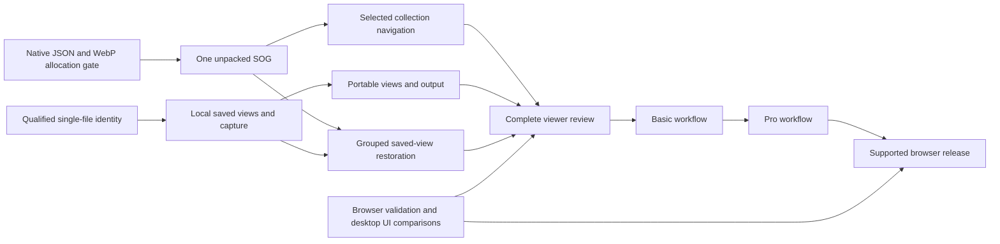
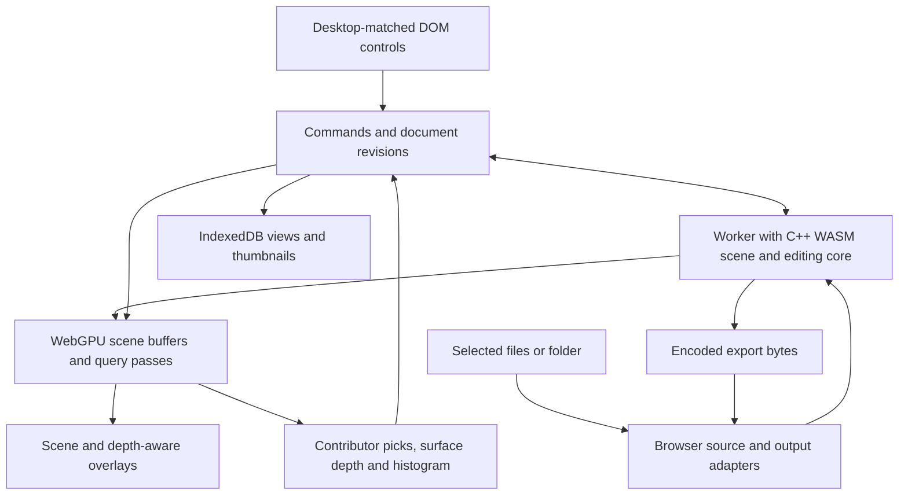
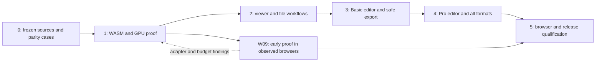

### Standalone browser renderer (October 25, 2026)

`npm run build:engine` produces an independent WebGPU/WebGL2 ES module, worker,
TypeScript declarations and plain browser example. Shared sorted/Steady kernels,
exact queries, automatic startup fallback and app artifact verification remain
in place. The [API guide](docs/development/renderer-engine.md) defines host camera,
admission, scheduling and async shutdown ownership. The [review](design/feature-reviews/standalone-renderer-2026-10-25.md)
records qualification and the remaining query-admission/cancellation, startup and
platform/performance follow-ups. No native/profile migration is claimed.

### Integrated WebGL2 delivery (October 25, 2026)

### Exact rendering optimizations (October 25, 2026)

Both backends now reuse exact resident depth order; WebGPU also reuses unchanged
projected data. Indexed Gaussian quads, asynchronous GL program preparation,
exact pick candidates, cooperative dense-tile sorting and color-only GL Gaussian
capture retain sorted display/fallback, clean output, raw maps and native editing.
Automatic WebGPU-to-WebGL2 fallback and the sorted default are preserved.

The [review](design/feature-reviews/rendering-optimization-plan-2026-10-25.md) and
[validation receipt](docs/validation/README.md#rendering-optimization-20261025-01)
record 6,426 portable tests, actual browser/production checks and repeated
measurements on Windows Chromium/RTX 5090. Exact queries and sorted capture
improve; the approximately 31 ms GL completion floor and App input latency remain.
No native/profile migration or other-platform GPU qualification is claimed.


The [WebGL2 plan](design/feature-reviews/steady-splats-webgl2-plan-2026-10-25.md) now has an integrated backend for the retained Basic surface, including deterministic editing/output and the same opt-in SteadySplats logic. Automatic startup prefers WebGPU, then WebGL2; device loss stays on the selected backend. This supersedes earlier statements that only a separate compatibility viewer was planned, while that separate viewer remains excluded. The [review](design/feature-reviews/webgl2-implementation-2026-10-25.md) and [delivery receipt](docs/validation/README.md#webgl2-implementation-20261025-02) bind local qualification and performance scope. Existing native/source/worker/format contracts, resource caps and independent environment/hosting qualification remain required.

### Text-tour refinement (October 19, 2026)

Continue refining the current text tour, as selected by the user. Accurate browser instructions and remembered-view modal sequencing belong in the existing course/hook/overlay owners. Preserve the 20/34 spatial courses, all seven translated rows, scene/history ownership, exact Bench data/license, source/native pins and keyboard/focus boundaries. A requested course may resume after its sample's saved-view choice only while that scene/client/renderer remains current; a dismissed or superseded preparation cannot revive. The [review](design/feature-reviews/tutorial-text-refinement-2026-10-19.md) and [evidence](docs/validation/README.md#tutorial-text-refinement-20261019-01) record final qualification.

### Dataset license correction (October 19, 2026)

Keep the Mip-NeRF 360 dataset under its author-declared CC BY 4.0 terms, separate from application and dependency licenses. The official SMERF page and its June 18, 2024 author-issued commit supersede the earlier incomplete license assessment. Distribute the full canonical legal text, author/source credits, license/declaration links and Gaussian reconstruction/editing/SOG change notice with the unchanged Bench sample. The [correction review](design/feature-reviews/dataset-license-correction-2026-10-19.md) and [web evidence](docs/validation/README.md#dataset-license-correction-20261019-01) record the precise qualification scope.

### Desktop demo data (October 19, 2026)

The desktop Bench scene now replaces the earlier procedural example for Open example and tutorial starts from an empty viewer. Its exact 5.1 MB SOG, 262,556 splats and authored camera use the normal controller/collection path; existing file and memory admission remain authoritative. Loaded user scenes, tutorial reading order, Basic scope and native pins remain unchanged. Preserve pending-download Cancel, supersession, failed-fetch retry and remembered-view priority when extending this path.

Distribute Mip-NeRF 360 source/paper credits separately from application and dependency licenses, following the owner's recorded delivery direction. The [sample reference](docs/third-party/DESKTOP_SAMPLE_REFERENCES.md), [feature review](design/feature-reviews/desktop-tutorial-sample-2026-10-19.md) and [validation record](docs/validation/README.md#tutorial-desktop-sample-20261019-01) supersede earlier procedural-sample statements below.

### Selection dependency and accounting review (October 18, 2026)

Completed three further maintainability improvements: app-owned dependency snapshots keep cache-key/currentness rules together; readonly published map metadata prevents accidental TypeScript writes; pure buffer planning separates retained CPU, host/upload and physical GPU accounting. Preserve exact query sizes, allocation order, preview/grading dependency rules, native/history owners and the single GPU retirement state machine. The [module map and invariants](docs/development/selection.md) describe these boundaries and the expanded fast test lane.

The 165-case focused CPU lane, 126-case selection browser cohort, four production journeys, both typechecks and source/product/native/build checks pass. Readback-layout extraction and broader controller work remain separate, evidence-driven follow-ups. [Review](design/feature-reviews/selection-dx-review-2026-10-18.md). [Validation](docs/validation/README.md#selection-dx-review-20261018-01).

### Selection module organization (October 18, 2026)

Completed a bounded maintainability pass: share query types, channel/tile constants, coverage normalization and uniform encoding in a pure contract; split shader preparation from scratch-buffer ownership; preserve one GPU query state machine and existing cache/native/history owners. Host/shader names are explicit while the 48-byte layout and all existing behavior remain. Keep internal imports direct and avoid compatibility barrels or speculative stage frameworks.

Future selection work starts with the [module map, invariants and focused workflow](docs/development/selection.md). The new developer commands pass 96 CPU cases and the full reviewed 126-case selection browser cohort; four production journeys, both typechecks and source/product/native/build verification also pass. Broader controller extraction remains separate work, with ownership-preserving changes sized to actual needs. [Review](design/feature-reviews/selection-modularity-2026-10-18.md). [Validation](docs/validation/README.md#selection-modularity-20261018-01).

### Selection interaction optimization (October 18, 2026)

Implemented the four follow-up optimizations. Prepare shared compute pipelines asynchronously after the first scene frame; compile source visibility only on demand. Bound tile candidates using the existing alpha/support ellipse, padded for FP32 rounding with a conservative fallback. Retain at most 16 MiB / 32 idle exact-size GPU scratch buffers, each with its own live ledger credit; evict under pressure and discard cancelled/failed work after retirement. Use immutable coverage-aware cache entries and conservative whole-stroke depth regions only for 3D brush with visible-only disabled. Full CPU/native dimensions remain; Fill, connected Color and global visibility upgrade to full coverage.

Qualified 6,255 CPU cases in 192 files, 126 focused development-browser cases, four production Basic/shipped cases, both typechecks and the source/product/native-artifact/build checks. The 37-fixture independent old-bound GPU oracle preserves every depth/opacity/raw-color pixel; local maps preserve exact native membership and Undo/Redo at normal/downsampled/DPR-two sizes. Actual pooled buffers match fresh results after camera, density and visibility changes. Pressure eviction, failed preparation retry, cancellation and teardown preserve credit/history ownership.

Same-helper local remeasurement of the compact baseline changed warm medians from 15.2 to 11.6 ms (2,273 sources) and 22.1 to 14.7 ms (8,193 sources). These include fixture/upload/query/disposal, with two warmups and three measured samples; the dense admission fixture is separate from the analytic surviving-fragment tests. Candidate allocations were 67,264 to 67,120 bytes and 262,144 unchanged, respectively. At 1,025 × 769, a brush tap read 4,096 rather than 2,094,504 depth bytes; full CPU/native transport still applies. No universal speed, memory or capacity claim follows. Stage timings are CPU wall intervals, not isolated GPU timestamps. [Review](design/feature-reviews/selection-interaction-optimization-2026-10-18.md). [Attribution](docs/third-party/PLAYCANVAS_SELECTION_REFERENCES.md). [Validation](docs/validation/README.md#selection-interaction-optimization-20261018-01).

### Compact surface selection (October 18, 2026)

Implemented a count-first compact GPU layout for existing Basic surface selection. Allocate each occupied tile's own power-of-two candidate span, skip empty/singleton sorting and use workgroup memory for spans up to 1,024. Remove the normal 8,192-per-tile ceiling while retaining actual buffer/index/memory admission. Keep exact desktop composited depth/opacity/raw color, contributing-source visibility, native map adoption, cancellation, history and the current UI. No advanced tools or agent access are added.

The local 2,273-splat / 512 × 512 surface workload used 65.7 KiB of candidate storage instead of a 16 MiB final allocation and improved its warm wall-time median from 13.2 to 10.4 ms. An 8,193-overlap fixture now succeeds. These are measured workloads, not universal capacity or faster cold-pipeline guarantees. SuperSplat informs GPU-work/readback design; its frontmost-ID/Flood semantics are not substituted for SplatView's blended map. All 6,214 CPU cases, 119 focused development-browser cases, four production-browser cases, both typechecks and the production/source/product/native checks pass. [Review](design/feature-reviews/compact-selection-surface-2026-10-18.md). [Pinned references and attribution](docs/third-party/PLAYCANVAS_SELECTION_REFERENCES.md). [Validation](docs/validation/README.md#selection-surface-optimization-20261018-01).

### Simplified web file toolbar (October 18, 2026)

The user's simplification request overrides keeping separate desktop-style Folder and Thumbnail icons. Scene files now contains Open scene, Save scene, Capture image and Copy image. Open folder moves to Settings / General / Scene. Remember view in Settings / General / Saved view reuses the existing browser-local camera/background/PNG transaction and T shortcut. It does not update operating-system thumbnails or save scene edits. Existing import/export, Reset/reopen restoration and storage/history/resource ownership remain.

The active tutorial keeps all 34 steps. Its remembered-view topic now opens the read-only Tools presentation and highlights Settings, with localized instructions for Remember view. The native capture and product registrations remain unchanged. This is an explicit browser presentation adaptation; the desktop design, native provider behavior and advanced engine compatibility work are separate.

Passed 84 focused CPU cases in eight files, 23 development-browser cases, 14 production-browser cases, both typechecks, pinned source/product/native-artifact verification and the production build. Browser runs used zero retries. Checks include real file and nested SOG-folder opening, genuine saved-view PNG/metadata and camera/background restoration, empty-directory selection, transaction refusal, portable import/export, focus-sensitive T, unchanged Undo/Redo, compact layout and the full tutorial. The first diagnostic browser attempt retains six failed legacy/fixture assertions; repaired assertions and the explicit Basic-only cohort are documented in the review. [Review](design/feature-reviews/web-toolbar-simplification-2026-10-18.md). [Validation](docs/validation/README.md#web-toolbar-simplification-20261018-01).

### Current Windows presentation alignment (October 18, 2026)

Implemented against the current Windows source and its dirty design inputs: remove “Your scene, in focus.” and the empty-view resource footnote; retain admission information in Open tooltips. Use a muted instruction and paired Open scene / Open example actions, natural shared widths and bounded centering below the actual wrapped toolbar. Each wrapped toolbar row has its own rounded ends. Language/Theme/Font size use compact property rows and selected dots. Selection Options sits beside Combine, parameters/polygon commands beneath, Actions last; polygon count remains accessible without a visible row.

Open example uses an original 4,096-record, 128 KiB procedural scene through the existing controller/native/GPU path. It does not copy the native sample whose public redistribution provenance is unresolved. Basic omissions and approved browser adaptations remain. The frozen native/source/toolchain and sealed product inputs are unchanged. This is current presentation alignment, not a native version migration or new advanced editing.

Passed 106 focused UI/policy tests in nine files, nine development-browser cases, nine production-browser cases, both typechecks, pinned source/product/native-artifact checks and the production build. All browser cases used zero retries. Browser checks cover actual example rendering/capture, file opening, Small/Large Settings and keyboard previews, French narrow/short empty layouts, bright-theme presentation, Basic history/picking and all 34 tutorial steps. [Review](design/feature-reviews/windows-design-alignment-2026-10-18.md). [Source/adaptation record](docs/third-party/WINDOWS_DESIGN_ALIGNMENT_REFERENCES.md). [Validation](docs/validation/README.md#windows-design-alignment-20261018-01).

### Current input policy: PlayCanvas local-editor reference (October 18, 2026)

The user selected PlayCanvas SuperSplat as the capacity-policy reference. The arbitrary 256 MiB scene cap is removed. Admission now checks source and decoded memory rather than promising a fixed supported file size. The current all-resident loader still charges its complete source and decoder allocations to a fixed 512 MiB native candidate budget; a source that exhausts that budget is refused before body reads, and smaller inputs can still fail later admission. Unpacked SOG checks include unique originals and the complete rewritten native stage. The 1 GiB logical ledger, one-million retained-splat preview, GPU/history/recovery/output checks and uint32 transport domain remain. These are our implementation constraints; there is no claim of hardware-adaptive allocation or SuperSplat-scale capacity. Its 10 GB Direct Upload allowance is a separate hosted flow. [Reference sources](docs/third-party/PLAYCANVAS_INPUT_LIMIT_REFERENCES.md).

Implemented and checked: intrinsic-source and candidate-budget guards at controller intake, client and worker boundaries; grouped-stage accounting; localized resource-dependent UI copy; and refusal without body reads, candidate workers, dirty prompts or lost edits/Redo. All 6,203 CPU tests in 189 files, six focused development-browser cases, five production-browser cases, both typechecks, build and pinned source/product/native-artifact checks pass. Browser cases used zero retries. Production checks include the emitted worker's early refusal and subsequent successful load, Basic cleanup/Undo and Flip/Apply, Color/Fill, and all 34 tutorial steps. Evidence is Windows Chromium 156 on secure localhost; the adapter probe is separate from the renderer owner and does not measure available GPU memory. [Review](design/feature-reviews/playcanvas-input-policy-2026-10-18.md). [Validation](docs/validation/README.md#playcanvas-input-policy-20261018-01).

Larger-scene support is optional future work: review a chunked/streaming parser and native decoder before raising memory budgets or claiming PlayCanvas-equivalent imports. Keep the Basic-only product, desktop UI/core authority and independent resource owners. Earlier 256 MiB statements below describe historical source captures and are superseded by this current policy. No physical Mac test, native rebuild, staging or remote deployment is part of this update.

### Current scope: Basic web app (October 18, 2026)

The user confirmed a Basic-only web app on October 18, 2026. The active `web-lite` profile offers viewing, basic selection and cleanup, manual transforms/alignment, basic and auto color, capture, browser-local saved views and export of a new copy. Agent access and advanced editing are excluded from this profile. The Pro switch, Current view only and Range controls are omitted. Existing advanced engine code remains available for independent compatibility work; its presence does not make it part of the Basic product.

Validation passed: 6,181 CPU tests across 189 files, the pinned product verifier (128 registrations), source/native-artifact checks, both typechecks and the production build. Three production-browser journeys passed with zero retries: Basic cleanup/Undo and manual Flip/Apply, Color/Fill picking without Range, and all 34 projected tutorial steps with selection restoration. Browser evidence is Windows Chromium 156 on a secure localhost origin; the separate high-performance adapter probe reported NVIDIA Blackwell without fallback. This is scoped browser evidence, not new macOS/native-provider or universal device qualification. [Review](design/feature-reviews/web-lite-selection-policy-2026-10-18.md). [Validation](docs/validation/README.md#web-lite-selection-policy-20261018-01).

Further work should improve this Basic workflow. Do not add agent access or advanced editing. The older full-editor plans and receipts below are historical; their Pro controls and 47-step tutorial are retained implementation history, superseded by the active Basic profile and its 34-step tutorial. Cross-platform contract migration and broader host/parameter conformance remain separately scoped; this packet qualifies the selection policy boundary and tested Basic journeys.

### Requested web implementation finished; optional follow-up

The requested browser implementation is complete within the documented limited-scene scope. The app uses WebGPU and portable C++ logic through WebAssembly in a worker. No Electron/native wrapper or Mac hardware test is required. Additional format-edge, recovery-timing, host/HTTPS, manual assistive and performance/capacity coverage is optional follow-up, unless it reveals a concrete defect.

The final bounded desktop presentation changes replace font-glyph chevrons with the pinned geometry and refine the Basic/Pro header width. Open folder remains an approved browser control. Folding and Reset retain independent hit targets and keyboard activation; matching native row paint does not merge those actions. [Sources and adaptations](docs/third-party/DESKTOP_CHEVRON_REFERENCES.md).

This presentation update passed 145 focused CPU tests in 8 files, 17 development-browser checks and 3 production-browser checks. The unchanged foundation retains 6,160 CPU tests, 118 production-browser cases, 48 tutorial/input/zoom cases and 14 native suites. These scopes overlap and are reported separately. [Qualification](docs/validation/README.md#current-desktop-chevron-web-20261017-01).

One current-build observation opened, exported and closed the pinned 256,000-record SH0 scene (8,192,000 input bytes), with independently checked output and joined owners. This is one practical observation, not measured universal capacity, a frame-rate guarantee or performance certification. The 256-MiB input and one-million loaded-preview limits remain admission ceilings; decoded data, history, GPU, recovery and output have separate admission, so an operation can be refused below those ceilings.

Further independent input branches, unusual recovery timing windows, a concrete deployed HTTPS origin, broader matched appearance/manual assistive observation and formal operating budgets can be separate follow-up work. They are coverage or delivery extensions, not hidden missing editor features or prerequisites for the requested browser app. WebGL fallback is a separate optional viewer. Native shell/AgentAccess integration and expensive continuous hover/refit/baking remain outside the agreed web scope.

The earlier plan sections remain intact as historical records. Their older pending Duplicate, pivot, Range, floating-action and tutorial notes are superseded by the qualified implementations above, and the user's no-Mac-testing scope takes precedence over old hardware matrices. No commit, push or remote deployment is claimed by this completion record.

### Implemented current tutorial and remaining acceptance

Current desktop tutorial v7 is implemented with 47 retained steps and 46 target tokens. Stable semantic IDs replace index-based copy overrides. The tour teaches the implemented Range, selection completion, Current View, Duplicate, transform modes, pivot, axes and snap/flips, with explicit browser adaptations and all eight locale rows. Native AgentAccess remains outside this browser app. The temporary Pro presentation preserves the user's profile, folds, raw settings and native edit state.

Validation passed: 6,160 CPU tests in 188 files, 118 production-browser cases, 48 tutorial/input/zoom browser cases and 14 executed native module suites. Browser runs used zero retries. [Validation record](docs/validation/README.md#current-tutorial-v7-web-20261017-01).

The next bounded UI packet addresses the measured desktop chevron paint and roughly 1.9-pixel English/Small header-width difference, preserving the approved Open folder adaptation and independent Reset hit areas. Subsequent acceptance work covers remaining retained-format/recovery checks and measured limited-scene capacity, followed by read-only deployed HTTPS checks when a deployment origin is available and residual current-desktop appearance comparison. Manual assistive observation can extend the evidence. Keep supported sizes aligned to the reviewed COLMAPView baseline and measured admission policy. Physical Mac hardware is not a prerequisite. The browser implementation keeps expensive continuous analysis outside the agreed scope. [Source references and adaptations](docs/third-party/TUTORIAL_V7_REFERENCES.md).

### Implemented transform-gizmo sessions and next acceptance work

Multi-drag Move/Rotate/Scale sessions now retain their first Cancel baseline while each accepted drag starts from current geometry. Native session Undo/Redo, undoable Cancel restoration, Check, header Reset and source/device/physical-press safeguards are implemented. Basic/Pro retains idle transform gizmos. Numeric transforms keep their existing explicit Apply/Cancel. Additive contract revision `proTransformSession:2` leaves core/camera ABI, transport, receipt and durable codec versions unchanged; fresh worker restoration explicitly finalizes the transient gizmo session.

Validation passed: 6,139 CPU tests in 187 files, 113 production-browser cases in one complete run, 14 executed native module suites, and 90 Python checks (1 existing host-dependent probe skipped). [Validation record](docs/validation/README.md#gizmo-session-actions-web-20261017-01).

The remaining implementation and acceptance slices are:

1. Update the current desktop tutorial catalog and target demonstrations for the implemented controls. Keep tutorial presentation independent of native edits and document history. Complete current-source visual, keyboard and assistive acceptance using the prepared finite tutorial packet.
2. Finish remaining retained-format/recovery and deployed HTTPS checks, then measure limited-scene capacity in the available browser environment. Keep supported input size aligned to the COLMAPView baseline and actual admission policy. Physical Mac testing is not a prerequisite.

The web remains a limited-scene browser app. Expensive continuous analysis remains outside the existing responsiveness scope. [Desktop behavior, native authority and browser adaptations](docs/third-party/GIZMO_SESSION_ACTIONS_REFERENCES.md).

### Implemented continuous selection history and next work

Exact manual selection history visibility now uses the native top Undo entry's runtime selection stamp and one continuous manual-session entry boundary. Manual tool and Basic/Pro switches preserve that boundary; Orbit/reentry starts a new one. Graphics-only recovery retains it; a new worker/source starts fresh. Undo/Redo preserves original stamps, and recovered historical entries start unstamped. `selectionActions:2` independently validates this metadata without changing ABI, transport, receipt or durable codec versions.

Validation passed: 6,084 CPU tests in 184 files, 109 production-browser cases in one complete run, 14 executed native module suites, and 90 Python checks (1 existing host-dependent probe skipped). [Validation record](docs/validation/README.md#selection-history-web-20261017-01).

The next implementation slices are:

1. Implement transform-gizmo drag-session history before attaching floating Check/Undo/X. Each accepted nonidentity released drag needs its own session Undo, and X must restore the session's original base. Numeric transform and opacity keep explicit Apply/Cancel. Use the reviewed finite gizmo plan in the private phase handoff.
2. Update tutorial coverage and finish current-source visual, keyboard and assistive acceptance.
3. Continue remaining retained-format/recovery/deployed HTTPS checks and measure limited-scene capacity in the available browser environment. Physical Mac testing is not a prerequisite.

The web remains a limited-scene browser app. Continuous expensive selection analysis remains excluded under the existing responsiveness policy. [Desktop reference, native authority and scope](docs/third-party/SELECTION_HISTORY_REFERENCES.md).

### Implemented floating selection actions and next work

Manual and filter Check/Undo/X now use explicit joined controller actions and one shared desktop-sized tray. Filter X commits the acknowledged visible result without evaluating newer dirty parameters, then clears and reopens its enclosure paused. Filter Undo distinguishes changed/in-flight drafts from unchanged drafts using native membership authority. Selection actions validate native filter and tolerance metadata independently across request, commit, rollback and recovery. Additive capabilities are `selectionFilter:2` and `selectionActions:1`; existing ABI/protocol/receipt/codec versions remain stable.

Validation passed: 6,050 CPU tests in 182 files, 105 production-browser cases in one complete run, 14 executed native module suites, and 90 Python checks (1 existing host-dependent probe skipped). [Validation record](docs/validation/README.md#floating-selection-actions-web-20261017-01).

The next implementation slices are:

1. Add bounded native selection-history creation/amendment stamps for exact manual per-tool floating-control visibility, preserving stamps through Undo/Redo and transactions. Fresh restored historical entries can start outside a newly armed tool session; do not infer stamps from selected count, content pointers or the global current revision.
2. Implement transform-gizmo drag-session history before attaching floating Check/Undo/X. One drag must be undoable independently; X must restore the session's original base. Numeric transform and opacity keep explicit Apply/Cancel.
3. Update tutorial coverage and finish current-source visual, keyboard and assistive acceptance. Continue remaining retained-format/recovery/deployed HTTPS checks and measure limited-scene capacity in the available browser environment. Physical Mac testing is not a prerequisite.

The web remains a limited-scene browser app. Continuous expensive selection analysis remains excluded under the existing responsiveness policy. [Desktop reference, native authority and scope](docs/third-party/FLOATING_SELECTION_ACTIONS_REFERENCES.md).

### Color/Fill Range and logarithmic Radius

Color and Fill now have independent viewer-session Range and Radius preferences in Basic and Pro. A pick freezes the raw native Color contributor center or the press-time Fill depth-surface center. Sphere membership is applied before Combine against the original click checkpoint, preserving Add/Remove selections outside the sphere and the separate captured current-view rule. Amendments keep one Undo; metadata-only changes preserve selection notifications and history. Legacy omitted-Range calls retain their prior ignored-input behavior, while explicit Range requests reject replacement of frozen inputs.

Radius uses the existing bounded sampled scene statistics, half the morphology maximum and a fresh geometric-mean default. Raw typed preferences survive scene/profile changes; only effective operands are clamped and quantized. Pointer/key/numeric edits settle before native selection work; the local Tools-only sphere has 192 source segments and follows Combine colors. Continuous next-pick hover sampling remains omitted, and Fill remains synchronous within the existing limited-scene scope.

The additive `colorFillRange:1` capability retains ABI24, protocol28, UI23, camera ABI4, receipt2 and codec3. Worker/client/controller checks authenticate Range independently across request, commit and rollback. Readonly statistics and pivot focus preserve compatible completed owners. Recovery retains accepted selection/history and viewer preferences, while a new click reacquires its transient map and center. [Desktop sources and browser adaptations](docs/third-party/SELECTION_RANGE_REFERENCES.md).

Validation passed: 5,960 CPU tests in 180 files, 102 production-browser cases in one complete run, 13 executed native module suites, and 90 Python verification checks; one existing host-dependent filesystem probe was skipped. [Validation record](docs/validation/README.md#color-fill-range-web-20261016-01).

Continue with joined floating confirmation actions and current tutorial coverage. Full current-source visual/assistive acceptance, remaining retained-format/recovery and deployed HTTPS checks, and measured limited-scene performance/capacity remain open. Physical Mac testing is not required. The implementation goal remains active.

### Automatic selection pivot defaults; next Range implementation

The pivot synchronizer now uses a native worker-lifetime committed-selection notification. It detects selected-bit and mask-cardinality changes, including same-count membership replacement, without treating draft previews, cancellation or unchanged-membership content bakes as a new selection. Nonempty committed selection chooses Selection; clearing an active Selection pivot chooses Origin. Store notifications coalesce, and numeric input plus pending selection/tolerance/map activity defer the automatic query until the accepted edit settles. Tolerance sliders defer it while a pointer or adjustment key is held; ordinary focus on an idle slider permits refresh.

Derived Scene/Selection references refresh after geometry changes. Custom and Origin choices survive geometry-only changes; a retained transform continues using its original base coordinates rather than recentering after each applied epoch. Recipe retirement clears its numeric transform, maps Custom through the accepted matrix once and refreshes derived references in the accepted scene. Automatic readonly focus preserves settled Color/Fill, grade and opacity owners and checks the same owner guard at admission and each cooperative step. Successful graphics recovery and canceled source-load cleanup permit another attempt after a remembered query refusal. Transaction rollback restores the notification value; recovery primes its fresh zero value without replaying a selection event. The `transformPivot: 2` capability carries the notification; this phase introduces no new scene-format, checkpoint-codec, receipt or camera versions.

Validation passed: 5,837 CPU tests, 98 distinct production-browser cases across the full run and targeted rerun, and 11 native module suites; 90 Python verification checks passed and one host-dependent filesystem probe was skipped. [Validation record](docs/validation/README.md#selection-pivot-web-20261016-01).

Continue with Color/Fill Range and logarithmic Radius using the prepared private design at `.build/color-range-implementation-drafts/revalidated-design-02.json`: frozen pick centers, Range before Combine, independent raw/effective preferences, same-pick amendments and bounded sphere feedback. These controls are not implemented by this pivot phase. Joined floating confirmations, revised tutorial qualification, complete current-source visual/assistive acceptance, remaining retained-format/recovery and deployed HTTPS work, and measured performance/limited-scene capacity remain open. The goal remains active; dedicated Mac hardware is optional.


### Explicit Pro pivot cycle; retained next work

The explicit Pro pivot action follows committed SplatView 1.0.2: Scene -> Selection -> Origin -> Scene, skipping empty Selection; numeric Pivot entry chooses Custom, whose next cycle returns to Scene. Current desktop icons and label/tooltips cover English plus seven translated locales. A revision/owner-bound native query computes selected three-sigma covariance AABB focus from canonical masks and the retained transform base, preserving the coordinate reference used by absolute browser previews. It uses a cooperative fixed-size owner of at most 512 bytes. The existing synchronous `beginTransform` selected-focus calculation is unchanged.

Reference-only changes with neutral rotation, unit scale and no flips preserve translation and pending values without a bake or Undo step. Changes affecting a nonneutral transform remain staged for explicit Apply. Chosen pivots feed the gizmo; Reset chooses Selection when nonempty and Origin otherwise; a replacement source starts at Scene. Canceled/stale queries cannot publish into another scene or transform epoch. [Source references](docs/third-party/PIVOT_REFERENCES.md) identify the exact desktop inputs and browser adaptations. Validation passed: 5,774 CPU tests, 96 production-browser tests, 10 native module suites and 47 Python verification tests. [Validation record](docs/validation/README.md#pivot-controls-web-20261016-01).

Continue with the desktop's automatic pivot default/refresh after completed selection membership edits, using an accurate committed-membership signal rather than general content revisions or selected count alone. Then finish Color/Fill Range, logarithmic Radius, independent preferences, same-pick amendments and sphere feedback; joined floating finish/undo/clear-or-cancel actions; and current tutorial coverage. Full current-source visual/assistive acceptance, remaining retained-format/recovery and deployed HTTPS qualification, and measured performance/operating capacity remain open. The goal remains active; dedicated Mac hardware is optional and costly continuous features retain their existing browser scope.


### Functional Pro Duplicate; retained next work

The complete Pro Duplicate action now connects cooperative native append, transaction/summary receipts, worker validation, admitted controller/GPU publication and recovery. Complete 144-byte records are copied in source order under the captured current-view scope; deleted masks remain intact, originals are deselected and only appended copies are selected. One scene-history step supports Undo/Redo with frame metadata and duplicate lineage. Successful Duplicate ends the old alignment Reset baseline; the next alignment begins on the grown scene, while the original import/subset binding remains immutable.

The Pro control uses the exact committed desktop icon, English plus seven translated label/tooltips, and presentation-only green `(0.49, 0.824, 0.573)` at a `0.72` mix. Exports and captures retain source colors. The untouched-copy guard prevents repeated in-place duplication until the copies are edited. Wire protocol 28/UI-worker contract 23/core ABI 24 carry Duplicate 1, transaction receipt 2 and recovery checkpoint 2; camera ABI 4 is unchanged. Codec 3 preserves and authenticates the whole growing/shrinking history graph and each scene's duplicate range. Admission covers retained old and candidate native/GPU ownership; the one-million loaded-splat cap includes deleted records and does not establish measured capacity.

The [functional Duplicate validation](docs/validation/README.md#pro-duplicate-web-20261016-01) records fresh native/web builds, typechecks, five native contract suites, 30 build/provenance tool tests, 5681 CPU cases and 94 production browser cases. The [reference record](docs/third-party/DUPLICATE_REFERENCES.md) binds the desktop strings, icon/tint and native/browser adaptation. Earlier Duplicate foundation/open-work notes below remain historical records.

The goal remains active. Continue with native pivot-mode cycling; Color/Fill Range, logarithmic Radius, independent preferences, same-pick amendments and sphere feedback; joined floating Check/Undo/X finish/undo/clear-or-cancel behavior; and the revised tutorial targets, order and copy across eight locales. Full visual/assistive equivalence, remaining retained-format/recovery and deployed HTTPS qualification, and measured operating budgets/capacity remain open. Available-browser evidence is the baseline; device hardware testing is optional. Native Agent/loopback companion controls remain excluded, and costly continuous previews remain optional or omitted under the existing browser scope.

**Desktop version erratum:** the active committed target is SplatView 1.0.2 at `4e1be155511fb49f08fd8c863d785ac008a4c43a`. Earlier packet notes and immutable records retain their mistaken 1.0.4 labels; the [erratum](IMPLEMENTATION_STATUS.md#desktop-reference-version-erratum) preserves their exact source identities and bounded results.

### Pro Duplicate implementation progress

The native append/history foundation is implemented and passes six executed contract groups, including full 144-byte SH0–3 copies, selected/deleted mask semantics, one-step Undo/Redo across scene sizes, captured view scope, marker lifetime, source/identity limits, exact one-million success, cancellation and 104 allocation refusals. The [native foundation validation](docs/validation/README.md#pro-duplicate-core-20261016-01) also records the fresh native/web builds, typechecks, 5,601 CPU cases and 60 production browser cases. Production output is audited and disposable compiler objects and Vite caches are cleared after the owners stop.

**Continue with the complete browser action:** connect native transaction/summary/receipt topology, integrate and test the prepared codec3 recovery changes against the immutable import binding, then publish native records, GPU buffers and green-copy feedback atomically under the admitted memory budget. Add the functional Pro control and browser failure/cancellation/Undo/Redo/recovery checks after these contracts are coherent. Native and UI capabilities currently remain unchanged; the foundation does not accept browser Duplicate or close the remaining requirements below.

### Current desktop chrome and next bounded feature

Committed SplatView 1.0.2 at `4e1be155511fb49f08fd8c863d785ac008a4c43a` remains the active authority; historical version labels and receipts below remain under the erratum. The [fresh bounded requalification](docs/validation/README.md#current-desktop-chrome-20261016-02) records 5,601 passing CPU cases/165 files, typechecks/build, 60 production browser cases and one complete clean selected development run of 291 cases/24 files. All browser cases execute against the repaired source/new build; the older failed cohorts remain diagnostic.

Implemented chrome includes Basic's full-width 44px Tool selector, shared tutorial targets and 28px world-axis transform strip; actual Selection → Transform → Color DOM order; the Pro 8px refinement gap; and Diameter's 15px text/21px frame. Basic uses explicit Apply/Cancel to commit a preview. The automatic morphology metadata query now preserves unrelated operation errors. Fresh browser observations measure 34/52 Basic and 43/65 Pro named full-bound rows within 0.5px against the unchanged committed-source native captures. Header/toolbar/fold/Help residuals remain visible; this is not whole-image or full-appearance acceptance. The earlier packet removed 152 native intermediates (745,347,234 bytes); this requalification removed 16 cache files (2,811,209 bytes) after all owned processes joined. These are separate observed file-byte totals.

**Next: functional Pro Duplicate.** Add admitted native append, coherent selection/deleted masks, topology-sensitive cache invalidation, executable Undo/Redo and correct alignment Reset lineage and old-plus-candidate/GPU overlap within the retained 1M cap. Grown-document recovery must authenticate the accepted state and its lineage without relaxing original-source binding. Publish native records, GPU records and green duplicate selection atomically before exposing the functional Pro action; do not add a placeholder. A successful Duplicate ends the prior alignment Reset baseline; the next alignment begins on the grown scene. Undo/Redo retains the frame metadata of its history states, and the immutable import binding remains unchanged. Native pivot-mode cycling remains distinct from current scene-center placement.

**Other retained current-source work:** add Color/Fill Range, a logarithmic Radius control with independent per-tool preferences, same-pick range amendments and sphere feedback. Complete the joined floating Check/Undo/X actions for selection and transform sessions, preserving finish, undo and clear-or-cancel behavior. Reconcile the current tutorial target/order/copy and all eight localized paths around Range, current-view scope, Duplicate, floating actions and Basic/Pro transforms. None of these workflows is accepted by the named chrome rectangles.

Browser scope keeps an explicit memory policy: the web core retains at most ten history entries subject to admission, compared with the current desktop default of 32 plus its byte budget. This is a web budget adaptation, not a promise that every admitted scene supports ten geometry edits (`native/upstream/splatview/src/core/editing.cpp:115`; committed `src/editing.hpp:59,192`). Native Agent/loopback service controls remain excluded with the native companion integrations; this browser-only app does not start a local service.

Keep explicit commands, cheap navigation/overlays and shader grading. Costly continuous hover/refit/baking stays optional or omitted. Broader appearance/assistive, remaining retained-format/recovery, deployed HTTPS and measured limited-size performance/capacity remain separate requirements. Mac hardware is optional; the overall goal remains active.

### Independent KSPLAT input coverage

Thirteen original KSPLAT0.1 inputs now cover compression0/1/2, SH0-3, mixed-degree sections, reserved capacities and full/partial bucket traversal. Independent attribute and PLY-output oracles check every loaded source and fixed sampled IDs with numerical limits fixed before execution. Refused inputs retain edited native records, masks, output and executable Redo. Three ordinary production-page workflows open compressed inputs, reject a bad replacement, exercise Delete/Undo/Redo, inspect actual downloads and reopen PLY output.

[Qualification](docs/validation/README.md#ksplat-input-20261016-01) records 117 focused cases, 5,586 passing CPU cases in the full suite and nine production browser cases. Application, native and distribution bytes are unchanged; services joined and regenerable caches were removed. Current desktop authority is committed1.0.4; older R0 captures keep their historical scope. Broader SPZ/SOG/ordinary-PLY input variants, matched current-desktop visuals, recovery/HTTPS and measured limited-size operating budgets remain open. The implementation goal remains active.

### Desktop-aligned web interaction completion

Save/Download, Capture, Copy and Update Thumbnail now show a three-second successful-result state. Controller receipts follow the current document and real completion; failures, replacement and Close cannot publish stale success. Plain-control Escape returns focus to the viewport before a later scene Escape can cancel a tool. The Alignment menu owns outside presses and uses bounded 300 ms hover opening/dismissal with click pinning and keyboard access. Expensive scene previews remain omitted.

[Qualification](docs/validation/README.md#delivery-readiness-20261016-01) records 5,469 passing CPU cases and 148 browser cases against a fresh web build, including genuine downloads, atomic thumbnail storage and preserved native/GPU/history state. Native WASM bytes remain unchanged. Stale distribution assets and regenerable caches are removed; the README documents local build, limits, deployment and attribution. Available-browser evidence is the baseline; Mac/Safari/device checks are optional. Broader visual/assistive, format/recovery, HTTPS and measured operating-budget qualification remains open. The implementation goal remains active.

### Independent compressed PLY inputs

A deterministic 16-input packet now covers both packed chunk-bound layouts, both binary byte orders and SH0–3, including chunk-edge records and exact capped source membership. Independent bit readers and quaternion/covariance/SH math compare the actual shipping WASM decoder with fixed numerical bounds. Scoped PLY output is parsed independently. Refused opens preserve prior native attributes, masks, output and executable history; accepted edges follow their declared source policy.

[Qualification](docs/validation/README.md#compressed-ply-20261016-01) records 64 positive decoder executions, 110 focused cases and 5,447 passing CPU cases in the full suite. The fixture constructor is reproducible, and thresholds were fixed before execution. Application, native and distribution bytes are unchanged; caches are removed and shipping has zero stale files. These fixtures do not establish broad third-party interoperability, browser rendering or scene capacity. Broader visual/assistive, remaining format/recovery, HTTPS and measured limited-size operating budgets remain open. The implementation goal remains active.

### Saved-thumbnail opaque capture coverage

Actual Gaussian, point and mesh captures now check every pre-filter alpha byte across Black, Gray and White backgrounds. The saved-thumbnail workflow exercises a 1025-to-1024 resize, one PNG encode and atomic metadata/image storage, with unchanged native state and joined image ownership. [Qualification](docs/validation/README.md#capture-opacity-20261016-01) records 19 focused image CPU cases and 15 browser cases. Application, native and distribution bytes are unchanged from the Pro morphology build; caches were removed after the owned service joined.

The 14 retained arbitrary transparent-input WIC diagnostics remain a portable-filter limitation. They do not occur in these observed opaque capture workflows. Universal Fant, browser-encoder byte/color equality and wider visual/assistive, format/recovery, HTTPS and measured operating-budget acceptance remain open. The implementation goal remains active.

### Pro selection morphology; implementation in progress

Pro now exposes the desktop Grow/Shrink, Volume and Sigma strip with its full-width parameter row. Basic keeps refinement hidden; the Refine tutorial uses a presentation-only Pro layout. Volume compares Gaussian centers using the native reach, while Diameter displays twice that reach. Sigma retains ellipsoid contact and its half-step bounds. Method, raw reach and sigma are shared viewer-session preferences. Hover computation is omitted.

A read-only cooperative native task computes and caches the desktop scene-based range under bounded scratch ownership. It does not alter masks, scene data, dirty state, history or retained edit reset owners. Selection work retains current-view scope, atomic publication, cancellation and one-step Undo/Redo. Legacy sigma-only commands remain supported; the runtime requires morphology capability 2.

[Current qualification](docs/validation/README.md#pro-morphology-20261016-01) records 5,337 passing CPU cases, 230 selected browser cases and 26 actual native contract mains, plus the production build and TypeScript checks. Independent center-distance, range and history oracles cover this bounded feature.

Shipping contains 102 files and zero stale assets. Regenerable caches were removed after owned services joined; generated native binaries remain ignored by Git. The reference pins 30 committed desktop 1.0.4 source files. The earlier Gaussian view-modes item came from a different source state: this committed target has one Gaussian appearance path and no mode selector, cycle or preference. It is not an outstanding feature for this target.

Broader appearance/assistive, image/format/recovery, HTTPS and measured limited-size operating budgets remain open. The implementation goal remains active; Mac hardware is optional. No commit, push or deployment was performed.

### Current view only; implementation in progress

The desktop Frustum action now limits selection and selected edits to Gaussian centers inside the current camera frustum. Enabling clips the current selection once; orbit alone preserves it. Delete and crop use the live view, while selected color, transform and opacity sessions freeze their effective targets. Canonical selection and frozen GPU preview targets publish together. Undo/Redo, exports, Restore and whole-scene alignment retain their desktop scope.

[Current qualification](docs/validation/README.md#view-scope-20261016-01) records 5,282 passing CPU cases, 205 selected browser cases and 26 actual native contract mains, plus the production build and TypeScript checks. Native session/history/refusal contracts, independently expected actual-App membership and GPU oracle comparisons cover this bounded feature. Native recovery snapshots write internal codec version 2 with effective edit owners and retain reading of the prior internal version 1 layout.

Shipping contains 102 files and zero stale assets. Regenerable caches were removed after owned services joined; generated native binaries remain ignored by Git. The feature reference pins 20 committed desktop 1.0.4 source files.

Pro Volume/Sigma Grow/Shrink with Diameter and Gaussian view modes remain subsequent work. Broader appearance/assistive, image/format/recovery, HTTPS and measured limited-size operating budgets remain open. The implementation goal remains active; Mac hardware is optional. No commit, push or deployment was performed.

### SOG/SOGS admitted exports; implementation in progress

SOG and legacy SOGS now use native-derived admission and the owned download lifecycle. The frozen desktop quantizer, texture channels, metadata and ZIP serialization remain the complete-file byte oracle. Spatial ordering, SH palettes, RGBA textures, codebook scratch, metadata construction and WebP internal allocations have scoped lifetime grants. WebP receives an enforced aggregate workspace allowance, including live resize/clone overlap; it is a policy limit and can refuse an export. The worker encoder remains synchronous, with no mid-call cancellation guarantee. All nine formats now use the owned browser export path.

[Current qualification](docs/validation/README.md#sog-export-20261016-01) records 5,211 passing CPU cases, 120 selected browser cases and 24 actual native contract mains, plus the production build and TypeScript checks. Actual SOG/SOGS downloads are independently inspected and reopened, including nontrivial Selected/Remainder membership and executable Undo/Redo. The obsolete shipping filesystem-export fallback and its unreachable fault-injection main were replaced by direct codec/refusal contracts.

Shipping contains 102 files and zero stale assets. The pinned WebP notice is a reviewed public asset; [source attribution](docs/third-party/SOG_EXPORT_REFERENCES.md) identifies the exact allocation overlay and upstream notices. Regenerable caches were removed after owned services joined; generated native binaries remain ignored by Git.

The frozen 1.0.4 desktop source review still identifies Current view only scope, Pro Volume/Sigma Grow/Shrink with Diameter, and Gaussian view modes as subsequent work. Broader appearance/assistive, image/format/recovery, HTTPS and measured limited-size operating budgets remain open. The implementation goal remains active; Mac hardware is optional. No commit, push or deployment was performed.

### SPZ v3 admitted exports and current desktop review; implementation in progress

SPZ v3 now shares native-derived export admission and the owned download lifecycle with PLY, SPLAT, compressed PLY, KSPLAT, CSV and SPZ v4. The original desktop attribute packing and single-member gzip framing are preserved, including independent one-MiB raw-deflate blocks and an always-present final tail. Input staging, compressed blocks and zlib workspace have real lifetime grants and hard bounds; failed admission or response preparation preserves the prior output and Redo. The encoder remains synchronous inside the worker. SPZ v4 keeps its separate cooperative implementation and compatibility wrappers.

[Current qualification](docs/validation/README.md#spz3-export-20261016-01) records 5,130 passing CPU cases, 114 selected browser cases and 24 actual native contract mains, plus the production build and TypeScript checks. Native tests compare the complete gzip bytes against the frozen desktop writer across SH/scopes and block boundaries. Shipping has 101 files and zero stale assets. Regenerable caches were removed after owned services joined; generated native binaries remain ignored by Git.

The sibling desktop has advanced to 1.0.4. Its bounded frozen review identifies three retained-feature deltas for subsequent implementation: Current view only scope, Pro Volume/Sigma Grow/Shrink with Diameter, and Gaussian view modes. The existing parity ledger targets the earlier frozen desktop and does not prove these current behaviors. Expensive hover previews remain optional. The source review is recorded in the qualification; no current-desktop parity acceptance is claimed.

SOG/SOGS retain their legacy codec path. Complete WebP workspace and download ownership remain open, as do broader appearance/assistive, format/recovery, HTTPS and measured limited-size operating budgets. The implementation goal remains active. Mac hardware is optional. No commit, push or deployment was performed.

### Bounded attribute exports and clean build assets; implementation in progress

PLY, SPLAT, compressed PLY, KSPLAT and CSV now write directly into admitted native output buffers. Scoped masks and compressed-Ply ordering scratch have lifetime grants and a hard operation bound. Native workspace, the transferred buffer and the retained download Blob have separate credits. Format/scope plans are revision-bound, concurrent scoped plans coexist, cancellation joins its worker terminal, and failed encoding or response preparation preserves the prior output and executable Redo. Alignment replies preserve retained output accounting across Center, Scale, Plane, Floor and Reset. The desktop serializers remain the byte oracle.

[Current qualification](docs/validation/README.md#generic-export-20261016-01) records 5,089 passing CPU cases, 299 browser cases, 23 actual linked native contract mains, the production build and TypeScript checks. The attribute native main compares 120 complete outputs across five formats, SH0–3 and all three scopes through the direct sink and actual bindings, and exercises admission/backend/response refusal. Shipping has 101 files and zero stale assets. Regenerable Vite caches were removed after owned services joined.

Legacy SPZ v3 and SOG/SOGS keep their existing codec path; their complete native workspace and Blob accounting remain open. The five attribute writers are still synchronous inside the worker. These checks do not qualify physical memory, capacity, latency budgets, full desktop appearance or deployed HTTPS. The implementation goal remains active; Mac hardware is optional. No commit, push or deployment was performed.

# SplatView web review and implementation plan

### Desktop navigation return and repeated lifecycle observations; implementation in progress

Orbit/Look now follows the frozen desktop's return rule for manual selection tools: pressing the navigation control exits an active selection tool to Orbit, while cancelling an armed alignment action still enters Look. Cancelling an unfinished Polygon restores its selection baseline. Two actual-App Basic/Pro cases cover all seven manual tools, alignment cancellation, executable Redo and unchanged full-SH3 scene export. The existing worker, native editing operations and browser navigation policy remain authoritative.

The new bounded lifecycle collector observes 20 complete cycles in one production page, browser context and retained controller bridge, without reload or bridge replacement. Every cycle opens the pinned 256,000-record SH0 scene, selects and deletes the independently declared anchor, executes Undo/Redo, exports all visible records to SPLAT with explicit acknowledgement, downloads and independently decodes a JPEG capture, replaces the source and joins scene Close. Complete native mask artifacts, export membership and named pending-owner barriers accompany the raw records. This is a specific repeated lifecycle observation, not a general operating budget or measured scene-capacity guarantee.

[Current bounded validation](docs/validation/README.md#lifecycle-20261015-01) binds 8 passing production browser cases across 2 files, 10 passing development browser cases across 1 files and 151 focused CPU cases across 6 files. The qualification records the actual reports, source preimages and independently declared inventories; unit fixtures qualify collector consistency rules, not real performance. The camera screenshot helper excludes the canvas focus outline and separate brush-size hint DOM feedback from scene-pixel comparison. Polygon assertions check that active polygon geometry is cleared while permitting the intended hover cursor; scene-pixel, native-state and history checks remain intact. Product styling is unchanged, and the three earlier raw camera diagnostics, two actual camera probes and executed test preimages remain preserved. The raw retention report retains one page clock, logical-ledger observations, currently addressable native accounts and actual joined cleanup. These measurements do not represent physical JavaScript, process or GPU memory, and no latency, sustained-performance, full-matrix or capacity acceptance is claimed.

Generic non-SPZ4 export still has a known native-workspace and Blob ownership accounting gap. A zero logical ledger after joined Close does not prove that every export allocation was represented during its lifetime. Complete generic export accounting remains open; the separate explicit SPZ4 path and existing admission limits keep their original scope. This packet does not change arbitrary scene caps or close that gap through the repeated test alone.

The production build and both TypeScript checks pass. Shipping contains 101 files (97 runtime artifacts, 3 maps and its manifest), with zero stale assets. Cleanup removed 16 regenerable cache files (2,798,323 bytes), preserving source, fixtures, raw observations and reports. Owned local services and browser contexts have stopped and joined. No commit, push or deployment was performed.

The implementation goal remains active. Broader desktop appearance and assistive comparisons, remaining image/format/recovery behavior, deployed HTTPS, complete generic export ownership and measured limited-size operating budgets remain in the plan. Mac hardware is optional. Full appearance, release readiness, performance and capacity remain unaccepted.

### Sealed historical release-evidence validator and clean shipping assets; bounded local qualification

The reusable release contract, named JSON schema and CLI now join the exact application/native/deployment inventory to independently declared test cases, terminal outcomes, logs, reports, attachments and source applicability. Shipping checks recompute the application and deployment identities, verify every reviewed public asset against its deployed copy, and bind the full distribution including all three maps and its own manifest. Playwright project outputDir, command --output, terminal directory and complete output tree must agree. Exclusive output creation preserves previously written results.

The stable [capability inventory](docs/parity/capabilities-v1.csv) and [structured ledger](docs/parity/capabilities-v1.json) cover all 33 historical feature rows: 31 retained editor features, the optional separate WebGL viewer, and excluded native shell integration. Of 73 required evidence cells, the [current release-evidence packet](docs/validation/README.md#release-evidence-20261015-02) accepts two narrowly mapped checks: manual-tool feedback and actual clipboard confirmation/failure feedback. The other 71 cells remain pending. These mappings do not qualify broader native selection, image policy, desktop visuals, deployed hosting or capacity.

[Current tooling qualification](docs/validation/README.md#release-evidence-20261015-02) records 96 focused CPU cases across three files, both TypeScript checks, schema/ledger checks, and seven fresh local Chromium cases with five bound attachments. An independent Playwright collection pins the expected IDs/titles/projects. All 1,033 browser source/config/native/distribution files, including playwright.config.ts, match their before/after captures. Historical reports retain their original scope; they are not added to a new whole-editor acceptance total. The application, native publication and shipping distribution are unchanged from the preceding manual-feedback build.

The reusable genuine-offline fixture adapter remains pending until it binds source/native publication, authored patches, build commands and physical router artifacts to the applicable scene/build inputs. Its internal receipt checks cannot qualify an offline cell alone. Native, independent-format, visual, manual assistive and deployed-HTTPS adapters also remain pending. Standard Vitest JSON lacks observed retry/repeat diagnostics; no fields were added retrospectively. Benchmark JSON consistency does not establish a genuine collector, supported capacity or approved operating budget.

Build assets remain allowlisted: 87 reviewed public inputs, 97 runtime artifacts, three source maps and the manifest, totaling 101 distribution files with zero stale leaves. Regenerable caches are absent, the exact local service has stopped and joined, and all application service ports are closed. An initial cleanup removed caches before its accounting step failed; its diagnostic is preserved, and no removed byte/file total is claimed. The final clean-state and full distribution checks passed. The incomplete first assembly was moved to private diagnostics; current published evidence contains only the qualified packet and its inputs.

The implementation goal remains active. Independent format/visual tolerances, unresolved thumbnail precision, remaining browser/host recovery cases, genuine fixture applicability, assistive workflows, deployed HTTPS and real limited-size performance/history/retention measurements remain work. The 256-MiB unique-original and one-million loaded-preview caps remain admission policies. Dedicated Mac hardware is optional for this web app. This phase does not commit, push or deploy.

### Sealed historical manual selection feedback, genuine worker deadlines and observed-host policy; implementation and remaining work

A coalesced display-only overlay now shows the desktop tool operation colors, cursor/badges, brush radius, bounded trail and Rectangle/Polygon geometry; Volume uses the bounded 2D ellipse adapter. It performs no native/GPU queries or idle animation loop. Release-anchored Finish/Exit controls avoid viewer chrome and hide during physical canvas input, popups and tutorials. Finish closes a Polygon with at least three accepted vertices, or exits while preserving the last completed selection; Exit joins the existing cancellation path. Panel Close/Previous/Cancel share the existing accepted-vertex handlers, and actual fullscreenchange controls the translated fullscreen state. Clipboard writes still start synchronously from the trusted gesture; copyImage now returns completion after actual encode/write settlement and a current-source check. The UI shows its bounded success receipt only for a successful current operation and resets it on replacement or unmount. The seven real-App browser cases qualify this bounded workflow; broader paired desktop visuals and assistive validation remain open.

Two genuine worker timing cases now qualify the accepted-successor RELEASE deadline and foreign control isolation during a real held restore range. The deadline case waits for the worker’s unchanged 60-second control timer; a test observer suspends only its competing main-thread watchdog callback. The actual worker error after native cleanup reconstructs the already accepted successor once, preserving full SH3 data, GPU bytes, masks, all/selected/remainder exports and executable Undo/Redo, without rollback, duplicate commit, source reread or edit replay. Foreign recovery ID, request ID and operation-owner controls leave the same candidate intact before its authentic range is forwarded. The borrowed-WebCrypto host deadline and broader host/browser timing matrix remain separate work.

The benchmark validator adds a version2 contract for explicitly declared observed browser/host cells while preserving both version1 JSON schemas byte for byte. Its existing repetition, correctness-oracle, threshold and memory gates still apply; synthetic or pending diagnostics cannot become accepted observations, and v1/v2 packets cannot mix or silently downgrade. The original schema exporter/publication/check bind their unchanged production inputs; the separately recorded synthetic fixture-isolation repair is qualified by the final CPU suite, and a fresh schema check binds the final full source seal. These observations qualify this tooling contract only. No real performance measurement packet, approved operating budget, capacity acceptance or sustained-performance claim was created.

Fresh genuine A/B/C offline application builds and all 21 offline browser cases bind the current source, native publication and owned local fixture host. The fixture receipt binds each build, deployment/artifact inventory, service-worker router relationship and browser input receipt; host shutdown joins the observed process. This evidence covers the local HTTP fixture protocol and does not qualify a deployed HTTPS site.

[Current bounded manual-feedback qualification](docs/validation/README.md#manual-feedback-20261015-01) binds the fresh 158-module build, TypeScript checks, 4,444 CPU cases/135 files and 278 browser cases across disjoint accepted cohorts (manual 7/1, recovery 11/2, ui 238/16, shipping 1/1, offline 21/1; cases/specs). Each command, executed source seal, test input, genuine timing proof, offline fixture and cleanup receipt is hash bound. Native5/protocol24/UI-worker20/core ABI18/camera ABI4 remain unchanged. Explicit app.spec and polygon.spec oracle repairs check cleared active geometry while allowing the intended hover cursor, and await the coalesced first-point paint while the pointer remains held. Native selection, point and history assertions remain intact. Earlier build/CPU/schema and manual/recovery gates retain their exact original unexecuted overlay-test bytes; the final TypeScript check and broad UI rerun bind both repaired files. No product fix or rerun of the unchanged worker control timer is implied. Earlier diagnostic runs contribute no accepted cases; preserved historical qualification retains its original scope.

The reviewed public inventory remains 87 files, with 97 runtime artifacts, three maps and the manifest (101 distribution files), and zero stale assets or compiler intermediates. Joined local-service cleanup and the recorded removal of 16 regenerable Vite cache files/2,808,753 bytes leave no root TypeScript or tools bytecode cache. The existing allowlisted publication and Vite emptyOutDir policies remain unchanged. Native build and verification scripts retain Python -B; private validation/fixture assets stay outside shipping assets.

The overall implementation goal remains active. Remaining work includes the 14 additional WIC vertical-alpha differences and unresolved private precision, the remaining host/browser and borrowed-WebCrypto recovery timing matrix, qualified limited-size history/operation admission and repeated capacity/performance measurements, broader browser and image workflows, deployed HTTPS, paired desktop visuals and assistive validation. The 256-MiB unique-original and one-million loaded-preview caps remain admission policies. Mac hardware is not a prerequisite for this web app. This phase does not commit, push or deploy.

### Sealed historical Current desktop panels, WIC-derived thumbnails and recovery fault gates; implementation and remaining work

Selection Options now use the desktop tool-specific joined row: Live for Single; Visible/Edges/Live for Brush and Volume; Edges/Live for Rectangle and Polygon; Connected for Color; Visible/Edges for Fill. Toggles change preferences without creating an edit. Basic/Pro retain independent option preferences and scroll positions; Pro folding survives Tools hide/reopen and mode switches. Help opens the web About dialog with current version/build identity, feedback links, contained keyboard focus and Escape return.

Nine real-worker fault cases now qualify restore header/payload-copy corruption, mismatched source generation and compiled native-core binding, termination at the first held range, Close with the authentic cancellation terminal held, actual prepublication GPU loss and precommit checkpoint admission refusal. An 8,192-record SH3 case consumes the first genuine one-MiB range before termination at the second range; the first-range case claims prepared input only. Unpublished candidates never replace the accepted document. Failed candidates and held copies join retirement before credit returns; Retry preserves the accepted root, full native SH3 data, GPU bytes, masks, all/selected/remainder exports and executable Undo/Redo without source rereads or edit replay. A genuine precommit reservation refusal stops authority before external acceptance/commit and restores the predecessor including its existing Redo. Physical Worker.terminate uses the explicit ErrorEvent observation seam; corruption changes the genuine outgoing copy after reader verification, never the retained checkpoint.

The production thumbnail filter now matches all 17 preserved Windows WIC final fixtures, including the formula-generated 1025-to-1024 constant case. The WIC-derived general rule uses measured fractional-boundary redistribution, f32 accumulation, premultiplied alpha and a fixed16 reciprocal; identity crops preserve straight RGB. The raw crop, size clamp/no-upscale, opaque alpha, owned final PNG encode and atomic storage lifetimes remain qualified. Additional calibration matches 324 of 338 native measurements; 14 vertical alpha ramps remain unresolved. This bounded agreement does not establish complete Fant compatibility. Browser encoding, JPEG quantization, metadata, ICC behavior and cross-browser color transfer remain explicit adapters, with no encoded-byte identity claim.

[Current bounded desktop and recovery qualification](docs/validation/README.md#desktop-recovery-20261015-01) binds the fresh 157-module build, both TypeScript checks, 4,419 CPU cases/135 files and 277 browser cases across the disjoint accepted cohorts (development 15/2, ui 164/12, images 57/4, lifecycle 40/7, shipping 1/1; cases/specs). The canonical receipt binds each command, source seal, browser proof and native-thumbnail diagnostic. Native5/protocol24/UI-worker20/core ABI18/camera ABI4 remain unchanged. The earlier UI run remains diagnostic. Its three Volume assertions compared total ledger bytes despite legitimate checkpoint metadata changes; the corrected test oracle accounts for that exact recovery-credit delta and still requires every other entry, native/GPU data and history to match. This is a test-accounting correction, with no product leak fix claimed. Focused Volume verification is separate from the accepted broad UI rerun and is not counted twice. Historical broad native/tooling/offline evidence keeps its original scope.

The reviewed public input inventory remains 87 files. Deployment contains 97 current runtime artifacts, three maps and the manifest (101 files), with zero stale assets, compiler intermediates or Vite temporary files. Native build and verification scripts now invoke Python with -B so imports do not regenerate root bytecode caches. The existing Vite emptyOutDir and allowlisted publication policy remain unchanged; no extra public assets were added. Qualified cleanup joins local services and removes regenerable Vite cache files; the validation record and private diagnostics stay outside shipping assets.

The overall implementation goal remains active. Remaining work includes the 14 additional WIC vertical-alpha differences, the remaining recovery timing/host fault matrix including the native 60-second control timeout, a qualified history/operation admission envelope and repeated capacity/performance measurements, broader browser and image workflows, deployed HTTPS, matched desktop visuals and assistive validation. The 256-MiB unique-original and one-million loaded-preview caps remain admission policies. Mac hardware is not a prerequisite for this web app.

### Sealed historical Current owned raw image capture and transfer lifetimes; implementation and remaining work

Capture now owns raw RGBA pixels, GPU readback/scratch and encoded output separately. Row padding and BGRA targets are converted explicitly; captured camera, background, framebuffer and preview inputs are frozen before asynchronous allocation. Raw borrowers retain pixel credit through encoding, and GPU resources retain scratch credit through actual readback and submitted-work retirement. PNG and JPEG use checked browser MIME output; JPEG requests quality 0.95. Snapshot Download retains encoded ownership until its 60-second timer, pagehide or Close settlement. Copy calls the real clipboard.write synchronously in the trusted click with a pending PNG promise and joins both encoding and browser write settlement. Close, source replacement and device loss abort stale work and join pending tasks; allocation/URL reentry and late settlement cannot leave stale owners.

Saved thumbnails now crop the raw captured pixels directly, without encoding and decoding a full source PNG. The centered integer square crop clamps requested size to 1-1024, never upscales, uses a deterministic portable area filter and forces output alpha to 255. One final PNG encode remains owned through hashing, final-PNG storage validation and the atomic IndexedDB metadata/image transaction. Close cancels queued writes and preserves the previous complete pair. The validation decode consumes that final encoded thumbnail, rather than an intermediate source PNG.

[Current owned-image qualification](docs/validation/README.md#image-capture-20261015-01) binds the fresh 156-module build, 919-file source/native verification, both TypeScript checks and 4,416 CPU cases/135 files. Browser execution passes 147 cases across four disjoint cohorts: 12 new image cases/1 spec, 124 regression cases/8 specs, 10 lifecycle cases/3 specs and 1 emitted-production worker case/1 spec. Native5/protocol24/UI-worker20/core ABI18/camera ABI4 remain unchanged. The new cases inspect actual native/WebGPU PNG/JPEG pixels, trusted clipboard write/read, URL settlement, held allocation/readback/encoder/clipboard/IDB boundaries and joined Close. Earlier source-oracle failures remain preserved diagnostics; broad native/tooling/offline evidence retains its previous scope.

[Image implementation and source references](docs/third-party/IMAGE_CAPTURE_REFERENCES.md) retain 17 actual WIC fixture references. Ten portable-filter final fixtures match and seven filtered fixtures differ; native Fant byte parity is not qualified. The center-impulse result is 47 in the portable filter and 70 in the retained WIC output. Browser JPEG/PNG encoding, quantization, metadata and color-transfer behavior remain explicit adapters; encoded-byte identity with the desktop is not claimed.

Build output remains 97 current runtime artifacts, three current maps and the manifest (101 files), with no stale compiler intermediates or Vite temporary files. Two redundant large constant-fixture leaves (8,396,804 bytes) were removed; their source hashes and formula-generated reference remain preserved. The qualified cleanup records also bind joined local services and removal of regenerable Vite cache files.

The overall implementation goal remains active. Remaining work includes the seven Fant filter differences, broader image color/encoder and browser workflows, the recovery fault/timing matrix, qualified history/operation capacity and repeated performance measurements, deployed HTTPS, matched desktop visuals and assistive validation. The 256-MiB unique-original and one-million loaded-preview limits remain admission policies. Mac hardware is not a prerequisite for this web app.

### Sealed historical Current worker recovery under GPU-memory pressure; implementation and remaining work

When compatible native checkpoint import succeeds but replacement GPU coverage exceeds the available ledger credit, recovery now joins and retires the previous GPU mirror before retrying coverage once on that same imported candidate. The old GPU credit remains charged until its queue and borrowers join and its buffers are destroyed. The one-GiB ledger limit is unchanged; the fallback neither repeats native import nor replays edits or rereads the source. If credit is still insufficient, the accepted checkpoint remains available for explicit Retry or Close. Default-camera aspect uses the retained canvas when the old renderer has already retired. A retained, verified empty-startup worker keeps its genuine 32-MiB coverage; Close transfers that ownership without a duplicate reservation.

[Current bounded pressure-recovery validation](docs/validation/README.md#worker-pressure-20261015-01) binds a fresh 155-module build, source/native verification, both TypeScript checks and 4,394 CPU cases/133 files. Development passes 40 cases/7 specs: the prior 37 recovery cases plus 3 actual-worker ledger-pressure cases. The new cases verify delayed old-GPU retirement, same-candidate admission retry, retained-checkpoint Retry/Close and exact native SH3 scene, masks, exports and executable history. Separate graphics regression passes 6 cases/2 specs; emitted-production worker recovery passes 1 case/1 spec. Native5/protocol24/UI-worker20/core ABI18/camera ABI4 are unchanged. Native/tooling and broad offline evidence retains its historical source scope; those gates are not represented as rerun. Executed failures remain preserved diagnostics.

The current validation also records two separate local, quiescent one-million-record diagnostics: SH0 and SH3 both load, emit output and restore after real worker termination under the unchanged one-GiB ledger. These current observations supersede the earlier refusal for those two named configurations; the sealed older six-cell observation remains intact. Neither run establishes one-million-record retained-history capacity, arbitrary edits, physical memory limits, frame rate or a universal scene-size guarantee.

The full implementation goal remains active. Remaining work includes the W27a recovery fault/timing matrix, a qualified history/operation admission envelope and repeated capacity measurements; owned raw image capture, deterministic desktop thumbnail filtering and capture/download/clipboard output retirement; broader browser, deployed HTTPS, matched desktop visuals and assistive workflows. The 256-MiB unique-original and one-million loaded-preview caps remain admission policies. Mac hardware is not a prerequisite for this web app.

### Sealed historical Current applied-tool, history and transient worker recovery; implementation and remaining work

Actual worker recovery now qualifies applied color/transform/opacity Reset and unfinished-preview normalization, lost Undo/Redo acknowledgement windows, completed tolerance selection, discarded filter drafts and nonidentity alignment/default-camera roll lineage. The color regression applied 1.5 but preserved unfinished 1.75 after worker loss; reconstruction now publishes only the accepted grade. Physical Worker.terminate() is followed by the explicit ErrorEvent observation seam because termination itself emits no error event. No scene, native receipt or restored bytes are fabricated. The native checkpoint observer records the existing export fence while transform/opacity owners are active, and proves complete SH3 exports after clean owner end and during executable history.

[Current bounded worker-tool recovery validation](docs/validation/README.md#worker-tools-20261015-01) binds the fresh 155-module build, source/native verification, both TypeScript checks and 4,394 CPU cases/133 files. Development passes 37 cases/6 specs, including 17 new actual-worker cases (6 applied-tool, 8 history and 3 transient/alignment cases); 17 is a subset of 37. Separate graphics regression passes 6 cases/2 specs, and emitted-production worker recovery passes 1 case/1 spec. Native5/protocol24/UI-worker20/core ABI18/camera ABI4 are unchanged. Prior 91-case broad production, 21-case genuine offline/update, 22 native executables and tooling 75/76 with one declared skip remain historical unchanged-code evidence; those gates were not rerun for this application identity. Earlier executed failures remain diagnostics.

Separate [bounded local capacity observations](docs/validation/README.md#worker-capacity-20261015-01) record the following six input/configuration cells. These are local Chromium observations, with successful input loading and export separate from restoration admission.

| Loaded records | SH | Configuration | Observed recovery |
| --- | --- | --- | --- |
| 256,000 | 0 | Quiescent | Restored |
| 256,000 | 3 | Quiescent | Restored |
| 256,000 | 3 | One admitted full-scene history edit | Restored |
| 1,000,000 | 0 | Quiescent | Memory admission refused |
| 1,000,000 | 3 | Quiescent | Memory admission refused |
| 1,000,000 | 3 | Full-scene history edit attempted and refused; checkpoint remains quiescent | Memory admission refused |

The last cell does not establish retained-history capacity at one million records. The observations do not establish a general 256,000-record guarantee, arbitrary history depth, all SH/edit combinations or a safe one-million-record recovery envelope.

Full W27a remains open for the remaining recovery fault/timing matrix and a qualified recovery/export admission envelope. The 256 MiB unique-original and one-million loaded-preview limits are admission policies. Broader browser, deployed HTTPS, matched desktop visuals, assistive workflows and general measured performance/capacity remain separate plan work. Mac hardware is not a prerequisite for this web app. The overall implementation goal remains active.

### Sealed historical Current graphics retry after replacement-worker publication; implementation and remaining work

If the graphics device is lost while the previous scene is retired after a replacement worker has already published, Retry edit recovery now rebuilds graphics from that same healthy replacement worker. Previously this state retained native authority but had no unresolved edit token, leaving the retry action ineffective. The correction preserves the recovered document, source identity, exact SH3 data and selection masks, camera, Undo/Redo and saved-content baseline. It does not reconstruct another worker, reopen the source or replay an edit.

[Current bounded retry-correction validation](docs/validation/README.md#worker-retry-20261015-01) records a fresh production build with 155 transformed modules, source/native verification and both TypeScript checks, followed by 4,394 CPU cases/133 files. Fresh development browser coverage is 20 cases/3 specs: 12 live-worker reconciliation cases, 7 physical-worker termination cases and one post-publication graphics-loss/manual-retry regression. That regression destroys the actual published GPU device during old-scene retirement and verifies that manual retry retains the same new native worker while replacing graphics. Physical-worker scenarios retain the explicit ErrorEvent observation seam because Worker.terminate() itself emits no error event. The original failing regression and its exact sources remain diagnostics.

Fresh shipping checks cover 1 emitted-worker/native SH3 recovery case/1 spec and 2 literal root/project offline-emulation checks against this deployment. These are the current-build browser scopes. [Predecessor evidence](docs/validation/README.md#worker-recovery-20261015-01) for 22 native contract mains, tooling 75/76 with 1 skipped, build policy 39, broad production 91/5 and genuine offline/update 21/1 is inherited across verified unchanged native/tooling and corresponding workflow code. Those broad gates were not rerun for the new application identity. Their counts remain separate from the fresh checks.

Native ABI18/protocol24/UI-worker20/camera ABI4 and all five native publications are unchanged. The current deployment contains 97 runtime artifacts, 3 current maps and the manifest (101 files), with no stale assets, compiler intermediates or Vite temporary files. The previous cohort's obsolete bundles are retired; qualification evidence remains outside deployment. No native recompilation or new compiler cleanup is claimed for this correction.

Full W27a remains open for actual-death applied-tool Reset/normalization cases, lost Undo/Redo acknowledgement windows, the complete recovery fault matrix and recovery/export envelope measurements at 256,000 and one million loaded records. Deployed HTTPS, broader browser/assistive workflows, matched desktop visuals and measured performance/capacity remain separate plan work. The 256 MiB unique-original and one-million loaded-preview limits are admission policies, not measured recovery capacity. Mac hardware is not a prerequisite for this web app.

### Sealed historical Current authoritative-worker recovery with external commit decisions; implementation and remaining work

The running web app now owns an admitted exact checkpoint outside its authoritative document worker and can restore it into a fresh verified compatible worker. An accepted external decision before native commit dispatch is the linearization boundary: interruption before that decision restores the predecessor; interruption after it restores the accepted successor exactly once. The edit is not replayed, and restoration does not fabricate a receipt from the terminated native worker. Source/core/member-subset identity, the exact native scene/mask graph, executable Undo/Redo and the matching browser metadata remain bound to the checkpoint.

Transport uses bounded one-MiB chunks, separate retained/transfer credits and explicit joins before memory is returned. Replacement workers pass the existing build/native verification gates. The main-thread saved-content baseline, current/default cameras and alignment roll lineage remain owned through recovery; compatible published navigation can be retained only for the captured alignment branch. Applied color/transform/opacity metadata and native Reset bases are implemented, while unfinished previews are deliberately discarded under the checkpoint normalization policy. Their broader recovery fault coverage remains open below.

[Current bounded worker-recovery validation](docs/validation/README.md#worker-recovery-20261015-01) records 4,394 CPU cases/133 files, including 24 native-checkpoint cases; focused counts overlap the CPU total and are not additive. All 22 linked native contract mains execute. Tooling records 75 passed/76 total with 1 skipped, and build policy passes 39. Browser qualification records 19 recovery cases/2 specs: 7 actual authoritative-worker termination cases and 12 separate live-worker operation-reconciliation cases. Production regression passes 91 cases/5 specs; genuine offline/update fixtures pass 21 cases/1 spec, and 2 separate literal shipping root/project offline checks pass. These scopes remain distinct. Earlier executed failures remain diagnostics.

Each of the 7 actual-death scenarios terminates the real authoritative worker. Because Worker.terminate() emits no error event, the harness separately injects an explicit ErrorEvent through the owned worker wrapper to exercise the app's observable fatal-error path. The event seam does not replace the terminated worker's native output or the restored checkpoint bytes. These bounded local Chromium observations establish the named scenarios only; they do not qualify every fault window or tool session.

The current build transforms 155 modules and passes source/native verification and both TypeScript checks. Native ABI18/protocol24/UI-worker20/camera ABI4 requires recoveryCheckpoint:1. Cleanup removes 193 compiler intermediates/34,523,791 bytes. Deployment contains 97 runtime artifacts, 3 current source maps and the manifest (101 files), with no stale assets, compiler intermediates or Vite temporary files. Qualification evidence stays outside deployment.

Full W27a remains open: actual-death applied-tool Reset and normalization coverage, lost Undo/Redo acknowledgement windows, the complete recovery fault matrix and recovery/export envelope measurements at 256,000 and one million loaded records still need qualification. Deployed HTTPS, broader browser/assistive workflows, matched desktop visuals and measured performance/capacity remain separate plan work. The 256 MiB unique-original and one-million loaded-preview limits remain admission policies, not measured recovery capacity. Mac hardware is not a prerequisite for this web app.

### Sealed historical Current exact native checkpoint and external-store foundations; implementation and remaining work

W27 now has a qualified native checkpoint foundation. The explicit codec preserves complete CPU scene records and metadata, shared scene/mask owners, ordered native Undo/Redo, content and identity high-water marks, alignment lineage and Reset baselines, and applied absolute color/transform/opacity session bases. It cancels unfinished selection/filter drafts in a private projection and omits pending native color jobs while retaining the applied native scene. An outer transaction exports its current tentative graph; capture does not decide which snapshot is committed. The live document remains unchanged. Export streams bounded chunks from a locked graph; import validates and admits the whole candidate before publishing it atomically.

The external store retains immutable prepared and accepted checkpoint ownership, binds source, core and member-subset identities, and verifies header, payload, chunk and root digests. Retained and transfer memory receive independent credits; cancellation joins read/hash/lease retirement before ownership releases. These are codec and storage foundations. The running app does not yet coordinate an external precommit decision or automatically reconstruct a terminated authoritative worker.

[Current bounded foundation validation](docs/validation/README.md#recovery-20261015-01) records 4,243 CPU cases/128 files, including 24 actual native-checkpoint cases/one file and 117 external-store/hash cases. Those focused counts overlap the CPU total and are not additive. All 22 linked native contract mains execute. Tooling passes 44 cases and build policy passes 39. Browser regression passes 90 production cases/four specs and 21 offline/update cases/one spec; two separate literal shipping root/project offline checks also pass. These browser observations preserve existing workflows; they do not exercise authoritative-worker termination and reconstruction. Earlier failed attempts remain diagnostics.

The current build transforms 150 modules and passes source/native verification and both TypeScript checks. Native ABI18/protocol23/UI-worker19/camera ABI4 requires recoveryCheckpoint:1. Cleanup removes 193 compiler intermediates/34,523,791 bytes. Deployment contains 97 runtime artifacts, three current source maps and the manifest (101 files), with no stale assets, compiler intermediates or Vite temporary files. Qualification evidence stays outside deployment.

W27a remains open: worker/client protocol, precommit external decision coordination, matching browser alignment metadata, fresh verified-worker reconstruction and actual termination fault tests still need implementation and qualification. Recovery measurements at declared limits, deployed HTTPS, broader browser/assistive workflows, matched desktop visuals and measured performance/capacity remain separate work. The native workspace case covers 20,000 loaded records only. The 256 MiB unique-original and one-million loaded-preview limits remain admission policies, not measured capacity. Mac hardware is not a prerequisite for this web app.

### Sealed historical Current application cache and explicit updates; implementation and next work

W26 now stores a complete, verified application cohort: 97 runtime artifacts plus the exact manifest, 98 application URLs in total. A generic service worker stages a unique cache, verifies the manifest and every asset, reads the cache back, then atomically publishes its identity and preferred version in IndexedDB. Root and project-subpath scopes use separate metadata and caches. Scene files are excluded; W13 saved views and thumbnails retain their separate metadata policy.

Each live tab keeps its verified deployment and document owners. Durable client pins route fixed native URLs to that tab's cohort; a missing or evicted asset fails coherently instead of fetching a different build. The adapter does not call skipWaiting or clients.claim and does not automatically reload the app. A naturally activated compatible generic router can rebind an uncontrolled tab while its native worker, scene, masks, exact export and executable Undo/Redo remain owned by the original app.

An offered update uses the existing Save/Discard/Stay boundary. Save requires acknowledgement of matching whole-scene output; Selected output does not authorize replacement. A durable one-use navigation ticket fixes the chosen target even if another tab publishes a later version. Lost acknowledgements retry the same request identity; cancellation and consumption retain terminal receipts. A narrow unload permission lasts until browser navigation commits or is stopped.

Interrupted, corrupt or quota-refused staging leaves the older complete cohort usable. Cache retirement keeps live pins, stable offers, pending targets and two complete fallbacks; unknown or unresponsive owners defer physical-cache deletion. Restarted routers reconcile actual clients, and cancelled destinations retire only after positive closure evidence. Explicit checks can repair missing metadata using the same verified live identity, then offer a separately complete newer build.

[Current bounded W26 validation](docs/validation/README.md#offline-20261015-01) records a source-bound local Windows Chromium qualification: 4,102 CPU cases/125 files, 39 build-policy cases, 90 production cases/four specs, two literal shipping root/project offline-emulation checks and 21 new browser scenarios/one spec. The selected final browser observations have zero failures, skips, retries or flakes. The 21 scenarios include actual host-wide outages returning 503 for all 98 application URLs. Those genuine fixture cohorts use the same shipping logic with captured comment/UI-identity variants; their provenance remains distinct from the literal shipping checks. These scopes overlap and remain separate. The production compatibility suite keeps its distinct sealed historical native fixtures. Earlier failed attempts remain diagnostics and contribute no cases to the selected final browser pass. The named test-oracle amendments preserve shipping application, native and runtime bytes. The current build transforms 150 modules and passes source/native verification and both TypeScript checks. Native ABI17/protocol23/UI-worker19/camera ABI4 and all five native publications are unchanged. Deployment contains 97 runtime artifacts, three current source maps and the manifest (101 files), with no stale assets, compiler intermediates or Vite temporary files. The 87-file public inventory remains exact; qualification evidence stays outside deployment.

This qualifies the named local Chromium workflows, including literal shipping root/project offline-emulation checks; it does not accept a deployed HTTPS host. Real root/subpath headers, MIME, CSP and offline/update behavior still require the separately planned `docs/validation/offline-update.json`. W27a reconstruction after actual authoritative-worker death remains open: it requires an admitted exact external checkpoint/journal, compatible source/core identity and committed Undo/Redo. Broader browser and assistive-technology workflows, matched desktop visuals and measured performance/capacity remain open. Mac hardware is not a prerequisite for this web app. The 256 MiB unique-original and one-million loaded-preview limits remain admission policies, not measured device capacity.

### Sealed historical Current build asset hygiene; implementation and validation

The build now requires exact membership in `tools/public-assets.json` for the 87 published non-native assets. Unlisted compiler objects, temporary files, obsolete scripts/icons and source maps fail before publication; a missing listed file also fails. Intentional asset additions or removals update the list and the corresponding `public/` files together. The five native publications remain independently verified.

[Bounded asset-hygiene validation](docs/validation/README.md#hygiene-20261015-01) records a clean production build, 32 passing build-policy cases and 90 passing production browser cases across four specs. The rebuild retires the four preceding script/map files and leaves 96 runtime artifacts, two current maps and the manifest (99 files), with no compiler or Vite temporary leftovers. Validation evidence stays outside deployment. Native ABI17/protocol23/UI-worker19/camera ABI4 bytes are unchanged; these checks do not claim a new native build or a full development-suite rerun.

### Sealed historical Live-worker edit outcomes and committed graphics recovery; implemented behavior and next work

Edits now allocate a document, source-generation and client-generation scoped operation identity before native begin. A fixed native ledger retains active ownership and a bounded terminal receipt. Commit or rollback records its exact before/terminal revision, draft, pending-selection and retained-map state without allocation before releasing the checkpoint or publishing JSON. Explicit receipt retirement precedes a new operation. A fresh status can seal proven not-started and fence a delayed begin; expired or conflicting identities never become not-started proof.

A lost acknowledgement retains the controller continuation, prepared GPU candidate and admitted history, work and map owners. Status uses independent client transport while preserving serial worker execution. The mutation is never replayed. An active owner receives its own rollback; a proven commit installs the already prepared result once. Late or duplicate retired responses cannot publish again. Unknown outcomes block competing edits, source replacement, selection/maps, export and capture while preserving the last coherent mirror. One bounded automatic check can be followed by the explicit Retry edit status action.

A known committed edit survives device loss or refused GPU mask publication. Its validated native receipt is retained while graphics rebuilds from that same live authority. A lost retirement acknowledgement is reconciled before graphics recovery joins the retained edit lifetime. This preserves the distinction between an unresolved edit, an acknowledged rollback and a committed edit awaiting graphics. Genuine worker/native/GPU fault fixtures cover lost begin/commit/rollback/status/retirement responses, late duplicates, not-delivered commands, no-op/selection-only edits and Undo/Redo. [Operation recovery references](docs/third-party/OPERATION_RECOVERY_REFERENCES.md) record the authored browser adapter and retained desktop edit/history authority.

[Current bounded W04 validation](docs/validation/README.md#reconciliation-20261015-01) records 4,021 CPU cases/121 files, 12/1 focused browser cases/files and 90/4 shipped production cases/files, alongside the disjoint affected workflow coverage described below. These scopes overlap and remain separate. The original 520/25 affected process remains failed (518 passed, 2 failed). Qualified affected coverage is disjoint: 430/24 passing cases/files from its unchanged non-queue specs plus a fresh entire-queue 90/1 pass, covering 520/25 together. All original queue cases are excluded from the retained component. No single passing aggregate process is claimed. Two source corrections change only the queue alert assertion literal and current runtime identity expectations in one production compatibility test; its sealed old-core fixture, hashes and capability refusal remain intact. Application, native, generated, distribution and every other captured test input remain byte-identical. CPU and focused observations are reused only across those proven unrelated test expectation changes; retained affected and fresh queue coverage is also unchanged by the separate production expectation correction. The focused, retained non-queue, replacement queue and production components have zero failures, skips, retries or flakes. Their named coverage does not establish a full development-suite rerun. The original production attempt remains a failed diagnostic; the fresh full production pass supplies all current production qualification. All 22 linked native contract mains execute, including 20 operation-receipt cases/182 checks with 2 post-proof terminal publication refusals and 2 preparation refusals. The web build passes source/native verification and both TypeScript checks, transforming 144 modules. Native ABI17/protocol23/UI-worker19/camera ABI4 requires transactionReceipt:1. Deployable output contains 96 runtime artifacts, 2 current source maps and its manifest (99 files), with zero stale files, compiler intermediates or temporary Vite configurations. Cleanup removes 192 compiler artifacts/33,822,197 bytes while retaining qualification evidence outside deployment. Other earlier failed observations remain diagnostic history; only the authenticated non-queue component above contributes retained coverage.

W27a reconstruction of an actually terminated authoritative worker remains open: an admitted exact external snapshot/journal, source/core compatibility and committed Undo/Redo are required before reconstruction can be claimed. A live-worker receipt or a GPU copy cannot replace that material. W26 offline/update behavior, deployed-host acceptance, matched desktop visual acceptance, broader declared-browser/assistive workflows and measured performance/capacity also remain open. The 256 MiB unique-original input and one-million loaded-preview limits remain admission policies, not measured device capacity. Mac hardware is not a prerequisite for this web app; no Mac/Safari, physical trackpad or assistive-technology execution is inferred.

### Sealed historical Scene announcements, keyboard access and browser zoom; implemented behavior and next work

The scene canvas now has localized instructions and a persistent polite, atomic status region. Stable current source, selected/visible counts, Basic/Pro mode and active tool or navigation are debounced by 150 ms and deduplicated. Combine is included for applicable selection tools. Held gestures and live previews retain the previous message; released Color/Fill work has a stable pending phase. Loading and recovery describe the current phase without claiming a successful replacement or edit. Existing alerts and dialog-owned status clear the scene message. The instructions and status copy have all eight supported locale paths.

Keyboard focus has a visible canvas ring. Faded toolbar, Tools, collection arrows and brand controls are inert and hidden from the accessibility tree; Tab reveals them synchronously before native focus traversal, and focused controls or open menus/dialogs retain visible chrome. Physical keyboard/pointer modality controls idle fading. Deferred scene replay retains its captured gesture operation without overwriting the currently held physical selection modifiers.

Compact reflow wraps desktop controls and scrolls their owning toolbar, Tools, menu or dialog. The focused browser fixtures use actual Chrome tabs.setZoom/getZoom at 100%, 200% and 400%, recording CSS viewport size, device pixel ratio and visual viewport scale. The named cases traverse toolbar/Settings, Pro selection and Presets menus, Save/Unsaved dialogs and Tutorial targets, including Large font cases, while retaining exact edited native data and executable Redo. The zoom extension is a test fixture outside deployment. Design references and the limits of these checks are recorded in the [accessibility references](docs/third-party/ACCESSIBILITY_REFERENCES.md).

[Current bounded validation](docs/validation/README.md#accessibility-20261015-01) records 3,893 CPU cases/119 files, 16/2 focused browser cases/files and 90/4 shipped production cases/files. Affected coverage is 286/17 affected cases/files qualified from disjoint parts: 280/16 passed cases/files from unchanged specs in the failed original observation, plus 6/1 passed cases/files in the complete fresh app-spec rerun. The original affected process remains failed with its exit code and report retained; all six app-spec cases are excluded from that observation. Only its unchanged selected specs are reused, and every selected case passed. The focused, production and fresh app-spec runs have zero failures, skips, retries or flakes. The exact test-only correction changes the hidden Tools pointer-events assertion to a DOM locator while preserving the later role-based wake, click and visibility checks. Application, native, generated build, distribution and every other test source remain byte-identical across this correction, including the reused CPU and focus inputs. The disjoint affected parts do not represent a single passing aggregate process or report. Other observed scopes overlap and remain separate; named development subsets do not establish a complete development-suite rerun. A separate 28-case build-policy observation remains supplemental. The web build passes source/native verification and both TypeScript checks, transforming 142 modules. Deployable output has 96 runtime artifacts, two current source maps and the manifest (99 files), with zero stale files, compiler intermediates or temporary Vite configurations. Native ABI16/protocol22/UI-worker18/camera ABI4 artifacts are unchanged; no native rebuild or standalone C++ test rerun was performed. Earlier failed build/browser observations remain immutable diagnostics; acceptance uses only the explicitly source-bound observations and disjoint selection described here.

Remaining acceptance includes broader keyboard and accessibility workflows, nonvisual exploration of arbitrary 3D geometry, matched desktop visuals, deployed-host/offline behavior and measured performance/capacity. Automated DOM, accessibility-tree and keyboard checks do not establish observed screen-reader speech or full WCAG conformance. F6 remains browser navigation. Mac hardware is not a prerequisite for this web delivery; no Mac/Safari, physical trackpad or assistive-technology execution is inferred. The 256 MiB unique-original input and one-million loaded-preview limits remain admission policies.

### Sealed historical Deferred scene input and popup ownership; implemented behavior and next work

Scene selection presses admitted during genuine color processing now retain an ordered physical input stream instead of disappearing behind the busy state. The browser bounds it to 32 unreplayed presses and 65,536 event records, preserves every accepted motion record, and yields after each 512 replayed records. A press snapshots Combine, selection options, Brush/Volume radius and Color/Fill tolerance. Replay joins the original grading operation and color-session settlement, then applies accepted work in FIFO order against successive committed baselines, preserving native Undo/Redo ownership.

The owner is bound to its source/document generation, camera, renderer, dimensions and viewport bounds. Focus transfer, capture loss, cancellation, hiding, popups, source replacement and invalidating work retire it. Expected release of an earlier physical capture does not cancel a newer held press. Native mouse-down click counts remain available to Polygon, and a healthy live Single rollback can restore its baseline without dropping its physical reentry or later accepted records. Explicit Apply and explicit Auto remain the browser grading workflow; later grading changes are fenced while deferred input owns the scene. This does not add the desktop's separate 32-color-action queue or change the existing independent 1,024-request released Color/Fill FIFO.

Selection and Auto/Presets portals now retain outside-press ownership through primary click, physical right contextmenu and middle/right auxclick, including both sibling events when one right press emits both. A physical contextmenu with detail zero remains owned; keyboard clicks, ContextMenu and Shift+F10 retain independent activation. Fresh presses and lifecycle retirement release the previous owner. The actual underlying Tolerance editor, native/GPU state and executable Redo have independent browser oracles. Behavior and bounded browser adaptations are documented in the [deferred input source references](docs/third-party/DEFERRED_INPUT_REFERENCES.md).

[Current bounded validation](docs/validation/README.md#deferred-input-20261015-01) records 3,826 CPU cases/118 files, 23/2 focused browser cases/files, 215/9 affected workflow cases/files and 90/4 shipped production cases/files. These observed counts overlap and remain separate. The qualifying browser cohorts have zero failures, skips, retries or flakes. Development browser coverage is a set of named subsets; no complete development-suite rerun is claimed. The web build passes source/native verification and both TypeScript checks, transforming 138 modules. Deployable output has 96 runtime artifacts, two current source maps and the manifest (99 files), with zero stale files, compiler intermediates or temporary Vite configurations. Native artifacts and ABI16/protocol22/UI-worker18/camera ABI4 remain unchanged; no native rebuild or standalone C++ test rerun was performed.

Continue with the remaining browser accessibility and acceptance work. Retain explicit Apply/Auto and the bounded scene ownership policies while completing those workflows; a desktop action queue or automatic grading commit is not implied by this packet.

Remaining work includes announcements, broader keyboard access and 200/400% zoom/accessibility acceptance, matched desktop visual acceptance, deployed-host/offline behavior and measured performance/capacity acceptance. F6 remains browser navigation. The 256 MiB unique-original input and one-million loaded-preview limits remain admission policies. Mac hardware is not a prerequisite for delivery of this web app; no Mac/Safari, physical trackpad or assistive-technology execution is inferred.

### Sealed historical Desktop interaction parity; implemented behavior and next work

Plain first-press T now saves the thumbnail and default view through the existing toolbar operation. It requires a focused, ready scene and the same availability checks as the button, with repeat and pointer-capture exclusion. Ctrl/Cmd+T stays browser-owned. Actual IndexedDB metadata and PNG checks cover Reset, renamed reopening and reload; native records, masks and executable Redo remain preserved.

Wheel follows the hovered canvas independently of keyboard focus. Ctrl/Meta-wheel remains unprevented for browser zoom; fresh tutorial/modal/menu state precedes both camera motion and Alt Brush/Volume sizing. Empty, invalid and already-handled deltas do no scene work. Local scroll containment preserves panel and popup scrolling at their edges. The output-acknowledgement click-through area can no longer resize a brush behind its receipt.

Auto/Presets now use 300ms hover-open and away-close timing, directional bridge traversal, click pin/unpin, same-hover suppression, grouped switching and bounded retirement. Hover preserves canvas focus and performs no color analysis, scene bake or history operation. Deadline timers stop when an open menu is idle. Keyboard navigation reveals the active Pro preset within its own scrolling popup. A shared primary-click guard prevents the dismissing outside press from also activating an underlying control; a fresh press and keyboard activation remain available. Selection menus also clear dismissal suppression after an outside-trigger choice, permitting the next genuine hover.

The behavior follows the [captured desktop interaction sources](docs/third-party/INTERACTION_REFERENCES.md). Native camera, color, persistence and export logic remain unchanged; explicit Apply remains the browser grading workflow.

[Current bounded validation](docs/validation/README.md#interactions-20261015-01) records 3,794 CPU cases/117 files, 21/3 focused browser cases/files, 107/9 affected workflow cases/files and 90/4 production cases/files, counted separately. The qualifying cohorts pass without failures, skips, retries or flakes. These development cohorts are named subsets; the previous full-suite result retains its earlier source scope. The web build passes source/native verification and both TypeScript checks, transforming 137 modules.

Continue with bounded input/accessibility work and the source-bound deferred-selection stream during genuine grading work. Retain explicit Apply and explicit Auto analysis under the browser responsiveness policy. Preserve current native/GPU/export and Undo/Redo ownership while completing the remaining UI workflows.

Remaining work includes selection presses during an active grading bake, announcements and broader keyboard/zoom accessibility, non-primary popup context-menu/auxiliary-click ownership, matched desktop visual acceptance, deployed-host/offline behavior and performance/capacity acceptance. F6 remains browser navigation. The 256 MiB unique-original input and one-million loaded-preview limits remain admission policies. Mac hardware is not a prerequisite for browser delivery.

### Sealed historical W25 Input scope; current implementation and remaining scope

The stable [App input ledger](src/ui/App.tsx) and [input-scope policy](src/input/inputScope.ts) place Tutorial, current store modal state, registered menus, composition/editable fields and other UI focus before scene shortcuts. Scene key admission checks target and actual focus; physical key ownership and quarantine prevent late or repeated held keys from restarting scene actions after UI takes ownership. Scene and its captured gesture retain modifier continuity. Blur/hidden reset the ledger and native navigation/modifiers. Open/Save retain their admitted application scope; browser Find/zoom and UI text Copy retain browser ownership. Canvas image Copy and plain G keep their existing focused-scene boundaries.

[Shared dialog focus](src/ui/useDialogFocus.ts) gives Save and Unsaved changes initial focus, forward/reverse Tab containment, Escape semantics and usable return targets. A real download transfers focus to the kept-file acknowledgment; dismissal and acknowledgment preserve the existing dirty/pending navigation policy. The receipt describes a browser handoff, not a completed disk save. Hover-open menus notify App synchronously even while canvas retains focus. Tutorial keeps separate owned keys and drains them on real window blur.

Actual focused cases cover Basic/Pro UI denial with real canvas Undo/Redo, Save and Unsaved keyboard containment/return, download and output acknowledgment paths, held W cancellation across hover-open menus, trusted native Copy of selected help text, and Tutorial Shift through an actual outside-window release and return. Source-bound assertions compare native/GPU records and masks, revisions, source/document/history and camera movement where applicable. The independent shipped Save case verifies the worker command stream stays unchanged under UI/modal shortcuts, then exercises retained native Redo/Undo and exported bytes. Full development retains Tutorial, Language, Guides, Theme and grading/opacity regression coverage.

The [input source notice](docs/third-party/INPUT_SCOPE_REFERENCES.md) binds six exact captured native keyboard sources, the capture manifest and proprietary OpsiClear notice, and explains browser focus/Copy adaptations. Tutorial v3 retains its38-step/37-target catalog; generated Language source/provenance/parser/license bindings remain inherited. Existing Dear ImGui/ImGuizmo and other licenses keep their scopes. This packet adds no PlayCanvas source/runtime.

[Canonical bounded receipt](docs/validation/README.md#input-20261015-01) records actual local Windows Chromium/WebGPU observations: complete CPU (`test-results-input-units-04.json`) 3,727/114 cases/files; input focus (`test-results-input-focus-04.json`) 9/1 cases/files; affected interactions (`test-results-input-affected-01.json`) 106/4 cases/files; complete development (`test-results-input-full-02.json`) 981/54 cases/files; production compatibility (`test-results-input-production-01.json`) 89/3 cases/files. Browser cohorts use one worker, zero retries and zero failures/skips/flakes/global errors. Focus and affected cases also occur in full development; their totals are never added. Separate current policy 93/1 and build-asset 28/1 observations are supplemental; historical policy02 remains bound to its archived pre-correction source. Current web build (`test-results-coherent-startup-input-build-03.command.json`) transformed 134 modules. [Closing source/build capture](.build/input-tests/capture-06.json) binds 96 runtime artifacts/99 distribution files/2 current maps, with zero stale files, compiler objects/archives and Vite temporary configurations. 5 superseded Tutorial bundle/map names (5,123,646 bytes) are absent from deployable output; preserved qualification bytes remain retained. [Direct Vite transport proof](.build/input-tests/direct-h2-03/probe-report.json) records CA/ALPN h2, 32 stable literal-module responses and authenticated native Vite WSS without an upstream proxy. Production uses the shipped HTTP preview independently. [Final service closure](.build/input-tests/direct-h2-03/services-closed-03.json) verifies the exact direct service joined, ports 4173/5173/5273 clear and no Vite temporary configuration. Earlier service generations retain their own joined closures and source-bound transport observations. Native 21-main/48-leaf evidence remains unchanged through [qualified Tutorial](docs/validation/README.md#tutorial-20261015-01), Language, Guides, Theme and grading-input from [qualified opacity](docs/validation/README.md#opacity-20261015-01); no native compiler or main was rerun for this packet.

This qualifies a bounded W25 input/focus packet. The web UI intentionally omits the desktop F6/Shift+F6 region ring and leaves those keys to browser navigation; this omission is not a release blocker. Plain T thumbnail, wheel routing, announcements, 200/400% zoom, broader accessibility and W18 commit/hover work remain open, together with matched desktop visual, deployed-host/offline and performance/capacity gates. Retain checked 256 MiB unique-original input and one-million loaded-preview admission policies; these are not measured capacity guarantees. Dedicated Mac hardware testing remains optional for browser delivery. This packet makes no execution claim for F6, Mac/Safari or assistive technology.

### Sealed historical W25 Tutorial; current implementation and remaining scope

The [Tutorial catalog](src/app/tutorialCatalog.ts) preserves native version3, 38 ordered steps and 37 semantic targets: nine toolbar, five fixed-header, twelve Selection, five Color and seven Transform steps. Filter intentionally appears twice; steps10-38 show Tools and only steps25,26,31,36,37 request Pro presentation. The first-run offer is available before a scene in an idle Gaussian viewer; geometry-only viewing defers the editing tutorial. Start/Skip, Back/Next, Finish, Close/Escape, progress and replay from Settings > Help follow the captured desktop flow.

The [tutorial preference](src/app/tutorialPreferences.ts) marks an offer handled when it is shown, before Start or Skip. Any positive prior completed version suppresses a new offer; early Close, Escape and Finish save version3. Reload and explicit Help replay retain those semantics. Refused storage keeps the in-window handled/completed choice, dismisses safely and shows the native localized save error after closing; it neither reoffers repeatedly nor changes a document. Idle admission waits for active input, camera movement, processing, capture/gestures, popups and confirmations to settle.

The [tutorial coordinator](src/ui/useTutorial.ts) and [App projection](src/ui/App.tsx) show each step's Tools visibility, Basic/Pro mode and required section without calling an editor mode switch or selecting a real tool. Existing folds, Tools-body scroll and mounted numeric drafts are retained and restored, including an invalid grade entry. Real committed mode, mode preference, pending grade/opacity/filter/transform owners and representation remain authoritative. Missing controls receive a localized unavailable explanation; the tour does not create a filter, alignment, gizmo or sample scene to manufacture targets.

The [overlay](src/ui/TutorialOverlay.tsx) lives outside the inert scene/chrome wrapper and owns focus, Tab containment, Escape and navigation. Scene admission rejects tutorial input before PageUp/PageDown, selection modifiers, shortcuts, wheel, drop and pointer handlers. Key releases that began inside the tour remain owned after it closes. Closing restores usable prior focus or the stable Open action. Event-driven geometry reveals targets only within Tools content, clips highlights at scroll owners and joins adjacent same-row controls while keeping wrapped rows separate. Native candidate placement and viewport clamping keep Close and navigation reachable; only the explanatory body scrolls. Static highlights and reduced-motion styles require no scene-render timer.

Actual browser observations cover all 38 before-scene target steps, compact target revealing, Back/Next/Finish, prompt/replay/version/refused-save behavior, focus/input admission and retained collapsed sections/invalid numeric text. Small Korean, Medium Japanese and Large Simplified Chinese cards at 420x240 have actual PNG attachments and reduced-motion checks. Edited-scene observations compare exact native/GPU records and selected masks, source identity, camera and complete raw-renderer RGBA, then exercise actual native Redo and Undo after clearing the retained grade preview. Separate dirty opacity, active filter and numeric transform observations preserve their real native owners, GPU previews and masks across tutorial projection; explicit subsequent Apply remains usable. Production compatibility also exercises the shipped tutorial against its retained native scene and executable Redo. These are bounded local behavior observations, not matched desktop pixel acceptance.

The [authored tutorial translations](src/app/translations/tutorial.ts) add 10 browser-specific rows across the existing eight languages, while unchanged titles/bodies use the captured native translation catalog. Browser copy describes saved views instead of Explorer thumbnails, plain G for Fill, platform primary modifiers, admitted scene-collection navigation and browser fullscreen. Auto color and presets describe their implemented click/explicit-Apply behavior without claiming hover preview; Reset describes the pending color/opacity preview. The [source reference notice](docs/third-party/TUTORIAL_REFERENCES.md) cites all six captured native sources and each deliberate adaptation. Existing proprietary OpsiClear translation ownership and exact Dear ImGui/ImGuizmo notices remain intact.

[Canonical bounded receipt](docs/validation/README.md#tutorial-20261015-01) records local Windows Chromium/WebGPU: complete CPU (`test-results-tutorial-units-03.json`) **3,634/113**; Tutorial focus (`test-results-tutorial-focus-03.json`) **17/1**; complete development (`test-results-tutorial-full-03.json`) **972/53**; affected interactions (`test-results-tutorial-affected-01.json`) **4/4**; production compatibility (`test-results-tutorial-production-02.json`) **88/3** cases/files. Tutorial focus and the four selected affected interactions also belong to complete development; these overlapping scopes are never added. Every accepted browser cohort uses one worker, zero retries and zero failures/skips/flakes/global errors. The two earlier complete-development diagnostics finished 971 passed/1 failed and 968 passed/4 failed and remain separate failed history. The [source phase proof](docs/validation/README.md#tutorial-20261015-01) binds exactly three subsequent test/configuration changes: real pointer ownership before the AutoColor baseline snapshot, completed slider-focus restoration before the idle opacity Escape, and readiness at the configured test origin. Application, native, runtime and build identities remain unchanged; complete CPU/build reuse and unchanged production sources are explicit. The [direct Vite transport probe](.build/tutorial-tests/direct-h2-01/probe-report.json) verifies its private CA and ALPN h2, 32 successful literal-module responses in four eight-module bursts on one direct H2 connection, stable repeated bytes, and a genuinely authenticated native Vite WSS upgrade/connected/close. Accepted development cohorts use this private direct service with no upstream HTTP proxy; production runs independently against the shipped HTTP build. The earlier [controlled proxy fixture probe](.build/tutorial-tests/h2-proxy-02/probe-report.json) remains historical transport evidence, not a passing application cohort or proof of the first module502 cause. Native 21-main/48-leaf qualification is retained unchanged through [qualified Language](docs/validation/README.md#language-20261015-01), [Viewport Guides](docs/validation/README.md#guides-20261015-01), [Theme](docs/validation/README.md#theme-20261015-01) and [grading input](docs/validation/README.md#grade-input-20261015-01) from [the qualified opacity build/execution](docs/validation/README.md#opacity-20261015-01); no native compiler or main was rerun for Tutorial. The current web build (`test-results-coherent-startup-tutorial-web-build-02.command.json`) transformed 132 modules. [Closing source/build capture](.build/tutorial-tests/capture-04.json) retains 96 runtime artifacts/99 distribution files/2 maps with zero stale assets, compiler objects/archives or Vite temporary files. 5 superseded Language asset names (4,994,695 bytes) are absent from the current distribution; their preserved bytes remain historical evidence. [Original service closure](.build/tutorial-tests/services-closed-01.json), [intermediate observed-family closure](.build/tutorial-tests/services-closed-03.json) and [final direct-service closure](.build/tutorial-tests/direct-h2-01/services-closed-01.json) retain distinct identities. The intermediate launch attempt exited without serving; the actual Playwright-managed upstream family was observed and later absent, and its owned proxy was joined. Final closure verifies the single direct H2 service joined, ports 4173/5173/5273 empty and no temporary Vite configuration files.

Continue the broader desktop keyboard/input and W18 commit/hover workflows against their captured contracts while retaining qualified Tutorial, Language, Guides, Theme and grading/opacity behavior. Keep scene-sized operations explicit and bounded; tutorial presentation does not expand scene-size admission or close unrelated release gates.

This qualifies only the bounded W25 Tutorial packet. Broader W25 keyboard/input work, W18 commit/hover interactions, matched desktop visual acceptance, deployed-host/offline and performance/capacity gates remain open. Retain checked 256 MiB unique-original input and one-million loaded-preview admission policies; they are not measured capacity guarantees. No Mac hardware test is a prerequisite for this web delivery, and no Mac/Safari runtime is claimed.

### Sealed historical W25 Language; current implementation and remaining scope

Settings now places the 44px [Language selector](src/ui/LanguagePicker.tsx) before Theme and Font size. The [captured native order](reference/targets/windows-r0-20261012-02/source/src/language.cpp) is System default, English, Español, Français, Deutsch, Português, 简体中文, 日本語, 한국어: System followed by eight fixed language autonyms. System follows the first supported browser display preference, including native two-letter regional matching and the English fallback; browser languagechange updates System live while an explicit choice remains fixed. The effective locale is reflected in html.lang and data-ui-language on loaded and empty viewers.

Real pointer hover and visible keyboard navigation preview translated chrome without saving or moving the committed selected mark. Home/End and arrows visit all nine choices with wrap; click, Enter or Space commits. Escape, outside dismissal, Tab, window blur/hidden state, resize, actual ancestor scrolling and unmount cancel transient preview. The listbox reveals focused rows through its own scroll area in compact Settings; a stationary pointer cannot steal keyboard ownership after auto-scroll. Genuine pointer movement resumes hover. Commit/cancel restore focus, storage persists across reload, and a refused save restores the committed language with a usable error and selector. Retrying the same committed language still performs a write and clears the error when storage is available.

The [bounded generator](tools/generate-native-translations.py) strictly parses the pinned native C++ table without eval/exec. The separate [static JSON catalog](src/generated/native-translations.json) contains 592 unique exact English keys, 8 complete locale catalogs and 4,736 nonempty values; source casing and decoded Unicode remain exact. Its 11 format-bearing keys and 24 multiline keys retain ordered printf specifiers and 39 LF characters per locale. Native-compatible formatting preserves numeric precision, literal %% and unsigned integer checks. The authored browser-copy census is appearance 13 rows/0 aliases, editing 27 rows/1 aliases, selection 40 rows/10 aliases, web 106 rows/17 aliases; these rows complement captured keys and aliases without changing the frozen desktop.ts generation.

Translation reaches toolbar and Settings chrome, Basic/Pro labels, editing/selection controls, tooltips/ARIA, menus, dialogs, progress and composite messages. Preset and export descriptions use captured/authored localized display labels while preset identities, format wire IDs/extensions, numeric entry values, filenames and raw technical exception details stay stable. Language changes leave pending grade, native/GPU splat records and masks, source identity, camera, raw renderer RGBA capture and native Undo/executable Redo unchanged; they trigger no scene bake or scene-sized realtime CPU translation work. Qualified Guides, Theme and native opacity behavior remain retained within their existing scopes.

[Canonical bounded receipt](docs/validation/README.md#language-20261015-01) records local Windows Chromium/WebGPU: complete CPU (`test-results-language-units-04.json`) **3,593/110**; Language focus (`test-results-language-focus-03.json`) **13/1**; complete development (`test-results-language-full-01.json`) **955/52**; production compatibility (`test-results-language-production-01.json`) **87/3** cases/files, plus pure Python parser tests (`test-results-coherent-startup-language-parser-tests-01.command.json`) **16/1**. Focus cases also belong to the complete development run; CPU, parser and browser cohorts have separate scopes and their counts are never added. Each accepted browser cohort uses one worker, zero retries and zero failures/skips/flakes/global errors. Native 21-main/48-leaf qualification is retained unchanged through [qualified Viewport Guides](docs/validation/README.md#guides-20261015-01) and [Theme](docs/validation/README.md#theme-20261015-01) from [the qualified opacity build/execution](docs/validation/README.md#opacity-20261015-01); no native compiler or main was rerun for Language. The current web build (`test-results-coherent-startup-language-web-build-03.command.json`) transformed 126 modules. [Closing source/build capture](.build/language-tests/capture-05.json) retains 96 runtime artifacts/99 distribution files/2 maps with zero stale assets, compiler objects/archives or Vite temporary files. 5 superseded Guides asset names are absent from the current captured distribution; their preserved bytes remain historical evidence. [Service closure](.build/language-tests/services-closed-01.json) records both owned service exits joined and ports 4173/5173/5273 empty.

Continue the tutorial and broader input/visual workflows against captured desktop behavior while retaining qualified Language, Guides, Theme and grading/opacity contracts. Keep scene work explicit and bounded; this chrome packet does not expand input-size limits or close unrelated release gates.

This qualifies only the bounded W25 Language packet. The current tutorial, broader W25 keyboard/input work, W18 commit/hover interactions, matched desktop visuals, deployed-host/offline and performance/capacity gates remain open. Retain checked 256 MiB unique-original input and one-million loaded-preview admission policies; they are not measured capacity guarantees. No Mac hardware test is a prerequisite for this web delivery, and no Mac/Safari runtime is claimed.

### Sealed historical W25 Viewport Guides; current implementation and remaining scope

The 36px [Viewport guides control](src/ui/App.tsx), using the captured Axes icon, now precedes Background in an intact wrapping pair. It cycles None, Grid, Axes and Both in [native order](reference/targets/windows-r0-20261012-02/source/src/viewport_guides.hpp), defaults to None and is disabled until a scene and renderer are ready. The choice belongs to the viewer UI instance: Reset, Close, source replacement and renderer recovery preserve it; saved camera data and page reload do not persist it.

The [guide layout](src/input/viewportGuides.ts) draws the horizontal world XZ plane at Y=0 with camera-distance spacing quantized to 1/2/5 decades. A bounded patch attempts at most 82 grid lines and six axis segments, independently of scene size. Grid major/minor fade and XYZ colors follow captured float32/UNORM8 conversion; line segments clip against all six homogeneous viewport planes. Axis labels and the origin marker appear only when their projected positions fit the viewport. Scene background controls guide contrast independently of the UI theme.

The pointer-transparent [SVG presentation](src/ui/ViewportGuides.tsx) sits behind selection graphics and UI, stays outside chrome auto-hide and remains separate from raw scene capture and surface/query buffers. Logical guide strokes use CSS pixels with scale 1, independent of devicePixelRatio and Font size. Updates use the existing displayed-camera subscription plus resize observation; there is no guide-owned animation loop, and an idle camera/layout produces no guide churn. Guide work stays bounded and does not change scene/native/GPU records, masks, source identity, grade, camera state, queries, Undo or executable Redo.

[Canonical bounded receipt](docs/validation/README.md#guides-20261015-01) records local Windows Chromium/WebGPU: complete CPU (`test-results-guides-units-01.json`) **3,483/106**; Guides focus (`test-results-guides-focus-02.json`) **14/1**; complete development (`test-results-guides-full-01.json`) **942/51**; production compatibility (`test-results-guides-production-01.json`) **86/3** cases/files. Focus cases also belong to the complete development run; independent cohorts are kept separate and never added. Each accepted browser cohort uses one worker, zero retries and zero failures/skips/flakes/global errors. Native 21-main/48-leaf qualification is inherited unchanged through [the qualified Theme packet](docs/validation/README.md#theme-20261015-01) from [the qualified opacity build/execution](docs/validation/README.md#opacity-20261015-01); no native compiler or main was rerun for Viewport Guides. [Closing source/build capture](.build/guides-tests/capture-03.json) retains 95 runtime artifacts/98 distribution files/2 maps with zero stale assets, compiler objects/archives or Vite temporary files. [Service closure](.build/guides-tests/services-closed-01.json) records both owned service exits joined and ports 4173/5173/5273 empty.

Continue language/tutorial and remaining input/visual workflows against captured desktop behavior, while retaining the qualified Guides, Theme and grading/opacity contracts. Keep expensive scene work explicit and bounded; this presentation packet does not expand scene-sized realtime computation or input-size limits.

This qualifies only the bounded W25 Viewport Guides packet. Language catalogs/previews, the current tutorial, remaining W25 and keyboard/input work, W18 commit/hover interactions, matched desktop visuals, deployed-host/offline and performance/capacity gates remain open. Retain checked 256 MiB unique-original input and one-million loaded-preview admission policies; they are not measured capacity guarantees. No Mac hardware test is a prerequisite for this web delivery, and no Mac/Safari runtime is claimed.

### Sealed historical W25 Theme; current implementation and remaining scope

Settings now places the [Theme selector](src/ui/ThemePicker.tsx) before Font size, with the captured [eight-choice order](reference/targets/windows-r0-20261012-02/source/src/ui_theme.hpp): System, Dark, Bright, Solar, Slate, Midnight, Forest and Rose. The native default is Dark. All sixteen captured palette fields and float32 tint interpolation feed semantic chrome tokens; root styling reaches body portals. The empty viewer uses the themed native window palette; a loaded scene keeps its renderer-owned background.

Hover and visible keyboard navigation preview a theme without saving. Click or Enter commits; Escape, outside dismissal, Tab, window blur/hidden state, resize, actual ancestor scrolling and unmount retire the preview. Opening and Home/End navigation fully reveal the focused row through the menu's own scroll area, including compact Settings; own-menu scrolling remains available. Keyboard navigation/commit follows the focused row and a stationary cursor cannot steal it after menu auto-scroll; genuine pointer movement resumes hover. Focus returns without a delayed animation-frame callback. A refused save restores the committed appearance, retains a usable selector and exposes an error; successful retry persists the choice.

The [preference module](src/app/themePreferences.ts) keeps committed and preview choices separate. [Browser appearance routing](src/app/useThemeAppearance.ts) resolves System with live prefers-color-scheme media changes; explicit choices remain fixed. Browser storage and media queries are host adaptations to desktop preferences/system detection. Theme does not enter the native worker or mutate native/GPU records, masks, source identity, grading, camera, selection, Undo or executable Redo. Scene overlay colors remain independent of chrome.

[Canonical bounded receipt](docs/validation/README.md#theme-20261015-01) records local Windows Chromium/WebGPU: complete CPU (`test-results-theme-units-03.json`) **3,422/105**; Theme focus (`test-results-theme-focus-04.json`) **13/1**; complete development (`test-results-theme-full-02.json`) **928/50**; production compatibility (`test-results-theme-production-01.json`) **85/3** cases/files. Focus cases also belong to the complete development run; independent cohorts are kept separate and never added. Each accepted browser cohort uses one worker, zero retries and zero failures/skips/flakes/global errors. Native 21-main/48-leaf qualification is inherited unchanged through [grading-input](docs/validation/README.md#grade-input-20261015-01) from [the qualified opacity build/execution](docs/validation/README.md#opacity-20261015-01); no native compiler or main was rerun for Theme. [Closing source/build capture](.build/theme-tests/capture-05.json) retains 95 runtime artifacts/98 distribution files/2 maps with zero stale assets, compiler objects/archives or Vite temporary files. [Service closure](.build/theme-tests/services-closed-01.json) records both owned service exits joined and ports 4173/5173/5273 empty.

Continue language/tutorial/guides and remaining input/visual workflows against captured desktop behavior, while retaining the qualified Theme and grading/opacity contracts. Keep expensive scene work explicit and bounded; this appearance packet does not expand realtime computation or input-size limits.

This qualifies only the bounded W25 Theme packet. Language catalogs/previews, the current tutorial and guides, broader keyboard/input work, W18 commit/hover interactions, matched desktop visuals, deployed-host/offline and performance/capacity gates remain open. Retain checked 256 MiB unique-original input and one-million loaded-preview admission policies; they are not measured capacity guarantees. No Mac hardware test is a prerequisite for this web delivery, and no Mac/Safari runtime is claimed.

### Sealed historical W18 grading inputs; current implementation and remaining scope

The [grading controls](src/ui/GradeControls.tsx) now use all fifteen captured [field formats and display scales](reference/targets/windows-r0-20261012-02/source/src/color.hpp) in 24px rows; Basic retains its four fields. Ctrl/Meta-click, right-click or Enter opens direct text; valid edits stage GPU preview and explicit Apply accepts it. Blank/invalid text fences Apply, Auto actions and presets. No scene-sized CPU bake runs per pointer or keyboard event. [Dear ImGui v1.91.9b attribution](docs/third-party/GRADING_INPUT_REFERENCES.md) and its full [distributed MIT notice](public/licenses/ImGui-MIT.txt) cover the adapted input policy.

The [input policy](src/ui/gradeInput.ts) preserves untouched raw precision, uses float32 display-unit Left/Right navigation with Ctrl slow/Shift fast and a rounding accumulator, and keeps text Escape field-local: restore the formatted entry value only when the current formatted value differs. Enter closes valid text without Apply; focused input keydown/keyup stays out of scene controls. Complete finite decimal/scientific parsing and browser range-grab geometry are deliberate browser adaptations to native scanf/ImGui.

Pro presets follow the captured sorted 40-name map; Basic keeps its explicit seven-name order. Pro Color folds with an independent Reset hit target. Source/profile/reset changes and folding clear local text validity; folding preserves staged grade/opacity and does not bake. Shared desired-vector ownership merges queued scalar and preset intent while an earlier clean owner is ending. Reset keeps the established opacity-before-neutral-grade order.

Placement erratum: Opacity follows all fifteen grading fields, after Hue shift; prior opacity prose after Tint was mistaken. Product code and tests already place it after Hue shift. See the [captured field loop and opacity row](reference/targets/windows-r0-20261012-02/source/src/processing_ui.cpp).

[Canonical bounded receipt](docs/validation/README.md#grade-input-20261015-01) records local Windows Chromium/WebGPU: CPU (`test-results-grade-input-units-03.json`) **3,370/102**; grading focus (`test-results-grade-input-focus-04.json`) **12/1**; affected 1 (`test-results-grade-input-affected-02.json`) **55/5**; production (`test-results-grade-input-production-02.json`) **84/3** cases/files. These independent scopes can overlap and are not summed into a full-development score. The earlier opacity 903-case full run remains historical. Native build/execution of 21 mains/48 output leaves is inherited byte for byte from the [qualified opacity receipt](docs/validation/README.md#opacity-20261015-01); no native compiler or main was rerun for this UI-only packet. [Closing capture](.build/grade-input-tests/capture-05.json) retains 98 distribution files/95 runtime artifacts/2 maps with zero stale assets, compiler objects/archives or Vite temporary files. [Service closure](.build/grade-input-tests/services-closed-01.json) records joined services and empty test ports.

Continue the broader W18 and retained Settings/input work using independent preview/history/selection oracles; whole-project completion is not claimed. This closes only the bounded grading-input packet. Broader W18 interactions and Settings, tutorial, focus/input, manual selection, matched desktop visuals, deployed-host/offline and performance/capacity work remain open. Retain the 256 MiB unique-original input and one-million loaded-preview policies with checked admission; these are not capacity guarantees. Mac hardware tests remain optional for this web delivery.

### Sealed historical W18 opacity Fade / boost; current implementation and next work

Current contract: core ABI16/protocol22/UI-worker18/`absoluteOpacitySession1`/`opacityBaseStream1`, camera ABI4 unchanged. Pro Color adds **Fade / boost** after Tint, using the captured [processing_ui.cpp:248](reference/targets/windows-r0-20261012-02/source/src/processing_ui.cpp) control: 0-500%, neutral 100%, separate from grading Fade. Slider, numeric percentage entry and keyboard edits stage a cheap GPU preview; explicit Apply opacity accepts it, and pending Apply requests coalesce to the latest desired value. No scene-sized CPU bake runs per slider event.

Captured [processing.cpp:957](reference/targets/windows-r0-20261012-02/source/src/processing.cpp) freezes selected/global membership and excludes deleted records; [processing.cpp:984](reference/targets/windows-r0-20261012-02/source/src/processing.cpp) defines scale `s` in 0-5 and `clamp(s <= 1 ? alpha*s : alpha + (1-alpha)*(s-1)/2, 0, 1)`. Boost revives alpha-zero records and saturates safely. The native adapter changes opacity only, preserving XYZ, covariance, directional SH, bounds, alignment, default view, masks and source identity.

Native begin/apply/reset/end uses an absolute fixed entry scene/mask/scope and retained entry GPU payload. Repeated Apply derives from entry rather than the previously accepted alpha; zero and saturation need no inverse reconstruction. Changed accepted Apply creates normal Undo history; accepted no-op creates none and preserves Redo. Reset restores entry and is undoable when changed. Cancel opacity preview restores the last accepted scale/controls and cancels pending work without undoing earlier accepted Apply. Clean end materializes accepted content before releasing the GPU base. Required nullable `opacitySession` has exactly `{id, baseId, epoch, appliedEpoch, selectedOnly, appliedScale}`. Monotonic IDs/request epochs, admitted transactions and fenced id/baseId/epoch base streams retain rollback/retry authority. Raw native competing edits/exports refuse active ownership; browser grading, transform/alignment, source, saved-view, capture and export boundaries settle accepted opacity ownership. Dirty opacity blocks capture/export until Apply or Cancel. Color Reset restores opacity entry before neutral grading; recovery reacquires the exact entry payload and mask, retaining accepted metadata after a reconciled GPU failure.

The existing 320-byte shared frame carries scale at float 59 and independent opacity scope at uint 79. Display projection and the downsampled map projection apply alpha before culling/support, then blending, contributor picks, depth/opacity, raw RGB weights and full-frame visibility consume the same preview. Alpha edits invalidate pending renderer queries and retained selection-map identities synchronously, including selected-mask dependency only for active selected scope. RGB grading/highlight remain excluded from raw map identity. The stable depth order already contains transparent sources, so opacity-only changes refresh projection without another depth-sort dispatch or scene-sized CPU alpha buffer.

[Canonical bounded receipt](docs/validation/README.md#opacity-20261015-01) qualifies local Windows Chromium/WebGPU: CPU (`test-results-opacity-units-03.json`) **3,318/101**; focus (`test-results-opacity-focus-02.json`) **18/2**; full development (`test-results-opacity-full-01.json`) **903/48**; production (`test-results-opacity-production-01.json`) **84/3** cases/files, plus [actual native execution](docs/validation/README.md#opacity-20261015-01) of all 21 linked mains. Scopes overlap; counts remain separate. [Cleanup](.build/opacity-tests/native-objects-cleanup-01.json) removes 183 compiler objects/27,230,269 bytes; 5 superseded hashed assets/4,224,311 bytes are absent from the current Vite output, while their named evidence copies remain protected; distribution retains 97 files/94 runtime artifacts/2 maps, with zero stale assets, compiler junk or Vite temporary files. [Closing capture](.build/opacity-tests/capture-05.json) binds current identities; [service closure](.build/opacity-tests/services-closed-01.json) records joined services/empty ports.

Continue the broader W18 color controls and interactions, then retained Settings, tutorial, focus/input and manual-selection parity; opacity Fade / boost and W21 manual transforms are implemented within their recorded local scope. This qualifies only the bounded local opacity slice. Broader W18 grading interactions/retained preview traces, Settings, tutorial, focus/input, manual selection, matched desktop visuals, deployed-host/offline and performance/capacity work remain planned. Retain 256 MiB unique-original scene input and one-million loaded-preview policies with checked admission; these are not physical-memory or capacity guarantees. No Mac compatibility or publication claim is added; dedicated Mac tests are optional for this web delivery.

### Sealed historical W21 manual transforms; sealed implementation and next work

Current contract: core ABI15/protocol21/UI-worker17/`proTransformSession1`, camera ABI4/`cameraTransformGizmo1`. Pro provides Translation/Scale XYZ, retained Pivot/scene-center, Flip X/Y/Z and independently retained Euler XYZ degrees, Quaternion wxyz, Axis + angle and row-major Affine 4x4. Native C++ owns composition, matrix conversion, ordered flip rotations, pivot and Move/Rotate/Scale with local/world axes and shared Local/Snap.

Numeric preview/Apply is absolute against a fixed native entry scene/mask/scope and entry GPU geometry. Explicit Apply cooperatively bakes without compounding; clean end materializes accepted GPU content. Reset restores entry; Cancel preview restores accepted controls without undoing earlier Apply. Incremental gizmo release bakes once and ends its separate owner; cancellation restores the delta. No scene-sized CPU work runs per pointer event.

Dirty numeric input needs Apply/Cancel before a gizmo. Basic/Tools-hide discard unapplied preview without baking; export, alignment, grading, source and saved-view transitions settle native/GPU ownership. Manual transforms preserve directional SH/alignment and clear the native default view. Required metadata/transactions retain rollback/recovery authority. Independent geometry scope, live CSS/DPR capture checks and inactive-scope normalization preserve valid query frames.

[Canonical bounded receipt](docs/validation/README.md#transform-20261014-01) qualifies local Windows Chromium/WebGPU: CPU (`test-results-transform-units-05.json`) **3,229/96**; focus (`test-results-transform-focus-04.json`) **134/7**; full development (`test-results-transform-full-03.json`) **885/46**; production (`test-results-transform-production-01.json`) **84/3** cases/files, plus [actual native execution](docs/validation/README.md#transform-20261014-01) of all 20 linked mains. Scopes overlap; counts remain separate. [Cleanup](.build/transform-tests/native-objects-cleanup-01.json) removes 178 compiler objects/25,235,704 bytes; distribution retains 97 files/94 runtime artifacts/2 maps, with zero stale assets, compiler junk or Vite temporary files. [Closing capture](.build/transform-tests/capture-08.json) binds current identities; [service closure](.build/transform-tests/services-closed-04.json) records joined services/empty ports.

Next implement W18 Pro opacity Fade / boost, distinct from grading Fade, using an absolute fixed-entry scope and cheap GPU preview with explicit Apply/coalesced release. Then continue grading interactions and wider Settings, tutorial, focus/input and manual-selection parity. Alpha changes affect projection/support, blending, picks and surface-cache dependencies, but not sorting: alpha-zero IDs are already ranked.

Whole-plan/grading/UI, matched visuals, deployed-host/offline and performance/capacity gates remain open. Retain 256 MiB unique-original scene input and one-million loaded-preview policies with checked admission; these are not physical-memory or capacity guarantees. Mac testing remains optional.

### Sealed historical build output hygiene; bounded local qualification

This build-only increment tightens output and cleanup tooling; application UI and native behavior remain unchanged. Web build01 (`test-results-coherent-startup-build-assets-web-build-01.command.json`) passes 100 modules with typechecks/source-lock checks; tool tests02 (`test-results-coherent-startup-build-assets-tool-tests-02.command.json`) passes 28/28 after Windows8.3 realpath fixture corrections. Production01 (`test-results-coherent-startup-build-assets-production-01.command.json`) passes 84 cases/three files. Services are closed, ports5173/5273/4173 empty and Vite temp files absent.

Cleanup removes 40 disposable files (36 objects/four ILKs), **76,720,297 bytes/about 73 MiB**, and four seeded stale asset files. Distribution retains 96 files, 93 runtime artifacts and two maps, with zero stale assets/current compiler objects/temp files. The 105 predecessor mutable leaves/7,972,361 bytes remain preserved.

The [canonical receipt](docs/validation/README.md#build-assets-20261014-01) passes strict `build-assets-validation-02`, guarding 1,254 exact evidence leaves and the unchanged closing capture. Earlier W22 CPU3,125/full873 and eighteen actual native-main results retain their historical scope and were not rerun; unchanged native execution is reused. The full plan/W21 remains open; Mac hardware is optional.

**Active delivery scope override: October 12, 2026:** this is a browser web app. Per the user's clarification, dedicated Mac hardware, shipping Safari and VoiceOver-on-Mac tests are not required for this delivery, release or next-work gates. Validate locally in available browsers and qualify the deployed web host; name the exact observed browser/OS/device and distinguish simulated platform routing from actual environment coverage. Current compatibility claims extend only to observed environments. Desktop SplatView remains the behavior and UI reference; the React/TypeScript, WebGPU and C++/WASM architecture remains unchanged, with no Electron delivery. This override supersedes older Mac-specific gates throughout the active slices, checkpoints and detailed backlog. Older Mac templates are optional historical support material. Historical receipt facts, counts, exclusions and source identities remain unchanged; this scope decision establishes no Mac/Safari compatibility.

The current desktop UI and behavior target is SplatView 1.0.2 at committed revision `4e1be155511fb49f08fd8c863d785ac008a4c43a`. The [committed reference capture](.build/pro-morphology-tests/desktop-reference/manifest.json), [Pro morphology qualification](docs/validation/README.md#pro-morphology-20261016-01) and [interaction qualification](docs/validation/README.md#delivery-readiness-20261016-01) establish their bounded source and browser scopes, subject to the [version-label erratum](IMPLEMENTATION_STATUS.md#desktop-reference-version-erratum). [R0 source 0.12.116](reference/targets/windows-r0-20261012-02/CAPTURE_MANIFEST.json) and its [matching Windows build](docs/validation/README.md#r0-20261012-01) remain a historical foundation. The immutable portable dependency package retains its older ancestry; these references and their runtime bytes are not relabeled as the current desktop target. Adopting current desktop behavior requires each integration's own evidence.

**Bounded-input product scope: October 12, 2026:** the user requires support for limited file sizes and points to COLMAPView. Its reference patterns use format-specific checks and large-file warnings rather than one blanket desktop input cap. Retain SplatView's own **256 MiB (268,435,456 bytes) per scene** and **one million loaded preview splats**, with central enforcement now implemented before reads or staging. A future unpacked/grouped scene sums its unique original metadata/resources under that same input cap, with per-resource bounds. This replaces earlier sequencing that made general raw-codec/filesystem allocation quotas a prerequisite for every new viewer feature. Retain checked decoded sizes, texture dimensions, splat/geometry counts, device limits and old-plus-candidate admission while continuing the desktop viewer/UI work. A compressed-file cap does not bound decoded memory or make arbitrary files safe. General allocator quota infrastructure is deferred unless a concrete supported path needs it; historical receipts and their exclusions remain unchanged. Central enforcement and intrinsic Blob-size validation across controller, probe, client and worker have fresh focused local qualification below.

**Most of the application is feasible on the web.** Build a local-first React/TypeScript application, use WebGPU for the full editor, and compile the reusable C++ scene and editing algorithms to WebAssembly. Reuse suitable COLMAPView browser logic while keeping the core behavior and UI design aligned with the SplatView desktop apps. The current Windows implementation supplies the parity baseline; the Mac and Ubuntu projects supply portable adaptations to reconcile with it. The product runs directly in a browser at `splatview.github.io`.

The fundamental exceptions are operating-system integration, unrestricted filesystem access, reliable physical-file identity, and desktop-sized memory guarantees. Finder Quick Look and Finder thumbnails remain native-extension features. A web application can provide an equivalent interactive viewer and its own saved thumbnail gallery, but cannot install those integrations by itself.

### Sealed historical W22 interactive filter gizmos; bounded local qualification

The feasible desktop filter control set is now implemented in source. [Filter controls](src/ui/FilterControls.tsx) expose joined Move/Rotate/Scale and Local axes/Snap groups using captured byte-identical icons, 28-by-28 logical-pixel buttons, 18-pixel glyphs and six-pixel separation. [Native-shaped SVG handles](src/ui/FilterGizmo.tsx) provide all fifteen handles: Move's three axes, three planes and screen handle; Rotate's three axis rings and screen ring; Scale's three axes and uniform handle. Sphere/Box/Ellipsoid permit all modes; Frustum Scale remains visibly disabled, and range filters have no widgets. Move/Rotate use local/world axes; Scale always stays local. Sphere retains one radius and stored rotation. Shared parameters and local/snap/outline preferences persist.

The [C++ math adapter](native/wasm/browser_filter_gizmo.cpp) and [typed camera bridge](src/input/filterGizmo.ts) handle constant-size geometry using fixed 25,276-byte scratch and a 128 KiB camera stack; the browser draws bounded records and routes captured handles before orbit/pick/pan. Drag and release stage parameters only, issuing no Preview or history transaction. **Explicit Preview** and latest-desired Confirm remain the selection path; Cancel restores the filter entry baseline. Pose-only gesture cancellation preserves Combine, checks unchanged native candidate/definition metadata before declaring the restored pose clean, and never rewinds revisions/epochs. Enter is blocked during dragging; Ctrl temporarily enables signed snap increments of move0.1 scene units, rotate15 degrees and scale0.1 factors. Escape restores a captured pose/deactivates its widget while retaining the filter; idle Escape cancels the filter. Capture loss, focus/visibility/resize, owner/device changes, Reset, hidden Tools, mode transitions and disposal retire gesture ownership. [MIT source and distribution attribution](docs/third-party/FILTER_GIZMO_REFERENCES.md) is present.

Current next work: Next implement W18 Pro opacity Fade / boost, distinct from grading Fade, using an absolute fixed-entry scope and cheap GPU preview with explicit Apply/coalesced release. Then continue grading interactions and wider Settings, tutorial, focus/input and manual-selection parity. Whole-plan/grading/UI, matched visuals, deployed-host/offline and performance/capacity gates remain open. Retain 256 MiB unique-original scene input and one-million loaded-preview policies with checked admission; these are not physical-memory or capacity guarantees. Mac testing remains optional.

Current contract is core ABI14/selectionFilter1/protocol20/UI-worker16, with camera ABI4/cameraFilterView1/cameraFilterGizmo1. Native build03 (`test-results-coherent-startup-filter-gizmo-native-build-03.command.json`) passes 193 targets; [native execution02](docs/validation/README.md#filter-gizmo-20261014-01) passes all eighteen actual linked mains. The gizmo main covers nine suites/3,201 checks, 65 handle evaluations, 72 frames, 101 updates, 44 refusals and four alias cases. Web build02 (`test-results-coherent-startup-filter-gizmo-web-build-02.command.json`) passes 100 transformed modules; full CPU02 (`test-results-filter-gizmo-units-02.json`) passes **3,125 cases/91 files**, and focus02 (`test-results-filter-gizmo-focus-02.json`) passes **15 cases/two files**, comprising five actual-App gizmo cases and ten numeric-filter cases. These scopes overlap. Focus01 preserved fourteen passes and one actual layout failure: joined widget buttons inherited a 30-pixel flex basis. The scoped CSS correction restores the desktop's 28-pixel size without weakening the browser assertion; focus02 qualifies that correction.

Full development01 (`test-results-filter-gizmo-full-01.json`) passes **873 cases/45 files** in 21.0 minutes, with one worker, zero retries and zero failures/skips/flaky results/global errors. This is one complete passing cohort, not composite coverage. Production01 (`test-results-filter-gizmo-production-01.json`) passes **84 cases/three files**. CPU, focused, full development and production scopes overlap.

[Capture02](.build/filter-gizmo-tests/capture-02.json), **539,837 bytes/SHA-256 `9594267b4cb72f473abe440b6029d68c86a68f0150823e7e8b39f8bb69c1d1f4`**, binds 183 application inputs, 70 native adapters, 506 test/config inputs including 139 test-source files, 93 runtime artifacts and five native runtime pairs. App/native/deployment identities are `105d7567fcead63c375d5c6e7a7414b6434b77f73bf787ba3775d30299d568ab`, `db0f6babbcf8b6913a64d396483b8d19644ffb60b3436397f3ba1955c18b0c14` and `06de1cfaaff295d4a333148fbc8590311dc5729672669cc4d0e7899ebab0c29c`. [Cleanup01](.build/filter-gizmo-tests/build-assets-cleanup-01.json) removes 169 disposable compiler objects/22,908,791 bytes and verifies five already Vite-retired hashed asset paths/3,910,030 bytes absent: **26,818,821 bytes retired in this increment**. Distribution remains 96 files/two source maps with unchanged bytes and zero stale assets/compiler objects/temp files. [Clean capture03](.build/filter-gizmo-tests/capture-03.json), **499,434 bytes/SHA-256 `eeba901ae60ad414d8e854dda17550dcf686c6453b76c4a829cacf03b92b3509`**, verifies capture02 application, native/publication/executed, test and distribution inputs unchanged. Cleanup retired only indexed unbound compiler objects after all native mains had finished; browser runtime bytes were unchanged. [Closing capture04](.build/filter-gizmo-tests/capture-04.json), **499,434 bytes/SHA-256 `af495ba7d1b72bf0ca1e1bdb7c6509b9a53c2a46edc030c1b533c7670ec34807`**, verifies clean capture03 unchanged through the completed cohorts. [Owned service stop01](.build/filter-gizmo-tests/services-stop-01.json) and [closed01](.build/filter-gizmo-tests/services-closed-01.json) verify joined exit-zero services, ports5173/5273/4173 empty and no Vite temp files. The [canonical bounded receipt](docs/validation/README.md#filter-gizmo-20261014-01), **3,042,206 bytes/SHA-256 `cc021d878e59855f893a02ad0bf330352f9a16f43ebfb09770366ada806826d3`**, passes strict `filter-gizmo-validation-01` and guards 3,200 exact evidence leaves. It locally qualifies the numeric and interactive W22 packet on the recorded Windows Chromium runtime. Matched desktop visual, deployed host/offline, performance/capacity and whole-plan qualification remain open. The [qualified numeric predecessor preservation](.build/filter-gizmo-tests/numeric-filter-preserved-01/manifest.json) retains 887 exact copies. Mac hardware remains optional; the full plan and independent host/visual/performance scopes stay open.

### Historical W21 transform plan; implemented by the current packet

Implement the captured [Transform controls](reference/targets/windows-r0-20261012-02/source/src/processing_ui.cpp) with Translation/Scale XYZ, Pivot and scene-center choice, Flip X/Y/Z, and Euler XYZ degrees, Quaternion wxyz, Axis + angle or Affine 4x4 rotation/matrix entry. Numeric values are absolute against one fixed entry scene, selection mask and transform scope. Reuse desktop recipe/composition helpers: UI affine rows place translation at3/7/11, while the native C ABI uses12/13/14; convert through the existing matrix kernel rather than forwarding rows unchanged. Captured [presets](reference/targets/windows-r0-20261012-02/source/src/gsmod_presets.json) define Flip as a **180-degree rotation**, not a reflection: Flip X uses Euler(0,180,0), Flip Y(180,0,0), Flip Z(0,0,180), composed in fixed X/Y/Z order around the pivot. Earlier generic mirror wording is historical and does not define this desktop command.

Feed a cheap native-composed preview matrix into the existing [GaussianRenderer](src/renderer/webgpu/renderer.ts), then perform one cooperative bake on release or explicit Apply; do not clone/bake the scene on every pointer event. Separate transform selected-only scope from color scope and capture selected focus bounds once per selection revision or use scene center. Manual transforms preserve directional SH coefficients and the alignment frame, and clear the saved default view; alignment remains a distinct operation that rotates SH/frame. A native session owner must reset to its entry baseline and carry metadata through typed client/worker/summary/history and atomic GPU publication/cancel/rollback. Reuse the fixed-size gizmo math/SVG route through a general matrix interface. Define Escape/blur/lost-capture, source/history/selection, Basic/Tools-hide and Reset transitions and settle the transform before export, alignment or saved-view work. GPU projection/sort costs remain real; retain explicit Preview/Apply when needed. This is planned source work, with covariance/SH/scope/pivot/matrix/Undo and interruption qualification still required.

### W22 six-filter numeric preview; sealed predecessor qualification

This sealed numeric predecessor records its own source and observed qualification. Its unimplemented-gizmo statements and planned next packet describe that historical scope; the active interactive-gizmo packet above supersedes them. Historical receipts, counts, identities, tables and later predecessor sections remain unchanged.


Current source provides Sphere, Box, Ellipsoid, Frustum, Opacity and Scale filters. [Tool/Filter selectors](src/ui/SelectionMenus.tsx) use the desktop paired 44-pixel controls with six-pixel separation, display-only Off and hover/pinned/keyboard menus. Basic keeps flat tools; Pro places filters in folding Selection. [Numeric controls](src/ui/FilterControls.tsx), actual center picking, Reset, Frustum Use current view and [cheap volume outlines](src/ui/FilterOverlay.tsx) accompany joined floating Confirm/Cancel and conditional Help with Apple Cmd labels. Authoritative references are captured [Selection UI](reference/targets/windows-r0-20261012-02/source/src/selection_ui.cpp), [processing controls](reference/targets/windows-r0-20261012-02/source/src/processing_ui.cpp) and [viewport tools](reference/targets/windows-r0-20261012-02/source/src/viewport_tools.cpp).

The browser flow is explicit: select one filter, edit stored parameters or Combine, choose **Preview**, then Confirm or Cancel. Kind entry may preview once. Confirm evaluates the latest staged revision and commits one changed-mask history transaction; Cancel restores the entry mask. A separate typed owner retains the fixed baseline and fences ordinary edits, exports and morphology. Manual `summary.selectionDraft` remains its own gesture baseline. Exact mask predicates run in C++/WASM while volume feedback stays cheap and independent of scene-sized mask work. This applies the user-authorized explicit-command policy.

Finish feasible interactive filter Move/Rotate/Scale gizmos, local/world axes and snapping before claiming all desktop filter controls. Then prioritize complete Pro transforms (scale, pivot, rotation modes, flips and commit sessions), separate opacity fade/boost, Color/Transform folding and grading numeric entry, broader manual selection controls, and Settings languages/theme/About/Tutorial/focus routing. Existing Grow/Shrink, JPEG capture/PNG clipboard, Auto Color and alignment tools are implemented; their wider qualification scopes do not make them missing features. Host/offline/lifecycle and independent visual/performance checks remain separate, with no mandatory Mac hardware gate.

Native build03 (`test-results-coherent-startup-filter-native-build-03.command.json`) and [native execution02](docs/validation/README.md#filter-20261014-01) pass, covering seventeen actual linked mains. Web build04 (`test-results-coherent-startup-filter-web-build-04.command.json`), full CPU04 (`test-results-filter-units-04.json`) at **3,059 cases/88 files**, and focus04 (`test-results-filter-focus-04.json`) at **179 cases/five files** pass. The current contract is core ABI14/selectionFilter1/protocol20/UI-worker16, with camera ABI4/cameraFilterView1.

Full browser03 (`test-results-filter-full-03.json`) finishes **867 passed/one obsolete ViewerShell heading-text assertion failure out of 868 cases/44 files**. Only that test assertion was corrected to accessible control names; product bytes were unchanged. Corrected complete ViewerShell01 (`test-results-filter-viewer-shell-01.json`) passes **four cases/one file**, with three cases overlapping earlier passes. This establishes **868 unique passing cases by composite coverage**, not a single passing 868-case rerun. Production01 (`test-results-filter-production-01.json`) passes **84 cases/three files**. CPU, focused, development and production scopes overlap.

[Closing capture06](.build/filter-tests/capture-06.json) verifies capture05's final inputs/artifacts unchanged. App/native/deployment identities are `669611b35a018d6861dfdf4c6bab5ca8dd2cd4bcb12d4cb82972179ceed628f3`, `ad3878b85c6ec8f7b45825cec52bc7e34aa406fd8a8ce3c4643882bec21374d7` and `039169c881ca6bad6c096ee10ea3a09e8a7f389122d748fe65d693ff64a0931a`. [Cleanup01](.build/filter-tests/build-assets-cleanup-01.json) deletes 165 disposable compiler objects/22,765,019 bytes and verifies five already Vite-retired hashed bundle/CSS/map paths/3,712,627 bytes absent: **26,477,646 bytes retired in total**. Current distribution has 95 files/two source maps, zero stale assets and zero disposable objects/temp files. [Owned service stop01](.build/filter-tests/services-stop-01.json) and [closed01](.build/filter-tests/services-closed-01.json) verify joined exits and ports5173/5273/4173 empty. The [canonical bounded receipt](docs/validation/README.md#filter-20261014-01), **4,408,998 bytes/SHA-256 `a7398244e9934da0ecc4ea33c2a8e58e8c15ea64eb84d8e3f88e2c2c250c424a`**, passes strict `filter-validation-03` and validates 3,614 unchanged evidence leaves. It qualifies the numeric W22 packet on the recorded local browser runtime. Earlier receipt-assembly diagnostics changed evidence handling only, with no product/build/test changes. Interactive gizmos, wider host/visual/performance scopes and the full plan remain open; Mac hardware remains optional.

### Historical numeric next packet: interactive filter gizmos (planned at predecessor scope)

This retained plan describes the sealed numeric predecessor. Its implementation steps and tables remain historical; current source status is given by the active gizmo section above.


Implement the remaining constant-size widgets using captured [viewport tools](reference/targets/windows-r0-20261012-02/source/src/viewport_tools.cpp) and [ImGuizmo math](reference/targets/windows-r0-20261012-02/source/third_party/ImGuizmo/ImGuizmo.cpp). These controls are not implemented in the current numeric packet.

| Filter | Move | Rotate | Scale |
|---|---|---|---|
| Sphere | Yes | Yes; stored rotation | Yes; retain spherical radius |
| Box | Yes | Yes | Yes |
| Ellipsoid | Yes | Yes | Yes |
| Frustum | Yes | Yes | Disabled |
| Opacity | None | None | None |
| Scale range | None | None | None |

Keep local/world axes for Move and Rotate; Scale always operates locally, matching ImGuizmo's no-shear policy. Snap increments are move0.1 scene units, rotate15 degrees and scale0.1 factors, with Ctrl temporarily enabling snap. Preserve signed exact-half-step snap behavior, shared stored parameters and local/snap/outline preferences. Sphere axis scaling chooses the decomposed axis furthest from its drag-start radius; it remains spherical.

Split ownership between fixed-size portable C++ ray/constraint/rotation/decomposition/snap math, SVG handle drawing and controls, and a controller-owned parameter gesture. Route handle hit/capture before existing orbit/pick input. Dragging and release update only staged definitions and cheap outlines; exact mask work stays behind explicit Preview/Confirm. Adapt the captured source with its [MIT license](reference/targets/windows-r0-20261012-02/source/third_party/ImGuizmo/LICENSE) and retain its notice.

During a drag, Escape restores pose only and keeps the filter; Combine changes remain staged. Idle Escape cancels the filter; Enter cannot confirm during dragging/picking. Lost capture/focus, Reset, kind/manual/Basic transitions, hidden Tools and disposal settle the gesture safely. Keep revisions/epochs monotonic, and restore clean status only when unchanged native candidate metadata and the restored definition/current Combine prove a match. Qualify independent geometry/snap fixtures plus focused capture/cancel/stale/popup/resize and no-Preview-during-drag behavior. This packet needs no scene-sized real-time computation or new native operating-system capability.

### Selection/Cleanup actions; sealed predecessor qualification

This sealed predecessor records its own source and observed qualification. Its filter and platform-label limitations below describe that historical product; the active W22 packet above supersedes those source-state statements. Historical counts, identities and receipts remain unchanged.

The [captured Selection/Cleanup controls](reference/targets/windows-r0-20261012-02/source/src/selection_ui.cpp) now use the desktop joined `[All / Clear / Invert]` and `[Delete / Keep]` groups, separated by eight logical pixels. Buttons are 30 by 28 logical pixels with 18-pixel glyphs and four-pixel outer corners; whole groups wrap. Clear/Delete/Keep require selected splats. All and Invert remain available at zero selection or zero visible splats, subject to ordinary readiness and processing barriers. Restore deleted remains a separate browser extension.

Reset cleanup is available for selection, deleted splats or an active manual tool. After a successful native/GPU reset it exits to Orbit (`tool=null`, `fly=false`, `autoOrbit=false`), retaining geometry, camera and color. The Help button opens a read-only, nonmodal Selection controls popup beside Tools, with a conditional Control/Input table and keyboard/outside-click dismissal that preserves the actual manual draft. Desktop shortcuts include primary+Y, primary+I, primary+Shift+A, plain C and plain I; repeated primary A/Z/I/Y presses are ignored. Browser `summary.selectionDraft` owns a manual baseline; it is not the desktop filter draft. A future filter preview needs a separate owner and availability predicate.

Build01 (`test-results-coherent-startup-selection-actions-build-01.command.json`) passes; CPU01 (`test-results-selection-actions-units-01.json`) passes **2,987 cases/83 files**, and focus03 (`test-results-selection-actions-focus-03.json`) passes **eight cases/two files**. Earlier focus01/02 remain nonaccepted test-setup diagnostics. Regression01 (`test-results-selection-actions-regression-01.json`) finishes **177 passed/one obsolete Fill test failure out of 178 cases/six files**. Corrected complete Fill02 (`test-results-selection-actions-fill-02.json`) passes **23 cases/one file**; its 22 already-passing cases overlap regression01. This is composite relevant coverage, not one passing 178-case rerun. The Fill correction changes test setup only. Production01 (`test-results-selection-actions-production-01.json`) passes **84 cases/three files**, with one worker and zero retries, failures, skips, flaky results or global errors. The [bounded receipt](docs/validation/README.md#selection-actions-20261014-01) passes strict `selection-actions-validation-02` and qualifies this relevant local browser increment. It verifies current captures, the 105 preserved predecessor copies, the unchanged canonical SPZ receipt, the sole obsolete Fill test failure and corrected complete Fill replay, the passing CPU/focus/production scopes and absence of the five superseded assets. Initial receipt assembly01 remains a helper-only TypeError diagnostic; its versioned correction changes no runtime or test source. These checks overlap; no fresh complete development or native cohort is claimed.

[Capture02](.build/selection-actions-tests/capture-02.json) binds 173 app inputs, 63 unchanged native adapters, 92 runtime artifacts, five unchanged native pairs and 488 test/config inputs from its narrower roots. App/native/deployment IDs are `7de289be087bd9c34e3ab93515102d9eb77b2db4387ba6f1cc456931c8351a01`, `c2a3a34e6f1a9934450650c229d6d83377ad787db835a245490fff1faeae2d31` and `d030e96087cbb560ea72e90fec726bc278fdb1ddd695ffcd678d29222f929962`. [Closing capture03](.build/selection-actions-tests/capture-03.json) verifies capture02 inputs, artifacts and tests unchanged. The Fill test correction changes no product bytes. Hygiene finds 95 distribution files, two current source maps, zero stale assets and zero disposable compiler objects. No additional compiler objects require deletion. Rebuilding replaces five superseded distribution bundle/CSS/map files totaling 3,695,725 bytes (about 3.52 MiB); their old proof copies remain preserved. The sealed predecessor removed 159 objects/20,499,987 bytes. This bounded browser increment keeps the 256 MiB unique-original scene input and one-million loaded-preview policy bounds, with dedicated Mac testing optional. Owned service exits are joined, ports 4173/5173/5273 are closed and `.vite-temp` contains zero files. Filter preview, remaining desktop controls and wider host/visual/performance qualification remain open. Help still follows the captured Windows `Ctrl` labels; platform-appropriate `Cmd` labels on Apple platforms remain input/UI parity work, without a hardware test gate. The standalone document check is outside this bounded runtime receipt.

### SPZ v4 export; sealed predecessor qualification

This section records the sealed SPZ predecessor. Its observed counts, identities and receipt facts apply to that historical product; they do not qualify the active Selection/Cleanup source above.

The [explicit desktop format table](src/document/exportFormats.ts) preserves wire IDs 0..7, adds SPZ v4 as 8, and orders the menu `[0,8,1,2,3,4,5,6,7]`. Labels distinguish SPZ v4 from legacy SPZ v3; compressed PLY uses `.compressed.ply`. Each dialog opening begins with a fresh draft of the controller's last accepted format. Cancel leaves that choice unchanged; format acceptance follows scene/scope validation and admission, and an encoding failure retains the accepted choice. The existing browser `-edited` basename remains. [The cooperative browser writer](native/wasm/browser_spz_export.cpp) adapts the fixed [Capture02 writer](reference/targets/windows-r0-20261012-02/source/src/scene_exports.cpp), with explicit packing/compression, native/codec/output admission and cancellation ownership.

[Native execution02](docs/validation/README.md#spz4-20261014-01) passes all **sixteen actual linked mains** after 181 native build targets. The SPZ main passes **seven suites/66 cases/43,576 assertions**: twelve literal SH0–3/scope exports, eight cancelled phases, eight admission refusals, seventeen actual C++ backend refusals, nine binding refusals and the 120,000-record input-staging boundary. The native closure is unchanged by the host color-settlement correction. Corrected web build02 (`test-results-coherent-startup-spz4-web-build-02.command.json`) passes with **92 transformed modules**; typecheck03 (`test-results-coherent-startup-spz4-types-03.command.json`) and [preflight03](.build/spz4-tests/preflight-03/verification.json) pass, with 52 served modules/maps and five named native responses. CPU04 (`test-results-spz4-units-04.json`) passes **2,969 cases/82 files**; focus03 (`test-results-spz4-focus-03.json`) passes **seven cases/one file**, covering explicit desktop IDs/draft Cancel, real v4 Download/reopen, legacy v3 framing, compound PLY filename, empty Selected refusal and settled-color exports in formats0/8 with retained isolated Redo. Production03 (`test-results-spz4-production-03.json`) passes **84 cases/three files**. These scopes overlap. Corrected full development02 (`test-results-spz4-full-02.json`) passes **854 cases/42 files** in 19.7 minutes, with one worker, zero retries and zero failures/skips/flaky results/global errors. Its strict report is 14,998,386 bytes/SHA-256 `6621ea431fe42fb76cad7f21f7f955662df5c2a87ab36095c399899794c199e5`; the observed exit0 terminal finished at `2026-10-14T17:21:55.5646871Z`. All required cohorts and closing identity/service checks have finished. The canonical receipt and independent audit below qualify this bounded local SPZ increment on the recorded Windows Chromium runtime; broader product and operating-environment gates remain open.

[Corrected source03](.build/spz4-tests/source-snapshot-03.json), 83,383 bytes/SHA-256 `cc2684cb086892f7fa963ef1f12a17921f7b7c82e41efebbf6361784b476d7fe`, binds **173 app inputs/63 native adapters/92 runtime artifacts/five native pairs**. Current app/native/deployment IDs are `a7ac5ac98d515ae3eaf8b30ba6e7fa587d8e079d36b019f2402fb49765fcda9f`, `c2a3a34e6f1a9934450650c229d6d83377ad787db835a245490fff1faeae2d31` and `57a6ba69b1d917941a74045a0312d06e864bc6a88d3e38888ad50be29cd6acd1`. Core ABI13 gains required `exportSpz4:1`; protocol19/UI-worker15 carries the plan family and export accounting fields. groupedSog3 and camera ABI4 remain unchanged. [Current inputs07](.build/spz4-tests/test-inputs-07.json), 96,966 bytes/SHA-256 `6a639fcf04fb102fe8506ac4a2ef16a672aea61f81896542474a4e58427f0700`, binds **490 test inputs/127 test-source files**. The final CPU/focus/full development/production cohorts use this same inventory. [Final post-source08](.build/spz4-tests/source-snapshot-08.json), 83,599 bytes/SHA-256 `414f7332552eef66a777dd6cd00f5c02eb3307f103835e12af4878bedee7a98b`, verifies source03 unchanged. [Final post-inputs12](.build/spz4-tests/test-inputs-12.json), 97,174 bytes/SHA-256 `a36b4920619e90482e7ab4019a1609bbf00f52103c5b47f724feff599e3c321e`, verifies all 490 input07 leaves unchanged through sealing. The earlier [post-source04](.build/spz4-tests/source-snapshot-04.json) and [post-inputs08](.build/spz4-tests/test-inputs-08.json) also close the completed browser interval unchanged. Product/native/generated identities remain unchanged; subsequent helper/reporting corrections introduce no runtime source or test change.

The [canonical SPZ receipt](docs/validation/README.md#spz4-20261014-01), **5,295,666 bytes/SHA-256 `f812cd5ca3a605467e4d952466f7c5b00dfc9adfa36e42ab24e3ca20611ce17a`**, passes strict `spz4-validation-05`. The [independent audit05](.build/spz4-tests/receipt-audit-05.json), **462,850 bytes/SHA-256 `df7bae99205808ef6bfb6e74e543702aec579bc626a1529fd32027bba23d3398`**, passes strict `spz4-audit-05`, reconstructing **1,551 physical leaves/47 strict commands**, sixteen actual native mains/38 unchanged binary-runner-publication leaves, the recorded native/CPU/browser cohorts and sixteen saved exports. Native execution predates the complete final test inventory; its native component and those 38 leaves remain unchanged. The [first receipt](docs/validation/README.md#spz4-20261014-01) is an assembly-only record and receives no independent qualification. Earlier failed audit attempts checked reporting/service schemas, CLI metadata and date labels; their corrections changed helpers or evidence metadata, with no further runtime source/test edits.

Doc01 structural verification (`test-results-spz4-docs-01.json`) passes with 199 tables, 1,795 local links, 250 anchors and 33 CSV rows. The runtime receipt binds [six immutable Doc01 copies](.build/spz4-tests/frozen-docs-01/manifest.json), comprising the four authored documents and two retained phase templates. Original mutable document paths are metadata only in that receipt. These final acceptance and receipt-link edits belong to the separate standalone Docs02 structural scope, outside the runtime receipt. Browser Undo is byte-proved and Redo remains enabled; linked native contracts separately qualify executable Redo. Qualification covers loaded-preview exports and the retained bounded ownership, key, history, cancellation and refusal oracles; it establishes no matched desktop visual, Mac, hosted/offline, performance, million-splat capacity, general physical-memory ceiling, full compiler closure or whole-plan completion.

Initial full development01 (`test-results-spz4-full-01.json`) passed **852 cases/42 files**, with initial CPU02 (`test-results-spz4-units-02.json`) at **2,959/81**, focus01 (`test-results-spz4-focus-01.json`) at **five/one** and web build01 (`test-results-coherent-startup-spz4-web-build-01.command.json`) at 92 transformed modules. Initial production01 (`test-results-spz4-production-01.json`) remains **nonaccepted: 73 passed/eleven failed out of 84/three**. Ten failures exposed export capturing its GPU scene before `settleColorSession()` could legitimately replace it, causing the ownership check to cancel valid exports. The correction captures the scene after settlement. The remaining failure was an obsolete all-capabilities assertion against the unchanged legacy core13/group1 fixture lacking the new `exportSpz4:1` capability. Intermediate production02 (`test-results-coherent-startup-spz4-production-02.command.json`) observed **83 passed/one failed**, with the color flows passing and that isolated capability assertion still failing; its exit1 terminal has no machine-readable report and is not acceptance. [The exact initial compatibility spec](.build/spz4-tests/initial-compat-test-01/manifest.json) is preserved before its assertion-only correction. [Inputs05/post06](.build/spz4-tests/test-inputs-06.json) closes that unchanged 490-leaf interval; current inputs07 differs only in `tests/production/build-compat.spec.ts`, while all other 489 leaves agree.

[Initial source01](.build/spz4-tests/source-snapshot-01.json), 83,383 bytes/SHA-256 `5befe6d8f07a01934a79d3ece56d00771d42ddaa69b86964411b0353f539e719`, binds initial app/native/deployment IDs `e56a50583bf5f0254339267ff35920d44aea4051c4b4907f812e7fd985c6e990`, `c2a3a34e6f1a9934450650c229d6d83377ad787db835a245490fff1faeae2d31` and `8e034806c31aada8f3dc3be7343f94f3f5d6170727cd212c98df716d115ee949`. [Initial inputs03](.build/spz4-tests/test-inputs-03.json), 96,800 bytes/SHA-256 `debc808696aeda003a732d0a09b0100dc53d86cd2d2ae45f5629a90bc500d630`, contains 489 leaves after the earlier template fixes. [Post-source02](.build/spz4-tests/source-snapshot-02.json) verifies source01 unchanged; [post-inputs04](.build/spz4-tests/test-inputs-04.json) verifies all initial 489 leaves before the real host correction and added regressions. Initial passing development/CPU/native evidence does not qualify corrected host bytes.

[Corrected build cleanup02](.build/spz4-tests/build-assets-cleanup-02.json), 1,977 bytes/SHA-256 `dd06e8ca92b943d33999959db33ae4ffb94999d53e45b5123f1fdd904612796c`, passes with zero additional objects removed, 194 retained current leaves and twelve protected indexed paths. The corrected distribution has **95 files: 92 runtime artifacts, one manifest and two current source maps**, with zero stale assets. [Initial cleanup01](.build/spz4-tests/build-assets-cleanup-01.json) separately removed **159 disposable compiler objects/20,499,987 bytes (about 19.6 MiB)** before the host correction. These hygiene checks retain sources, overlays, references and evidence, without root `public/wasm` enumeration or historical archive-member traversal. [Owned service stop01](.build/spz4-tests/services-stop-01.json) and [closed verification01](.build/spz4-tests/services-closed-01.json) pass: both verified service exits are joined, ports5173/5273/4173 are free and `.vite-temp` contains zero files. Persistent caches, current runtime assets and qualification evidence are retained.

Native execution01 (`test-results-coherent-startup-spz4-native-execution-01.command.json`) remains nonaccepted: its existing response main stopped at an independent schema expectation that omitted the new `exportBytes`/`exportOutputBytes` fields. The expected loaded/unloaded literals and scalar cases are corrected before the passing fresh execution02. CPU01 (`test-results-spz4-units-01.json`) remains nonaccepted at **2,950 passed/nine failed out of 2,959/81**: seven SSR selectors assumed `aria-label` was the first select attribute after autofocus was added; the other two assertions were stale Floor/geometry summary templates. [Three exact initial test files](.build/spz4-tests/initial-unit-source-01/manifest.json) are preserved. [Input01/post02](.build/spz4-tests/test-inputs-02.json) closes the unchanged failed CPU baseline before current input03. Those test-only corrections do not change the source01 product. Earlier narrow pure passes keep their original scope.

The collection predecessor is preserved in [768 exact mutable copies](.build/spz4-tests/collection-sealed-mutable-inputs-01/archive.json). Its historical acceptance below does not qualify the changed SPZ product. The one-million loaded-preview and 256 MiB unique-original input ceilings remain policy bounds with separate decoded/native/GPU/device/old-plus-candidate admission. Native successful final-step publication is authoritative: earlier cancellation keeps old output, while a later host abort may suppress Download and retain the newly committed, charged native output. The output handoff uses one admitted full-buffer copy; no copy latency or physical-memory capacity is established.

### Selected collection navigation; bounded local qualification

This section records the sealed pre-SPZ collection predecessor. At that seal, the collection successor implemented **Open folder**, real folder-picker relative paths, directory drop and ordinary multiple-file selection at **core ABI13/protocol18/UI-worker14/groupedSog3**, with camera ABI4 unchanged. Its [owned catalog](src/io/sceneCollection.ts) lists eligible primaries in deterministic natural order; metadata/WebP resources are not ordinary scene entries. [Acquisition](src/io/collectionAcquisition.ts) captures drop authority synchronously, retains selected file/directory paths and lazy providers, and reads no scene metadata or body until activation. Browser selection authorizes only the explicitly acquired collection, with no implicit filesystem-neighbor access.

Previous/next use desktop edge chevrons and PageUp/PageDown, without a sidebar or wrapping. Tools hides chevrons while scene-focused Page keys remain available; collision, chrome fade, text/popup/pointer ownership and load/save/processing barriers govern interaction. Save/Discard/Stay retains the incumbent while a candidate stages. Only a CPU/GPU winner publishes catalog/index with document, source key and camera. Failed/cancelled navigation retains the accepted index, edits and executable Redo. Cancel, supersession, Close and dispose join real scan/resource callbacks and source/GPU retirement before returning their credit.

**Explicit browser extension:** nested groups and ordinary scenes may occur anywhere in the selected collection. Native navigation uses immediate supported siblings and does not discover sibling SOG directories. Preserve desktop commands and UI/core alignment while recording this acquisition difference. The pinned COLMAPView [scanner](https://github.com/ColmapView/Colmapview.github.io/blob/0a1d01c3c8c65f9c0a244f4608c50558c221c5fd/src/utils/fileScanning.ts) and [drop payload](https://github.com/ColmapView/Colmapview.github.io/blob/0a1d01c3c8c65f9c0a244f4608c50558c221c5fd/src/hooks/fileDropzoneDropPayload.ts), plus the [Entries API](https://wicg.github.io/entries-api/), are behavior/API references. COLMAPView is AGPL-3.0; the adapter is independent, with no copied or adapted code.

Retain **256 MiB unique original bytes per scene**, one-million loaded preview splats and separate decoded/native/GPU/device/old-plus-candidate admission. Discovery ceilings are **65,536 entries including directories**, **4,194,304 UTF-16 path units**, **65,536 path components** and **depth 256**. They do not prove capacity or performance. The [12-leaf nested fixture](tests/fixtures/scene-collection-nested-v1/manifest.json) uses uppercase `asset/META.JSON`, nested textures and in-root `../shared` references with an [independent whole-original key](tests/fixtures/scene-collection-nested-v1/expected-source-key.json). The independent eight-original digest is `dabb154326d88c7b1ae2b12e346643a0492afe55c8740f57850800e73542ef35`. The existing 182-leaf SH packet remains unchanged.

Corrected web build02 (`test-results-coherent-startup-collection-web-build-02.command.json`) passes with 90 transformed modules. CPU03 (`test-results-collection-units-03.json`) passes **2,860/76** and published-core calibration03 (`test-results-collection-native-unit-03.json`) passes **107/4**. Regression01 (`test-results-collection-regression-01.json`) passes all **21 previously failed titles across seven files** in 25.7 seconds, with one worker/zero retries and zero failures/skips/flaky results/global errors. These counts overlap. Focus03 (`test-results-collection-focus-03.json`) passes **66 cases/three files** (nine collection, 56 SOG and one Floor) in 2.0 minutes. Full development02 (`test-results-collection-full-02.json`) passes **847/41** in 19.8 minutes with observed exit 0. Both use one worker/zero retries and have zero failures/skips/flaky results/global errors. Focus/regression counts overlap the full cohort. Production01 (`test-results-collection-production-01.json`) remains nonaccepted: **83 passed/one failed out of 84 cases/three files**, with zero skips/flaky results/global errors. Its sole failure is the stale protocol17/UI13 expectation at `tests/production/build-compat.spec.ts:369`, before the older-core probe. The [exact initial spec](.build/collection-tests/initial-production-spec-01/manifest.json) is preserved; only those two expected-version constants change to protocol18/UI14. Product/app/native/deployment bytes remain unchanged. Production02 (`test-results-collection-production-02.json`) passes **84 cases/three files** in 2.5 minutes, one worker/zero retries, observed exit 0 and zero failures/skips/flaky results/global errors. All required cohorts have finished, and the closing receipt and independent audit below pass.

[Corrected source03](.build/collection-tests/source-snapshot-03.json), 82,537 bytes/SHA-256 `c2e36c703cbafb7aa4b4e8f7aa485314372e0ec52d0c73c8486aaa7784f29b0a`, binds 171 app inputs/60 native adapters/92 runtime artifacts/five native pairs. [Test inputs04](.build/collection-tests/test-inputs-04.json), 95,630 bytes/SHA-256 `e4202590f161501e0ca0f852638566673e5d1c62f8c78dd8ac7960eb455380cb`, binds 482 corrected inputs. Current app/deployment IDs are `cc12eea4e51de1c8374ff313fb7dc9408c371fcd37ec452121d1e64449cf3e50` and `a42cc793c9e62590e11d1059a0700fec392989cc7a5954ccea1f5ce92492aa45`; native ID remains `313861fc9ae12de3a1968d2887a153f76c567002003c2ba81fabede9afd0cb0c` with core13/protocol18/UI14/groupedSog3/CAM4 unchanged. [Post-source04](.build/collection-tests/source-snapshot-04.json) verifies source03 unchanged. [Post-inputs05](.build/collection-tests/test-inputs-05.json) verifies all 482 development/CPU input04 leaves unchanged before the production-only assertion correction. [Production inputs06](.build/collection-tests/test-inputs-06.json) captures the subsequent 482-leaf inventory: only `tests/production/build-compat.spec.ts` differs, while all other 481 leaves agree. Development/CPU tests do not import the changed production entrypoint. Development/CPU qualification therefore binds inputs04/post05; production02 binds inputs06/[post07](.build/collection-tests/test-inputs-07.json), which verifies all 482 production-stage leaves unchanged. These are distinct test inventories for the same product. [Final source05](.build/collection-tests/source-snapshot-05.json) verifies the same source03 product after every cohort. [Owned service stop01](.build/collection-tests/services-stop-01.json) and [closed verification01](.build/collection-tests/services-closed-01.json) pass: both verified process exits are joined, ports 5173/5273/4173 are free and `.vite-temp` contains zero files. The closing receipt and independent audit below qualify this bounded local runtime.

[Preflight06](.build/collection-tests/preflight-06/verification.json) passes 50 served modules/maps and five native responses against the corrected captures. Preflight05 (`test-results-coherent-startup-collection-preflight-05.command.json`) remains an invocation diagnostic: the explicit Node certificate CA was omitted. Owned services stayed verified and live; no restart was required. [Cleanup02](.build/collection-tests/build-assets-cleanup-02.json) removes zero additional objects, preserves 189 exact source/artifact/native leaves and verifies the corrected **95-file distribution with zero stale assets**. Production02, final source/test checks and the closing receipt/audit pass; collection acceptance is bounded to this exact local runtime.

[Sealed collection receipt](docs/validation/README.md#collection-20261014-01) accepts this **bounded local Windows Chromium collection runtime**, with 1,001,936 bytes/SHA-256 `ffa66f5e0f410c3bc4dbe7be0044af0871acbf799ccbd94513fe38b52adcfd1d`, **1,158 exact bindings and fifteen actual native mains**. [Independent audit02](.build/collection-tests/receipt-audit-02.json) passes **eighteen checks/1,158 physical bindings/zero issues**; its 17,533 bytes have SHA-256 `ba1cbe9eecc45b63584740d234d6a5129c63b98b61040ff44d68ea4e8752aee8`. Strict collection-validation-02 and collection-audit-02 both exit 0. The receipt closes source03/04/05 equality and the separately unchanged development/CPU inputs04/05 and production inputs06/07; it verifies the exact two-constant production assertion replacement and all 481 other unchanged leaves. All fifteen native mains and 36 native leaves remain unchanged, including SOG 29,431 checks/19,314 higher-SH checks; nineteen web-build tool steps remain qualified. Focus/regression/native-calibration counts overlap their wider cohorts. Predecessor archive metadata is bound without recursively re-auditing historical members. This accepts no whole-plan, Mac/host, matched native visual, measured performance, million-splat capacity or general physical-memory claim.

First-cohort evidence remains historical below. Native build01 (`test-results-coherent-startup-collection-native-build-01.command.json`) passes 174 targets, native execution01 (`test-results-coherent-startup-collection-native-execution-01.command.json`) passes fifteen linked mains, and web build01 (`test-results-coherent-startup-collection-web-build-01.command.json`) passes. CPU02 (`test-results-collection-units-02.json`) passes 2,850/76 and published-core calibration02 (`test-results-collection-native-unit-02.json`) passes 107/4; counts overlap. Initial focus01 remains diagnostic at 64 passed/two authored assertion failures out of 66: the assertions expected booleans from a void harness helper. Its [original spec](.build/collection-tests/initial-focus-spec-01/manifest.json) is preserved. Corrected focus02 passes its initial-source scope. At that checkpoint, failed full development01 prevented acceptance; corrected final cohorts pass above, with the current closing receipt/audit passing.

Corrected focus02 (`test-results-collection-focus-02.json`) passes 66 cases/three files with one worker/zero retries and zero skips/flaky results/global errors. Full development01 (`test-results-collection-full-01.json`) remains **nonaccepted: 826 passed/21 failed out of 847 cases across 41 files**, 22.9 minutes, observed terminal exit 1, with zero skips/flaky results/global errors. The two narrow-toolbar failures are stale control-count assertions: Open folder increases the toolbar from fourteen to fifteen controls, without an observed CSS layout failure. Product and accounting-fixture corrections now have the corrected captures, passing regression, full development02 and production02 above; the final receipt/audit passes below. [Post-run source02](.build/collection-tests/source-snapshot-02.json) and [test inputs03](.build/collection-tests/test-inputs-03.json) verify that the first cohort retained its source01/test02 bindings unchanged before fixes. [Original product/workflow files](.build/collection-tests/initial-full-source-01/manifest.json), [accounting fixtures](.build/collection-tests/initial-full-accounting-01/manifest.json) and the [toolbar assertion](.build/collection-tests/initial-full-toolbar-01/manifest.json) are preserved as exact diagnostic copies. Source02/test03 close the failed first-full baseline; corrected source03/input04 and final source05 with development/CPU post05 and production post07 are recorded above.

The [product capture](.build/collection-tests/source-snapshot-01.json) binds 171 app inputs, 60 native adapters, 92 runtime artifacts and five exact pairs; [test inputs02](.build/collection-tests/test-inputs-02.json) binds 482 inputs after the assertion correction. Sealed SH receipt `f2c2ff95a72462a7212c13035e12b1538f3cf8dafa061da23c9f03144e40964e`, its twelve-check/1,043-binding audit and predecessor counts stay historical. [Preservation metadata](.build/collection-tests/sh-sealed-mutable-inputs-01/archive.json) records 746 exact copies, manifest SHA-256 `37d8385833768554cd9eeb550bfbacdea8dbb21ccada9dab6fab455916065fc5`; this reference does not re-audit historical members.

[Build cleanup01](.build/collection-tests/build-assets-cleanup-01.json) removes **153 unbound compiler objects/19,263,230 bytes (about 18.4 MiB)** while preserving 189 exact source/artifact/native leaves. Its initial distribution has **95 files: 92 runtime artifacts, one manifest and two current source maps**, with zero stale assets. The [publication workflow](tools/web-build.mjs) and [Vite configuration](vite.config.ts) retain a freshly emptied project-local distribution and copy only the qualified public/native closure. Keep sources, overlays, references and qualification evidence; this cleanup performs no historical archive-member traversal or root `public/wasm` enumeration. These are first-build hygiene facts, not qualification of the corrected build.

At this collection seal, SPZ4 export was the required next increment. That successor now has bounded local SPZ qualification above; captured Selection/Cleanup controls and remaining desktop work follow. Explicit bounded commands remain required; costly continuous analysis is optional and dedicated Mac testing is not a gate. Hosted/offline, matched native visuals, full interoperability, measured performance, general physical-memory limits and whole-plan acceptance stay separate.

### Browser responsiveness and optional realtime behavior

**Responsiveness scope override: October 13, 2026:** the user permits omitting realtime features that are excessively expensive in the browser. Keep the desktop layout, command meanings and correct committed results; continuous recomputation and exact desktop preview/commit cadence are conditional web capabilities. This overrides older mandatory costly Auto hover and per-pointer full-scene processing requirements. Preserve the 256 MiB input and one-million loaded-preview limits. This is a scope decision based on current execution paths, not a measured performance claim or a new runtime implementation.

**Scoped delivery decisions:** retain every working bounded command and the desktop controls that invoke it. Continuous Auto recomputation and Auto analysis on hover are excluded; the four explicit Auto actions remain required. For filters, transforms, floor fitting and morphology, omit an unaffordable continuous variant and retain admitted Preview/Apply or confirm/cancel jobs with the same authoritative result. Preserve cheap orbit/pan/zoom, pointer feedback, point/shape/gizmo overlays and existing fixed-base shader grading. A costly preview cadence does not justify removing its explicit command.

Native shell integration is outside this browser deliverable: Finder/Explorer preview and thumbnail handlers, shell registration, installers and system CLI integration need a separate native component. Keep the in-app viewer, saved thumbnails/default views, portable view/image output and ordinary user-selected file workflows. These exclusions are platform scope decisions, not browser performance findings.

| Feature | Active web requirement | Optional realtime behavior |
| --- | --- | --- |
| Navigation, rendering and selection | Keep interactive viewing and authoritative click/gesture selection, including contributor and visible-only semantics. Coalesce obsolete input and preserve correct depth ordering. | Live selection preview and extra camera animation are optional; shape overlays and authoritative release evaluation remain. Optional work cannot keep an idle viewer rendering. |
| Manual grading and presets | Retain fixed-base shader previews, all fields and preset choices, with correct Apply/Undo/export boundaries. | Cheap reversible preset hover can follow later. Preserve release commits where practical; explicit Apply is an acceptable fallback if automatic cadence causes excessive scene baking. Ordinary menu opening, focus and dismissal remain required. |
| Auto, Exposure, Contrast and White balance | Keep all four explicit actions with progress, cancellation and transactional publication. | **Continuous Auto recomputation and Auto analysis on hover are outside required web scope.** Hover/focus identifies the item without scene scans, native baking or history edits. |
| Spatial/range filters and geometry edits | Keep fixed-baseline parameters, preview/apply or confirm/cancel, scope correctness and independently checked baked/exported results. | Exact per-pointer CPU recomputation is optional. Coalesce requests and evaluate on control release or an explicit Preview action when continuous evaluation is too costly. Lightweight enclosure/shader/gizmo overlays can remain live. |
| Grow/Shrink and floor fitting | Keep explicit admitted jobs: one morphology layer per click and one floor candidate with retry/flip/confirm/cancel. | Do not introduce continuous morphology or repeated floor fitting during hover, orbit or parameter movement. |
| Rendered histogram | Preserve the rendered-RGB definition and compact bins; retain the useful existing bounded implementation. | Live refresh may pause during interaction and refresh on settling, or become on-demand if measured extra draws/readbacks interfere with navigation. Mark pending/stale results clearly; source-color bins are not an equivalent fallback. |
| Native shell/platform integration | Keep in-app file viewing, thumbnails, saved views and portable output. | Native preview/thumbnail handlers, registration, installers and system CLI integration are excluded from the browser deliverable; no realtime substitute is required. |

The [captured Auto analysis, processing.cpp:915](reference/targets/windows-r0-20261012-02/source/src/processing.cpp) samples at most 65,536 records, while accepted grading uses a [scene-wide processing loop, processing.cpp:977](reference/targets/windows-r0-20261012-02/source/src/processing.cpp). Repeating those operations continuously introduces additional work; this source evidence does not establish a browser latency or memory threshold. Existing bounded runtime receipts prove their stated correctness scopes, not realtime affordability. Measure optional variants separately before labeling a working path too costly; preserve the current bounded histogram and other useful implementations while that evidence is absent.

Compare optional behavior enabled/disabled on the same bounded fixture, camera and framebuffer in a declared available browser/device. Record frame/input latency, blocking work, extra scene scans, GPU draws/readbacks and peak overlap. Prefer a settled or explicit action when optional work exceeds the reviewed device budget after straightforward coalescing/throttling; omit its realtime variant if the fallback remains unsuitable. Do not remove a working bounded command solely because its algorithm is linear in scene size. No dedicated Mac test is required. The [implementation policy](WEB_IMPLEMENTATION_DETAILS.md#browser-responsiveness-policy) defines correctness and ownership exits; browser technique reuse follows the [pinned PlayCanvas references](docs/third-party/PLAYCANVAS_REFERENCES.md).

### Bounded unpacked SOG SH1–3; bounded local qualification

This section records the sealed pre-collection SH successor; its counts, identities and acceptance remain historical. One flat selected `meta.json` and its declared resources load **v1/v2 SH0–3** through ordinary Open/drop and the existing desktop Basic/Pro controls. This packet has bounded local Windows Chromium qualification at **core ABI13/protocol17/UI-worker13/groupedSog3**, with camera ABI4 unchanged. Original-only keys, aliases/extras, worker rewrite validation, atomic candidate publication and joined read/native/GPU retirement remain in place.

The [native preflight](native/wasm/browser_sog_group.cpp) checks all seven physical higher-SH role headers and full decoded costs before the first plane allocation. Aliases stage/hash once but each decoded role remains charged. Legacy degree is inferred from centroid headers; admission reserves SH3 for an unknown legacy hint and reconciles the actual result. Preserve 256 MiB unique originals, one-million loaded preview and separate metadata, decoded, native/GPU, device and old-plus-candidate checks; these bounds do not promise million-splat capacity or latency.

[Native execution01](docs/validation/README.md#sog-sh-20261014-01) passes fifteen linked mains after 174 build targets: SOG makes 29,431 checks, including 19,314 higher-SH checks. Published-core calibration01 (`test-results-sog-sh-native-unit-01.json`) passes 100 cases/three files, overlapping units01 (`test-results-sog-sh-units-01.json`), 2,723/70. Focus01 (`test-results-sog-sh-focus-01.json`) passes 57/two files: 56 SOG workflows (14 retained SH0 and 42 higher-SH) plus one Floor case. Full development01 (`test-results-sog-sh-full-01.json`) passes 838/40 and production01 (`test-results-sog-sh-production-01.json`) passes 84/three. Browser cohorts use one worker, zero retries and have no failures/skips/flaky results/global errors. Counts overlap. The six independent bases and 33 policy variants check full 48-half native records, active/padded GPU words, signed zeros, sampled validity, complete original keys, actual export/reopen and retained edited Redo.

The [sealed receipt](docs/validation/README.md#sog-sh-20261014-01), 898,694 bytes/SHA-256 `f2c2ff95a72462a7212c13035e12b1538f3cf8dafa061da23c9f03144e40964e`, binds 1,043 exact leaves and fifteen mains. [Independent audit01](.build/sog-sh-tests/receipt-audit-01.json) passes twelve checks/all 1,043 physical bindings with zero issues. Before/after snapshots preserve 169 application inputs, 60 native adapters, 92 runtime artifacts, five native pairs and 462 test inputs. The old preflight descriptive capability label is explicitly stale; the frozen cap3 descriptor and actual hashes establish the accepted identity.

At this predecessor seal, folder/collection navigation and SPZ4 export remained next. The collection successor above now has sealed bounded local qualification; SPZ4 now has bounded local qualification above; paired native UI comparison can proceed where feasible. Keep working explicit commands, cheap navigation/overlays and shader grading; expensive continuous analysis remains optional. This local qualification establishes no complete format interoperability, matched native visual, hosted/offline, measured performance, million-splat capacity, general allocator/physical-memory or whole-plan acceptance. Dedicated Mac testing is not a delivery gate.

### Self-contained older-core compatibility fixture

The packaging followup is complete: the actual core ABI13/groupedSog1 module, WASM and pinned manifest now live in [owned test fixtures](tests/fixtures/build-compat/core13-group1/README.md). Fresh local production (`test-results-compat-fixture-production-01.json`) passes 84 cases/three files with the former private archive absent throughout the run. It retains genuine capability-only and shipped full-identity refusal before group decode. The [packaging receipt](docs/validation/README.md#compat-fixture-20261014-01), 213,874 bytes/SHA-256 `5f78406d317b126da77e37c9ba7994a06a0f07c3dfeb96fd2462b599a14f050c`, binds 636 exact leaves. Shipping source/native/runtime/deployment bytes equal the sealed v2 packet; this test-only closure adds no decoder, CPU/development/native, host or performance qualification. Archive paths remain historical provenance, without an execution dependency.

### Bounded unpacked SOG v2 implementation and qualification

This section records the sealed SH0 predecessor. Its counts, identities and exclusions retain their historical scope; the higher-SH qualification above supersedes its supported-band limit.

The v2 SH0 packet is implemented through the existing flat-group Open/drop path, borrowed native decoder and desktop controls. The support capability advances to groupedSog2 without changing core ABI13, protocol17 or UI-worker13. Original-byte identity includes unique declared resources and unused extras; aliases count once and unrelated neighbors remain unread. No additional codec or editor panel is needed.

[Native execution01](docs/validation/README.md#sog-v2-20261013-01) passes all fifteen linked mains; the grouped main makes 10,117 checks, including 5,864 v2 checks. Published-core calibration01 (`test-results-sog-v2-native-unit-01.json`) passes 30 cases/two files, units01 (`test-results-sog-v2-units-01.json`) passes 2,616/69, focus01 (`test-results-sog-v2-focus-01.json`) passes 15/2, full development01 (`test-results-sog-v2-full-01.json`) passes 796/40 and production01 (`test-results-sog-v2-production-01.json`) passes 84/3. Counts overlap; browser cohorts use one worker, zero retries and have no failures, skips, flaky results or global errors.

Independent literal RGBA/codebooks and Decimal80 expectations cover caps 3/2/1, distinct DC/scales, alpha endpoints, anisotropic covariance and original keys. Actual native checks cover all 37 constructed metadata/resource cases, including fractional numeric conversion, boolean float conversion, unused/padding/unsampled values and refused replacement preserving executable Redo. Actual compiled old/new compatibility is tested.

The [sealed receipt](docs/validation/README.md#sog-v2-20261013-01) is 778,485 bytes, SHA-256 `bc72e404b5cbb59b8fc0aad4407a14df99d6245b96348b7d3231ff475c568350`, and binds 860 exact leaves. [Independent audit02](.build/sog-v2-tests/receipt-audit-02.json) passes with zero issues. [Source01/post02](.build/sog-v2-tests/source-snapshot-02.json) agree on 169 application inputs, 59 native adapters, 92 deployment artifacts and five exact native pairs; [inputs01/post02](.build/sog-v2-tests/test-inputs-02.json) agree on all 273 test inputs. [Preflight03](.build/sog-v2-tests/preflight-03/verification.json) verifies 48 served modules/maps and five native responses. The [sealed v1 archive](.build/sog-v2-tests/v1-sealed-archive-01/archive.json) preserves 823 exact predecessor copies; The audit reads the sealed manifest and makes two exact original/copy metadata comparisons, with no recursive archive-member filesystem reads. The two older-core module files used by the current production compatibility test are separately rehashed.

Keep the 256 MiB aggregate original-input and one-million loaded-preview limits. Metadata, full decoded planes, native/GPU work, device limits and old-plus-candidate admission remain separately bounded; a compressed group below the input cap can still be refused. At this predecessor seal, folder discovery, multiple groups, unpacked higher SH and SPZ4 export remained separate future packets; later sections above record their implemented successors and exact qualification scopes. Costly continuous analysis is optional under the [responsiveness policy](WEB_PORT_PLAN.md#browser-responsiveness-and-optional-realtime-behavior); explicit commands, navigation, shader grading and desktop controls remain required. No host/offline, measured-performance, million-splat latency, general physical-memory, matched native visual or whole-plan acceptance follows. Dedicated Mac testing is not required.

The former private-archive compatibility dependency is closed by the [self-contained fixture packet](#self-contained-older-core-compatibility-fixture) above. The original v2 receipt retains its executed archive inputs; the separately recorded packaging cohort uses the owned fixtures and leaves those historical facts unchanged.

<a id="next-format-increment-bounded-unpacked-sog"></a>
### Bounded unpacked SOG; implementation and qualification

This section records the sealed v1 predecessor. Its runtime identities, counts and exclusions are historical; the v2 section above records its sealed SH0 successor, and the higher-SH successor above has its own bounded local qualification.

The first implementation opens one explicitly selected flat `meta.json` and its selected declared resources for **v1 SH0** through the ordinary Open/drop workflow and existing desktop Basic/Pro controls. Group acquisition, the worker resource table, the checked native entry and atomic App publication are implemented. Folder discovery, multiple groups and unpacked v2/higher-SH support follow separately; bundled SOG support keeps its existing scope. The [grouped-SOG slice below](#first-grouped-sog-review-slice) supplies the original detailed contracts and independent fixtures; the [current implementation](WEB_IMPLEMENTATION_DETAILS.md#bounded-unpacked-sog-implementation) supersedes its historical ABI proposal.

Read and admit metadata first, then enforce **256 MiB across unique original metadata and all declared resources, including unused extras**, before reading texture bodies. Aliases count once; unrelated selected neighbors receive no body reads. Keep one global outstanding read of at most 1 MiB, separately admitted rewritten metadata, and the one-million loaded-preview cap. Full WebP planes still decode before preview sampling, so reject unsupported decoded size or old-plus-candidate overlap before publication. Cancellation must join reads, native staging and GPU retirement while retaining the old edited scene and executable Redo.

The [captured native reader](native/upstream/splatview/src/core/model.cpp) checks WebP dimensions, checked RGBA sizes and cumulative decoded bytes, and admits each output plane before decoding it. The implemented group preflight validates the complete five-role layout and source capacity before allocating the first plane. Earlier prose describing all WebP checks as post-allocation is superseded. A checked disposable source overlay exposes the same borrowed-span decoder through `_sv_open_group`; frozen upstream sources and the qualified JSON cleanup remain unchanged.

The current runtime is **core ABI13, protocol17, UI-worker13, groupedSog1 and camera ABI4**. Earlier ABI7/protocol11 group proposals below and the sealed Floor ABI12 packet are historical. [Native execution02](docs/validation/README.md#sog-group-20261013-01) passes all fifteen linked mains; actual published-core calibration01 (`test-results-sog-group-native-unit-01.json`) passes twelve cases against independent attribute/key fixtures. Units02 (`test-results-sog-group-units-02.json`) passes 2,585 tests/68 files, focus03 (`test-results-sog-group-focus-03.json`) passes eight cases/two files, full development02 (`test-results-sog-group-full-02.json`) passes all 789 cases/40 files and production01 (`test-results-sog-group-production-01.json`) passes 83 cases/three files. Counts overlap; browser cohorts have zero failures/skips/flaky results/retries/global errors at one worker. [Closing qualification](docs/validation/README.md#sog-group-20261013-01) binds 804 exact leaves and fifteen mains; [independent audit02](.build/sog-group-tests/receipt-audit-02.json) verifies all bindings with zero issues. [Current status](IMPLEMENTATION_STATUS.md#bounded-unpacked-sog-bounded-local-qualification) records identities, unchanged-byte snapshots and preserved diagnostics, including full01's lone stale ABI assertion. The [pinned PlayCanvas SOG references](docs/third-party/PLAYCANVAS_REFERENCES.md#sog-and-header-first-file-reading) inform layout and lifecycle only; this bridge adapts no PlayCanvas code. Full decoded planes and separately admitted non-plane codec/DOM headroom remain necessary; these bounds establish no general physical-memory or realtime-performance guarantee.

The Floor, Plane, Scale and Center qualifications below describe sealed predecessor runtimes. The [complete Floor archive](.build/floor-tests/floor-sealed-archive-01/archive.json) preserves their then-current files and evidence before grouped-SOG changes.

#### v2 packet specification and followups

Extend the existing Open/drop path to v2 SH0 before adding folder navigation or higher SH. The [metadata parser](src/io/sogMetadata.ts) and [decoder-document factories](src/io/sogDecoderMetadata.ts) already describe v2; the [captured desktop reader](reference/targets/windows-r0-20261012-02/source/src/model.cpp) supplies count, codebook and linear-alpha decoding. The qualified v2 packet above removes the earlier explicit v1 restrictions in acquisition, worker revalidation and native group preflight. Reuse that decoder and the five-role texture layout; this increment needs no continuous analysis, new editor panel or additional codec.

Allow authenticated prepared versions `1|2` while retaining SH0, the inert span descriptor, original-only key and all existing input/metadata/decoded/device/old-plus-candidate limits. Add v2 count and codebook structure to header-first preflight. Preserve the captured decoder's indexed-value policy: unused entries whose conversion would overflow float32 do not justify a new blanket rejection. Version the declared support capability and compiled build identities together; qualify compatible and incompatible actual builds before enabling v2.

Create independent literal RGBA/codebook fixtures covering distinct scale/DC values, alpha endpoints, anisotropic covariance and preview membership at caps 3/2/1. Add boolean/fractional/out-of-range count, empty/257-entry codebooks, invalid indexed values, layout disagreement, aliases, unused extras, original-key literals and refused edited-owner/Redo cases. The independent v2 fixtures now qualify sampled attribute math as well as count conversion; full-domain interoperability remains open. Repeat real App acquisition, edit/export/reopen, held-read cancellation, stale winner and GPU retirement checks. Keep the five full decoded planes admitted before preview sampling and retain explicit progress/cancellation.

The [qualified higher-SH packet](#bounded-unpacked-sog-sh13-bounded-local-qualification) adds the centroid/label planes and palette rules; its own source and runtime receipt supersedes the SH0 limit. Folder discovery expands authorized paths, catalogs and lazy navigation. Current-desktop SPZ4 export remains useful but adds Zstandard output and nine-choice wire/default/memory semantics; keep it separate. None of these extensions is accepted by the sealed v1/v2 SH0 results. PlayCanvas format context retains the [pinned citations](docs/third-party/PLAYCANVAS_REFERENCES.md#sog-and-header-first-file-reading); desktop math and UI remain authoritative.

<a id="three-point-align-plane-qualification-in-progress"></a>
<a id="floor-integration-and-remaining-validation"></a>
<a id="floor-focused-local-qualification-and-remaining-validation"></a>
### Floor; bounded local qualification and remaining work

Explicit Level floor is implemented at ABI12/protocol16/UI-worker12/alignment4 with camera ABI4. Basic/Pro retain Detect/Retry, fixed-candidate Flip, Level floor and Cancel. Read-only cooperative detection captures eligible selected/all support and detection-time viewpoint, releases sampling scratch and retains a small native-authorized candidate. Navigation/Flip never refit. Only confirmation changes all records and WorldUpright camera/roll history; proven rollback keeps a retryable candidate. The [complete Plane archive](.build/floor-tests/plane-sealed-archive-01/archive.json) preserves the previous runtime. Disabled-Floor/preparatory statements in the historical Plane/Scale/Center sections below retain their sealed scope.

[Native execution02](docs/validation/README.md#floor-20261013-01) passes fourteen mains after 167 targets: Floor has 68,932 checks/96 captured-source runs/56 camera combinations. Current published-WASM checks (`test-results-floor-compact-unit-01.json`) pass 46 native Floor cases with SH 0-3 confirmation coverage plus 16 worker/client transport cases (62/two files). Build04 (`test-results-coherent-startup-floor-web-build-04.command.json`), units03 (`test-results-floor-units-03.json`) (2,492/62) and focus03 (`test-results-floor-focus-03.json`) (eleven/two) pass separately, including compact Pro and Enter. Full development01 (`test-results-floor-full-01.json`) passes all 782 cases/39 files at one worker/zero retries. Browser cohorts have zero failures/skips/flaky results/retries/global errors. Three unchanged Close/recovery/dispose regressions qualify final post-confirm retirement joins; unloaded-only pending normalization and stable latest committed input handlers are included. [Three root-reviewed PNGs](docs/validation/README.md#floor-20261013-01) qualify local popup/control geometry, without matched native visual acceptance. [Source04](.build/floor-tests/source-snapshot-04.json), [206-file inputs03](.build/floor-tests/test-inputs-03.json) and [preflight04](.build/floor-tests/preflight-04/verification.json) bind 34 modules/maps and five native pairs; exact current identities are recorded in the [Floor status](IMPLEMENTATION_STATUS.md#floor-detection-implemented-with-focused-local-qualification).

Production01 (`test-results-floor-production-01.json`) passes all 83 cases/three files at one worker/zero retries, with zero failures/skips/flaky results/global errors. [Post-source05](.build/floor-tests/source-snapshot-05.json) agrees with source04 on 166 app inputs, 54 native adapters, 92 artifacts and five native pairs; [post-inputs04](.build/floor-tests/test-inputs-04.json) agrees with all 206 input03 test-file bytes after the final cohorts.

[Sealed Floor receipt](docs/validation/README.md#floor-20261013-01) has 340,903 bytes/SHA-256 `b9e9b9289f203425af5d010cf1009637b80c1559ca8db6c069684eede25ac45e`, binding 832 exact leaves and fourteen actual native mains. [Independent audit01](docs/validation/README.md#floor-20261013-01) passes with zero issues: 832 physical bindings and eight archive manifests. Its 2,845 bytes have SHA-256 `4be00fe0a2b9a867163303943db0066def67633afd68aec1c14b881899a5d609`. Historical archive members and the old Plane packet are outside this audit; their sealed qualifications remain unchanged.

Remaining work is deployed-host/offline qualification and the retained UI/export/product plan, including the separate [SOG successor review](#next-format-increment-bounded-unpacked-sog). Floor does not complete W19 or the overall plan, and no performance, million-splat latency, Mac or matched native visual acceptance is established.

Continuous Floor fitting during hover, orbit or Flip and Auto-on-hover analysis are excluded. Other excessively costly realtime variants are optional under the active user policy; explicit commands/cancellation, cheap navigation/fixed overlays/candidate controls and manual shader grading remain.

### Three-point Align plane; bounded local qualification

The current successor implements three ordered contributor picks, a cheap triangle/normal overlay, Flip normal and explicit Align plane/Cancel in the desktop Basic/Pro controls. Native `planeNormal` owns the double cross product `(p1-p0) cross (p2-p0)` and inclusive relative `1e-6` collinearity refusal. Confirmation uses the float32 centroid `p0/3+p1/3+p2/3`, captured shortest-arc leveling and effective flip `uiFlip != !yUp`; it preserves the centroid rather than moving the plane to Y=0. The all-record edit transforms selected, unselected and deleted Gaussians with double affine position/covariance sums and float32 casts, plus captured degree0–3 directional-SH rotation. Masks and opacity remain unchanged. Picking, navigation and Flip do not bake geometry. See captured [geometry_tools.cpp:27–94](reference/targets/windows-r0-20261012-02/source/src/geometry_tools.cpp) and [viewport_tools.cpp:347–411](reference/targets/windows-r0-20261012-02/source/src/viewport_tools.cpp).

The successor contract is core ABI11/protocol15/UI-worker11 with `alignment:3`, V2 alignment metadata and camera ABI4 with `cameraInput:1`/`cameraTransform:1`/`cameraFrame:1`/`cameraOrientation:1`. Scene frames admit proper uniformly scaled rotation plus translation and refuse shear, reflection and nonuniform scale. Raw native float32 frame change remains the authority for current active/default poses and original-source saved views. Explicit Align plane applies WorldUpright roll=0; revision-keyed active/default roll checkpoints retain intentional roll through current navigation, Reset, Undo/Redo and equal-frame distinct branches. Actual native retained branch IDs bound checkpoint pruning. Saved/default replacement prepares orientation-only default-roll transport through captured row normalization/quaternion reconstruction, avoiding irrelevant abandoned-frame scale/translation overflow; it stages before storage/publication. Reset camera replaces every retained active roll with its default roll. These rules follow [viewer_processing.cpp:552–652](reference/targets/windows-r0-20261012-02/source/src/viewer_processing.cpp) and [viewer.cpp:305–336](reference/targets/windows-r0-20261012-02/source/src/viewer.cpp).

The [actual captured MSVC source fixture](tests/fixtures/alignment-plane-reference.json) contains 24 plane cases, five refusals, twelve default-orientation cases, two actual Viewer roll sequences and four SH-degree cases, while preserving the sealed twelve-case/five-refusal Scale output. Its 2,368-byte RDF seed comes from captured `writeVisiblePly`, including the source SH-axis conversion. Source build06 and execution03 pass; the [64-binding source input receipt](.build/align-plane-reference-01/receipt.json) records their observed terminals, exact captured source/excerpts, driver, output, seed and named dependencies. This runs byte-preserved Viewer method bodies with private ownership/cancellation scaffolding, not the complete GUI/processScene or host toolchain. Existing Center/Scale scalar camera comparisons retain `2e-5` scope; new Plane yaw/roll comparisons handle the signed-zero ±pi boundary and also check independent source view/projection/eye at `2e-5`. Bit-exact cross-target or full-domain equivalence is not claimed.

CPU units06 (`test-results-align-units-06.json`) pass 2,281 tests/56 files, source/WASM calibration06 (`test-results-align-calibration-unit-06.json`) passes 190 overlapping tests/six files, focus05 (`test-results-align-focus-05.json`) passes all 127 cases/seven files, full04 (`test-results-align-full-04.json`) passes all 771 development cases/37 files, and production01 (`test-results-align-production-01.json`) passes 83 cases/three files. Each cohort passes separately with zero failures/skips/flaky results/retries/global errors. The native build passes 160 targets/thirteen actual linked mains, including Plane four suites/18,357 checks and camera nine suites/426 checks. The [actual-App screenshot receipt05](docs/validation/README.md#align-20261013-01) binds three root-reviewed Basic/compact Pro PNGs and actual popup/normal/control avoidance bounds. This qualifies local presentation, not matched native visuals.

The [sealed Plane receipt](docs/validation/README.md#align-20261013-01) is 5,032,418 bytes/SHA-256 `f98e9907e38652718ebfec8fd2131c03a347f89eb96c176fb55ff435246fa9af`, with 11,374 exact file bindings, thirteen mains and 87 diagnostic/predecessor executions. [Independent audit01](.build/align-tests/receipt-audit-01.json) passes with zero issues across 11,374 physical bindings and fourteen archives/10,307 members; its 5,930 bytes have SHA-256 `d962de64e24b84b0e3bb1f32e292325c6877b60e0e7f18f8fc24f24ae033a6c9`. Source03/post04 agree on the product, and all 195 test files in inputs06/post07 agree after all final cohorts and observation05. Historical Center/Scale acceptance and source identities remain unchanged; full W19 stays open.

Full01/02 each retain 770 passed/one startup module-request failure of 771; per-spec isolated full03 retains 769 passed/two startup failures. Initial focus01 remains 120 passed/seven authored test-assumption failures, and observation/transport helper diagnostics retain their original failed outcomes and bytes. Final development used a private byte-preserving HTTP/2 proxy at `https://127.0.0.1:5273` over the unchanged Vite source graph. [Browser proof04](.build/align-tests/h2-browser-proof-04/report.json) observes ready App/harness owners, 67/72 page-module HTTP/2 responses, primary secure Vite WebSockets and exact module singleton identity; conditional 304 bodies match prior observed 200 responses, while worker response/completion remains unqualified in page CDP. Optional `SPLATVIEW_TEST_ORIGIN`, `SPLATVIEW_TEST_IGNORE_HTTPS_ERRORS` and exact-certificate `SPLATVIEW_TEST_CHROMIUM_SPKI_PIN` affect local Playwright configuration only; the default remains `http://127.0.0.1:5173`. Shipping app/native identities did not change for this test transport. No original OS/socket cause, general startup remedy, hosted/offline or performance acceptance is claimed, and predecessor outcomes do not form a passing union.

Level floor is the next separate packet after Plane qualification. An admitted owner-bound Detect/Retry job will produce a fixed candidate from eligible selected/all support and its captured viewpoint; cheap current-camera projection and Flip will not refit it. Only Level floor confirmation will apply the all-record rotation/translation to Y=0, with the common camera/roll/history path; Cancel or source/edits retirement will discard analysis/candidate without an edit. The captured default reservoir/RANSAC path scans the scene, sorts sampled axes and can test 50 million sampled distances at defaults, or one billion at configured maxima. Those are source-derived work bounds, not browser timings. Use cooperative stages/chunks, including long scans/sorts/refinement, or a separately admitted analysis worker with immutable owner-bound inputs; never terminate the sole document/history owner to cancel detection. Keep progress and bounded scratch, qualify random draw mapping before promising identical cross-standard-library sampling, and omit continuous refitting during hover/navigation/Flip. [Captured floor math](reference/targets/windows-r0-20261012-02/source/src/geometry_tools.cpp) and [explicit floor UI](reference/targets/windows-r0-20261012-02/source/src/viewport_tools.cpp) define the result; no latency or million-splat performance guarantee is established.

The first Floor slice should use the captured default detector settings (automatic threshold, 1,000 iterations, up to 50,000 sampled eligible points). Its read-only owner captures the settled scene/mask, source/content revision, analysis ID and detection-time camera eye. Selected scope applies when native selectedCount is nonzero; deleted, faint and nonfinite records are excluded. Navigation preserves the fixed candidate; edits/source replacement retire it. Native candidate identity authorizes Confirm, which uses the then-current cameras/yUp and the existing all-record WorldUpright transaction. Refused admission/GPU publication must leave a retryable candidate after joined rollback. Analysis owns no writable scene/history/Reset group; release its scratch before publishing the small candidate.

Qualify bounded random sampling explicitly: the pinned MSVC distribution uses full 32-bit mt19937 multiply/rejection, whereas WASM libc++ masks low bits and rejects. Identical seeds therefore do not establish identical detector inputs. Preserve the bounded MSVC mapping through one engine shared by reservoir and RANSAC, and compare actual source draws/reservoir/fit outputs. Cooperative phases must include reservoir scanning, axis sorting, per-point inlier/error scans and center/covariance/refinement passes; yielding only between RANSAC iterations is insufficient. Source fixtures, chunk-size invariance, cancellation in every phase, stale-owner/refusal, and browser history/export qualification remain separate from Plane acceptance. Private Floor preparation has 24 fixtures, 96 chunked MSVC runs and approximately 2 MB sampling storage; this is preparatory source/host evidence only, not integrated WASM/browser, performance or million-splat latency acceptance. Floor remains disabled. No timing guarantee follows from these source-derived bounds.

### Two-point Scale; bounded local qualification

W19a2 implements native/WASM, controller and point-tool two-point Scale with a fixed meter target and explicit confirmation. The dedicated job applies the accepted float32 midpoint/scale matrix to every Gaussian, including deleted records, through double affine position/covariance sums and float32 casts. It preserves masks, opacity and SH. Center and Scale share the uninterrupted Reset baseline and branch/history ownership. The Scale contract is core ABI10/protocol14/UI-worker10 with `alignment:2`, and camera ABI3 with `cameraInput:1`/`cameraTransform:1`/`cameraFrame:1`. Its pure frame export carries raw native float32 `inverse(oldFrame) * newFrame`, including homogeneous-component rounding, through active/default cameras and original-source saved views. The sealed Center contract and observations below remain historical and unchanged.

The coordinated native build passes 160 targets and thirteen mains: Center seven cases/15,943 assertions, Scale five cases/14,178 assertions, and camera seven suites/340 checks. Camera includes two frame suites with five successes, 45 refusals and twelve alias cases. The actual pinned MSVC Scale oracle (`test-results-scale-camera-reference-02.json`) passes twelve cases and five refusals, linking the captured camera/geometry code and a byte-preserved affine/SH excerpt. Its PLY seed uses captured covariance-to-axes code so real-core qualification first checks decoder rounding, then Scale output against the source oracle. This does not claim the complete captured processScene/Viewer or host toolchain closure.

Final CPU units03 (`test-results-scale-units-03.json`) pass 2,142 tests/53 files. Dedicated CAM3/Scale calibration02 (`test-results-scale-calibration-unit-02.json`) passes 131 tests/five files; focused browser03 (`test-results-scale-focus-03.json`) passes 108 cases/six files, complete development02 (`test-results-scale-full-02.json`) passes 752 cases/36 files and production01 (`test-results-scale-production-01.json`) passes 83 cases/three files. Each cohort passes independently with zero skips, flaky results, retries or global errors; focused/calibration counts overlap the broader inventories and are not added to them. Source/WASM camera comparisons retain scoped `2e-5` tolerance; real-core source/codec position and covariance comparisons use declared relative tolerances while native opacity/SH/padding remain exact before/after. Preserve the initial CPU01 diagnostic at 2,124 passed/17 failed of 2,141 and full development01 at 750 passed/two failed of 752, with their exact source/test inputs. Passing successor cohorts do not relabel those failures.

The [sealed Scale receipt](docs/validation/README.md#scale-20261013-01) is 2,216,693 bytes with SHA-256 `c6470be12f19feb2797baa1f47ec0916578e8c57399629961c984271665d3f3d`; it binds 7,584 file bindings, thirteen native mains, 21 preserved diagnostic executions, 164 application inputs, 92 runtime artifacts and fifty native adapters. Final app/native/deployment IDs are `509df658a4697080604e6045e6c029f850eed1e0301201c8cb2515e6cfa13c7c`, `48db5f6f3ce0ddc7cf6ec9d37e403681e724442a864572b8b7884573091fcd11` and `2e65a76aa265e0c8a47f25de5876806a8c9f0c627168a8c444b64a6ddb218d7d`. [Independent receipt audit03](.build/scale-tests/receipt-audit-03.json) passes with zero issues: 7,584 bindings/7,586 exact leaves and 6,847 members across three archives, including independently rehashed nested Center recovery. Its 5,993-byte report has SHA-256 `07551d1f29ac03b4c119444364212163ec65c2deb6e86f97a3b31bef06c8fabf`. Private audit01/02 helper-lookup diagnostics retain their exact helper/terminal/log bytes; no receipt, product or native source changed to obtain the passing audit. This accepts bounded local two-point Scale, without closing all W19.

[Actual-App observation02](docs/validation/README.md#scale-20261013-01) records four root-reviewed Basic/Pro states, including compact 640 × 300. Measured distance flows below the popup header/Cancel, the settled target uses five significant digits without changing its float32 value, and popup/row bounds fit the viewport. The report is 63,067 bytes with SHA-256 `a20ea053b491ea070881775afedf612ec3c54d0c92e137985daac0eedbcc0338`; preserve observation01 and its CSS-overlap diagnostic. These local Windows Chromium observations establish no matched native visual, hosted/offline or performance acceptance.

The [three-point Align plane successor](#three-point-align-plane-qualification-in-progress) now implements proper similarity-frame admission, all-record covariance/directional-SH rotation, WorldUpright policy and revision-keyed active/default roll checkpoints with CAM4 orientation-only default transport; it has bounded local qualification. Floor follows as a separate owner-bound, cooperative analysis job: Detect/Retry produces a fixed candidate, Flip stays cheap, and only Confirm changes the scene; Cancel retires analysis without an edit. Preserve stale/cancel/admission/GPU/commit refusal, mixed alignment Reset/history, original-source saved views and export/reopen. Full-scene baking occurs on confirmation; costly realtime variants remain optional, with no dedicated Mac gate or new host/performance claim.

### Absolute grading and Auto Color; bounded local qualification

This section records the historical Auto Color packet. Its counts, IDs, ABI/capability values and exclusions retain their sealed source scope; the [Center successor](#center-alignment-bounded-local-qualification) below supplies the later core ABI9/protocol13/UI-worker9/camera ABI2 contract. Its broader passing cohorts do not relabel the Auto Color packet or close all W18.

The October 13 increment implements native fixed-base grading across all 15 fields and the four desktop actions Auto, Exposure, Contrast and White balance in Basic/Pro. Core ABI8/protocol12/UI-worker8 and camera ABI1 form that packet's coherent captured contract, with `absoluteColorSession:1`, `autoColor:1` and `colorBaseStream:1`. Bounded local qualification is recorded below; the complete W18 workflow and full plan remain open.

Repeated accepted grades derive from the immutable pregrade scene and captured selected/global scope. Native processing updates the baked document while the GPU retains the matching base and draws absolute settings; it does not compound successive adjustments. Auto analyzes source DC coefficients rather than rendered pixels, uses desktop sampling/percentiles/trimmed statistics, and merges only the action's owned fields. Manual equal-applied grades preserve Redo. Neutral restoration after a bake is a real edit, and accepted nonneutral Auto can create a revision even if quantization leaves packed colors unchanged.

The native session and transaction metadata, safe-integer source/session/base/epoch identities, base-stream recovery and controller GPU owner now form one implementation boundary. Native edits and metadata stage before publication; the controller commits only after admission and the GPU fence. Mask/selection/transform/history/source boundaries settle the session and materialize its baked display. Read-only settled native export preserves an active session; pending export remains refused and does not preserve the in-flight operation. Admission allowances and observed grants/census are not global allocator/codec/filesystem quotas. Existing 256 MiB input/one-million-preview limits remain.

Next W18 exits are correct fixed-base previews and Apply/Undo/export boundaries, deferred pointer-press handling while busy, and matched retained control/visual/workflow traces. Cheap preset hover and exact automatic commit cadence are conditional improvements under the responsiveness policy; Auto-on-hover analysis is outside required scope. Complete retained behavior without weakening immutable-baseline, cancellation, rollback, recovery or independent export checks. Keep all four explicit alignments, Pro tools, grouped SOG, Language/Theme/Help and hosting/release work in the active plan. The [pinned MIT PlayCanvas material](docs/third-party/PLAYCANVAS_REFERENCES.md) informs browser execution techniques only; no reviewed code was adapted into this increment, and its color formulas are not the SplatView oracle.

The [sealed local receipt](docs/validation/README.md#auto-color-20261013-01) passes **1,968 units/48 files, 19 focused browser cases/one file, 239 affected development cases/13 files and 66 production cases/two files**, counted separately. Browser cohorts have zero failures/skips/flaky results/retries. Final units03/typecheck03/web-build03/native-build03/source04 and post-cohort source05/test-inputs04 pass. The 1,562,199-byte receipt has SHA-256 `538dc5f9b6accede25a2d08e728814e8ae5c4b053273a76edf598bc689517509`, binding 2,642 exact files, 161 application inputs and 92 runtime artifacts. This is bounded local acceptance; whole W18/full-plan acceptance remains open, with no fresh complete 718-case development run claimed.

The sealed Auto Color app/native/deployment IDs are `1aa41fe2798dd9d1ed03dedc008739f2bc60dc507f5affc7f8fd9bd08fc10d4c`, `71b5d759b66f6a55afbe0e767b5caa1260aaebabd9fd9a968e6efbf6aef00311` and `f93fc1aee842691d82c3d5392c4950d347082eaab9f35e8f182e7150faf05b82`. [Final native execution](docs/validation/README.md#auto-color-20261013-01) passes 11 actual linked mains after the 146-target build: Auto analysis 45 cases/52,212 checks; metadata nine suites/287 assertions; actual color bindings 27 cases/9,096 checks, including colored White balance, settled active export and four terminal publication refusals. The [independent audit](.build/auto-color-tests/receipt-audit-01/audit.json) passes 2,642 observed files/222,730 assertions with zero issues and rehashes five archives/1,234 files. Its 1,492,472-byte report has SHA-256 `413be58567a51a7d6ab4c6085248c41c5f66c33ad288c19311c24cb081a516db`.

Failed regression01 remains **68 passed/five failed/165 unrun**; regression02 remains **235 passed/three failed/all 238 executed**; regression03 remains **237 passed/two failed/all 239 executed**. The latter's HTTP/source-map evidence identified an older served morphology harness matching archived input01; excluding generated/reference/native/WASM trees from Vite watching and restarting established the final app identity. Native identity stayed unchanged across that watcher correction. Initial unit/runner/focus diagnostics, earlier focus02/03 passes and all historical receipts retain their original scope and do not contribute a current passing union.

[Preflight01](.build/auto-color-tests/preflight-01/verification.json) passes 21 selected HTTP modules/source maps (29,522 bytes/SHA-256 `751532cebe8ada78f30e683699f2ca4bb285c803e7b77eb26101fcea94d89479`). The 179-file browser-input snapshots03/04 and source snapshots04/05 remain exact before/after the final cohorts. These observations do not establish execution-time transitive dependency/toolchain closure or deployed-host bytes.

[Actual-App observation01](docs/validation/README.md#auto-color-20261013-01) records four root-reviewed PNGs: Basic Auto menu/applied at 1280 × 720, Pro White balance/all 15 fields at 1280 × 900 and compact Pro at 640 × 300. The 105,839-byte report has SHA-256 `65679f73c1f5238423420b2da7e595a3276cd9560a7a9bde446072e1d5b5c0ae`. Scope is local Windows Chromium 156, default Small font/DPR1, with actual native actions; matched native camera/font/DPR, hosted/offline and performance acceptance remain open. No Mac gate applies.

### Center alignment; bounded local qualification

W19a1 Center has bounded local qualification across the dedicated native/WASM operation, worker, controller and Basic/Pro point-tool UI. Explicit confirmation translates every Gaussian, including selected, unselected and cleanup-deleted records, while preserving covariance, opacity and directional SH. Native frame/default-view/branch metadata and staged GPU geometry publish through the admitted transaction and completion fence. Current active and mutable default cameras follow cumulative float32 frames through Undo/Redo and Reset; saved views persist in original-source coordinates. The sealed Center contract is core ABI9/protocol13/UI-worker9 with `alignment:1` and camera ABI2 with `cameraInput:1`/`cameraTransform:1`; the Scale successor above has its own later contract and bounded local qualification. The [Center status](IMPLEMENTATION_STATUS.md#center-alignment-bounded-local-qualification) records the exact source scope. Full development passes 740 cases/35 files and production02 passes 83 cases/three files; final independent receipt audit passes with zero issues. Center does not accept all W19, and no dedicated Mac gate applies.

**W19a1c camera reconstruction has bounded local qualification with Center.** Captured [Camera::transformed](reference/targets/windows-r0-20261012-02/source/src/camera.cpp) transforms float32 eye and focus separately, then reconstructs distance, yaw, pitch and roll. The historical camera-ABI1 candidate retained those parameters: a valid zero target, yaw `0.5`, pitch `0`, distance `3` and translation X=`2^24` proved a material difference in later orbit/zoom. Camera ABI2 now exposes the common native C++ transformation path used by Center, Reset, Undo/Redo, active/mutable default cameras and original-source saved-view conversion. Its pure call returns detached state without changing live camera/input/revision/background owners. Preserve the pre-correction packet and reports with their original scope. Admission/GPU/commit refusal leaves prepared camera and geometry owners unpublished.

The actual pinned Windows C++ source oracle passes 16 cases (`test-results-alignment-camera-reference-01.json`); actual-WASM camera calibration and related focused units (`test-results-alignment-camera-abi2-units-02.json`) pass 95/95. The oracle covers identity/decimal/large-coordinate translation, both up conventions, roll and both policies, with subsequent orbit/zoom. SSE/WASM comparison uses the captured contracts' `2e-5` tolerance; it is scoped source-based evidence, not bit-exact or full-domain equivalence. Fresh native execution passes thirteen mains, including Center's seven cases/15,943 assertions and camera transform's five cases/262 assertions. Units06 (`test-results-alignment-units-06.json`) pass 2,085 cases/52 files, and focus05 (`test-results-alignment-focus-05.json`) passes 45 browser cases: twenty Center, twenty saved-view and five Font. Full02 development (`test-results-alignment-full-02.json`) passes all 740 cases/35 files and production02 (`test-results-alignment-production-02.json`) passes all 83 cases/three files, including seventeen genuine cross-build cells. These counts are separate overlapping cohorts. Archived production01 (`test-results-alignment-production-01.json`) remains diagnostic at 82 passed/one failed: the genuine ABI1 camera test expected missing identity, while the ABI2 guard correctly refuses it as out of date. Only that test's title/error expectation changed; production02 uses its final test bytes while CPU/development cohorts retain their own unchanged inputs. The failed cohort is not relabeled or combined into a passing union.

The [sealed Center receipt](docs/validation/README.md#alignment-20261013-01) is 1,568,456 bytes/SHA-256 `cb2363742272fe8d6e3c03746dedf405dcea5961e8130612a6edd67b40b23ed8`, binding 5,883 exact files, thirteen native mains and 44 preserved diagnostic executions. Strict evidence assembly02 and the [independent receipt audit06](.build/alignment-tests/receipt-audit-06.json) pass. The 3,406-byte audit has SHA-256 `d94acc865f5fbe68ca58ffa726001b5e69eb1757696e15aa4335353e3413e795`, verifies 5,883 bindings/5,884 exact leaves and eight archives/5,038 members, and reports zero issues. Private audit01–05 retain their parser-assumption diagnostic outcomes; no receipt, product or tested-input changes result. This accepts Center's bounded local packet without claiming whole W19, deployed-host, Mac or performance acceptance.

Preserve the qualified [W19a2 two-point Scale runtime path](WEB_IMPLEMENTATION_DETAILS.md#next-alignment-slice-two-point-scale-w19a2), separately passing final cohorts and independent receipt audit03. The fixed meter target is initialized to float32 measured distance, then divided by the original double distance from two float32 contributor points. The float32 factor is accepted in the inclusive range `1e-6`–`1e6` and applied about the float32 midpoint through double affine position/covariance sums followed by float32 casts; the initial target need not produce bit-exact factor one. Every Gaussian transforms, opacity/SH/masks remain unchanged, and uninterrupted Center/Scale shares Reset. CAM3 supplies native frame inverse/composition for active/default camera carry and original-source saved views. Captured duplicate-pick removal remains matched. Preserve the bounded local qualification of the [Plane/CAM4 successor](#three-point-align-plane-qualification-in-progress) and the separately cancellable [explicit Floor workflow](#floor-bounded-local-qualification-and-remaining-work). Target editing/markers stay cheap; full-scene work occurs on confirmation and costly realtime variants remain optional. The 256 MiB input and one-million-preview limits are unchanged.

### Historical Grow/Shrink and captured-icon packet; bounded local qualification

All counts, IDs and exclusions below retain that sealed packet's original meaning. “Current” in this historical section refers to its captured-icon successor, not the October 13 live contract.

The [current icon successor](docs/validation/README.md#morphology-icons-20261012-01) passes 1,879 units/44 files, 27 focused browser cases/two files (21 morphology plus six Settings) and 66 production cases/two files, with no failures/skips/flaky results/retries; typecheck01, build and source verification pass. Its 451,367-byte receipt has SHA-256 `95de0c7fa57d4fea9f8a672bfd7ae984cb59f27c9d23a45fc65f769f3e649d6e` and records 822 exact-file bindings, including all 457 archived original bindings, 158 current app inputs and 92 runtime artifacts. Independent audit passes 822 bindings/1,428 checks with zero issues. Current app/deployment IDs are `b17472926563b9141f44f027782c194061a397eb4816fe796923e1ff9a75cf2c` and `eda78712d36034e8f41afbaadfe6ea0bffe00b63416cfdfb731ff120ca857b28`. Native source/provenance and the five exact artifact leaves remain unchanged at `351867cd57f9edfac461810e83b573f48d08b335fc46a75aca7c02f72c008431`, ABI7/protocol11/UI-worker7/camera ABI1/`selectionMorphology:1`; the earlier nine-main native execution is reused with no fresh build/execution.

[currentDesktopIcons](src/generated/currentDesktopIcons.ts) supplies captured-target Grow/Shrink SVGs ahead of the legacy palette in Icon. Generation verifies pinned `icons.def`, both SVG records/hashes and name mapping; the 73-icon baseline stays unchanged at 34,538 bytes/SHA-256 `aac4e0622fcd225a06ac70831effbdaedb1373ff4ad61325d29428ac9541b313`. Seven new asset tests cover actual Icon rendering, tamper refusal and the new capture. [Current App observation](docs/validation/README.md#morphology-icons-20261012-01) is 59,521 bytes/SHA-256 `593ae3495c9699313c6e4b4c2a8fff89d19a14dced7fe469ae62042d923fa957`, covering Basic/Pro at 1280 × 720 and compact Pro at 640 × 300. Exact SVG DOM checks precede PNGs; all three corrected states were visually reviewed. This qualifies local icon presentation, without matched native camera/font/DPR, host/offline or browser-performance acceptance.

The [original-packet archive](docs/validation/README.md#morphology-20261012-01) preserves all 457 original bindings and was independently rehashed. Original runtime qualification and its 700-case development passing union below remain historical; current focused/production results do not constitute a fresh complete 700-case regression. Original fallback-icon captures and diagnostics remain unchanged. Whole W30 and the full plan remain open; there is no Mac hardware gate.

Grow/Shrink is integrated across native/WASM, the worker/controller and desktop-ordered Basic/Pro controls. Each action uses exact anisotropic covariance-ellipsoid contact against one immutable baseline, excludes deleted splats, and publishes one sorted sparse selection change. Sigma defaults to 1, ranges from 0.5 to 10 in 0.5 steps and resets on click. No-op actions preserve Redo/revisions. Stable admitted ownership and transaction rollback preserve the scene and original selection while cooperative work runs; completion/cancel/replacement also clear the empty global pointer's deleter-held Work service.

The full WASM32 owner is 6,168 bytes, including its 6,024-byte job. Six scratch arrays total `S = 37*N + 44*M` bytes (42,767,124 at one million splats/131,071 nodes). Controller policy reserves `S + 6168 + 24*N + 4 MiB`, with existing `historyBytes` added separately for transaction-copy overlap. This is conservative admission with native grants/census reconciliation, not a closed heap/codec/filesystem quota. The worker uses MessageChannel task yields, 4,096-work steps and batches capped at 8 ms or 256 steps with a coarse/frozen clock. Sparse conversion and native COW/history publication remain synchronous O(N+K); neither the batch target nor isolated million-splat CPU timing establishes browser performance.

The [historical original runtime packet](docs/validation/README.md#morphology-20261012-01) has bounded local qualification: 1,872 units/43 files, 66 production cases/two files and 700 unique passing development cases/33 files. Original all-browser01 remains **699 passed/one failed**; settings-correction01 passes six, overlapping five prior passes. Focus21 overlaps the development inventory and is counted separately. Final typecheck03, native-build02, nine actual mains in native-execution01 (morphology 27 cases/294 assertions), web-build01 and source01 pass. The receipt is 206,122 bytes/SHA-256 `d3c9d488f95f9e094f7ed276101050dc4e78c99019ac155c973e30d421c23cec` and binds 457 observed exact files, 157 application inputs and 92 runtime artifacts.

The original failure preceded Settings opening: roughly 6.2-second startup outlasted the three-second idle hide, and canvas intercepted 105 Tools-click attempts over about 53.7 seconds. A real pointer wake and visibility wait correct only the e2e helper; no product/App/native/UI behavior changed. Original test bytes, trace, error context and the 10,381-byte diagnosis/SHA-256 `0051afdd4a49792d18975d14200fecaccd4f2fc2b753bd5c1106ec6a77de9e64` remain receipt-bound. Initial Windows-launcher SyntaxError executed no main; native diagnostics corrected a legitimate 4-to-2 context consolidation/48-byte decrease with payload/live blocks unchanged and strengthened valid selection-map busy guards. Failed attempts keep their recorded outcomes.

[Original actual-App observation](docs/validation/README.md#morphology-20261012-01), 55,280 bytes/SHA-256 `1196618177b584a9c629469007d3a46152ff90b9c1a3fe7993bd360f544d5394`, records Basic/Pro at 1280 × 720 and compact Pro at 640 × 300; all three states were visually reviewed. Review detected Grow/Shrink Help fallback glyphs from missing names in legacy generated assets; the successor above corrects them. Original observations remain unchanged limited local evidence, without matched native camera/font/DPR, deployed/offline or browser-performance acceptance.

Sealed-packet app/native/deployment IDs are `c0f5ba40795f4d3167cecec18004718980194601def339b60acc714d148efe6b`, `351867cd57f9edfac461810e83b573f48d08b335fc46a75aca7c02f72c008431` and `749a10a8bebd354f89d638106aae9f5b0618f33391bcef2f9ecb6ed5d1c4189c`. Core ABI7/protocol11/camera ABI1 stay; UI-worker7 and capability `selectionMorphology:1` are coherent. Limits remain 256 MiB per scene/one million loaded preview splats, without a Mac test gate. Whole W30 and the full plan remain open, including Auto Color, alignments, Pro filters/transforms, Language/Theme/Help, bounded grouped SOG, visuals, recovery and host/offline work. The [histogram archive](docs/validation/README.md#histogram-20261012-01) preserves all 343 exact-file bindings; original sealed histogram IDs/counts below are unchanged.

### Current desktop review and revised priorities

**Correct the target before adding more parity features.** The [bounded current-source review](docs/reviews/desktop-source-review-2026-10-12.json) observes Windows source and `dist/SplatView.exe` at 0.12.115, Git HEAD at 0.12.110, and a changing worktree: initially 47 tracked dirty/11 untracked entries, then 51/12 at the closing observation. Of the 616 locked Windows paths, 505 matched, 109 changed and two measurement icons were absent in that observation. The frozen package itself passed all 616 hash comparisons. This is a selected review record, not a stable source snapshot or a matching native build/execution result.

**Baseline erratum:** [SOURCE_LOCK.json](native/SOURCE_LOCK.json) declares `windowsBehaviorVersion: 0.12.82`, but its hash-valid [captured Windows CMake file](reference/windows/CMakeLists.txt) declares 0.12.86. The [reconciliation record](docs/validation/README.md#r0-20261012-01) identifies the historical capture tool's hardcoded label and rechecks all 919 locked files without changing them. Earlier 0.12.82 statements identify that declared label; their functional results retain their exact captured-source scope. The new capture derives its version from the captured CMake file. Its matching Windows reference now builds and passes the focused checks; browser adoption remains separate.

**R0 source preparation implemented:** [capture-target.py](tools/capture-target.py) captures declared desktop source/build/workflow inputs into a new destination, compares inventories and hashes before/after copying, retains failed captures and verifies completed snapshots without consulting the live origin. [Capture02](reference/targets/windows-r0-20261012-02/CAPTURE_MANIFEST.json) contains 720 files/54,156,025 bytes at 0.12.116; its two-pass checks passed. Against the old 616-file Windows package, 503 files match, 111 changed, two were removed and 106 are newly captured. New coverage includes build/workflow inputs, so addition does not imply newly written desktop code. This is a recoverable selected source snapshot; it does not claim an atomic filesystem snapshot or a captured operating system/toolchain.

**Matching reference and contract handoff:** the [Windows reference result](docs/validation/README.md#r0-20261012-01) records a fresh build from Capture02 and copied, hash-verified static dependencies. The eight focused contracts plus their shared fixture setup pass 9/9; source verification passes after the build. The [32-row source-bound inventory](docs/parity/current-target-deltas-v1.csv) specifies independent fixtures and browser boundaries, with native/browser/Mac contract acceptance still pending. These existing native tests do not execute all newly specified fixtures or establish paired UI visuals. Preserve the failed capture/compiler attempts alongside the successful result. Portable-core adoption and refreshed desktop/web control/visual traces remain R0/R1 follow-up work.

The [R0 handoff receipt](docs/validation/README.md#r0-20261012-01) binds the tool tests, actual command terminals, native result and passing source-contract audit. This completes the source/reference handoff within its recorded scope; the browser native package has not been rebased.

**R1 native UI preparation:** existing captured test commands now provide [81 native test-generated reference images](docs/validation/README.md#r0-20261012-01), including Gaussian Basic/Pro, point/mesh and Settings states. The [procedure and limits](docs/validation/README.md#r0-20261012-01) distinguish these offscreen test outputs from normal desktop-window captures; some outputs exercise Windows-only features excluded from the web scope. Root [verified all image dimensions/output hashes and inspected representative states](docs/validation/README.md#r0-20261012-01). Paired browser visuals and explicit matched viewport/DPR/font/camera traces still require separate work.

The current desktop also changes product scope: Grow/Shrink selection, a scene-center pivot action, SPZ v4 export alongside legacy v3, fixed-meter alignment, font-size settings, Settings hover previews, About and a 38-step onboarding/tutorial flow require review. The panel sections are Selection → Color → Transform, with a pinned histogram in both modes. Basic has all seven manual tools, four Combine modes and Grow/Shrink; Pro adds filters and advanced transforms. Distance/Angle measurements, measurement CSV and the unit chooser have been removed and leave the active web parity target. The [current-target deltas](#current-target-feature-deltas) override older frozen-baseline requirements below; W23 remains historical.

| Priority | Concrete work | Reviewable exit |
| --- | --- | --- |
| R0. Reconcile the current desktop target | Source 0.12.116, matching Windows build and 32-row contract handoff are complete within their recorded scope. Reconcile portable-core adoption and refresh desktop assets/control/visual references selectively. The earlier 39-path Mac observation remains a review input. | Preserve the new package/reference and old receipts; execute each target delta's independent fixtures as its browser operation family is integrated. Portable adoption and visual traces remain explicit follow-up work. |
| R1. Complete the desktop viewer shell | Grouped toolbar, empty-view Open, brand, Basic/Pro, panel order, history and Background now have bounded local qualification. Settings tabs and rendered histogram/stats have bounded local qualification; extend Language/Theme/Help and finish remaining controls/wrapped-row corners. Pair applicable empty/Gaussian/point/mesh and Settings states with the desktop and implement the production measurement collector. | Existing four-state local App observations remain distinct from matched desktop/web visual acceptance. Record command/workflow traces, environment, limits and remaining gaps; dedicated Mac hardware and Safari runs are optional. |
| R2. Finish opening bounded existing assets | Fixed replies, observational census, SPZ/export cleanup, exact-input SOG JSON cleanup and fixed-buffer content keys are integrated. The existing 256 MiB input cap is centrally enforced before reading/staging, with one-million loaded-preview behavior retained. Retain decoded/header/texture/count/device and overlap checks; then integrate one bounded unpacked SOG using original-resource identity and candidate-only atomic publication. Grouped restore and lazy selected-folder/file-set navigation follow. Expand decoder variants with independent fixtures. | Exact-boundary input refusals occur before body reads, worker staging or native decode. Open/browse/cancel/refuse retains the old edited document, view, index and executable Redo; publish the supported-format and size policy. |
| R3. Complete Basic editing | Preserve qualified fixed-base grading/four explicit Auto actions; finish retained preview/Apply boundaries and busy deferred presses. Expensive hover/repeated baking is optional. Preserve sealed Center/W19a1c and qualified [W19a2 Scale](WEB_IMPLEMENTATION_DETAILS.md#next-alignment-slice-two-point-scale-w19a2) with its independent audit03. Preserve the bounded local qualification of the [Plane/CAM4 successor](#three-point-align-plane-qualification-in-progress), then add a separate cooperative floor-analysis job. Preserve qualified Grow/Shrink, icons and histogram. | Independent pinned-source/WASM state and subsequent navigation checks pass for the scoped Center/Scale camera cases. Preserve source-bound confirm/cancel/Reset/Undo/export, stale/refusal and original-source saved-view exits; full Basic acceptance still requires all four explicit actions and each packet's own audit. |
| R4. Complete Pro editing | Finish opacity, numeric/matrix/pivot/gizmo/snapping/flip controls, one-active-filter sessions and all export choices. | Chained preview/commit/cancel/Undo/export behavior agrees with the current native target. |
| R5. Qualify the supported release | Small/Medium/Large font preferences and reversible font previews are implemented. Complete languages/theme previews, tutorial/accessibility, image parity, migrations, failure/recovery, deployed HTTPS and offline/update behavior; publish measured budgets for the observed browser configurations. | All retained feature rows accepted on the declared configurations; browser differences and optional fallback capabilities published. |

R1 proceeds alongside R0 reference preparation and R2 native work; final visual comparison waits for the matching reference build. Owned raw image capture and deterministic thumbnail filtering remain useful parallel work, but do not replace viewer-shell and early browser review. Small UI/helper extractions proceed with their owning feature; a controller rewrite is not a prerequisite. The [structure and ownership plan](WEB_IMPLEMENTATION_DETAILS.md#current-project-structure-and-staged-extraction) defines safe boundaries. The existing A–E release slices and W00–W29 contracts remain traceable below; R0–R5 set the revised priority, and W30 adds the new selection workflow.

The companion [implementation specification](WEB_IMPLEMENTATION_DETAILS.md) defines module responsibilities, WASM interfaces, worker messages, GPU passes, memory accounting, interaction state machines and a dependency-ordered backlog. The [implementation status](IMPLEMENTATION_STATUS.md) separates the current prototype from remaining parity work. Release targets below follow the active web-app scope override. Implemented controls and passing local tests establish only their recorded browser/environment scope.

**Reading guide:** [Release slices and dependencies](#release-slices-and-what-to-review), [current delivery contract](#current-delivery-contract), [review checkpoints](#review-checkpoints), [viewer delivery packets](#viewer-delivery-packets-and-review-gates), [first grouped-SOG slice](#first-grouped-sog-review-slice), [source preparation handoff](#source-preparation-handoff-before-group-io), [single-file qualification](#next-viewer-review-source-wire-qualification), [viewer failure behavior](#viewer-failure-behavior-and-visible-outcomes), [geometry baseline and gates](#next-implementation-packet-ordinary-ply-viewing-w12b), [milestone exits](#milestone-completion-and-review-order), [feature scope](#feature-scope), [stack and performance](#stack-and-performance-decision), [desktop UI contract](#ui-parity-contract), [UI comparison states](#ui-comparison-states-and-browser-differences), [browser limitations](#browser-and-apple-limitations), [delivery phases](#delivery-sequence), [next packets](#next-delivery-packets), [named completion artifacts](#named-completion-artifacts-and-ownership) and the [detailed technical specification](WEB_IMPLEMENTATION_DETAILS.md).

**Rendered-view histogram/stats bounded local acceptance:** implementation follows captured `src/app_ui.cpp:1012–1142`, `src/renderer.cpp:1900` and `src/shaders/histogram.hlsl`. Histogram bins consume actual display RGB with background, grade, selection highlights and deleted-source removal, rather than clean capture/source DC. Stats are selected/visible splats and `SH{min(degree,3)}`, with visible equal to loaded minus deleted. The pinned 54-pixel field uses a 4-pixel inset, three 256-bin lines/shared `log1p` peak, `#ec6464`/`#7dd292`/`#69a5f5` at opacity 0.82 and no axes/legend. WebGPU reads the real canvas texture through `TEXTURE_BINDING`, samples a centered grid bounded by 256 × 144, rounds clamped RGB into byte bins and asynchronously reads 3,072 bytes at most 5 Hz on changed views, without idle polling. A separate 12,304-byte GPU/CPU-overlap reservation adds no native credit; stale hide/Close/replacement/recovery results cannot publish. Optional sampler failure is sticky for that renderer. Native/WASM and the 256 MiB/one-million-preview policy are unchanged.

[Focused histogram qualification](docs/validation/README.md#histogram-20261012-01) passes 1,834 unit cases/40 files and 66 production cases/two files. Exact file/project/title coverage verifies 679 unique development-browser cases/32 files across three runs: initial01 remains 444 passed/five failed/230 unrun, remainder01 remains 261 passed/one failed, and final checkpoint-correction01 passes two. The latter runs overlap prior passing coverage by 27 and one cases respectively; failed runs retain their outcomes. Focus03 passes 13 overlapping cases/one file and is counted separately. Final typecheck05, web-build01 and source02 pass. The receipt binds 343 observed exact files, 153 application inputs and 92 runtime artifacts, is 142,470 bytes and has SHA-256 `ac6beb64bc722ca6a250e6d382bfc804dda7ba372208cfa7c10dd57f27553ad1`.

The histogram packet app input ID is `27eb08fb538d95522cfab75f424206a184ac34adccf008ef716d9f785d8eb3f0`; its deployment ID is `dacef8c72fdb7f309b088d20dd9cb685c4931799d6dba86ba7e6642334835d2c`. Native remains `d10f9d7f72adf377da2a14827a3b175ce31ba444b043acaf31d6fa088a41e7a5`, at core ABI7/protocol11/UI-worker6/camera ABI1. The five exact native artifact/provenance leaves match the prior Settings receipt; this packet claims no fresh native build or execution. Earlier receipts retain their exact identities and scope.

[Actual-App observation](docs/validation/README.md#histogram-20261012-01) covers Basic/Pro at 1280 ? 720 and compact Pro at 640 ? 300; Basic and compact Pro were visually reviewed. The 29,577-byte observation has SHA-256 `da0bc244feaac7e1144a5d7539d23101307d029b2d27984c81f005e0446c2c19`. These are local Windows Chromium observations, without matched native camera/font/DPR visual acceptance, deployed-host/offline qualification or a performance guarantee. The receipt does not assert a portable test/helper execution-source closure or a fresh full historical A/B/C cohort.

The full-plan objective continues after this packet: preserve bounded Grow/Shrink runtime and captured-icon qualification; Auto Color, alignments, Pro filters/transforms, Language/Theme/richer Help, bounded grouped SOG, matched visuals, recovery and hosting remain required where feasible. Dedicated Mac testing remains optional. Historical Settings/viewer-shell receipts retain their exact identities and scope.

**Grow/Shrink integration status:** native/WASM, worker/controller and Basic/Pro implementation has bounded runtime qualification, and corrected captured-icon presentation has the separate successor qualification above. Whole W30/full-plan acceptance remains open. The earlier isolated `.build/morphology-port-draft` remains supporting host/standalone-WASM evidence, including 612 jobs, 100 desktop comparisons and million-splat fixtures. Its 6,120-byte host and 6,024-byte WASM job measurements are distinct from the integrated 6,168-byte full owner. The [W30 contract](WEB_IMPLEMENTATION_DETAILS.md#grow-and-shrink-selection-w30) records ownership/publication requirements and remaining qualification.

**Floating Settings bounded local acceptance:** [SettingsDialog](src/ui/SettingsDialog.tsx) is extracted with 300/336/375-pixel widths matching Tools, 12-pixel top/Tools gap or left edge, and viewport clamping. A fixed header contains joined 24-pixel General/Privacy/Help tabs; only active content scrolls and resets on tab change. General retains real font, Close, saved-view transfer/status/cancel and recovery actions. Tab selection survives reopen; inactive content unmounts to cancel preview. Roving ARIA tab navigation and the transparent outside-press shield/modal focus protection are explicit browser adaptations from the native popup. Privacy/Help are truthful browser content without fake desktop controls.

[Focused Settings qualification](docs/validation/README.md#settings-panel-20261012-01) passes 1,825 units/38 files, 157 development-browser cases/14 files and 66 production cases/two files; focus13/three files overlaps and is counted separately. Browser runs have zero retries/skips/flaky results; final build01/typecheck02 pass. The receipt binds 420 distinct exact files/819 bindings and 92 runtime artifacts, is 182,982 bytes and has SHA-256 `cd3312d180a5732f3b6d00c3c69262a7e22e07a3774c5ca4068234076416aaf8`. [Six capture01 states](docs/validation/README.md#settings-panel-20261012-01) cover Small General/Privacy/Help at 1280 × 720, Medium commit, Large hover and compact 640 × 240, with placement/width/tab bounds matching the native contract. They are observations: failed native versus loaded browser scene and visibly different font metrics prevent matched full visual acceptance.

The Settings packet app input ID is `4766b537dc5e00a36aa033d7a098af1c1f1538c9192aff908babe468a8b11433`; its deployment ID is `244879d5ce54609c5c48f75f4a60abff6fbca7d92e49ff43d6d7b78483326d36`. Native remains `d10f9d7f72adf377da2a14827a3b175ce31ba444b043acaf31d6fa088a41e7a5`, at ABI7/protocol11/UI-worker6/camera ABI1, reusing unchanged eight-main closure without fresh native build/execution. Central 256 MiB/one-million-preview limits are unchanged. Histogram/stats were outside that packet and receive separate bounded local qualification above; Language/Theme, richer Help, Guides, Grow/Shrink, Pro filters and complete visuals remain open, without a Mac hardware gate. Historical receipts keep their identities and scope.

**Viewer-shell bounded local acceptance:** the visible shell now follows desktop 0.12.116's captured `src/app_ui.cpp`, lines 816–859: grouped 36-pixel toolbar cells/22-pixel glyphs/6-pixel gaps, five file actions, five navigation actions with Guides omitted, three lens/fullscreen actions and one applicable Tools or Settings action. Geometry uses one Settings cell without spare Tools width. The linked brand is 32 pixels in a 48-pixel target; joined Undo/Redo use 24-pixel cells/16-pixel glyphs, Basic/Pro retains equal width with an 18 × 10 switch, panel order is Selection → Color → Transform, and Background is one 14 × 14 swatch. The empty state has a 28-pixel heading at viewport-height/2 minus 30 pixels, 15-pixel detail and functional silver 154 × 28 Open button with the genuine 18-pixel Folder glyph and input-limit caption. SVG paint inheritance restores Fullscreen/ExitFullscreen strokes without editing frozen assets. Existing command paths, native/COLMAPView baseline logic and limits stay in place. Floating Settings tabs and rendered histogram/stats were outside that packet and receive separate successor qualification above; Language/Theme, richer Help, Guides, Grow/Shrink, filters and full UI parity remain open.

[Focused viewer-shell qualification](docs/validation/README.md#viewer-shell-20261012-01) passes 1,825 units/38 files, 151 development-browser cases/13 files and 66 production cases/two files, counted separately; both browser cohorts have zero retries/skips/flaky results. Typecheck03, final web-build03 and the separately named benchmark typecheck pass. The receipt binds 433 observed files/855 bindings, 92 runtime artifacts and HTML integrity, is 212,035 bytes and has SHA-256 `0a0dc57f1d4f1f81d8a65a48383148a1185bf2d2e68853c1714c3cd4baa81c84`. [Capture02](docs/validation/README.md#viewer-shell-20261012-01) passes four actual-App states at 1920 × 1080/DPR1 with workspace app/native before/after bindings; the source-matched demo1728 and reviewed empty/Basic/Pro/Fullscreen are local Windows Chromium observations, without verified deployed bytes or matched native DPR/fonts/camera/full visual acceptance. Preserve initial capture01's missing stroke, affected01 at 149 passed/two failed, focus01 at three passed/one failed and superseded affected02/151 before the final icon-paint fix.

The viewer-shell packet app input ID is `550294701ea428dd85c540eb94ccc9dbe483e5629a3f3fdb3829c04f321d9341`; its deployment ID is `c6eb0e45f7321ecf8952fb0fef18b67f438d67bc6e89b795b370e8aa942099a4`. Native input remains `d10f9d7f72adf377da2a14827a3b175ce31ba444b043acaf31d6fa088a41e7a5`, with eight mains reused through unchanged exact native source/artifact/compile closure and no native rebuild/execution. The shell is locally accepted within this bounded scope. Floating Settings tabs and rendered histogram/stats have separate successor qualification above; Language/Theme, richer Help, Guides, Grow/Shrink, Pro filters, wrapped-row corners and complete visuals remain pending; the 256 MiB/one-million-preview policy is unchanged.

**Latest implementation, bounded scene input:** [one shared policy](src/document/sceneInputLimits.ts) enforces the existing 256 MiB input limit using intrinsic Blob size, with independent worker descriptor validation. Initial choice, drop and adjacent navigation refuse before source reads, reservations or candidate workers; direct client/worker paths also check before source work. The viewer/Open title publishes the limit. [Focused local qualification](docs/validation/README.md#limited-input-20261012-01) passes 1,825 units/38 files, 128 development-browser cases/ten files and 66 production cases/two files, counted separately; both browser cohorts have zero retries/skips/flaky results. Final web-build02, full post-correction typecheck02 and the separately labeled benchmark typecheck pass. Eight native mains are reused through unchanged exact native source/artifact/compile closure from the JSON-cleanup receipt, with no new native execution/build. Development01's 124-pass/four-failure banner-timing diagnostic is preserved; test-only corrections precede passing development02. The receipt binds 399 observed files and 92 runtime artifacts, is 184,502 bytes and has SHA-256 `9b44af09f33b262216f4bc807dce9416c05cfca82a2bcddc84db33951942cca7`.

The bounded-input packet app input ID is `bec10c2738119b0a7cd47b0d6524ca2731825f74e579e306c0c9a864eb92fcae`; its deployment ID is `a46b0544c252278d06b6dc4463673242e798a1c18e667cea97178efc8a068ceb`. Native input ID remains `d10f9d7f72adf377da2a14827a3b175ce31ba444b043acaf31d6fa088a41e7a5`, at core ABI7/protocol11/UI-worker6/camera ABI1. The [nine-file local COLMAPView review](docs/reviews/colmapview-bounded-input-review-2026-10-12.json) separates its warning/archive/SOG/device policies; it does not establish deployed-site bytes. The user permits that baseline and reviewed logic, while desktop SplatView remains the core/UI authority. This packet adds no group loading, physical-memory guarantee, full A/B/C cohort, matched visual, deployed-host or performance acceptance; complete test/helper execution-source capture remains excluded.

**Latest implementation, bounded SOG JSON cleanup:** the actual loader qualifies its exact metadata bytes with an allocation-free, fixed-array UTF-8/JSON scanner. A private parsed owner keeps destruction authority through all DOM retirement; unqualified nested parsing masks and restores outer authority. One reviewed generated nlohmann header is shared across the linked JSON translation units. Inputs outside the qualification bounds retain the original route, with no new rejection, quota or command limit. Source content keys now use fixed digest/hex buffers and one throwing owning-string allocation, preserving complete SHA-256 identity on successful publication. [Implementation status](IMPLEMENTATION_STATUS.md#bounded-sog-json-cleanup-authority) records the lifetime, fallback and observation limits.

[Fresh linked native execution02](docs/validation/README.md#native-json-cleanup-20261012-01) passes all eight mains. The JSON suite reports 13 cases/3,838 assertions, 68 scans, 46 qualification refusals, six qualified destructions, 98 parse and 247 candidate allocation refusals, six ordinary refusals, five accepted fallback variants and the retained 65,536-point command path. It observes zero C++ allocation attempts/backend events after injected refusal through the observed unwind boundaries and a maximum sampled destructor stack delta of 1,056 bytes; independent archive identity checks total four.

[Fresh focused local validation](docs/validation/README.md#json-cleanup-20261012-01) passes 1,808 unit cases across 38 files, 117 development-browser cases across eight files and 66 production compatibility/initialization cases across two files. Both browser runs have zero retries, skips or flaky results. Clean native02, production web build01, typechecks, the 30-case toolchain-protection suite and 19 Node build-protection cases pass. Counts remain separate and overlap historical inventories. The receipt verifies 395 observed files, all 92 deployment artifacts and HTML integrity; it is 174,454 bytes with SHA-256 `3b8fe2e21c057374fb5877f261ba9c7146bb93330afb96a22012c2ab95c08af3`. It does not establish a fresh complete A/B/C cohort, complete execution-source capture for test/helper imports, matched visuals, deployed-host or performance acceptance.

The receipt preserves native01's swallowed content-key allocation failure, the superseded first native build, diagnostic incremental build, direct module execution that invoked no main, explicit factory diagnostic and the protection-test source-spelling failure. Later results do not relabel those attempts or upgrade older sealed receipts. The final census records 18,867 allocation attempts/18,864 blocks after removal of the stream-formatting allocations; its remaining contract counts and the SPZ/export results are unchanged.

The JSON-cleanup packet native input ID is `d10f9d7f72adf377da2a14827a3b175ce31ba444b043acaf31d6fa088a41e7a5`; app input ID is `d27f6502d5cab6a6de2e44df06fce725507ef90b20f4871fbc7d470809b63232`; deployment ID is `39e88df3a3bed5c994917ee74db2872a0f2f07878f82216a0a5e019cce5a20f8`. Core ABI7/protocol11/UI-worker6/camera ABI1 are unchanged. The focused receipt binds these identities; historical receipts retain their original bytes and scope.

**Historical SPZ/export cleanup increment:** legacy-gzip SPZ streams now retire after vector exceptions/codec errors, and exports stage complete bytes, retire request/file temporaries and prepare the reply before replacing output. [Fresh focused qualification](docs/validation/README.md#cleanup-20261012-01) passes seven native suites, 1,808 units, 117 affected development-browser cases and 66 production compatibility/initialization cases, with zero browser retries/skips/flaky results. Native cleanup specifically covers 18 SPZ cases/2,898 assertions and 14 export cases/1,345 assertions, including 130 filesystem refusals and retained output/edit/Redo. This adds no quota or admission credit. The JSON cleanup successor above has separate focused qualification. Active bounded support retains explicit input/resource/decoded limits and candidate admission; general raw-codec/filesystem quotas are deferred unless a concrete supported path requires them. [Implementation status](IMPLEMENTATION_STATUS.md#spz-stream-and-transactional-export-cleanup) records identities, scope and exclusions; older receipts remain unchanged.

**Latest complete captured runtime acceptance:** the [portable01 receipt](docs/validation/README.md#legacy-summaries) accepts bounded local W13 single-view portable ZIP import/export, local views/thumbnails and retained protocol10/UI-worker5 regression:1,750 units across35 files,644/644 development cases across26 files,82/82 production cases across3 files, seventeen genuine compatibility bindings, six native-memory attachments and final source/artifact audit. The89 affected-browser cases across7 files overlap full644. All25 capture steps,14 chosen successful terminals and final build/post-build verification pass. Earlier native93/hash106/1,374,314/geometry257/live execution is reused only through unchanged native source/artifact/compile closure. Views01 remains historical. Actual desktop visuals, Mac/host, measured capacity/performance and complete product parity remain open.

**Earlier response/font snapshot with focused qualification:** [fixed native replies, reusable summary queries and Font size Settings](IMPLEMENTATION_STATUS.md#fixed-native-replies-and-font-size-settings) pass [targeted validation](docs/validation/README.md#response-ui-20261012-01): 1,769 units/37 files, 117 affected development cases, 66 production cases and five appearance/keyboard cases, counted separately. The four rebuilt native mains pass, including 13 response cases/435 assertions and 16 state-preserving refusals. Real native and production-entry font tests retain edits, selection, camera and executable Redo. This changes app/native bytes while retaining protocol10/UI-worker5/coreABI6; portable01 remains bound to its older capture. Fresh complete A/B/C qualification, native visual parity, Mac and operation-wide quotas remain open.

**Earlier census integration snapshot:** [authenticated live allocation census](docs/native-allocation-census.md) is implemented at core ABI7/protocol11/UI-worker6/camera ABI1. The [five linked native mains](docs/validation/README.md#native-census-20261012-01) pass; census contracts report 15 cases/2,351 assertions, 371 allocation-free observations, 106 binding queries and 20 ordinary refusals. Full units02 passes 1,808/1,808 across 38 files; affected development validation passes 117/117 across eight files with zero retries/skips, including fresh post-cleanup census after real 40 MiB staging, unchanged admission credit and retained Redo/retirement. Typechecks and web build01 pass. [Focused local qualification](docs/validation/README.md#census-20261012-01) also passes production02 at 66/66 across two files with zero retries/skips/flaky results; unit, development, production and native counts remain separate. The receipt verifies 367 observed files, 92 deployment artifacts and HTML integrity. Census adds diagnostics, no quotas or admission credit; malformed/missing/stale census is fatal on every response family, including progress. The earlier stale-ABI unit expectation and legacy-core error-message expectation failures remain retained diagnostics. Historical portable01 and response/font receipts retain their own versions and source identities.

**Current portable acceptance and isolated preparation:** bounded container reads, exact stored-pair export, atomic fresh-ID import, Settings actions and joined cancellation have [complete captured local qualification](IMPLEMENTATION_STATUS.md#w13-portable-view-bounded-local-acceptance). Preserved signed-zero/TypeScript diagnostics remain unchanged. The [isolated WIC draft](../splatview-web-image-parity-draft-20261012/README.md) supplies repeated native raw filter references; portable filtering/color/encoding parity remains pending. Isolated native response accounting passes22 cases and shared metadata/response composition passes19 cases under one quota authority; neither proof is integrated into the live C ABI or group bridge.

**Next engineering work:** preserve qualified Grow/Shrink/icons, histogram, shell/Settings and fixed-base grading/four explicit Auto actions; finish retained preview/Apply boundaries and busy deferred presses under the responsiveness policy. Preserve sealed Center/W19a1c and qualified [W19a2 Scale](WEB_IMPLEMENTATION_DETAILS.md#next-alignment-slice-two-point-scale-w19a2), its separately passing final cohorts and independent audit03. Preserve the sealed bounded local qualification of the [Plane/CAM4 covariance/SH and intentional-roll successor](#three-point-align-plane-qualification-in-progress) and [explicit Floor detection/confirmation](#floor-bounded-local-qualification-and-remaining-work), including cooperative owner-bound Detect/Retry, fixed-candidate Flip and Confirm/Cancel. Extend Pro controls and Language/Theme/Help in parallel, with matched visuals as a separate qualification track. Use the completed [R0 handoff](#current-desktop-review-and-revised-priorities), preserving central 256 MiB input checks, one-million loaded-preview behavior, decoded/header/texture/scene/GPU limits and old-plus-candidate admission. Preserve the sealed [flat unpacked v1 SH0 bridge](#next-format-increment-bounded-unpacked-sog); its v2 SH0 successor is also sealed, and self-contained compatibility fixture packaging is qualified. Preserve the historical higher-SH qualification and the sealed bounded local collection successor. SPZ v4 has bounded local qualification above; captured Selection/Cleanup controls and remaining desktop work are next. General raw-codec/filesystem quota enforcement is deferred unless a concrete supported path needs it. The census remains observational and adds no credit; unqualified JSON fallback, raw C codecs and MEMFS remain outside broader closed-refusal guarantees. Validate locally in available browsers and qualify deployed HTTPS separately; dedicated Mac testing is outside scope. Owned raw RGBA capture, the [isolated Windows WIC references](../splatview-web-image-parity-draft-20261012/README.md), image-output lifetime/MIME and migrations can proceed independently. Grouped restore remains pending; preserve every historical receipt with its original scope.

**Historical pre-integration Auto prerequisite:** grading at the preceding sealed packet previewed transient `store.grade` and bakes from the current native scene; it has no compiled desktop pregrade/applied-grade session. Add retained native color-session metadata, pregrade scene and GPU baseline owners, plus transaction snapshots for rollback, Undo/Redo, replacement and recovery, before enabling the four Auto actions. Desktop color completion keeps the renderer on its pregrade scene and draws absolute settings until session end switches it to the bake; retaining absolute sliders over the current web baked GPU scene would apply the grade twice. A neutral grade is not a safe session carrier: the existing grade command still replaces the scene/clears Redo. Current isolated host-02 preparation passes 109 bitwise captured-source fixtures/129 jobs/91,474 assertions and all 11 cancellation phases; its MSVC `/fp:strict` oracle compiles captured Windows source rather than invoking a desktop binary. Caller scratch is 527,360 bytes at one million; host Job/owner/result are 1,504/2,080/344 bytes, with owner plus scratch at 529,440 bytes. Private WASM layout measures 1,404/1,912/344 bytes and owner plus scratch at 529,272 bytes; layout does not execute the WASM algorithm. That isolated evidence did not qualify shipping session/bake, native admission or browser/UI; the current increment above has separate bounded local qualification. The [color-session contract](WEB_IMPLEMENTATION_DETAILS.md#color-geometry-and-alignment-sessions) records the current boundary and historical probe receipt.

Historical [geometry04 acceptance](docs/validation/README.md#legacy-summaries) and [source01 foundation evidence](IMPLEMENTATION_STATUS.md#w11-foundation-source-awaiting-qualification) retain their original scope. Earlier coherent04/live-preview, geometry03 and source-wire failed attempts remain diagnostic records; later acceptance does not relabel them or establish unknown causes. Complete feasible desktop features remain required.

### Release slices and what to review

Deliver the product in the following slices. A slice is a reviewable build with a complete user workflow; the full editor still includes every retained feasible feature in the [feature ledger](docs/parity/feature-matrix.csv). A viewer review does not remove later editing requirements.

| Slice | User-visible deliverable | Required before review | What remains after it |
| --- | --- | --- | --- |
| A. Reliable single-file viewer | Open a supported single file, inspect Gaussian/point/mesh content, use desktop camera/background controls, capture an image, save a local view and reopen matching content. | Retain accepted local W13/replacement/dirty/Close behavior; compare the viewer shell with desktop, list qualified format variants and perform the local browser workflow proof. | Complete variants, grouped sources, collection browsing and portable view transfer. |
| B. Complete viewer | Supported bounded input variants, unpacked SOG, explicit folder/file-set browsing, natural previous/next, portable saved views and capture/copy. | Hard scene-input cap plus checked expanded/decoded/header/texture/count/device and overlap limits precede each supported load path. Grouped identity precedes grouped restore. Complete source-kind command policy, viewer-shell comparison and browser file/storage/clipboard checks. | Basic/Pro feature completion and release reliability. |
| C. Complete Basic workflow | Select/Grow/Shrink, delete/keep, grade/preset/automatic action, align, inspect histogram, Undo/Redo and export/reopen, using current desktop Basic controls. | Fixed entry baselines, contributor selection, morphology, native command results and one-step history agree. Independently verify output and compare every enabled Basic state. | Remaining Pro tools, full exporter matrix and combined presentation. |
| D. Complete Pro workflow | Full grading/opacity, transforms/gizmos/pivots, filters and eight scene-format families/nine export choices/scopes. | Preserve covariance/SH, exact source membership, confirm/cancel and history through chained workflows. Complete current native/web UI comparisons. | Final combined browser, accessibility, sustained capacity, recovery and hosting acceptance. |
| E. Supported browser release | Publish a coherent static build with documented observed browser configurations, measured budgets, complete feature evidence and qualified offline/update behavior. | Local browser workflow and compatibility checks; deployed HTTPS checks; keyboard/focus/zoom accessibility; repeated open/edit/export/close and failure recovery; complete release evidence. No dedicated Mac, Safari or VoiceOver-on-Mac gate applies. | Optional WebGL viewer, additional tested environments and independently requested features. |

Slice A remains the next product-review boundary. Its single-file W13 storage/capture/restore path now has [bounded local acceptance](docs/validation/README.md#legacy-summaries); desktop shell comparison, explicit format qualification and local browser workflow proof remain required. The [saved-view chooser difference](docs/parity/ui-differences-v1.csv) records local focus/shortcut behavior while its native visual cells remain pending and Mac-specific cells are optional historical support material.



Desktop capture work and local browser measurements start alongside implementation. The complete viewer is a review checkpoint; independent Basic algorithms, exporter fixtures and Pro control inventories can be prepared before it. Shared controller/native/protocol integration remains sequential where ownership overlaps.

For each slice, keep a short demonstration script: starting asset and state; commands in desktop order; expected view/content/history/output; one refused or cancelled operation; successful use afterward. Include screenshots only after the underlying command path works. A visible control with a placeholder action cannot satisfy its feature row. Publish the remaining gaps beside each review build.

Estimate work after two facts are established: the native codec integration scope is bounded, and the first recorded browser baseline identifies viable operating conditions. Then size implementation, desktop comparison and browser/host qualification separately for each slice. Record assumptions about fixture availability, supported format variants and minimum hardware; revise the estimate when one changes. Current local test counts do not establish a completion date.

### Detailed delivery map

The architecture decision is settled: **React/TypeScript controls, WebGPU/WGSL graphics, and a reusable C++/WASM core running in a document worker**. The worker owns scene mutations, history and codecs; the renderer owns GPU mirrors and per-frame scheduling. React receives compact UI summaries rather than scene arrays. COLMAPView remains a source of reviewed browser algorithms and adapters; desktop SplatView remains the authority for tool behavior, data conventions and appearance. No installation or scene upload is required.

| Workstream | Present boundary | Next reviewable output |
| --- | --- | --- |
| Runtime and source ownership | Portable01 accepts bounded local/portable single-file W13 and retained source/heap regression; views01/heap04 remain historical. | Preserve cancellation/retirement and qualify each later changed native/protocol boundary against its own capture. |
| SOG preparation | Integrated original-byte ownership, authenticated reservations, graph validation and decoder-only filename rewriting;318 focused cases. | Connect those owners to one bounded unpacked asset after aggregate input, decoded/texture/count/device and overlap checks pass. General allocator quotas remain a separate hardening option. |
| Independent SOG evidence | Reproducible v1 SH0 packet with an alias, declared extra and excluded neighbor;17 current tests pass. | Use the same fixed records/key vectors for grouped native and App acceptance, then add v2/higher-SH/lossy-codec fixtures. |
| Saved views and thumbnails | Portable01 locally accepts schema/storage, atomic IDB pairs, immutable capture, matching Gaussian/point/mesh Reset/reopen, retained owners/chooser focus and bounded portable import/export under complete1750/644/82 regression. | Implement explicit migrations and qualify deterministic native image parity, image output and deployed-origin behavior separately. |
| Benchmark infrastructure | Pure validator, two schemas, bounded CLI and68 adversarial tests integrated. | Implement the production-page collector, deterministic workload manifest and local browser baseline; target profiles remain pending. |
| Full desktop parity | Useful viewing/editing paths exist; the retained feature ledger is incomplete. | Complete viewer, Basic, Pro and presentation in the order below; each needs an end-to-end workflow. |

| Order and ownership | Implementation detail | Exit demonstration and evidence |
| --- | --- | --- |
| 1. Bounded load policy — I/O/worker/native owners | Centralize the existing 256 MiB scene-input cap before reads/staging, with worker-side validation; retain the one-million loaded-preview cap. Keep format header, expansion, metadata, texture dimensions, splat/geometry counts, checked products and device/admission checks. Review actual codec copies/workspace for supported bounded variants and restrict or refuse a concrete path without a justified envelope. | Test the exact cap and one byte over, malformed high-expansion headers and old-plus-candidate refusal. Oversized input performs no body read/staging/decode; failures retain old scene, selection, camera, exports and executable Redo. Publish the bounded-support policy without equating bytes to physical memory. |
| 2. One unpacked SOG — native/I/O/worker/controller owner | Stage original unique resources once, hash unchanged originals and use a checked borrowed-span table with separately rewritten metadata. Version the native capability and worker family together; preserve one outstanding bounded range across the group. Decode a disposable v1 SH0 candidate, then commit scene, client, key, camera and catalog index together after complete success. | Open the independent fixture; match source IDs, attributes and complete key. Missing extra, malformed texture, denied read, low quota, cancellation and a newer winner preserve the active document. Unrelated neighbor receives no body read. |
| 3. Selected collection — controller/UI owner | Reuse the one-group wire/publication path. Add folder/drop discovery, complete grouped entries, the portable natural comparator and lazy previous/next. Keep source-kind command availability aligned with the desktop. | Browse mixed Gaussian/SOG/ordinary-PLY entries in both directions. Test duplicate names, nested roots, order ties, Save/Discard/Stay, failed neighbors and held-read/upload retirement. No implicit sibling access or neighbor preload. |
| 4. Saved views and capture — storage/renderer owner | Store validated versioned camera/up/roll/FOV/background and matching thumbnail atomically by complete content identity. Add portable JSON/PNG output and clean capture/copy. | Restore identical bytes under another outer name; choose explicitly among ambiguous records. Corrupt/quota-denied storage, changed resources, stale completions and denied clipboard leave the scene usable. Match native square thumbnail crop and desktop toolbar placement. |
| 5. Basic workflow — core/controller/UI owner | Finish fixed-baseline grading, presets and optional hover cancellation, four automatic actions, four alignment actions and rendered histogram. Keep contributor-based selection and one history step per accepted gesture. | Select → grade → align → Undo/Redo → export/reopen against independent attributes and masks. Repeated slider input does not compound; hover and Cancel leave content/history unchanged. |
| 6. Pro workflow — core/renderer/UI owner | Finish all fifteen grading fields, opacity, affine/pivot/matrix/local-world transforms, gizmos/snapping/flips, one active filter, scene-center pivot and eight format families/nine choices with All/Selected/Remainder. | Chained transformations preserve covariance/SH and source membership; filter Cancel restores entry selection. Independently parse each output and apply its declared precision/version rules. |
| 7. Desktop presentation and release — UI/validation/host owners | Complete source-backed controls, menus, Settings anchoring, numeric input, all eight catalogs, 38 tutorial steps, keyboard/focus/zoom accessibility and coherent offline/update/tab handling. | Matched Windows/web states at fixed logical viewport, DPR, font and camera; document each necessary browser difference. Repeat full workflows on the declared, observed browser configurations and the real HTTPS host before release. |

Run three lanes alongside this sequence: independent format fixtures and native reference captures; production-page measurement and early local browser smoke; storage/recovery schema and failure fixtures. A shared native ABI or worker/controller integration has one owner. Dependent features wait for the stated gate; independent preparation can continue.

**Performance proof:** measure the production build on the available, declared browser/device configurations. The earlier 64-cell Mac/Safari proposal is optional historical support material, not a required delivery matrix. Use fixed 256k/1M sources, SH0/SH3, low/high overdraw and explicit CSS/framebuffer/DPR policies; declare the applicable cells before running them. Separate read/hash/decode/upload/first-frame, warm orbit, cold/warm query, accepted edit, export and retirement. Record cancellation from the actual cancellation-request timestamp. Freeze reviewed target profiles before optimization; frame-rate targets and 3M upper ceilings are not current support claims. The [measurement contract](WEB_IMPLEMENTATION_DETAILS.md#performance-measurement-protocol) defines unavailable metrics, raw samples and correctness gates.

**UI proof:** keep the desktop toolbar order/assets, Basic/Pro hierarchy, panel geometry, control values and commit/cancel behavior. Compare empty/loading/refused replacement, Gaussian/points/mesh, selection, grading, filter, export and Settings states at baseline and Retina sizes. File dialogs, browser tab-close prompts, download confirmation, clipboard activation and font rasterization can differ where the host controls them. Each difference needs a narrow explanation; using COLMAPView logic does not authorize its UI layout.

The first complete viewer review ends after steps2–4 plus the viewer-shell comparison. Single-file saved views can be implemented and qualified before grouped SOG and collection browsing; grouped restoration consumes the later qualified group key. Full-product acceptance additionally requires steps5–7 and the complete retained [feature ledger](docs/parity/feature-matrix.csv). Calendar estimates follow the native codec proof and recorded browser baseline; neither dependency currently has enough evidence for a reliable release date.

### Next packets with concrete implementation exits

These packets refine the existing W00–W29 backlog. The order below is the integration order within each lane. A dependency blocks its consumer, while independent schemas, fixtures, UI references and measurements can proceed. One owner integrates the shared controller, worker protocol or native ABI at a time.

| Packet and ownership | Prerequisite and concrete changes | Demonstration required to leave the packet |
| --- | --- | --- |
| W19a1 Center — native/controller/renderer/point-tool UI | Implemented dedicated all-Gaussian operation, typed frame/default-view/branch ownership, contributor-picked confirmation, current active/default camera history carry and original-source saved-view conversion. Preserve bounded local qualification of the final corrected source, color settlement, uninterrupted Reset group and admitted transaction/GPU publication. | Independent translation of selected/unselected/deleted records, unchanged covariance/SH, camera/default-view deltas, cumulative Reset, divergent-branch Undo/Redo, original-source saved-view roundtrip and export/reopen. Explicit confirm/cancel plus stale/admission/GPU/commit refusal preserve native/view/history owners. Native/development/production and independent receipt audit pass for this bounded local slice; whole W19 remains incomplete. |
| W19a1c camera reconstruction — native camera/core/controller | Implemented camera ABI2 common C++ path for Center/Reset/history, active/mutable default cameras and saved-view conversion, replacing the historical parameter-preserving candidate. Actual pinned C++16/WASM calibration95, thirteen native mains, units06, focus05, full02 740/35 and production02 83/3 pass in their separate scopes. Independent receipt audit06 passes; preserve this bounded local scope through Scale. | Independent source/artifact receipt audit06 passes with zero issues; archived production01 stays diagnostic82/1 after its exact legacy-refusal title/error correction. Scoped `2e-5` pinned-source state/navigation checks include both up conventions/roll, decimal/large-coordinate cancellation and invalid/collapsed-camera refusal; no bit-exact or full-domain claim. Candidate geometry/camera remain unpublished after admission/GPU/commit refusal. |
| W19a2 Scale — native/controller/renderer/point-tool UI | Implemented and locally qualified [fixed-meter Scale](WEB_IMPLEMENTATION_DETAILS.md#next-alignment-slice-two-point-scale-w19a2), all-Gaussian double-affine covariance and CAM3 native frame carry. Native160/13mains, actual MSVC oracle12/5, CPU2142/53, calibration131/5, focus108/6, development752/36 and production83/3 pass separately. Four root-reviewed actual-App states pass bounded geometry/readability checks; sealed receipt/audit03 pass with7,584 bindings and zero audit issues. | Preserve independent all-member midpoint/position/covariance and unchanged opacity/SH/masks, precision/range/refusal, mixed Reset/current/default history/saved views, duplicate-pick behavior, explicit target/confirm/cancel, stale/admission/GPU/commit refusal and export/reopen. No full-W19, host, matched-native-visual or performance acceptance. |
| Three-point Align plane — bounded local qualification | Implemented proper similarity-frame guard, all-Gaussian affine covariance/directional-SH rotation, three ordered picks/Flip/explicit confirmation and revision-keyed active/default intentional-roll checkpoints for WorldUpright history. CAM4 adds source-exact orientation-only default-roll transport. Preserve the shared alignment Reset boundary and original-source saved views. | The [sealed Plane receipt](docs/validation/README.md#align-20261013-01) and independent audit accept their bounded local scopes; recorded CPU/calibration, focused, full development and production cohorts pass separately. Preserve both yUp/flip/winding, inclusive collinearity and antiparallel cases, selected/unselected/deleted records, mixed Center/Scale/Align Reset, current navigation and independent default rolls through history/equal-frame branches, stale/refusal, saved views and export/reopen. Full W19, host/performance and matched native visuals remain open. |
| Explicit Floor — bounded local qualification | Implemented admitted owner-bound reservoir/RANSAC/refinement analysis with cooperative stages/chunks, including long scans/sorts/refinement; explicit Detect/Retry yields a fixed candidate, cheap Flip/overlay, then Confirm/Cancel. Preserve eligible selected/all support, captured viewpoint sign and ordinary-edit/source retirement. | The [sealed Floor receipt](docs/validation/README.md#floor-20261013-01) and independent audit accept their bounded local scopes. Preserve source-qualified fit/outlier/degeneracy/sign and captured MSVC RNG mapping, bounded scratch/progress/cancel and stale-result refusal; Cancel leaves scene/mask/frame/camera/history unchanged and never terminates the sole document owner. All-record transform/history/export use the common rotation path. No continuous refitting or browser performance acceptance follows. |
| W13 single-file local views — storage/controller/renderer/UI | Bounded local views01 acceptance: complete identity/kind, atomic metadata/PNG, immutable capture, retained owners and actual toolbar/chooser. Units04/typecheck06/build01, focus34 and complete624/82 source-bound regression pass. | Retain Update Thumbnail → change view/background → Reset → renamed Gaussian/point/mesh reopen, refusal/Redo and joined Close. Portable01 separately accepts portable files; complete migration/native image/Mac/host exits separately. |
| Bounded scene input — locally qualified | Shared controller/probe/client/worker policy enforces the existing 256 MiB input cap before source work, with intrinsic Blob-size validation. One-million loaded previews and existing expansion/header/texture/count/device/admission checks remain. Future groups need checked aggregate sums under the same cap. | [Focused qualification](docs/validation/README.md#limited-input-20261012-01) passes 1,825 units, 128 development and 66 production cases. Exact-cap probing remains eligible; one byte over refuses without source reads/staging/decode. Refusal retains old edits, view/key, masks/output and executable Redo. This does not accept grouped loading or complete decoded-memory guarantees. |
| W11e one unpacked SOG — I/O/worker/native/controller | Bounded scene policy plus integrated original-byte preparation. Acquire only the complete declared group within the same aggregate scene-input cap, hash and decode the same owned bytes, stage each unique texture once, and introduce one coherent versioned group wire/native capability. Check metadata/resource bounds, dimensions, decoded-role counts and old-plus-candidate peaks. | Independent v1 SH0 fixture opens through the real App, with exact source IDs/key and bounded attribute errors. Alias and extra declarations work; unrelated neighbor remains unread. Missing/malformed or oversized resource, cancellation, admission refusal and newer replacement preserve the previous document/view/key. General allocator quotas are deferred unless a concrete supported path requires them. |
| W12c selected collection — I/O/controller/UI | Implemented owned lazy folder/drop catalogs, complete primary eligibility, portable natural order, desktop edge/Page navigation and dirty-navigation barriers; see the current collection section above. Core13/protocol18/UI14/groupedSog3/CAM4 has sealed bounded local qualification. | Preserve the passing focused/full development/production cohorts and sealed receipt/audit. SPZ4 has bounded local qualification above; next finish captured Selection/Cleanup controls. Retain exact old index/document/key/edits/Redo on failure, joined callbacks/credit and the explicit selected-root browser extension over native immediate siblings. |
| W13 portable views and output — storage/output/UI | Portable01 accepts the bounded two-member ZIP, exact stored-pair export, fresh-ID atomic import and Settings actions under complete1750-unit/644-development/82-production capture and final audit. Implement explicit prior-schema migration and qualify native filtering/color, JPEG/gesture-initiated PNG clipboard and output lifetime separately. Grouped restore waits for W11e identity, independently of collection browsing. | Export/import on matching renamed Gaussian/point/mesh content preserves camera/up/roll/FOV/background and decoded PNG pixels. Refusal and held read/transaction cancellation retain old records and executable Redo; dirty state never clears. Browser download/storage proof remains required on the declared observed environments. |
| W25 viewer shell — UI/reference validation, parallel | Existing source-backed desktop tokens/assets plus qualified controls. Complete anchored Settings, focus/idle states, source-specific enablement and control inventory; retain native toolbar and Basic/Pro hierarchy. | Matched empty/Gaussian/points/mesh states at fixed logical viewport and DPR1/2, with command/focus traces and an explicit difference record for browser-owned behavior. |
| W09/W28 first browser proof: validation/renderer, parallel | Production build, deterministic fixtures/traces and integrated benchmark validator. Implement the production-page collector; run correctness locally in the available browsers before expanding performance coverage. | Open/orbit/select/edit/Undo/export/reopen/capture passes with exact browser/OS/build/fixture/framebuffer identities. Raw timings and memory categories remain separately measured; no dedicated Mac hardware, shipping Safari or Mac assistive-technology run is required. |

**Saved-view qualification detail:** preserve one immutable request containing source identity, decoded kind, content revision, camera/up/roll/FOV/background, viewport and captured rendering inputs. Moving the camera after capture begins may produce the requested earlier view; it must not produce earlier pixels with later metadata. A newer thumbnail request, content edit, close or source replacement must cancel obsolete work before any durable write can commit. Test an actual IndexedDB transaction held after both writes are queued; a rejection after `oncomplete` is too late to establish rollback.

Keep metadata and thumbnail reads bounded before parsing or decoding: the written local policy admits at most64 matching records,8 KiB per metadata body and16 MiB per PNG. Validate PNG signature/IHDR dimensions before browser image decoding, then verify decoded dimensions and hash. These are conservative application admission limits, not guarantees about physical browser heap use. Cover oversized corrupt metadata, missing images, mismatched hashes/dimensions, denied storage, quota refusal and cancellation. Thumbnail crop is the largest centered square, no padding/upscale, at most1024 pixels per side; exact native filtering/color-transfer comparison remains separate.

**Portable-view bounded acceptance:** the [implemented package](WEB_IMPLEMENTATION_DETAILS.md#portable-view-packet-and-migration-work) is one bounded two-member, uncompressed ZIP containing `view.json` and `thumbnail.png`. [Portable01](docs/validation/README.md#legacy-summaries) accepts complete source/kind matching, fresh local IDs, atomic persistence before camera adoption, immutable stored-pair export and joined cancellation under complete current regression and final audit. Explicit prior-schema migration, native image comparison and actual Mac/host behavior remain separate exits. The package transfers a view and image; it contains no scene bytes.

**Grouped-source qualification detail:** retain original metadata separately from decoder-only opaque-name metadata. The content key includes every final declared resource, including declared extras, and deduplicates aliases; it excludes unreferenced neighbors and outer folder names. Validate catalogs/paths before body reads, admit old-plus-candidate peaks before staging, and keep one bounded outstanding range across the group. Commit native scene/client/key/default view/catalog index only after decode, summary serialization and required GPU readiness succeed. On refusal, compare old exported bytes, masks, view and history, then actually execute Redo/Undo to prove continued usability.

**Desktop editing completion detail:** Basic review exercises selection/Grow/Shrink → repeated noncompounding grading/preset preview → all four alignment actions → Undo/Redo → scoped export/reopen. Pro adds all 15 grading fields, affine/pivot/matrix/local-world controls, scene-center pivot, gizmos/snapping/flips, each filter's entry-mask Confirm/Cancel boundary and eight export families/nine choices. Measurements/unit choice/measurement CSV are retired from the current target. A visible button or native encoder smoke test does not complete a workflow. Keep source-kind capability checks consistent across toolbar, menus, shortcuts and direct commands.

**Alignment packet refinement:** captured desktop [processing.cpp:1025–1038 and 1143–1152](reference/targets/windows-r0-20261012-02/source/src/processing.cpp) applies accepted alignment to every Gaussian, including cleanup-hidden/deleted data, and stores directional SH/frame/default-view/alignment branch state. Sealed Center/W19a1c retains its original source-based C++ eye/focus reconstruction and acceptance facts. [W19a2 PreserveView Scale](WEB_IMPLEMENTATION_DETAILS.md#next-alignment-slice-two-point-scale-w19a2) has bounded local qualification with separately passing complete cohorts and sealed receipt/audit03. Preserve every historical observation with its original scope. The [implemented Plane/CAM4 packet](#three-point-align-plane-qualification-in-progress) supplies exact ordered normal/centroid/effective flip, native shortest-arc leveling, directional SH rotation, WorldUpright revision-keyed active/default roll checkpoints including equal-frame branches, and orientation-only explicit-default transport; it has bounded local qualification. Floor then adds a separately cancellable candidate from eligible selected/all support; explicit Detect/Retry, Flip and Confirm/Cancel precede all-record application. A synchronous full detector would block worker cancellation messages, so use cooperative stages. Center/Scale does not close all W19; Plane has bounded local qualification; floor remains disabled and unqualified.

### Browser limits and decision register

| Topic | Product decision | Qualification or fallback |
| --- | --- | --- |
| Highest performance potential | WebGPU/WGSL passes with native covariance/packed SH, C++/WASM CPU kernels and a DOM UI; keep scene arrays and frame scheduling outside React. | Measure the complete production pipeline. Neither C++ calling the GPU API nor a UI framework choice establishes faster rendering by itself. |
| Browser/device capabilities | Primary full editor requires a qualified WebGPU adapter and sufficient limits. Check capabilities at runtime. | Record the exact observed OS/browser/device configurations; browser branding or local platform emulation alone does not establish compatibility elsewhere. An optional WebGL viewer has a separately published reduced capability set. |
| File/folder access | Portable browser inputs, explicit folder/drop selection and downloads are the baseline. Optional writable handles are feature-detected. | No sibling discovery after opening one file, unrestricted paths, automatic source overwrite or reliable physical-file identity. Identical content uses explicit saved-record choice where ambiguous. |
| File size and decoded memory | Keep SplatView's 256 MiB cap for one scene's original input and one million loaded preview splats. Future unpacked/grouped scenes sum unique original metadata/resources under the same byte cap and retain per-resource bounds. | Central controller/probe/client/worker enforcement is implemented; COLMAPView informs format-specific checks rather than supplying this number. Compressed bytes do not bound decoded size: retain expansion, texture/count/checked-product, GPU/device and old-plus-candidate admission checks. Collection catalogs may list multiple scenes but only the selected candidate loads. |
| Memory and cancellation | Admit old document, candidate, history, query, capture/export and recovery overlap; cap/refuse before starting unaffordable work. | No desktop-sized or physical-memory guarantee. WASM high-water memory and synchronous codecs require explicit retirement/disposable-job or stepping policies. Publish measured per-device budgets later; general raw allocator quotas remain deferred unless a supported path needs them. |
| Threads and hosting | Static HTTPS, ordinary workers and non-pthread WASM form the primary build. | A threaded build is optional and separately qualified against actual cross-origin-isolation headers; it is not a prerequisite for GitHub Pages delivery. |
| Saved views versus scene data | App-local view/PNG storage and portable bundles replace the desktop metadata integration. Export retains edited scene data. | Origin storage can be denied or evicted; a thumbnail is not a scene backup. Finder Quick Look/thumbnails, shell registration and native CLI remain outside the web product. |
| COLMAPView reuse | Reuse reviewed browser patterns and suitable dependencies behind SplatView contracts. Preserve desktop core semantics, data layout and UI. | Track exact file/revision/license provenance. Direct AGPL application-code reuse remains a distinct distribution choice; architecture reference does not require importing its UI or modules. |

WebKit documents WebGPU's compute support and mapping to Metal; that supports the selected rendering direction, while actual SplatView results still need paired measurements. Emscripten documents the isolation requirement and separate binaries for threaded/non-threaded builds. The deployment keeps benchmark/source datasets separate from application assets and observes the actual host limits. [WebKit WebGPU](https://webkit.org/blog/17333/webkit-features-in-safari-26-0/#webgpu), [Emscripten pthreads](https://emscripten.org/docs/porting/pthreads.html), [GitHub Pages limits](https://docs.github.com/en/pages/getting-started-with-github-pages/github-pages-limits).

The implementation owner supplies the complete changed-boundary diff and meaningful checks; the validation owner supplies independently expected data/pixels and the source-bound receipt; the UI owner supplies desktop comparison states and allowed differences. Release review accepts only the scope demonstrated by those artifacts. Keep deployed-origin, desktop visual and performance columns pending until their respective runs exist. Mac-specific columns in older templates are optional and do not block this web-app delivery; absent results establish no Mac/Safari claim.

### Current delivery contract

Use this table to select the next implementation packet. The later sections define the complete desktop scope; this table identifies what can be reviewed next without treating a helper, a screenshot or a focused test as the finished workflow.

| Handoff | Required implementation | Review result and next consumer |
| --- | --- | --- |
| W09 runtime qualification | Protocol10/UI5 authenticated heap/coverage reconciliation, active overage, dirty-protected Close and joined retirement have bounded local acceptance. | [Heap04](docs/validation/README.md#legacy-summaries) binds full development/production execution of its captured source and final audit. W11e can reuse this lifecycle with the bounded input/decoded policy; measured browser capacity and deployed-host behavior remain separate gates. General codec quotas are deferred hardening. |
| W11e one unpacked SOG | Original-byte catalog and complete fingerprint; independent decoder metadata; checked borrowed native resource table; candidate-only decode; atomic scene/key/camera publication. | Open one explicit v1 SH0 group with an extra, alias and unread neighbor; prove independent attributes/key and old-edit/Redo preservation on refusal. Extend v2/SH before enabling those variants. W12c consumes complete group entries. |
| W12c collection browsing | Bounded selected-root acquisition, eligible-primary discovery, stable natural ordering and lazy previous/next with Save/Discard/Stay. | Mixed Gaussian/SOG/ordinary-PLY browsing commits scene and index together. A failed neighbor leaves the current index/key/view intact. W13 receives the complete winning content identity. |
| W13 views and capture | Versioned validated storage, atomic view/thumbnail records, complete camera/background restore and immutable clean capture. | Reopen identical content under a different outer name, restore the chosen view, and handle denied/corrupt storage, stale completion and clipboard refusal. First desktop viewer-shell comparison completes this review. |
| Basic, Pro and release | Finish the retained editor controls and exporters, then complete desktop interaction/visual, language/accessibility, recovery/host and browser qualification. | Each retained feature has its own authoritative workflow and evidence. Viewer completion is an intermediate milestone; full-product completion uses the [feature ledger](docs/parity/feature-matrix.csv). |

**Current W09 gate:** [heap04](docs/validation/README.md#legacy-summaries) passes all25 genuine build/probe steps, units06 with1,330 cases, TypeScript07, build06, full04 with601 development cases across24 files and production01 with82 cases across3 files. Both browser cohorts have zero failures, skips or flaky cases. Final build01 and post-build verification01 pass; the audit binds92 runtime artifacts and95 dist files. Native02/verification02/contracts02 are reused only through unchanged native inputs/artifacts/compile evidence. The15-case Save focus overlaps full601; earlier125/65/four-case passes stay historical. The [full03/Save follow-up](IMPLEMENTATION_STATUS.md#retained-heap-full03-and-deferred-save-follow-up) preserves earlier diagnostics. This accepts the bounded local runtime gate, with actual Mac, physical capacity, native visuals and full-product qualification still open.

Each handoff includes the changed file/contract boundary, an independently expected fixture, successful use, cancellation, admitted refusal and immediate reuse/recovery. Label it implementation-ready, locally browser-qualified, desktop-compared or deployed-host-qualified, with one evidence index bound to the reviewed source/build. Actual Windows reference execution, local browser checks, desktop/web appearance and deployed-host qualification remain separate review columns. Dedicated Mac input/GPU/accessibility results are optional, and no other environment inherits a compatibility claim from a local run. Parallel work can prepare fixtures, schemas, desktop captures and browser measurements while shared protocol/controller integration has one owner.

## Review checkpoints

The next reviews should follow this execution index. Each row names a demonstrable user result; the linked sections supply the full implementation scope. These are acceptance checkpoints, not calendar estimates.

| Review checkpoint | What the user should be able to verify | Dependency and review artifact |
| --- | --- | --- |
| Parallel: remaining initialization and selection/input faults | The locally accepted verified-byte startup foundation opens, edits and exports; incompatible legacy assets and failed candidate readiness preserve the active edited document. Genuine cached-build combinations and local Fill input pass; complete remaining initialization and desktop live-failure behavior. | Geometry04 bounded local evidence accepts 611 unit assertions, 589 development and 81 production cases plus final audit, including the [genuine A/B/C matrix](#genuine-two-build-compatibility-checkpoint). Complete remaining [selection/input and initialization faults](#next-delivery-packets) alongside viewer, recovery/export budget and browser work. |
| Next: complete viewer workflow | Choose files or a folder, open each retained format including unpacked SOG, browse in natural order, inspect point/mesh PLY, capture a clean image and restore an app-saved view. | Format/resource identity and browser I/O precede saved-view restoration. Review the [owned viewer packets](#viewer-delivery-packets-and-review-gates) with malformed input, denied storage and failed replacement cases. |
| Then: Basic and Pro workflow reviews | First complete select/grade/align/Undo/export; then review full transforms, filters, Grow/Shrink and all current export choices. Panels and interactions follow the new R0 current-desktop capture. | Picking, fixed baselines and committed export data precede dependent controls. Review the [desktop workflows](#desktop-workflows-for-acceptance) and [full-product boundary](#review-builds-and-the-full-product-boundary); unfinished feasible editor features remain required. |
| In parallel, then before release: browser and deployed-host evidence | Repeat the same workflows locally in available browsers and against the deployed HTTPS build, including input focus, zoom/DPR, clipboard and allocation/device-loss behavior. | Use the [browser proof packet](#immediate-mac-proof-alongside-foundation-work) and [qualification matrix](#qualification-matrix); record exact environments, raw samples and measured operating budgets. Dedicated Mac hardware, Safari and VoiceOver-on-Mac testing are optional for this scope. |

The [feature delivery ledger](docs/parity/feature-matrix.csv) maps each capability to its desktop contract, work-package IDs, present coverage, remaining work and required evidence. Use it during review to prevent a working placeholder or a small codec smoke test from being counted as completed desktop parity.

For the best potential browser performance, use **WebGPU/WGSL compute and rendering, C++ compiled to WebAssembly for the editing core, and React/TypeScript for the desktop controls**. Keep scene arrays, GPU state and per-frame work outside React. Sorting, projected footprint, overdraw, data transfers and render resolution dominate this workload. Electron would create an installed desktop product rather than the requested browser application. Start with portable WASM, then enable SIMD or additional GPU compute only when parity tests and measurements justify them.

### Execution map for the next review builds

Complete the following review builds in dependency order. Each includes its visible controls, authoritative command path, failure handling and evidence; a new backend function alone does not complete a row. Work on fixtures, desktop captures and independent host adapters can run in parallel. Shared controller/protocol changes need one owner per packet.

| Review build | Concrete remaining implementation | Dependencies and parallel work | Acceptance before moving on |
| --- | --- | --- | --- |
| Selection and initialization, W04/W16/W17 | Viewport readiness, unchanged notification and Float32 aspect fixes are implemented. Preserve genuine resize, both-owner restoration, Polygon capacity and deferred geometric sessions; finish explicit blur/held-rollback/emitted-worker/startup fault cells. | Geometry04 units611/build05/focused47 and original viewport/Color focus8 pass. Geometry03 production81 passes while full02 remains584/587; canceled-export cause and startup host cause remain unproven. | Geometry04 bounded local receipt accepts 611/589/81 plus final build/artifact audit. Complete remaining W04 fault cells; native/Mac/host gates stay separate. |
| Complete viewer, W10–W13 | Finish supported bounded decoder variants, unpacked resources, folder grouping/natural previous-next order and app-saved camera/thumbnail restoration. Enforce scene-input/resource/decoded/device and overlap checks; general codec quotas are deferred unless a concrete supported path needs them. Qualify ordinary-PLY rendering and source-kind commands against the Windows reference and declared observed browsers. | Resource identity precedes saved views; ordinary geometry has a separate view-only renderer. Independent decoder comparisons and denied-storage fixtures can run alongside UI work. | Open each retained variant within published bounds; cancel or reject a replacement without losing edits. Read-only PLY matches native framing/appearance. Previous/next uses only selected sources, and a saved view restores the complete camera/background. |
| Complete Basic, W15/W18–W20 | Preserve qualified fixed-base grading/four explicit Auto actions; finish retained preview/Apply boundaries, busy deferred presses and four alignments while preserving the qualified rendered histogram. Costly continuous previews are optional under the responsiveness policy. | Contributor picking feeds alignment; immutable committed data feeds export. Audit color transfer before accepting histogram or visual pairs. | Select → adjust → align → Undo/Redo → export/reopen gives the same authoritative result. Optional hover changes no history or pending/dirty state, repeated slider input does not compound, cancellation restores the entry state. |
| Complete Pro, W21–W24 | Finish all grading/opacity controls, affine/matrix/pivot/local-world tools, gizmos/snapping/flips, one active filter, scene-center pivot and all nine export choices/scopes. | Reuse accepted Basic sessions/history and selection baselines. Independent exporter checks can advance before every Pro panel exists. | Chained edits preserve covariance/SH and selected membership. One gesture gives one history item; filter Cancel restores its entry mask; Grow/Shrink masks and the nine export choices match independent expectations. |
| Desktop presentation, W02/W25 | Reconcile current controls beyond grading, glyphs, menus/panel scrolling, Settings/font/theme previews, eight catalogs/system language, 38-step tutorial and focus/accessibility. | Capture current reference states after R0; review each panel when its command workflow works. Final combined visual acceptance follows complete Basic/Pro. | Matched desktop/web captures at fixed viewport/DPR/font/camera, plus browser keyboard/focus/zoom traces and any separately recorded assistive-technology review. Record necessary browser differences; retain current toolbar/panel hierarchy. |
| Recovery and release host, W04/W26/W27 | Add durable unknown-operation reconciliation and admitted worker reconstruction; finish safe offline/update/multiple-tab behavior and deployed-path/header/cache checks. | Design recovery/export/history peaks before freezing scene budgets. A live authoritative worker and a terminated worker require different recovery paths. | Lost acknowledgement cannot replay an edit or erase commit proof. Interrupted installation keeps a coherent app/worker/WASM set; reload waits for edits to be protected. Actual HTTPS deployment repeats open/edit/export and failure workflows. |
| Browser qualification and budgets, W09/W28/W29 | Run the local browser proof, then repeat complete workflows and low/high-overdraw measurements on available declared configurations. | Runs alongside engineering; final acceptance names the exact release candidate, browser/OS/device, viewport/DPR and observed input/clipboard behavior. | Publish only observed configurations and measured budgets with raw samples. Every retained feature row has current evidence; optional Mac/Safari/VoiceOver cells do not block delivery. |

The immediate engineering path starts from [accepted portable01 local runtime evidence](docs/validation/README.md#legacy-summaries): retain local/portable single-file views/capture and qualify deterministic image output; preserve the sealed bounded grouped-SOG packets and the sealed bounded local W12c collection successor; native codec quotas remain separate when a concrete supported path requires them. Grouped restoration consumes the later complete group key. These lanes join at complete viewer review, then Basic and Pro. Independent format fixtures, Windows UI captures and early browser proof run alongside them. Ordinary geometry still needs Windows visuals and measured browser capacity/performance; W04 fault work and the optional later WebGL viewer retain their own gates.

### Feasibility decisions and allowed browser differences

| Category | Features and decision | Practical boundary |
| --- | --- | --- |
| Feasible and retained | Desktop rendering/navigation, seven selection tools, grading, alignment, transforms, filters, Grow/Shrink, history and eight export families/nine choices | Engineering and qualification remain substantial. Their current incompleteness is not a fundamental web limitation. |
| Feasible with a browser adaptation | Open/folder/drop, previous-next, Save/Discard/Stay, capture/clipboard, Update Thumbnail and saved views | Use user-selected files/resources, download or optional file handles, app-local metadata and gesture-qualified clipboard. Preserve the desktop command and toolbar position; explain the host-specific result. |
| Native integration excluded | Finder Quick Look/thumbnails, shell registration, system CLI, installer/store/cache-refresh commands | These require a separate native product or extension. The browser viewer and local thumbnail gallery cover the relevant in-app workflow. |
| Capacity subject to measurement | Very large scenes, history depth, synchronous codec/flood cancellation, sustained Retina frame rate and background execution | Budget concurrent native/JS/GPU/history/export/recovery allocations. Refuse an operation before destructive work when it cannot fit; publish measured limits rather than desktop-sized guarantees. |

Keep one primary static-host build without required pthreads. An ordinary document worker already moves native work off the UI thread; optional shared-memory threads require a separately qualified host supplying the isolation headers. File-picker access is also capability-dependent, so portable file input/download remains the baseline. [Emscripten threading requirements](https://emscripten.org/docs/porting/pthreads), [Chrome file-system guidance](https://developer.chrome.com/docs/capabilities/web-apis/file-system-access).

### Acceptance checklist for every desktop feature

Before enabling a feature, identify its frozen desktop source/control record, entry baseline, preview representation, confirm/cancel boundary, Undo/Redo transition and export effect. Give the browser adapter an explicit policy for busy, cleanup-required, unsupported-source and budget-refused states. The renderer mirrors accepted native state; React receives only compact control/status data.

Review four traces together: successful use, cancellation, an admitted failure and use immediately after recovery. Compare independently expected source IDs/attributes and history before relying on screenshots. Then compare desktop/web appearance and browser input at fixed viewport/DPR. An optimization must pass those same traces at the same quality and fixture conditions; a lower-resolution or lower-SH result needs its own recorded quality policy.

Use the [feature ledger](docs/parity/feature-matrix.csv) as the scope authority and the [implementation backlog](WEB_IMPLEMENTATION_DETAILS.md#implementation-backlog) for file boundaries. Record implementation, local qualification, native comparison and Mac/host qualification separately. Size the next packet once its unknowns are resolved; no full-product calendar estimate follows from the existing small-scene prototype.

<a id="next-implementation-packet-ordinary-ply-viewing-w12b"></a>

### Ordinary PLY viewing, W12b: local baseline and remaining gates

The implemented viewer increment opens ordinary point clouds and polygon meshes inside the desktop shell. Geometry04/views01 retain their historical bounded scopes; portable01 accepts local single-file camera/background Reset, renamed reopen and matching portable import/export for both geometry kinds. Windows visual comparison, actual Mac and measured capacity/performance remain open. Unpacked SOG, collection browsing and qualified image output are the next viewer milestones. The [technical contract](WEB_IMPLEMENTATION_DETAILS.md#ordinary-ply-point-and-mesh-contract-w12b) defines exact geometry layouts and native behavior.

| Step | Concrete result to review | Present state and remaining gate |
| --- | --- | --- |
| 1. Authoritative geometry document | Native summary distinguishes original vertices/faces from retained vertices/triangles; native fit and deterministic sampling are preserved. Editing commands refuse without mutation. | Exact core/camera native build passes 89 targets; the actual geometry executable passes 257 assertions and retained live-selection contracts pass. Matching Windows execution and Mac decoder qualification remain open. |
| 2. Bounded transfer and GPU mirror | XYZ/RGBA8 vertices and uint32 indices reach a separate opaque point/mesh renderer; no Gaussian masks, sorting or selection maps are fabricated. | Implemented; geometry04's 611 units include transport/admission and retained primitives. All 22 actual WebGPU renderer cases pass locally, including independent depth/color/lighting/radius/capture and resize/refusal oracles. Source04 now accepts the single-file range/fingerprint regression; grouped source, Windows/Mac visual and performance gates remain open. |
| 3. Safe replacement and graphics retry | An admitted complete candidate replaces the active document atomically. A canceled/refused/malformed candidate leaves the prior content, history, camera and source index intact. | Implemented; actual App cases pass for four replacement failures, geometry/Gaussian transitions, both geometry kinds after device loss, idle resize and held-fence disposal. Geometry04 full589/production81 pass historically; source04 now accepts full595/production82 with single-file fingerprint publication. Grouped-source publication retains its own regression gate. |
| 4. Desktop command availability | Open, navigation, Reset, Capture, Copy, Background and Fullscreen retain desktop placement. Tools/Save and Gaussian edit/query/export entry points refuse ordinary geometry. | Retained App command tests and portable01 point/mesh Thumbnail/Reset/reopen/portable-view paths pass locally. Desktop visuals and actual Safari clipboard remain pending. |
| 5. Qualified review build | Decoder/topology expectations, rendered pixels, policy and resource lifetime are proved independently; retained Gaussian workflows still pass. | Geometry04 accepted local611/589/81 and final audit pass; focused47 and viewport/Color focus8 overlap. Preserve geometry03 production81 and failed full02 as historical scopes. Windows visual pairs and observed-browser qualification remain separate gates; dedicated Mac tests are optional. |

Keep failures actionable: unsupported layout, malformed data, budget refusal and graphics loss each retain a usable prior document where one exists. The point/mesh path is intentionally view-only because that is the frozen desktop contract. Its completion must not enable Gaussian editing on arbitrary mesh vertices.

Geometry04's accepted focus is browser04 (`test-results-geometry-browser-04.json`), **47/47 in 48.289 seconds**, overlapping the full development run. Earlier geometry03 focused evidence is browser03 (`test-results-geometry-browser-03.json`), **45/45 in 48.433 seconds**, with its observed exit-zero terminal (`test-results-coherent-startup-geometry-browser-03.command.json`); units04 (`test-results-geometry-units-04.json`) and build04 (`test-results-coherent-startup-geometry-build-04.command.json`) retain that historical scope. Preserve browser01 (`test-results-geometry-browser-01.json`) at 44/45: its retained draft fixture omitted the required captured selection operation, native live preview rejected it, and baseline restoration succeeded before the readiness timeout. The fixture now captures native Set=0 like production input; its selected=3, ten-second timeout and history/Redo/image assertions remain unchanged. Browser02 retains its earlier passing source scope. This diagnosis does not retrospectively establish the uninstrumented full04 failure's internal cause.

Preserve full01 (`test-results-geometry-full-01.json`) at 585 passed/two failed, with observed nonzero terminal (`test-results-coherent-startup-geometry-full-01.command.json`). Its startup diagnostic (`test-results-geometry-full-01-startup-diagnostic.json`) identifies a failed harness-script GET before Brush logic. The disposal fixture now captures the old Gaussian scene before closing, preserving its resource assertions. Three repeats of both leaves (`test-results-geometry-regression-focus-01.json`) pass 6/6, and both pass in full02. Full02 records **584 passed, three failed, zero skipped/flaky in 859.754 seconds** with an observed exit-one terminal (`test-results-coherent-startup-geometry-full-02.command.json`). Its bound diagnostic (`test-results-geometry-full-02-startup-diagnostic.json`) distinguishes the failed geometry harness-script GET from the two Color failures. Host samples are correlations only. A bounded network probe (`test-results-geometry-startup-network-01.json`) completed 120 boots without failure; the original `ERR_NO_BUFFER_SPACE` host cause remains unknown.

Preserve production01 (`test-results-geometry-production-01.json`) at **80/81** with its observed nonzero terminal (`test-results-coherent-startup-geometry-production-01.command.json`). The loader correction validates ABI, then static identity, then geometry exports, retaining the exact legacy refusal oracle. Production02 (`test-results-geometry-production-02.json`) now passes **81/81 in 148.481 seconds**, including all seventeen genuine A/B/C cells on geometry03, with an observed exit-zero terminal (`test-results-coherent-startup-geometry-production-02.command.json`). This qualifies that captured production inventory; failed full02 still prevents complete local packet acceptance. Source changes require a new capture and production rerun.

#### Immediate readiness correction and next source capture

The Color readiness diagnostic (`test-results-color-readiness-diagnostic-01.json`) observed forty normal harness boots. All became ready at backing size 300×150 despite CSS size 320×200. One original publication-refusal repetition completed a Color owner before the first ResizeObserver callback; that callback changed backing size/aspect and camera revision, then ended the owner through the production invalidation path. Another repetition canceled before reaching the injected publication stage. All twenty canceled-export repetitions passed, so the exact full02 canceled-export cause remains unproven.

| Delivery step | Concrete acceptance |
| --- | --- |
| Initial viewport | Measure CSS size/DPR and establish backing dimensions plus camera aspect before publishing editor readiness. A held first observer callback cannot leave the initial default 300×150 view eligible for picking. |
| Unchanged and real resize | Compare aspect at its stored Float32 precision and suppress unchanged notifications. Preserve real backing/CSS resize cancellation, including subpixel CSS changes relevant to captured gestures. |
| Deterministic regression | Hold the actual first observer delivery until after a completed Color pick; release unchanged dimensions and prove native owner, masks, history, output and adjustable tolerance survive. Then change dimensions and prove genuine view invalidation still works. Preserve both original failed Color oracles/timeouts. |
| Requalification | Capture new covered inputs after the correction and source-identity primitives; run units/typecheck/build, relevant real-browser cases, complete development/production inventories, then final build and exact source/artifact checks. Preserve geometry03 and every failed report as historical evidence. |

The shared viewport synchronization is implemented in initial and recovery readiness, with unchanged-notification suppression and Float32 aspect comparison. Units05 (`test-results-geometry-units-05.json`) passes 611 cases across sixteen files with an observed exit-zero terminal (`test-results-coherent-startup-geometry-units-05.command.json`); typecheck05 (`test-results-coherent-startup-geometry-typecheck-05.command.json`) and build05 (`test-results-coherent-startup-geometry-build-05.command.json`) pass. Viewport focus01 (`test-results-geometry-viewport-focus-01.json`) passes 8/8 in 5.782 seconds, including both original failed Color leaves and the two deterministic viewport cases. Browser04 (`test-results-geometry-browser-04.json`) passes 47/47 in 48.289 seconds: retained renderer22/App17/recovery6 plus viewport2. These overlap and are not added. [Geometry04](.build/cf/geometry04/fixture-set.json) and its observed generation terminal (`test-results-coherent-startup-geometry-fixtures-04.command.json`) bind the new source. Inventories03 list 589 development and 81 production leaves. Full03 (`test-results-geometry-full-03.json`) passes 589/589 in 1,184.731 seconds with two workers; production03 (`test-results-geometry-production-03.json`) passes 81/81 in 167.511 seconds with one worker, all seventeen genuine cells bound to geometry04. Both have zero failed/skipped/flaky results. Final build02 (`test-results-coherent-startup-geometry-build-final-02.command.json`), post-build verification02 (`test-results-coherent-startup-geometry-fixtures-postbuild-02.command.json`) and the [bounded local receipt](docs/validation/README.md#legacy-summaries) pass. These results do not relabel full02 or establish actual Mac support.

The next [W11 integration order](WEB_IMPLEMENTATION_DETAILS.md#w11-integration-order-and-ownership) assigns pure canonical primitives, fixed-memory native hashing, verified-worker credit, File/Blob read ownership, atomic source publication, SOG grouping and saved-view storage as separate deliverables. The [declared-resource contract](WEB_IMPLEMENTATION_DETAILS.md#declared-resource-inclusion-and-decoder-names) requires original-byte fingerprints plus opaque decoder-only names, so nested browser resources work without changing frozen native source.

The next source workflow needs a versioned bounded fingerprint before saved-view keys are persisted. W11 will hash single-file bytes or a canonical table of referenced SOG resources off the UI thread, with acknowledged chunks and candidate cancellation. Selection order and outer folder names must not change an asset key; changed referenced bytes must change it. Identical copies remain explicitly ambiguous. The [source identity contract](WEB_IMPLEMENTATION_DETAILS.md#bounded-source-identity-w11w13) defines encoding, ownership, migration and acceptance fixtures.

The [decoder-input sequence](WEB_IMPLEMENTATION_DETAILS.md#bind-hashing-to-decoder-input) now specifies exactly when bytes are admitted, read, hashed, staged, decoded and published, including the lifetime of canceled reads after worker termination. For a single file, the final native input must be the same original bytes used for its fingerprint. Grouped SOG hashes original metadata/resources while separately binding the decoder-only filename rewrite; rewritten metadata is never substituted into the key. The canonical table length is distinct from source-file totals. The written bounded metadata parser supplies depth/token/string limits; actual acquisition, rewrite and decoder overlap still require integrated admission. An isolated grouping or hash prototype does not complete these worker/controller boundaries.

Use the portable desktop digit-run comparator with pinned case/byte rules and exact ties for deterministic selected-source navigation. [Filename-ordering details](WEB_IMPLEMENTATION_DETAILS.md#desktop-filename-ordering) record the Windows collation difference and the browser extension for collections containing multiple SOG groups. Display ordering, resource lookup and fingerprint ordering are separate contracts; the desktop toolbar and panel design remain the UI authority.

### Milestone completion and review order

Use one concrete workflow per milestone, then review failures and desktop appearance against the same frozen inputs. The milestones accumulate toward the complete product; early viewer builds do not remove feasible editor features.

| Milestone | Review workflow | Exit gate |
| --- | --- | --- |
| Retained-memory runtime | Open an edited scene, replace or cancel a large-input candidate, edit/Undo/Redo, release maps and close after held reads/uploads settle. | Qualify protocol10/UI-worker5 and measured heap/coverage transitions with a rebuilt native core, fresh compatibility capture and complete current regression. Preserve historical diagnostics and remaining W04 fault cells. |
| Complete viewer | Open every retained format; inspect ordinary points/meshes; browse selected folder assets; capture and restore a matching saved view. | Format/version matrix, resource grouping, W12b, dirty navigation and W13 pass their independent and lifecycle fixtures. |
| Basic editor | Select, preview grade/preset, align, Undo/Redo, save the chosen scope and reopen. | Native commit boundaries, fixed baselines, automatic actions, histogram, four alignments and independent exported attributes agree. |
| Pro editor | Chain transforms, grading/opacity, pivots and filters, then export All/Selected/Remainder. | Covariance/SH, selection, one-step gesture history, filter cancellation and all nine export choices retain current native semantics. |
| Desktop presentation | Repeat complete workflows using each panel, menu, shortcut, language and tutorial target. | Matched reference captures and interaction traces; approved browser differences only; local browser keyboard/focus/zoom review, with any manual assistive-technology results labeled separately. |
| Supported release | Repeat workflows and failure cases from the deployed HTTPS build on the declared browser/environment matrix. | Exact artifacts, host/update/offline behavior, measured low/high-overdraw budgets and all retained capability evidence are joined. |

Review architecture choices against a fixed scene/camera/framebuffer before optimizing. WebGPU/WGSL remains the primary performance path, C++/WASM preserves desktop algorithms, and React handles compact UI state. Safari support is qualified by the actual OS/browser/device combination; the existence of WebGPU alone is insufficient. [WebKit WebGPU release information](https://webkit.org/blog/17333/webkit-features-in-safari-26-0/#webgpu).

## Reviewed baselines

| Project | Observed state | How to use it |
| --- | --- | --- |
| This directory | React/TypeScript shell, real C++/WASM core and camera builds, WebGPU renderer, early editing/export workflows and local tests | Continue the bounded portability proof and desktop parity work. No phase is fully qualified on Mac yet. |
| [Committed Windows UI/behavior target](.build/pro-morphology-tests/desktop-reference/manifest.json) | SplatView 1.0.2, commit `4e1be155511fb49f08fd8c863d785ac008a4c43a`, with exact committed-source captures bound by the [Pro morphology](docs/validation/README.md#pro-morphology-20261016-01) and [interaction](docs/validation/README.md#delivery-readiness-20261016-01) qualifications; preserved older labels are covered by the [erratum](IMPLEMENTATION_STATUS.md#desktop-reference-version-erratum). | Current UI and behavior authority. Each receipt qualifies only its named workflows; complete native/browser visual parity remains open. |
| [Historical Windows R0 foundation](reference/targets/windows-r0-20261012-02/CAPTURE_MANIFEST.json) | Selected source snapshot 0.12.116, 720 files, matching Windows reference and 9/9 focused tests. The earlier bounded review observed source/dist 0.12.115 and HEAD `54b9ac7` at 0.12.110. Existing web lock label 0.12.82/captured CMake 0.12.86 is preserved by the erratum. | Retain its exact source/build and runtime scope. Portable adoption, independent fixtures and refreshed visual traces remain separate gates; the historical reference result does not establish current browser parity. |
| [macOS port](../splatview_macos/FEATURE_PARITY.md) | Product CMake 0.1.0; historical import 0.12.58 and reconciliation reference 0.12.74. Current sibling differs at 39 of the web lock's 303 Mac paths; none were missing in this review. Scene/Domain/CPU-renderer targets exist; native Apple acceptance remains open. | Reuse portable domain contracts selectively. Reconcile each changed path against the new Windows target; the live sibling is not the same package as the web's frozen dependency. |
| [Ubuntu port](../splatview_ubuntu/IMPLEMENTATION_STATUS.md) | Frozen Windows reference 0.12.73 and a Mac import; portable, software-renderer and Vulkan work have test evidence, with native desktop and hardware qualification still open. | Reference for source acquisition, memory admission, render paging and platform boundaries. Its tests do not establish Safari performance or web portability. |
| [COLMAPView](../colmapview.github.io/package.json) | Cloned locally to `../colmapview.github.io`; application 0.15.4; commit `0a1d01c3c8c65f9c0a244f4608c50558c221c5fd` | Selectively reuse browser loading, workers, WebGPU lifecycle, captures, limits and testing patterns. |

[REVIEW_BASELINE.json](REVIEW_BASELINE.json) preserves the initial 0.12.79 review record. [REVIEW_UPDATE_BASELINE.json](REVIEW_UPDATE_BASELINE.json) records the refreshed inputs and observed version/license changes. These are historical selected-file review manifests. Implementation now consumes the 919-file dependency snapshot in [SOURCE_LOCK.json](native/SOURCE_LOCK.json), with dependency versions in [DEPENDENCIES.json](native/DEPENDENCIES.json). The build reads the captured package rather than live sibling sources and verifies exact package closure, published artwork and generated icons/presets/fields. Reviewed installed toolchain/codec verification and clean-build provenance now have local checks. A matching native reference build, SDK authentication, independent cached-library reproduction and broader host closure remain open Phase 0 evidence; installed fingerprints alone do not establish them.

The native siblings continued changing during review. [REVIEW_UPDATE_BASELINE.json](REVIEW_UPDATE_BASELINE.json) is the earlier selected-file observation; the [October 12 record](docs/reviews/desktop-source-review-2026-10-12.json) records the historical R0 Windows observation separately. The immutable package remains the authority for the older dependency bytes consumed by the web build. Current UI and behavior follow committed 1.0.2 above; do not silently sync sibling working files or relabel historical source/runtime evidence.

Several existing documents describe older behavior. For example, the Windows README table limits Basic alignment, while the current narrative and [alignment control implementation](../splatpreview/src/alignment_ui.cpp) expose all four alignment actions. Older passages describe combined filters and reference-matching panels; current behavior uses one active filter, and the reference-matching folder has been removed. The current [selection controls](../splatpreview/src/selection_ui.cpp) also include Color picker, Fill and live selection beyond the older five-tool inventory. Resolve discrepancies against the current implementation and focused contracts before recording parity.

The 0.12.82 refresh materially changes selection acceptance: live Rectangle and Polygon recompute from the gesture's original selection when the region shrinks, and Color picker/Fill tolerance immediately adjusts the last valid pick from its original baseline. These behaviors supersede the initial plan's narrower live-tool scope and next-click tolerance description. The current Windows license also differs from the initial review; the reuse section below reflects the files now present.

## Current implementation and next milestone

### Decisions fixed by this project

- Delivery is a static browser application. React/TypeScript owns the desktop-matched controls; WebGPU/WGSL owns rendering and queries; C++/WASM owns reusable SplatView algorithms and codecs. Electron and a server-rendered streaming viewer are outside this delivery.
- The current Windows UI and behavior target is committed SplatView 1.0.2 at `4e1be155511fb49f08fd8c863d785ac008a4c43a`, as bound by the [committed reference and qualification](docs/validation/README.md#pro-morphology-20261016-01) with the [version-label erratum](IMPLEMENTATION_STATUS.md#desktop-reference-version-erratum). Historical R0 capture02 remains 0.12.116. The baseline erratum preserves the older web package's declared 0.12.82/captured CMake 0.12.86 discrepancy and exact bytes. Current native execution and browser adoption require their own evidence. Mac/Ubuntu adaptations and COLMAPView are implementation references. Reuse must preserve SplatView scene representation, numerical results, commands, interaction boundaries and appearance.
- The full editor targets browsers with observed WebGPU capabilities and sufficient operation admission limits. Compatibility and budget claims name the actual tested browser/OS/device configurations. Dedicated Mac hardware, Safari and VoiceOver-on-Mac qualification are not required for this delivery.
- The first full-editor release retains every viewer/editor feature marked Keep or Adapt in the matrix below. Explicitly deferred reporting/recipe workflows and native-only exclusions keep their stated scope. Intermediate milestones are useful review builds; unfinished retained selection, alignment, Pro tools and formats remain required.
- A WebGL viewer is a separate compatibility deliverable. It can follow the WebGPU editor and does not block its release. Older browsers show a clear capability message until that viewer is implemented and qualified.

<a id="immediate-mac-proof-alongside-foundation-work"></a>
### Browser proof alongside foundation work

Run the production small-SH3 open/orbit/select/grade/Undo/Redo/export/reopen/capture workflow locally in available browsers while native/grouped work continues. Record exact source/build/fixture identities, independently expected outputs, browser/OS/device, adapter limits, logical viewport, framebuffer and DPR. Browser cross-platform command routing, focus, storage and compatibility cases can be exercised locally; simulated platform branches and automated browser engines do not establish another operating system's GPU or assistive-technology behavior.

| Proof item | Record and decision |
| --- | --- |
| Reproducible input | App/core/camera build IDs, source and output hashes, exact fixture hashes, observed browser/OS/device, adapter features and limits |
| Small correctness workflow | Open SH3 PLY, fit/orbit/focus, pick overlapping splats, select/grade/Undo/Redo, export/reopen, capture, resize and repeat all three backgrounds |
| First scale check | Declared 256k low/high-overdraw fixtures at fixed CSS/framebuffer/DPR; cold load, first present, orbit frame times, pick latency, edit/export time and available memory observations |
| Browser host behavior | File input, gesture-qualified clipboard, downloads, hidden-tab resume, denied operation, failed replacement, graphics retry and successful use afterward; deployed HTTPS validation remains a separate environment |
| Continue or revise | Record outcomes and unresolved defects per observed environment. Correct browser/codec/host adapters or admission limits while preserving the retained desktop behavior/UI contract |

The measurement dependency is **versioned benchmark fixtures -> production-page collector and validator -> declared browser runs -> measured operating budgets**. W09 owns the first usable collector; W28a expands query/codec/capture/export and sustained-load coverage, and W28b publishes only measured budgets. The integrated validator's 68 passing focused cases qualify its validation logic, not collected performance or physical memory.

The [older Mac proof instructions](docs/validation/phase-1-template.md) and [JSON template](docs/validation/phase-1-template.json) are optional historical support material. Their artifact, raw-sample and separately labeled memory fields may be reused for browser reports. Their Mac/Safari/VoiceOver hardware cells are not active delivery or release requirements. No Mac availability, run or compatibility is promised, and historical receipts retain their exact scopes.

### Current development evidence

The prototype already opens a small SH3 Gaussian PLY through the desktop WASM decoder, uploads native covariance/packed SH to WebGPU, renders and navigates it, performs basic selections and cleanup, previews/bakes grading, uses Undo/Redo, and produces all eight native output formats on small fixtures. The camera uses a separate small WASM module so it does not wait for document work. This proves useful portions of the architecture, while complete format coverage and desktop interaction parity remain open.

The editing foundation preserves its locally accepted terminal-cleanup contract through the new initialization source. Native edits use an explicit recoverable checkpoint; candidate GPU content or masks and history/retirement allocations are admitted before commit, with the prior GPU set retained until publication succeeds. Injected geometry, mask, history-admission and upload-cancellation failures preserve native history, exported bytes, rendered image and reservation totals. Refused or unknown terminal restoration retains the exact session/client/document owner, exposes explicit Restore selection retry and blocks conflicting operations. Graphics reconciliation releases that owner only after strict authoritative-state checks and successful replacement GPU publication, with the recovery lock cleared before ready is published. Historical 272-unit/470-browser/build evidence retains its original source identity; the current 305-unit/490-browser/77-production/final-build receipts repeat the retained regression and new Fill/coherent-build cases. Unknown committed-edit acknowledgement, terminated-worker reconstruction, complete peak memory and actual Mac qualification remain open.

Live Single, Brush, Volume brush, Rectangle and Polygon now use the original gesture mask and commit one native history step. Single previews the press contributor once and restores the baseline when displacement exceeds 5 CSS pixels; release within the threshold can complete the click. Basic/Pro have separate selection-option profiles shared across tools. Volume and visible-only Brush consume admitted immutable surface maps through the real controller/worker/WASM path. Native tests cover depth sampling, anisotropic intersection, full-path baselines, all Combine modes, empty depth and safe refusal. Their browser regression results are recorded separately in the status document; native reference, Mac interaction and performance acceptance remain open.

Ordinary Color picker now has a usable browser path: a release click captures the rendered contributor and native camera, and subsequent tolerance changes amend that completed click from its original selection. Successful amendments replace the same history item; failed publication preserves the previous item. Tests cover growing, shrinking, no-op and return-to-baseline cases. Completed owners preserve their captured operation across Basic/Pro and Combine changes, including queue-empty profile restoration while the first Connected amendment waits; explicit selection-option edits end them. Export waits for pending picks and amendments before capturing scope. Tests also cover tolerance changes while a replacement pick waits and preservation of the previous owner after a missing-contributor replacement. The UI uses separate Color/Fill values, native 1% defaults, logarithmic/exact entry and the native 48-pixel brush default. Native reference and Mac interaction acceptance remain open.

Fill now has a local native/controller/UI implementation. A release click floods opacity from a fixed seed through four neighbors, then applies the desktop center/touched-footprint and visibility rules. Tolerance changes reuse the captured map and pre-click selection, sharing the click's Undo item. Its native checkpoint retains the original map even after the active cache upgrades or releases it; retained IDs/bytes are deduplicated across checkpoint and transaction owners. Empty/refused replacement clicks preserve the previous adjustable owner. Pending picks, tolerance changes and export share the ordinary Color ordering.

Connected colors now extends that shared infrastructure and the ordinary Color checkpoint. It intersects source SH matching with fixed-seed composited RGB connectivity, global visibility and native touched footprints. The desktop checkbox amends the original click; first enable may acquire RGB/visibility once, while subsequent tolerance and off/on changes reuse the retained map. Absolute mode/tolerance requests share one Undo item. W17e.6 locally corrects the frozen viewer's waiting-owner cancellation, empty-amendment baseline/history, allowed queue-empty profile transition, and initial valid-contributor/transparent-map replacement semantics. Logical waiting is separate from readback and publication lifetime; older cancellation cannot capture a newer gesture. Verified Windows executable and actual Mac traces remain qualification work.

W16q now queues released Color/Fill clicks in order, including Connected Color. Each record keeps its captured input and receives its native baseline when it executes. Tail controls change only their matching fields; canceled bookkeeping cannot intercept later setters or cancellation. Basic/Pro changes defer until all released records finish publication/rollback and cleanup. Save waits for the same boundary. Historical cleanup/startup runs and the frozen coherent03 490-case full run include 90 queue cases. That frozen packet also passes 305 units, 77 production-preview cases and the final build. Historical 272/470 and older 450/258 receipts retain their original source identities; the [status document](IMPLEMENTATION_STATUS.md#local-evidence) records them separately. Native/Mac qualification is separate.

The bounded surface module produces depth/opacity, optional raw SH RGB and a full-framebuffer visibility bitset. It retains the desktop 262,144-pixel map limit, exact floored-map projection, globally ordered tile candidates, explicit overflow retry/refusal and stale-result cleanup. ABI6 adopts validated maps through acknowledged chunks of at most 1 MiB. An explicit cache owns the renderer result and native map, reuses them across ordinary selection and display-color changes, and invalidates geometry, deletion, camera, viewport and device changes. Selection-dependent geometry also tracks selected membership. Volume, visible Brush, Fill and Connected Color are production consumers. Twenty-four local cache/controller browser cases cover reuse, history accounting, failed-edit rollback, replacement, graphics recovery, close, pending-query cancellation and Color/Connected/Fill checkpoint retention. Native comparisons, consumer peak/latency measurements and actual Apple Silicon Safari/Chrome evidence remain required.

The current prototype policy admits at most one million loaded splats, an input of at most 256 MiB, a configured 1 GiB aggregate reservation ledger and a 512 MiB native resource budget. These are conservative development settings, not tested Mac capacity or total-process-memory guarantees. The renderer also checks device binding limits. Publish operating limits only after Phase 5 measurements, and keep three million splats as a separate gate.

### Current implementation packets

The receipts in this section retain their historical source identities. Current protocol9 source-wire acceptance is recorded at the top and in the [single-file checkpoint](#next-viewer-review-source-wire-qualification); older packet passes are not relabeled as evidence for that change.

The bounded W04 **verified-byte startup foundation is locally accepted for the recorded source**. The native core and camera expose static scalar identities before scene/camera allocation, including their canonical native-input identity, ABI and named capability revisions. Build tooling compiles one application-input descriptor into the UI and worker, writes the final deployment manifest from actual emitted/copied files and adds exact-byte entry/CSS integrity attributes before hashing HTML. The application verifies the executing entry role, descriptor, manifest and fetched artifact bytes before creating document/camera state; the worker independently validates explicit initialization and reports its compiled descriptor and actual native identity. Verified glue, worker and precompiled WASM bytes are the bytes executed. Development retains an explicitly weaker unbundled-module-graph mode; production verification has its separate preview receipt. Genuine A/B/C cache compatibility now passes separately; this bounded acceptance does not close W04 or the remaining initialization matrix.

The historical frozen startup snapshot passed **305 unit cases across eight files**, **twenty Python native-build faults** and **nineteen web-build faults**, with a clean 84-target native build and a real compiled static-identity probe (`test-results-runtime-handshake-native-probe-01.json`). Full development-browser regression passes **470/470 cases across seventeen files**, with two workers in 9.7 minutes and no failures, skips or flaky cases. A fresh production build after that terminal full run passes source/generated-asset verification, native freshness, TypeScript and Vite, publishing the same **92 qualified runtime artifacts** and deployment ID. Production copying includes only the captured public assets and four provenance-qualified native outputs plus provenance; unpublished compiler intermediates remain outside that runtime closure. Unit receipt (`test-results-runtime-handshake-units-03.json`), full browser receipt (`test-results-runtime-handshake-all-02.json`), native build log (`test-results-runtime-handshake-native-build-01.log`), native verifier log (`test-results-runtime-handshake-native-verifier-01.log`), web-build verifier log (`test-results-runtime-handshake-web-build-verifier-02.log`), post-run production build log (`test-results-runtime-handshake-build-final-01.log`), [validation report and exact hashes](docs/validation/README.md#legacy-summaries). Run duration is verification evidence, not a product performance measurement.

The historical corrected-source **production-preview packet passed 47/47 cases** in 31.6 seconds, with no failures, skips or flaky cases. It exercises the shipped entry's real open/select/edit/export path, a project subpath, manifest/descriptor and altered-byte refusal, real legacy native artifacts with valid hashes but missing identities, every pre-initialization document-worker family, duplicate initialization, and failed/canceled candidate readiness preserving an edited active scene and isolated Redo. Production-preview receipt (`test-results-runtime-handshake-production-02.json`), [production test source](tests/production/build-compat.spec.ts). The first full development-browser run remains **diagnostic: 469 passes and one failure** in the Color completed-owner/retained-map background-cycle case; diagnostic full receipt (`test-results-runtime-handshake-all-01.json`). Its harness manually drew `selectedOnly=false` while the scheduled production frame used `selectedOnly=true`; the query guard correctly detected that frame-uniform change. The test-only `renderCurrent` correction mirrors controller draw for four selection-related calls, preserving intentional clean/empty renders, production algorithms, the stale guard and all result oracles. The eleven Background cases pass three repeats (**33/33**, 14.0 seconds), then the corrected full run passes all 470; focused repeat receipt (`test-results-runtime-handshake-background-02.json`). Synthetic manifest mutations prove their named refusal paths; they do not prove both directions of a genuinely coherent second UI build. No shipping-Mac, deployed-host, offline-update or native Windows executable qualification is implied.

The corrected-source [211-input capture](docs/validation/README.md#legacy-summaries) has canonical file-list SHA-256 `7c65d196b13d930bcb6773d640918399dc858a4ca7d4b8123f15c9d05ac20d4d`; all covered inputs remained unchanged through the passing full run and final build. Those frozen unit/focused/production/full receipts use this revision. The earlier [211-input capture](docs/validation/README.md#legacy-summaries), canonical `c3a475f0f6c22acc704f6edf4e3f6c74f4ad1f58d0130d76be2e22494def6239`, retains the initial 47-case production pass (`test-results-runtime-handshake-production-01.json`) and diagnostic full-run identity. That frozen startup deployment ID is `1bfc31e74b3335db31b7270f59214e06bd251ddc36ad9593fc1c5550a6db869e`; its native input identity is `65cab916c99c63585cdd969167db78c7b3f281bbb7361af0d1ac7e54ad24a210`. The final independent artifact audit (`test-results-runtime-handshake-artifact-audit-02.json`) passes for that inventory, compiled descriptors, native identities and integrity-protected entry. The [historical startup validation report](docs/validation/README.md#legacy-summaries) binds the receipts and exact hashes. Browser receipts qualify only the source they actually execute.

The bounded W04 terminal-selection cleanup packet was **locally accepted for its frozen pre-handshake source**. Failed or unknown cancellation retains the exact session/client/document owner; explicit **Restore selection** retry joins one concurrent attempt without an automatic loop. Its `idle`, `restoring` and `required` states block conflicting operations until restoration or verified graphics reconciliation succeeds. Historical evidence passed **272/272 units across seven files**, **141/141 focused browser cases across four files** and **470/470 full browser cases across 17 files**, followed by a fresh production build. The focused and full runs used two workers, took 3.4 and 12.5 minutes respectively, and had no failures, skips or flaky cases. Historical unit receipt (`test-results-selection-cleanup-units-04.json`), historical focused receipt (`test-results-selection-cleanup-focused-04.json`), historical full receipt (`test-results-selection-cleanup-all-final-02.json`), historical build log (`test-results-selection-cleanup-build-final.log`), [historical validation report and hashes](docs/validation/README.md#legacy-summaries). Current initialization receipts separately repeat the applicable cleanup regression; the historical receipts retain their original runtime/build/native input identities.

The previous locally verified snapshot passed **258 unit cases and 450 browser cases across 16 files**, followed by production compilation. Its two-worker full run completed in 11.0 minutes without failures, skips or flaky cases. That bounded gesture packet is complete for its frozen older source; it does not qualify the newer terminal-cleanup implementation. Historical full browser receipt (`test-results-polygon-gesture-all-final-05.json`), historical build log (`test-results-polygon-gesture-build-final.log`), [historical validation report and hashes](docs/validation/README.md#legacy-summaries). Shipping Mac/native, deployed-host and dense-performance acceptance remain open.

The Polygon/Single implementation retains press routing, captured live options, exact-shape confirmation, baseline fallback/restart and stationary Single confirmation without a second pick. W04 now extends session ownership through refused terminal cancellation: only explicit `true` acknowledgements count as accepted begin, preview, confirm or restoration. An unknown begin closes its attempt without an automatic resubmission loop; a successful confirm retires the draft, while a false, thrown or unknown restoration retains cleanup authority. Duplicate finish paths join the existing attempt, and unresolved `cleanupNeeded` survives finish cleanup.

The historical 450-case suite includes 69 additions to the older 381-case snapshot. Separate earlier focused runs passed **121/121 gesture/Polygon/Volume cases** and **53/53 App/Polygon cases**; they overlap that inventory and are not added to its total. Historical runtime focus (`test-results-polygon-gesture-volume-focused-01.json`), historical App/Polygon focus (`test-results-polygon-idle-focused-01.json`). The completed test-only audit added physical pointer wake and visible-toolbar assertions to idle-sensitive setup helpers, preserving production algorithms, result oracles and timeouts. Preserve those checks in current W04 qualification. Run durations are not product performance measurements. [Packet exit checks](WEB_IMPLEMENTATION_DETAILS.md#polygon-implementation-sequence-and-exit-checks).

The historical cleanup [198-input capture](docs/validation/README.md#legacy-summaries) has canonical file-list SHA-256 `ba389df79a62530ed74bd55a002b8cd8b4f296ab6920ef7b26dd39eb02fafd2f`; all covered inputs remained unchanged through that passing full run and fresh build. The previous gesture packet's [196-input capture](docs/validation/README.md#legacy-summaries), canonical SHA-256 `73059fadae5ed1e7f29c08977847521e97b231989027f3766d975502ed571a24`, remains tied to its historical 450-case receipt. Both historical packets verified and copied unchanged ABI6 core/ABI1 camera artifacts without rebuilding native code. The new initialization packet rebuilt native artifacts while retaining ABI6/core and ABI1/camera; its static identities distinguish the new semantics. Capture/report metadata remains local validation evidence, separate from the newly implemented runtime descriptor and final deployment manifest.

The cleanup failure cases preserve original selection/Redo, native/GPU masks, blocked traffic, visible cleanup ownership and settled resources through refused terminal restoration and explicit retry. Ordinary admitted Polygon publication cleanup retires controller/UI ownership, clears the overlay and permits first Redo and a fresh armed gesture. Genuine refusal remains an error without a replacement selection query. The frozen coherent03 full run preserves these bounded outcomes in both profiles; the newly written live-selection computation outcome needs its own integration qualification.

| Packet | Code or tests now present | Acceptance still required |
| --- | --- | --- |
| Verified-byte startup foundation, W04 | Frozen coherent03 local acceptance: 305 units, 490 full browser cases, 77 production-preview cases, twenty native-build checks, nineteen web-build checks, real native probe and final 92-runtime/95-file artifact audit/build pass. [Report](docs/validation/README.md#legacy-summaries). | Genuine A/B/C and thirteen initialization cases pass within the 77. Complete held-client, successful-winner late-event and cleanup-admission faults. W04 recovery, shipping Mac, real host and offline updates remain open. |
| Background, W12a/W13 | Black/gray/white display/empty/capture cycle and graphics-retry retention; portable01 locally accepts matching saved background on Reset/reopen/import, with native framing/black fallback. | W19b histogram has separate bounded local qualification above; native color-transfer/image comparison remains open. Dedicated Mac testing is optional. |
| Manual gestures and W04 cleanup | Historical pre-handshake acceptance retains its 272/141/470 receipts; current 305-unit/490-browser/final-build evidence repeats exact terminal ownership, retry/interlocks, strict acknowledgements, duplicate finish and graphics reconciliation. | Preserve these contracts while completing native live-selection algorithm failure parity, native/Mac qualification of the locally passing scene-focused G Fill shortcut and remaining physical input. |
| Released-input boundary evidence, W16q | Ninety queue cases pass again in the current 490-case full run, including twenty-six saturation/setter/command/navigation/keyboard-Save additions; cleanup failure cases verify conflicting admission stays blocked. | Admission after graphics recovery beyond tested cleanup paths, future folder navigation, actual heap, dense latency and native/Mac qualification remain separate gates. |

The initialization changes leave native ABI numbers and frozen desktop source unchanged, while adding identity exports and rebuilding the core/camera artifacts. Earlier cleanup receipts refer to older native bytes. The current validation report identifies the new descriptor, final manifest, exact artifacts and passing source-frozen receipts. Deployed-host and shipping Mac workflows remain separate gates. Keep bundle identities and receipts tied to the source actually tested.

### Next reviewable milestones

| Milestone | Concrete remaining work | Evidence needed to accept it |
| --- | --- | --- |
| Browser architecture proof, in parallel | Run the existing small render/edit/export path locally in available browsers; record GPU, file and clipboard behavior | Production build and fixture hashes, adapter limits, measured timings and per-browser outcomes; W09 is qualified only for its observed environment, without a dedicated Mac gate |
| Complete selection queries | Preserve passing ABI6 transport/controller lifecycle and Volume/visible-Brush consumers; qualify native raster agreement and exact consumer peaks | Separate native image/capture pairs, raw depth/opacity/RGB/visibility goldens and dense low/high-overdraw timing/peak reports. Record source/build/fixture identities and tolerances at thin/noninteger-scale/Retina dimensions; reject stale or overflowing work without changing masks/history or leaking resources. |
| Complete seven-tool selection | Preserve locally accepted terminal cleanup and gesture contracts; close native live-selection algorithm failure and remaining shortcut/input gaps | Exact masks/history/query counts at asynchronous barriers and fallback/restart boundaries; native/browser traces and actual Mac input workflows |
| Complete viewer inputs | Qualify every supported bounded input variant and ordinary-PLY points/meshes; apply bundled/grouped original-byte/resource/decoded/device limits and candidate admission; implement related-folder SOG and saved views | Independent format reports, Windows appearance comparison, measured browser capacity and browser folder/replacement/admission workflows; general allocator quotas are deferred unless a concrete supported path needs them |
| Complete Basic then Pro | Native color/Auto/preset sessions, histogram, four alignments; then Pro transforms, pivots and filters | Fixed-baseline numerical results, desktop interaction recordings, preview/export agreement and eight export families/nine independently checked choices |
| Release qualification | Finish desktop visual pairs, languages/tutorial, coherent offline updates, recovery and measured operating budgets | Every retained ledger row links to evidence on the published hardware/browser matrix |

Continue independent engineering while browser measurements are prepared, and record unmeasured behavior explicitly. Dedicated Mac availability does not block this scope. A new backend command, disabled checkbox, tiny codec round trip or local test does not by itself accept the corresponding end-user workflow.

Before freezing the first browser operating budget, run the [recovery/export design spikes](WEB_IMPLEMENTATION_DETAILS.md#early-decisions-that-affect-operating-budgets): choose recovery data retained outside the document worker, resolve the commit outcome when acknowledgement is lost, and measure the workspace needed to preserve an edited scene through a baseline export. Final recovery acceptance is later, but its memory cost must be represented in early editable-scene budgets. Also choose a cancellation boundary per job family rather than treating all worker calls as interruptible.

### Work to review next

The following rows preserve the historical startup/selection contracts and remaining parallel work. The accepted [305-unit/490-browser/77-production packet](docs/validation/README.md#legacy-summaries) keeps its original source scope; the [next three review builds](#next-three-review-builds) give the current execution order. Complete remaining initialization cells, native live-selection algorithm failure and shortcut/input gaps alongside recovery/export design and actual Mac proof. Preserve the [W16q released-input implementation](WEB_IMPLEMENTATION_DETAILS.md#w16q-engineering-steps-and-invariants), [W17e.6 Connected viewer contract](WEB_IMPLEMENTATION_DETAILS.md#connected-viewer-fidelity-corrections-w17e6), Polygon/profile and stationary Single behavior, Restore selection ownership/interlocks, selection algorithms and map retention. Source review, independent expected masks and verified native/browser execution remain distinct evidence requirements. Dedicated Mac execution is optional.

| Order | Deliverable | Concrete result | Acceptance artifact |
| --- | --- | --- | --- |
| Preserve | Controller map lifecycle | Twenty-four wrapper/controller cases pass locally, including failed edits, Undo/Redo, replacement, graphics recovery, Color/Connected/Fill retained maps and close; maps are excluded from duplicate history charges | Repeat the applicable cases in the declared observed browsers; keep authoritative retained-ID and ledger checks |
| Preserve | Volume brush and visible-only Brush | Native adapters borrow immutable ABI6 channels and evaluate the complete supplied path against the original gesture mask | Preserve all-Combine, same-path live/deferred, empty-depth, cancellation and one-Undo evidence; add verified native/Mac traces and measured dense-scene peaks |
| Preserve | Completed-click map owner and Fill | Implemented fixed-seed opacity flood, independent tolerance and retained map/baseline/Redo; atomic publication checks the native authoritative session ID | Keep no-diagonal/gap, fractional-pixel and independent X/Y cases; all Combine modes, one Undo, pending tolerance/export and failed replacement/rollback |
| Preserve | Connected Color domain command | Captured original pixel and immutable RGB/visibility map; SH match intersects fixed-seed RGB flood and visible touched footprints before Combine | Preserve disconnected-color, composited-seed, noise, clipped/thin layers, source-ID and exact baseline/Redo oracles |
| Preserve | Connected checkbox and amendments | Toggle the original click; first enable acquires missing channels once, then tolerance and off/on reuse the retained map | No repick or tolerance-only readback; preserve the corrected wrapper outcomes and exact lease accounting |
| Locally verified | W17e.6 waiting-owner cancellation | Default cancellation ends a waiting first RGB owner, preserving committed selection/history and requested preference. Off clears waiting; an acquired map remains nonwaiting through publication. Older cleanup cannot cancel a newer gesture. | Held real-query, off/on, queued-tolerance/publication, exact work-retirement and new-gesture cases pass; retain them through W16q and add verified native/Mac traces |
| Locally verified | W17e.6 empty seed and owner boundaries | An empty amendment restores the original baseline while retaining its owner. An initial Connected click with a valid contributor and transparent mapped seed instead creates a new no-op owner; missing-contributor Color and empty Fill preserve the prior owner. | All Combine modes, original/fresh baseline, exact exports, Undo-item removal/Redo, retained maps and stale-owner guards pass locally; qualification remains open |
| Locally verified | W17e.6 profile during amendment | With the released-pick queue empty, allow Basic/Pro switching while a completed-click amendment waits, retaining its captured operation/options | Both real UI directions and explicit option invalidation pass locally; preserve these separately from W16q deferred released-click transition |
| Locally verified | Pending input order, W16q | FIFO releases, execution-time baselines, tail-only controls, cancellation isolation, deferred profiles and Save barriers; exact saturation/recovery and keyboard/toolbar scope boundaries | Preserve the earlier 64-case receipt and passing twenty-six additions, including real 1,024-record drains. Complete native/Mac and actual retention/latency qualification. |
| Preserve local acceptance | Gesture interaction and terminal cleanup | The frozen startup snapshot's 305-unit/470-browser/final-build evidence preserves the bounded contracts. Pre-handshake 272/141/470 and earlier 258/450 receipts retain their historical source identities. | Preserve exact masks/history/owners, native/GPU/exported results, blocked traffic and settled leases. Native traces, physical Mac input and dense measurements remain separate. |
| Parallel | Ordinary Color qualification | Preserve passing Basic/Pro/Combine lifetime and pending-pick/export tests while adding verified native and actual Mac interaction traces | Same masks, captured operation, one history item and output scope; explicit option edits end ownership and empty replacements preserve it |
| Parallel | First browser packet | Run the existing production build locally in available browsers, then repeat new query/tool checks as they land | OS/browser/device/adapter/build/fixture manifest, timings, memory observations and explicit outcomes; claims remain limited to these observed configurations |

W17e.6 follows the [Windows selection wrapper](reference/windows/src/viewer_selection.cpp) and [mode-change guard](reference/windows/src/viewer.cpp), rather than inferring viewer behavior from a selection helper's return value. Its corrected source-based fixtures distinguish masks, Undo/Redo, adjustable-owner lifetime and requested UI preference. Preserve these contracts alongside the algorithm/resource checks; local tests do not replace a verified native executable comparison.

Keep the first complete viewer and the full editor as separate review builds. After selection, prioritize complete source/folder handling and safe exports, native color/alignment, then Pro transforms/filters and current export choices; W23 measurements are retired. The detailed specification breaks these into file ownership, input/output contracts and failure tests. A newly working slice does not remove later retained scope.

The [next gesture packet](WEB_IMPLEMENTATION_DETAILS.md#next-gesture-reconciliation-packet) records the source-backed event table and exact remaining Polygon transitions. Reconcile controller/session state and App routing together. Preserve the original gesture baseline, one history item, Redo on cancel, and released-click ownership; test physical Mac trackpad/focus behavior separately from logical event replay.

### Decisions to close before broader acceptance

These are concrete implementation dependencies. They can proceed alongside feature work and must not be deferred until final release testing.

| Decision or artifact | Owner and timing | Required result |
| --- | --- | --- |
| Coherent build/capability handshake | Bounded verified-byte startup and genuine A/B/C matrix locally accepted; remaining initialization cells open; W26 owns cached updates | Native freshness/static identities, compiled expectations, final manifest, SRI, exact-byte execution and readiness pass with 305 units, 490 full browser cases, 77 production cases and a final build. Preserve real coherent-build tests separately from synthetic manifest faults; complete held-client, successful-winner late-event and cleanup-admission cells. [Handshake contract](WEB_IMPLEMENTATION_DETAILS.md#coherent-artifact-and-capability-handshake). |
| Replayable parity traces | W01 alongside remaining selection work | One versioned logical trace describes initial state, events, asynchronous barriers and independent mask/history/owner/output expectations. Native/browser adapters replay it and identify the first differing state. Verified native execution is attached separately. [Trace schema requirements](WEB_IMPLEMENTATION_DETAILS.md#replayable-parity-trace-contract). |
| Display/capture color and alpha | W05/W13 before native visual acceptance; W19b shares the decision | Audit native transfer functions, target formats, composition, alpha and image tagging. Validate color patches, translucent overlap and all backgrounds; retain the independent raw selection RGB contract. [Color policy audit](WEB_IMPLEMENTATION_DETAILS.md#render-capture-and-histogram-color-contract). |
| Recovery and export workspace | W04/W20/W27 before publishing editable-scene budgets | Measure retained external-worker recovery data and export copies together with the scene/history/GPU set. Decide lost-acknowledgement reconciliation and per-job cancellation without destroying committed edits. |
| Terminal selection cleanup authority | Locally accepted bounded W04 slice | Preserve exact session/client/document ownership, explicit restoration retry and conflict blocking while `restoring` or `required`. Current tests cover strict acknowledgements, duplicate-finish joins, UI recovery, coherent graphics reconciliation and ordinary live-Single press preservation. |

The implemented handshake compiles a deterministic application-input identity and required contract/semantic revisions into the UI and worker before Vite, compares those expectations with the fetched final manifest, and checks the executing entry URL/role before initialization. Entry/CSS SRI and single self-contained application/worker bundles protect the executed module closure; verified native loading uses the retained exact bytes rather than another unchecked fetch. The final deployment ID is computed after bundling and HTML integrity rewriting, without writing that ID back into hashed bundles. An old cached UI must reject a coherent newer manifest/core/worker set, while a coherent UI-only rebuild may reuse unchanged native artifacts. Keep the genuine two-build compatibility matrix open until separately built coherent A/B deployments prove both cache-mismatch directions and native reuse; changing a manifest field alone does not satisfy that requirement.

W04 retains cleanup authority after refused terminal cancellation, including when admission later recovers. `cancelSelectionGesture()` returns a known boolean outcome and joins one concurrent attempt; a refused, thrown or unknown restoration leaves the exact session/client/document owner in `required` state. `retrySelectionCleanup()` and Restore selection start an explicit retry. While cleanup is unresolved, mutations, history, new selection gestures, Color/Fill input, map requests, capture, export and replacement are blocked. Failed finish retains `cleanupNeeded`, and duplicate finish calls cannot start another commit/cancel path. The historical cleanup packet accepted this bounded path; the frozen startup snapshot's 305-unit/470-browser/final-build evidence preserves it through the initialization changes.

Ordinary acknowledged restoration during a live Single press must preserve the ongoing pointer owner and its captured Combine operation. Moving outside the five-CSS-pixel stationary region can restore the preview without ending that press; reentry and release still belong to the original gesture. Entering unresolved `required` state clears the drag, so an explicit recovery retry cannot revive canceled input. The accepted focused/full runs preserve this distinction alongside the new failure handling.

Graphics retry may reconcile this owner only when the same client and exact revision are authoritative, native state is healthy and loaded, and no transaction, selection draft, pending operation or pending map remains. Candidate GPU publication must also succeed before releasing the required owner. Clear the recovery lock before publishing ready state so store observers see a coherent usable document. Failure keeps cleanup required. Do not auto-commit a native checkpoint or clear the general `editingFailed` state merely to resume selection. Unknown committed-edit outcomes and terminated-worker reconstruction remain separate W04/W27 work.

| Module owner | Responsibility and reviewable exit criterion |
| --- | --- |
| `src/input/selectionSession.ts` | Require strict acknowledgements, preserve native draft authority until known confirm/restoration, join duplicate finish and explicit cleanup attempts. Tests distinguish false, throw and unknown results without a repeat-preview/confirm loop. |
| `src/app/controller.ts` | Retain exact session/client/document ownership, return boolean cancellation, serialize explicit retry and gate mutations/history/input/maps/capture/export/replacement. A refused cleanup produces no conflicting worker traffic; successful explicit retry restores exact selection/Redo and releases ownership once. |
| `src/app/store.ts` and `src/ui/App.tsx` | Publish `idle`/`restoring`/`required`, show the Restore selection action and keep conflicting controls unavailable until acknowledgement. Match existing desktop control/status styling; the exceptional recovery action has clear keyboard focus and preserves normal panel hierarchy. |
| Controller graphics-recovery path | Require exact live native/client/revision state and successful replacement GPU publication. Each failed prerequisite leaves cleanup required and preserves general editing failure; no checkpoint is implicitly committed. |
| `tests/selection-session.test.ts` and `e2e/cancel-cleanup.spec.ts` | Use stateful acknowledgement tests plus real controller/worker/native/GPU/UI faults. Compare independent masks, history/Redo, exported state after recovery, actual blocked traffic and retired leases; hold cancellation and graphics publication separately. |

This W04 slice is locally accepted by the real failure matrix, retained gesture/queue/recovery suites and fresh production build against the frozen source capture. Preserve the edited scene through failures; export stays blocked until acknowledged restoration or independently verified graphics reconciliation permits it. These checks do not qualify a terminated worker, an unknown committed edit, Mac interaction or dense-scene capacity.

| Cleanup failure scenario | Implemented boundary and acceptance checks |
| --- | --- |
| Failed preview, refused restoration, then admission recovers | Locally accepted strict acknowledgements and retained draft/cleanup ownership. Units and real browser cases verify no repeated failed preview/confirmation, original mask/Redo, draft state and resources before and after explicit retry. |
| Explicit terminal cancel is refused, cleanup settles, then admission recovers | Implemented `required` state and Restore selection retry. Verify a second cancellation does not create an automatic retry loop, concurrent explicit retries join once, and new input/export remain blocked until acknowledged restoration. |
| Every restoration attempt remains refused or throws | Implemented owner retention and conflict blocking. Verify repeated explicit failures preserve exact original content/history, native authority and actionable UI; never advertise ready or silently destroy the edited worker. |
| Confirm succeeds, acknowledgement is false/unknown, or finish is repeated | Implemented strict `true` acknowledgement, retirement after known successful confirm and duplicate-finish protection. Verify failed/unknown outcomes cannot discard cleanup authority or silently repeat confirmation; broader unknown committed-edit reconciliation remains separate. |
| Graphics recreation is requested while cleanup is required | Implemented strict native-state/client/revision checks plus successful replacement GPU publication before releasing ownership. Fault native status, pending maps and GPU publication independently; required ownership and general editing errors must survive failure. |
| Older cleanup settles after its captured owner has changed | Implemented exact session/client/document identity guards. Verify older completion cannot clear or mutate a newer owner, and all retained resources retire only after their actual work settles. |

The accepted 141-case focus and 470-case full run exercise both profiles, failed physical/controller confirmation, refused restoration, joined retries, stale ownership and graphics publication/checkpoint refusal. They also preserve ordinary live-Single press ownership after acknowledged restoration. This local acceptance remains bounded to those tested paths.

W16q's new twenty-six cases now establish actual 1,024/1,025-record saturation, same-tail initial-dispatch setters, held external/deferred and immediate replacement fences, and keyboard-versus-toolbar Save locally. The [boundary acceptance table](WEB_IMPLEMENTATION_DETAILS.md#w16q-engineering-steps-and-invariants) retains graphics-recovery admission, future folder navigation, measured memory/latency and verified native/Mac evidence as distinct work.

### Implemented released-input packet and remaining acceptance

W16q implements asynchronous input ownership across controller, store, App and Save entry points. Its [record and execution contract](WEB_IMPLEMENTATION_DETAILS.md#w16q-engineering-steps-and-invariants) keeps the existing native kernels and ABI6. The table records the implemented integration and the invariants future work must preserve.

| Step | Files and responsibility | Reviewable behavior |
| --- | --- | --- |
| Admit a released click | Controller owns a bounded record and completion promise; App supplies the pointer-down Combine operation and release-time pixel, tolerance, Connected state and applicable options | A second release is accepted while the first owned query or publication is pending. Admission reserves record memory before enqueueing; a full queue reports refusal without discarding admitted clicks. |
| Drain in order | Controller serializes head query, previous-owner amendment, native checkpoint, candidate publication and terminal cleanup | Each changing click has its own Undo item. A successor starts from the predecessor's accepted result; an owned rollback may advance revision without making the successor externally stale. |
| Route pending controls | Controller changes only the matching tail record; App keeps applicable tolerance/Connected controls usable after release | Holding the head while changing the tail never changes the head's captured request or an older completed owner. Empty tail records cannot transfer their settings to an earlier valid click. |
| Cancel by ownership | Controller separates geometric cleanup, released-queue cancellation and completed-owner cleanup | Normal release/next left press preserve admitted work. View, resize, history, tool/options, blur, recovery and disposal invalidate the appropriate records. Executing publication remains owned until commit/rollback and cleanup settle. |
| Defer Basic/Pro | Store exposes queued plus executing count; App remembers the requested target and retries after the whole boundary clears | No profile switch between consecutive records. Repeated toggles use the pending target; requesting the active mode clears that request. Preserve W17e.6's allowed queue-empty waiting amendment. |
| Keep every Save entry consistent | Toolbar, keyboard and output dialog use the same controller export barrier | Save waits for all admitted records and final amendments. Opening Save must not first cancel them; newer released requests are refused while output scope is captured. |
| Accept the packet | Focused real-controller/App tests plus the applicable existing selection/map/recovery suites | Hold queries and GPU publication separately; cover two Add clicks, Add/Remove, empty tail, tail controls, refusal/rollback, cancellation, both profiles and both Save entry points. Compare exact masks, history, exported IDs and final reservations. |

Keep mutation execution serialized even when input admission is allowed during owned publication. Treat unrelated loading/processing as unavailable for new selection. Track external invalidation separately from revisions advanced by this queue; simply relaxing revision checks would permit stale work. Query only the executing head initially, because a predecessor's mask publication can invalidate a prefetched contributor snapshot. Compatible immutable raw maps may still be reused.

The queue admits at most 1,024 waiting/executing records and reserves an estimated 1 KiB of work bookkeeping per record before admission. The count bound is exact; the byte estimate is not a JavaScript heap measurement. Admission refusal preserves existing records. The executing record stays counted until its native/GPU outcome and amendments settle. Local saturation traces fill the queue, refuse record 1,025, cancel, refill and execute all 1,024 commands. [Receipts](IMPLEMENTATION_STATUS.md#local-evidence) establish that correctness boundary; admission after graphics retry, future folder navigation, measured heap/retirement peaks and native/Mac qualification remain open.

After an empty final click, remembered Connected preference can differ from the surviving owner's mode. Tolerance preserves that owner's mode. An actual Connected change adopts the current Color tolerance; assigning the already requested checkbox value does nothing. Canceled records awaiting physical cleanup are excluded from the logical tail. These frozen setter distinctions are part of the acceptance contract, including setters arriving while a canceled initial publication rolls back.

### Near-term execution order

These are bounded review packets within the existing backlog, not new release scope. Each packet includes its failure cases and updates the feature ledger. Local browser validation can proceed alongside implementation; dedicated Mac hardware access is not a dependency.

| Order and dependency | Work boundary | Review artifact and stopping condition |
| --- | --- | --- |
| Preserve locally accepted startup foundation | Current 305-unit/490-browser/77-production/final-build evidence accepts the bounded verified-byte startup, genuine A/B/C and Fill regression path, preserving cleanup/gesture/queue contracts. | Preserve [receipts, frozen inputs and bundle identities](IMPLEMENTATION_STATUS.md#local-evidence). Pre-handshake 272/141/470 and earlier snapshots remain historical; actual Mac/deployed evidence remains pending. |
| 1. Complete remaining initialization matrix, W04 | Preserve the accepted descriptor/manifest/SRI/exact-byte/readiness implementation and the passing genuine A/B/C deployments while filling held-client, successful-winner and cleanup-admission cells. | Both stale-entry directions and mixed roles refuse before allocation; coherent C reuses A native bytes; edited A stays pinned through candidate failure. Keep synthetic manifest and real legacy/candidate cases distinct from genuine second-build proof. |
| 2. Complete selection failure/input contracts, W16/W17 | Model native live-selection algorithm failure separately from refusal; preserve the passing browser-safe Fill shortcut and complete remaining physical input transitions. Preserve accepted terminal-cleanup and released-input ownership. | Trace-defined fallback/restart, exact baseline/Redo, query counts and UI owners agree with a verified Windows executable. Browser modifier/pointer/focus/DPR workflows pass in the observed environments; dedicated Mac input testing is optional. |
| 3. Resolve editable-budget design spikes | Stage recovery material outside the document worker, specify lost-acknowledgement decisions, and measure one baseline export with recovery/history/GPU resources retained. | Exact reconstruction of content, masks and Undo/Redo across injected termination. Publish no editable-scene capacity until the export/recovery envelope fits. |
| 4. Complete viewer and desktop editing workflows | Follow W10–W13, then W18–W24 with independent fixtures and real command paths. Build saved views with background before treating the Thumbnail control as complete. | Every enabled control has a complete success/cancel/refusal path. All eight output formats have independent precision/scope reports; all retained Basic/Pro actions have trace evidence. |
| Parallel. W09 and visual references | Capture the matching Windows build and run the production browser workflow locally and on deployed HTTPS; repeat new packets as they land. | Build/fixture/host/environment manifests, matched desktop states, raw timings and explicit failures. Compatibility claims name only the observed configurations. |

The highest near-term risks are dense full-frame visibility cost, unknown commit outcomes, mixed cached ABI6 semantics and browser-managed memory. Their gates are query measurements, reconstruction fault traces, the coherent-build handshake and simultaneous peak admission respectively. A browser rewrite of the core or an Electron wrapper would not resolve these gates.

### Next delivery packets

This section retains historical contract-preservation context and the parallel W04/recovery packets; use the [next three review builds](#next-three-review-builds) for the current critical path. Frozen coherent03 accepted 77 production and490 development cases; those receipts do not cover later source. Held-client, successful-winner late-event and cleanup-admission cells still need implementation/evidence. The following packets complete native failure/input behavior and the early recovery/export envelope; general worker reconstruction remains unfinished. Each handoff records frozen source and artifact identities, fixtures, changed modules, terminal checks and unresolved native/Mac evidence. Qualification closes only the recorded packet, not W04 as a whole or remaining desktop parity/hardware requirements.

| Packet | Implementation boundary | Required checks and deliverable |
| --- | --- | --- |
| Coherent initialization, W04 | Preserve verified-byte startup and genuine isolated A/B/C fixtures; complete remaining initialization faults | Frozen coherent03 seventeen genuine-build and thirteen initialization cases pass within the 77-case production run and accepted full regression. Repeat for changed source; add held-client, successful-winner late-event and cleanup-admission cells. [Detailed handshake](WEB_IMPLEMENTATION_DETAILS.md#coherent-artifact-and-capability-handshake). |
| Native failure/input completion, W16/W17 | Portable selection adapter, `src/input/`, controller and App routing; structured native live-selection outcome and real gesture/failure fixtures | Represent `LiveSelection::failed` separately from document-worker death, publication failure and refusal. Restore the baseline with strict acknowledged cleanup while retaining the gesture/Polygon overlay for final current-options fallback; test cursor/Combine versus next-vertex restart rules. All twenty both-profile Fill cases now pass with the actual admitted command promises joined; preserve exact masks, Redo, output and cache/cleanup counts. Preserve the [cleanup contracts](docs/validation/README.md#legacy-summaries). [Detailed gesture packet](WEB_IMPLEMENTATION_DETAILS.md#next-gesture-reconciliation-packet); matching native execution and observed browser input remain explicit gates; dedicated Mac input testing is optional. |
| Recovery and export envelope, W04/W20/W27 | Document protocol/coordinator, externally retained snapshot/journal and resource ledger; immutable export job adapter | First decide operation identity and the unknown commit-acknowledgement outcome. Then retain admitted recovery material outside the worker, terminate it at controlled boundaries and reconstruct exact content/masks/history. Measure one baseline export while source/recovery/history/old and candidate GPU resources coexist. Record copy ownership and cancellation per codec before expanding editable-scene budgets. [Recovery design decisions](WEB_IMPLEMENTATION_DETAILS.md#early-decisions-that-affect-operating-budgets). |

The implemented selection packet represents the desktop's `LiveSelection::failed` outcome. Native behavior restores the original baseline but keeps the gesture and Polygon overlay available for final evaluation with current options. Cursor motion or Combine changes after an observed failure do not restart live computation; an accepted new Polygon vertex can restart it when Live is enabled. The adapter, worker/client family, session and controller pass their captured coherent04 native/focused/production checks. The current geometry04 protocol8 cohort has bounded local acceptance; the remaining W04 fault cells are still required. Publication/admission refusal remains fatal, and unacknowledged restoration retains W04 cleanup authority.

The browser Fill shortcut is **implemented and locally passes all twenty focused cases**; current report (`test-results-coherent-startup-fill-03.json`), 32.3 seconds with no failures/skips/flaky cases. Desktop Ctrl+G arms/rearms Fill when Shift/Alt are absent and consumes repeat; clicking the already active Fill button is a no-op. The web adaptation uses unmodified **G** only when both the event target and active element are the scene canvas, preserving Ctrl/Cmd+G for browser Find Next and existing F/O shortcuts. Handled/composing events, fields, modal/output scope, unavailable editing and unrelated busy work take precedence. Fresh G cancels current gesture/released records, ends the completed-pick owner, clears camera input and arms/rearms Fill; repeat adds no cleanup. Tooltip, accessible shortcut and Settings hints are present. The first (`test-results-coherent-startup-fill-01.json`) and second (`test-results-coherent-startup-fill-02.json`) diagnostic runs retain their fourteen/six and sixteen/four results. The test-only observer now joins each real command promise from admission through settlement; shipping code and exact masks, Redo, output and cache/cleanup assertions are unchanged. The frozen coherent03 regression passes all 490 cases. Matching native execution, physical Mac/browser Find workflows and the broader shortcut priority audit remain open.

#### Genuine two-build compatibility checkpoint

The passing production packet covers real legacy modules and the named manifest/byte/candidate faults. The remaining cache-coherence proof requires separately compiled deployments, because an edited manifest cannot represent another executing UI. Generate these fixtures in isolated temporary checkouts/staging areas, leaving the active test/build source frozen. Preserve each fixture's real compiler inputs, native provenance, compiled descriptor, HTML integrity and complete final manifest; do not add a shipping debug bypass.

| Step and dependency | Concrete work | Exit evidence |
| --- | --- | --- |
| 1. Preserve coherent A | After source changes stop and the new snapshot passes its build, stage physical captured inputs and the five qualified native/provenance files in a unique immutable fixture directory. Emit A's web build normally and reference the retained native compile evidence. Open a real scene, edit it and create an isolated Redo item. | A/A open-edit-export passes; record exact scene/export/mask/history identities and native/application/deployment IDs. A records native artifact reuse honestly. |
| 2. Build coherent B with the same ABI | In staged adapters only, add diagonal visits to opacity Fill, leaving Connected Color four-neighbor, and bump `fillSelection` from 1 to 2. Perform real clean builds of **both** core and camera: their shared native-input identity covers the changed adapter/contract tree. Keep core ABI6, camera ABI1 and `cameraInput: 1`. Emit B's real web build. | The independent diagonal fixture yields A/C mask `[1,0,0]` and B `[1,1,0]` through actual WASM command entrypoints. B/B opens/edits/exports with independent provenance; static exports and worker readiness report B's compiled identities. This fixture-only revision does not change shipping Fill semantics. |
| 3. Test both stale-entry directions | Run A's actual HTML/entry with B's coherent manifest/assets, then B's actual HTML/entry with A's coherent manifest/assets. Retain each entry's matching SRI rather than rewriting its compiled expectations. | Both directions refuse before scene or camera-input allocation and ordinary worker traffic. Name the exact mismatch and confirm candidate resources settle. |
| 4. Build UI-only C | Change staged CSS hover color from `#262626` to `#272727`; emit C's real descriptor, entry, worker, SRI and final manifest. Reuse all **five** qualified A native/provenance files byte for byte, with no C native compilation. | Coherent C opens/edits/exports; native identities and all five file hashes equal A, while application/deployment IDs differ. C references A's compile evidence. A/C and C/A descriptor drift refuses despite equal native IDs. |
| 5. Test mixed roles and edited-tab lifetime | Cross actual worker/core/camera from A/B and separately supply the genuine legacy pair. For identity-gate probes, declare the substituted bytes' correct hashes; keep these resealed fault sets distinct from coherent deployments. Keep an edited A tab open while the host offers B, then initialize another candidate from A's pinned bytes. | Name the gate reached: digest mismatch, compiled-worker mismatch, native mismatch or missing identity. Earlier digest refusal cannot satisfy a later identity oracle. A retains content, masks, Redo, export bytes and leases; no automatic worker hot swap or edit replay occurs. |
| 6. Publish the bounded compatibility report | Bind each matrix cell to fixture/source/artifact hashes, exact role substitution, allocation/traffic probes and terminal receipts. Repeat affected regression/build checks after any correction. | Every required cell passes without forged accepted identities. Keep deployed/offline update policy and observed-browser qualification as separate W26/W09 gates; dedicated Mac qualification is optional. |

Complete the [remaining initialization matrix](WEB_IMPLEMENTATION_DETAILS.md#production-preview-compatibility-failure-matrix) alongside A/B/C: hold each client operation family before ready and verify zero payload admission until release, then one execution; inject browser import/compile failure, missing-ready timeout, disposal during module resolution and changed bytes offered on a second fetch; supersede a held candidate and deliver its late ready/error after the winning source opens. Exercise preview MIME/CSP/redirect behavior, and attempt replacement while required selection cleanup owns the document. Each waiter must settle, each stale candidate must retire without changing the winner, and cleanup authority must survive. Existing unit and direct-worker cases remain useful evidence; they do not substitute for these remaining production-browser cells or real-host/offline qualification.

Thirteen additional [production initialization cases](tests/production/initialization-faults.spec.ts) and [helpers](tests/production/initialization-helpers.ts) pass again on the current production build: 13/13 in 74.5 seconds (`test-results-coherent-startup-init-03.json`), with no failed/skipped/flaky cases, also repeated within the combined 77. The earlier 79.1-second receipt (`test-results-coherent-startup-init-01.json`) retains its original source/build scope. The inventory covers eight core/camera compile/import/missing-factory/rejection cases, edited-candidate rejection, an actual 45-second candidate timeout with a hung factory return, cancel during a hung factory, held-candidate supersession with a failing successor and late ready, and three open/edit/export cycles with one executable fetch per role. Factory wrappers invoke the genuine native factory before rejection or a held return; this is fault evidence, not coherent-build provenance. The timeout proves bounded candidate settlement without independently distinguishing both timers. Held client families, successful-winner late events, cleanup admission, full camera/background/output/resource oracles and deployed host policy remain open.

The [fixture generator](tools/build-compat-fixtures.py), [real-module probe](tools/probe-compat-fixture.mjs), [immutable fixture loader](tests/production/coherent-fixtures.ts) and [seventeen-case matrix](tests/production/coherent-builds.spec.ts) are implemented. Capture `coherent01` preserves the original B configuration failure; `coherent02` preserves successful pre-observer-correction construction. Current [`coherent03`](.build/cf/coherent03/fixture-set.json) captures the corrected tree and completes all three web builds, B's clean native build, actual-module probes and exact A/C native reuse. Its strict verifier and all seventeen browser cells (`test-results-coherent-startup-coherent-03.json`) pass, with repeats inside the 77-case production run (`test-results-coherent-startup-production-03.json`). Fixture-set ID is `370aee4b663f2491f2ba14fd2305b8e44153e346b7bd988cf11653789ff30fec`; receipt SHA-256 is `98894def68472cde8b2a86416f1afed5ee0c2bfdf2184cbff46dcd42888ab11f`. Full 490-case regression, final build and post-build input/artifact verification pass; [bounded report](docs/validation/README.md#legacy-summaries). Future covered changes require a new unique capture. See the [fixture qualification steps](WEB_IMPLEMENTATION_DETAILS.md#compatibility-fixture-recovery-and-qualification).

#### Viewer workflow checkpoint

Complete source identity and acquisition before depending on them for saved views or navigation. Format/resource fixtures and UI capture work can proceed alongside selection failure/input reconciliation. Each source candidate is isolated until decode, admission and GPU publication succeed; an edited current document remains authoritative through cancellation or refusal.

| Order and dependency | Implementation boundary | User-visible exit criterion |
| --- | --- | --- |
| 1. Inventory and independent format fixtures, W10 | Map every native decoder branch to a fixture: Gaussian PLY byte order/property/SH variants, compressed PLY layouts and partial chunks, SPZ input versions 1–4, SPLAT, KSPLAT section/compression variants, SOG/SOGS metadata versions 1/2. Store independent expected attributes and malformed-input outcomes. | Each retained input either decodes within its documented precision or produces a safe diagnostic; a tiny encoder/reopen round trip does not close a version family. |
| 2. Group selected resources, W11 | Build an immutable candidate resource table from explicitly selected files/folders. Normalize relative paths, reject missing/duplicate/traversal resources, apply natural asset ordering and fingerprint the referenced content. Selection of one file grants no sibling enumeration. | Users can select a folder or related-file set, identify the intended asset, and receive actionable missing-resource errors while the current document remains usable. |
| 3. Bridge bounded unpacked SOG, W08/W10/W11 | Add the bounded resource/range protocol, acknowledged transfers and borrowed native resource spans. Check the same 256 MiB aggregate-original cap plus resource/metadata/texture/decoded/count/device limits. Keep data-preserving decoding and admit staging, vendor work, scene and candidate GPU allocations together; a caller allowance is not measured workspace. General allocation quotas are deferred unless a concrete path needs them. | First v1, then v2 fixtures match independent attributes. Input/decoded/admission refusal and missing/canceled/range-failed jobs release candidate resources and preserve the edited prior scene. Original browser fingerprints remain authoritative; native filesystem provenance is absent. |
| 4. Complete navigation and view-only geometry, W12 | Wire previous/next to selected source groups and Save/Discard/Stay; stage replacement without preloading neighboring scenes. Add ordinary PLY point/mesh depth, colors and triangulation with an explicit view-only command policy. | Natural-order navigation preserves dirty-state decisions; failed replacement retains content/history/camera. Points/meshes render correctly and expose no editing/export controls that cannot operate on them. |
| 5. Add matching saved views and capture, W13 | Store immutable camera/background/thumbnail records against resource/content fingerprints; handle ambiguous identity, quota and stale image completion. Provide portable metadata and qualify clean capture/clipboard. | Update Thumbnail restores its matching roll/up/FOV/background and image after reopening; quota/refused clipboard leaves the scene usable. A saved camera record does not claim scene recovery. |

#### Basic and Pro workflow checkpoint

Preserve the desktop panel/menu hierarchy and interaction boundaries throughout these packets. Selection failure/input reconciliation precedes final edit acceptance; the native color-transfer policy precedes visual/histogram acceptance. Recovery/export memory decisions run early so the final scene budget includes their simultaneous retained data.

| Order | Concrete implementation and dependency | Exit criterion |
| --- | --- | --- |
| 1. Complete the shared selection contract, W16/W17 | Model native live-selection algorithm failure separately from refusal; validate the written browser-safe Fill shortcut and finish pointer/modifier transitions. Preserve all seven tools, captured Combine/options, fixed baselines, terminal cleanup and released-input ordering. | Independent masks/history/owner/query traces pass for success, fallback/restart, cancel and recovered admission; verified native execution and observed browser input remain separately identified; dedicated Mac input testing is optional. |
| 2. Complete Basic grading, W18 | Preserve the implemented fixed-base native/GPU session and four explicit Auto actions; finish retained slider/numeric preview/Apply boundaries, busy deferred presses and matched Reset/workflow traces. Cheap preset hover and exact automatic commit cadence are conditional; Auto-on-hover analysis is excluded. | Repeated preview does not compound; hover performs no native analysis/bake or history edits; Apply/Undo/export agree for All/Selected/Remainder. Profile changes follow native unfinished-tool rules. |
| 3. Complete Basic alignment and retain histogram, W19 | Preserve sealed Center/W19a1c and locally qualified [W19a2 fixed-meter Scale](WEB_IMPLEMENTATION_DETAILS.md#next-alignment-slice-two-point-scale-w19a2). Qualify implemented [Plane/CAM4 covariance/SH rotation and intentional-roll history](#three-point-align-plane-qualification-in-progress), then add a separate cooperative floor candidate. Preserve the qualified rendered-RGB histogram while completing display/capture transfer and matched visuals. | Historical Center development740/35, production83/3 and audit06 remain unchanged; Scale development752/36, production83/3 and audit03 pass with their own source scope. Plane CPU/calibration passes do not yet accept its browser packet. Degenerate/canceled alignment preserves baseline; accepted changes form expected history items. All four actions need their own native/browser/export exits. Histogram matches independent bins/backgrounds, stops when hidden and bounds readbacks. |
| 4. Complete Pro sessions, W21 | Add every grading/opacity field, numeric affine transforms, matrix/pivot, local/world axes, gizmos, snapping and flips. Use the same authoritative selection/content and admit preview/retirement resources. | Preview/baked covariance/SH agree; a gesture commits once; Escape/focus loss restores the exact baseline and no extra history item. |
| 5. Complete filters and morphology, W22/W30 | Implement one active fixed-baseline filter with confirm/cancel; add separate Grow/Shrink with immutable baseline and admitted index. W23 is retired. | Filter Confirm commits once and Cancel restores the entry mask. Grow/Shrink exact masks, contact radius, stale/cancel/no-op and history match current desktop behavior. |
| 6. Harden outputs and finish presentation, W20/W24/W25 | Cross eight format families/nine export choices with All/Selected/Remainder and independent precision/loss fixtures; capture immutable output jobs and complete copy/cancellation admission. Finish menu states, eight languages, tutorial, focus and desktop captures. | Later edits cannot alter a captured export or clear newer dirty state. Every enabled control has a complete success/cancel/refusal workflow; no placeholder is counted as desktop parity. |

Run the first browser packet in parallel with these checkpoints, then repeat its affected cells as they land. Use exact deployment/fixture identities and recorded browser/OS/device, CSS viewport/framebuffer/DPR, keyboard/focus, download and clipboard outcomes. The older Mac templates are optional historical support material and create no hardware obligation. Publish operating budgets only from recorded raw latency/retention/peak measurements, including the admitted recovery/export envelope; do not infer dates or capacity from functional-suite duration.

Gesture fixtures use baseline `B={0,2}`, center result `C={1}` and touched-footprint result `T={1,2}`, with an isolated Redo item. Historical coherent03 regression preserves query/command counts, native/GPU masks, exported Selected IDs, one-step Undo, Redo and settled leases for that initialization source; current geometry04 passes the complete retained development inventory under its own accepted identity. Preserve press/release, 8/9 CSS-pixel closure, nearby double-click, 4,096 vertices, both profiles, held computation/publication, explicit options/Combine and stationary Single pixel boundaries. W04's retained terminal ownership, explicit retry and ordinary-restoration press preservation are preserved contracts. Native live-selection algorithm failure remains separate.

The genuine [legacy ABI6/core and ABI1/camera fixture](tests/fixtures/build-compat/legacy-abi6-camera1/manifest.json) preserves pre-handshake artifacts with hashes and provenance. Their real glue confirms ABI6/camera1 without identity exports. The historical 47-case production packet proves missing-identity refusal after matching byte hashes; those cases pass within historical coherent03 production77 and current geometry04 production81. Keep the fixture unchanged. Separately compiled coherent A/B/C compatibility now has its own seventeen passing cells; legacy refusal alone did not supply that proof.

Run the first browser proof alongside these packets. Initial W09 measurements may diagnose browser problems while the remaining W04 fault cells are completed, but accepted qualification must identify a coherent production build. Keep diagnostics and accepted evidence separate. If a gate fails, revise its adapter, scheduling or admission policy and repeat the same fixture; do not change expected desktop results merely to complete the packet.

### Implementation lanes and dependencies

| Lane | Concrete next deliverable | Dependencies and review boundary |
| --- | --- | --- |
| Selection | Preserve locally accepted terminal cleanup; close native failure/input gaps, then native/Mac qualification | Current ABI6 maps, shared Color/Connected/Fill checkpoints, W17e.6 wrapper outcomes, W16q FIFO/profile integration and atomic masks are available. Preserve independent masks/history/owners, saturation and navigation fences; block conflicting input while cleanup is unresolved. |
| Source/output | Format-version fixture inventory, SOG folder resource table, safe browser acquisition and independent exports | Can proceed alongside selection. Read-only PLY geometry needs its own render/depth path. Qualification includes retained-document replacement and large simultaneous-copy peaks. |
| Desktop interface | Verified desktop capture manifest, complete native panel/menu states, generated content and input routing | Capture/reference work can proceed now. Enable each control with its actual native command/session path; do not redesign around COLMAPView's layout. |
| Reliability | Unknown-commit reconciliation, then admitted in-tab worker reconstruction | Status/operation identity comes before replay; snapshot/journal must survive the failed worker and preserve committed history. Persisted recovery across browser termination is optional. |
| Browser validation | Production build locally in available browsers, followed by deployed HTTPS validation | Starts with small fixtures, repeats each tool as it lands, then measures declared 256k/1M low/high-overdraw cells. Dedicated Mac/Safari/VoiceOver-on-Mac testing is optional; no result implies support for an unobserved environment. |

For each deliverable, review the UI workflow, independent/native result, failure behavior, memory ownership and feature-ledger update together. Agree a calendar estimate after the packet's unknowns are measured; use these dependencies to parallelize work without treating unfinished feasible features as exclusions.

### Named completion artifacts and ownership

The feature ledger and genuine fixture receipts exist. The control inventory has a source-reviewed grading slice, and the UI difference ledger now records the local saved-view ambiguity chooser. Its matched captures and actual Mac accessibility cells remain pending. Other named outputs below remain planned. Giving each an owner and acceptance rule makes the remaining work reviewable. Missing coverage leaves the related gate pending.

| Artifact and owner | Concrete contents | Acceptance dependency |
| --- | --- | --- |
| [controls-v1.csv](docs/parity/controls-v1.csv), W18/W21/W25a | First grading-only slice: 65 records covering 15 fields, four automatic actions, 40 Pro/seven Basic presets, selectors, Reset and shared interaction rules, with source anchors and explicit pending execution/web review | Extend to remaining panels and controls. Review each slice before implementation; compare native/web states after wiring its real command/session. |
| `tests/fixtures/format-tolerances-v1.json`, W01/W10/W24 | Format/version/layout, fixture hashes, independent decoder revision, per-attribute error metrics/derived tolerances and explicit losses | Required for format acceptance. Exact membership/count is checked independently of lossy attribute bounds. [Comparison records](WEB_IMPLEMENTATION_DETAILS.md#independent-format-comparison-records). |
| `docs/parity/capabilities-v1.csv`, W04/W12/W25 | Command availability by source kind, device/worker/cleanup state, required limits and operation admission, with localized explanation keys | Exercise unavailable GPU, ordinary PLY, recoverable graphics and budget refusal without changing the desktop shell. [Capability presentation](WEB_IMPLEMENTATION_DETAILS.md#capability-presentation-and-command-availability). |
| [ui-differences-v1.csv](docs/parity/ui-differences-v1.csv), W02/W25a | First saved-view ambiguity record: desktop source anchors, content-identity reason, actual App focus/shortcut behavior, local evidence and explicit pending matched-capture/Mac cells. Extend with capture profiles and expected geometry for each difference. | Every visible difference has a narrow record. Toolbar/panel hierarchy, tool behavior and history boundaries remain desktop contracts. Local keyboard proof does not accept native visual or actual Mac parity. |
| Recovery/export envelope report, W04/W20/W27a | Operation identity and retained terminal receipts; status requests that can resolve a lost acknowledgement; external snapshot/journal ownership, exact reconstruction and simultaneous scene/history/export/GPU peaks | Implement before publishing editable-scene budgets; final browser qualification is W27b. [Recovery packages](WEB_IMPLEMENTATION_DETAILS.md#preserved-and-remaining-recovery-packages), [unknown edit outcome contract](WEB_IMPLEMENTATION_DETAILS.md#unknown-edit-outcomes-implementation-contract-w04). |
| `docs/validation/offline-update.json`, W26c | First install, complete cache cohort, offline start, interrupted/quota failure, A/B tabs, deferred update and obsolete-cache retirement | Deployed-host proof after coherent initialization. Cache application assets by default; scene persistence requires its own explicit policy. [Update lifecycle](WEB_IMPLEMENTATION_DETAILS.md#offline-installation-updates-and-multiple-tabs-w26). |
| Planned browser accessibility report, W25d | Toolbar/menu/numeric/modal traversal, progress/error semantics, focus return, zoom/DPR and reduced motion; available manual assistive-technology results labeled separately | Local DOM/keyboard/focus/zoom checks are the active gate. The older `accessibility-mac.json` proposal is optional support material. [Accessibility packet](WEB_IMPLEMENTATION_DETAILS.md#mac-accessibility-zoom-and-keyboard-review-w25d). |
| `docs/validation/release-evidence.schema.json` and `release-evidence.json`, W29 | Exact shipping artifacts, feature rows, native reference, fixtures/tolerances, browser differences, browser/host reports and supported budgets | Validator refuses missing/stale/mixed evidence and broader acceptance than a report supports. [Release bundle](WEB_IMPLEMENTATION_DETAILS.md#release-evidence-bundle-and-validator-w29). |

Keep W12a camera/input and W26a coherent builds available to the early browser proof. W12c grouped navigation depends on completed source acquisition. W27a recovery and W28a measurements begin with the foundation; W27b host failures and W28b published budgets close at release. This dependency split allows early risk resolution while final UI and formats are still being completed.

### Packet handoff and verification order

Assign ownership by module before parallel implementation. Interface changes agree their typed command/result shape first; the owner of a numerical algorithm remains the C++ core, and the UI owner consumes that result. Use the following order for the next delivery, with local browser validation running alongside it.

| Boundary | Owned files or artifact | Handoff and acceptance |
| --- | --- | --- |
| Fill input | `src/ui/App.tsx`, `e2e/fill-shortcut-*` | All twenty focused cases pass after the test-only observer joins real commands from admission. Preserve exact masks, Redo, owner and cleanup counts through full regression and future changes; native/Mac qualification remains open. |
| Initialization failures | `tests/production/initialization-faults.spec.ts`, `initialization-helpers.ts` | Thirteen focused production cases pass on the new build, including real timeout and worker/Blob retirement. Preserve that receipt and add remaining held-client, successful-winner and cleanup-admission cells. |
| Coherent build fixtures | `tools/build-core.py`, fixture generator/probe, `tests/production/coherent-*`, immutable roots under `.build/cf/` | Verified dependency materialization and fresh shipping native compilation pass. Genuine `coherent03` seals the corrected test tree; seventeen real-build cases and combined 77-case production regression pass. Full 490-case regression, final build and input/artifact audit pass; preserve their sealed evidence. Never edit a fixture while a cell uses it. |
| Live computation failure | `native/wasm/`, `src/document/`, `src/workers/`, `src/input/`, controller and gesture fixtures | Native build/contracts/probe04, 393 units, 58 live focus and 78 production pass; final build01 and post-build consistency pass. Terminal full04 has failed leaves, so complete packet acceptance remains pending. Preserve W04 authority and final evaluation. |
| Source/output and UI preparation | `src/io/`, independent codec fixtures, reference-capture manifests | Format inventory, resource-table contracts and matched desktop captures can proceed independently. Coordinate shared controller/protocol edits through their owner. |

For each changed-source packet: finish edits → typecheck and applicable unit/tool checks → fresh production build → capture inputs/artifacts → focused development and production browser cases → retained full regression → verify input stability and final build → publish the bounded report. Record terminal command results and keep failed attempts. A later correction starts a new capture; an older receipt remains tied to its original bytes. Reuse unchanged native compilation only when the freshness verifier and exact provenance permit it. This order does not require rebuilding native code for a UI-only change.

The next browser commands are specified in the [verification handoff](WEB_IMPLEMENTATION_DETAILS.md#next-packet-verification-handoff). Their inclusion is an execution plan, not a report that they have passed.

#### Live-preview source handoff and acceptance

This review build is implemented but its complete local qualification is pending. Recoverable typed live computation restores original selection/Redo and retains the unfinished Polygon; an accepted new vertex with Live on may resume, while cursor/Combine/rejected presses do not. Final evaluation uses current options once; refused restoration retains Restore selection authority. This does not complete general worker recovery or the editor release.

Captured coherent04/live-preview results: **393 units, 58/58 focused live-preview cases in 59.694 seconds and 78/78 production-preview cases in 150.863 seconds pass**. The terminal full04 diagnostic (`test-results-live-preview-full-04.json`) records **546 passed, 2 failed, 0 skipped and 0 flaky cases** from 548 in 777.651 seconds with 2 workers; its observed terminal (`test-results-coherent-startup-live-preview-full-04.command.json`) records nonzero exit. Acceptance of the captured live-preview packet remains pending: diagnose the failed full-run leaves, make any necessary correction, freeze a new source capture if covered bytes change, run current complete regression, then repeat final build/source/artifact verification after any correction and assemble bounded evidence. The captured final-build01 and post-build fixture verification pass with matching shipping IDs; they do not turn failed full04 into acceptance. No accepted live-preview-local receipt is claimed. [Coherent04](.build/cf/coherent04/fixture-set.json) seals 1,241 captured inputs; probe04 (`test-results-live-preview-native-probe-04.json`) verifies exact native/generated requirements. Focused Fill20/initialization13/coherent17/live58 overlap full/combined inventories and are not added. Frozen coherent03 remains accepted only for its historical 305/490/77 source. Full desktop parity, matching Windows execution, actual Mac, deployed/offline-host and product performance remain open.

| Owner and boundary | Current passing evidence | Remaining review evidence |
| --- | --- | --- |
| Native adapter | Clean build02 passes 86 targets; contract03 executes the actual factory/C++ main. Probe04 verifies exact exports/static identities and generated protocol7/UI-worker2/live capability requirements. | Natural native algorithm failure, matching Windows/Mac execution and remaining resource/cancellation gates. |
| Worker/client/session | 393 units across ten files: sixty session, eighteen protocol/client and 38 actual-core adapter cases. Failed typed outcomes do not advance accepted revisions; both-owner restoration interruption guard is implemented. | Genuine emitted-worker protocol faults and durable unknown-commit/reconstruction. |
| Controller/App/GPU | Focus03 passes all 58 cases: both-profile Polygon recovery/resume/final/held-restore Escape/refusal plus 32 geometric before/after-preview finish/cancel cases. Independent native/GPU/CSV, history/Redo and work oracles remain. | Explicit held-restore blur and independently held transaction rollback; terminal full04 failures; native/Mac physical and appearance comparison. |
| Build/evidence | Coherent04 genuine A/B/C, probe04, 78 production cases, final build01 and post-build source/artifact consistency pass. | Complete passing full regression and bounded report; repeat final checks after any correction. Preserve all original diagnostics and coherent03. |

| Terminal full04 source | Failed leaf | Report outcome |
| --- | --- | --- |
| `polygon.spec.ts:171` | polygon.spec.ts › Polygon profile capture, completion and fallback › pro pending publication closes by restoring baseline then evaluating current profile touched options | unexpected |
| `recovery.spec.ts:9` | recovery.spec.ts › device loss during draft preserves the document and recovers on a new epoch | unexpected |

The Polygon startup diagnostic (`test-results-live-preview-full-04-polygon-startup-diagnostic.json`) records `net::ERR_NO_BUFFER_SPACE` while fetching `/src/main.tsx`, before App startup, scene loading or Polygon computation; its underlying OS/resource cause is unknown. The draft-readiness diagnostic (`test-results-live-preview-full-04-draft-readiness-diagnostic.json`) records a timeout waiting for `!busy && summary.selected === 3` after a rectangle preview. Device destruction and graphics retry were never reached. Bootstrap requests succeeded and no failed request/page error/crash/reload was captured; the internal command/session/readiness transitions were not recorded, so the cause remains unresolved. This second failure does not establish failed GPU recovery and cannot be classified as a transient startup failure.

The subsequent instrumented geometry browser01 observes original admitted command/live-preview/GPU promises and establishes a missing captured operation in the retained draft fixture. Its correction preserves all selected-count, mask/history/Redo, device-loss and resource assertions; browser03 passes them on geometry03. This new observation does not establish the internal cause of the earlier uninstrumented full04 timeout. The separate `ERR_NO_BUFFER_SPACE` transport failure recurred in geometry full01 before harness startup; its underlying host cause remains unknown. Complete the [current geometry cohort gates](#next-implementation-packet-ordinary-ply-viewing-w12b) and retain read-only browser/host resource observations if it recurs, without changing timeouts or independent result oracles.

The native seam forwards a real selector then throws before publication; browser seams forward real native preview then replace the client outcome. They independently test native nonpublication and browser restoration, with no shipping fault command. Neither proves a naturally occurring native failure.

Preserve browser01 (`test-results-live-preview-browser-01.json`) at 22/24, browser02 (`test-results-live-preview-browser-02.json`) at 23/24 and the bounded reload analysis (`test-results-live-preview-reload-analysis-02.json`). The source write/reload timing supports a development-server reload inference; the trace does not directly identify its initiator. The unchanged duplicate/4,096-cap no-resume oracle passes in focus03 (`test-results-live-preview-browser-03.json`); that pass does not reclassify the earlier diagnostic. Units02 (`test-results-live-preview-units-02.json`), the earlier 71-case report (`test-results-plan-details-live-preview-01.json`) and probe03 (`test-results-live-preview-native-probe-03.json`) retain their own scopes.

Captured fixture-set ID `52b79518f326a211c164e3d8f0c7ebd10188255a8c6b452a4a7453cc9d4369ff`, receipt SHA-256 `813f17099bbb61e75a0231af977889150d086bac5bb952276febdd8f91a72af3` and covered-input SHA-256 `2fcf820f64374310064907f81cf196c73ca14820c65547f3891e729ca803ac09` identify coherent04. Captured coherent04 app input ID `eaad9e1cfaa00cce274cb8faec0d8a67567810a3a489be396941926e11ff2a14`, deployment ID `4315404358bde9d6edb4c2c6c9712011e1bef77bd79f2cf4007d6ae0433482cb` and native input ID `b3b4f20724c10eed30af8dc83a0a59fc9f104325d0a5edeedae10a31314965e8` agree at the probe/capture boundary. Protocol7/UI-worker2/liveSelectionOutcome1 and core ABI6/camera ABI1 are compiled. Final build01 terminal (`test-results-coherent-startup-live-preview-build-final-01.command.json`) and post-build fixture verifier (`test-results-coherent-startup-live-preview-fixtures-postbuild-04.command.json`) pass with matching IDs. At that final audit, the 1,241 covered inputs were unchanged; the audited closure was 92 runtime artifacts/95 complete dist files with SRI/native-copy agreement. Complete packet acceptance remains pending because full04 failed.

Explicit blur during held typed baseline restoration, finish during independently held preview-transaction rollback, genuine emitted-worker malformed/wrong-family/stale/duplicate faults and the remaining held-client/successful-winner/cleanup-admission startup matrix remain pending. Durable unknown-commit reconciliation, terminated-worker reconstruction and native/Mac/host/aggregate-resource qualification remain separate work.

### Detailed completion order after selection

Ordinary PLY uses native read-only ownership/metadata → versioned vertex/index transport → full-source admission/depth rendering → candidate publication/capture/recovery → source command policy → independent qualification. Preserve Gaussian-only `SceneEdits`; geometry acquires no selection mask or edit/export session. Its decode peak includes every source vertex before compaction and remap/triangulation scratch while the old document remains retained. Standalone ordinary PLY is independent of unpacked SOG; W12c integrates both source groups later. See the [W12b implementation sequence](WEB_IMPLEMENTATION_DETAILS.md#implementation-sequence-and-ownership). The frozen 919-file package remains immutable; scratch changes belong in a reviewed browser overlay or conservative adapter reservation.

Each package delivers a usable desktop workflow with its UI, native behavior and failure handling together. Infrastructure can proceed independently, but a control is enabled only when its entire command path is ready.

| Package | Implementation work | Required end-to-end result |
| --- | --- | --- |
| Viewer inputs, W10–W12 | Enumerate every decoder branch; add independent fixtures/tolerance records; group unpacked SOG resources; complete and qualify the browser point/mesh renderer using native semantics and source-kind command policy; finish selected-folder previous/next and replacement admission | Every retained input opens correctly or fails while preserving the prior document. Ordinary PLY uses native point/mesh appearance, framing, sampling and disabled Tools/Save. Cancel and malformed input release candidate resources. |
| Saved views and capture, W13 | Implement versioned IndexedDB camera/thumbnail records including background, content/resource fingerprints, ambiguity handling, portable metadata and quota fallback; qualify gesture-bound clipboard | Update Thumbnail restores the matching camera including roll/up/FOV/background, metadata survives export/import, and capture contains clean scene pixels. Storage failure leaves the open scene usable. |
| Basic adjustments, W18 | Preserve implemented fixed-base grading, presets and explicit Auto/Exposure/Contrast/White balance; finish retained preview/Apply boundaries, busy deferred presses and matched Reset/workflow traces. Optional cheap hover and automatic commit follow the responsiveness policy. | Repeated adjustments do not compound unintentionally. Hover causes no native analysis/bake or history edits; Apply, Undo and exported data agree for All/Selected/Remainder. |
| Alignment and histogram, W19 | Preserve sealed Center/W19a1c and locally qualified [W19a2 two-point Scale](WEB_IMPLEMENTATION_DETAILS.md#next-alignment-slice-two-point-scale-w19a2). Preserve bounded local qualification of [Plane/CAM4 WorldUpright roll history](#three-point-align-plane-qualification-in-progress), then add a separately cooperative floor candidate. Preserve contributor-point ownership, degeneracy/refusal and qualified bounded GPU RGB reduction. | Full Basic requires all four actions with source-qualified camera/default/roll history, cancellation and export. Center/Scale does not close this package; Plane has separate bounded local qualification; Floor remains disabled. Histogram matches rendered RGB and stops when hidden; costly continuous alignment/fitting variants remain optional. |
| Pro transforms, W21 | Complete all grading/opacity fields; translation/rotation/scale, matrix/pivot, local/world axes, gizmos, snapping and flips | Selected and whole-scene previews agree with baked covariance/SH. A gesture commits once; Escape or focus loss restores the exact baseline. |
| Filters and morphology, W22/W30 | One active sphere/box/ellipsoid/frustum/opacity/scale filter; fixed entry mask and confirm/cancel; separate covariance-contact Grow/Shrink. W23 is retired. | Filter Confirm/Cancel and exact entry mask; Grow/Shrink one-layer membership, no-op/history, cancellation and refusal follow current native behavior. |
| Export hardening, W20/W24 | Cross eight format families/nine choices with three scopes; independent decode/precision checks; immutable output snapshots, cancellation and complete copy admission | A later edit cannot change an export already captured or clear newer dirty state. Format losses and loaded-subset scope are explicit; refusal preserves edits. |
| Desktop presentation, W02/W25 | Finish native section/menu order, fixed versus scrolling regions, focus/shortcuts, eight catalogs, system language, 38 tutorial steps and matched captures | Basic/Pro states match desktop at agreed sizes/DPRs. Temporary placeholders and Apply workflows are removed. Browser adaptations stay limited to the documented differences. |
| Release host and recovery, W04/W26–W29 | Resolve unknown commit outcomes; reconstruct terminated workers; coherent app/worker/WASM updates; offline shell; real-host and repeated-cycle tests | No duplicate edit after lost acknowledgement, no mixed-build cache, no implied recovery from camera-only metadata. Published limits come from measured supported Macs. |

The [detailed work packets](WEB_IMPLEMENTATION_DETAILS.md#remaining-work-packets-and-acceptance) specify the contracts, dependencies and evidence for these packages. Hardware qualification proceeds throughout this sequence. Estimates should be attached to an individual packet after its unknowns are measured; the current local prototype does not justify a full-product delivery date.

### Viewer delivery packets and review gates

Complete the viewer in the following packets. These subdivisions retain the W10–W13 parent scope and give each shared boundary one owner. The native, browser I/O and independent-fixture work can proceed in parallel; worker/client/controller integration proceeds together after its prerequisites. An implementation row becomes accepted only with evidence from its actual source and emitted artifacts.

| Packet and owner | Concrete deliverable | Dependencies and acceptance |
| --- | --- | --- |
| W10 input matrix — codec/validation owners | Versioned fixtures and independently derived tolerances for every retained decoder branch, including ordinary PLY. Record original/loaded counts, SH, sampling, source membership, attribute error and codec peak. | Start with PLY and SPLAT, then compressed PLY/SPZ/KSPLAT and bundled/unpacked SOG. Families may progress independently. Tiny export/reopen tests cannot accept a family; malformed and resource-refused cases must preserve an edited old document. |
| W11a canonical descriptors - src/io owner | Snapshot validated paths, roles, byte lengths and copied resource digests once; expose frozen summary scalars, exact canonical byte length and a repeatable bounded writer. | Existing v1 literal bytes remain authoritative. Source04 locally accepts the single-file content key and its publication. Multi-resource grouping and persistence still need their own complete-key gates. |
| W11b fixed native hash — `native/wasm/` owner | One fixed incremental SHA-256 owner, ten internal operations, guarded opaque handles and a typed worker facade. Keep frozen upstream unchanged and contract-only inspection outside shipping exports. | Clean 93-target build and actual linked contracts pass: hash106 cases/1,374,314 assertions, geometry257 assertions and retained live contracts. Exact artifacts/ABI sizes are recorded; facade22 units and production loader checks pass. Full current-source regression remains separate. |
| W11c bounded reads and wire - worker/client/I/O owner | Main-owned Blob brokers feed typed ranges to the verified worker. One outstanding range of at most1 MiB; hash/copy the same final native staging bytes before acknowledging consumption. | Source04 accepts the client/worker/contract suites within986 units and full595/production82. Wrong/stale/duplicate ranges and held-read cancellation retain their exact ownership checks. Transfer and native consumption remain separate acknowledgments. Retained-heap and physical-capacity qualification are separate. |
| W11d winning source publication - controller owner | Install catalog/index, complete key, client, scene and camera in one synchronous winner swap; retire old owners afterward and clear source handles on close. | Six independently expected navigation/key cases pass and overlap full595. Failed/canceled candidates preserve old edits, Redo, camera and key; newer winners survive held older retirement. Deployed-host and grouped-source publication remain subsequent gates; dedicated Mac testing is optional. |
| W11e unpacked SOG — grouping/native bridge owners | Written pure metadata/catalog/graph preparation validates complete declarations and derives stable asset-relative paths. Bind those descriptors to actual original bytes, grouped hashing, opaque decoder-only filenames and native staging. | Parser123/resource75 pass with frozen limits and admitted private/path work. Texture-dependent checks, missing/invalid textures, independent attributes, actual resource cleanup and grouped winner publication must pass before enabling folder groups. |
| W12c selected-source navigation — controller/UI owner | Open/drop/folder acquisition feeds immutable grouped entries; natural previous/next order uses the versioned portable comparator, with source-kind command availability. | W11d/e and relevant W10 decoders. A single selected file grants no sibling access. No neighbor preloading. Test duplicate basenames, order ties, partial selection, dirty Save/Discard/Stay and rapid navigation with held reads/retirement. |
| W13a saved-view records — storage owner | Versioned IndexedDB records and portable JSON/PNG bundle keyed by complete source content; camera includes up/roll/FOV and background. Preserve separate UI preferences and source display hints. | W11 complete key and W12 camera. Validate before applying; handle identical-content ambiguity, schema migration, denied/quota/evicted/corrupt storage and changed resource bytes without losing the open document. |
| W13b Thumbnail/capture/copy — renderer/UI owner | Capture one immutable source/view/image pair; native centered-square thumbnail crop, ordinary aspect-ratio JPEG and gesture-qualified PNG clipboard. | W13a for persistence. Discard stale image/storage completion after replacement or a newer Thumbnail request. Test portrait/landscape/odd/small dimensions, three backgrounds, Safari activation failure and download fallback. |
| Integrated viewer review — validation owner | One production browser build opens every retained family, navigates grouped sources, captures and restores a matching saved view using the desktop shell. | Complete applicable rows above, the [first viewer-shell parity packet](WEB_IMPLEMENTATION_DETAILS.md#first-viewer-shell-parity-review), retained Gaussian regression and genuine mixed-build checks. Repeat in the declared available browsers and on deployed HTTPS. Label local and deployed evidence separately; dedicated Mac/Safari testing is not required. |

The near-term sequence is **preserve portable01 and historical views01/heap04 → centralize the existing bounded input policy → visible desktop viewer/UI work plus native bounded-group contracts → one-group App publication → W12c navigation**. The group path retains checked resource/metadata/texture/decoded/device limits, old-plus-candidate admission and complete original identity. General JSON/WebP allocation quotas are deferred unless a concrete supported path needs them. Single-file W13a/b and portable view files have bounded local acceptance; native image output proceeds independently, and grouped restoration waits for its complete group key. The lanes join at integrated viewer review. Wider W10 comparisons, desktop captures, early browser proof, Basic and Pro remain required.

The first W10 packet now passes 44/44 cases (`test-results-format-ply-splat-units-04.json`) for ten named Gaussian PLY/SPLAT fixtures against independently computed attributes and byte-parsed output, including SH4 input retaining SH3 and exact sampled source IDs. It provides small native-decoder/export evidence for those branches; compressed PLY and the other format families retain their separate gates. See the [first independent format packet](WEB_IMPLEMENTATION_DETAILS.md#first-plysplat-independent-qualification-packet).

The first W11e pure metadata/resource-graph packet is written in [sogMetadata.ts](src/io/sogMetadata.ts) and [sogResources.ts](src/io/sogResources.ts), with 123 metadata and 75 resource cases passing in observed focused runs. It consumes admitted original metadata and an immutable selected-resource catalog, validates the complete graph and returns a frozen candidate descriptor; actual acquired-byte/hash/decoder binding remains an integration gate. Review its [parser limits and refusal fixtures](WEB_IMPLEMENTATION_DETAILS.md#bounded-sog-metadata-and-resource-graph-packet) before adding texture reads, grouped wire or candidate-only native staging.

W13 schema, local storage/restore/capture integration, migration and denied/quota-storage fixtures can proceed independently for qualified single-file identities. Applying a saved record requires the qualified complete fingerprint and winning publication for that source kind; grouped-SOG restoration waits for W11e. Folder navigation uses completed grouped entries, while texture acquisition remains lazy. This parallel work does not accept the integrated folder/reopen workflow early.

#### Next three review builds

The grouped-source path starts from the accepted W09 local foundation: **bounded aggregate input/resource/decoded policy → W11e one-group Open → W12c selected-source navigation**. Central input-cap enforcement is the immediate packet, followed by visible viewer/UI work; native group integration can proceed alongside it. Independent **single-file W13 views/capture → portable output** and later grouped restoration join at **complete viewer review → Basic → Pro → release qualification**. General allocator quotas are deferred unless a concrete supported path needs them. Wider format comparisons, desktop captures and local browser measurements run alongside these lanes. Shared protocol/controller changes stay in one integration packet; parallel owners hand over fixtures and adapters at explicit interfaces.

| Review build | Work to finish and owner boundary | Demonstration and refusal cases | Gate before dependent work |
| --- | --- | --- | --- |
| 1. One bounded unpacked SOG, W11e | Native/build owner implements checked resource/metadata/texture/count/decoded limits and the borrowed-span group bridge. I/O/worker/controller owner admits unique original bytes under the same 256 MiB scene cap and connects one explicit group to candidate-only decode and atomic publication. | Demonstration1 below, plus input/decoded/admission limits, allocation and response preparation failures. Existing W09 memory/Close regression remains required. | Independent v1 SH0 attributes and complete key, zero neighbor body reads, exact borrowed-byte integrity, bounded admission/refusal cleanup and old edits/Redo preservation. Later v2/SH variants retain separate gates; general allocator quotas are deferred unless the path needs them. |
| 2. Complete selected-source browsing, W10/W11e/W12c | I/O owner binds the validated metadata graph to original selected resources and hashes. Native bridge owner stages only a disposable candidate. Controller/UI owner publishes grouped source identity and portable previous/next ordering. | Demonstration2 below, plus altered metadata, cancellation during staging and rapid newer-source choice. | Independent decoder attributes and complete resource-key vectors; bounded read/candidate-staging/codec peaks and exact cleanup; winner-only publication; dirty Save/Discard/Stay; selected-root and stable-order fixtures. No implicit access to unselected siblings. |
| 3. Views and desktop viewer polish, W13/W25a | Storage owner implements versioned source-matched records and migration. Renderer/UI owner captures an immutable view/image pair and native thumbnail crop, then completes the first desktop-shell capture inventory. | Demonstration3 below, plus identical-content ambiguity, schema migration, stale completion and corrupt/quota-denied storage. | Complete-key restoration, camera/background equality and independent decoded image/crop checks; matching desktop captures at fixed logical size/DPR; retained focus/command availability; actual Safari/Chrome host behavior recorded separately. |

Use these numbered user demonstrations as each build's review script:

1. **One group:** explicitly choose metadata and its resources, open the independent unpacked v1 SH0 asset and verify its attributes/key. Repeat with the extra missing, invalid texture, insufficient quota and cancellation during a held read/upload. Preserve the prior edited source, camera, exports and working Redo; prove zero unrelated-neighbor reads. Retain the accepted W09 overage/Close/Stay/Discard and retirement regression alongside this new path.
2. **Browsing:** choose a mixed collection containing two unpacked SOG assets and ordinary PLY, navigate both directions, and replace it with a newer collection while the old one retires. Repeat with a missing texture, duplicate basename and denied read. The displayed source, complete key and catalog position always belong to the same winner; no unselected neighbor is read.
3. **Views and presentation:** save camera/up/roll/FOV/background, reopen identical content under a different filename and restore it. Update Thumbnail, capture and Copy; then deny storage/clipboard or change a resource. Review the desktop shell in those same success/refusal states without changing panel hierarchy or edit boundaries.

Each handoff includes a production URL or local production preview, named fixture set, replayable trace, current outcomes and limitations. W09 hands the grouped-source owner a qualified read/consume/heap/retirement contract; W11e supplies storage the complete grouped fingerprint and W12c supplies navigation's winning catalog. Single-file W13 already consumes the qualified single-file identity independently; W13 hands UI review the matched view/image and stale-completion rules. Only evidence for the exact changed source accepts a build. Exported bytes and history are checked before visual review.

The first viewer-shell parity review is an exit criterion of build3: empty/loading/refused replacement; SH3 Gaussian, ordinary points and mesh; toolbar, Tools, anchored Settings, hover/focus and idle; baseline and Retina sizes. Match the desktop hierarchy, control geometry and interaction outcomes, and record each permitted browser/font difference. This early review precedes the complete Basic/Pro W25 inventory.

The full editor remains the destination. Build3 does not complete Basic grading/automatic actions/alignment/histogram, Pro transforms/filters, current exporter interoperability, languages/tutorial, recovery or the release host. Those continue under the existing milestone ledger. A calendar estimate follows scoped implementation/review packets and browser validation scope; the present prototype does not justify a full-product date.

#### First grouped-SOG review slice

This is the preserved preparatory design. Its pending-group statements are superseded by the qualified flat v1/v2 SH0–3 packet above; original proposal details and evidence counts retain their historical scope.

The first W11e product packet opens **one explicitly chosen flat `meta.json` plus its declared selected Files, for v1 SH0 only**, through Open/drop. Folder discovery, multiple groups, v2/higher SH and previous/next follow under their later gates. The existing authenticated metadata/catalog/rewriter helpers are foundations; every live source contract still opens a single source. The current UI filters metadata/resources out of eligible primary input, so acquisition eligibility must change together with the worker/native bridge.

Read and admit original metadata first, within its 16 MiB bound and preparation/read credits: the complete group cannot be known before that read. Authenticate the complete graph, then enforce the existing 256 MiB scene cap against unique ORIGINAL metadata, all declared resources and declared extras before any texture body read or native staging. Exclude unrelated selected neighbors. Aliases count once as compressed original input, while each consumed SH0 role needs its own decoded output, including five RGBA planes. Retain the one-million loaded-preview limit. COLMAPView's header/pixel checks are a useful reference; its 50-million count and 1 MiB metadata policies are not this product's limits.

| Part | Concrete implementation and review result |
| --- | --- |
| Original-byte preparation | Bind the chosen metadata and selected texture handles to one immutable catalog. Retain the exact original metadata for hashing; resolve every final known-group declaration, including declared extras and aliases. An unrelated selected neighbor must receive no body read. |
| Decoder metadata | Produce deterministic safe opaque filenames in a separately owned decoder-only representation. Rewrite every declared filename and preserve array order/alias identity. Independently bound and qualify the rewritten JSON at 16 MiB after splicing; original-input qualification does not authorize transformed bytes. Admit original-copy, descriptor and output overlap; dispose preparation owners explicitly. Rewriting cannot change the source fingerprint or unrelated JSON values. |
| Native bridge | Implement the proposed checked span-table `_sv_open_group` and candidate-only `loadSog` wrapper through a checked disposable model overlay. Preserve `sv_json::ParsedSogMetadata` exact-input cleanup authority. Validate finite integral JavaScript doubles before casts, SVSG descriptor fields, subtraction-based bounds, disjoint spans and exact totals. Inspect WebP features/dimensions and admit decoded role planes before allocation; the current reader's post-allocation checks are insufficient for that order. Frozen desktop sources remain unchanged. |
| Worker and client | Add the group message family coherently with runtime/build identities; current protocol/capabilities do not advertise groups. Keep one GLOBAL outstanding range of at most 1 MiB across all resource brokers, hash each original resource once, including unused declared extras, and stage complete admitted decoder inputs before synchronous decode. Cancellation joins actual reads, deliveries and native/GPU retirement. |
| Controller and visible result | Publish scene, client, camera, complete fingerprint and catalog position together only after the actual GPU fence. Retain the old edited document through that fence. Missing texture, altered metadata, denied read, allocation refusal or a newer source choice retains its executable Redo. Keep the desktop toolbar, progress and error treatment. |

Start the review with independent [sog-group-v1 fixtures](tests/fixtures/sog-group-v1/README.md), an arbitrary declared extra, a repeated alias and an unread unrelated neighbor. Check literal complete-key vectors and independently expected attributes, held Blob-read cancellation, aggregate oversize with zero texture reads, independent original/rewritten 16 MiB boundaries and failed-candidate executable Redo. Hold an actual GPU upload during cancellation; reservations cannot become reusable before those owners retire. Extend v2/higher SH separately. The [technical slice](WEB_IMPLEMENTATION_DETAILS.md#first-grouped-sog-vertical-slice-w11e) names files, native design choices and admission boundaries. This is a plan, not an implemented grouped Open.

##### Source preparation handoff before group I/O

The following handoff is historical preparatory sequencing, superseded by the qualified flat v1/v2 SH0–3 packet above.

Keep the next SOG changes in three reviewable packets. The seven-file preparation owner is integrated with 318 focused cases (`test-results-sog-preparation-units-01.json`); its historical pre-W13 cohort passed1,535 units and96 affected browser cases. [Portable01](docs/validation/README.md#legacy-summaries) captures the current local/portable single-file W13 source with complete local regression; views01 remains historical. Native grouped decoding, group wire/App publication and broader v2/higher-SH parity remain pending. General enforced codec quotas are deferred under the bounded-input scope unless a concrete supported path needs them. The narrow numeric conversion proof (`test-results-sog-numeric-units-01.json`) passes128 focused cases including five actual-WASM fixture cases; it accepts boolean source-count refusal only, not complete v2 interoperability.

| Packet and owned files | Implementation handoff | Acceptance and dependent work |
| --- | --- | --- |
| Integrated preparation authority: `src/document/resources.ts`, `src/io/sogMetadata.ts`, `src/io/sogResources.ts`, `src/io/sogDecoderMetadata.ts` and their three SOG unit files | Private reservation identities and explicit one-to-one wrapper bindings are live. Factories audit parent/new-child credits without caller callbacks immediately before allocating or emitting. Original metadata stays unchanged; only decoder filenames are rewritten. | The318-case focus covers disposal/reentry, revoked/resized credit, aliases, duplicate keys, deferred emission and rejected Promise-valued getters; existing assertions are preserved. Use genuine backing reservations in the group adapter. These pure helpers do not enable unpacked Open. |
| Native group bridge: `native/wasm/` bindings/contracts and controlled build overlay | Apply the same 256 MiB aggregate-original input cap plus checked per-resource/metadata/texture/count/decoded and overlap limits. Trace actual copies/workspace and resolve concrete unsupported peaks without treating a caller estimate as a measured ceiling. Implement checked `sv_open_group` around the pinned reader, borrow staged spans synchronously and finish the candidate before replacement. Keep native filesystem provenance empty and original browser identity authoritative. | Prove boundary/expansion/admission refusal and cleanup, independent v1 attributes, unchanged borrowed bytes and edited-old-owner/Redo retention; extend v2 separately. Regenerate build/export/capability identities together. General allocator quotas are deferred unless this path needs them. The frozen desktop snapshot remains unchanged; browser/desktop saved-view key compatibility is not assumed. |
| Group wire and App: source preparation/read broker, worker protocol, CoreClient and controller | Carry the complete original resource union through bounded sequential reads, hashing, native staging and GPU publication. Keep rewritten metadata separately admitted. Publish scene, source key, camera and catalog position as one winner. | Hold actual reads/uploads during cancel and newer-source races; prove unread-neighbor exclusion, exact output/history/key preservation and joined cleanup. Qualify current genuine compatibility and complete applicable browser cohorts before W12c consumes grouped entries. |

The proposed credit binding authenticates one complete reservation, including nested one-to-one wrappers. Standalone custom leases and subdivided reservations need a separately reviewed allocator contract; they cannot acquire authority by returning plausible byte counts. This is an internal preparation boundary, with no additional user-facing controls. The [detailed authority gate](WEB_IMPLEMENTATION_DETAILS.md#decoder-preparation-authority-and-integration-gate) defines the private checks and integration requirements.

After this slice passes, W12c adds bounded folder acquisition, eligible-primary discovery, natural ordering and previous/next over mixed grouped/Gaussian/ordinary-PLY sources. Navigation opens lazily, honors Save/Discard/Stay and does not eagerly decode every asset. Grouped W13 restoration consumes the complete winning group fingerprint; single-file views and thumbnails can be qualified earlier. A pure rewrite helper or native decoder smoke test alone completes none of these product milestones.

#### Retained-heap runtime integration order

This packet has [bounded heap04 local acceptance](docs/validation/README.md#legacy-summaries) for worker/client/controller integration and persistent overage/Close policy. The [current status record](IMPLEMENTATION_STATUS.md#w09-written-runtime-next-qualification-packet) owns exact check identities and diagnostic outcomes. Protocol10/UI-worker5 supplies authenticated heap/allocation snapshots, source finalization and scene/history/map/work coverage. The [W09 contract](WEB_IMPLEMENTATION_DETAILS.md#retained-wasm-heap-accounting-w09) defines H/C/R and distinct local-runtime and actual-Mac exits; the order below is the contract to preserve and requalify after changes.

| Order and owner | Concrete handoff | Completion evidence |
| --- | --- | --- |
| 1. Protocol and worker | Give each initialized module a checked, increasing heap snapshot on ready and every result/error/control/cleanup boundary. Refresh `HEAPU8` after growth and bind snapshots to the actual initialization/client/request. Regenerate coherent protocol/UI-worker and build identities. | Real memory growth and detached old views; malformed/foreign/stale telemetry refusal; explicit pre-module initialization failure. Existing protocol9 browser evidence remains historical for this change. |
| 2. CoreClient and load finalizer | Reconcile authenticated telemetry before returning for an absent pending request. At load completion install the measured H, decoded native coverage and source-input release atomically, after pending browser reads/delivery settle and before stage credit becomes reusable. | Valid late telemetry still accounts retention; large input/tiny decoded scene retains its grown heap; cancellation with a held Blob read cannot release its admission early. No transient double charge or credit gap. |
| 3. Controller, history and maps | Register only actual native portions of scene/history/map leases. Move released native coverage to the remainder at unchanged H. Keep JS read buffers, GPU allocations and other clients separately admitted. | Gaussian and ordinary geometry cases; history growth/Undo/Redo and map replacement/cleanup; exact lease identity, retained totals and no future-peak reservation counted as already allocated coverage. |
| 4. Admission and retirement | Activate a candidate only after valid reconciliation. Preserve the committed owner on measured active overage, block growth work and permit bounded rollback/cancel/cleanup. Hold each old/candidate remainder through its actual module/read/GPU retirement joins. | Refused candidate preserves old bytes/history/view; active overage bypasses ordinary fatal-worker shutdown; overlapping old/new owners, repeated close/cancel and held retirement release each lease once. |
| 5. Validation and platform | Run current units/typecheck/build, actual App cases and a fresh genuine A/B/C capture, complete development/production regression and final source/artifact audit. Repeat the measured workflow on Macs and the deployed host separately. | A new bounded runtime receipt names its exact scope. Logical ledger/heap agreement does not establish total-process memory, pre-growth hard caps, camera coverage or Apple hardware operating budgets. |

Steps1-5 and the [retained-overage recovery policy](WEB_IMPLEMENTATION_DETAILS.md#retained-overage-recovery-and-command-policy) now pass within [heap04 local acceptance](docs/validation/README.md#legacy-summaries), including six actual native-memory cases in full601. Earlier browser03/live-focus02 passes and live-focus01 failure retain their historical scopes. Pure helpers check arithmetic and ownership; emitted worker/App cases prove the handoffs. Persistent Close lives in the memory notice and Settings; dirty Stay preserves the document, and explicit Discard joins retirement. Grouped SOG staging can reuse that accounting path after its bounded input/resource/decoded and original-identity gates. General codec quotas are deferred unless a concrete supported path needs them; deployed-host repeats remain open and dedicated Mac testing is optional.

Review the single-file checkpoint before adding grouped I/O: open a file, finish its source key, replace it successfully, reject and cancel replacements, and prove retained edits/navigation while an old owner retires. Then add SOG resources using the same read/consume/publication lifecycle. This keeps failures attributable to one new boundary at a time while retaining the complete viewer target.

The specification supplies the [range protocol and ownership contract](WEB_IMPLEMENTATION_DETAILS.md#source-range-protocol-and-read-credit-ownership), [single-file implementation order](WEB_IMPLEMENTATION_DETAILS.md#single-file-integration-implementation-order), [native foundation qualification](WEB_IMPLEMENTATION_DETAILS.md#native-hash-foundation-qualification) and [saved-view delivery steps](WEB_IMPLEMENTATION_DETAILS.md#saved-view-delivery-steps-and-acceptance). Change protocol/UI-worker contracts with the new message family and regenerate native/app/genuine-fixture identities coherently; the accepted geometry04 receipt remains unchanged.

<a id="next-viewer-review-source-wire-qualification"></a>

#### Single-file source-wire qualification

This single-file checkpoint now has [bounded source04 local acceptance](docs/validation/README.md#legacy-summaries); the checklist below defines the qualification contract to repeat after relevant changes. It precedes grouped resources. Keep one owner for shared client/worker/controller changes; independent format fixtures and Mac/UI references can progress in parallel.

| Order and responsibility | Concrete work | Required result and handoff |
| --- | --- | --- |
| 1. Build/protocol owner | Regenerate app expectations from protocol 9/UI-worker 4 after the successful native build. Check native identities and execute the actual linked hash, geometry and retained contracts. | Exact UI/worker/native descriptors agree; old protocol 8 assets fail before document work. Record build and execution separately. |
| 2. Client/worker owners | Execute typecheck and the complete unit suite, including the new shared-source, client and actual-native worker tests. Fix failures before browser capture. | Independent canonical digests agree; wrong IDs/ranges, duplicate/early acknowledgments, malformed summaries, failed reads/transfers and admission refusal cannot produce a completed candidate. Cancellation joins actual pending Blob reads and releases each reservation once. |
| 3. Controller/browser owner | Open a real file, replace it with changed bytes, reopen identical bytes under another name, and hold older reads/GPU retirement while a newer winner completes. Repeat failure, cancel, device loss and close. | Source fingerprint, catalog/index, camera, scene and client always describe the same winner. Identical bytes keep the same content key; changed bytes change it. Failed/canceled candidates preserve old edits and Redo; close clears source references and the key. |
| 4. Production/compatibility owner | Build immutable production artifacts and a new genuine A/B/C fixture set. Run current initialization, format/open, range-protocol and mixed-build cases against emitted workers/WASM. | Actual browser execution uses the recorded bytes and contract 9/4. Derive case counts from the current inventory. Preserve source01 as the historical protocol 8 capture; synthetic manifest faults alone do not accept this step. |
| 5. Regression/evidence owner | Run the full current development regression and applicable production regression; audit exact source/artifact identities after their terminal results. | One review receipt identifies passed, failed and still-pending scope. Focused runs overlap full runs and are not added to totals. A native build alone cannot accept the new wire. |
| 6. Mac owner, in parallel | Repeat the bounded open/replace/cancel/capture path in normal-launch Safari and Chrome on actual Macs, with separate load, cancellation and memory observations. | Record real platform defects before group/storage work depends on them. Local Windows qualification and pending Mac qualification retain separate statuses. |

The review handoff includes source/artifact identities, observed terminals, independent expected keys, admission/retirement traces and remaining scope. Steps1-5 pass locally in source04; W11e can reuse that lifecycle after its metadata/path/staging admission gates. Full Mac/host and retained-heap/capacity qualification remain open. A relevant shared-code change requires new coherent capture, affected checks, complete regression and final audit before extending acceptance.

#### Viewer failure behavior and visible outcomes

Use the existing desktop loading/status presentation and modal style. Explain the user's available action; keep protocol IDs, pointers and build diagnostics in the diagnostic record. These are acceptance requirements for the completed viewer, including rows whose implementation is still pending.

| User situation | Visible behavior | State and resource acceptance |
| --- | --- | --- |
| Open a new source while a document is active | Show candidate progress and Cancel. Apply dirty Save/Discard/Stay before replacing edited content. | The current document remains authoritative until the complete candidate wins; progress never installs a partial key or source index. |
| Cancel, then immediately open another source | Acknowledge cancellation and allow the next admitted request; account for older work still retiring. | No new reads for the canceled owner. Late bytes/results cannot publish; outstanding real reads and GPU fences retain their reservations until settlement. |
| Unpacked SOG has missing/invalid resources | Name the missing relative resource or invalid metadata and offer reselection of the related files/folder. | Reject invalid metadata/unresolved references before scene decode; reject invalid textures before publication. No machine-wide search, case-guessing or silently omitted declared resources; the active scene remains usable. |
| Metadata exceeds size or complexity limits | Explain that this metadata exceeds browser limits; offer another source or opening it in the desktop app. | Refuse before texture reads/decode, release the candidate and preserve the current document. A lower loaded count does not bypass parser limits. |
| Input or operation cannot fit the budget | Explain the refused operation and available lower loaded-count option where supported. | Refuse before destructive work. Show loaded/source counts after explicit sampling; never describe a sampled export as the untouched full source. |
| A folder contains standalone assets and SOG textures | Browse asset entries in deterministic natural order. Report ambiguous or invalid groups with an actionable choice. | Textures are resources, not extra scenes. Keep selection order, display order and fingerprint order distinct; no neighboring scene preload. |
| Thumbnail storage is denied, full or evicted | Keep the scene open; explain that the app view could not be retained and offer portable metadata/image output. | A matching image/view record is atomic. Storage failure does not alter content/history or claim Finder was updated. |
| Several saved records match identical content | Offer explicit saved-record selection or portable metadata import; keep default framing available. | Do not guess physical-file identity or apply an ambiguous view. A selected record must match the complete source key. |
| Clipboard is refused or user activation expires | Offer the supported image download and let the user retry Copy. | Preserve camera/content. Clean image output excludes chrome/selection; a rejected copy does not count as a successful clipboard operation. |
| GPU/device is lost during viewing or candidate upload | Show graphics retry within the desktop shell and preserve the authoritative document. | Retry publishes a complete GPU mirror of the same accepted revision. If authority is unhealthy or cleanup unresolved, conflicting edits/export remain blocked until recovery establishes it. |

For each row, review success, refusal and immediate retry with the same fixture and desktop command placement. The group, storage and host rows become required when their packets are implemented; they are not claims about today's prototype.

## Feature scope

“Keep” means a release target, not a feature already implemented or verified in a browser. Full editing parity targets the WebGPU path. The WebGL fallback has a smaller, explicitly stated capability set.

### Current-target feature deltas

These active requirements follow committed desktop 1.0.2 at `4e1be155511fb49f08fd8c863d785ac008a4c43a`. The [committed capture](.build/pro-morphology-tests/desktop-reference/manifest.json), [Pro morphology qualification](docs/validation/README.md#pro-morphology-20261016-01) and [UI interaction qualification](docs/validation/README.md#delivery-readiness-20261016-01) bind the reviewed current behaviors within their named scopes, with historical version labels corrected by the [erratum](IMPLEMENTATION_STATUS.md#desktop-reference-version-erratum). The [32-row contract inventory](docs/parity/current-target-deltas-v1.csv) and [mapping notes](docs/parity/current-target-deltas-v1.md) remain the historical R0 foundation, with their original source anchors and fixture requirements. This committed target has one Gaussian appearance path and no view-mode selector, cycle or preference to add. Source binding does not establish complete native/browser parity. Earlier detailed W23 and eight-choice export requirements remain historical where superseded here.

| Desktop change | Web decision and implementation boundary | Acceptance |
| --- | --- | --- |
| Pro Volume/Sigma Grow/Shrink and Diameter | Keep W30's Pro-only action/method strip and full-width Diameter/Sigma row; Basic hides refinement controls. Preserve finite 3D covariance-ellipsoid contact, immutable one-layer baseline and cached spatial index. Volume is the default method; Diameter displays twice the stored reach. Sigma defaults to1, range0.5–10 in0.5 steps. | Exact masks at contact/radius boundaries; deleted/disconnected/empty/all-selected policy; repeated actions, stale/cancel/refusal and one Undo per change with adequate admitted history capacity, none for a no-op. Explicitly qualify the history-budget boundary. Independent of camera/brush visibility. |
| Distance/Angle, measurement CSV and unit chooser removed | Retire W23 from active delivery. Keep old requirements as historical documentation; do not implement new measurement UI or create compatibility icons. | Current control/feature inventories show retirement; no active release dependency requires W23. |
| SPZ v4 export plus legacy v3 | The current source integrates v4 ID8 alongside legacy v3 ID1, with nine explicit menu choices and admitted cooperative native/worker/UI ownership. The color-session capture boundary is corrected, with bounded local qualification above. | Independent literal v4 header/TOC/decompressed attributes, v3 framing, real Download/reopen, scopes, cancellation/admission and desktop draft/accepted-format behavior have their recorded initial scopes above. Corrected product cohorts and the canonical receipt/independent audit pass above; broad interoperability and numerical tolerance qualification stay separate. |
| Current transform chrome and pivot policy | Basic and Pro share the compact transform strip; Pro adds local axes, pivot and numeric representations. Basic uses world axes and explicit preview Apply/Cancel. The committed native pivot button cycles modes, while the current web action sets scene center; that behavioral gap remains open. | Preserve selected scope, preview/commit continuity and covariance/SH/history oracles. Named rectangle agreement does not qualify pivot behavior. |
| Pro Duplicate | Next bounded feature: real native append, coherent masks/topology/history/caps, authenticated grown-document recovery and atomic native/GPU green-selection publication; then a functional Pro action. Never relax source binding or add a placeholder to satisfy an inventory. | Independent appended-record/mask/SH/covariance and GPU membership, refusal/cancel/rollback, executable Undo/Redo, new alignment Reset baseline, recovery and cap/overlap tests. Successful Duplicate ends the prior alignment Reset baseline; the next alignment starts on the grown scene, while Undo/Redo retains frame metadata and the immutable import binding remains unchanged. |
| Color/Fill Range and Radius | Retain the current desktop Range option, logarithmic Radius, independent Color/Fill preferences, same-pick range amendments and sphere feedback; this is distinct from morphology Diameter. Source: committed selection_ui.cpp:752-797,856-866 and viewer_selection.cpp:107-181,547-564. | Independent sphere-boundary membership, radius bounds/defaults, original-pick amendment/one-Undo behavior, view scope, cancellation/refusal, exports and bounded feedback. Implementation and qualification remain open. |
| Floating selection and transform actions | Match joined Check/Undo/X controls: selection Check finishes or confirms a filter, Undo follows current selection-action ordering, X clears; transform Check finishes, Undo reverses a drag and X cancels the session. Source: committed selection_ui.cpp:545-620 and viewport_tools.cpp:412-453. | Real pointer/keyboard, busy and capture guards; exact baseline/history recovery; no scene mutation from placement or dismissal. Current two-button selection feedback and panel Apply/Cancel do not qualify this behavior. |
| Current tutorial and localized control coverage | Reconcile committed tutorial.hpp targets/order/copy with functional retained controls, including Range, Current view only, Duplicate, finish actions, Basic gizmos and pivot cycling. Preserve the browser adaptations and exclude native-only setup from the web tour. | All eight catalogs, empty/loaded scenes, one presentation-only Pro preview, keyboard/focus/scroll, reduced motion, narrow/zoom layouts and exact close/restore behavior. Historical R0 tutorial qualification does not accept the revised tour. |
| Fixed-meter alignment and current confirmation controls | Update W19/W25. Match all four alignment workflows and scene-adjacent confirmation placement; retire the earlier unit-choice assumptions. | Two-/three-point/floor/center results, camera/default-view/roll history and confirm/cancel agree with current native. |
| Font sizes, language/theme previews, About, first-run/tutorial changes | Keep applicable W25 settings and content. Small/Medium/Large preserve icon spacing; preview cancellation restores the saved choice. Adapt agreement/help content to the web product; omit default-app registration. | Fixed logical viewport/DPR captures, focus/blur/Escape and saved-preference traces, localized layout and accessibility names in observed browsers. Record browser-owned differences and any optional assistive-technology results narrowly. |

Historical R0 source references are [selection controls](reference/targets/windows-r0-20261012-02/source/src/selection_ui.cpp), [viewport tools](reference/targets/windows-r0-20261012-02/source/src/viewport_tools.hpp), [export choices](reference/targets/windows-r0-20261012-02/source/src/scene_export_formats.hpp), [alignment](reference/targets/windows-r0-20261012-02/source/src/alignment_ui.cpp) and [changelog](reference/targets/windows-r0-20261012-02/source/CHANGELOG.md). Their capture manifest retains those exact older bytes. Current UI/behavior changes use the committed reference and bounded qualifications above; future changes need an explicit new target and evidence.

| Windows feature | Web decision | Adaptation or acceptance condition |
| --- | --- | --- |
| Gaussian PLY, ASCII and binary, both byte orders | Keep | Property-name decoding, SH basis, invalid-input handling and sampling must match native behavior. |
| SuperSplat compressed PLY | Keep | Include both supported chunk layouts, optional SH and native quantization conventions. |
| SPZ versions 1–4 | Keep | Use the reference codec, including gzip and Zstandard variants. Do not infer complete version support from a browser library's SPZ label. |
| SPLAT and KSPLAT | Keep | Preserve supported versions, compression levels, sections, buckets, quaternion ordering and omitted SH behavior. |
| SOG and SOGS versions 1 and 2 | Keep | Support bundled files and unpacked folders. Decode attribute WebP bytes with a data-preserving codec; browser image color conversion must not alter them. |
| Ordinary PLY points and meshes | Keep as view-only | Match desktop depth testing, vertex colors and triangulation. Tools and scene export remain unavailable for these inputs. |
| Open, drag/drop, loading progress and cancellation | Keep | Qualify file input and folder selection in the declared observed browsers; opening a replacement retains the current document until the replacement succeeds. |
| Previous/next asset and natural filename order | Adapt | Browse explicitly selected files or a selected folder. Opening one file cannot authorize enumeration of its siblings. Do not preload neighboring scenes. |
| Orbit/Look, smooth wheel, keyboard flight, focus, FOV, flip up, reset and auto-orbit | Keep | Port the native camera semantics, framing and easing. Adapt modifiers and trackpad deltas to macOS. |
| Black/gray/white viewport background | Keep | Preserve the implemented desktop Background button between Copy and Update Thumbnail. Cycle Black → Gray → White with native shades 0, 0.5 and 1; complete saved-view restoration and rendered-histogram acceptance. Changing it does not edit scene content or add Undo. |
| Floating toolbar, Tools, Settings, logo and idle fade | Keep | Match current desktop geometry, order, icons, colors and interaction states. |
| Basic/Pro modes and automatic selection scope | Keep | Preserve edits, camera and history across mode changes; cancel the same unfinished Pro tools as desktop. |
| Single, box, brush, volume brush and polygon selection | Keep | Single picking uses the strongest rendered contributor. Volume brush uses composited surface depth. Preserve source IDs through sorting and compaction. |
| Color picker, its Connected colors option, and Fill | Keep in Basic and Pro | Ordinary Color compares view-dependent SH colors against the picked contributor. Connected colors additionally requires a connected raw RGB region, visible membership and touched footprints. Fill floods screen-space opacity, independently of RGB. Tolerance-only updates reuse the original pick/map and pre-click selection, and share one Undo step. Enabling Connected colors may acquire its missing RGB/visibility map once. |
| Replace/Add/Subtract/Intersect, visibility, touched edges and live selection | Keep | Match tool-specific options, footprint/occlusion semantics, modifier overrides and per-mode preferences. Live Single, Brush, Volume brush, Rectangle and Polygon use one gesture baseline and one Undo; shrinking areas remove earlier matches. Rectangle precedes Polygon in the UI. |
| Delete, keep/crop, restore, clear/invert/select all and Undo/Redo | Keep with a memory budget | Target ten snapshots, sharing immutable content and sparse selection differences. Large-scene history may need fewer retained steps, visibly reported. |
| Color controls, presets, Auto/Exposure/Contrast/White balance and Fade/boost | Keep | Preserve all 15 Pro grading fields, Basic controls, selected scope and fixed-baseline sessions. Hover previews do not edit content or history. |
| Rendered RGB histogram and menu previews | Keep | Histogram samples actual display canvas RGB including background/grade/selection highlights/deletion, with compact GPU bin readback and no hidden/idle work. Menu previews separately use cached textures. |
| Sphere, box, ellipsoid, frustum, opacity and scale filters | Keep | One active filter; preview against the selection captured on entry. Confirm commits one selection step; Cancel restores that exact baseline. |
| Numeric transforms, matrix/pivot controls, local/world axes, gizmos, snapping and axis flips | Keep | Preserve full covariance under affine transforms, selected-only previews, one commit per gesture and cancel-on-focus-loss behavior. |
| Center, two-point scale, three-point alignment and floor detection | Keep | All four are available in Basic. Preserve camera/default-view/roll and SH orientation through commit, reset and history. Run floor fitting in a worker. |
| Grow/Shrink selection and contact radius | Keep | Match current native membership, controls, radius bounds and history; add W30 after the R0 kernel/command review. |
| Distance/angle measurements, units and measurement CSV | Retired from current target | Removed from the observed desktop; W23 is historical and no longer a release requirement. |
| PLY, compressed PLY, SPZ v3/v4, SPLAT, KSPLAT, SOG, SOGS and CSV export | Keep, stage by complexity | Eight families, nine choices; export All/Selected/Remainder from the authoritative edited scene. Preserve each format's documented precision loss, default choice and limits. SOG encoding may be slower but is feasible. |
| JPEG capture and image clipboard | Adapt | Render clean pixels without chrome, selection or logo. Use JPEG quality 0.95 for browser encoding, or a pinned WASM encoder for deterministic quality 95. Copy a PNG through the Clipboard API. |
| Update Thumbnail and saved default view | Adapt | Keep the toolbar position and combined camera/thumbnail action. Store an app thumbnail and view locally; offer portable metadata export. This does not update Finder. |
| Dirty indicator and Save/Discard/Stay | Adapt | Preserve in-app navigation protection. Browser tab closure uses a generic browser prompt; download completion cannot prove that a file reached disk. |
| Languages, font/theme settings, tutorial, help and local preferences | Keep | Reconcile the eight catalogs, system choice and revised tutorial with the current target. Keep Small/Medium/Large sizing and reversible hover previews. Use DOM controls/reduced motion; adapt General/Privacy/Help to browser storage/support. |
| Optional usage/error reports and bug reporting | Adapt or omit initially | Keep reporting off in the first version; retain help/feedback links. If reporting is added later, preserve separate explicit opt-ins and do not send scene data, paths or screenshots automatically. |
| Native CLI and recipes | Defer the browser recipe interface | A page cannot replace a system CLI. A local recipe import/run/export workflow is feasible later; keep its data contract compatible. |
| Windows shell handlers, registration, cache refresh, Store updates and native packaging | Omit | These have no useful direct web equivalent. Native Mac and Ubuntu integrations remain separate products. |
| Removed reference-matching UI, CUDA/PyTorch training, camera timelines and unsupported formats | Omit from parity | Do not reintroduce old or unrelated functionality. Retain current desktop exclusions such as RAD/RADC, streamed SSOG, GLB splats, ZIP64 and 2DGS-specific rendering unless separately requested. |

Histogram/reference matching, learning, merging and other recipe-engine operations should retain compatible algorithms if included in the shared core. That does not require exposing every historical CLI operation in the web UI. In particular, the current Windows UI has no reference-matching folder.

Match native export versions and losses explicitly: the web menu implements nine choices across eight families, including SPZ v4 and legacy v3. The [SPZ v3](docs/validation/README.md#spz3-export-20261016-01) and [SOG/SOGS](docs/validation/README.md#sog-export-20261016-01) receipts qualify their bounded owned-export workflows, not complete format interoperability. SPLAT omits higher SH; compressed PLY and SOG quantize attributes. A successful round trip must meet the format's precision rules rather than requiring identical reconstructed floats.

## Browser and Apple limitations

### GPU support and renderer portability

The application has three explicit capability states:

| State | Available behavior | Release relationship |
| --- | --- | --- |
| Qualified WebGPU editor | Retained viewing/editing/export features, subject to per-scene and per-operation admission | Primary full-product release |
| Planned WebGL viewer | After implementation/qualification: a stated format/SH subset, navigation, clean capture and saved views; clear unavailable editing controls | Separate compatibility release; currently unavailable; no silent editor downgrade |
| Graphics unavailable | Settings/help, actionable graphics retry and preservation of the loaded document. Export requires a usable worker, healthy authoritative committed state and no unresolved edit/cleanup authority. | Recoverable failure state; no empty replacement scene or loss of edits |

Distinguish permanent web limits from engineering work. Finder extensions, arbitrary filesystem access and reliable physical-file identity require a native component. Sorting, query maps, codecs, history memory, graphics recovery and desktop-like controls are feasible browser work with explicit correctness/resource gates. A slow initial implementation does not make those features inherently infeasible.

| Constraint | Product decision | What remains feasible |
| --- | --- | --- |
| Finder/Explorer integration and native registration | Exclude from the web product | Preserve toolbar capture and app-local thumbnail/default-view actions. |
| Arbitrary sibling files, filesystem watchers and in-place saves | Require explicitly selected resources; use downloads as the portable output path | Folder grouping, natural-order browsing and optional supported file handles. |
| Native Direct3D/Metal/Vulkan renderer | Port shader behavior to WebGPU/WGSL | Same scene data, covariance/SH, ordering, queries and editing semantics, subject to cross-API numerical acceptance. |
| Shared-memory threads on an unisolated static origin | Keep the primary build single-threaded per worker | GPU compute and ordinary workers; separately qualify threads only with suitable hosting. |
| Unlimited scene/history memory | Admit simultaneous operation peaks and publish measured budgets | Preserve editing tools on admitted scenes; larger scenes need separately qualified paging or lower loaded counts. |
| Background work, GPU interruption and crash recovery | Treat cancellation, retirement, in-tab worker reconstruction and persistent recovery as separate mechanisms | Responsive UI, resumable CPU jobs, stale-result rejection, graphics retry and admitted in-tab reconstruction; optional stored recovery across tab/browser termination. |
| Browser window, permission prompts, shortcuts and font rasterization | Accept small host differences | Keep desktop tool order, geometry, assets, colors, control states and interaction boundaries. |

The full-resolution visibility pass is a particular performance risk: the surface map cap limits its output resolution, while visibility still tests full-frame source footprints. Retina resolution, large hidden splats and heavy overlap can be expensive even on a small map. Benchmark query latency and retirement peaks separately from orbit frame rate; candidate refusal must preserve the current selection.

Safari 26 introduced shipping WebGPU, but availability of the Safari update on Sonoma or Sequoia does not imply availability of that feature: WebKit documents a macOS Tahoe requirement for the initial Safari implementation. This records optional Safari support context. For this delivery, qualify available WebGPU browsers and record the exact observed OS/browser/device and runtime capabilities. A future Mac or Safari compatibility claim requires its own qualification. [WebKit release information](https://webkit.org/blog/17333/webkit-features-in-safari-26-0/), [WebKit OS requirement](https://bugs.webkit.org/show_bug.cgi?id=299237#c3).

The October 2026 proposal to include Safari 27 is optional future compatibility work. WebKit lists the macOS versions that can install it; installation alone does not establish the required graphics behavior. The Safari 26/Tahoe requirement above records the initial implementation history. Qualify each promised OS/browser pair directly, including initialization, module loading, GPU limits and clipboard behavior. New optional WebAssembly or WGSL features do not become baseline requirements without a separate measured and tested change. [Safari 27 release notes](https://webkit.org/blog/18325/webkit-features-for-safari-27-0/).

Use capabilities rather than CPU-brand checks: an Intel Mac with a qualified WebGPU adapter can run the same editor. Qualify that hardware separately before promising its performance. Once the separate WebGL viewer is implemented and qualified, it can offer camera controls, its supported scene subset, capture/copy and app-local saved views on compatible older browsers. Until then, show the unavailable-graphics state and supported-browser guidance.

Capability checks distinguish a missing WebGPU API, no usable adapter, inadequate requested limits, shader/device initialization failure and operation allocation refusal. Record the actual adapter/device features and limits in diagnostics. `powerPreference: 'high-performance'` is an adapter-selection hint and does not establish which GPU or performance the browser supplies. Review each refusal with retry/support guidance and preservation of any healthy authoritative document. [WebGPU adapter selection](https://www.w3.org/TR/webgpu/#adapter-selection).

Direct3D, Win32, COM, Metal and Vulkan implementations do not run directly in a browser. Port GPU behavior to WGSL/WebGPU. Windows WARP is also unavailable as a portable browser fallback. WebGL through Spark can provide viewing on supported older machines; complete editor parity there would require another substantial renderer/query implementation. A small CPU renderer can support diagnostics or thumbnails, but should not be promised as an interactive million-splat fallback.

WebGPU's portable default limits include a 128 MiB storage-buffer binding and a 256 MiB buffer. Higher limits must be advertised by the adapter and requested when creating the device. Chunking uploads alone does not solve a shader binding that is too large. Request sufficient limits or page the render data while preserving globally correct depth order. [WebGPU limits specification](https://gpuweb.github.io/gpuweb/#limits).

### Files, folders and saved metadata

Safari currently lacks `showDirectoryPicker()` and `showSaveFilePicker()` in MDN's compatibility data. The baseline must use file inputs, folder input, drag/drop and downloads. Chromium file handles are an optional enhancement. A selected folder supplies a known file list; it does not give arbitrary machine-wide access or a persistent filesystem watcher. Unpacked SOG requires the related textures to be selected or dropped together. [Directory-picker compatibility](https://github.com/mdn/browser-compat-data/blob/main/api/Window.json), [folder input](https://developer.mozilla.org/en-US/docs/Web/API/HTMLInputElement/webkitdirectory), [save picker](https://developer.mozilla.org/en-US/docs/Web/API/Window/showSaveFilePicker).

| Acquisition/output adapter | Scope and present state | Required acceptance |
| --- | --- | --- |
| Multiple-file input and flat file drop | Heap04 locally accepts retained single-file range/key/publication and protocol10 heap/retirement behavior; grouped collections remain pending | Canceling selection leaves the document unchanged; snapshot the selected list before async work. Preserve the native Open control. |
| Folder input and directory drop | W11e/W12c implementation work | Snapshot selected relative paths, validate/group SOG resources, exclude texture-only entries and browse only the authorized set. Nested folders, duplicate names and canceled acquisition have explicit outcomes. |
| Portable downloads | Baseline output path; existing small export/capture path | Capture the exact exported revision and retain download-only status. No filesystem overwrite or disk-completion claim. |
| Supported file/directory handles | Optional enhancement, feature-detected per browser | Handle permission denial/revocation and failed writes; retain portable input/download paths and the desktop toolbar layout. |
| IndexedDB/optional OPFS | Planned app views/preferences and optional larger cache/recovery | Site-private storage is distinct from the user's source/output files. Clear/evict/migrate without falsely claiming scene backup or Finder metadata. |

Keep those choices behind host adapters so document commands do not depend on one browser's picker support. Review canceled/denied pickers and writes alongside successful file/folder workflows. [Chrome's capability and fallback guidance](https://developer.chrome.com/docs/capabilities/web-apis/file-system-access).

NTFS streams, APFS extended attributes and OS file IDs are outside the normal browser File API. Browser storage therefore cannot reproduce desktop guarantees for independent identical copies, rename tracking or metadata traveling with a file. Give each opened source a session identity; retain handle identity where available; associate persisted records with content fingerprints and selected-folder context. Do not use a filename, size or hash alone as proof of a physical file's identity. Ambiguous persistent matches need explicit record selection or a portable metadata file.

Use IndexedDB for settings, saved views and thumbnails. Use OPFS only for larger optional caches or recovery data. Storage belongs to the site origin and can be cleared or evicted; it is not a durable user document. Changing from a GitHub origin to a custom domain also changes the storage namespace. Export a small versioned metadata bundle containing the fingerprint, camera including roll/up/FOV/background, and matching PNG for reliable transfer. Capture view and thumbnail as one immutable request so asynchronous encoding cannot pair pixels with newer view metadata. The scene format need not be rewritten. [Storage behavior](https://developer.mozilla.org/en-US/docs/Web/API/Storage_API/Storage_quotas_and_eviction_criteria).

The storage adapter can inspect `estimate()` and `persisted()` where supported and request `persist()` for an explicit retention workflow. Treat quota estimates as advisory and persistence denial as a usable state. Always handle actual transaction/quota failure, missing records and evicted data; portable metadata export remains available. No persistence result guarantees a backup of scene bytes or edits. [WebKit storage policy](https://webkit.org/blog/14403/updates-to-storage-policy/).
### Memory and large scenes

The current native CPU Gaussian is 144 bytes. Three million loaded Gaussians therefore consume 432 MB for that array alone. Native SH3 scene GPU buffers add approximately 420 MB, before sort scratch, input bytes, export buffers, browser transfer copies, render targets or history. These are source-layout calculations, not browser measurements. [CPU layout](../splatpreview/src/model.hpp), [native resource accounting](../splatpreview/README.md).

Do not promise the desktop's three-million loaded-splat limit, one-GiB input allowance or ten large geometry snapshots on every Mac browser. Retain them as upper ceilings where applicable and choose lower operating budgets from actual allocation requirements and tested hardware. Initial qualification should include 256k and 1M splats, with 3M as a separate large-scene gate. Count alone is insufficient: projected footprint, overdraw, SH degree and Retina resolution materially affect performance.

The baseline WASM32 build also has bounded linear memory; increasing compiler limits does not guarantee a browser allocation. Budget WASM, JS transfers, GPU resources, pending jobs and history together. A memory64 build is not a substitute for this policy. [Emscripten memory settings](https://emscripten.org/docs/tools_reference/settings_reference.html#maximum-memory).

Bounded file transfer does not make the native decoder incremental. The written single-file path removes the whole-file JavaScript transfer, but still stages all original input bytes in one native allocation and passes that same allocation to the existing decoder. Decoder output, codec scratch, heap growth, the existing edited document and the candidate GPU set can coexist with it. Streaming decode or paged editing would be separate core work.

| Source-load component | Written logical reservation | Lifetime to verify |
| --- | --- | --- |
| Candidate native module baseline/remainder | Initial32 MiB before construction; measured `R=max(0,H-C)` afterward in the written W09 integration | Transfer from idle bootstrap or reserve for the candidate; retain the measured remainder with the winning module through joined retirement. Qualify the new runtime before relying on this accounting. |
| Original input and bounded hash/canonical workspace | `F + 64 KiB`, where `F` is original file bytes | Reserve before staging; release after decode/input cleanup and actual outstanding read settlement. |
| Main Blob read/transfer | `2L`, where `0 < L ≤ 1 MiB` | Hold through the actual read and successful synchronous transfer; cancellation cannot abort an already running `Blob.arrayBuffer()`. |
| Worker receive range | `L`, admitted before starting the read | Hold through native copy/hash consumption and its acknowledgment; posting bytes is not that acknowledgment. |
| Decoded scene, codec scratch, GPU mirror, history and retirement | Separately admitted/accounted operation peaks | Include the old document and its pending work until their actual owners retire. Grouped SOG adds metadata, resource-table, texture and decoder overlaps. |

The first four rows explain the source ownership policy; its current qualification is recorded at the top of this plan. They do not establish browser process memory or measured Mac capacity. Do not double-count the worker-local receive ceiling as another independent global reservation: the host reserves its receive credit already. Native `_free` returns input space to its module allocator without shrinking linear memory, so an active worker can retain its staging high-water mark after the logical input reservation ends. Reconcile retained heap allowance, ledger traces and available process/GPU observations before selecting release budgets. [Detailed source ownership](WEB_IMPLEMENTATION_DETAILS.md#source-range-protocol-and-read-credit-ownership).

The W09 integration replaces the fixed module assumption with a per-client retained-heap owner and has [bounded heap04 local runtime acceptance](docs/validation/README.md#legacy-summaries). Record actual linear-memory size `H`, identify native portions already covered by live reservations `C`, and atomically retain `max(0, H - C)` before releasing input/history/map credit. Keep active, candidate and retiring workers separate. Large-input free, rollback, history/map release and overlapping retirement pass locally; repeat the [retained-heap contract](WEB_IMPLEMENTATION_DETAILS.md#retained-wasm-heap-accounting-w09) after relevant changes. Browser process memory and operating budgets for declared supported environments require separate measurements.

Review three gates separately: logical ownership/admission, retained-heap accounting, and physical operating capacity. Post-growth accounting does not enforce a hard allocation ceiling. That claim requires an admitted growth limit before allocation plus measurements in the declared supported browser/device environments; the core's 2 GiB growth maximum currently exceeds the 1 GiB development ledger. Camera memory, JS/Blob copies and GPU/driver allocations also require their own accounting or observations.

Local protocol10 accounting/lifecycle acceptance therefore does not complete W09 operating-capacity qualification. That requires the versioned benchmark fixtures, collector/validator, normal-launch production-browser runs and measured operating budgets in the declared observed environments. Paired Mac/Safari runs are optional future compatibility work. A persistent retained-heap overage also needs its own recovery action: recreating graphics cannot shrink a live WASM heap. See the [retained-overage command policy](WEB_IMPLEMENTATION_DETAILS.md#retained-overage-recovery-and-command-policy).

If an input is sampled, show loaded/source counts and make clear that edits and exports affect the loaded subset. Keep full-resolution reload an explicit action only where admission succeeds. Do not call sampled output a lossless export of the original scene.

### Threads, cancellation and static hosting

Run the first version without SharedArrayBuffer or WASM pthreads. Ordinary Web Workers can keep computation off the UI thread without cross-origin isolation. Emscripten pthreads require COOP/COEP and shared memory; development-server headers do not establish those headers on deployed GitHub Pages. COLMAPView itself distinguishes its development headers from production hosting. [Emscripten pthread requirements](https://emscripten.org/docs/porting/pthreads.html), [COLMAPView deployment behavior](../colmapview.github.io/docs/dual-hosting.md).

Single-threaded WASM still needs a sequential execution policy in place of native thread creation. A worker cannot handle a Cancel message while synchronous WASM monopolizes its event loop. Make long jobs resumable with cancellation checks between chunks, or put disposable jobs in workers that can be terminated safely. Merely discarding a late result does not stop CPU or memory consumption. Add a separate threaded build only after measuring a need and choosing a host configuration that supports it.

A threaded/nonthreaded choice requires separate Emscripten binaries and manifests; one pthread-enabled binary cannot transparently become the baseline unthreaded build. Qualify the primary deployment with `crossOriginIsolated === false`. Any optional isolated deployment needs its own headers, artifact-selection rules, startup/refusal tests and regression, including requests for ordinary workers and native assets. [Emscripten binary distinction](https://emscripten.org/docs/porting/pthreads.html).
### Browser-controlled interactions

Clipboard writes need a user gesture in Safari. Fullscreen, OS-reserved keys and file-picker UI also remain browser-controlled. Use the fullscreen button and capability checks, macOS shortcut labels, and inline failure handling. Preserve text-input priority so navigation, Delete and Copy do not interfere with editing fields. [Clipboard differences](https://developer.mozilla.org/en-US/docs/Web/API/Clipboard_API).

For Copy, initiate `clipboard.write()` in the click handler and pass the asynchronous PNG production through the supported `ClipboardItem` promise path. Qualify delayed generation and denied permission in declared observed browsers; waiting for rendering before calling the clipboard API can lose activation. A future Safari claim needs its own observed result. Compare decoded clipboard pixels rather than exact PNG bytes, because WebKit can process/re-encode the image. [WebKit gesture/promise guidance](https://bugs.webkit.org/show_bug.cgi?id=222262#c3), [WebKit clipboard image processing](https://webkit.org/blog/10855/async-clipboard-api/).

An in-app source change can offer Save/Discard/Stay, but tab close cannot reliably run an asynchronous save or display a custom three-button prompt. On Safari, a generated download also has no disk-completion receipt. Track exported revision separately from confirmed file writes; keep navigation protection for an unverified download instead of claiming disk-save success. Optional incremental recovery helps, but is not a guaranteed crash-safe save. [Tab-close restrictions](https://developer.mozilla.org/en-US/docs/Web/API/Window/beforeunload_event).

## Recommended implementation

### Stack and performance decision

| Option | Browser suitability | Decision |
| --- | --- | --- |
| TypeScript UI, WebGPU/WGSL renderer, C++/WASM domain core | Direct static browser delivery, GPU compute, shared desktop math and codecs | Primary architecture. It combines the best performance potential for this workload with the strongest path to desktop behavior reuse. |
| TypeScript UI and a fully TypeScript scene/editor | Feasible, with the same WebGPU access | Avoid rewriting authoritative editing algorithms without a measured need; maintaining another implementation makes numerical and history parity harder. |
| C++/WASM application with an Emscripten canvas UI | Browser delivery is possible | Retain C++ for domain work; use DOM controls for the desktop appearance, accessibility and browser input. Moving UI into C++ does not remove sort, overdraw or transfer costs. |
| WebGL renderer | Useful on older compatible browsers | Viewing fallback with explicit capabilities. Full selection/query parity requires additional work and is outside the fallback's first release contract. |
| Electron with native C++ | Installed desktop application | Outside the requested web product. It can be considered independently if a native companion is later requested. |

Treat performance as a measured pipeline property. The main levers are packed half SH, GPU sorting and queries, avoiding unchanged uploads/sorts, bounded transfers, render resolution, and limiting overlapping work. WASM SIMD is a later optimization of CPU kernels; it does not accelerate WGSL by itself. Keep the primary build independent of pthreads and cross-origin isolation so its hosting contract stays compatible with ordinary static delivery. [Emscripten threading requirements](https://emscripten.org/docs/porting/pthreads.html).

If measurements later justify pthreads, ship a separately identified threaded WASM build and select it only after checking the deployed host's isolation and browser capabilities. Emscripten requires separate threaded and non-threaded binaries; a document worker by itself does not require shared-memory threads. Qualify both build/update/compatibility paths and their aggregate memory before offering the optional build. [Emscripten build constraints](https://emscripten.org/docs/porting/pthreads.html#compiling-with-pthreads-enabled).

Calling WebGPU from C++/WASM is also possible through Emscripten's WebGPU bindings. Retain the current TypeScript GPU host unless a controlled comparison demonstrates an advantage for this application's actual command/transfer workload. Both approaches still need the same shaders, GPU passes, lifetime management and desktop rendering checks; changing the API caller language alone supplies no measured speedup. [Emscripten WebGPU support](https://emscripten.org/docs/porting/multimedia_and_graphics/WebGPU-support.html).

WebKit recommends WebGPU for new applications and describes its compute shaders and mapping to Metal. That supports this architecture's performance potential; it does not establish a frame-rate ranking for SplatView. Keep desktop scene/covariance/SH algorithms in C++ and implement graphics passes in WGSL. Electron bundles Chromium with native process capabilities for an installed application; it adds no required browser capability to this delivery. [WebKit WebGPU design](https://webkit.org/blog/17333/webkit-features-in-safari-26-0/#webgpu), [Electron process model](https://www.electronjs.org/docs/latest/tutorial/process-model).

The first performance report must separate orbit from editing latency: contributor pick, cold depth map, warm reuse, visibility/RGB upgrades, full-path Volume, Fill/Connected amendments, cancellation and resource retirement. Record p50/p95 and raw samples at fixed source count, overdraw and framebuffer; query correctness is the same source-ID/mask oracle used for parity. The [query measurement contract](WEB_IMPLEMENTATION_DETAILS.md#selection-query-measurements-and-decisions) defines these boundaries. Freeze supported thresholds after measurements in the declared observed browsers, then optimize the measured bottleneck. C++ versus TypeScript alone is not a frame-rate prediction.

Compare available browsers using paired runs on the same device, with the same release artifacts, source bytes, camera trace, SH degree, framebuffer, power conditions and quality settings. Separate cold initialization/decode from warm orbit, cold query from cached reuse, and successful work from cancellation/retirement. Record adapter limits and missing optional timing features. Use clearly labeled wall-clock measurements when GPU timestamps are unavailable. Keep per-browser operating budgets when results differ; do not infer a fastest browser in an unobserved environment. A future Safari/Chrome comparison on a Mac is optional and requires its own paired evidence.

Include [ordinary geometry measurement cells](WEB_IMPLEMENTATION_DETAILS.md#geometry-performance-and-capacity-cells): point/mesh decode and first frame, vertex/index transfer bytes, opaque orbit frame times, resize/capture depth peaks, replacement coexistence, cancellation and retirement. Record original versus retained vertices/triangles and sampling. Qualify baseline and Retina resolutions independently; Gaussian count/frame-rate targets do not establish mesh or point-cloud capacity.

Include held-query traces with rapid released clicks, Connected/tolerance changes and Basic/Pro requests. Record accepted queue length and its admitted peak memory, time to an accepted preview, time until input ownership clears, and time until native/GPU resources retire. Keep successful, empty-seed and cancelled operations separate; the correctness oracle includes history, owner and preference state as well as selected IDs. Faster completion with a lost click or different wrapper outcome cannot qualify an optimization.

### Performance optimization order

Use the following order after the first observed-browser report identifies a bottleneck. Each optimization retains the same source-ID, mask, history and render-quality checks. Frame rate depends on the complete pipeline; C++/WASM is the reuse and CPU-compute boundary, while WebGPU provides the primary rendering/compute path.

| Priority | Change to investigate | Measurement that justifies it | Constraint to preserve |
| --- | --- | --- | --- |
| 1 | Remove redundant work and copies | Unchanged sorts/uploads, per-frame React work, duplicate packed scene buffers or avoidable readbacks | Camera/frame scheduling, stable IDs and exact native scene data; idle and hidden views sleep. |
| 2 | Tune projection, stable sort and raster | Fixed-trace GPU timings or clearly labeled elapsed timings show the dominant pass | Equal-depth ordering, native covariance/SH, clipping, opacity and contributor eligibility. |
| 3 | Tune map acquisition and reuse | Cold map, visibility/RGB upgrades or retirement dominate selection latency | Full-resolution visibility semantics, raw ungraded RGB, explicit overflow/refusal and compatible cache ownership. The map-pixel cap does not bound visibility work. |
| 4 | Bound render resolution during interaction | Retina raster/overdraw is the measured limiting stage | Keep CSS controls at native size; record effective framebuffer and quality policy. Queries capture their actual viewport/key, and export/capture use an explicit resolution. |
| 5 | Optimize CPU kernels/codecs | Decode, flood, source scan or encoding dominates with transfer costs separated | Try scalar improvements, then a separately checked SIMD build; numerical/format precision and original-baseline behavior remain unchanged. |
| 6 | Split long synchronous jobs | UI ownership or cancellation remains blocked despite worker isolation | Resumable chunks or safely disposable jobs need a reconstruction/commit policy. Discarding a result is not cancellation of running work. |
| 7 | Consider threads or larger-scene paging | Qualified single-worker/GPU paths still fail a measured objective | Threads require a separately qualified isolation-capable host/build; paging requires stable editing/query/history semantics. Neither changes the primary static-host contract by assumption. |

At W09, record the baseline before attempting this ladder. At W28, repeat the same fixtures and traces, freeze supported operating budgets and publish the measured conditions. The initial 1M/30 fps objective is a target; the current 1M admission setting is not a performance result. The [repeatable benchmark packet](WEB_IMPLEMENTATION_DETAILS.md#repeatable-benchmark-packet) defines runs and reporting.

Before tuning, freeze a versioned target profile for each hardware/browser/fixture/framebuffer/quality cell. It names orbit and pointer-to-preview p95 limits, cancellation and retirement envelopes, admitted/observed memory categories, allowed refusal behavior and quality requirements separately from the measured samples. Initial observed-browser baselines establish which proposed cells are viable; pending thresholds cannot produce a pass. Changing a target or resolution policy creates a reviewed new profile, preserving earlier failed results. The [benchmark target contract](WEB_IMPLEMENTATION_DETAILS.md#repeatable-benchmark-packet) defines the planned artifact and validator.

The desktop-quality baseline uses the full configured framebuffer in settled views. Adaptive resolution starts disabled; its first measured experiment may reduce resolution during interaction and must restore the configured framebuffer after the recorded settling interval. Freeze scale bounds, hysteresis and restore timing before that experiment. Capture uses its explicit requested resolution and thumbnails use the native crop policy; pending picks/maps retain their captured dimensions and incompatible results are invalidated. A persistent lower-resolution operating mode requires its own visible, qualified quality policy.

The first controlled experiments compare 256/512 KiB/1 MiB transfer chunks, 4/16/32 MiB upload-drain intervals, bounded query capacities and scalar versus SIMD CPU kernels. Change one factor at a time against the recorded baseline; the ABI6 map chunk ceiling stays 1 MiB. Choose improvements using p95 end-to-end latency, input responsiveness, refusal/retry rate and aggregate admitted/observed peaks, with identical fixture/camera/framebuffer and numerical checks. Low/high-overdraw workloads also record projected footprint/overlap statistics, opacity distribution and camera trace hashes. [Experiment controls](WEB_IMPLEMENTATION_DETAILS.md#controlled-performance-experiments).

W28a expands the initial W09 collector as a concrete deliverable: source read/hash, decode, scene transfer/upload, first-frame completion, projection/sort/raster, cold/warm queries, capture, export and cancellation/retirement each receive named timing boundaries. A frame callback or submitted command alone does not prove physical display presentation. Detect/request optional GPU timestamp support; keep GPU and ordinary elapsed samples separate. Export raw samples, fixture/camera hashes, effective framebuffer, quality and build/adapter metadata with p50/p95 summaries. The existing templates do not implement this collector. Accept it on normal-launch browsers without developer flags or mandatory nonstandard GPU-memory APIs before using its reports to choose budgets. [Chrome timestamp guidance](https://developer.chrome.com/blog/new-in-webgpu-121).

### Desktop behavior and design authority

| Area | Authority | Implementation rule |
| --- | --- | --- |
| Scene model and editing | SplatView desktop core, reconciled against the reviewed Windows baseline | Share the C++ algorithms, format conventions, presets, command semantics and history behavior through a pinned package and WASM bindings. |
| UI design and interaction | SplatView desktop design tokens, icons, panels and workflows | Match the desktop layout and state transitions. Share or generate catalogs, presets and tutorial content where practical; verify browser components against desktop references. |
| Browser infrastructure | Suitable COLMAPView loading, worker, GPU lifecycle, capture and deployment logic | Adapt reusable modules to the SplatView data and command contracts. When behavior differs, preserve SplatView semantics and change the browser adapter. |
| Host-specific behavior | Browser APIs and measured resource limits | Keep file access, persistence, downloads, clipboard and capability handling behind explicit adapters. Record necessary differences in the feature matrix and test them. |

Maintain one owned implementation of the reusable SplatView core across desktop and web. Browser components can have their own rendering code while consuming the same definitions and behavior contracts. COLMAPView's application layout, toolbar organization and COLMAP-specific workflows do not define the SplatView interface. Electron and installed desktop packaging are outside this web delivery.

Review reuse at each boundary: pinned desktop C++ produces authoritative scene/history/export data; the browser adapter supplies worker ownership and WebGPU passes; desktop tokens/icons/control records define DOM presentation. Record any reused COLMAPView module's provenance and adapter changes. Acceptance compares the SplatView result and interaction, rather than the reference project's page layout.

### Application structure

Use React, TypeScript and Vite for the application, small Zustand stores for UI state, CSS variables for native design tokens, and DOM buttons/fields/panels over the canvas. Keep large scene arrays and render state outside React. A render scheduler should sleep when idle and reuse the last scene texture for chrome-only updates.

For example, a final desktop-style color slider sends a small field/scope/session update through the controller, while the GPU displays the fixed-baseline preview. The C++/WASM worker owns the authoritative scene and commits at the desktop interaction boundary; the controller publishes the accepted revision and GPU mirror together. React owns the field, focus and status presentation. Export reads an immutable committed snapshot rather than the preview texture. This division keeps the DOM responsive without creating a second TypeScript implementation of scene math or moving per-splat work into UI renders.



Suggested boundaries:

```text
src/app/                 lifecycle, command controller, dirty state
src/ui/                  toolbar, Tools, Settings, tutorial, overlays
src/styles/              native tokens, typography, layout
src/input/               pointer, trackpad, keyboard and focus routing
src/document/            source identity, revisions, job protocol
src/io/                  files, selected folders, metadata, downloads
src/renderer/webgpu/     scene storage, WGSL passes, queries, capture
src/renderer/webgl/      optional viewing fallback
src/workers/             WASM host, resumable jobs, codec orchestration
native/wasm/             bindings and reproducible Emscripten build
tests/fixtures/          small native and independent format fixtures
e2e/                    browser workflows and visual comparisons
```

Host the compiled app, worker scripts, WASM, icons and dependencies as static same-origin assets. Scene processing stays on the user's computer. No backend, account or upload is required for parity. Bundle the complete baseline before claiming offline support; cache application assets with a versioned service worker. A first visit still needs the app to be downloaded.

### Reuse the C++ algorithms through a real portability boundary

The Windows `preview_core` is not a portable library: it links the renderer, filesystem metadata, shell services and dialogs. The Mac [shared entry point](../splatview_macos/shared/README.md) is a better starting boundary, exposing Scene, Domain and optional CPU rendering. It does **not** already include portable codecs, complete processing orchestration or an Emscripten build.

1. Reconcile scene, camera, selection, editing and processing kernels against the new R0 current-Windows capture. Preserve existing Color/Fill/live-area contracts and add current Grow/Shrink/alignment/export changes selectively; keep Windows behavior where the ports diverge.
2. Provide one pinned source package, with explicit ownership and dependency versions. Consume that package from the web build; avoid silently reading live sibling directories or creating a fourth independently maintained copy.
3. Start with scalar-compatible DirectXMath and a sequential execution policy. Evaluate WASM SIMD after numerical parity. Test exception handling, stop tokens and C++20 library support under the pinned Emscripten toolchain.
4. Separate byte decoding and byte/stream encoding from native paths, atomic file replacement, metadata, dialogs and source acquisition. Build SPZ, gzip/deflate, Zstandard and WebP dependencies for WASM.
5. Pass bounded related-file resources to SOG decoding. A virtual `meta.json` path without its validated textures is insufficient. Avoid a full MEMFS copy of every large input and output.
6. Preserve original splat IDs, covariance, half-precision SH, selected scope and immutable operation baselines. Keep authored scene data in the worker; send bounded render updates and compact query results across the boundary.

Treat source generation, content revision, draft revision and job ID as explicit protocol fields. A completion may update the document only if its captured revisions still match. Save operates on a fixed revision; exports and thumbnails from an old scene must not replace the state of a newly opened scene.

### Adapt COLMAPView selectively

| Reference | Reusable value | Required SplatView change |
| --- | --- | --- |
| [Worker loader](../colmapview.github.io/src/splat/gaussianCloudLoader.worker.ts) | Transferable buffers, progress and decode isolation | Retain an editable authoritative scene, cancellation and revision checks; its dispatch currently covers PLY/SPZ. |
| [WebGPU device and limits](../colmapview.github.io/src/splat/webgpu/webGpuSplatLimits.ts) | Preflight requirements, elevated limits and allocation checks | Account for editing/query buffers, half-SH storage and aggregate memory before decoding/uploading. |
| [Render session](../colmapview.github.io/src/splat/webgpu/gaussianRenderer.ts) | Projection/sort/raster/output separation and lifecycle | Add native covariance layout, edit previews, stable selection IDs and query passes. |
| [Visible renderer adapter](../colmapview.github.io/src/splat/webgpu/visibleSplatRendererAdapter.ts) | Bounded in-flight frames, scene resources and clean capture | Its public interface is load/frame/render/capture/dispose, rather than a full editing/query contract. |
| [SOG validation](../colmapview.github.io/src/splat/sogBundle.ts) | ZIP directory checks, texture bounds and malformed-input handling | Reconcile native limits and versions; decode to the editable model. COLMAPView currently routes SOG through Spark rather than its PLY/SPZ WebGPU decode path. |
| [Backend policy](../colmapview.github.io/src/utils/splatBackendPolicy.ts) | Clear readiness/failure states and Spark fallback | Publish a SplatView capability map. Do not silently reduce editing or SH quality when a device limit fails. |
| [Screenshot workflow](../colmapview.github.io/src/components/viewer3d/useScreenshotBlobCapture.ts) | Browser capture lifecycle and output handling | Match clean desktop framing, JPEG behavior and clipboard restrictions. |
| Browser tests and deployment profiles | Production-path loading, memory-retention and GPU validation patterns | Add native parity fixtures and observed production-browser evidence; qualify any optional future Safari claim separately. |

COLMAPView's current packed geometry uses scale/quaternion and float SH buffers. Windows edits operate on covariance and packed half SH. Copying the browser layout unchanged would add conversion and memory overhead, and could change preview/export agreement. Prefer the native covariance representation and packed SH words in the SplatView renderer; unpack half values in WGSL without requiring optional shader-f16 support. [Browser packing](../colmapview.github.io/src/splat/webgpu/gaussianCloudPacking.ts), [native layout](../splatpreview/src/model.hpp).

The current Windows [license notice](../splatpreview/LICENSE) marks original SplatView application code and artwork proprietary; the Mac checkout still contains an [MIT license](../splatview_macos/LICENSE). COLMAPView's application is [AGPL-3.0](../colmapview.github.io/LICENSE), while its vendored gs-toolbox carries [Apache-2.0](../colmapview.github.io/vendor/gs-toolbox/LICENSE). Do not carry forward the initial review's statement that the current Windows source is MIT. Record the exact originating revision, file and license for each reused dependency or module; historical grants and later proprietary changes need separate provenance.

For the current product, use COLMAPView's architecture and browser workflows as a reference around the SplatView-owned core. Directly importing its AGPL application modules is a separate distribution-license decision, rather than an assumed consequence of reusing logic. Prefer suitable standalone permissive dependencies with their notices where direct reuse is wanted. Keep browser adapters small and independently test their SplatView contracts; no repository-wide license change is part of this planning task.

### Renderer contract needed for parity

The renderer must support more than displaying a cloud:

- Perspective covariance projection, SH0–3 evaluation, native clipping/alpha conventions, stable depth order and correct tie handling.
- Selection/deletion masks keyed by original IDs, plus draw-list compaction that retains those IDs.
- Uniform-driven color previews that match native SH grading and half rounding, and selected-only geometry previews that affect covariance, sorting and picking.
- Strongest-contributor pixel picking, composited surface depth, opacity/coverage maps and visible/touched-footprint queries. A nearest-center raycast does not provide equivalent selection, alignment or volume-brush behavior.
- Color matching using native per-splat SH evaluation, Connected colors using a composited raw RGB map plus full-resolution visible/touched footprints, and Fill using a bounded opacity map. Preserve empty-click/drag behavior, immediate tolerance adjustment from a cached valid pick, visibility/edge options and source-ID mapping. View, scene or selection-history changes end the tolerance-adjustment session.
- Asynchronous, bounded readback with camera/scene/preview revision checks. Cache stationary hover results; do not synchronize the GPU on every pointer move.
- GPU filter previews against a fixed selection baseline, without accumulating results while dragging.
- RGB histogram reduction at up to five updates per second from at most 256 by 144 sampled pixels, reading only the bins. Stop when Tools/chrome are hidden.
- Clean capture and chosen-thumbnail rendering from the same camera/scene state, excluding controls and selection highlights.
- Correct depth interaction for points, meshes and geometry overlays, plus device-loss recovery or a controlled fallback.

Keep depth-sensitive rendering and queries on the same device with compatible depth/alpha semantics. COLMAPView's layered canvas approach is useful infrastructure, but a second independent canvas does not automatically share depth for SplatView's gizmos or selection overlays. DOM labels can project from the shared camera.

## UI parity contract

The existing [ui_design.hpp](reference/windows/src/ui_design.hpp), [ui-design-system.md](reference/windows/design/ui-design-system.md) and [icon definitions](reference/windows/src/icons.def) describe the frozen implementation inputs. R0 must refresh tokens/assets and control geometry from its current-target capture; final visual acceptance uses the matching new native build. Live sibling edits cannot silently replace either captured package.

| Element | Web target |
| --- | --- |
| Viewport | Scene fills the content area; floating controls leave it unobstructed. |
| Toolbar | Open, Save, Reset, Orbit/Look, Orbit center, Flip up, narrower/wider FOV, Capture, Copy, Background, Update Thumbnail, Fullscreen, Tools. Same icons and order. |
| Toolbar geometry | 36 CSS-pixel square buttons, 6-pixel gaps, 12-pixel edge inset; wrap into rows at narrow widths. |
| Tools and Settings | 300-pixel width with viewport clamping; 12/6 padding; 8-pixel corners and 1-pixel outlines. Settings is a popup anchored left of Tools, with fixed title/tabs and scrolling content. Retain General/Privacy/Help with browser-appropriate content. |
| Panel header | Preserve title, Basic/Pro, history and Settings placement. Model info, scope and histogram remain fixed above the scrolling body. |
| Typography | 15-pixel body and 20-pixel bold titles. Use a properly licensed font with close metrics or a Mac system fallback; Segoe UI cannot simply be copied from Windows. |
| Surfaces | Panel `#161616`, field `#1A1A1A`, button `#1E1E1E`, outline `#2A2A2A`, text `#E8E8E8`, secondary text `#858585`. |
| Icons and logo | Match the native processed glyphs, not just raw SVG filenames: native atlas assembly applies inherited 1.75 stroke width. Use 22-pixel toolbar and 19-pixel selection glyphs; retain tooltips and hover/pressed/focus states. The lower-left logo is 32 logical pixels with a 48-pixel clickable target. |
| Idle chrome | Hide after 3 seconds, with a reversible 350 ms eased fade. Hover, menus, text entry, saving and active editing keep it visible. Hidden controls do not intercept gestures. |
| Selection and point tools | Match highlights, cursors, point-confirmation controls and cancellation behavior; keep prompts inside the viewport. |
| Basic and Pro | Match current section order, fields, defaults and resets. Basic uses flat separator headings; Pro uses folding sections with reset independent of folding. Remember the native per-mode scrolling/folding state. No extra permanent browser sidebar or dashboard frame. |
| Cleanup layout | Basic has a joined Navigate plus seven-tool strip; Pro has adjacent Tool and Filter icon menus. Combine/options are compact icon groups, alongside at content width ≥238 logical pixels and stacked below otherwise. Selection controls use native 30×28 geometry. |
| Histogram and model header | Reserve the native 54-pixel histogram region above scrolling content. Preserve fixed model/scope placement and ellipsis for long translated headers. |
| Folder navigation | Separate 36×64 previous/next overlays follow native placement, availability and PgUp/PgDn behavior; hide with Tools open and when placement would overlap controls. |
| Polygon controls | Show point count and native Close / Previous point / Cancel controls while a polygon is in progress. |
| Background | Three tone dots and current underline; cycle black/gray/white. Display, clean capture and rendered histogram change; raw selection maps, current masks and completed tolerance owners remain valid. |

Selection options are remembered per mode, shared by its tools: Basic starts with Add, visible-only and touched edges enabled, Live disabled; Pro starts with Replace and those three options disabled. Visible-only applies to Brush, Volume brush and Fill. Touched edges does not apply to Single or Color; Connected colors enforces its own visible/overlap rules. Persist the window mode; retain in-window option profiles at the native lifetime. Defer mode changes during captured nonpolygon selection, an active transform/spatial drag or a nonempty released/executing-pick queue; an unfinished Polygon alone is not the native selection-drag guard. Shared manual tools retain their armed state. With that queue empty, a waiting completed-click amendment allows the mode change and retains its captured operation. Clicking an already active manual tool preserves it; Navigate explicitly exits it. Complete W17e.6/W16q plus operation/tool interaction tests before claiming native input parity.

These details come from the frozen [toolbar and overlays](reference/windows/src/app_ui.cpp), [selection layouts](reference/windows/src/selection_ui.cpp), [Settings popup](reference/windows/src/app_ui_settings.cpp), [section widgets](reference/windows/src/ui_widgets.hpp) and [icon assembly](reference/windows/cmake/Icons.cmake). The current web shell has incomplete versions of several states; source/asset verification alone does not establish matching glyph rendering or panel behavior.

Acceptable small differences are browser window chrome and dialogs, font rasterization, macOS shortcut labels, selected-folder controls, download status, and the app-local meaning of Update Thumbnail. Retain Cmd-based app shortcuts and appropriate selection modifiers on macOS, Option for Alt gestures, and a usable Delete/Backspace action when the canvas has focus. Browser-reserved shortcuts must remain available to the browser.

Plain scene-focused **G** replacing desktop Ctrl+G for Fill is a named browser adaptation. Preserve the desktop icon, placement, rearm semantics and active-button behavior. Include shortcut hints, focus rings and disabled states in translated visual comparisons.

| Focus boundary to complete | Required behavior and review |
| --- | --- |
| Canvas and toolbar | Keyboard users can reach both without a pointer. DOM order follows the visible toolbar and panel hierarchy; focus alone performs no selection or scene mutation. |
| Tools and anchored Settings | Opening moves focus into the new scope. Escape closes the top scope and returns to its invoking control; hidden/faded controls cannot retain inaccessible focus. Record native differences explicitly. |
| Menus and numeric editing | Arrow/Enter/Escape follow the active control. Composition and edited text take priority over scene shortcuts; cancellation restores the field/session baseline at its desktop boundary. |
| Output and dirty navigation | Modal focus remains in the dialog; dismissal returns to the invoker when it survives. Save, Discard and Stay retain their document/output semantics and do not leak keys to the scene. |
| Close, replacement and failure | Return focus to a surviving control or the canvas deliberately, avoiding a detached element or automatic resumed camera movement. Required selection recovery keeps conflicting commands unavailable. |

The Fill gate implements its own priority checks; it does not establish these requirements for every existing shortcut. Audit all app/camera/tool bindings against handled events, composition, modal scope, field focus, repeat and edit admission. Accept the audit with Tab/Shift+Tab/Escape/key traces, accessible names and browser Find behavior in the declared observed browsers. Record automated and manual assistive-technology results separately; Mac/Safari/VoiceOver and physical-device checks are optional future compatibility work. Focus work must preserve the desktop layout.

Freeze typography before accepting visual pairs. Use a named available system-font profile for the web UI and a separately recorded Windows reference profile; do not distribute Windows font files. Record the exact CSS stack, weights, measured reference-string metrics, OS/build and font readiness. An optional future Mac profile needs its own comparison. A bundled alternative is a later explicit choice with its own asset identity and layout comparison. Test the 238-logical-pixel control-row boundary and long labels in all eight languages under each accepted profile. Font differences may change rasterization; they must not clip controls or alter the desktop panel hierarchy. [Font and capture requirements](WEB_IMPLEMENTATION_DETAILS.md#reference-capture-manifest).

Use DOM semantics for accessibility and stable tests while keeping the visual presentation close to ImGui. Export current native translations/tutorial content rather than manually maintaining parallel copies.

Retain desktop command/session meaning and appearance. Slider/numeric sessions preview from a fixed baseline; desktop release commits remain preferable where practical. Under the responsiveness policy, explicit Apply/Preview or a coalesced settled boundary is an accepted web adaptation for costly processing. Auto hover/focus only highlights an item; optional preset hover leaves pending/dirty/content/Undo unchanged. A mode change preserves completed edits, camera and history while cancelling incompatible unfinished tools. Disabled prototype placeholders remain unfinished; omitted costly realtime variants are recorded scope differences.

### UI comparison states and browser differences

Compare a working panel when its authoritative workflow is ready, then repeat the combined shell before release. Each reference pair records the frozen Windows version, web build, source hash, camera, background, logical viewport, DPI/DPR, font profile, language and active tool. Use controlled desktop-reference and observed-browser captures; platform font rasterization has its own recorded difference. The following state set makes “looks identical except for small differences” reviewable.

| State set | Capture and interaction review | Acceptance |
| --- | --- | --- |
| Empty, loading, loaded and failed replacement | Full toolbar, logo, model/scope header, progress/Cancel and error presentation | Same desktop hierarchy and command placement; candidate progress/error cannot replace the current model name, view or scene with partial data. |
| Basic | Joined Navigate/tool strip, options, expanded grading/alignment, history and active selection overlay | Native sizes/order/defaults and logical row breakpoints; enabled toolbar, menu, keyboard and direct-command paths agree. |
| Pro | Tool/Filter menus, folded and expanded sections, transform fields/gizmo, active filter, scene-center pivot and Grow/Shrink states | Native section/reset behavior; fold/scroll state and menu placement survive the documented mode transitions without changing committed content. |
| Menus and numeric fields | Hover, pinned menu, selector-to-menu bridge, text composition, invalid input, Enter/Escape and focus ring | Compare input/state traces as well as pixels. Hover adds no history; text input has priority over scene shortcuts. |
| Narrow, high-DPR and localized | Fixed logical viewport at DPR 1/2, 238-pixel option boundary, long labels across eight catalogs and browser zoom | No clipped essential controls or overlapping menus/navigation; native wrap/scroll rules remain. Observed browser zoom/DPR checks are required; physical Mac Retina checks are optional future compatibility work. |
| Capture, saved view and recovery | All three backgrounds, clean output, Update Thumbnail status, denied clipboard/storage, device loss and Restore selection | The normal desktop shell remains recognizable. Each browser-specific status names a real user action and reflects authoritative state. Clean output contains scene pixels only. |

Maintain one explicit difference record per affected control/workflow: desktop reference, browser result, platform reason, user-visible behavior, keyboard/help text, effect on content/history, evidence and owner. OS file dialogs/window chrome, Mac shortcut labels, selected-folder access, download receipts and app-local thumbnails are allowed categories. A different panel hierarchy, permanent extra sidebar, missing feasible control, changed commit/Undo boundary or reduced output quality requires correction or an explicitly reviewed product decision.

The UI handoff includes source-backed control records, matched captures, pointer/keyboard traces and the difference list. Source-generated icons/tokens alone do not accept the appearance, and a screenshot alone does not accept the workflow. The full control inventory and observed-browser keyboard/focus/zoom review remain W25 work, with assistive-technology observations separately labeled. Mac/VoiceOver checks are optional future compatibility work.

Start with the [viewer-shell parity review](WEB_IMPLEMENTATION_DETAILS.md#first-viewer-shell-parity-review): empty, SH3 Gaussian, ordinary point cloud and ordinary mesh. Review toolbar/logo, Tools header, source-specific command availability, Settings placement, idle scheduling and focus. The planned `docs/parity/ui-captures-v1.json` joins each native/web pair to its interaction trace, control records and unresolved differences. Extend the existing grading inventory with toolbar/Settings records now; retain the temporary centered Settings dialog as unfinished until the anchored desktop popup is implemented and compared.

Include the written persistent-memory notice and Settings Close action as a named browser adaptation in that review. Capture normal, blocked, dirty-Stay and closing states; check that clearing a transient error cannot hide persistent pressure. This policy has no accepted desktop/web visual pair yet and must preserve the frozen toolbar order and normal shell geometry.

Register the identical-content saved-view chooser as another explicit browser adaptation. Show it only when several valid app records match the complete content key and decoded kind. Escape keeps native initial framing; choosing a record applies that view. Trap Tab, suppress scene/navigation/Save shortcuts while it is open and return focus deliberately on dismissal. Compare both ambiguity and no-ambiguity states; the chooser must not add a permanent gallery/sidebar or move the desktop toolbar. Retire its retained record owner on choice, dismissal, replacement or Close as specified in the [saved-view ownership contract](WEB_IMPLEMENTATION_DETAILS.md#saved-view-delivery-steps-and-acceptance).

### Remaining desktop interaction details

Complete interaction fidelity with each panel's algorithms. W25 is the combined visual, localization and focus review after those workflows exist. The following details now have explicit implementation and acceptance contracts in the companion specification.

| Package | Concrete desktop behavior to retain | Review artifact |
| --- | --- | --- |
| W18/W21 control inventory | Basic has Brightness, Contrast, Saturation and Temperature; both modes retain Auto/Exposure/Contrast/White balance. Basic's seven named presets and Pro's full catalog keep native order. Grading Fade and opacity Fade/boost remain separate. | The [first grading inventory](docs/parity/controls-v1.csv) has 65 source-backed records and 35 metadata columns. Remaining UI inventory, native execution and web parity are pending. [Control requirements](WEB_IMPLEMENTATION_DETAILS.md#control-inventory-and-interaction-details). |
| W18/W21/W22 menus | Native 300 ms hover-open/away-close, safe selector-to-menu bridge, click to pin and click the pinned selector again to close, grouped-menu switching, native edge placement and preview removal on dismissal. | Pointer and keyboard state traces with unchanged scene/history before selection, plus native/web menu pairs. [Menu state machine](WEB_IMPLEMENTATION_DETAILS.md#icon-menu-state-machine). |
| W16/W18/W21 numeric editing | Right-click numeric entry, parseable live field updates, display-unit conversion and bounds. Enter exits entry; Escape restores its captured text without automatically canceling the surrounding tool. Remember full precision when merely displaying a value. | Invalid/boundary/percent/degree and field-focus cases, with separate value/session rollback oracles. Stable selection icons stay visible and disable when inapplicable. |
| W30 Grow/Shrink; W23 retired | Current Basic/Pro covariance-contact morphology, immutable one-layer baseline, sigma0.5-10 and asynchronous publication. Measurements/unit chooser/measurement CSV are absent from the current target. | Exact masks/no-op/history/stale/cancel/refusal checks. [W30 workflow](WEB_IMPLEMENTATION_DETAILS.md#grow-and-shrink-selection-w30); [historical W23 contract](WEB_IMPLEMENTATION_DETAILS.md#measurement-state-and-dedicated-csv-w23). |
| W20/W24 output | Preserve typed base names across format changes, recognize compound suffixes, and remember scene format independently of image output choices; measurement output is retired. | Filename/format/cancel/reopen cases and captured-revision receipts. [Output naming](WEB_IMPLEMENTATION_DETAILS.md#output-naming-and-remembered-format). |
| W13 thumbnail/preferences | Centered square thumbnail, no padding/upscaling, maximum 1024 by 1024; ordinary capture keeps aspect ratio. Language, accepted mode and tutorial version persist independently; selection profiles remain per window. | Odd landscape/portrait crops, immutable image/view pairing, partial updates and denied/quota storage. [Persistence contracts](WEB_IMPLEMENTATION_DETAILS.md#saved-views-and-recovery). |
| W25c tutorial | Current 38 targets; one-time Start/Skip before-scene offer/replay, reveal target, preview Basic/Pro without changing saved mode, yield to alignment confirmation and restore prior panel folds/scroll/visibility. | Every localized/narrow/reduced-motion target, close/Escape/Finish, no scene/history mutation or leftover animation. [Tutorial workflow](WEB_IMPLEMENTATION_DETAILS.md#tutorial-workflow-w25c). |
| W25d accessibility/input | Native-order keyboard access, accessible names/status, field/menu/modal priority, focus return and controls reachable at 100%/200%/400% browser zoom. | Observed-browser keyboard/focus/zoom report with exact OS/browser/device, locale, font, viewport/DPR and build identity; separately label assistive-technology results. Mac/Safari/VoiceOver checks are optional. [Accessibility review](WEB_IMPLEMENTATION_DETAILS.md#browser-accessibility-zoom-and-keyboard-review-w25d). |

For each panel, implement in this order: review its source-backed inventory and reset/commit rules; wire the authoritative native command/session; add preview/cancel/Undo/output agreement; add exact control/menu/focus behavior; compare desktop/web states. This keeps the core and visible UI aligned throughout development. The accepted small browser differences remain those listed above, with individual evidence records rather than a broader redesign.

### Desktop workflows for acceptance

| Workflow | Required final sequence and result |
| --- | --- |
| Inspect a local asset | Open/drop a selected asset, fit the native view, orbit/pan/look, change FOV/up, reset, and capture the same clean view. Errors retain the prior document. |
| Browse a selected folder | Explicitly choose a folder or file set containing ordinary scenes and an unpacked SOG resource group. Resolve each SOG from its own metadata/resources, browse scene entries in natural order, cancel a load and remove a required resource. Resource textures are not separate scene entries; every failure preserves the active document and its edits. Unlike desktop sibling enumeration, browsing stays inside the user's selected set. |
| Clean and export | Select with the chosen Combine/options, delete or keep selected, Undo/Redo, then export All/Selected/Remainder from the committed scene. Original source IDs and loaded/source counts remain correct. |
| Adjust color | Choose scope, if enabled hover a preset without changing content, apply a preset/Auto, adjust and reverse a field, reset, Undo, and reopen an exported result. Repeated adjustment does not compound the baseline. |
| Live selection | Start from a nonempty selection, grow then shrink a Rectangle/Polygon with each Combine mode, confirm, Undo once, and cancel a second gesture outside the canvas. The exact original mask returns. |
| Color picker and Fill | Make a valid pick, increase then decrease tolerance, Undo once, then move the camera and change tolerance. Test Color with Connected colors both off and on, including disconnected matching colors and hidden layers. Cached adjustment ends when its dependency state changes. Empty clicks and gaps follow desktop behavior. |
| Connected viewer lifetime | Exercise first-upgrade blur/default cancellation, an empty first acquired seed and queue-empty Basic/Pro switching during an amendment. Match W17e.6 mask/history/owner/preference outcomes, then repeat with W16q queued released picks and export. |
| Align and transform | Center, set a two-point scale, align three points, fit a floor, then apply a selected affine edit. Preview, camera/default view, covariance, SH orientation, Reset and history follow desktop contracts. |
| Filter in Pro; Grow/Shrink in both modes | Enter a filter from a nonempty selection, adjust against its entry mask, switch filters, Cancel, then repeat and Confirm once. Separately repeat Grow/Shrink across a contact chain, change sigma for the next action and Undo/Redo each change. Compare exact masks, no-op/history and cancellation with the current R0 reference. |
| Change asset with edits | Request next/open, choose Save/Discard/Stay, fail or cancel the replacement, then export. A stale export or failed load cannot clear or replace current edits. |
| Save an app view | Update Thumbnail, reopen the matching asset, restore the camera including roll/up/FOV/background, and export/import its metadata bundle. UI explains the action as a view saved in this app. |
| Reopen a saved view after reload | Reload the page, choose the source again and match its content/resource identity before restoring the saved view. Test duplicate filenames, changed content and denied/quota-limited storage. A camera/thumbnail record never implies that source bytes or edits were backed up; ambiguity requests a source choice instead of restoring a view onto the wrong asset. |
| Change the background | Cycle all three tones without changing content/history. Compare viewport, clean capture and histogram; raw maps and completed tolerance adjustments remain reusable. Save a thumbnail/default view, change the tone, Reset and reopen/import to verify restoration, including old metadata defaulting to black. |
| Reopen offline or accept an update | After a completed app-cache installation, reopen offline and explicitly choose local sources. While an edited scene is open, offer an update without replacing its running worker/core; accept it at a safe document boundary. An incomplete cache, interrupted update or incompatible candidate stays a recoverable state and cannot publish mixed command semantics. Offline shell readiness and source/edit recovery are reported separately. |

These workflows supplement individual feature tests. Record their initial fixture/state, real input sequence, final content/history/view, visible UI state and failure outcome against the same frozen Windows reference. Folder authorization, storage, downloads and updates are browser adaptations; selection algorithms, edit baselines, panel organization and commit/Undo behavior retain the desktop contract. A feature is release-ready only when its native behavior, browser adaptation, UI state and failure handling all pass together.

## Delivery sequence

### Phase 0 Baseline and acceptance inventory

Execute R0 against the observed current desktop target, resolving the lock-label/captured-CMake mismatch first. Preserve the old package; create a new complete recoverable Windows/portable-core capture with reviewed dependency and asset identities. Account for uncommitted/untracked source explicitly and verify that the reference executable was built from those captured inputs. Walk current commands/panel states, including added and retired features; reconcile the Mac/Ubuntu adaptations selectively. Map each reused COLMAPView module to its SplatView contract and provenance. Capture desktop images at fixed logical viewport sizes, DPI, camera and scene state.

**Exit:** every retained feature has a source reference, expected behavior, browser adaptation and acceptance case. Infeasible native integrations are explicitly excluded.

### Phase 1 Portability and rendering proof

Create a minimal Vite shell with native toolbar styling. Build Scene/Domain with Emscripten in an ordinary worker without pthreads. Load and render a small SH3 PLY using native covariance/SH data; perform selected-only color/affine previews and one edited PLY round trip. Add a representative contributor pick and surface-depth query. Compile the required codecs and prove a small SOG decode/encode round trip, since WebP and codec scratch are important unknowns.

Test that candidate locally in available WebGPU browsers using a production-like unisolated static build. Record the exact browser/OS/device, memory copies and adapter limits before scaling up. Dedicated Mac hardware or shipping Safari testing is optional and creates no active delivery gate.

**Exit:** the proposed data model, WASM boundary, renderer edits and picking agree with native fixtures, and the initial toolbar agrees with desktop design references. Reused COLMAPView modules satisfy those same contracts. If scalar math, codecs or query passes need a different implementation, settle that here before building the full editor. A rotating splat alone does not pass this gate.

### Phase 2 Complete viewer and browser file workflow

Implement all supported input formats, read-only point/mesh PLY, robust framing, camera navigation, smoothing, natural-order previous/next, cancellation and replacement safety. Add capture, clipboard, local default-view/thumbnail storage and the desktop toolbar/Settings shell. Develop the separately scoped WebGL viewer when compatibility coverage is prioritized; it is not a full-editor release blocker.

**Exit:** every supported format opens in the primary browser targets; view/capture/reset/folder workflows work; unsupported or oversized input produces a recoverable error without losing the current scene.

### Phase 3 Basic editing

Implement contributor/visibility/depth/opacity/raw-RGB queries, all seven manual selection tools including Color picker with Connected colors and Fill, combination modes, authoritative gesture results, cleanup, Undo/Redo and selected-scope editing. Add Basic color, presets, explicit automatic correction, noncompounding sessions and the rendered histogram. Lightweight preset/shape previews and live selection are conditional under the responsiveness policy; Auto hover performs no analysis/bake. Add all four explicit Basic alignment actions with camera-following history. Implement PLY/SPLAT exports and in-app dirty-state protection early so edits can be kept.

Include shrinking live Rectangle/Polygon regions, polygon Backspace/close/cancel, and Color picker/Fill tolerance changes that share the initial click's Undo. Cached query results must remain valid for the original camera, geometry and selection state; moving the view or changing history invalidates the adjustment.

**Exit:** complete select, grade, align, crop, undo and export workflows match desktop state transitions; navigation stays responsive during background jobs; cancellation preserves committed content.

### Phase 4 Pro tools and complete export

Add remaining color/opacity controls, numeric/matrix transforms, pivots including scene center, gizmos, snapping/flips and spatial/range filters with confirm/cancel. Complete eight scene-format families/nine choices, including SPZ v4 and legacy v3, with All/Selected/Remainder scope. Measurements/measurement CSV are retired from the current target. Verify Reset, fixed baselines, SH/covariance math and preview/export agreement across chained operations.

**Exit:** every retained Pro workflow passes independent numerical/format checks and browser interaction cases. Export format limits and sampled-scene behavior are explicit.

### Phase 5 Production qualification

Complete language/catalog integration, tutorial, responsive and explicit DPR screenshots, reduced-motion behavior and error recovery. Add offline application caching, update-safe worker/WASM versioning and reproducible static deployment. Run the declared browser/environment matrix, memory/failure cases and native visual comparisons. Publish actual supported scene budgets and fallback capabilities.

**Exit:** the qualified WebGPU editor is complete for the retained scope. A fallback build with missing editing features is labeled accordingly; no native Finder integration is implied.

### Later optional work

Browser recipe execution, larger paged scenes, an optional threaded WASM build, URL sharing/loading with CORS-aware sources, and native companion integration can follow independently. Accounts, cloud publishing, COLMAP camera/image galleries, reconstruction and PSNR are outside this migration's initial scope.

### Dependencies and reviewable deliverables



Visual tokens, fixture collection and protocol definitions can be prepared together. Renderer picking and source-ID correctness must be established before selection tools depend on them. Export parity depends on committed C++ scene data; adding more UI cannot compensate for a preview/commit mismatch.

| Gate | Reviewable output | Blocking decision resolved |
| --- | --- | --- |
| 0 | Pinned source/dependency manifest, feature-to-contract inventory, desktop captures, provenance ledger | Which exact desktop behavior and code are authoritative? |
| 1 | Reproducible minimal build, native/WASM fixture results, GPU pick/depth evidence, codec round trip, recorded browser measurements | Does the proposed portable core and renderer support editing parity at an acceptable memory cost? |
| 2 | Complete format-opening matrix, browser file/folder workflow recordings, viewer capability table and separately tracked compatibility-viewer status | Can users reliably open and inspect their existing assets? |
| 3 | Basic workflow recordings, selection/history contract results, independent PLY/SPLAT exports | Can users edit, undo and retain a result without state drift? |
| 4 | Pro workflow results, all-export interoperability report, chained-operation parity fixtures | Are the retained desktop editing features complete? |
| 5 | Actual-browser/hardware report, published operating budgets, visual comparisons, deployment/recovery evidence | What configurations and scene sizes can the release claim to support? |

The [task backlog](WEB_IMPLEMENTATION_DETAILS.md#implementation-backlog) gives concrete tasks, dependencies, file boundaries and completion checks. The [next implementation packages](WEB_IMPLEMENTATION_DETAILS.md#next-implementation-packages) break down the immediate gaps. Treat each gate as an evidence-based decision. Independent implementation and fixture work may continue while browser measurements are pending; do not mark the gate passed or expand hardware support claims. Do not assign a confident calendar estimate to the full editor until Phase 1 establishes codec portability, query correctness and memory/performance on the declared observed browser configurations.

Recovery and measurement work crosses the phase boundaries: W27a resolves unknown commit outcomes and reconstruction admission early; W28a measures the first browser path. Phase 5 completes W27b/W28b against all retained workflows and the final deployment. Offline/update work similarly starts with W26a coherent builds and ends with W26c's explicit multi-tab lifecycle.

## Validation and release evidence

### Review builds and the full-product boundary

| Build | Useful result | Still required before calling it the full web SplatView |
| --- | --- | --- |
| Foundation proof | Authoritative native scene, render/query agreement, reversible edits, bounded admission and first browser packet | Complete viewer formats and workflows, Basic/Pro parity and final qualification |
| Complete viewer | All retained inputs, read-only geometry, native navigation, selected-folder workflow, capture and app-local saved views | All selection/color/alignment/Pro editing workflows and independent outputs |
| Basic editor | Seven manual selection tools, cleanup/history, Basic grade/Auto/alignment and safe PLY/SPLAT retention | Remaining Pro workflows, hardened eight-format export and full UI/content qualification |
| Full WebGPU editor | Complete retained scope, desktop-matched UI, independent numerical/format evidence and observed browser/environment reports | Only explicitly listed native/browser differences and separately planned work |
| Compatibility viewer | Published WebGL format/SH/capability subset on separately tested hardware | Editing parity is outside this viewer's scope; it carries its own release status |

Review a slice with both successful workflows and failure outcomes. A phase is accepted only when its artifacts exist and its retained capabilities pass on the stated targets. Intermediate builds may be shared for feedback with their unfinished scope stated explicitly. Calendar estimates follow the first browser proof and package sizing, rather than assuming a viewer demonstration predicts the whole editor's cost.

### Qualification evidence lifetime

Each release manifest identifies its exact app/worker/core/camera artifacts, frozen source, fixture/tolerance versions and the native, browser, format and deployed-host reports that apply. Support claims name tested OS/browser versions and hardware; an untested future browser is not automatically covered. Retain older reports as historical evidence rather than relabeling them for a changed build.

| Change | Required requalification |
| --- | --- |
| Core, codec, camera, shader or semantic protocol change | Affected native/independent numerical or format fixtures, current unit/browser regression and fresh coherent build; repeat the related browser render/query/edit/export/performance cells. A protocol change also repeats mismatch/recovery tests. |
| UI, font, icon, catalog or input routing change | Affected desktop visual/state pairs, geometry/focus/shortcut and localized cases; current regression/build. Font changes include narrow-width and DPR boundaries. |
| Hosting, asset URLs, headers, caching or worker initialization change | Real production cold/warm/offline/update and mismatch cases with an edited document; file/clipboard/download workflows and actual-host browser smoke checks. |
| New macOS/browser version, hardware class or higher operating budget | Small production correctness/host packet first, then the render/query/performance/retention cells needed for that claim. Keep the previous supported range until the new configuration passes. |

A packet reviewer records which reports were repeated and which remain applicable, with the reason. Browser/host report freshness depends on the affected behavior and exact environment; a passing unit run does not extend compatibility to another environment. Optional Mac reports retain their original scope and are not required for this delivery. [Evidence inventory](WEB_IMPLEMENTATION_DETAILS.md#fixture-and-evidence-inventory).

The final [release-evidence bundle](WEB_IMPLEMENTATION_DETAILS.md#release-evidence-bundle-and-validator-w29) joins these reports to every retained feature row and the exact shipping bytes. It records actual terminal results, fixture-set attachments and report/output-directory associations. Its validator rejects incomplete, stale or mixed evidence. An accepted bounded startup packet can coexist with a pending full-editor release.

### Qualification matrix

| Area | Required evidence |
| --- | --- |
| Algorithm parity | Native and WASM results for camera/framing, packed half SH, covariance/shear/reflection, selection combinations, fixed color baselines, alignment/reset/history, filters and units. Use existing native contracts as inputs, with independent expected values where possible. |
| Format interoperability | All supported variants, eight export families/nine choices including SPZ v3/v4, independent decoders and round trips within each format's quantization tolerance. Include SH0–3, SPZ4, both compressed-PLY layouts, both SOG versions and unpacked SOG. |
| Render and picking | Fixed-camera images from Windows and browser with controlled color space, alpha and exposure; analytic overlapping splats for contributor/depth checks. Include negative axes, roll, near-plane clipping and partial transforms. Pixel identity across APIs is not assumed. |
| Interaction parity | Per-mode preferences, press/release Single, operation/tool changes, repeated Auto, live/release strokes, shrinking Rectangle/Polygon, polygon Backspace/close/cancel and touched edges; Color/Connected/Fill algorithms and one-Undo tolerance sessions; W17e.6 cancellation/empty-seed/amendment-mode state and W16q queue/profile order; filter confirm/cancel, input focus, dirty navigation and stale results. |
| Browser environment | Declare the locally available browser/OS/device configurations and test the actual web app there, then qualify the real deployed HTTPS host. Include file/download/clipboard behavior, keyboard/focus, zoom/DPR, permission denial, storage and device-loss/refusal paths. Local platform-routing simulations and browser-engine automation remain separately labeled. Dedicated Mac hardware, shipping Safari and VoiceOver-on-Mac runs are optional; current compatibility claims stay limited to observed environments. |
| Automation | Vitest for policy/protocol/state, native/WASM contract runners for math/codecs, Playwright for workflows/layout. Playwright WebKit is useful but does not substitute for shipping Safari plus Apple's actual GPU stack. |
| Performance | Cold/warm load, first frame, frame-time distribution, interaction latency, cancellation latency, peak process memory and retained memory after repeated open/edit/export/close. Initial required fixtures are256k/1M across SH degrees and low/high overdraw;3M is a separate optional measured large-scene gate. |
| Initial performance objective | Aim for interactive orbit around 30 fps on the qualified 1M test scenes at a 1280 by 800 render target on a declared measured browser/device configuration, with adaptive resolution if needed. This is an engineering target pending measurement, not an existing result or universal scene guarantee. |
| Failure recovery | Oversized/malformed PLY, ZIP expansion and invalid SOG textures, codec failure, allocation refusal, device loss, cancelled open/save, stale results, download-only exports and quota exhaustion. |
| Deployment and idle behavior | Real static production build without assumed dev headers, correct worker/WASM URLs, offline restart after caching, cache-version consistency, no idle render loop, and no background histogram/hover polling while hidden. |

Local build, WASM and Chromium prototype evidence is tracked in [implementation status](IMPLEMENTATION_STATUS.md). No Mac GPU measurements or shipping Safari qualification are established, and neither is required for this scope. Complete the retained desktop behavior/UI parity and browser/deployed-host gates before claiming a full editor; publish compatibility and budgets only for the observed environments.

### Opt-in SteadySplats (October 25, 2026)

Settings / General now offers SteadySplats alongside the default sorted renderer.
The WebGPU adaptation uses the existing Gaussian projection/color/opacity
contract, STBN visibility, four-neighbor PDF resampling, occluder history,
motion reprojection and stationary convergence. Exact queries and clean captures
retain sorted semantics. Optional framebuffer allocations use existing render
admission and queue-fenced retirement; unavailable views keep sorted rendering.
See the [review](design/feature-reviews/steady-splats-2026-10-25.md) and its
validation record for actual browser evidence. Native adapters remain separate
implementation gaps; WebGL compatibility and profile migration are not added.

### Qualified browser throughput policy (October 25, 2026)

[Rendering throughput review](design/feature-reviews/rendering-throughput-2026-10-25.md)
updates the current sorted-display policy: 24-bit moving views, exact 32-bit
rest/output, two bounded host display submissions, and optional large-scene
WebGPU visible-draw compaction. The standalone API defaults to exact precision.
The [packet](docs/validation/README.md#rendering-throughput-20261025-01)
separates observed local speed/quality from platform requirements. Earlier
planning targets and validation records remain historical; there is no matched
PlayCanvas/COLMAPView performance claim.

### Exact WebGL worker throughput (October 25, 2026)

The [worker-sort review](design/feature-reviews/webgl-worker-sort-2026-10-25.md)
adds bounded synchronous kernels, uniform-digit skipping and exact adaptive
counting with separately admitted retained storage. Existing precision/defaults,
source ties, worker ownership, query budgets and the 16 MiB pool cap remain.
Matched old/new standalone builds measured 43–75% lower current-sort worker
round-trip medians across four synthetic scenes at 24/32 bits; all 48 snapshot
pairs were identical. The [packet](docs/validation/README.md#webgl-sort-20261025-01)
records app/browser qualification separately. This does not establish physical
FPS, remove the app's GL fence-polling floor or require external-engine parity.
