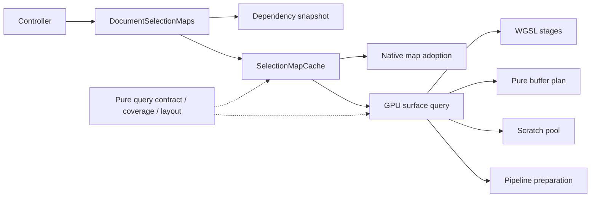

# Maintaining selection

Selection follows desktop SplatView's composited depth, opacity, raw-color and
contributing-source semantics. The GPU query feeds the existing native selection
core; the controller remains responsible for accepted commands and history.

## Module map

| Module | Responsibility |
| --- | --- |
| [surfaceQuery.ts](../../src/renderer/webgpu/surfaceQuery.ts) | Shared request/result types, dimensions, coverage validation, channel flags and the 48-byte shader parameter encoder. No device, shader import, cache or asynchronous work. |
| [surfaceCoverage.ts](../../src/renderer/webgpu/surfaceCoverage.ts) | Pure containment/union and conservative whole-stroke depth coverage in physical framebuffer coordinates. |
| [surfaceLayout.ts](../../src/renderer/webgpu/surfaceLayout.ts) | Pure compact tile-span planning and complete-prefix admission before allocation. |
| [surfaceBuffers.ts](../../src/renderer/webgpu/surfaceBuffers.ts) | Pure per-buffer sizes and separate retained CPU, host/upload scratch and physical GPU totals. Candidate bytes are admitted after counting. |
| [surfacePipelines.ts](../../src/renderer/webgpu/surfacePipelines.ts) | Renderer-keyed asynchronous compilation, shared in-flight preparation, lazy visibility and failure eviction. |
| [surfaceScratchPool.ts](../../src/renderer/webgpu/surfaceScratchPool.ts) | Device-buffer reuse, physical leases, bounded idle retention, pressure eviction and final disposal. |
| [surface.ts](../../src/renderer/webgpu/surface.ts) | One GPU query's allocation, count/scatter/sort/composite/readback sequence, cancellation checks, queue retirement and result publication. |
| [surface.wgsl](../../src/renderer/webgpu/surface.wgsl) | Projection and exact fragment calculations, conservative binning and GPU query stages. |
| [selectionMapCache.ts](../../src/document/selectionMapCache.ts) | Channel/coverage coalescing, immutable active/pending ownership, replacement and native-map retirement. |
| [selectionMaps.ts](../../src/app/selectionMaps.ts) | Production adapter: uses the dependency snapshot, prepares rendering, admits shared-ledger work, adopts native maps and isolates diagnostic observation. |
| [selectionMapSnapshot.ts](../../src/app/selectionMapSnapshot.ts) | App-owned capture of source/view/preview dependencies, cache-key encoding, currentness checks and immutable captured render inputs. No GPU/native work or cache lifecycle. |
| [controller.ts](../../src/app/controller.ts) | Gesture/command dispatch, eligible brush-region requests, scene changes and existing history ownership. |



Import directly from the module that owns a symbol. Shared types come from
`surfaceQuery.ts`; execution comes from `surface.ts`. Internal moves do not need
compatibility re-exports. Keep pure helpers free of renderer/worker dependencies.
Keep queue fences, cancellation and publication together in the query rather
than distributing their state among stage objects.

## Invariants to preserve

- The shader parameter block remains 48 bytes. Region coordinates are packed
  unsigned u16 values, maxima are exclusive, and scale is f32. Update the host
  encoder, WGSL and independent ABI test together if this contract changes.
  Tile size and channel bits must agree across the host and shader. Keep the
  browser oracle independent of the production encoder.
- `undefined` coverage means full coverage; an empty rectangle means no samples.
  Published and submitted coverage is immutable. Full maps can serve partial
  requests; partial maps cannot satisfy larger/full requests. Color and global
  visibility always require full coverage.
- Published map dimensions, coverage, channel references and accounting/profile
  metadata are readonly to TypeScript borrowers. This does not freeze or copy
  channel typed arrays. The negative guards in `tests/surface-query.types.ts`
  are compiled by typecheck/build; Vitest alone does not check those guards.
- Capture dependency keys, currentness checks and render inputs together in the
  app snapshot. Keep intentional exclusions explicit: display grading and
  ordinary mask changes do not invalidate unrestricted raw maps. Test new
  dependencies with both key/rebuild and retained-currentness assertions.
- Only non-visible-only 3D-brush depth queries use restricted coverage. Bound
  every stroke endpoint before clipping, include the native interpolation halo,
  and retain full native map dimensions. Ambiguous inputs use full coverage.
- Preserve every accepted fragment and stable compositing order. Bounds may
  remove impossible candidates; they must not change alpha, transmittance,
  depth, color, visibility or native membership.
- Every physical scratch buffer retains its own ledger credit, including while
  idle. Reuse requires the same owner, size and usage, unmapped state and fully
  retired GPU work. Clear counters/padding/visibility/partial outputs as needed.
  Idle retention is capped at 16 MiB / 32 buffers. Pressure can evict idle work;
  busy credit stays live until retirement. Failed/cancelled work is discarded.
- Buffer plans separate retained CPU outputs, temporary host/queued-upload
  copies and physical GPU scratch. Pooled physical buffers have independent
  leases; fresh queries admit both host and physical scratch. Add candidate
  storage only after the complete count plan is known. A size-plan edit must
  preserve all three categories, dummy bindings and channel-specific buffers.
- Cache/native map bytes are not history bytes. Adoption and replacement retain
  the current native/controller/history owners. Observer exceptions cannot
  affect selection ownership or results.

## Focused validation

Use the repository's pinned Node/toolchain setup described in the root README.
The CPU lane covers query encoding, independent buffer accounting, geometry,
compact layout, compilation/pool lifecycle, dependency snapshots, cache
coverage and native-adoption admission:

```sh
npm run typecheck
npm run test:selection
npm run test:selection:e2e
```

The browser command runs the maintained 126-case cohort in
[playwright.selection.config.ts](../../playwright.selection.config.ts). It reuses
the base browser/security/worker policy and starts or reuses the development
server. Each spec retains its separate project identity, so browser workers
retire between specs. Fill, Connected Color and Volume use their reviewed
controller-boundary filters; the surface, opacity, cache, optimization and Basic
journeys run in full. There are zero automatic retries.

Narrow the cohort during development without changing its configuration:

```sh
npm run test:selection:e2e -- --project=spec:surface-bounds.spec.ts
npm run test:selection:e2e -- --project=spec:selection-interaction.spec.ts
npm run test:selection -- --reporter=verbose
```

Run the full CPU suite for changes outside this lane, and retain the normal
source/product/native/build checks. `npm run build` verifies pinned inputs,
both TypeScript projects and emitted artifacts. Test the production preview
after building; development tests alone do not qualify the production bundle.
Do not rebuild or change imported sources while a development-browser cohort
runs: generated build identity or HMR updates can reload its pages mid-test.

Browser/GPU results qualify the observed environment. The local evidence and
earlier optimization measurements are linked from the
[current DX review](../../design/feature-reviews/selection-dx-review-2026-10-18.md),
[module refactor](../../design/feature-reviews/selection-modularity-2026-10-18.md)
and [optimization review](../../design/feature-reviews/selection-interaction-optimization-2026-10-18.md).
